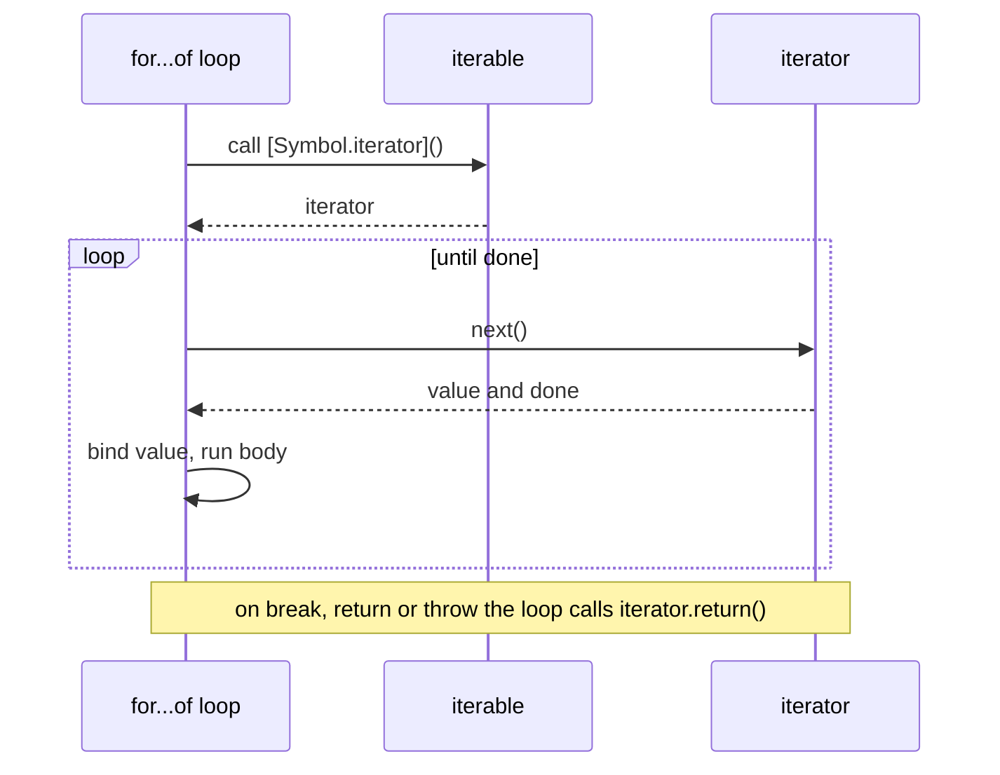

## Introduction

The classic `for (let i = 0; i < arr.length; i++)` loop, covered in [[b1-for-loops]], works by counting indexes. Most of the time you do not care about the index; you want "each item". And many things you want to loop over do not have indexes at all — a `Set` of user IDs, a `Map` from product to price, the characters of a string, the keys of a configuration object.

JavaScript has two loop statements for this, and their names differ by one word:

```javascript title="of-vs-in.js"
const colors = ['red', 'green', 'blue'];

for (const value of colors) {
  console.log('of:', value);
}
for (const key in colors) {
  console.log('in:', key, typeof key);
}
```

```output
of: red
of: green
of: blue
in: 0 string
in: 1 string
in: 2 string
```

- **`for...of`** (added in ES2015) gives you the **values** that a collection produces: `'red'`, `'green'`, `'blue'`.
- **`for...in`** (in the language since the beginning) gives you the **keys** — the property names — of an object. For an array those are the indexes, and they are **strings**, not numbers.

The difference is not cosmetic. The two loops rely on completely different mechanisms. `for...of` asks the object for an **iterator** and pulls values from it. `for...in` lists the object's **enumerable properties**, walks up its **prototype chain**, and includes inherited properties too. Mixing them up produces bugs that pass simple tests and fail in production — `'0' + 1` giving `'01'`, or a library's extra property showing up as an array element.

By the end of this lesson you will know which loop to use for arrays, strings, `Map`s, `Set`s and plain objects, why, and what each one does under the hood.

## Before you start

- **Classic loops** — `for`, `while`, and how `let` creates per-iteration bindings. See [[b1-for-loops]].
- **Objects and properties** — what a property key is. See [[b1-objects-as-values]].
- **Prototypes** — objects inherit properties from their prototype. See [[b1-prototypes]] and [[b1-prototype-chain]]; you need only the idea that an object can see properties it does not own.
- **Destructuring** — `const [a, b] = pair` and `const { x } = obj`, used in loop heads. See [[b1-destructuring]].

## The intuition

Imagine a filing cabinet.

`for...in` is an inventory clerk who reads the **labels on the drawers**: "drawer 0, drawer 1, drawer 2, and — oh — this cabinet came from a factory that added a drawer labelled 'warranty', so that one too". The clerk reports labels, not contents, and includes drawers inherited from the factory design unless told not to.

`for...of` is someone who asks the cabinet to **hand over its contents one at a time**. The cabinet decides what "its contents" means and in what order — an array hands over its elements, a `Map` hands over key–value pairs, a string hands over characters. If the cabinet does not know how to hand things over, you get an error rather than a guess.

The analogy holds in one more respect: the clerk works with any object, because every object has labels. The hand-over only works with objects that implement it — **iterables** — which is why `for...of` on a plain object throws.

## for...of: iterating values

### Syntax and what it works on

```text
for ( declaration of iterable ) statement
```

On each iteration, the next value from `iterable` is assigned to the declared variable and the body runs. The declaration is usually `const`, because each iteration declares a **new** variable rather than updating an old one — unlike the classic `for` loop's counter, nothing needs to be reassigned. (`let` also works if you want to reassign the variable inside the body.)

`for...of` works on any **iterable**. Built-in iterables include:

| Iterable | What each iteration gives you |
|---|---|
| Array, typed array (`Uint8Array`…) | Each element, in index order |
| String | Each Unicode **code point** (not each UTF-16 unit) |
| `Map` | A `[key, value]` array per entry, in insertion order |
| `Set` | Each value, in insertion order |
| `arguments` | Each argument passed to the function |
| DOM collections (`NodeList`, `HTMLCollection`) in browsers | Each node or element |
| Generator objects | Each yielded value ([[b1-iterators]]) |
| `arr.entries()`, `map.keys()`, `Object.entries(obj)` … | Whatever that iterator or array yields |

```javascript title="for-of-tour.js"
for (const ch of 'hey') console.log('char', ch);

const prices = new Map([['apple', 1.2], ['bread', 2.5]]);
for (const [item, price] of prices) console.log(item, price);

const tags = new Set(['js', 'css', 'js']);    // duplicates are dropped by the Set
for (const tag of tags) console.log('tag', tag);

function logAll() {
  for (const arg of arguments) console.log('arg', arg);
}
logAll('x', 'y');

for (const byte of new Uint8Array([7, 255])) console.log('byte', byte);
```

```output
char h
char e
char y
apple 1.2
bread 2.5
tag js
tag css
arg x
arg y
byte 7
byte 255
```

The `Map` line shows **destructuring in the loop head**. Each value a `Map` yields is a two-element array, and `const [item, price]` unpacks it. This is the idiomatic way to walk a `Map`. (DOM collections such as the result of `document.querySelectorAll` are iterable in all modern browsers; that example is not run here because Node.js has no DOM.)

### When you also need the index

`for...of` does not give you the index. When you need it, iterate `arr.entries()`, which yields `[index, value]` pairs:

```javascript title="entries.js"
const steps = ['install', 'build', 'deploy'];
for (const [i, step] of steps.entries()) {
  console.log(`${i + 1}. ${step}`);
}
```

```output
1. install
2. build
3. deploy
```

Here `i` is a real number, so `i + 1` is arithmetic, not string concatenation. If you need to skip around, go backwards or compare neighbouring elements, a classic indexed `for` loop is still the right tool.

### Plain objects are not iterable

A plain object `{ … }` does not implement the iteration protocol, so `for...of` refuses it:

```javascript title="object-not-iterable.js"
const config = { theme: 'dark', fontSize: 14 };
try {
  for (const x of config) console.log(x);
} catch (err) {
  console.log(`${err.name}: ${err.message}`);
}

for (const [key, value] of Object.entries(config)) {
  console.log(key, '=', value);
}
```

```output
TypeError: config is not iterable
theme = dark
fontSize = 14
```

This is a deliberate design decision. An object is a bag of named properties, and it is not obvious whether "iterating" it should mean keys, values or pairs, or whether inherited properties count. So the language makes you say which: `Object.keys(obj)` for own enumerable string keys, `Object.values(obj)` for their values, and `Object.entries(obj)` for `[key, value]` pairs. Each returns an ordinary array, which `for...of` can walk.

### Strings iterate by code point

Strings in JavaScript are sequences of UTF-16 code units, and characters outside the Basic Multilingual Plane — most emoji, for example — take **two** units, called a surrogate pair ([[b1-unicode-strings]]). Indexing with `str[i]` sees the halves separately; `for...of` uses the string's iterator, which combines each pair into one **code point**:

```javascript title="string-iteration.js"
const s = 'a😀';
console.log('length:', s.length);
for (let i = 0; i < s.length; i++) console.log('index', i, JSON.stringify(s[i]));
for (const ch of s) console.log('of', ch);
```

```output
length: 3
index 0 "a"
index 1 "\ud83d"
index 2 "\ude00"
of a
of 😀
```

The indexed loop produced two broken halves of the emoji; `for...of` produced the emoji whole. Code points are still not the same as what a user perceives as one character: `'👍🏽'` (a thumbs-up with a skin-tone modifier) is two code points, so `for...of` yields two pieces. For user-perceived characters, use `Intl.Segmenter` with `granularity: 'grapheme'`.

## How for...of works: the iteration protocol

`for...of` is not special-cased for arrays. It follows a small contract called the **iteration protocol**, and any object that follows it can be looped over.

1. An object is **iterable** if it has a method under the well-known symbol key `Symbol.iterator`.
2. Calling that method returns an **iterator**: an object with a `next()` method.
3. Each call to `next()` returns a **result object** `{ value, done }`. While `done` is `false`, `value` is the next item. When `done` is `true`, iteration is over.
4. If the loop stops early — by `break`, `return` or a thrown error — it calls the iterator's optional **`return()`** method, so the iterator can clean up.

So `for (const x of iterable) body` behaves roughly like this:

```javascript title="desugared.js"
const iterable = ['a', 'b'];

const iterator = iterable[Symbol.iterator]();
while (true) {
  const result = iterator.next();
  if (result.done) break;
  const x = result.value;
  console.log(x);                // the loop body
}
```

```output
a
b
```

(The real algorithm also handles calling `return()` on early exit, and creates a fresh binding for `x` on every iteration.)



### Making your own object iterable

Because the protocol is just methods, you can make any object work with `for...of` — and with everything else built on the protocol: spread `[...x]`, `Array.from(x)`, array destructuring, `new Set(x)`, `Promise.all(x)`.

```javascript title="custom-iterable.js"
const range = {
  from: 1,
  to: 4,
  [Symbol.iterator]() {
    let current = this.from;
    const last = this.to;
    return {
      next() {
        return current <= last
          ? { value: current++, done: false }
          : { value: undefined, done: true };
      },
      return() {
        console.log('  (iterator closed early)');
        return { value: undefined, done: true };
      },
    };
  },
};

for (const n of range) {
  console.log('n =', n);
  if (n === 2) break;          // triggers return()
}
console.log([...range]);       // spread uses the same protocol
```

```output
n = 1
n = 2
  (iterator closed early)
[ 1, 2, 3, 4 ]
```

The `break` caused the loop to call `return()`. Spreading the range ran it to completion, so `return()` was not needed and not called. Each use called `[Symbol.iterator]()` again and got a fresh iterator, which is why the spread started from 1.

Generators are the easy way to write iterators: a `function*` returns an object that is both an iterator and iterable, and a `finally` block in the generator runs when the loop exits early — which makes generators a natural fit for resources that need cleanup:

```javascript title="generator-cleanup.js"
function* lines() {
  console.log('open file');
  try {
    yield 'line 1';
    yield 'line 2';
    yield 'line 3';
  } finally {
    console.log('close file');   // runs even if the consumer stops early
  }
}

for (const line of lines()) {
  console.log(line);
  if (line === 'line 2') break;
}
```

```output
open file
line 1
line 2
close file
```

Generators and iterators are taught fully in [[b1-iterators]]. For asynchronous sources — a stream, paginated API results — there is a sibling loop, `for await...of`, which awaits each value; it builds on [[b1-async-await]].

### Mutating while iterating

Iterators over arrays, `Map`s and `Set`s are **live**: they read the collection as it is at each `next()` call, not a snapshot taken at the start. An array iterator keeps an index and checks it against the current `length`, so pushing elements during the loop extends the loop — and pushing on every iteration never ends:

```javascript title="live-iteration.js"
const queue = ['a'];
for (const job of queue) {
  console.log('run', job);
  if (job === 'a') queue.push('b');   // seen by the same loop
  if (job === 'b') queue.push('c');
}

const seen = new Map([['x', 1]]);
for (const [key] of seen) {
  console.log('visit', key);
  if (seen.size < 3) seen.set(`added${seen.size}`, 0);
}
```

```output
run a
run b
run c
visit x
visit added1
visit added2
```

Occasionally this is useful (a simple work queue), but usually it is a bug waiting to happen. If you need to modify a collection based on its contents, iterate over a copy (`for (const x of [...arr])`) or build a new collection.

## for...in: enumerating keys

### Syntax and the exact rules

```text
for ( declaration in object ) statement
```

`for...in` visits property **keys**, assigning each to the variable in turn. Exactly which keys:

1. **String keys only.** Symbol-keyed properties are skipped. Array indexes come out as strings: `'0'`, `'1'`.
2. **Enumerable properties only.** A property is enumerable if its `enumerable` attribute is `true` ([[b1-property-descriptors]]). Properties created by assignment or object literals are enumerable. Built-in methods (`Array.prototype.map`, `Object.prototype.toString`), an array's `length`, and class methods are not, which is why they normally do not appear.
3. **Own and inherited.** After an object's own properties, `for...in` walks up the prototype chain and visits enumerable properties of each prototype, skipping any key it has already seen (a shadowed property is visited once).

```javascript title="for-in-rules.js"
const defaults = { theme: 'light', 1: 'from prototype' };
const settings = Object.create(defaults);    // settings inherits from defaults
settings.fontSize = 14;
settings[Symbol('internal')] = 'skipped';
settings[2] = 'two';
settings.language = 'en';
Object.defineProperty(settings, 'secret', { value: 'x', enumerable: false });

for (const key in settings) {
  console.log(key, Object.hasOwn(settings, key) ? '(own)' : '(inherited)');
}
console.log('Object.keys:', Object.keys(settings));
```

```output
2 (own)
fontSize (own)
language (own)
1 (inherited)
theme (inherited)
Object.keys: [ '2', 'fontSize', 'language' ]
```

Every rule is visible. The symbol key and the non-enumerable `secret` are skipped. The inherited `theme` and `1` appear after the own keys. And `Object.keys` returns only own enumerable string keys — no inheritance — which is usually what you actually wanted.

### Order of keys

For ordinary objects, the order of **own** keys is defined by the specification: first **integer-like keys** (`'0'`, `'2'`, `'10'`) in ascending numeric order, then other string keys in the order they were **created**. That is why `'2'` came before `'fontSize'` above even though it was added later. `Object.keys`, `Object.entries` and `JSON.stringify` follow the same order.

Before ES2020, the order `for...in` used was left to engines. The ES2020 specification pinned it down for the common case — own keys in the order above, then each prototype's keys in turn — provided nothing unusual happens during the loop: no proxies, no prototype changes, and no properties added to or deleted from the objects being walked. In practice, all major engines agree. But if you need a guaranteed order, the clearer approach is to make it explicit: iterate `Object.keys(obj)` (or a `Map`, which always keeps insertion order).

### Modifying an object during for...in

The specification gives one guarantee and leaves the rest open: a property **deleted before it is visited is not visited**; a property **added during** the loop may or may not be visited. So it is safe to delete the current key, and you should not rely on anything else.

```javascript title="for-in-delete.js"
const flags = { a: true, b: false, c: true };
for (const key in flags) {
  console.log('visit', key);
  if (key === 'a') delete flags.b;   // b was not visited yet, so it is skipped
}
```

```output
visit a
visit c
```

### Filtering inherited properties

If you do use `for...in`, guard it with **`Object.hasOwn`** (ES2022) to skip inherited keys:

```javascript title="has-own.js"
const base = { inheritedFlag: true };
const options = Object.create(base);
options.retries = 3;

for (const key in options) {
  if (!Object.hasOwn(options, key)) continue;
  console.log(key, options[key]);
}
```

```output
retries 3
```

Older code uses `obj.hasOwnProperty(key)` or `Object.prototype.hasOwnProperty.call(obj, key)`. `Object.hasOwn` is preferred because it also works for objects with no prototype (`Object.create(null)`) and objects that define their own `hasOwnProperty`.

## Why for...in is wrong for arrays

`for...in` treats an array as an object with string keys. That causes four distinct problems:

```javascript title="for-in-arrays.js"
const scores = [10, 20];
scores.label = 'Round 1';          // arrays are objects; extra properties are allowed

// Problem 1 and 2: extra properties appear, and keys are strings.
for (const i in scores) {
  console.log(i, '->', i + 1);
}

// Problem 3: holes are skipped by for...in but visited by for...of.
const sparse = [1, , 3];
for (const i in sparse) console.log('in visits', i);
for (const v of sparse) console.log('of visits', v);

// Problem 4: anything added to Array.prototype (old polyfills, careless libraries) leaks in.
Array.prototype.last = function () { return this[this.length - 1]; };
for (const i in [5]) console.log('prototype leak:', i);
delete Array.prototype.last;
```

```output
0 -> 01
1 -> 11
label -> label1
in visits 0
in visits 2
of visits 1
of visits undefined
of visits 3
prototype leak: 0
prototype leak: last
```

1. **Keys are strings.** `i + 1` concatenates: `'0' + 1` is `'01'`. Any index arithmetic silently becomes string building.
2. **Non-index properties appear.** Arrays are objects, so code (or a library) can attach properties such as `label`, and `for...in` lists them as if they were elements. Built-in APIs do this too: the array returned by `'abc'.match(/b/)` has own enumerable `index`, `input` and `groups` properties, so `for...in` over it visits `'0'`, `'index'`, `'input'` and `'groups'`.
3. **Holes behave differently.** A sparse array's missing indexes are not properties, so `for...in` skips them, while `for...of` yields `undefined` for them. Neither is wrong, but code written for one breaks with the other.
4. **Inherited enumerable properties leak in.** Assigning a method to `Array.prototype` creates an enumerable property, and every `for...in` over every array in the program now visits it. Modern libraries avoid this (and define methods as non-enumerable), but the risk is the reason the rule exists.

The rule is simple: **use `for...of` (or a classic `for`, or an array method) for arrays; never `for...in`.**

## How it works internally

`for...of` evaluates the expression after `of`, calls `GetIterator` on it — which looks up `Symbol.iterator` and throws `TypeError: … is not iterable` if it is missing — and then repeatedly calls `next()`. When the body completes abruptly with `break`, `return` or a `throw`, the loop calls `IteratorClose`, which invokes `return()` if the iterator has one. A `continue` simply moves on to the next `next()` call. For arrays, engines such as V8 recognise the built-in array iterator, and their optimising compilers can inline it so that no `{ value, done }` object is actually allocated per element; that is why `for...of` over an array is fast in modern engines, as long as no one has replaced `Array.prototype[Symbol.iterator]`.

`for...in` evaluates the expression after `in`; if the result is `null` or `undefined`, the loop runs zero times (it does *not* throw). Otherwise it converts the value to an object and runs the specification's `EnumerateObjectProperties`, which gathers own enumerable string keys and then those of each prototype, skipping duplicates and properties deleted before they are reached. Because the work involves walking the prototype chain and filtering by attributes, engines cache the key list for objects of the same shape. It is still generally slower than `Object.keys`, and slower to read, which is another reason to prefer the `Object` methods.

| | `for...of` | `for...in` |
|---|---|---|
| Walks | Values from an iterator | Enumerable string keys |
| Works on | Iterables only (throws otherwise) | Any value (zero iterations for `null`/`undefined`) |
| Inherited properties | Not applicable | Included |
| Symbol keys | Not applicable | Skipped |
| Array holes | Yields `undefined` | Skipped |
| Order | Defined by the iterator | Integer keys ascending, then creation order, then prototypes |
| Early exit cleanup | Calls `iterator.return()` | None needed |

## Worked example: summarising an order

Here is a realistic task that uses the right loop for each structure: an order with line items (an array), a catalogue of prices (a `Map`), and a plain object of applied adjustments.

```javascript title="order-summary.js"
const catalogue = new Map([
  ['sku-1', { name: 'Notebook', price: 4.5 }],
  ['sku-2', { name: 'Pen', price: 1.25 }],
  ['sku-3', { name: 'Backpack', price: 39 }],
]);

const order = {
  lines: [
    { sku: 'sku-1', qty: 3 },
    { sku: 'sku-3', qty: 1 },
    { sku: 'sku-9', qty: 2 },          // not in the catalogue
  ],
  adjustments: { coupon: -5, shipping: 3.99 },
};

function summarise(order, catalogue) {
  let subtotal = 0;
  const problems = [];

  // Array: we need values and a human-readable position, so iterate entries().
  for (const [i, line] of order.lines.entries()) {
    const product = catalogue.get(line.sku);
    if (product === undefined) {
      problems.push(`line ${i + 1}: unknown SKU ${line.sku}`);
      continue;
    }
    subtotal += product.price * line.qty;
  }

  // Plain object: we want its own values only, so use Object.values.
  let total = subtotal;
  for (const amount of Object.values(order.adjustments)) {
    total += amount;
  }

  return { subtotal, total: Math.round(total * 100) / 100, problems };
}

console.log(summarise(order, catalogue));

// Map: list the catalogue, destructuring each [key, value] entry.
for (const [sku, { name, price }] of catalogue) {
  console.log(`${sku}: ${name} at ${price.toFixed(2)}`);
}
```

```output
{
  subtotal: 52.5,
  total: 51.49,
  problems: [ 'line 3: unknown SKU sku-9' ]
}
sku-1: Notebook at 4.50
sku-2: Pen at 1.25
sku-3: Backpack at 39.00
```

Why each choice:

- **Line items** are an array of values, and the error message needs a position, so `for...of` over `lines.entries()` gives both, with `i` as a real number.
- **Adjustments** are a plain object. `Object.values` gives its own values in a defined order and ignores anything inherited; `Object.entries` would be the choice if the reasons (`coupon`, `shipping`) were needed too. A `for...in` would also work, but would need an `Object.hasOwn` guard to be equally safe.
- **The catalogue** is a `Map`, which is directly iterable; nested destructuring `[sku, { name, price }]` unpacks both the entry and the product.
- `continue` skips a bad line without nesting the rest of the body in an `else` ([[b1-break-continue]]).

## In real systems

**DOM work.** `for (const button of document.querySelectorAll('button'))` is the modern way to attach behaviour to many elements. (Old code converted `NodeList`s to arrays first, because they were not iterable in older browsers.)

**Configuration and serialisation.** Walking a JSON-derived object — environment settings, a feature-flag payload, form field errors keyed by field name — uses `Object.entries` in a `for...of`. Because JSON objects have `Object.prototype` as their prototype, the inherited-key concern only arises if something has polluted that prototype ([[b1-prototype-pollution]]), which is a reason security-conscious code avoids `for...in` on untrusted data.

**Data structures.** `Map` and `Set` are increasingly used instead of plain objects for lookups because they iterate in insertion order and directly with `for...of`, and accept non-string keys ([[b1-map]], [[b1-set]]).

**Streams.** In Node.js, readable streams are async iterables, so `for await (const chunk of stream)` reads a file or HTTP body chunk by chunk, with the iterator's `return()` closing the stream if the loop exits early.

## Trade-offs and alternatives

| Task | Best choice | Why |
|---|---|---|
| Each element of an array | `for (const x of arr)` | Values, real `break`/`continue`/`await` |
| Element and index | `for (const [i, x] of arr.entries())` or classic `for` | Numeric index without string keys |
| Transform or filter an array | `map` / `filter` | Expresses intent, returns a new array |
| Own keys/values of an object | `Object.keys` / `values` / `entries` + `for...of` | No inherited keys, defined order |
| Entries of a `Map`, values of a `Set` | `for (const [k, v] of map)` / `for (const v of set)` | Directly iterable, insertion order |
| Inherited enumerable keys on purpose | `for...in` | The only loop that walks the prototype chain |

`forEach` is a fine alternative to `for...of` when you neither need to stop early nor `await` inside the body. `for...in` has one genuine niche — deliberately including inherited enumerable properties, such as merging a defaults object created with `Object.create` — and almost everything else is better served by the `Object` methods.

## Common mistakes

> [!MISTAKE] Using for...in on an array
> It yields string indexes (so `i + 1` concatenates), includes non-index and inherited enumerable properties, and skips holes. Use `for...of`, `arr.entries()`, a classic `for`, or an array method.

**Using `for...of` on a plain object.** It throws `TypeError: … is not iterable`. Use `Object.entries(obj)` (or `keys`/`values`).

**Forgetting that `for...in` includes inherited properties.** Guard with `Object.hasOwn`, or switch to `Object.keys`.

**Expecting `for...in` keys to be numbers.** They are always strings. Convert with `Number(key)` if needed, or better, do not use `for...in` for numeric data.

**Iterating a `Map` and expecting values.** `for (const x of map)` yields `[key, value]` arrays. Destructure, or iterate `map.values()` when you only want values.

**Assuming a string loop yields user-perceived characters.** `for...of` yields code points; emoji with modifiers or combining accents can span several. Use `Intl.Segmenter` for graphemes.

**Pushing to the array you are iterating.** Array iterators are live; each push extends the loop. Iterate a copy if you must add elements.

## Interview perspective

> [!INTERVIEW] What a strong answer sounds like
> "`for...of` uses the iteration protocol — it calls `[Symbol.iterator]()` and pulls values with `next()` until `done` — so it works on arrays, strings, `Map`s and `Set`s, and throws on plain objects. `for...in` enumerates enumerable string keys, own and inherited, so for arrays it gives string indexes plus any extra or inherited enumerable properties. I use `for...of` for iterables and `Object.entries` for objects."

Questions to expect:

- **What is printed?** A `for...in` over an array with an extra property or a prototype method, or `i + 1` on a `for...in` key. Answer: string keys, extra properties included.
- **How do you make an object usable with `for...of`?** Implement `[Symbol.iterator]` returning an object with `next()`, or write it as a generator method `*[Symbol.iterator]() { … }`.
- **What happens on `break` in a `for...of`?** The loop calls the iterator's `return()`; for a generator, its `finally` blocks run.
- **Why are plain objects not iterable?** There is no single obvious meaning (keys, values, entries, own or inherited); the `Object` methods make you choose.
- **In what order does `for...in` visit keys?** Own integer-like keys ascending, then own string keys in creation order, then the prototype's keys, skipping duplicates; specified since ES2020 for ordinary cases.

## Practice

1. **Predict.** For `const a = [3, 4]; a.x = 5;`, write down what `for...in` and `for...of` each log, and what `Object.keys(a)` returns.
2. **Fix it.** `function total(arr) { let t = 0; for (const i in arr) t += arr[i + 1] ?? 0; return t; }` is meant to sum all but the first element. Explain the bug and rewrite it with `for...of`.
3. **Make it iterable.** Write a `Countdown` class whose instances can be used as `for (const n of new Countdown(3))`, yielding 3, 2, 1. Write it once with an explicit `next()` and once with a generator.
4. **Objects.** Given `const prefs = Object.create({ theme: 'dark' }); prefs.lang = 'en';`, print only own preferences two ways: `for...in` with a guard, and `Object.entries`.
5. **Characters.** Count the user-perceived characters in `'café 👩🏽‍💻'` with `for...of`, then with `Intl.Segmenter`, and explain the difference.

```quiz
Q: What does `for (const i in ['a', 'b']) console.log(i + 1)` print?
- [ ] `1` then `2`
- [x] `01` then `11`
- [ ] `a1` then `b1`
- [ ] It throws because arrays are not enumerable
> `for...in` yields property keys, and property keys are strings, so `i` is `'0'` and then `'1'`. Adding 1 to a string concatenates, giving `'01'` and `'11'`. Use `for...of` with `entries()` or a classic `for` loop when you need numeric indexes.

Q: Why does `for (const x of { a: 1 })` throw a TypeError?
- [ ] Because `const` cannot be used in a `for...of` loop
- [ ] Because the object has only one property
- [x] Because plain objects do not have a `Symbol.iterator` method, so they are not iterable
- [ ] Because `for...of` only works on arrays
> `for...of` starts by calling the value's `[Symbol.iterator]()` method. Plain objects do not have one, so the loop throws `TypeError: ... is not iterable`. Strings, Maps, Sets and many other non-array values do implement it, so the restriction is "iterables", not "arrays".

Q: An object `child` is created with `Object.create({ inherited: 1 })` and given an own property `own: 2`. What does `for (const k in child)` visit?
- [ ] Only `own`
- [x] `own` and then `inherited`
- [ ] Only `inherited`
- [ ] Nothing, because `Object.create` objects are not enumerable
> `for...in` visits enumerable string keys of the object and then of every object on its prototype chain. `inherited` is an ordinary enumerable property on the prototype, so it is included after the own key. `Object.keys(child)` would return only `['own']`.

Q: A `for...of` loop over a generator object hits `break`. What happens to a `finally` block inside the generator?
- [ ] It never runs, because the generator was not finished
- [x] It runs, because the loop calls the iterator's `return()` method on early exit
- [ ] It runs the next time the generator is iterated
- [ ] It runs only if the loop used `continue` instead
> On early exit, `for...of` calls `return()` on the iterator. For a generator, `return()` resumes it as if a `return` statement occurred at the paused `yield`, so its `finally` blocks run. This is how generators clean up resources such as open files.
```

## Quick revision {#quick-revision}

- `for (const v of iterable)` → **values**; `for (const k in object)` → **enumerable string keys**, own then inherited.
- Iterables: arrays, typed arrays, strings (by code point), `Map` (`[key, value]`), `Set`, `arguments`, DOM collections, generators. Plain objects are not iterable → `TypeError`.
- Protocol: `obj[Symbol.iterator]()` → iterator; `next()` → `{ value, done }`; early exit calls `return()`.
- Index with values: `for (const [i, v] of arr.entries())`. Map: `for (const [k, v] of map)`. Objects: `Object.keys/values/entries`.
- `const` works in `for...of` and `for...in` (new binding per iteration).
- `for...in` skips symbols and non-enumerable properties; keys are strings; includes inherited enumerable keys → guard with `Object.hasOwn` or use `Object.keys`.
- Key order: integer-like keys ascending, then string keys in creation order, then prototype keys (pinned down in ES2020 for ordinary cases).
- `for...in` on arrays: string indexes, extra/inherited properties, skips holes → never use it for arrays.
- `for...in` over `null`/`undefined` runs zero times; `for...of` over them throws.
- Array/Map/Set iterators are live: additions during the loop are visited.
- Deleting an unvisited key during `for...in` means it is not visited; added keys are not guaranteed.

## Key takeaways {#key-takeaways}

- `for...of` asks an object for its values through the iteration protocol; `for...in` lists an object's enumerable property names, including inherited ones.
- Use `for...of` for arrays, strings, `Map`s and `Set`s; use `Object.entries` (or `keys`/`values`) with `for...of` for plain objects.
- `for...in` keys are always strings, and the loop walks the prototype chain — the two facts behind nearly every `for...in` bug.
- Any object can become iterable by implementing `Symbol.iterator`, and generators make that easy, including cleanup on early exit.
- Strings iterate by code point, which fixes surrogate pairs but is still not the same as user-perceived characters.
