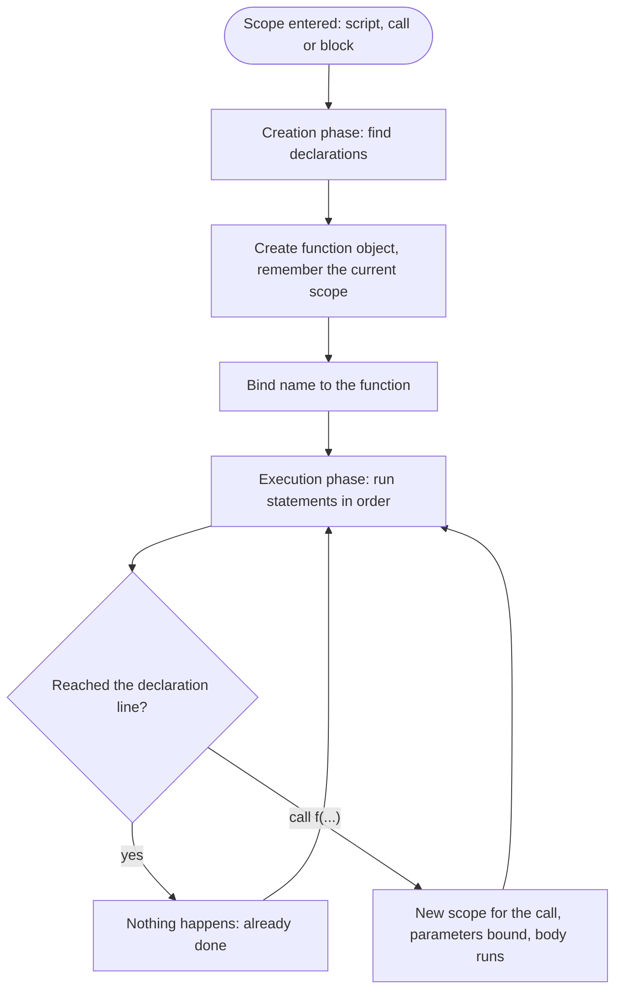

## Introduction

Almost every program repeats work. A shop computes a price with tax for every item in a cart, a form validates every field the same way, a game updates every enemy on every frame. You could copy the same lines each time, but then a bug in the calculation has to be fixed in every copy, and the code says *how* something is done everywhere instead of *what* is being done.

A **function** solves this. It packages a piece of work under a name, takes inputs, and hands back a result. Write the work once, then **call** the function wherever it is needed. When the calculation changes, you change one place.

JavaScript has several ways to create a function. The oldest and most direct is the **function declaration**:

```javascript
function area(width, height) {
  return width * height;
}

console.log(area(3, 4));
console.log(area(10, 2));
```

```output
12
20
```

A function declaration is a *statement* that starts with the keyword `function`, gives the function a name, and binds that name in the surrounding scope. That last part — the binding is created when the scope is set up, not when the line runs — is what makes declarations behave differently from the other forms, and most of this lesson is about understanding it precisely.

You will meet declarations constantly: as top-level helpers in scripts and modules, as the components of older React code (`function App() { … }`), and as utility functions in Node.js. They are also the starting point for everything else in this module — [[b1-function-expression]], [[b1-arrow-functions]], [[b1-parameters]] and [[b1-first-class-functions]] all build on the vocabulary introduced here.

## Before you start

- **Statements vs expressions** — a declaration is a statement; the expression forms of functions are taught next. See [[b1-statements-expressions]].
- **Variables and scope** — functions create their own scope, and the declaration binds a name in the enclosing one. See [[b1-variables]] and [[b1-scope]].
- **Strict mode** — some rules below differ between strict and sloppy code. See [[b1-strict-mode]].

You do not need to know hoisting in depth; this lesson explains the part that matters for functions and links to [[b1-hoisting]] for the full picture.

## The intuition

Think of a recipe card in a kitchen. The card has a title ("Pancakes"), a list of ingredients it expects you to bring (flour, eggs, milk), and the steps. Writing the card does not cook anything. Cooking happens each time someone *follows* the card with real ingredients, and each time they get a fresh batch of pancakes.

A function declaration is the recipe card. The **name** is the title, the **parameters** are the ingredient list, the **body** is the steps, and the **return value** is the dish handed back. Calling the function is following the card.

The part where the analogy is most useful is this: before service starts, the kitchen pins *every* recipe card in the room on the wall. Whatever order the cards were written in, a cook can use any of them from the first minute. That is how function declarations behave — all of them in a scope are ready before any line of that scope runs. The analogy stops working in one place: the "room" is a scope, and as you will see, a card pinned inside a block may or may not be visible outside it, depending on strict mode.

## Anatomy of a function declaration

```javascript
function formatPrice(amount, currency) {
  const rounded = amount.toFixed(2);
  return `${currency} ${rounded}`;
}

console.log(formatPrice(9.5, 'USD'));
```

```output
USD 9.50
```

Each part has a job:

| Part | In the example | What it does |
|---|---|---|
| `function` keyword | `function` | Marks the statement as a function declaration |
| Name | `formatPrice` | Creates a binding in the enclosing scope that holds the function |
| Parameter list | `(amount, currency)` | Local variables that receive the arguments of each call |
| Body | `{ … }` | Statements that run on every call; has its own scope |
| `return` statement | `return \`${currency} ${rounded}\`` | Ends the call and hands a value back to the caller |

Two words are easy to mix up. **Parameters** are the names in the definition (`amount`, `currency`). **Arguments** are the actual values passed at a call (`9.5`, `'USD'`). Parameters are covered fully — defaults, rest parameters and the `arguments` object — in [[b1-parameters]].

The name is required. `function (a, b) { … }` on its own as a statement is a `SyntaxError`, because a declaration's whole purpose is to bind a name. (The single exception is `export default function () {}` in a module, where the export itself provides the binding.) A nameless `function` is only legal where an *expression* is expected, which is the subject of [[b1-function-expression]].

## Calling a function and returning a value

Writing `formatPrice(9.5, 'USD')` is a **call**. Three things happen:

1. The arguments are evaluated, left to right.
2. The engine creates a fresh scope for this call, binds each parameter to the matching argument, and runs the body from the top.
3. When execution reaches a `return` statement, the call ends immediately and the call expression evaluates to the returned value.

If the body finishes without reaching `return`, or reaches a bare `return;`, the call returns `undefined`. This is not an error — it is the normal result of a function that does something rather than computes something.

```javascript
function logGreeting(name) {
  console.log(`Hello, ${name}`);
  // no return statement
}

function firstNegative(numbers) {
  for (const n of numbers) {
    if (n < 0) return n;     // leaves the loop and the function at once
  }
  return null;               // an explicit "nothing found"
}

const result = logGreeting('Ada');
console.log(result);
console.log(firstNegative([4, -2, -7]));
console.log(firstNegative([1, 2]));
```

```output
Hello, Ada
undefined
-2
null
```

`firstNegative` shows why `return` is useful beyond producing a value: it stops the loop and the function in one step, so there is no need for a `found` flag. It also shows a design choice. Returning `null` on purpose says "I looked and found nothing", which is clearer to a caller than falling off the end and returning `undefined`. See [[b1-undefined-vs-null]] for that distinction.

Each call gets its own fresh set of local variables. `rounded` inside `formatPrice` is created on every call and disappears when the call ends (unless something keeps a reference to it, which is how closures work — see [[b1-closures]]). Two calls never share local variables, even if they happen at the same time through recursion.

### The return-on-its-own-line trap

JavaScript inserts semicolons automatically in some places (Automatic Semicolon Insertion, ASI). One of the rules is that a line break directly after `return` ends the statement. So this function does not return the object:

```javascript
function getConfig() {
  return
  { debug: true };
}

console.log(getConfig());
```

```output
undefined
```

The engine reads `return;` and then a block containing the label `debug`. The fix is to start the value on the same line as `return`: `return { debug: true };`. Code formatters such as Prettier make the bug visible by printing `return;` with its semicolon, and linters flag the unreachable code after it. The rule is explained in [[b1-asi]].

## Declarations exist before their line runs

Here is the behaviour that sets declarations apart. A function declared at the bottom of a scope can be called at the top:

```javascript
console.log(isEven(10), isOdd(7));

function isEven(n) {
  return n === 0 ? true : isOdd(n - 1);
}

function isOdd(n) {
  return n === 0 ? false : isEven(n - 1);
}
```

```output
true true
```

This works because JavaScript prepares every scope in two phases. When a scope is entered — a script starting, a function being called, a block being entered — the engine first scans it for declarations and creates their bindings. Only then does it run the code line by line. For a function declaration, the creation phase does not merely reserve the name: it creates the complete function object and stores it in the binding. By the time line 1 runs, `isEven` and `isOdd` are already finished functions.

This is usually called **hoisting**, from the picture of declarations being lifted to the top of their scope. Nothing is physically moved; the picture is shorthand for the creation phase. Compare the three starting states:

| Declaration | Binding exists from scope start? | Value before its line runs |
|---|---|---|
| `function f() {}` | Yes | The complete function |
| `var x = 1` | Yes | `undefined` |
| `let x = 1` / `const x = 1` | Yes | Uninitialised — reading it throws `ReferenceError` |

The table explains why function declarations are the only form you can call early. `var f = function () {}` would give you `undefined` and a `TypeError: f is not a function`; `const f = () => {}` would throw a `ReferenceError` from the temporal dead zone. Both are taught in [[b1-function-expression]], and [[b1-function-hoisting]] puts all the forms side by side. The general mechanism is in [[b1-hoisting]].

Why was the language designed this way? The `isEven`/`isOdd` pair is the reason. Functions that call each other — **mutual recursion** — would be impossible to write in a strict top-to-bottom order, because whichever comes first refers to one that does not exist yet. Making declarations available for the whole scope means you can order functions for readability: the high-level function at the top of a file, the helpers it uses underneath.

> [!TIP] Calling early is allowed, not required
> Being able to call a function above its declaration is useful for mutual recursion and for "main function first, helpers below" layouts. It does not mean you should scatter calls before every declaration. Most style guides accept either order; pick one per file and keep it.

### Name clashes

Because declarations are processed before the code runs, clashes resolve in a way that surprises people. Two declarations with the same name at the top level of a function body or a classic script are allowed, in sloppy and strict code alike; the later one wins, because both are set up in the creation phase and the second overwrites the first. (At the top level of a module, or twice in the same block in strict code, the duplicate is a `SyntaxError` instead.)

```javascript
function pick() { return 1; }
function pick() { return 2; }
console.log(pick());

var total = 5;
function total() {}
console.log(typeof total);
```

```output
2
number
```

The second case shows the two phases at work. In the creation phase `total` is set to the function (a `var` without its assignment does not overwrite an existing binding). Then the execution phase runs `total = 5`, replacing the function with a number. The declaration line itself does nothing at execution time.

With `let` or `const`, the clash is caught: `let x = 1; function x() {}` in the same scope is a `SyntaxError: Identifier 'x' has already been declared`. That early error is a good reason to prefer `let` and `const` for variables — accidental reuse of a function's name is reported before any code runs.

## Function declarations inside blocks

A **block** is any pair of braces grouping statements: the body of an `if`, a loop, or a bare `{ … }`. What a function declaration inside a block means depends on whether the code is strict.

**In strict code** — every ES module, every `class` body, and any script or function that starts with `'use strict'` — a function declared in a block is **block-scoped**, like a `let`. It is available everywhere inside that block (including above its line, because the block has its own creation phase) and nowhere outside it.

```javascript title="block-strict.mjs"
console.log(typeof helper);
{
  console.log(helper());
  function helper() { return 'inside the block'; }
}
console.log(typeof helper);
```

```output
undefined
inside the block
undefined
```

The file is an ES module (`.mjs`), and modules are always strict. `helper` exists only inside the braces.

**In sloppy code**, browsers must follow legacy rules from Annex B of the ECMAScript specification, which preserve how pre-2015 browsers behaved. The function is still block-scoped inside the block, but the engine *also* creates a `var`-like binding with the same name in the enclosing function or script. That outer binding starts as `undefined` and only receives the function when execution passes the declaration inside the block.

```javascript title="block-sloppy.js"
console.log(inner);
{
  function inner() { return 'block'; }
}
console.log(typeof inner);

if (false) {
  function never() {}
}
console.log(never);
```

```output
undefined
function
undefined
```

Read the output carefully. Before the block, reading `inner` does not throw a `ReferenceError`: the outer binding already exists and holds `undefined`. After the block runs, the outer `inner` holds the function. `never` was declared in a branch that did not execute, so its outer binding exists but stays `undefined`. This was run as a Node.js CommonJS file, which is sloppy by default; browsers implement the same Annex B rules for classic scripts.

Sloppy code even allows a declaration as the direct body of an `if` with no braces — `if (ok) function f() {}` — while strict code rejects it with `SyntaxError: In strict mode code, functions can only be declared at top level or inside a block`.

> [!WARNING] Do not rely on sloppy block functions
> The Annex B rules exist for backward compatibility, and their edge cases (a block function with the same name as a parameter or a `let`, for example) are notoriously confusing. If a function should only exist in a block, write the code as a module or in strict mode. If it should exist everywhere, declare it at the top level of the function. For conditional behaviour, assign a function expression instead: `const handler = isMobile ? onTap : onClick;`.

## Declarations at the top level of a script or module

Where a declaration lives also decides who else can see it.

In a **classic browser script** (a plain `<script>` tag), a top-level function declaration becomes a property of the global object. `function init() {}` makes `window.init` available to every other script on the page — and lets any other script overwrite it by declaring its own `init`. This is a historical source of name collisions between libraries. (This is browser behaviour from the specification; it was not run for this lesson.)

In an **ES module** (`<script type="module">`, or a `.mjs` file / `"type": "module"` package in Node.js), top-level declarations are local to the module. Other files see a function only if it is exported:

```javascript
// pricing.js (a module)
export function withTax(amount) {
  return amount * 1.2;
}

function roundCents(n) {   // private to this module
  return Math.round(n * 100) / 100;
}
```

Module-scoped declarations are still hoisted within the module, which is what lets modules that import each other in a cycle call each other's exported functions. Modules are covered in [[b1-modules]] and module scope in [[b1-module-scope]].

## How it works internally

When a scope is entered, the engine runs a step the specification calls *declaration instantiation* (for example, `FunctionDeclarationInstantiation` when a function is called). For each function declaration it finds, it calls `InstantiateFunctionObject`, which creates a new function object and records the **current environment** — the scope that contains the declaration — in the function's internal `[[Environment]]` slot. That recorded environment is how the function later reads outer variables; it is the mechanism behind lexical scope and closures ([[b1-lexical-scope]], [[b1-closures]]).

Two consequences follow.

First, **a new function object is created each time the enclosing scope is entered.** A helper declared inside another function is a different object on every call of the outer function:

```javascript
function outer() {
  function inner() {}
  return inner;
}

console.log(outer() === outer());
```

```output
false
```

For ordinary code this costs almost nothing, but it matters when identity matters. A React component that declares an event handler inside itself creates a new handler on every render, which is why `useCallback` exists ([[b4-usecallback]]).

Second, **the function is a full object.** A declaration produces an ordinary function: callable, constructible with `new`, and carrying properties. `area.name` is `"area"`, `area.length` is the number of declared parameters (`2`), and it has a `prototype` object for use as a constructor. Arrow functions differ on several of these points ([[b1-arrow-functions]]); functions as values are explored in [[b1-first-class-functions]].



## Worked example: a small order summary

Declarations shine for a set of named helpers with one main function on top. The main function reads like an outline; each helper does one job.

```javascript title="order-summary.js"
printSummary([
  { name: 'Notebook', price: 4.5, qty: 3 },
  { name: 'Pen', price: 1.25, qty: 4 },
]);

function printSummary(items) {
  for (const item of items) {
    console.log(formatLine(item));
  }
  console.log(`Total: ${formatMoney(orderTotal(items))}`);
}

function orderTotal(items) {
  let total = 0;
  for (const item of items) {
    total += lineTotal(item);
  }
  return total;
}

function lineTotal(item) {
  return item.price * item.qty;
}

function formatLine(item) {
  return `${item.name} x${item.qty}: ${formatMoney(lineTotal(item))}`;
}

function formatMoney(amount) {
  return `$${amount.toFixed(2)}`;
}
```

```output
Notebook x3: $13.50
Pen x4: $5.00
Total: $18.50
```

Walk through it. The first statement calls `printSummary` before its declaration; this works because all five declarations were created in the script's creation phase. `printSummary` calls `formatLine` and `orderTotal`, which call `lineTotal` and `formatMoney` — each a separate call with its own `item`, `total` and `amount`. `lineTotal` is reused by two callers, so the price rule lives in one place; changing it to apply a discount would update both the per-line and total figures. Every helper returns a value rather than printing, which keeps them reusable and easy to test. Only `printSummary` produces output. That separation is the subject of [[b1-pure-functions]].

## In real systems

**Named helpers in modules.** Utility files in front-end and Node.js projects are mostly exported function declarations: `export function formatDate(d) { … }`. The names show up in stack traces, error monitoring tools and profiler flame charts, which makes production failures easier to locate.

**React components.** The React documentation writes components as declarations: `export default function ProfileCard({ user }) { … }`. React identifies a component by the function object, and DevTools shows the function's `name`. Arrow-function components work equally well; teams pick one style.

**Express and Node.js handlers.** Route handlers and middleware are frequently declared functions passed by name: `app.get('/users', listUsers)`. Declaring them separately keeps the routing table short and each handler testable on its own.

**Legacy scripts.** Older pages often define global functions with top-level declarations in classic scripts and call them from inline `onclick="save()"` attributes. That only works because declarations in classic scripts become properties of `window`; it breaks if the script is converted to a module, which is a common surprise during migrations.

## Trade-offs and alternatives

| Form | Hoisted as callable? | Own `this` / usable with `new`? | Typical use |
|---|---|---|---|
| `function f() {}` (declaration) | Yes | Yes / yes | Named top-level helpers, components, mutual recursion |
| `const f = function () {}` (expression) | No (TDZ) | Yes / yes | Functions created conditionally or passed as values |
| `const f = () => {}` (arrow) | No (TDZ) | No / no | Callbacks, and code that must keep the surrounding `this` |

Choose a declaration when the function is a named, top-level unit of your program. Its name binds in the scope, it is hoisted, and it is the most readable form for a reader scanning a file.

Choose an expression or an arrow when the function is a *value* first: passed as a callback, chosen at runtime, stored in an object, or when you want the `const` guarantee that the name cannot be reassigned. A declaration's binding is mutable — any later `formatMoney = null` silently replaces it — whereas `const formatMoney = …` makes that a `TypeError`.

Some teams write everything as `const name = () => …` in modules for a single consistent style; others prefer declarations for named functions and arrows for callbacks. Both are reasonable. What matters is knowing the hoisting and `this` differences so the choice is deliberate.

## Common mistakes

> [!MISTAKE] Putting the returned value on the next line
> `return` followed by a line break returns `undefined`, whatever comes next. Start the value on the same line: `return {` … `};`.

**Forgetting to return.** A function that computes a value but never returns it hands back `undefined`, and the bug appears far away, where the result is used. If a function's name is a noun or a question (`total`, `isValid`), it should almost certainly `return`.

**Calling instead of referencing.** `button.addEventListener('click', save())` calls `save` immediately and registers its return value. Pass the function itself: `addEventListener('click', save)`. This is explained in [[b1-first-class-functions]].

**Assuming every function form is hoisted.** Only declarations are callable before their line. Converting `function load() {}` to `const load = () => {}` during a refactor can introduce a `ReferenceError` in code that called it early.

**Relying on block functions in sloppy code.** A function declared inside an `if` may or may not be visible after it, and its value depends on whether the branch ran. Use strict code, or assign a function expression to a variable declared outside the block.

**Reusing a name.** A later declaration or assignment with the same name silently replaces a function in sloppy scripts and across classic scripts sharing the global scope. Use modules, `const`, and linters (ESLint's `no-func-assign` and `no-redeclare`) to catch this.

## Interview perspective

Interviewers use function declarations to test whether you understand scope setup, not syntax. Expect output-prediction snippets that call a function before its declaration, mix `var` and functions with the same name, or declare functions in blocks.

> [!INTERVIEW] What a strong answer sounds like
> "When a scope is entered, the engine creates bindings for all its declarations before running any code. A function declaration's binding is initialised with the finished function, so it can be called above its line. A `var` starts as `undefined`, and `let`/`const` are uninitialised until their line, so function expressions assigned to them can't be called early."

Questions you should be able to answer:

- **Why can you call a function declaration before it appears?** The creation phase of its scope creates and binds the function object before execution starts.
- **What does a function return without a `return` statement?** `undefined`.
- **What is printed by `var a = 1; function a() {} console.log(typeof a);`?** `"number"` — the function is bound in the creation phase, then the assignment replaces it.
- **Is a function declared inside an `if` visible after it?** In strict code, no — it is block-scoped. In sloppy code, Annex B also creates an outer `var`-like binding that holds the function only if the block ran.
- **Declaration or arrow function?** Declarations are hoisted, have their own `this`, and can be constructors; arrows are not hoisted as callable, take `this` from the surrounding scope, and cannot be used with `new`. Choose by role, and mention consistency within a codebase.

```quiz
Q: What does this program print? `console.log(square(4)); function square(n) { return n * n; }`
- [ ] `undefined`
- [ ] `ReferenceError: square is not defined`
- [x] `16`
- [ ] `TypeError: square is not a function`
> Function declarations are created in the creation phase of their scope, so `square` already holds the complete function when the first line runs. A `TypeError` would occur with `var square = function …`, where the binding starts as `undefined`.

Q: What does `function f() { return\n 42; }` return when called (the `\n` is a line break)?
- [ ] `42`
- [x] `undefined`
- [ ] It throws a `SyntaxError`
- [ ] `null`
> Automatic Semicolon Insertion ends the statement after `return` when a line break follows, so the function executes `return;` and `42;` is unreachable. Put the value on the same line as `return`.

Q: In an ES module, `{ function helper() {} }` is followed by `console.log(typeof helper)` outside the braces. What is printed?
- [x] `"undefined"`, because modules are strict and block functions are block-scoped
- [ ] `"function"`, because function declarations are always hoisted to the top of the file
- [ ] A `ReferenceError`
- [ ] `"object"`
> Modules are always strict, and in strict code a function declared in a block is scoped to that block. `typeof` on a name with no binding returns `"undefined"` rather than throwing. Only sloppy code adds the Annex B outer binding.
```

## Practice

1. **Predict, then run.** Without running it, write down what each line prints, then check: `console.log(typeof a); var a = 1; function a() {} console.log(typeof a);`. Explain each result using the creation and execution phases.
2. **Refactor for reuse.** Take a script that computes a discounted price in three places with copied arithmetic, and extract a `discountedPrice(price, percent)` declaration. Make it return the value rather than print it.
3. **Mutual recursion.** Write `isEven(n)` and `isOdd(n)` for non-negative integers without `%`, each calling the other. Then call them from the top of the file and explain why that works.
4. **Strict vs sloppy blocks.** Declare a function inside an `if (true) { … }` block and log `typeof` it after the block, first in a `.js` file run with Node.js and then in an `.mjs` file. Explain the difference.
5. **Spot the bug.** A teammate's `function buildUser(name) { return\n { name }; }` returns `undefined`. Explain why and fix it.

## Quick revision {#quick-revision}

- Syntax: `function name(param1, param2) { body }` — a statement that binds `name` in the enclosing scope. The name is required (except `export default function () {}`).
- Parameters are the names in the definition; arguments are the values passed at a call.
- Each call gets a fresh scope; `return value` ends the call and hands back `value`; no `return` (or bare `return;`) gives `undefined`.
- `return` followed by a line break returns `undefined` because of ASI.
- Declarations are created in the creation phase of their scope, so they can be called before their line (enables mutual recursion).
- Same-name declarations: the later one wins. A `var` with the same name is replaced at runtime by its assignment; `let`/`const` with the same name is a `SyntaxError`.
- Blocks: strict code (modules, classes, `'use strict'`) makes block functions block-scoped. Sloppy code (Annex B) also creates an outer `var`-like binding that gets the function only when the block runs.
- Classic scripts: top-level declarations become properties of `window`. Modules: local unless exported.
- A new function object is created each time the enclosing scope is entered; it records that scope in `[[Environment]]`.
- Declarations have `name`, `length`, `prototype`, their own `this`, and can be called with `new`.

## Key takeaways {#key-takeaways}

- A function declaration names a reusable piece of work; calling it runs the body in a fresh scope and returns a value, or `undefined` if nothing is returned.
- Declarations are set up before their scope's code runs, which is why they can be called above their line and why mutually recursive functions are possible.
- That early setup is unique to declarations: `var`-assigned expressions start as `undefined`, and `let`/`const`-assigned ones are in the temporal dead zone.
- In strict code, a function declared in a block belongs to the block; in sloppy code, legacy rules leak it outward in confusing ways, so avoid depending on them.
- Prefer declarations for named top-level helpers and components, and use expressions or arrows when a function is primarily a value passed around.
