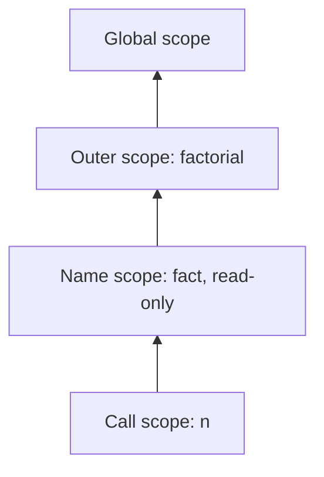

## Introduction

In [[b1-function-declaration]] you met functions as named statements: `function area(w, h) { … }` binds `area` in its scope before the scope's code runs. That covers named helpers well, but a lot of real JavaScript treats functions differently — as **values** created on the spot:

```javascript
const double = function (n) {
  return n * 2;
};

setTimeout(function () {
  console.log('timer fired');
}, 0);

console.log(double(21));
```

```output
42
timer fired
```

Both `function` keywords here appear in places where JavaScript expects a *value*: on the right of `=`, and as an argument to `setTimeout`. In those positions, `function (…) { … }` is a **function expression**. It does not declare anything in the surrounding scope. It evaluates to a new function object, exactly as `2 + 2` evaluates to a number, and you decide what to do with that value — store it, pass it, return it, or call it immediately.

(The output order is not a typo: `setTimeout` schedules its callback to run after the current script finishes, so `42` prints first. That scheduling is the subject of [[b1-event-loop]].)

This lesson covers what that difference means in practice: *when* the function is created, why calling it too early fails, and how the optional name between `function` and `(` changes recursion and debugging. The two nested topics — **named function expressions** and **anonymous functions** — are taught in their own sections below. Arrow functions are also expressions, with extra rules of their own; they are covered in [[b1-arrow-functions]].

## Before you start

- **Function declarations** — syntax, calling, returning and hoisting. See [[b1-function-declaration]].
- **Statements vs expressions** — the parser's distinction that decides which kind of function you wrote. See [[b1-statements-expressions]].
- **`var`, `let` and `const`, and the temporal dead zone** — they decide what an early call does. See [[b1-var-let-const]] and [[b1-tdz]].

## The intuition

A function declaration is like a printed sign on a shop door — it is there before anyone walks in. A function expression is like a sticky note you write during the day: it exists only from the moment you write it, and it is only as reachable as the place you stick it. Stick it on the fridge (assign it to a variable) and people can find it by looking there. Hand it to a colleague (pass it as an argument) and only they have it.

The note can also carry a name in its corner, written for whoever reads the note itself. That name is visible to the note's contents, not to the rest of the office — which is the idea behind named function expressions.

## Declaration or expression: how the parser decides

The same `function` keyword produces either form. The rule is purely about position:

- If a statement **begins** with the keyword `function`, it is a **declaration**.
- Anywhere else that an expression is allowed, it is an **expression**.

| Code | Form | Why |
|---|---|---|
| `function save() {}` | Declaration | The statement starts with `function` |
| `const save = function () {};` | Expression | On the right-hand side of `=` |
| `button.addEventListener('click', function () {});` | Expression | An argument to a call |
| `const api = { save: function () {} };` | Expression | A property value in an object literal |
| `return function () {};` | Expression | The operand of `return` |
| `(function () {})();` | Expression | Inside parentheses, so the statement starts with `(` |

The last row is the **Immediately Invoked Function Expression (IIFE)**: a function expression created and called in one step. The parentheses are there to stop the statement from starting with `function`. Without them, `function () {}();` is read as a declaration, and since declarations need a name it fails with `SyntaxError: Function statements require a function name`. Before modules and block-scoped `let`, IIFEs were the main way to give code a private scope; they have their own lesson in [[b1-iife]].

## When the function is created

A declaration's function exists from the start of its scope. A function expression's function exists only once the expression is **evaluated** — when execution reaches it. Before that, the variable you are going to store it in may exist, but it does not hold the function. What you get depends on how that variable was declared:

```javascript
try {
  hidden();
} catch (e) {
  console.log(e.name + ': ' + e.message);
}
const hidden = function () { return 1; };

try {
  legacy();
} catch (e) {
  console.log(e.name + ': ' + e.message);
}
var legacy = function () { return 1; };
```

```output
ReferenceError: Cannot access 'hidden' before initialization
TypeError: legacy is not a function
```

The two errors come from two different mechanisms, and telling them apart is a common interview question.

With `const` (or `let`), the binding `hidden` is created when the scope starts but left **uninitialised**: it is in the temporal dead zone until the line `const hidden = …` runs. Any access before that throws a `ReferenceError`. Even `typeof hidden` throws here, unlike for a name that does not exist at all.

With `var`, the binding `legacy` is created at the start and initialised to `undefined`. Reading it is fine; *calling* `undefined` is not, so the engine throws `TypeError: legacy is not a function`.

Neither is a bug in JavaScript — they are the rules from [[b1-hoisting]] applied to variables that happen to hold functions. The practical rule is simple: **define a function expression before the code that calls it runs.** Note that "before it runs" is about time, not position in the file. A function defined below can still be called from inside another function, as long as that other function is only *called* after the definition has executed:

```javascript
const start = function () {
  return helper();             // looked up when start() runs, not when it is defined
};
const helper = function () {
  return 'ready';
};

console.log(start());
```

```output
ready
```

## Choosing a function at runtime

Because a function expression is a value, you can decide *which* function to create while the program runs — something a declaration cannot express cleanly.

```javascript
const isProd = false;

const log = isProd
  ? function () {}                                  // silent in production
  : function (msg) { console.log('[debug]', msg); };

log('starting');
```

```output
[debug] starting
```

The conditional operator picks one of two function values, and `log` holds whichever was chosen. Callers write `log(...)` without knowing which version they have. Doing the same with declarations inside `if` blocks runs into the block-scoping rules described in [[b1-function-declaration]]; with expressions there is no ambiguity, because the variable is declared once, outside the condition.

The same property makes expressions the natural form for functions stored in data structures, such as a table of handlers keyed by name — shown in the worked example below.

## Named Function Expression {#b1-named-function-expression}

A **named function expression** is a function expression with a name written between `function` and `(`:

```javascript
const factorial = function fact(n) {
  return n <= 1 ? 1 : n * fact(n - 1);
};

console.log(factorial(5));
console.log(factorial.name);
console.log(typeof fact);
```

```output
120
fact
undefined
```

There are two names here, and they live in different places. `factorial` is an ordinary `const` in the **outer** scope; it is how the rest of the program reaches the function. `fact` is the function's own name, and it is visible **only inside the function's body**. That is why the recursive call `fact(n - 1)` works, why `factorial.name` reports `"fact"`, and why `typeof fact` outside prints `"undefined"` — there is no `fact` binding out there at all.

This is the key difference from a declaration. `function fact(n) { … }` as a statement binds `fact` in the enclosing scope. As an expression, the name is private to the function.

### Why the inner name exists

**Safe recursion.** A function that calls itself through an outer variable depends on that variable never changing. The inner name removes that dependency:

```javascript
let countdown = function tick(n) {
  return n === 0 ? 'done' : tick(n - 1);
};
const saved = countdown;
countdown = null;
console.log(saved(3));

let fragile = function (n) {
  return n === 0 ? 'done' : fragile(n - 1);
};
const saved2 = fragile;
fragile = null;
try {
  saved2(3);
} catch (e) {
  console.log(e.name + ': ' + e.message);
}
```

```output
done
TypeError: fragile is not a function
```

Both functions are reached through `saved` variables after their original variable is set to `null`. The first recurses through `tick`, its own name, and keeps working. The second recurses through the outer variable `fragile`, which now holds `null`, so the recursive call fails. Reassigning a `let` like this is unusual in application code, but the same situation arises when a function is passed somewhere and the original variable goes out of reach, or when a library wraps or replaces a property that held the function.

**Calling the function before the outer variable exists.** If a function runs immediately, during the initialisation of the very variable that will hold it, the outer name is still in the temporal dead zone. The inner name is already usable:

```javascript
try {
  const config = (function () { return config; })();
} catch (e) {
  console.log(e.name + ': ' + e.message);
}
```

```output
ReferenceError: Cannot access 'config' before initialization
```

The function body asks for `config`, but `config` is assigned only *after* the IIFE returns. A named expression that recurses through its own name avoids this whole class of problem.

**Readable stack traces.** When an error occurs inside a function, the stack trace lists each function on the call stack by name. A named expression always shows its name, even when it is passed directly as an argument, where no name could be inferred (see the next section).

### Rules for the inner name

The inner name is a binding in a small scope of its own that sits between the function and the outer scope. Three rules follow from that.

It **shadows** any outer variable with the same name, so inside the function the name always means the function. Outside, the outer variable is untouched:

```javascript
var g = 'outer';
const f = function g() { return typeof g; };
console.log(f(), g);
```

```output
function outer
```

It is **read-only**. In strict code, assigning to it throws `TypeError: Assignment to constant variable.`; in sloppy code the assignment is silently ignored, so the name still refers to the function. Either way, do not assign to it.

It **can be shadowed** by a declaration inside the body, because the body's own scope is nested inside the name's scope. `const h = function inner() { var inner = 5; return inner; }` returns `5`. Avoid this — it defeats the purpose of naming the function.

> [!TIP] Matching names
> A common convention is to give the expression the same name as the variable: `const walk = function walk(node) { … }`. It reads naturally, recursion uses the stable inner name, and stack traces match what you search for in the code.

Named function expressions are most useful for recursive callbacks (walking a tree inside a `.map`), for long-lived event handlers you want to identify in profiles, and anywhere you pass a non-trivial function inline.

## Anonymous Function {#b1-anonymous-function}

An **anonymous function** is a function written without a name between `function` and `(` — for example `function (a, b) { return a + b; }`. Only expressions can be anonymous; a declaration must have a name. Arrow functions are always anonymous in their syntax, because there is nowhere to write a name: `(a, b) => a + b`.

Anonymous functions are the everyday form for short, one-off callbacks:

```javascript
const prices = [12, 5, 30];
const withTax = prices.map(function (p) { return p * 2; });
console.log(withTax);
```

```output
[ 24, 10, 60 ]
```

There is no reason to name a one-line callback that is used once, right where it is written. The surrounding code already says what it does.

### Name inference: anonymous in syntax, named at runtime

Every function has a `name` property, used by stack traces and DevTools. For an anonymous function, the engine **infers** a name from where the function is first placed, if that position provides one. ECMAScript 2015 standardised these rules (the specification's `NamedEvaluation`):

```javascript
const handler = function () {};
let later;
later = function () {};
const settings = { onSave: function () {}, onLoad: () => {}, reset() {} };
const store = {};
store.update = function () {};

function nameOf(fn) { return JSON.stringify(fn.name); }

console.log(nameOf(handler), nameOf(later));
console.log(nameOf(settings.onSave), nameOf(settings.onLoad), nameOf(settings.reset));
console.log(nameOf(store.update));
console.log(nameOf(function () {}), nameOf(() => {}));
console.log(nameOf(handler.bind(null)), nameOf(new Function('return 1')));
```

```output
"handler" "later"
"onSave" "onLoad" "reset"
""
"" ""
"bound handler" "anonymous"
```

Line by line:

- Assigning to a **variable** — in a declaration (`const handler = …`) or a plain assignment (`later = …`) — gives the function that variable's name.
- A **property in an object literal** gives the property's name, for function expressions, arrows and method shorthand alike. Default values in destructuring and default parameters infer names the same way.
- Assigning to a **property of an existing object** (`store.update = …`) does *not* infer a name. The rule only applies when the left side is a plain identifier.
- A function **passed directly as an argument** gets no inferred name — there is nothing to infer it from — so its `name` is the empty string.
- `bind` creates a new function named `"bound "` plus the original name, and the `Function` constructor creates functions named `"anonymous"`.

In modules, `export default function () {}` and `export default () => {}` get the name `"default"`.

### Why it matters: debugging

Inferred names are why `const handler = function () { … }` usually produces a readable stack trace even though the function is anonymous. The functions that stay truly nameless are the ones passed inline. Here is what Node.js 22 prints for an error thrown from inside two `map` callbacks, one anonymous and one named (paths shortened):

```javascript title="app.js"
function fail() { throw new Error('boom'); }

try { [1].map(function () { fail(); }); }
catch (e) { console.log(e.stack); }

try { [1].map(function processRow() { fail(); }); }
catch (e) { console.log(e.stack); }
```

```text
Error: boom
    at fail (app.js:1:25)
    at app.js:3:29
    at Array.map (<anonymous>)
    ...
Error: boom
    at fail (app.js:1:25)
    at processRow (app.js:6:39)
    at Array.map (<anonymous>)
    ...
```

The anonymous callback appears only as a file position; the named one says what it was doing. In a production error report with dozens of frames from minified code, that difference adds up — which is why some teams enable ESLint's `func-names` rule and name any callback longer than a line or two. (Other engines format traces differently; the information is similar.) Reading traces is covered in [[b1-stack-traces]].

> [!NOTE] Inferred names are a debugging aid, not an API
> Do not write logic that depends on `fn.name`. Minifiers rename functions, `bind` prefixes the name, and some positions infer nothing. Use explicit identifiers or a `Map` if your code needs to look functions up by name.

## How it works internally

Each time execution reaches a function expression, the engine creates a **new function object** and records the current scope in its internal `[[Environment]]` slot, so the function can later read the variables around it. Unlike a declaration, nothing happens in the creation phase of the scope; the expression is one more piece of code evaluated in order.

"A new object every time" is easy to observe in a loop:

```javascript
const handlers = [];
for (let i = 0; i < 3; i++) {
  handlers.push(function () { return i; });
}
console.log(handlers.map(function (fn) { return fn(); }));
console.log(handlers[0] === handlers[1]);
```

```output
[ 0, 1, 2 ]
false
```

Three evaluations, three distinct function objects, each remembering the `i` of its own iteration (with `let`, every iteration has a fresh `i`; [[b1-closures-in-loops]] explains why `var` would give `[3, 3, 3]`). Creating functions is cheap in modern engines — the compiled code is shared between all the objects created from the same expression; only the small object and its scope link are new.

For a named expression, the engine creates one extra scope between the outer scope and the function, containing a single immutable binding for the name, and points the function's `[[Environment]]` at it. That scope is what makes the inner name visible to the body but not outside.



Each call of `factorial` creates a call scope whose parent is the name scope, so the lookup for `fact` succeeds there, while code in the outer scope never sees it.

## Worked example: a validator table

Function expressions shine when functions are data. This small form validator stores one rule per field in an object, then runs whichever rules apply.

```javascript title="validate.js"
const rules = {
  email: function (value) {
    return value.includes('@') ? null : 'must contain @';
  },
  age: function checkAge(value) {
    const n = Number(value);
    return Number.isInteger(n) && n >= 13 ? null : 'must be a whole number, 13 or more';
  },
  username: function (value) {
    return /^[a-z0-9_]{3,16}$/.test(value) ? null : 'must be 3-16 lowercase letters, digits or _';
  },
};

const validate = function (form) {
  const errors = {};
  for (const field of Object.keys(form)) {
    const rule = rules[field];
    if (!rule) continue;                  // fields without a rule are accepted
    const message = rule(form[field]);
    if (message) errors[field] = message;
  }
  return errors;
};

console.log(validate({ email: 'ada@example.com', age: '36', username: 'ada_l' }));
console.log(validate({ email: 'nope', age: '12.5', username: 'A' }));
console.log(rules.email.name, rules.age.name, validate.name);
```

```output
{}
{
  email: 'must contain @',
  age: 'must be a whole number, 13 or more',
  username: 'must be 3-16 lowercase letters, digits or _'
}
email checkAge validate
```

Walk through it. `rules` maps field names to anonymous and named function expressions; each returns `null` for valid input or an error message. `validate` looks up the rule for each field at runtime with `rules[field]` — a lookup that only makes sense because functions are values stored in an object. Adding a new field means adding one property; `validate` does not change.

The last line shows name inference: `rules.email` is anonymous in the source but named `"email"` from its property, `rules.age` keeps its explicit name `checkAge`, and `validate` is named after its `const`. Notice also that `validate` is defined as an expression, so it could not be called above its line — the calls at the bottom come after it, so that is fine.

## In real systems

**Callbacks everywhere.** Event listeners, timers, array methods, promise handlers and Node.js APIs all take functions as arguments: `fs.readFile(path, function (err, data) { … })`. Before ES2015, these were written as anonymous function expressions; modern code mostly uses arrow functions for them, but the concept is the same. See [[b1-first-class-functions]].

**Strategy tables and dispatch.** Command handlers in CLIs, reducers keyed by action type, and validator maps like the one above are objects whose values are function expressions.

**Module pattern and IIFEs.** Libraries written before ES modules — older jQuery plugins, for example — wrapped their code in `(function () { … })();` to keep variables out of the global scope. You still meet this pattern in legacy code and in the output of some bundlers.

**Named expressions for observability.** Teams that rely on error monitoring often enforce named functions (ESLint's `func-names` rule) so that production stack traces stay readable even for inline callbacks.

## Trade-offs and alternatives

| | Declaration `function f() {}` | Expression `const f = function () {}` | Arrow `const f = () => {}` |
|---|---|---|---|
| Callable before its line | Yes | No | No |
| Name binding in outer scope | Yes, reassignable | Whatever variable you choose (`const` prevents reassignment) | Same as expression |
| Can be created conditionally | Awkward | Yes | Yes |
| Own `this`, usable with `new` | Yes | Yes | No |
| Optional inner name | — | Yes (named expression) | No |

Choose a **function expression** when you need a function as a value with ordinary `function` behaviour: its own `this` (for example a method assigned to an object property that will be called as `obj.method()`), use with `new`, or an inner name for recursion. Choose an **arrow function** for short callbacks and whenever the function should use the surrounding `this` — this is most callbacks in modern code. Choose a **declaration** for named top-level helpers you want available throughout their scope.

The costs of expressions are small but real: they cannot be called early, and anonymous ones can make stack traces harder to read.

## Common mistakes

> [!MISTAKE] Calling a function expression before it is assigned
> `init(); const init = function () { … };` throws a `ReferenceError`, and with `var` it throws `TypeError: init is not a function`. Move the definition above the first call that *executes*, or use a declaration if early calls are intentional.

**Forgetting the parentheses on an IIFE.** `function () { … }();` at the start of a statement is a `SyntaxError`. Wrap the function: `(function () { … })();`. When a line starts with `(`, also make sure the previous line ends with a semicolon; otherwise ASI may join the two lines into a call.

**Expecting the inner name outside.** `const f = function g() {}; g();` throws `ReferenceError: g is not defined`. Use the outer variable outside the function.

**Recursing through a variable that can change.** If a recursive function might be reassigned, wrapped or passed elsewhere, recurse through its own inner name instead.

**Depending on `fn.name`.** Minification renames functions and some positions infer no name. Treat `name` as information for humans.

**Calling instead of passing.** `setTimeout(save(), 1000)` runs `save` now and passes its return value. Pass the function: `setTimeout(save, 1000)`, or wrap it: `setTimeout(function () { save(draft); }, 1000)`.

## Interview perspective

Function expressions appear in interviews through hoisting snippets ("what does this print?"), questions about the inner name's scope, and IIFE syntax.

> [!INTERVIEW] What a strong answer sounds like
> "A function expression is evaluated when execution reaches it, so it isn't available earlier. If it's stored in a `var`, an early call throws a `TypeError` because the variable is `undefined`; with `let` or `const` it's a `ReferenceError` from the temporal dead zone. If the expression has a name, that name is only bound inside the function, which makes recursion safe and stack traces readable."

Questions you should be able to answer:

- **What is the difference between a function declaration and a function expression?** Position decides the form. Declarations bind their name in the enclosing scope and are hoisted with their value; expressions produce a value when evaluated and bind nothing outside.
- **Why does `var f = function () {}` called early give `TypeError` but `const` gives `ReferenceError`?** `var` bindings start as `undefined`; `const` bindings are uninitialised until their line.
- **In `const a = function b() {}`, where is `b` visible?** Only inside the function body, as a read-only binding.
- **Why wrap an IIFE in parentheses?** So the statement does not begin with `function`, which would make it a declaration.
- **What is `(function () {}).name`? And `const x = function () {}; x.name`?** `""` and `"x"` — names are inferred from variable and object-literal positions, not from being passed as an argument.

```quiz
Q: What is printed? `try { go(); } catch (e) { console.log(e.name); } var go = function () {};`
- [ ] `ReferenceError`
- [x] `TypeError`
- [ ] Nothing — `go()` runs successfully
- [ ] `SyntaxError`
> `var go` is created at the start of the scope and initialised to `undefined`; the function is assigned only when its line runs. Calling `undefined` is a `TypeError`. With `const` or `let` it would be a `ReferenceError` from the temporal dead zone.

Q: Given `const sum = function add(a, b) { return a + b; };`, which statement is true?
- [ ] Both `sum` and `add` can be called from outside the function
- [x] `sum` is visible outside; `add` is visible only inside the function body
- [ ] `add` is visible outside; `sum` is visible only inside
- [ ] `sum.name` is `"sum"`
> In a named function expression, the name after `function` is bound in a small scope wrapped around the function body, not in the outer scope. `sum` is the outer `const`. Because the function has an explicit name, `sum.name` is `"add"`; inference only applies to anonymous functions.

Q: What is `store.save.name` after `const store = {}; store.save = function () {};`?
- [ ] `"save"`
- [ ] `"store.save"`
- [x] `""` (the empty string)
- [ ] `"anonymous"`
> Name inference applies when an anonymous function is assigned to a plain identifier or defined as a property inside an object literal. Assigning to a property of an existing object does not infer a name, so the function stays nameless. `"anonymous"` is the name given to functions made with the `Function` constructor.
```

## Practice

1. **Predict the errors.** For each of `var`, `let` and `const`, write `f(); <keyword> f = function () {};` and predict the error before running it. Then add `typeof f` before the call and predict again.
2. **Safe recursion.** Write `const flatten = function flat(arr) { … }` that flattens nested arrays using recursion through `flat`. Show that it still works after `const copy = flatten;` and reassigning a `let` that held it.
3. **Name inference table.** Create anonymous functions in six positions — `const`, `let` assignment, object literal property, property assignment on an existing object, function argument, `bind` — and log each `name`. Explain each result.
4. **Strategy table.** Build an object `ops` mapping `'+'`, `'-'`, `'*'`, `'/'` to function expressions, and a `calculate(a, op, b)` that looks up and calls the right one, returning an error message for unknown operators.
5. **IIFE scope.** Use an IIFE to create a counter with a private `count` variable and return an object with `increment` and `value` methods. Then rewrite it using an ES module and compare.

## Quick revision {#quick-revision}

- A statement beginning with `function` is a declaration; `function` anywhere an expression is allowed is a function expression.
- A function expression produces a new function object each time it is evaluated; it binds nothing in the outer scope by itself.
- Early call: stored in `var` → `TypeError: f is not a function`; stored in `let`/`const` → `ReferenceError` (temporal dead zone). Define before the call *executes*.
- IIFE: `(function () { … })();` — the parentheses stop it being parsed as a declaration.
- Named function expression `const a = function b() {}`: `a` is outer; `b` is visible only inside, read-only, shadows outer names; `a.name === "b"`.
- Use the inner name for recursion that survives reassignment and for readable stack traces.
- Anonymous functions get inferred names from `const`/`let`/`var` declarations, plain identifier assignment, object-literal properties and destructuring/parameter defaults — not from `obj.prop = …` or from being passed as an argument.
- `bind` → `"bound name"`; `new Function` → `"anonymous"`; `export default function () {}` → `"default"`.
- Never build logic on `fn.name`; minifiers change it.

## Key takeaways {#key-takeaways}

- A function expression treats a function as a value, created at the moment execution reaches it, which lets you store, pass, return and choose functions at runtime.
- Because it is created late, it cannot be called earlier; the error you get (`TypeError` with `var`, `ReferenceError` with `let`/`const`) tells you which variable rule was hit.
- Giving the expression a name creates a private, read-only binding inside the function, ideal for recursion and for stack traces.
- Anonymous functions often still get a runtime `name` inferred from where they are first stored, but inline callbacks stay nameless, so name non-trivial callbacks.
- Pick the form by role: declarations for hoisted named helpers, function expressions for values that need ordinary `function` behaviour, and arrows for most callbacks.
