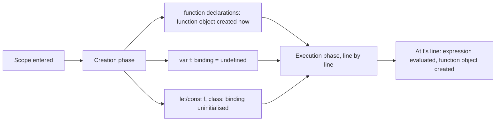

## Introduction

Here is a refactor that looks harmless. A file calls a helper at the top and defines it at the bottom:

```javascript
console.log(formatPrice(9.5));

function formatPrice(n) {
  return `$${n.toFixed(2)}`;
}
```

```output
$9.50
```

A teammate prefers arrow functions and rewrites the definition. Nothing else changes:

```javascript
console.log(formatPrice(9.5));

const formatPrice = (n) => `$${n.toFixed(2)}`;
```

The program now crashes on its first line:

```output
ReferenceError: Cannot access 'formatPrice' before initialization
```

Both versions define the same function with the same body. The difference is the *form*: the first is a **function declaration**, the second is a **function expression** (an arrow function) stored in a `const`. JavaScript prepares every scope before running it, and it prepares these two forms differently. A declaration is ready to call from the first moment the scope exists. An expression is a value that is only created when execution reaches its line, so before that line its name either holds `undefined` or is locked.

This lesson takes the general mechanism taught in [[b1-hoisting]] and applies it to the question you meet most in practice: *when can I call this function?* You will learn to predict the outcome for every way of writing a function, to read the error messages as clues, to untangle the rare cases where a function and a variable share a name, and to choose a function style on purpose rather than by habit.

## Before you start

- **Declarations and expressions** — `function f() {}` as a statement versus `function () {}` or `() => {}` used as a value. See [[b1-function-declaration]], [[b1-function-expression]] and [[b1-arrow-functions]].
- **Hoisting and the creation phase** — the idea that a scope's declarations are set up before its code runs. See [[b1-hoisting]] and [[b1-creation-vs-execution]]; this lesson recaps what it needs.
- **`var`, `let` and `const`** — and the temporal dead zone that makes `let`/`const` unusable before their line. See [[b1-var-let-const]] and [[b1-tdz]].

## The intuition

Imagine a conference schedule printed before the event. Some sessions are **confirmed**: the speaker, title and room are all printed, and you can walk in at any time. Others are listed as **"TBA"**: the slot exists on the schedule, but there is nothing in it until the organisers fill it in on the day. A few are **embargoed**: the slot exists but the schedule says "do not attend until announced", and staff turn you away at the door.

A function declaration is a confirmed session. The function is fully there from the moment the scope begins. A function expression stored in a `var` is a TBA slot: the name exists and holds `undefined` until the assignment line runs, so "attending" (calling) it early gets you nothing callable. A function expression stored in `let` or `const` is embargoed: the name exists, but touching it before its line throws.

The analogy stops at one point: the schedule is reprinted every time the scope is entered. Each function call prepares its own body afresh, so a declaration inside a function is created anew on every call.

## The two forms, side by side

A **function declaration** is a statement that starts with the keyword `function` (or `async function`, `function*`, `async function*`) and has a name:

```javascript
function area(w, h) {
  return w * h;
}
```

A **function expression** is any function written where a value is expected: on the right of `=`, as an argument, inside parentheses. Arrow functions are always expressions.

```javascript
const area1 = function (w, h) { return w * h; };       // anonymous function expression
const area2 = function area(w, h) { return w * h; };   // named function expression
const area3 = (w, h) => w * h;                         // arrow function expression
```

The rule that decides everything is short: **a declaration creates its binding and its function during the creation phase; an expression creates its function only when its line runs, and the binding it is stored in follows that binding's own rules** (`var`, `let` or `const`).

## What happens if you call each form early

This program calls six differently defined things before their definitions and records what happens:

```javascript title="early-calls.js"
const results = [];
function attempt(label, fn) {
  try { results.push(`${label}: ${fn()}`); }
  catch (e) { results.push(`${label}: ${e.name}: ${e.message}`); }
}

attempt('declaration', () => declared());
attempt('var + expression', () => viaVar());
attempt('const + arrow', () => viaConst());
attempt('never declared', () => missing());
attempt('async declaration', () => typeof loadLater);
attempt('class', () => new Widget());

function declared() { return 'ok'; }
var viaVar = function () { return 'ok'; };
const viaConst = () => 'ok';
async function loadLater() {}
class Widget {}

console.log(results.join('\n'));
```

```output
declaration: ok
var + expression: TypeError: viaVar is not a function
const + arrow: ReferenceError: Cannot access 'viaConst' before initialization
never declared: ReferenceError: missing is not defined
async declaration: function
class: ReferenceError: Cannot access 'Widget' before initialization
```

Walk through each line.

**`declared()` works.** During the creation phase of the script, the engine found the declaration `function declared() {...}`, created the function object and bound it to `declared`. By the time line 7 runs, it is an ordinary function.

**`viaVar()` throws a `TypeError`.** The creation phase saw `var viaVar` and created the binding with the value `undefined`. The function expression on the right of `=` has not been evaluated; that happens when execution reaches its line. So `viaVar()` means `undefined()`. The name was found — no `ReferenceError` — but the value is not callable, which is a type problem.

**`viaConst()` throws a `ReferenceError` mentioning initialization.** The creation phase created the `const viaConst` binding but left it **uninitialised**. Reading an uninitialised binding is forbidden, so the error is thrown when the name is looked up, before any call happens. This period between the start of the scope and the declaration line is the **temporal dead zone (TDZ)**.

**`missing()` throws a different `ReferenceError`.** There is no binding called `missing` anywhere in the scope chain, so the lookup fails with "is not defined". Compare the two `ReferenceError` messages: "before initialization" means *the name exists, you are too early*; "is not defined" means *the name does not exist at all* — usually a typo or a missing import.

**`async function` declarations hoist like ordinary declarations.** The same is true of generator declarations (`function*`) and async generator declarations. The async-ness affects what calling the function returns, not when the function exists.

**`class` declarations behave like `let`.** Even though classes are "functions" under the hood, a class declaration is hoisted into the TDZ, not initialised early. See [[b1-class-hoisting]].

| How the function is defined | Before its line, the name holds | Calling it early gives |
|---|---|---|
| `function f() {}` (also `async`, `function*`) | The finished function | Works |
| `var f = function () {}` / `var f = () => {}` | `undefined` | `TypeError: f is not a function` |
| `let` / `const f = function () {}` or `() => {}` | Uninitialised (TDZ) | `ReferenceError: Cannot access 'f' before initialization` |
| `class F {}` | Uninitialised (TDZ) | `ReferenceError: Cannot access 'F' before initialization` |
| Not declared anywhere | No binding | `ReferenceError: f is not defined` |

> [!TIP] Read the error as a clue
> "`x` is not a function" for something you know is a function almost always means a `var` assigned further down (or an import cycle, or a property that is `undefined`). "Cannot access `x` before initialization" means a `let`/`const`/`class` used too early. "`x` is not defined" means the name is missing entirely.

### `typeof` before the line

`typeof` is the one operator that does not throw for a missing name, which makes the three cases easy to tell apart — except in the TDZ:

```javascript
console.log(typeof a, typeof c);
try { console.log(typeof b); } catch (e) { console.log(e.name + ': ' + e.message); }
var a = function () {};
let b = () => {};
```

```output
undefined undefined
ReferenceError: Cannot access 'b' before initialization
```

`a` is a `var` holding `undefined`, and `c` is not declared at all; both report `'undefined'`, so `typeof` cannot distinguish them. `b` is in its TDZ, and the TDZ rule beats `typeof`'s usual leniency: it throws. Code written as `if (typeof helper === 'function')` to guard against a missing helper therefore crashes if `helper` is a `const` declared later in the same scope.

## It is about time, not position

The TDZ is about **when** code runs, not **where** it is written. A function body can mention a `const` that is defined further down, as long as the function is *called* after that `const` has been initialised:

```javascript
function describe() { return `${LABEL}: ${count}`; }

try { describe(); } catch (e) { console.log(e.name + ': ' + e.message); }

const LABEL = 'items';
let count = 3;
console.log(describe());
```

```output
ReferenceError: Cannot access 'LABEL' before initialization
items: 3
```

The first call happens while `LABEL` is still in its TDZ and throws. The second call happens after both lines have run and works. The text of `describe` did not change; only the moment of the call did.

This is why function *expressions* are perfectly safe in most real code. In a typical module, all the `const` helpers are defined at the top level, and they are only called later — from event handlers, from exported functions, from code at the bottom. The problem appears only when top-level code runs a function *during* the module's own evaluation, before the helper's line.

## Name collisions

Most code never reuses a name for a function and a variable in the same scope, and linters forbid it. But the rules explain several classic interview puzzles, and they reveal the order in which the creation phase works.

**A function declaration and a `var` with the same name.** The `var` does not overwrite the function during creation, but an assignment does overwrite it when it runs:

```javascript
console.log(typeof value);
var value = 'string';
function value() {}
console.log(typeof value);
```

```output
function
string
```

In the creation phase, the function declaration wins: `var value` only creates a binding if none exists and never resets an existing one to `undefined`. So the first `typeof` sees the function. Then execution runs `value = 'string'` (the declaration part of the `var` has already been handled; only the assignment remains), and the second `typeof` sees a string. A bare `var value;` with no assignment would leave the function in place.

**Two declarations with the same name.** The last one wins — for the whole scope, including calls above both:

```javascript
console.log(pick());
function pick() { return 'first'; }
console.log(pick());
function pick() { return 'second'; }
```

```output
second
second
```

There is no moment at which `pick` is the first function. The creation phase processes all declarations before any code runs, and the later declaration replaces the earlier one. This is a real hazard in long legacy scripts where two files concatenated together each declare a `function init()`.

**A function declaration and a parameter with the same name.** The declaration replaces the argument:

```javascript
function show(x) {
  console.log(typeof x);
  function x() {}
}
show(42);
```

```output
function
```

A `var x` in the same situation would not replace the argument, for the same reason a `var` never resets an existing binding.

**A function declaration and `let`/`const`/`class` with the same name.** This is not allowed at all. `let f = 1; function f() {}` in the same scope is a `SyntaxError: Identifier 'f' has already been declared`, reported before any code runs. The newer declaration forms were designed to make these collisions loud rather than silent.

## Named function expressions do not hoist their name

A **named function expression** — `const run = function step() {}` — has a name, so it looks like it might behave like a declaration. It does not. The name `step` is bound only *inside the function's own body*, so the function can refer to itself; it is not added to the surrounding scope at all, early or late. Only `run` exists outside, and `run` follows `const` rules. See [[b1-named-function-expression]].

## Functions declared inside blocks

A function declaration inside an `if`, a loop or a bare `{}` block is hoisted to the top of *that block*, not the whole function. In strict mode — which includes every ES module and every class body — the function exists only inside the block. In sloppy-mode scripts, browsers follow legacy rules (Annex B of the specification) that additionally create a `var`-like binding in the enclosing function, which is `undefined` until the block runs. The resulting behaviour is hard to predict and differed between engines before ES2015. The simple rule: do not declare functions inside blocks in sloppy code; if a function should exist only under some condition, assign a function expression to a `let` or `const`. The exact Annex B behaviour is worked through in [[b1-hoisting-puzzles]].

## Modules and circular imports

In an ES module, top-level function declarations are hoisted across the whole module, just as in a script. They are also initialised earlier than anything else: during module **instantiation**, before *any* module's code runs. That detail matters when two modules import each other.

```javascript title="main.mjs"
import './a.mjs';
```

```javascript title="a.mjs"
import { report } from './b.mjs';
export function formatDecl(x) { return `[${x}]`; }
export const formatArrow = (x) => `[${x}]`;
```

```javascript title="b.mjs"
import { formatDecl, formatArrow } from './a.mjs';
console.log(formatDecl('decl'));
try { console.log(formatArrow('arrow')); } catch (e) { console.log(e.name + ': ' + e.message); }
export const report = 1;
```

Running `node main.mjs` prints:

```output
[decl]
ReferenceError: Cannot access 'formatArrow' before initialization
```

`main` imports `a`, which imports `b`, which imports `a` again — a cycle. Module dependencies are evaluated first, so `b`'s body runs *before* `a`'s body. At that moment, `a`'s exported function declaration already exists (it was created at instantiation), so `formatDecl` works. But `formatArrow` is a `const` whose line in `a.mjs` has not run yet; it is still in its TDZ. Imports are **live bindings** to the exporting module's variables, so `b` sees exactly that TDZ state.

The fix for cycles is usually to remove them, but this is one concrete advantage of function declarations in shared utility modules: they make some import cycles harmless. Circular dependencies are covered in [[b1-circular-deps]] and live bindings in [[b1-live-bindings]].

## How it works internally

The specification sets up a function's scope in an algorithm called **FunctionDeclarationInstantiation**, which runs at the start of every call before the first statement. Scripts use the similar GlobalDeclarationInstantiation, and modules do this work when they are instantiated. In simplified form, for a function call:

1. Bind the parameters to the arguments.
2. Collect every `var` name in the body. For each name that is not already bound (for example, as a parameter), create a binding initialised to `undefined`.
3. Collect every function declaration at the top level of the body. If two share a name, keep only the **last** one. For each, create a function object — capturing the current environment, so it can see outer variables — and store it in the binding, overwriting a parameter or `var` of the same name.
4. Create bindings for every `let`, `const` and `class` declaration *without initialising them*. Each stays in the TDZ until its declaration line is evaluated.
5. Run the body. A `var x = expr` line now only performs the assignment; a `let`/`const` line initialises its binding; a function declaration line does nothing at all, because its work was done in step 3.

Every collision rule above falls out of these steps. "Function beats `var`" is step 2 skipping an existing name plus step 3 overwriting. "Last declaration wins" is step 3's de-duplication. "`var` does not overwrite a parameter" is step 2's check. The steps are set out with examples in [[b1-creation-vs-execution]], and the execution context they create in [[b1-function-execution-context]].



## Worked example: why the refactor broke

Return to the opening example and make it slightly more realistic. A small script prints an order summary.

```javascript title="summary.js (before)"
printSummary([4.5, 5]);

function printSummary(prices) {
  const total = prices.reduce((sum, p) => sum + p, 0);
  console.log(`Items: ${prices.length}, total ${formatPrice(total)}`);
}

function formatPrice(n) {
  return `$${n.toFixed(2)}`;
}
```

```output
Items: 2, total $9.50
```

Read it the engine's way. Creation phase: `printSummary` and `formatPrice` both become functions immediately. Execution: line 1 calls `printSummary`, which calls `formatPrice`; both exist; it works.

Now apply the arrow-function refactor to both helpers:

```javascript title="summary.js (after)"
printSummary([4.5, 5]);

const printSummary = (prices) => {
  const total = prices.reduce((sum, p) => sum + p, 0);
  console.log(`Items: ${prices.length}, total ${formatPrice(total)}`);
};

const formatPrice = (n) => `$${n.toFixed(2)}`;
```

```output
ReferenceError: Cannot access 'printSummary' before initialization
```

Creation phase: both names are created but left uninitialised. Execution: line 1 looks up `printSummary`, which is in its TDZ, and throws. Nothing else runs.

There are two correct fixes. The first keeps the arrows and moves the **entry point** — the top-level call — to the bottom, after every definition. This is the conventional layout for code written with `const` functions: definitions first, then the code that uses them. The second keeps the top-down layout and uses declarations for the helpers. Note what does *not* need fixing: `printSummary` refers to `formatPrice`, which is defined after it, and that is fine once the call moves down, because by the time `printSummary` runs, `formatPrice` has been initialised. The order of *definitions* relative to each other rarely matters; what matters is that no code *runs* a function before its definition line has executed.

## In real systems

**Linters encode a team's choice.** ESLint's `func-style` rule enforces either declarations or expressions throughout a codebase. `no-use-before-define` reports uses that appear above their definition; its `functions: false` option allows calling function declarations early (they are safe) while still catching `const` and `class` uses. `no-func-assign` catches reassigning a function declaration's name, and `no-inner-declarations` flags function declarations inside blocks. Many teams turn these on precisely to avoid the bugs in this lesson.

**TypeScript catches the simplest TDZ cases.** Using a `const` or `let` above its declaration in the same scope is a compile-time error (TS2448, "Block-scoped variable used before its declaration"). TypeScript cannot know when a function that *mentions* the variable will be called, so the `describe()` example above compiles and only fails at run time.

**React components.** Most React code is written as `const Component = () => {...}` or `function Component() {...}`; both are fine because components are referenced from JSX that runs later, during rendering. The `export default function Page()` form is common in frameworks such as Next.js because a declaration can be named and exported in one statement.

**Readable file layout.** With declarations you can put the high-level function at the top of a file and the helpers below it, so a reader meets the "what" before the "how". With `const` functions, the helpers must be defined before any top-level code calls them, which pushes the entry point to the bottom. Both layouts are common; teams pick one and apply it consistently.

## Trade-offs and alternatives

| | Function declaration | `const` + function expression or arrow |
|---|---|---|
| Callable before its line | Yes | No (TDZ error) |
| Can be reassigned | Yes (a linter should forbid it) | No |
| Has its own `this`, `arguments`, can be used with `new` | Yes | Arrow: no. `function` expression: yes |
| Name in stack traces | Always | Inferred from the variable name in most cases |
| Survives circular imports | Yes | May hit the TDZ |
| Can be defined conditionally | Avoid (block rules are confusing) | Yes, cleanly |
| Encourages define-before-use | No | Yes |

Declarations are convenient: order-independent, always named, safe in import cycles. Their costs are that they can be silently overwritten by a later declaration or assignment of the same name, and that their early availability hides ordering mistakes that would otherwise surface. Some style guides (Airbnb's, for example) prefer named function expressions for exactly that reason: making use-before-define an error forces a file to be read in order.

`const` expressions cannot be reassigned, make use-before-define a loud error, and with arrows give lexical `this` — the right behaviour for callbacks. Their cost is the TDZ, which constrains file layout and occasionally bites in import cycles. Function names are rarely a problem: since ES2015, an anonymous function assigned to a variable gets that variable's name as its `name` property, so `const formatPrice = () => {}` still shows as `formatPrice` in stack traces.

A common and sensible compromise: use declarations for top-level, named units of work (including React components and exported utilities), and arrow functions for callbacks and small inline functions.

## Common mistakes

> [!MISTAKE] Converting a declaration to an arrow without checking call sites
> A declaration can be called from anywhere in its scope; an arrow in a `const` cannot be called before its line. Before converting, search for calls that run during the file's top-level evaluation and make sure they come after the definition.

**Reading "is not a function" as "the function is broken".** When the name is a `var` assigned later, the function is fine; it simply has not been assigned yet. Look for where the name gets its value, not inside the function.

**Guarding with `typeof` against a `const` in the same scope.** `typeof x === 'function'` throws if `x` is in its TDZ. Use `typeof` guards only for names that may genuinely not exist, such as browser globals.

**Relying on "last declaration wins".** Two scripts that each declare `function init()` in the same global scope silently replace one another. Modules prevent this; in classic scripts, wrap code in an IIFE ([[b1-iife]]) or use unique names.

**Declaring functions inside `if` blocks in sloppy-mode scripts.** Behaviour depends on legacy rules and differs from strict mode. Use a `let` or `const` with a function expression instead.

## Interview perspective

Interviewers use this topic to check that you know hoisting is not about code moving, and that you can predict behaviour precisely.

> [!INTERVIEW] A precise answer
> "Function declarations are fully initialised when the scope is created, so they can be called before their line. A function expression is only evaluated when its line runs. If it's stored in a `var`, the name is `undefined` beforehand, so calling it gives a TypeError. If it's in `let` or `const`, the name is in the temporal dead zone, so even reading it throws a ReferenceError."

Questions to prepare:

- **Output of `console.log(typeof f); var f = 1; function f() {}`?** `'function'`: in the creation phase the declaration wins and `var` does not reset it; the assignment runs later.
- **Why is "is not a function" a `TypeError` but "before initialization" a `ReferenceError`?** In the first case, the name resolves (to `undefined`), and calling a non-function is a type error. In the second, resolving the name itself fails because the binding is uninitialised.
- **Are `let` and `const` hoisted?** Yes — their bindings exist from the start of the scope, which is why they shadow outer variables and throw "before initialization" rather than "is not defined". They are hoisted but not initialised.
- **Which should we use, declarations or arrows?** There is no single right answer; a strong answer names the trade-offs (TDZ and define-before-use, `this` semantics, reassignment, circular imports) and states a consistent rule.

```quiz
Q: What does this print? `try { greet(); } catch (e) { console.log(e.name); } var greet = () => 'hi';`
- [ ] hi
- [x] TypeError
- [ ] ReferenceError
- [ ] SyntaxError
> `var greet` is hoisted and initialised to `undefined`; the arrow function is only assigned when its line runs. Calling `undefined` is a TypeError. It would be a ReferenceError if `greet` were declared with `let` or `const`, because then the binding would be in the temporal dead zone.

Q: A file has `function show() { return 'A'; }` near the top and `function show() { return 'B'; }` near the bottom, with `console.log(show())` between them. What is printed?
- [ ] A
- [x] B
- [ ] A, then a SyntaxError
- [ ] undefined
> All function declarations in a scope are processed in the creation phase, before any code runs, and the last one with a given name replaces earlier ones. There is never a moment when `show` returns 'A'. Redeclaring a function with `let` or `const` would be a SyntaxError, but two function declarations are allowed.

Q: Module `a.mjs` imports `b.mjs`, and `b.mjs` imports from `a.mjs` and calls one of its exports at the top level. Which export of `a.mjs` is safe to call there?
- [x] `export function helper() {}`
- [ ] `export const helper = () => {}`
- [ ] `export const helper = function () {}`
- [ ] All three are equally safe
> In the cycle, `b`'s body runs before `a`'s body. Exported function declarations are initialised when modules are instantiated, before any module body runs, so they are callable. `const` exports are still in their temporal dead zone until `a`'s body reaches them.
```

## Practice

1. **Predict the table.** Without running anything, write what each line prints: `console.log(typeof x); var x = function () {}; console.log(typeof x);`, then the same with `let` and with a function declaration. Then run them.
2. **Fix the entry point.** Take a file of five `const` arrow helpers with a top-level `main()` call at the top. Rearrange it so it runs, without changing any helper to a declaration.
3. **Collision puzzle.** Predict the output of `function f(a) { console.log(a); var a = 2; function a() {} console.log(a); } f(1);` and explain each line using the creation-phase steps.
4. **Break a cycle.** Reproduce the circular-import example, then change `a.mjs` so that `b.mjs` no longer needs to call it at load time. Explain why the TDZ error disappears.
5. **Write a style rule.** In two or three sentences, write the function-style rule you would propose for a React + TypeScript codebase and name the ESLint rules that would enforce it.

## Quick revision {#quick-revision}

- Function declarations (including `async function`, `function*`) are created in the creation phase: callable anywhere in their scope.
- Function expressions and arrows are created when their line runs; the name follows `var`/`let`/`const` rules.
- Early call to `var f = function () {}` → `TypeError: f is not a function` (`f` is `undefined`).
- Early call to `let`/`const f = ...` or `class F` → `ReferenceError: Cannot access 'f' before initialization` (TDZ).
- Undeclared name → `ReferenceError: f is not defined`.
- `typeof` gives `'undefined'` for `var`-before-assignment and for undeclared names, but throws in the TDZ.
- TDZ is about time: a function may mention a later `const` if it is called after that `const` is initialised.
- Collisions: declaration beats `var` at creation; a later assignment overwrites it; last declaration wins; declaration overrides a same-named parameter; declaration + `let`/`const` is a SyntaxError.
- Named function expression names are visible only inside their own body.
- Block-level function declarations: block-scoped in strict code; confusing Annex B rules in sloppy code — avoid.
- ES modules: exported function declarations are usable during circular imports; exported `const` functions may still be in the TDZ.

## Key takeaways {#key-takeaways}

- Whether you can call a function before its line depends only on how it was defined, not on what it does.
- Declarations exist from the start of their scope; expressions exist from the moment their line runs.
- The error type tells you the cause: TypeError means a `var` holding `undefined`, "before initialization" means the TDZ, "not defined" means no such name.
- The TDZ concerns when code runs, so `const` helpers are safe as long as nothing calls them during evaluation before their line.
- Pick declarations or `const` expressions deliberately, write the rule down, and let a linter enforce it.
