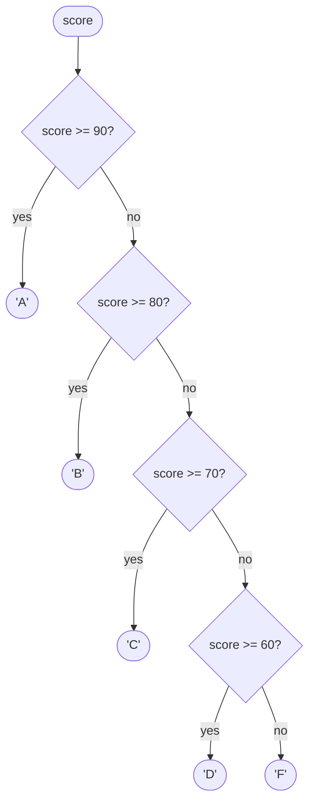

## Introduction

A program that always does the same thing is rarely useful. A checkout page charges shipping only below a certain order total. A login form shows an error only when the password is wrong. A React component renders a spinner while data is loading and the data once it arrives. Each of these is a **decision**: look at the current state, then run one piece of code or another.

In JavaScript the basic tool for a decision is the **`if` statement**:

```javascript title="first-if.js"
function shippingCost(orderTotal) {
  if (orderTotal >= 50) {
    return 0;
  } else {
    return 4.99;
  }
}
console.log(shippingCost(80));
console.log(shippingCost(20));
```

```output
0
4.99
```

The part in parentheses, `orderTotal >= 50`, is the **condition**. If it holds, the first block runs; otherwise the block after `else` runs. Exactly one of the two runs, never both and never neither.

That much looks the same in most languages. What is particular to JavaScript — and what causes most real bugs — is *how* the condition is tested. JavaScript does not require a boolean. You can write `if (user)`, `if (items.length)` or `if (name)`, and the language converts whatever value you give it into `true` or `false` using a fixed rule. Knowing that rule exactly is the difference between code that works and code that silently skips a branch when a count happens to be `0`.

This lesson covers the syntax, the conversion rule, how `else if` really works, how braces and scope interact with `if`, and the habits that keep decision code readable as it grows.

## Before you start

- **Statements vs expressions** — `if` is a statement: it does something but produces no value you can assign. See [[b1-statements-expressions]].
- **Truthy and falsy values** — the full conversion table that `if` relies on. See [[b1-truthy-falsy]]; this lesson recaps the part you need.
- **Comparison operators** — `===`, `<`, `>=` and friends, which produce the booleans most conditions use. See [[b1-comparison-operators]].
- **Logical operators** — `&&`, `||` and `!`, for combining conditions. See [[b1-logical-operators]].
- **`let` and `const`** — to understand block scope inside `if` bodies. See [[b1-let]] and [[b1-const]].

## The intuition

Picture a railway junction with a single lever. A train arrives; the signal operator looks at one fact — "is this train going north?" — and sets the lever. The train then travels down exactly one track. The other track is not visited at all, so anything placed on it is never touched.

That captures three properties of `if`:

1. The condition is **evaluated once**, when the train arrives, before either track is entered.
2. **Exactly one** path is taken. The untaken branch is not evaluated, so a function call or an error inside it never happens.
3. After the chosen path, both tracks **rejoin**, and execution continues with the statement after the whole `if`.

Where the analogy stops working: a real signal operator answers a yes/no question. JavaScript's `if` accepts *any* value — a number, a string, an object — and has to decide whether that value counts as "yes". That decision is the subject of the next section.

## The syntax, precisely

The grammar of `if` has two forms:

```text
if ( Expression ) Statement
if ( Expression ) Statement else Statement
```

Three details in that grammar matter.

First, the parentheses are **required**. `if x > 0 { … }` is a syntax error, unlike in Python, Go or Swift.

Second, each branch is **one statement**. Most of the time that one statement is a **block statement** — a pair of braces `{ … }` that groups any number of statements into one. So `if (a) { x(); y(); }` is really "if `a`, run this one block statement". Without braces, the branch is only the single statement that follows.

Third, there is **no `elif` or `elseif` keyword**. JavaScript has only `if` and `else`. The familiar `else if` is an `else` whose single statement happens to be another `if`. This is covered in detail below because it explains how chains behave.

```javascript title="forms.js"
const temperature = 31;

// Form 1: if without else — the block is skipped when the condition fails.
if (temperature > 30) {
  console.log('Heat warning');
}

// Form 2: if with else — exactly one of the two blocks runs.
if (temperature < 0) {
  console.log('Below freezing');
} else {
  console.log('Above freezing');
}

console.log('Done');
```

```output
Heat warning
Above freezing
Done
```

## How the condition is tested: ToBoolean

When JavaScript evaluates `if (expr)`, it does three things:

1. Evaluate `expr` to get a value.
2. Convert that value to a boolean using the abstract operation the specification calls **ToBoolean**.
3. If the result is `true`, run the first branch; otherwise run the `else` branch (if there is one).

ToBoolean never throws and never calls your code — it is a fixed lookup. A value is **falsy** if ToBoolean turns it into `false`. There are exactly eight falsy values in modern JavaScript:

| Falsy value | Type |
|---|---|
| `false` | boolean |
| `0` and `-0` | number |
| `0n` | bigint |
| `''` (empty string) | string |
| `null` | null |
| `undefined` | undefined |
| `NaN` | number |

Every other value is **truthy**. That includes values beginners expect to be falsy: the string `'0'`, the string `'false'`, a string containing a space, an empty array `[]`, an empty object `{}`, any function, and wrapper objects such as `new Boolean(false)`. (Browsers also have one legacy oddity, `document.all`, which is an object but is treated as falsy for web-compatibility reasons; you will not meet it in modern code.)

```javascript title="to-boolean.js"
const samples = [0, -0, 0n, '', null, undefined, NaN, false,
                 '0', 'false', ' ', [], {}, () => {}, new Boolean(false)];

for (const value of samples) {
  if (value) {
    console.log('truthy:', value);
  } else {
    console.log('falsy: ', value);
  }
}
```

```output
falsy:  0
falsy:  -0
falsy:  0n
falsy:  
falsy:  null
falsy:  undefined
falsy:  NaN
falsy:  false
truthy: 0
truthy: false
truthy:  
truthy: []
truthy: {}
truthy: [Function (anonymous)]
truthy: [Boolean: false]
```

Read the second half carefully. `'0'` and `'false'` are non-empty strings, so they are truthy, even though they *print* like falsy values. `[]` and `{}` are objects, and every object is truthy, however empty. `new Boolean(false)` is an object that wraps `false` — and objects are truthy — so `if (new Boolean(false))` takes the first branch. This is one reason never to construct wrapper objects with `new` (see [[b1-autoboxing]]).

> [!IMPORTANT] `if (x)` is not `if (x === true)`
> `if (x)` asks "is `x` truthy?". `if (x === true)` asks "is `x` exactly the boolean `true`?". For `x = 'yes'` the first runs the branch and the second does not. Use the short form when you mean "present / non-empty / non-zero", and an explicit comparison when you mean something narrower.

### When truthiness lies to you

Truthiness is convenient for "does this thing exist?" checks such as `if (user)` or `if (error)`. It goes wrong when a falsy value is also a *legitimate* value.

```javascript title="falsy-trap.js"
function describeCart(itemCount) {
  if (itemCount) {
    return `${itemCount} items`;
  } else {
    return 'Cart not loaded yet';
  }
}
console.log(describeCart(3));
console.log(describeCart(0));          // a real, valid count
console.log(describeCart(undefined));  // genuinely not loaded
```

```output
3 items
Cart not loaded yet
Cart not loaded yet
```

An empty cart and a cart that has not loaded are different states, but `if (itemCount)` treats them the same, because `0` and `undefined` are both falsy. The same trap appears with an empty search string `''`, a price of `0`, a page index of `0`, and a coordinate of `0`.

The fix is to say exactly which values you want to exclude:

```javascript title="falsy-fix.js"
function describeCart(itemCount) {
  if (itemCount == null) {             // true only for null and undefined
    return 'Cart not loaded yet';
  }
  return `${itemCount} items`;
}
console.log(describeCart(3));
console.log(describeCart(0));
console.log(describeCart(undefined));
console.log(describeCart(null));
```

```output
3 items
0 items
Cart not loaded yet
Cart not loaded yet
```

`x == null` is the one widely accepted use of loose equality: by the rules of `==`, `null` and `undefined` are equal to each other and to nothing else, so it is a compact "is missing" test (see [[b1-equality]]). If your team bans `==` entirely, write `x === null || x === undefined`. Other precise forms are `typeof x === 'number'`, `Number.isNaN(x)`, `str.length > 0` and `Array.isArray(a) && a.length > 0`.

`NaN` deserves one more line. It is falsy, so `if (Number(input))` treats both "not a number" and "zero" as failure. If zero is valid input, test `Number.isNaN(n)` instead.

## Building chains with else if

Many decisions have more than two outcomes: a grade has five letters, an HTTP status falls into several classes, a temperature is cold, mild or hot. You express this with an `else if` chain:

```javascript title="grade.js"
function letterGrade(score) {
  if (score >= 90) {
    return 'A';
  } else if (score >= 80) {
    return 'B';
  } else if (score >= 70) {
    return 'C';
  } else if (score >= 60) {
    return 'D';
  } else {
    return 'F';
  }
}
console.log([95, 90, 85, 72, 60, 12].map(letterGrade).join(' '));
```

```output
A A B C D F
```

### What else if really is

Because each branch is one statement, and an `if` statement is one statement, the chain above is really nested `if`s formatted flat. With the hidden braces written out, it is:

```javascript title="nested-equivalent.js"
function letterGrade(score) {
  if (score >= 90) {
    return 'A';
  } else {
    if (score >= 80) {
      return 'B';
    } else {
      if (score >= 70) {
        return 'C';
      } else {
        if (score >= 60) {
          return 'D';
        } else {
          return 'F';
        }
      }
    }
  }
}
console.log([95, 85, 72, 60, 12].map(letterGrade).join(' '));
```

```output
A B C D F
```

The two functions are the same program. Seeing the nesting explains the two rules every chain obeys.

**Conditions are tested top to bottom, and the first truthy one wins.** Once a branch runs, the rest of the chain is inside the `else` that was not taken, so it is skipped. Later conditions are not even evaluated.

**Order matters when conditions overlap.** `score >= 90` and `score >= 80` are both true for 95. The chain is correct only because the narrower test comes first. Reverse the order and every score of 80 or more gets a `B`:

```javascript title="wrong-order.js"
function brokenGrade(score) {
  if (score >= 80) {
    return 'B';
  } else if (score >= 90) {   // unreachable: any score >= 90 was caught above
    return 'A';
  }
  return 'below B';
}
console.log(brokenGrade(95));
```

```output
B
```

A useful habit when writing a range chain: order conditions so that each one can assume all earlier ones were false. In the correct version, the `score >= 80` branch can rely on `score < 90`, so it does not need to test it again. Writing `score >= 80 && score < 90` would be correct but redundant, and redundant conditions drift out of sync when someone edits one boundary and forgets the other.



### The final else

A chain without a final `else` may run no branch at all. Sometimes that is right — "log a warning if the disk is nearly full" has nothing to do otherwise. But when every input should produce a result, a final `else` (or a final `return`) makes that explicit and catches inputs you did not anticipate. A common defensive pattern is to make the final `else` throw, so an impossible state fails loudly instead of silently returning `undefined`.

## Braces, blocks and scope

### Why braceless bodies are dangerous

Braces are optional when a branch is a single statement, so this is valid:

```javascript title="braceless.js"
const isAdmin = false;
if (isAdmin) console.log('Showing admin panel');
console.log('Page rendered');
```

```output
Page rendered
```

The danger appears when someone adds a second line later, indents it to match, and assumes it belongs to the `if`:

```javascript title="braceless-bug.js"
const isAdmin = false;
let deleteButtonVisible = false;

if (isAdmin)
  console.log('Showing admin panel');
  deleteButtonVisible = true;    // looks guarded, but is not

console.log(deleteButtonVisible);
```

```output
true
```

Indentation means nothing to JavaScript. Only the first statement after `if (isAdmin)` is the branch; the assignment always runs. This is not a hypothetical class of bug: Apple's 2014 "goto fail" vulnerability in its TLS code (written in C, which has the same rule) came from a duplicated line under a braceless `if` that skipped a signature check. The defence is simple: **always use braces**, even for one-line bodies. Formatters such as Prettier keep your indentation honest, and the ESLint `curly` rule can enforce braces.

### The dangling else

Braceless nesting also creates an ambiguity called the **dangling else**: when an `else` follows two `if`s, which one does it belong to? JavaScript, like C and Java, attaches an `else` to the **nearest** preceding unmatched `if`.

```javascript title="dangling-else.js"
function check(loggedIn, isAdmin) {
  if (loggedIn)
    if (isAdmin) return 'admin';
    else return 'please log in';   // indentation lies: this pairs with if (isAdmin)
  return 'fell through';
}
console.log(check(true, false));
console.log(check(false, false));
```

```output
please log in
fell through
```

The author meant "please log in" for logged-out users. Instead, a logged-in non-admin is told to log in, and a logged-out user falls through. With braces, the structure is whatever you write, and the question never arises.

### Block scope inside if

A block `{ … }` creates a new **block scope** for `let`, `const` and `class` declarations. Variables declared with them inside an `if` body exist only inside that body:

```javascript title="block-scope.js"
const input = '42';

if (input !== '') {
  const parsed = Number(input);
  var legacy = parsed * 2;       // var ignores blocks: scoped to the function or script
  console.log('inside:', parsed);
}

console.log(typeof parsed);      // not visible here
console.log(legacy);             // visible: var leaks out of the block
```

```output
inside: 42
undefined
84
```

`parsed` is gone after the closing brace, which is usually what you want — a temporary value should not leak into the rest of the function. `var` does not respect blocks, which is one of the reasons modern code avoids it (see [[b1-var-let-const]]).

Because a braceless branch has no block, the language forbids a lexical declaration as the whole body — it would create a variable that nothing could ever use:

```javascript title="lexical-body.js"
try {
  new Function('if (true) let y = 1;');
} catch (err) {
  console.log(`${err.name}: ${err.message}`);
}
```

```output
SyntaxError: Lexical declaration cannot appear in a single-statement context
```

(The exact message is V8's, as printed by Node.js 22; other engines word it differently. `new Function` is used here only so the error can be caught and printed — in a normal file the whole script would fail to parse.)

> [!WARNING] Function declarations inside if
> In strict mode (which includes ES modules and classes), a `function` declared inside an `if` block is scoped to that block. In old non-strict scripts, browsers apply legacy rules that can make it visible outside the block in surprising ways. If you need a function only in one branch, assign a function expression to a `const` instead.

## Assignment versus comparison in a condition

A single `=` is assignment, and an assignment is an expression whose value is the value assigned. So `if (x = 5)` assigns 5 to `x` and then tests 5, which is truthy — the branch always runs, and `x` is overwritten:

```javascript title="assign-in-if.js"
let role = 'viewer';
if (role = 'admin') {             // assignment, not comparison
  console.log('Granted admin access');
}
console.log(role);
```

```output
Granted admin access
admin
```

That is a security bug in four characters. Use `===` for comparison, and turn on the ESLint `no-cond-assign` rule, which flags assignments in conditions. There is one idiom where assignment in a condition is deliberate — reading in a loop until a function returns `null`, as in `while ((match = re.exec(text)) !== null)`. Even there, the extra parentheses and the explicit comparison signal that the assignment is intended.

## Guard clauses and early returns

Inside a function, `return` ends the function immediately. That means an `if` whose branch returns does not need an `else`: if the branch ran, the code after it never executes.

This enables **guard clauses**: test for each invalid or special case at the top of the function and return (or throw) straight away. What remains below the guards is the normal path, written without nesting.

```javascript title="guard-clauses.js"
// Nested version: the real work is buried three levels deep.
function applyDiscountNested(order, code) {
  if (order) {
    if (order.items.length > 0) {
      if (code === 'SAVE10') {
        return order.total * 0.9;
      } else {
        return order.total;
      }
    } else {
      return 0;
    }
  } else {
    throw new Error('order is required');
  }
}

// Guard-clause version: special cases leave early, the main path reads straight down.
function applyDiscount(order, code) {
  if (!order) {
    throw new Error('order is required');
  }
  if (order.items.length === 0) {
    return 0;
  }
  if (code !== 'SAVE10') {
    return order.total;
  }
  return order.total * 0.9;
}

const order = { items: ['book'], total: 40 };
console.log(applyDiscountNested(order, 'SAVE10'), applyDiscount(order, 'SAVE10'));
console.log(applyDiscountNested(order, 'NOPE'), applyDiscount(order, 'NOPE'));
console.log(applyDiscount({ items: [], total: 0 }, 'SAVE10'));
```

```output
36 36
40 40
0
```

Both versions behave identically, but the second is easier to verify. Each guard can be read on its own: "no order → error", "no items → zero". In the nested version, to understand the inner `return 0` you have to track which of three conditions it is the `else` of. The general technique of flattening nested decisions is developed further in [[b1-nested-control-flow]].

## How it works internally

The specification's algorithm for an `if` statement is short. To evaluate `if (Expression) Statement1 else Statement2`, the engine evaluates `Expression`, applies `GetValue` to read the actual value, applies ToBoolean, and then evaluates `Statement1` or `Statement2`. The result of the whole `if` is the **completion** of whichever branch ran — normal completion, or an abrupt one such as a `return`, `break` or thrown error, which then propagates outward.

An engine does not interpret that algorithm literally. V8, the engine in Chrome and Node.js, first compiles a function into **bytecode** for its Ignition interpreter, and an `if` becomes a test followed by a conditional jump. You can see this with Node's `--print-bytecode` flag. For this function:

```javascript title="classify.js"
function classify(n) {
  if (n > 0) {
    return 'positive';
  } else {
    return 'not positive';
  }
}
function truthy(v) {
  if (v) return 1;
  return 0;
}
console.log(classify(1), truthy(0));
```

```output
positive 0
```

Running `node --print-bytecode --print-bytecode-filter=classify classify.js` on Node.js 22 prints (addresses trimmed):

```text
LdaZero
TestGreaterThan a0, [0]
JumpIfFalse [5]
LdaConstant [0]      ; 'positive'
Return
LdaConstant [1]      ; 'not positive'
Return
```

`TestGreaterThan` compares the argument with zero and leaves a boolean in the accumulator; `JumpIfFalse` skips over the first branch when it is false. For `truthy`, where the condition is an arbitrary value rather than a comparison, V8 emits `JumpIfToBooleanFalse` instead — a jump that performs the ToBoolean conversion as part of the test. Two consequences follow. First, an `if` costs a comparison and a jump; there is no "overhead" worth avoiding. Second, the untaken branch is genuinely never executed — the machine jumps over it. (The exact bytecode varies between V8 versions; the shape — test, conditional jump — does not.)

When a function becomes hot, V8's optimising compilers record which branch is usually taken and lay out machine code so the common path runs straight through. This is why you should write the clearest condition, not the "cleverest" one; the engine handles the rest.

## Worked example: validating a sign-up form

Here is a realistic function that validates a sign-up form before it is sent to a server. It uses guard clauses for missing data, explicit tests where falsy values would be wrong, and an `else if` chain for password strength.

```javascript title="validate-signup.js"
function passwordStrength(password) {
  const hasDigit = /\d/.test(password);
  const hasSymbol = /[^A-Za-z0-9]/.test(password);

  if (password.length < 8) {
    return 'too short';
  } else if (hasDigit && hasSymbol && password.length >= 12) {
    return 'strong';
  } else if (hasDigit || hasSymbol) {
    return 'medium';
  } else {
    return 'weak';
  }
}

function validateSignup(form) {
  const errors = [];

  if (form == null) {
    return ['Form data is missing'];
  }
  if (typeof form.email !== 'string' || !form.email.includes('@')) {
    errors.push('Enter a valid email');
  }
  // Age 0 is invalid for sign-up, but the check is explicit so the intent is clear.
  if (typeof form.age !== 'number' || Number.isNaN(form.age)) {
    errors.push('Age must be a number');
  } else if (form.age < 13) {
    errors.push('You must be at least 13');
  }

  const strength = passwordStrength(form.password ?? '');
  if (strength === 'too short' || strength === 'weak') {
    errors.push(`Password is ${strength}`);
  }
  return errors;
}

console.log(validateSignup({ email: 'ana@example.com', age: 30, password: 'c0rrect-horse!' }));
console.log(validateSignup({ email: 'bob', age: 9, password: 'abc' }));
console.log(validateSignup({ email: 'cy@example.com', age: NaN, password: 'longpassword' }));
console.log(validateSignup(null));
```

```output
[]
[
  'Enter a valid email',
  'You must be at least 13',
  'Password is too short'
]
[ 'Age must be a number', 'Password is weak' ]
[ 'Form data is missing' ]
```

Walk through the design choices:

- The `form == null` guard returns immediately, because every later check would throw on `null.email`.
- The email and age checks are **independent `if` statements**, not an `else if` chain. A user with a bad email *and* a bad age should see both errors. Use `else if` only when the outcomes are mutually exclusive.
- Inside the age check, `else if (form.age < 13)` *is* chained, because comparing a non-number with 13 makes no sense — the second test should only run when the first one passed.
- `typeof form.age !== 'number' || Number.isNaN(form.age)` is needed because `typeof NaN` is `'number'`. A plain `if (!form.age)` would reject `NaN`, but it would also give the wrong message for missing data versus zero.
- In `passwordStrength`, the strongest condition is tested first so that weaker conditions can assume it failed. Moving the `medium` test above `strong` would make `strong` unreachable for most passwords.
- `form.password ?? ''` substitutes an empty string only when the password is `null` or `undefined`, using [[b1-nullish-coalescing]].

## In real systems

**React conditional rendering.** A component often starts with guard clauses: `if (isLoading) return <Spinner />;` then `if (error) return <ErrorBanner error={error} />;` and finally the main JSX. Inside JSX, which only allows expressions, the [[b1-ternary]] and `&&` replace `if`. The falsy-zero trap is especially visible there: `{items.length && <List />}` renders a literal `0` when the list is empty, which is why teams write `{items.length > 0 && <List />}`.

**Request handlers.** Server code in Express or similar frameworks validates input with early returns: `if (!req.body.email) { return res.status(400).json(…); }`. Each guard sends a response and returns so the handler does not continue and try to send a second one.

**Feature flags and permissions.** `if (flags.newCheckout) { … } else { … }` is how teams ship code behind switches. Permission checks such as `if (!user.roles.includes('admin')) throw new ForbiddenError();` are guard clauses at the top of sensitive functions.

**Type narrowing in TypeScript.** TypeScript reads your `if` conditions: inside `if (typeof value === 'string') { … }` it knows `value` is a string, and after `if (user == null) return;` it knows `user` is defined. Precise conditions therefore help the compiler as well as the reader.

## Trade-offs and alternatives

| Tool | Best for | Limits |
|---|---|---|
| `if` / `else` | Any decision, especially with side effects or several statements per branch | It is a statement, so it cannot appear where a value is needed |
| Ternary `c ? a : b` | Choosing between two **values** in an expression | Nesting quickly becomes unreadable; branches must be expressions |
| `&&`, `||`, `??` | "Use this if present, otherwise that" defaults and guards | `||` and `&&` use truthiness, so `0` and `''` are treated as missing |
| `switch` | Many outcomes for one value compared with `===` | Fall-through bugs; only strict equality |
| Lookup object or `Map` | Mapping keys to values or handlers | Not suited to ranges or compound conditions |

Choose `if` whenever a branch *does* something (logs, mutates, returns early, throws) or contains more than one statement. Choose the ternary when you are computing a value from a two-way choice. Choose `switch` or a lookup table when a single value selects among many discrete options — the grade example cannot use a lookup table because it tests ranges, but mapping `'SAVE10'` to `0.9` and `'SAVE20'` to `0.8` can. These alternatives are covered in [[b1-ternary]], [[b1-logical-operators]] and [[b1-switch]].

## Common mistakes

> [!MISTAKE] Treating a valid zero or empty string as missing
> `if (price)`, `if (count)`, `if (query)` all skip legitimate `0` or `''`. Decide which values are truly "missing" and test for those: `price == null`, `typeof count === 'number'`, `query !== undefined`.

**Assigning instead of comparing.** `if (status = 'done')` always runs and overwrites `status`. Use `===` and enable `no-cond-assign`.

**Overlapping conditions in the wrong order.** In an `else if` chain, the first truthy condition wins. Put narrower conditions before broader ones, or make the conditions mutually exclusive.

**Braceless bodies that grow.** A second indented line under a braceless `if` always runs. Always write braces.

**Expecting an empty array or object to be falsy.** `if ([])` and `if ({})` take the true branch. Test `arr.length > 0` or `Object.keys(obj).length > 0`.

**Using `else if` for independent checks.** In validation, chaining checks with `else if` reports only the first error. Use separate `if` statements when several conditions can be true at once.

**Comparing with `== true`.** `if (x == true)` converts both sides to numbers, so it is true for `1` and `'1'` but false for `2` and `'yes'`. Write `if (x)` for truthiness or `if (x === true)` for the exact boolean.

## Interview perspective

`if` itself is rarely the whole question, but interviewers probe it through truthiness puzzles and code-quality discussions.

> [!INTERVIEW] What a strong answer sounds like
> "`if` evaluates its condition once and applies ToBoolean, so any value works. Eight values are falsy — `false`, `0`, `-0`, `0n`, `''`, `null`, `undefined` and `NaN` — and everything else, including `[]`, `{}` and `'0'`, is truthy. `else if` isn't a keyword; it's an `else` whose body is another `if`, so the first matching condition wins."

Questions to be ready for:

- **What does `if ([] )` do, and why?** It runs the branch: `[]` is an object, and all objects are truthy. Contrast with `[] == false`, which is `true` because `==` converts `[]` to `''` and then to `0` — truthiness and loose equality follow different rules.
- **When would you avoid `if (value)`?** When `0`, `''` or `false` are valid values. Give the cart or price example and the `== null` fix.
- **How do you reduce nesting?** Guard clauses with early return or throw, extracting helper functions, and replacing value-mapping chains with a lookup object.
- **What is the dangling else problem?** An `else` binds to the nearest unmatched `if`; braces remove the ambiguity.
- **Is `if` an expression?** No. It produces no value, so `const x = if (a) 1 else 2` is a syntax error; use a ternary for that.

## Practice

1. **Predict the branch.** For each of `0`, `'0'`, `' '`, `[]`, `null`, `NaN`, `-1` and `new Number(0)`, say whether `if (v)` runs its body. Then check with Node.
2. **Fix the falsy bug.** A function `formatScore(score)` returns `'No score yet'` when `score` is missing, otherwise `` `Score: ${score}` ``. The current version uses `if (!score)` and shows "No score yet" for a score of 0. Fix it.
3. **Order the chain.** Write `httpClass(status)` returning `'informational'`, `'success'`, `'redirect'`, `'client error'` or `'server error'` for 100–599, and throwing for anything else. Make each condition rely on the previous ones being false.
4. **Flatten it.** Rewrite a function with three nested `if`/`else` levels (such as `applyDiscountNested` above) using guard clauses, and confirm both versions return the same results for at least five inputs.
5. **Spot the bug.** Explain what `if (user.age > 18); { grantAccess(); }` does. (Hint: look at the semicolon.)

```quiz
Q: Which of these conditions runs the body of `if (value) { ... }`?
- [ ] `value = 0`
- [ ] `value = ''`
- [x] `value = []`
- [ ] `value = NaN`
> `[]` is an object, and every object is truthy, even an empty one. `0`, `''` and `NaN` are three of the eight falsy values (with `false`, `-0`, `0n`, `null` and `undefined`), so they would skip the body.

Q: What does this print? `const n = 95; if (n >= 60) console.log('pass'); else if (n >= 90) console.log('distinction');`
- [x] `pass`
- [ ] `distinction`
- [ ] `pass` then `distinction`
- [ ] Nothing
> An else-if chain stops at the first truthy condition. `95 >= 60` is true, so `pass` is printed and the `else` — which contains the second `if` — is skipped. The `distinction` branch is unreachable because every score of 90 or more is caught by the first test; the narrower test must come first.

Q: Why does `if (isAdmin) showPanel(); enableDelete();` enable delete for every user?
- [ ] Because `isAdmin` is coerced to a string
- [ ] Because semicolons end the whole `if` chain
- [x] Because without braces only the first statement is the branch; `enableDelete()` always runs
- [ ] Because function calls inside `if` are hoisted
> A braceless `if` controls exactly one statement. `enableDelete()` is the next statement after the `if`, so it runs unconditionally. Braces make the intended grouping explicit.

Q: A function receives `quantity`, which may be `undefined` (not chosen yet) or any integer including 0. Which test correctly detects "not chosen yet"?
- [ ] `if (!quantity)`
- [x] `if (quantity === undefined)`
- [ ] `if (quantity == false)`
- [ ] `if (quantity === 0)`
> `!quantity` is also true for 0, which is a valid quantity. `quantity == false` converts to numbers, so it is true for 0 as well (and false for `undefined`, which is the case we want). Testing exactly for `undefined` separates the missing state from the zero value.
```

## Quick revision {#quick-revision}

- Syntax: `if (expr) statement [else statement]`; parentheses required; each branch is one statement, usually a `{ }` block.
- The condition is evaluated once and converted with ToBoolean; exactly one branch runs and the other is never evaluated.
- Falsy: `false`, `0`, `-0`, `0n`, `''`, `null`, `undefined`, `NaN`. Everything else is truthy, including `'0'`, `'false'`, `[]`, `{}`, `new Boolean(false)`.
- `else if` is `else` + a nested `if`; conditions are tested top to bottom and the first truthy one wins, so order overlapping conditions narrowest first.
- Use separate `if`s for independent checks, `else if` for mutually exclusive outcomes.
- Always use braces: braceless bodies control one statement, and a dangling `else` binds to the nearest `if`.
- `let`/`const` inside a block are scoped to it; `var` leaks; a lexical declaration cannot be a braceless body.
- `if (x = 1)` assigns and is always truthy; compare with `===`.
- Test precisely when `0` or `''` are valid: `x == null`, `typeof x === 'number'`, `Number.isNaN(x)`, `arr.length > 0`.
- Guard clauses (early `return`/`throw`) replace deep nesting.
- V8 compiles `if` to a test plus a conditional jump (`JumpIfFalse`, `JumpIfToBooleanFalse`).

## Key takeaways {#key-takeaways}

- `if` tests truthiness, not equality with `true`: memorise the eight falsy values and remember that all objects are truthy.
- Truthiness is right for "does it exist?" and wrong when `0`, `''` or `false` are valid data; then compare explicitly.
- `else if` is just nesting, so the first truthy condition wins and later conditions are not evaluated.
- Braces define structure; indentation does not. Always write them.
- Guard clauses keep the main path flat and each special case readable on its own.
- Use `if` for actions and multi-statement branches; use the ternary, logical operators, `switch` or a lookup table when they express the decision more directly.
