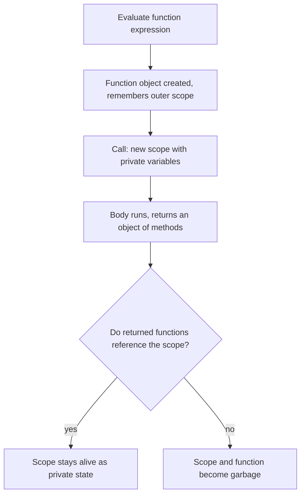

## Introduction

Before 2015, every `<script>` tag on a web page shared one global scope. If your file declared `var count = 0` at the top level, that variable became a property of `window`, visible to — and overwritable by — every other script on the page. Load an analytics library that also happened to use a top-level `count`, and one of you would silently corrupt the other's state. The language had no modules, no `let`, no `const`, and no way to say "these variables belong to this file only".

What it did have was **function scope**: variables declared inside a function exist only inside that function. So developers wrapped their entire file in a function and called it straight away:

```javascript
(function () {
  var count = 0;          // private to this function, not a global
  // ...the rest of the file...
})();
```

That construct is an **Immediately Invoked Function Expression (IIFE)**, pronounced "iffy": a function expression that is called as soon as it is created. Its body runs exactly once, its local variables never reach the global scope, and whatever it chooses to `return` is the only thing the outside world gets.

For a decade the IIFE was the backbone of JavaScript architecture. jQuery, Underscore, Backbone and countless plugins were built from it, and it underpinned the module pattern that later inspired real modules. ES2015 added block-scoped `let`/`const` and ES modules, which removed most of the reasons to write an IIFE by hand. But the construct is far from dead. Bundlers still emit IIFEs when they build a library for a plain `<script>` tag, the async IIFE is the standard way to use `await` in code that cannot use top-level `await`, and an IIFE is a neat way to compute a `const` from several statements. You will also read IIFEs constantly in older code — and you will be asked about them in interviews, because explaining why the parentheses are needed requires understanding how JavaScript parses functions.

## Before you start

- **Function declarations and expressions** — the difference between `function f() {}` as a statement and `function () {}` used as a value. See [[b1-function-declaration]] and [[b1-function-expression]]; the IIFE is a special case of the second.
- **Scope and `var`** — function scope, and why `var` ignores blocks. See [[b1-scope]] and [[b1-var]].
- **Closures** — an inner function keeps access to the variables of the function it was created in. See [[b1-closures]]. The IIFE's most useful tricks are closures in disguise.
- **The global object** — what `window` / `globalThis` is and how scripts pollute it. See [[b1-global-variables]].

## The intuition

Think of an IIFE as a **disposable workshop**. You walk in, use the tools and scrap materials inside to build something, then walk out carrying only the finished product. The workshop is torn down behind you. Nobody outside ever saw the scrap, and nobody can wander in later and rearrange the tools — unless you handed them a key on the way out.

In code: the function body is the workshop, its local variables are the tools and scrap, the `return` value is the finished product, and an inner function that you return is the key, because it can still reach the workshop's variables after the call has finished. Where the analogy stops: the workshop is not torn down if you handed out a key. As long as a returned inner function still references the IIFE's variables, the engine keeps them alive. That is exactly how IIFEs give you private state.

## Anatomy: why the parentheses are required

An IIFE has two parts: a function expression, and a call to it.

```javascript
(function () {
  console.log('runs immediately');
})();
//^^ the call
```

The obvious shorter spelling does not work:

```javascript
function () {
  console.log('runs immediately');
}();
```

```output
SyntaxError: Function statements require a function name
```

The reason is a parsing rule. When a statement **begins with the keyword `function`**, the parser treats it as a **function declaration** — a statement that creates a named binding in the current scope. A declaration must have a name, so the anonymous version fails. Adding a name does not rescue it:

```javascript
function run() {
  console.log('runs immediately');
}();
```

```output
SyntaxError: Unexpected token ')'
```

Now the declaration is valid, but a declaration is a complete statement; it is not a value, so it cannot be called. The parser finishes the declaration at the closing `}` and then sees `()` as a new statement — a grouping operator with nothing inside it, which is illegal. A sneakier variant shows that this is really what happens:

```javascript
function run() {
  console.log('never printed');
}(1);
```

This is *not* an error, and it prints nothing. It is a function declaration followed by a separate expression statement `(1)`, which evaluates the number 1 and discards it. The function is never called.

To call a function at the point of definition, the parser must see it in **expression position** — somewhere a value is expected. The usual way is to wrap the function in the **grouping operator** `( )`. Parentheses can only contain an expression, so inside them `function` starts a **function expression**, which produces a function object as a value. The trailing `()` then calls that value.

### The spellings you will meet

Anything that puts the function in expression position works. These forms all run the body once:

```javascript
(function () { console.log('a'); })();     // parens around the function
(function () { console.log('b'); }());     // parens around the whole call
(() => { console.log('c'); })();           // arrow function IIFE
!function () { console.log('d'); }();      // unary operator forces an expression
void function () { console.log('e'); }();  // same idea, discards the result
const f = function () { return 'f'; }();   // after =, an expression is expected
console.log(f);
```

```output
a
b
c
d
e
f
```

The first two are equivalent; which one to use is a style choice (Douglas Crockford popularised the second, most code today uses the first). The **arrow function** form has one restriction: the parentheses must wrap the arrow function itself, because an arrow function cannot be called directly where it is written — `(() => {}())` and `() => {}()` are both syntax errors. The unary-operator forms come from minified code, where `!` saves a byte. They change the return value — `!function () { return 1; }()` evaluates to `false` — so avoid them in code people read. The last form works without parentheses because the right side of `=` is already expression position, but most style guides still ask for the parentheses as a visual signal that the function is called, not assigned.

> [!WARNING] The missing semicolon trap
> An IIFE starts with `(`. If the previous line has no semicolon, JavaScript may read the `(` as a call on that line's value. `const a = 1` followed by `(function () {})()` on the next line becomes `const a = 1(function () {})()`, which throws `TypeError: 1 is not a function`. Automatic semicolon insertion (ASI) does not save you, because the combined line is valid syntax. Use semicolons, or start the IIFE with a defensive `;(function () { ... })();` if your codebase omits them. See [[b1-asi]].

### Arguments and names

An IIFE is an ordinary function call, so you can pass arguments. Classic libraries used this to give global objects short, local names:

```javascript
(function ($, win) {
  // inside, $ is jQuery and win is window, even if another library
  // later reassigns the global $
})(jQuery, window);
```

This did three useful things: it documented the file's dependencies at the top, it protected the code from a later script overwriting the global `$`, and it let minifiers shorten `win` to a single letter — they cannot rename a global like `window`, but they can rename a parameter. You may also see a third parameter named `undefined` that is never passed. In ES3 the global `undefined` was writable, so a hostile or buggy script could reassign it; a parameter that receives no argument is guaranteed to hold the real `undefined`. ES5 made the global `undefined` read-only, so this trick is obsolete.

An IIFE can also have a name. A **named IIFE** is a named function expression: the name is visible only inside its own body, which lets the function call itself and makes stack traces readable.

```javascript
const result = (function factorial(n) {
  return n <= 1 ? 1 : n * factorial(n - 1);
})(5);

console.log(result, typeof factorial);
```

```output
120 undefined
```

`factorial` is usable inside the body for recursion, but `typeof factorial` outside is `'undefined'`: the name did not leak into the surrounding scope. Named function expressions are covered in [[b1-named-function-expression]].

## Private scope: the original reason

In a browser, a **classic script** (a `<script>` without `type="module"`) runs its top level in the global scope. Every top-level `var` and function declaration becomes a property of the global object. The two snippets below are browser code, described from the HTML and ECMAScript specifications rather than run here:

```javascript title="without-iife.js (classic script)"
var total = 0;
function add(n) { total += n; }
// window.total and window.add now exist; any other script can read
// or overwrite them, and a second file declaring `total` clobbers this one
```

```javascript title="with-iife.js (classic script)"
(function () {
  var total = 0;
  function add(n) { total += n; }
  // total and add exist only inside this call; window is untouched
})();
```

The wrapped version adds nothing to `window`. Because `var` and function declarations are **function-scoped**, they belong to the IIFE's scope, and that scope is unreachable from outside. This was the only reliable scoping tool before ES2015: a bare block `{ ... }` does not contain `var`.

## The revealing module pattern

Hiding everything is only half the story; a library must also expose something. The **revealing module pattern** returns an object whose methods are closures over the IIFE's private variables. The methods can read and change that state; nothing else can.

```javascript title="counter.js"
const counter = (function () {
  let count = 0;                       // private: no code outside can reach it

  function log(action) {               // private helper
    console.log(`${action} -> ${count}`);
  }

  return {
    increment() { count += 1; log('increment'); },
    reset() { count = 0; log('reset'); },
    get value() { return count; },
  };
})();

counter.increment();
counter.increment();
console.log(counter.value);
console.log(counter.count);
counter.reset();
```

```output
increment -> 1
increment -> 2
2
undefined
reset -> 0
```

Follow what happens. The IIFE runs once and creates one `count` variable and one `log` function. It returns an object with three members, and that object is stored in `counter`. The call then finishes — but `count` is not destroyed, because the three methods were created inside the IIFE and hold a reference to its scope. `counter.value` goes through the getter and reads the private variable; `counter.count` looks for a property named `count` on the returned object, finds none, and gives `undefined`. There is no way to set `count` to `-50` from outside; the only operations are the ones you chose to reveal.

The result is a **singleton** — exactly one instance — with genuinely private state. The same idea, called repeatedly instead of once, gives a factory function that creates many independent instances; that variation and its trade-offs against classes are taught in [[b1-private-state]] and [[b1-module-pattern]].

### Splitting a namespace across files

Large pre-module codebases grew one global **namespace object** and let each file add to it through an IIFE:

```javascript
var MyApp = MyApp || {};          // reuse the namespace if an earlier file made it

(function (ns) {
  ns.format = (n) => n.toFixed(2);
})(MyApp);

(function (ns) {
  // a later file can use what an earlier one added
  ns.total = (items) => ns.format(items.reduce((sum, x) => sum + x, 0));
})(MyApp);

console.log(MyApp.total([1.5, 2.25]));
console.log(Object.keys(MyApp));
```

```output
3.75
[ 'format', 'total' ]
```

Only one global name, `MyApp`, is created. Each file keeps its helpers private and attaches its public functions to the namespace. The weakness is that file order matters: the second IIFE uses `ns.format`, so its file must load after the first. Nothing checks this for you. ES modules solved that problem by making dependencies explicit with `import`.

## Fixing the loop-closure bug before `let`

The most famous IIFE use in interviews is a historical one. Before `let`, a loop counter declared with `var` is a single variable shared by every iteration, so callbacks created in the loop all see its final value:

```javascript
var fns = [];
for (var i = 0; i < 3; i++) {
  fns.push(function () { return i; });
}
console.log(fns.map((f) => f()));

var fixed = [];
for (var i = 0; i < 3; i++) {
  (function (j) {
    fixed.push(function () { return j; });
  })(i);
}
console.log(fixed.map((f) => f()));
```

```output
[ 3, 3, 3 ]
[ 0, 1, 2 ]
```

In the first loop, all three functions close over the same `i`. By the time they are called, the loop has finished and `i` is `3`. In the second loop, each iteration calls an IIFE and passes the *current value* of `i` as the argument `j`. Each call creates a new scope with its own `j`, so each pushed function closes over a different variable holding a different number.

Today you write `for (let i = 0; ...)`, which creates a fresh binding per iteration and makes the IIFE unnecessary. Knowing the IIFE fix still matters: it is the clearest demonstration that **a function call creates a new scope**, and it is how you will see the problem solved in older code. The full story is in [[b1-closures-in-loops]] and [[b1-var-loop-problem]].

## The async IIFE

`await` is only allowed inside an `async` function or at the top level of an ES module. In a CommonJS file in Node.js, or in a classic browser script, a top-level `await` is a syntax error:

```javascript title="start.cjs"
const v = await Promise.resolve(42);
```

```output
SyntaxError: await is only valid in async functions and the top level bodies of modules
```

The workaround is an **async IIFE**: an `async` arrow function that is called immediately. Inside it, `await` is legal.

```javascript title="start.js"
const loadUser = (id) =>
  new Promise((resolve) => setTimeout(() => resolve({ id, name: 'Ada' }), 10));

console.log('1. script starts');

(async () => {
  console.log('2. IIFE starts');
  const user = await loadUser(7);
  console.log('4. user loaded:', user.name);
})().catch((err) => {
  console.error('startup failed:', err);
  process.exitCode = 1;
});

console.log('3. script continues');
```

```output
1. script starts
2. IIFE starts
3. script continues
4. user loaded: Ada
```

The numbering shows the most important fact about an async IIFE: **it does not pause the code around it**. The IIFE runs synchronously up to its first `await`, then returns a promise immediately. The script carries on and prints line 3. Only when `loadUser` resolves does the rest of the IIFE resume and print line 4. If line 3 needed `user`, it would not have it yet. Anything that depends on the async result must go inside the IIFE, or chain on the promise it returns.

The `.catch` is not decoration. An async function reports failure by rejecting its promise, and an IIFE's promise is usually not stored anywhere. Without a handler, a failure becomes an **unhandled rejection**, which in Node.js 15 and later terminates the process with a stack trace by default. Handling it explicitly lets you log a clear message and set an exit code. See [[b1-unhandled-rejection]].

In an ES module (`.mjs`, `"type": "module"`, or `<script type="module">`), you can use top-level `await` directly since ES2022, and the async IIFE is unnecessary. Note the difference in behaviour: top-level `await` *does* pause the rest of the module (and any module importing it), while an async IIFE does not. See [[b1-top-level-await]].

## `this` inside an IIFE

An IIFE is called as a plain function, not as a method, so the ordinary rules for `this` apply. In sloppy-mode code a regular function IIFE gets `this === globalThis`; in strict mode (including all ES modules and class bodies) it gets `undefined`. An arrow IIFE has no `this` of its own and uses the surrounding one.

```javascript
const report = {
  name: 'report',
  run() {
    (() => console.log(this.name))();                  // arrow: inherits run's this
    (function () { console.log(this === report); })(); // plain call: not report
  },
};
report.run();
```

```output
report
false
```

This matters when you wrap code that used `this` in an IIFE: a regular-function IIFE silently changes what `this` means. Use an arrow IIFE when the body needs the outer `this`. The rules are in [[b1-this-default]] and [[b1-this-arrow]].

## How it works internally

When the engine evaluates `(function () { ... })()`, three things happen in order.

1. **The function expression is evaluated.** The engine creates a new function object. Like every function, it records the environment it was created in — its `[[Environment]]` internal slot — which is how it will later find outer variables.
2. **The function is called.** A new **function environment record** is created for the call and linked to that saved outer environment. A new execution context is pushed onto the call stack, `var`/function declarations in the body are set up (hoisted), and the body runs. See [[b1-function-execution-context]].
3. **The call returns.** The execution context is popped. The return value is handed to whatever surrounds the IIFE — usually an assignment.

What happens next is up to the garbage collector. The function object itself is unreachable as soon as the call ends, because nothing stored a reference to it. Its environment record is unreachable too — unless the IIFE returned (or stored somewhere) an inner function that references it. In the counter example, the returned methods keep the environment alive for as long as `counter` is reachable. This is a closure, and it is why "private state" works. The details of when closed-over memory is released are in [[b1-closure-memory]].

There is also a parser-level detail. V8, the engine in Chrome and Node.js, normally **pre-parses** functions lazily: it checks their syntax but delays full compilation until they are first called, since many functions are never called. A function wrapped in parentheses is a strong hint that it will be called immediately, so V8 compiles such "possibly invoked function expressions" eagerly instead of parsing them twice. You do not need to act on this, but it explains why some bundlers keep the parentheses around wrapper functions. See [[b1-parsing-jit]].



## IIFE, block or module?

ES2015 gave JavaScript two other ways to create a private scope, and each covers part of what the IIFE did.

| Tool | Scopes `var`? | Scopes `let`/`const`/`class`? | Produces a value? | Typical use today |
|---|---|---|---|---|
| IIFE | Yes | Yes | Yes, via `return` | Async start-up code, computing a `const`, bundles for `<script>` tags |
| Block `{ ... }` | No | Yes | No | Limiting a temporary variable to a few lines |
| ES module (file) | Yes | Yes | Through `export` | Any new application or library code |

A **block** is the lightest option: `{ const tmp = ...; }` keeps `tmp` out of the surrounding scope. But a block cannot contain `var` and cannot return anything. An **ES module** gives every file its own scope, explicit `import`/`export` dependencies, strict mode by default, and top-level `await`. It replaces the revealing module pattern entirely: a top-level variable you do not export is private. See [[b1-modules]] and [[b1-module-scope]].

So for new code, the scoping job of the IIFE belongs to modules and blocks. What remains is the IIFE's other ability: it is an *expression* that runs statements and produces a value. That is why these uses survive.

**Computing a `const` from several steps.** JavaScript has no expression form for `if`/`else` chains or `try`/`catch`. An arrow IIFE lets you keep the result `const`:

```javascript
const config = (() => {
  const env = 'production';
  if (env === 'production') {
    return { apiUrl: 'https://api.example.com', retries: 3 };
  }
  return { apiUrl: 'http://localhost:3000', retries: 0 };
})();

console.log(config);
```

```output
{ apiUrl: 'https://api.example.com', retries: 3 }
```

The alternative — `let config;` followed by assignments in branches — leaves `config` reassignable and briefly `undefined`. Extracting a named helper function (`function loadConfig() { ... }`) is often clearer still; reach for the IIFE when the logic is short and used exactly once.

**Async entry points** in CommonJS scripts, as shown above.

**Library bundles.** When a bundler such as esbuild, Rollup or webpack builds a library for direct inclusion with a `<script>` tag, its IIFE output format wraps the whole bundle in one function and assigns the public API to a single global. Conceptually, the output looks like this (simplified, not literal bundler output):

```javascript
var Greeter = (function () {
  const prefix = 'Hello';                     // private to the bundle
  function greet(name) { return `${prefix}, ${name}`; }
  return { greet };                           // the module's exports
})();
```

It is the namespace pattern again, generated by a tool. With esbuild, for example, this is `--format=iife --global-name=Greeter`.

## In real systems

**Node.js CommonJS modules are wrapped functions.** Before running a `.cjs` file, Node.js wraps its source in a function and calls it. You can print the wrapper yourself:

```javascript
console.log(require('module').wrapper);
```

```output
[
  '(function (exports, require, module, __filename, __dirname) { ',
  '\n});'
]
```

This is why a top-level `var` in a CommonJS file does not become a global, and where `require`, `module` and `__dirname` come from — they are parameters of the wrapper. It is the IIFE idea applied by the runtime to every file.

**Third-party snippets.** Analytics tags, chat widgets and A/B-testing snippets that site owners paste into a page are almost always IIFEs, because they must run on pages whose other scripts they know nothing about and must not leak names into them. Browser extensions' content scripts and userscripts use the same pattern for the same reason.

**Legacy codebases.** jQuery plugins follow the `(function ($) { ... })(jQuery)` shape, and AngularJS-era applications commonly wrapped every file in an IIFE, as the popular AngularJS style guides recommended. When you maintain such code, recognise the IIFE as the file's module boundary.

**Universal Module Definition (UMD).** Libraries that had to work as a global, under CommonJS and under the AMD loader used a UMD header: an IIFE that receives a factory function and decides how to export its result based on what the environment provides. Modern packages ship ES modules instead, but UMD builds are still published for `<script>`-tag users.

## Trade-offs and alternatives

The IIFE's strength is that it works everywhere: any JavaScript engine, any script type, no build step. Its weaknesses are the ones ES modules were designed to fix. Dependencies are implicit — a file silently expects certain globals to exist and certain files to have loaded first. Tools cannot easily analyse which parts of an IIFE-based library you use, so **tree shaking** (removing unused exports at build time) does not work through an IIFE's returned object the way it does with `export`. And the extra nesting and parentheses add visual noise.

There is no meaningful runtime cost to an IIFE. It is one function creation and one call, which happens once.

Use an IIFE when you need a one-off scope that also produces a value, when you need `await` without module top-level `await`, or when you are writing code that must run as a classic script and must not touch the global scope. Prefer ES modules for organising code, blocks for limiting a temporary variable, and a named function when the logic is long enough to deserve a name.

## Common mistakes

> [!MISTAKE] Writing `function () {}()` without parentheses
> A statement that begins with `function` is a declaration, which cannot be called in place. Wrap the function in parentheses: `(function () { ... })()`. For arrow functions, the parentheses must surround the arrow itself: `(() => { ... })()`.

**Forgetting the semicolon on the previous line.** As shown above, a preceding expression without a semicolon gets "called" with your IIFE as its argument. The error message names the previous line's value, not your IIFE, which makes it confusing to debug.

**Expecting an async IIFE to wait.** Code after an async IIFE runs before the IIFE's awaited work finishes. Put dependent code inside the IIFE, or `await` the returned promise from another async function.

**Not handling an async IIFE's rejection.** A floating `(async () => { ... })()` that throws becomes an unhandled rejection. Attach `.catch` or wrap the body in `try`/`catch`.

**Assuming an IIFE protects you from accidental globals.** An IIFE contains *declared* variables. Assigning to an undeclared name in sloppy mode — `total = 0` without `var`, `let` or `const` — still creates a global, IIFE or not. Add `'use strict';` at the top of the IIFE (or use modules) so that assignment throws a `ReferenceError` instead. See [[b1-strict-mode]].

**Changing `this` by wrapping code.** Moving code that uses `this` into a regular-function IIFE gives it `globalThis` or `undefined` instead. Use an arrow IIFE.

## Interview perspective

IIFE questions test whether you understand parsing (declaration versus expression), scope, and closures, and whether you know the history well enough to say what replaced them.

> [!INTERVIEW] Explaining the parentheses
> "A statement starting with `function` is parsed as a function declaration, and a declaration isn't a value, so you can't call it in place. Wrapping it in parentheses puts it in expression position, so it becomes a function expression, which evaluates to a function object, and the trailing `()` calls it."

Questions you should be ready for:

- **What is an IIFE and why was it used?** A function expression called immediately. It created a private scope in an era with only global and function scope, preventing global-variable collisions between scripts and enabling private state via closures.
- **Why does `function f() {}()` fail but `function f() {}(1)` does not?** Both parse as a declaration followed by a separate statement; `()` is an empty grouping (illegal), while `(1)` is a valid expression that is evaluated and discarded. The function never runs in either case.
- **How did IIFEs fix the `var` loop problem?** Each iteration calls a function and passes the current index as an argument, creating a new scope per iteration for the callback to close over. `let` does this automatically now.
- **Implement a counter with private state.** The revealing module pattern above. Strong follow-up: compare it with a class using `#private` fields.
- **Do we still need IIFEs?** Rarely for scoping — modules and blocks cover that. Still useful for async start-up code outside modules, for computing a `const` in one expression, and in bundler output for `<script>` tags.

A good follow-up to anticipate: *"What is printed by `!function () { return true; }()`?"* The expression evaluates to `false` because `!` negates the returned value. It is a reminder that the operator is not just a parsing trick; it participates in the result.

```quiz
Q: Why does `function () { console.log('hi'); }();` throw a SyntaxError?
- [ ] Anonymous functions cannot be called in JavaScript
- [x] A statement starting with `function` is parsed as a declaration, which needs a name and cannot be called in place
- [ ] The call must come before the function body
- [ ] `console.log` is not allowed inside an immediately called function
> The parser decides by position. At the start of a statement, `function` begins a declaration, which requires a name and is not a value. Anonymous functions can be called perfectly well once they are in expression position, for example inside parentheses.

Q: What does this print? `console.log('A'); (async () => { await null; console.log('B'); })(); console.log('C');`
- [ ] A, B, C
- [x] A, C, B
- [ ] A, B and then a SyntaxError
- [ ] C, A, B
> The async IIFE runs synchronously until its first `await`, then returns a promise and lets the outer script continue, so C prints before B. The rest of the IIFE resumes in a later microtask.

Q: Before `let` existed, why did wrapping a loop body in `(function (j) { ... })(i)` fix callbacks that all saw the final `i`?
- [ ] The IIFE delays the callback until the loop ends
- [ ] The IIFE converts `var` into `let`
- [x] Each call creates a new scope with its own parameter `j` holding that iteration's value
- [ ] The IIFE copies the callback for every iteration
> A function call always creates a fresh scope. Passing `i` as an argument copies its current value into a new `j` for each iteration, so each callback closes over a different variable. Without the IIFE, all callbacks shared the single function-scoped `i`.
```

## Practice

1. **Predict, then run.** For each of `!function () { return 0; }()`, `void function () { return 0; }()` and `+function () { return '5'; }()`, predict the value of the whole expression. Explain what each operator contributed.
2. **Private ID generator.** Write an IIFE that exposes `next()` returning `'u1'`, `'u2'`, ... and `peek()` returning the next ID without consuming it. Prove that the counter cannot be modified from outside.
3. **Convert to a module.** Take the `counter` example and rewrite it as an ES module file that exports `increment`, `reset` and `value`. Which parts of the IIFE disappear, and which privacy guarantees remain?
4. **Safe start-up.** Write a CommonJS script whose async IIFE reads two simulated config sources with `await`, merges them, and on failure prints a single-line error and sets `process.exitCode = 1`. Test the failure path by making one source reject.
5. **Find the bug.** A file without semicolons contains `const items = [1, 2, 3]` followed by an IIFE on the next line. Explain the exact error and two ways to fix it.

## Quick revision {#quick-revision}

- IIFE = function expression + immediate call: `(function () { ... })()` or `(() => { ... })()`.
- A statement starting with `function` is a declaration; declarations cannot be called in place. Parentheses (or `!`, `void`, `=`) force expression position.
- `function f() {}(1)` is a declaration plus a discarded `(1)`; the function never runs.
- Arrow IIFEs need parentheses around the arrow itself: `(() => {})()`.
- Purpose: a private scope for `var` and function declarations in classic scripts, so nothing leaks onto `window`.
- Revealing module pattern: return an object of closures over private variables, giving a singleton with private state.
- Pre-`let` loop fix: pass the loop variable as an argument to get a new scope per iteration.
- Async IIFE: allows `await` outside modules; it does not pause surrounding code; always handle rejection.
- Missing semicolon before `(` turns the previous line into a call: `TypeError: ... is not a function`.
- Regular-function IIFE: `this` is `globalThis` (sloppy) or `undefined` (strict); arrow IIFE inherits outer `this`.
- Modern replacements: ES modules for file scope, blocks for `let`/`const` scope, top-level `await` in modules.
- Still used: computing a `const`, CommonJS async start-up, bundler IIFE output, third-party snippets. Node wraps every CommonJS file in a function.

## Key takeaways {#key-takeaways}

- An IIFE is a function expression that is called the moment it is created, so its body runs once in its own scope.
- The parentheses exist because of parsing: they turn what would be a function declaration into an expression that can be called.
- IIFEs gave pre-2015 JavaScript private scope and, combined with closures, private state and modules.
- An async IIFE lets you use `await` where top-level `await` is unavailable, but the code after it keeps running.
- In new code, ES modules and block scope replace the IIFE's scoping role; the IIFE remains useful as a value-producing expression and in generated bundles.
