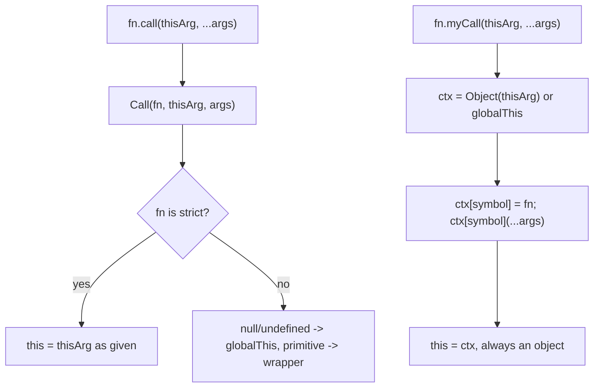

## Introduction

Every regular JavaScript function has an implicit input called `this`. Most of the time JavaScript chooses it for you from the way you call the function: `user.greet()` runs `greet` with `this` set to `user`. Sometimes you need to choose it yourself — to borrow a method from another object, to pass a method as a callback without losing its object, or to pre-fill some arguments. That is what the three methods on `Function.prototype` do:

- `fn.call(thisArg, a, b)` calls `fn` now, with `this = thisArg` and arguments `a, b`.
- `fn.apply(thisArg, [a, b])` is the same, but the arguments come as an array (or array-like).
- `fn.bind(thisArg, a)` does not call anything. It returns a **new function** that, when called later, runs `fn` with `this = thisArg` and `a` placed before whatever arguments it receives.

"Implement `call`, `apply` and `bind`" is a standard interview exercise with one rule: you may not use the built-in `call`, `apply`, `bind` or `Reflect.apply` inside your solution. The question then becomes: *how else can you make a function run with a chosen `this`?* The answer — attach the function to the object and call it as a method — tests whether you understand where `this` comes from. The follow-ups test whether you know the cases where that trick is not quite the same as the real thing.

## Before you start

- **How `this` is chosen** — default, implicit, explicit and `new` binding. See [[b1-this]], [[b1-this-implicit]] and [[b1-this-explicit]].
- **The built-in methods** from the user side. See [[b1-call]] and [[b1-bind]].
- **Strict mode** — it changes what `this` is when you pass `null` or a primitive. See [[b1-strict-mode]].
- **Symbols** — unique property keys that cannot collide with string keys. See [[b1-symbols]].
- **Rest and spread** — `...args` to collect and spread arguments. See [[b1-spread-rest]].

## The intuition: this comes from the call site

The rule that makes the exercise possible is **implicit binding**: when you call a function as a property of an object, `obj.method(...)`, JavaScript sets `this` to `obj` for that call. It does not matter where the function was defined or which object it "belongs to". It only matters which object was to the left of the dot at the moment of the call.

```js title="call-site.js"
function describe() {
  return `I am ${this.name}`;
}

const ada = { name: 'Ada' };
const alan = { name: 'Alan' };

ada.describe = describe;
alan.describe = describe;

console.log(ada.describe());
console.log(alan.describe());
console.log(ada.describe === alan.describe);
```

```output
I am Ada
I am Alan
true
```

The same function object produced two different results because it was called through two different objects. So, to run `describe` with `this = ada` without calling `call`, you can do what this snippet did by hand: **put the function on the object for a moment, call it as a method, then remove it**. Think of it as clipping a tool onto someone's belt, letting them use it once, and unclipping it. That is the entire idea behind `myCall`.

## Implementing call

A first version takes the idea literally.

```js title="naive-call.js"
Function.prototype.naiveCall = function (thisArg, ...args) {
  thisArg.__fn = this; // `this` here is the function naiveCall was called on
  const result = thisArg.__fn(...args);
  delete thisArg.__fn;
  return result;
};

function greet(greeting, mark) {
  return `${greeting}, ${this.name}${mark}`;
}

console.log(greet.naiveCall({ name: 'Ada' }, 'Hello', '!'));
```

```output
Hello, Ada!
```

Inside `naiveCall`, `this` is the function being called on — `greet` — because `greet.naiveCall(...)` is itself a method call on `greet`. That is a nice second use of the same rule.

The naive version works for the happy path and has four bugs that interviewers probe:

1. **Name collision.** If the object already has a `__fn` property, it is overwritten and then deleted. The caller's data is destroyed.
2. **Primitives.** `greet.naiveCall('text')` tries to set a property on a string primitive, which does nothing (or throws in strict mode), so the call fails.
3. **`null` and `undefined`.** `greet.naiveCall(null)` throws on the property assignment.
4. **Exceptions.** If the function throws, `delete` never runs and the temporary property stays on the object.

The robust version fixes each one.

```js title="myCall.js"
Function.prototype.myCall = function (thisArg, ...args) {
  if (typeof this !== 'function') {
    throw new TypeError('myCall must be called on a function');
  }
  // null/undefined -> the global object; primitives -> wrapper objects
  const ctx = thisArg === null || thisArg === undefined ? globalThis : Object(thisArg);
  const key = Symbol('fn'); // unique: cannot collide with any existing key
  ctx[key] = this;
  try {
    return ctx[key](...args);
  } finally {
    delete ctx[key]; // runs even if the function throws
  }
};

function greet(greeting) {
  return `${greeting}, ${this.name}`;
}
function shout() {
  return this.toUpperCase();
}
function boom() {
  throw new Error('failed inside');
}

const user = { name: 'Ada', __fn: 'keep me' };
console.log(greet.myCall(user, 'Hi'));
console.log(user.__fn, Object.getOwnPropertySymbols(user).length);
console.log(shout.myCall('quiet'));

try {
  boom.myCall(user);
} catch (e) {
  console.log(e.message, Object.getOwnPropertySymbols(user).length);
}
```

```output
Hi, Ada
keep me 0
QUIET
failed inside 0
```

**A `Symbol` key cannot collide.** Every call to `Symbol()` returns a new, unique value, so no existing property can have that key. Symbol-keyed properties are also skipped by `Object.keys`, `for...in` and `JSON.stringify`, so code that inspects the object during the call is less likely to notice the temporary property. The `user.__fn` string survived untouched.

**`Object(thisArg)` boxes primitives.** `Object('quiet')` returns a `String` wrapper object, which can hold properties, and inside `shout` the wrapper's `toUpperCase` works as usual.

**`null` and `undefined` become `globalThis`.** This mirrors what happens to a *non-strict* function called with `null`: its `this` becomes the global object. (Strict functions behave differently — see "How it works internally".)

**`try`/`finally` guarantees cleanup.** The `finally` block runs whether the call returns or throws, and the `return` value from `try` is still returned. The last line shows no symbol was left behind after the exception.

**The spread `...args` is allowed.** Spreading an array into a call does not use `call` or `apply`. Before ES2015 there was no spread syntax, and old polyfills built a string such as `"ctx.__fn(args[0], args[1])"` and ran it with `eval` — one reason the exercise used to be considered hard.

## Implementing apply

`apply` is `call` with the arguments packed into one array-like value. The built-in accepts `null` or `undefined` (meaning "no arguments"), accepts any object with a `length` (it reads indices `0` to `length - 1`), and throws a `TypeError` for anything else, such as a number.

```js title="myApply.js"
Function.prototype.myCall = function (thisArg, ...args) {
  const ctx = thisArg == null ? globalThis : Object(thisArg);
  const key = Symbol('fn');
  ctx[key] = this;
  try {
    return ctx[key](...args);
  } finally {
    delete ctx[key];
  }
};

Function.prototype.myApply = function (thisArg, argsArray) {
  if (argsArray === null || argsArray === undefined) {
    return this.myCall(thisArg);
  }
  if (typeof argsArray !== 'object' && typeof argsArray !== 'function') {
    throw new TypeError('CreateListFromArrayLike called on non-object');
  }
  const args = [];
  for (let i = 0; i < argsArray.length; i++) args.push(argsArray[i]);
  return this.myCall(thisArg, ...args);
};

function sum() {
  let total = 0;
  for (const n of arguments) total += n;
  return `${this.label}: ${total}`;
}

console.log(Math.max.myApply(null, [3, 9, 4]));
console.log(sum.myApply({ label: 'array-like' }, { length: 2, 0: 5, 1: 6 }));
console.log(sum.myApply({ label: 'none' }));
try {
  sum.myApply({}, 5);
} catch (e) {
  console.log(e.constructor.name + ': ' + e.message);
}
```

```output
9
array-like: 11
none: 0
TypeError: CreateListFromArrayLike called on non-object
```

The loop reads each index explicitly instead of spreading `argsArray` directly. That matters because spread uses the **iteration protocol**, which plain array-likes such as `{ length: 2, 0: 5, 1: 6 }` do not implement — spreading `{ length: 2 }` throws a `TypeError` because it has no `Symbol.iterator` method. The built-in `apply` reads by index, so ours does too. Holes and missing indices become `undefined`, just as they do in the built-in.

Since ES2015, spread made `apply` far less necessary: `Math.max(...nums)` replaces `Math.max.apply(null, nums)`. You still meet `apply` in older code and in this interview question.

## Implementing bind

`bind` is different in kind: it does not call the function. It returns a new function that remembers three things — the original function, the chosen `this`, and any **pre-filled arguments**. Supplying some arguments now and the rest later is called **partial application** (see [[b1-currying]] for how it relates to currying). A closure is the natural way to remember those three values.

```js title="myBind-basic.js"
Function.prototype.myBind = function (thisArg, ...preset) {
  const fn = this;
  return function (...later) {
    return fn.apply(thisArg, [...preset, ...later]);
  };
};

function volume(unit, w, h, d) {
  return `${this.prefix} ${w * h * d} ${unit}`;
}

const inCm = volume.myBind({ prefix: 'Volume:' }, 'cm3');
console.log(inCm(2, 3, 4));

const button = { label: 'Save', onClick() { return `clicked ${this.label}`; } };
const detached = button.onClick;
const fixed = button.onClick.myBind(button);
console.log(detached());
console.log(fixed());
```

```output
Volume: 24 cm3
clicked undefined
clicked Save
```

To keep the snippet short, the returned function uses the built-in `apply`; in the exercise you would call `myApply` from the previous section instead, which behaves the same here.

The middle line is the interesting one. When this file runs as a CommonJS script (Node's default for `.js` files), `onClick` is a non-strict function, so `detached()` runs with `this = globalThis`, and `globalThis.label` is `undefined`. In strict code the same call would throw a `TypeError` instead, because `this` would be `undefined`. That silent wrong answer is the reason `bind` exists: a method passed somewhere as a plain function — an event handler, a `setTimeout` callback — **loses its object**, and the bug often does not throw. `fixed()` remembers `button` permanently. See [[b1-this-lost]] for more of these cases.

The basic version is the answer most interviewers expect. A stronger answer handles three more behaviours of the built-in.

### bind and new

A function produced by the built-in `bind` can be used with `new`. When it is, the bound `this` is **ignored** — `new` always creates a fresh object — but the preset arguments are still applied, and the result is an instance of the original function.

```js title="myBind-full.js"
Function.prototype.myBind = function (thisArg, ...preset) {
  const fn = this;
  if (typeof fn !== 'function') {
    throw new TypeError('myBind must be called on a function');
  }

  function bound(...later) {
    const args = [...preset, ...later];
    if (new.target) {
      // Called with `new`: ignore thisArg and construct the original function.
      return Reflect.construct(fn, args, new.target === bound ? fn : new.target);
    }
    const ctx = thisArg == null ? globalThis : Object(thisArg);
    const key = Symbol('fn');
    ctx[key] = fn;
    try {
      return ctx[key](...args);
    } finally {
      delete ctx[key];
    }
  }

  if (fn.prototype) bound.prototype = fn.prototype; // so instanceof bound works
  Object.defineProperty(bound, 'name', { value: `bound ${fn.name}` });
  Object.defineProperty(bound, 'length', {
    value: Math.max(0, fn.length - preset.length),
  });
  return bound;
};

function Point(x, y) {
  this.x = x;
  this.y = y;
}

const PointOnYAxis = Point.myBind({ ignored: true }, 0);
const p = new PointOnYAxis(5);
console.log(p, p instanceof Point, p instanceof PointOnYAxis);
console.log(PointOnYAxis.name, PointOnYAxis.length);

const NativeBound = Point.bind({ ignored: true }, 0);
const q = new NativeBound(5);
console.log(q, q instanceof Point, NativeBound.name, NativeBound.length);
```

```output
Point { x: 0, y: 5 } true true
bound Point 1
Point { x: 0, y: 5 } true bound Point 1
```

**`new.target` detects construction.** Inside a function called with `new`, `new.target` is the constructor that was invoked; in a normal call it is `undefined`. When it is set, we construct `fn` with the combined arguments using `Reflect.construct`, which is how you say "`new fn(...args)` but with a chosen `new.target`". Passing `fn` when `new.target === bound` matches the specification for bound functions, and passing `new.target` through otherwise keeps a subclass's prototype if someone writes `class Sub extends BoundThing`.

**`instanceof` needs a `prototype`.** `p instanceof PointOnYAxis` checks whether `PointOnYAxis.prototype` is on `p`'s prototype chain. Sharing `fn.prototype` makes that true. Native bound functions have no `prototype` property at all; the language special-cases them inside `instanceof` by checking the target function instead. Sharing the prototype object is the closest a user-land function can get.

**`name` and `length` match the built-in.** A native bound function is named `"bound " + fn.name`, and its `length` is the original's `length` minus the number of preset arguments, never below zero. Function `name` and `length` are non-writable but configurable, so `Object.defineProperty` can set them.

### Binding twice

Binding an already-bound function cannot change its `this`, because the first bound function never looks at its own `this` — it always uses the value it captured. Preset arguments, however, do accumulate:

```js title="double-bind.js"
function show(a, b) {
  return `${this.id} ${a} ${b}`;
}

const once = show.bind({ id: 'first' }, 'x');
const twice = once.bind({ id: 'second' }, 'y');
console.log(twice());
```

```output
first x y
```

The closure-based `myBind` produces the same result without any special code, for the same reason.

## How it works internally

The built-in `call` does not touch your object at all. The specification defines `Function.prototype.call(thisArg, ...args)` as, in essence, "perform `Call(F, thisArg, args)`": an internal operation that invokes the function's internal `[[Call]]` method with `thisArg` passed straight through as the receiver. What happens to that receiver is decided by the *called* function, in a step the specification calls `OrdinaryCallBindThis`:

- A **strict** function (or a class method, or any code in an ES module) receives `thisArg` exactly as given — `null` stays `null`, `5` stays the primitive `5`.
- A **non-strict** function converts `null`/`undefined` to the global object and boxes primitives into wrapper objects.
- An **arrow function** ignores `thisArg` completely and uses the `this` of the scope where it was created.

Your `myCall` always applies the non-strict conversion, because the temporary-property trick needs an object to attach to. That creates an observable difference with strict functions:

```js title="strict-difference.js"
Function.prototype.myCall = function (thisArg, ...args) {
  const ctx = thisArg == null ? globalThis : Object(thisArg);
  const key = Symbol('fn');
  ctx[key] = this;
  try {
    return ctx[key](...args);
  } finally {
    delete ctx[key];
  }
};

function strictKind() {
  'use strict';
  return typeof this;
}
function strictSelf() {
  'use strict';
  return this;
}

console.log(strictKind.call(5), strictKind.myCall(5));
console.log(strictSelf.call(null) === null, strictSelf.myCall(null) === globalThis);
```

```output
number object
true true
```

The built-in hands the strict function a primitive `5` and a real `null`; the imitation hands it a `Number` object and the global object. You cannot fix this from user code without the built-ins, because the only way to call a function as a method is to have an object on the left of the dot. In an interview, stating this limitation is a strong signal.

Two more differences come from the fact that the trick **writes to the object**:

```js title="trick-limits.js"
Function.prototype.myCall = function (thisArg, ...args) {
  const ctx = thisArg == null ? globalThis : Object(thisArg);
  const key = Symbol('fn');
  ctx[key] = this;
  try {
    return ctx[key](...args);
  } finally {
    delete ctx[key];
  }
};

function getName() {
  return this.name;
}
function ownKeys() {
  return Reflect.ownKeys(this);
}

const frozen = Object.freeze({ name: 'Ice' });
console.log(getName.call(frozen));
try {
  getName.myCall(frozen);
} catch (e) {
  console.log(e.constructor.name + ': ' + e.message);
}

console.log(ownKeys.call({ name: 'Ada' }));
console.log(ownKeys.myCall({ name: 'Ada' }));
```

```output
Ice
TypeError: ctx[key] is not a function
[ 'name' ]
[ 'name', Symbol(fn) ]
```

**Frozen, sealed or non-extensible objects reject the new property.** In this non-strict script the assignment fails silently, so `ctx[key]` is `undefined` and calling it throws. In strict code the assignment itself would throw. See [[b1-object-freeze-seal]].

**The function can see the temporary key.** `Reflect.ownKeys` (and `Object.getOwnPropertySymbols`) list symbol keys, so the callee observes an extra property that the built-in would never add. A `Proxy` passed as `thisArg` would also see the `set` and `deleteProperty` operations, and a setter-heavy object could react to them.

None of this makes the exercise pointless — it demonstrates that you understand implicit binding — but it explains why real polyfills of `bind` (for very old browsers) still used the native `apply` internally.



## Arrow functions

Arrow functions have no `this` of their own. Neither the built-ins nor your versions can change it:

```js title="arrow.js"
Function.prototype.myCall = function (thisArg, ...args) {
  const ctx = thisArg == null ? globalThis : Object(thisArg);
  const key = Symbol('fn');
  ctx[key] = this;
  try {
    return ctx[key](...args);
  } finally {
    delete ctx[key];
  }
};

const team = {
  name: 'core',
  makeArrow() {
    return () => this.name; // captures makeArrow's this
  },
};

const arrow = team.makeArrow();
console.log(arrow.call({ name: 'other' }));
console.log(arrow.myCall({ name: 'other' }));
console.log(arrow.bind({ name: 'other' })());
```

```output
core
core
core
```

Calling an arrow as a method (`ctx[key]()`) does not rebind it either, so `myCall` agrees with the built-in here without extra code. See [[b1-this-arrow]] and [[b1-lexical-this]].

## In real systems

Modern code calls `call`, `apply` and `bind` directly, and rarely needs to re-implement them. The patterns they enable are everywhere:

- **Method borrowing.** `Object.prototype.hasOwnProperty.call(obj, key)` uses a method from one object on another — safe even when `obj` has its own `hasOwnProperty` property or no prototype. ES2022 added `Object.hasOwn(obj, key)` for exactly this case. See [[b1-function-borrowing]].
- **Fixing `this` for callbacks.** `this.handleClick = this.handleClick.bind(this)` in React class components, or `setTimeout(this.tick.bind(this), 1000)`. Class fields with arrow functions (`handleClick = () => { … }`) are the common modern alternative.
- **Partial application.** `const log = console.log.bind(console, '[api]')` creates a logger that prefixes every message.
- **Framework internals.** Event systems and dependency-injection containers call user functions with a chosen receiver; libraries prefer `Reflect.apply(fn, thisArg, args)`, which cannot be affected by someone overwriting `fn.apply`.

The re-implementation matters in interviews and for understanding: once you have written `myBind`, the "lost `this`" bug and the "why is `this` undefined in my handler" question become easy to diagnose.

## Trade-offs and alternatives

| Approach | Changes the object? | Strict-mode faithful? | Allowed in the exercise? |
|---|---|---|---|
| Temporary `Symbol` property | Yes, briefly | No (always boxes) | Yes — the usual answer |
| `Reflect.apply(fn, thisArg, args)` | No | Yes | Usually not (it is the built-in operation) |
| `fn.call`/`fn.apply` | No | Yes | No — it is what you are implementing |
| Closure (`myBind`) | No | Depends on the call it makes | Yes |

If an interviewer allows `apply` inside `bind` (some do, because `bind` is the interesting part), use it: it removes the frozen-object and strict-mode differences. Ask before assuming.

## Common mistakes

**Using a string key such as `'fn'` or `'__fn'`.** It can overwrite and then delete the caller's own property. Use a `Symbol`.

**Forgetting `finally`.** An exception leaves the temporary property on the object forever.

**Writing `myCall` as an arrow function.** `Function.prototype.myCall = (thisArg) => { this … }` captures the module's `this`, not the function `myCall` was called on.

**Spreading the array-like in `myApply`.** `fn(...{ length: 1, 0: 'a' })` throws because plain array-likes are not iterable. Read indices in a loop.

**Losing `new` support in `myBind`.** A closure that always calls `fn` with the bound `this` returns `undefined` from `new Bound()` and builds nothing useful. Check `new.target`.

**Assuming `bind` can be overridden later.** Binding again, or calling a bound function with `call`, never changes its `this`. Only `new` overrides it.

## Interview perspective

**"Implement `Function.prototype.call` without using `call`, `apply` or `bind`."** Explain implicit binding first in one sentence, then write `myCall` with the `Symbol` key, `Object()` boxing, `null` handling and `finally`. Then volunteer the limits: strict functions see a boxed or global `this`, frozen objects fail, and the callee can observe the key.

**"Now implement `apply`."** Reuse `myCall`; handle `null`/`undefined` as no arguments; reject non-objects; read array-likes by index.

**"Implement `bind`."** Return a closure that combines preset and later arguments. Follow-ups: "Can you `new` it?" (check `new.target`, construct the original), "What is `bound.length`?" (original length minus presets, not below zero), "What happens if you bind twice?" (the first `this` wins; arguments accumulate).

**"What does `fn.call(null)` give as `this`?"** It depends on the callee: `null` in strict code, `globalThis` in non-strict code, and the lexical `this` in an arrow function.

```quiz
Q: Why does `myCall` use `Symbol('fn')` as the temporary key instead of a string such as `'__fn'`?
- [ ] Symbols make the call run faster
- [x] A new symbol cannot equal any existing key, so the caller's properties are never overwritten or deleted
- [ ] String keys cannot hold functions
- [ ] Symbols make the object frozen during the call
> Every `Symbol()` call produces a unique value, so `ctx[key] = fn` can never clobber an existing property, and `delete ctx[key]` cannot remove one. A string key works until the object happens to have that property — then the trick silently destroys the caller's data.
```

```quiz
Q: `function f() { 'use strict'; return this; }`. What do `f.call(7)` and a `myCall` built on the temporary-property trick return for `f.myCall(7)`?
- [ ] Both return the primitive `7`
- [x] `f.call(7)` returns the primitive `7`; `f.myCall(7)` returns a `Number` wrapper object
- [ ] Both return a `Number` wrapper object
- [ ] Both return `globalThis`
> The built-in passes `thisArg` through unchanged, and strict functions do not box it. The trick has to attach the function to an object, so it boxes `7` with `Object(7)` first, and the function sees that wrapper. This difference cannot be removed without using the built-in call machinery.
```

```quiz
Q: `const B = Point.bind({ a: 1 }, 0); const p = new B(5);` What is true?
- [ ] `this` inside `Point` is `{ a: 1 }`
- [ ] `new` throws because bound functions are not constructors
- [x] `this` is a fresh object, `p` is `Point { x: 0, y: 5 }`, and `p instanceof Point` is `true`
- [ ] Preset arguments are ignored under `new`
> When a bound function is called with `new`, the bound `this` is ignored and a new instance of the target is created, but the preset arguments are still applied first. That is why `myBind` checks `new.target` and constructs the original function with the combined arguments.
```

## Practice

1. Extend `myCall` so that it throws the same `TypeError` as the built-in when called on a non-function, for example `Function.prototype.myCall.call({})`.
2. Write `myBind` using only `myApply`, then list which of the built-in behaviours (name, length, `new`, `instanceof`) your version reproduces.
3. Write `softBind(fn, defaultThis)`: like `bind`, but if the bound function is called as a method of some other object (`obj.soft()`), use `obj` instead. Hint: inspect `this` inside the returned function.
4. Use your `myCall` to borrow `Array.prototype.join` for the array-like `{ length: 3, 0: 'a', 1: 'b', 2: 'c' }`.
5. Explain, with a snippet, why `setTimeout(user.greet, 0)` logs the wrong name, and fix it three ways: `bind`, an arrow wrapper and a class field.

## Quick revision {#quick-revision}

- Implicit binding: `obj.fn()` runs `fn` with `this = obj`. That is how to implement `call` without `call`.
- `myCall`: check `this` is a function → `ctx = thisArg == null ? globalThis : Object(thisArg)` → `key = Symbol()` → `ctx[key] = this` → `try { return ctx[key](...args) } finally { delete ctx[key] }`.
- `myApply`: `null`/`undefined` → no arguments; non-object → `TypeError`; array-like → read indices `0..length-1` (do not spread it).
- `myBind`: closure over `fn`, `thisArg`, `preset`; call with `[...preset, ...later]`.
- Under `new`, a bound function ignores bound `this`, keeps preset arguments and constructs the target (`new.target` + `Reflect.construct`).
- Bound `name` is `"bound " + fn.name`; `length` is `max(0, fn.length - preset.length)`.
- Binding twice: first `this` wins, arguments accumulate. Arrow functions ignore every `thisArg`.
- Limits of the trick: strict functions get a boxed/global `this`; frozen objects fail; the callee can see the symbol key; proxies observe the writes.

## Key takeaways {#key-takeaways}

- `this` is decided by the call site, so attaching a function to an object and calling it as a method is a legitimate way to choose `this`.
- A robust `myCall` needs a `Symbol` key, primitive boxing, `null` handling and cleanup in `finally`.
- `bind` is a closure that remembers a function, a receiver and preset arguments; a complete version also supports `new`.
- The built-ins pass `thisArg` straight to the callee, which decides how to treat it; the imitation cannot, and saying so is part of a strong answer.
- In production, use the built-ins or `Reflect.apply`; the exercise is about understanding, not replacement.
