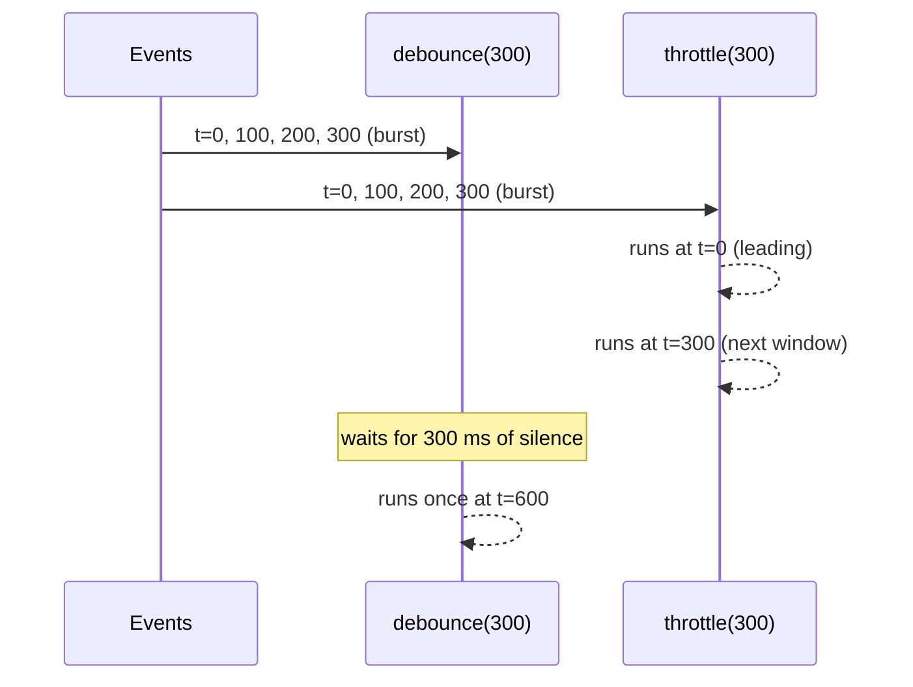

## Introduction

Some events fire far more often than you want to react to them. Typing "javascript" into a search box fires ten `input` events in about a second; scrolling fires dozens of `scroll` events per second; resizing a window fires `resize` continuously while the user drags. If every event triggers a network request or a layout calculation, the page becomes slow and the server gets flooded.

Two wrappers fix this by deciding *when* the real function may run:

- **Debounce** waits until the events **stop** for a given quiet period, then runs once. A search box that only queries after the user pauses typing for 300 ms is debounced.
- **Throttle** lets the function run **at most once per interval**, however many events arrive. A scroll handler that updates a progress bar at most every 100 ms is throttled.

A third wrapper, **memoize**, decides *whether* the function needs to run at all: it remembers results by their inputs, and returns the remembered result when the same inputs come again.

All three are **higher-order functions** — they take a function and return a new function with the same calling interface — and all three are built on a **closure** that holds private state between calls. "Write `debounce`" is one of the most common frontend interview questions; "now make it support leading calls" and "now write `throttle`" are the standard follow-ups. This lesson builds each one, adds the options real libraries such as Lodash provide, and covers the bugs that show up in production.

## Before you start

- **Closures** — a returned function keeps access to variables of the function that created it. See [[b1-closures]].
- **Timers** — `setTimeout`, `clearTimeout`, and the fact that the delay is a minimum, not a guarantee. See [[b1-settimeout]].
- **`this` and `apply`** — the wrapper must pass the caller's `this` through. See [[b1-this]] and [[b1-impl-call-apply-bind]].
- **`Map`** — keys of any type, compared by identity. See [[b1-map]].
- The user-side views of these ideas: [[b1-debounce]], [[b1-throttle]], [[b1-debounce-vs-throttle]] and [[b1-memoization]].

## The intuition

**Debounce is a lift door.** Every time someone walks in, the door's close timer restarts. The door closes (the function runs) only when nobody has walked in for a few seconds. A steady stream of people keeps it open indefinitely.

**Throttle is a turnstile with a clock.** It lets one person through, then stays locked until the interval has passed, no matter how many people push on it. A steady stream gets through at a steady rate.

**Memoize is a notebook.** Before doing a calculation, check whether you have written down the answer for these exact inputs. If so, read it; if not, calculate, write it down, then answer.

The analogies already show the key difference between the first two: under a continuous stream of events, a debounced function may *never* run until the stream stops, while a throttled function runs regularly throughout.



## Implementing debounce

The core of debounce fits in five lines: each call cancels the pending timer and starts a new one.

```js title="debounce-basic.js"
function debounce(fn, wait) {
  let timer = null;
  return function debounced(...args) {
    clearTimeout(timer); // forget the previous pending call
    timer = setTimeout(() => {
      timer = null;
      fn.apply(this, args); // `this` comes from the arrow's surrounding call
    }, wait);
  };
}

const search = debounce((query) => console.log('search:', query), 50);

// Simulated typing: three keystrokes 20 ms apart, then a pause, then one more.
setTimeout(() => search('j'), 0);
setTimeout(() => search('ja'), 20);
setTimeout(() => search('jav'), 40);
setTimeout(() => search('java'), 200);
```

```output
search: jav
search: java
```

Four calls produced two runs. The first three arrived within 50 ms of each other, so each reset the timer; only the last of them (`'jav'`, at about 40 ms) survived, and it ran at about 90 ms. The fourth call arrived long after, with nothing to cancel, and ran at about 250 ms.

Three design points are worth stating out loud in an interview.

**The timer id lives in the closure.** `timer` is created once, when `debounce` runs, and shared by every call to `debounced`. A version that declared `let timer` inside `debounced` would get a fresh variable each call and never cancel anything.

**`this` and arguments are preserved.** The returned function is a regular `function`, so when it is used as a method (`input.onSearch = debounce(...)`, then `input.onSearch()`), its `this` is the object. The arrow function passed to `setTimeout` has no `this` of its own, so it uses `debounced`'s, and `fn.apply(this, args)` forwards both. Writing `setTimeout(fn, wait)` would lose the arguments, and making `debounced` an arrow function would lose `this`.

**The last call's arguments win.** Each call replaces the timer, and the new timer's callback closes over that call's `args`. This is what you want for a search box: query the final text, not the first keystroke.

### Leading mode, cancel and flush

The basic version is **trailing**: it runs at the *end* of a burst. Sometimes you want the opposite. A "Save" button should react to the first click immediately and ignore the double-click that follows. That is **leading** debounce: run on the first call of a burst, then ignore calls until the quiet period passes.

Real implementations also expose two controls:

- **`cancel()`** drops any pending call — for example when the component that owns the handler is removed from the page.
- **`flush()`** runs the pending call immediately — for example when the user presses Enter, or the page is about to unload and the latest draft must be saved.

```js title="debounce.js"
function debounce(fn, wait, { leading = false, trailing = true } = {}) {
  let timer = null;
  let lastArgs = null;
  let lastThis = null;

  function invoke() {
    const args = lastArgs;
    const ctx = lastThis;
    lastArgs = lastThis = null;
    return fn.apply(ctx, args);
  }

  function startTimer() {
    timer = setTimeout(() => {
      timer = null;
      if (trailing && lastArgs) invoke(); // only if a call is still pending
    }, wait);
  }

  function debounced(...args) {
    const isNewBurst = timer === null;
    lastArgs = args;
    lastThis = this;
    clearTimeout(timer);
    startTimer();
    if (leading && isNewBurst) invoke(); // first call of a burst runs now
  }

  debounced.cancel = () => {
    clearTimeout(timer);
    timer = lastArgs = lastThis = null;
  };
  debounced.flush = () => {
    if (timer === null) return;
    clearTimeout(timer);
    timer = null;
    if (lastArgs) invoke();
  };
  return debounced;
}

const save = debounce((label) => console.log('save', label), 50, {
  leading: true,
  trailing: false,
});
save('click 1');
save('click 2'); // ignored: same burst
setTimeout(() => save('click 3'), 100); // new burst: runs

const draft = debounce((text) => console.log('draft', text), 1000);
draft('hel');
draft('hello');
draft.flush(); // runs now instead of in a second

const resize = debounce(() => console.log('never printed'), 30);
resize();
resize.cancel();
```

```output
save click 1
draft hello
save click 3
```

The state is now three variables: the timer, and the `this` and arguments of the most recent call that has not run yet. `invoke` clears `lastArgs` when it runs, which is how the trailing timer knows whether there is still something to do.

Trace the `save` button. The first call starts a new burst (no timer), so with `leading: true` it runs immediately. The second call arrives while the timer is running: it restarts the timer but is not a new burst, and `trailing: false` means it will never run. After 50 quiet milliseconds the timer clears itself, so the call at 100 ms starts a new burst and runs.

With both `leading` and `trailing` true, a single isolated call runs once (leading), because `invoke` cleared `lastArgs` and the trailing check finds nothing pending. A burst of several calls runs twice: once at the start and once, with the latest arguments, at the end.

> [!NOTE] maxWait
> Under a continuous stream of events a trailing debounce never runs. Lodash's `debounce` has a `maxWait` option that forces a run at least every `maxWait` milliseconds. A debounce with `maxWait` equal to `wait` behaves like a throttle — Lodash implements `throttle` exactly that way.

## Implementing throttle

The simplest throttle remembers when it last ran and ignores calls until `wait` milliseconds have passed.

```js title="throttle-basic.js"
function throttle(fn, wait) {
  let last = -Infinity; // so the very first call always runs
  return function throttled(...args) {
    const now = Date.now();
    if (now - last >= wait) {
      last = now;
      fn.apply(this, args);
    }
  };
}

const onScroll = throttle((i) => console.log('handle scroll event', i), 100);

// Ten events, 30 ms apart (t = 0, 30, 60, ..., 270).
for (let i = 0; i < 10; i++) setTimeout(() => onScroll(i), i * 30);
```

```output
handle scroll event 0
handle scroll event 4
handle scroll event 8
```

Event 0 runs at t = 0. Events 1–3 (t = 30–90) are inside the 100 ms window and dropped. Event 4 at t = 120 is the first one at least 100 ms after the last run, so it runs and starts a new window; event 8 at t = 240 runs for the same reason. (Timer delays are minimums, so real times drift by a few milliseconds; the gaps here are large enough that the result is stable.)

This version is **leading-only**, and it has a real flaw: the *last* event in a burst is often dropped. Events 5–7 and event 9 never ran. If the handler shows the scroll position, the final position the user stopped at is never displayed.

### Adding a trailing call

The fix is to remember the latest dropped call and schedule it for the moment the window ends.

```js title="throttle.js"
function throttle(fn, wait) {
  let last = -Infinity;
  let timer = null;
  let pendingArgs = null;
  let pendingThis = null;

  function invoke(ctx, args) {
    last = Date.now();
    fn.apply(ctx, args);
  }

  function throttled(...args) {
    const remaining = wait - (Date.now() - last);
    if (remaining <= 0) {
      clearTimeout(timer); // a trailing call may be scheduled; we are running now
      timer = null;
      invoke(this, args);
    } else {
      pendingArgs = args; // keep only the most recent call
      pendingThis = this;
      if (timer === null) {
        timer = setTimeout(() => {
          timer = null;
          invoke(pendingThis, pendingArgs);
          pendingArgs = pendingThis = null;
        }, remaining);
      }
    }
  }

  throttled.cancel = () => {
    clearTimeout(timer);
    timer = pendingArgs = pendingThis = null;
    last = -Infinity;
  };
  return throttled;
}

const onScroll = throttle((i) => console.log('run', i), 100);

// Nine events, 30 ms apart (t = 0, 30, ..., 240).
for (let i = 0; i <= 8; i++) setTimeout(() => onScroll(i), i * 30);
```

```output
run 0
run 3
run 6
run 8
```

Trace it. Event 0 runs immediately. Event 1 (t = 30) is 70 ms too early, so it is saved and a timer is set for t = 100. Events 2 and 3 replace the saved arguments but do not set new timers. At t = 100 the timer runs the latest saved call — event 3. Event 4 (t = 120) is 80 ms too early, so a timer is set for t = 200, which runs event 6. Event 7 (t = 210) schedules t = 300, which runs event 8, the final event. The function ran every 100 ms throughout, and the last event was not lost.

Two details make it correct. The timer's delay is `remaining`, not `wait`, so the trailing run lands exactly at the end of the current window. And `invoke` updates `last`, so a trailing run starts a new window like any other run.

> [!TIP] Throttling to the screen
> For work that updates what is drawn — moving an element on scroll or drag — throttling to the display's refresh rate with `requestAnimationFrame` is usually better than a fixed interval: the browser calls you once per frame, right before painting. See [[b1-requestanimationframe-js]].

## Implementing memoize

Memoization trades memory for time. It is only correct for **pure functions**: functions whose result depends only on their arguments and that have no side effects (see [[b1-pure-functions]]). Memoizing `getCurrentTime()` or `sendEmail(to)` would be a bug.

```js title="memoize.js"
function memoize(fn, resolver = (first) => first) {
  const cache = new Map();
  function memoized(...args) {
    const key = resolver(...args);
    if (cache.has(key)) return cache.get(key);
    const result = fn.apply(this, args);
    cache.set(key, result);
    return result;
  }
  memoized.cache = cache; // exposed so callers can inspect or clear it
  return memoized;
}

let calls = 0;
const slowSquare = (n) => {
  calls++;
  return n * n;
};

const square = memoize(slowSquare);
console.log(square(4), square(4), square(5), 'computed', calls, 'times');

const area = memoize((w, h) => w * h, (w, h) => `${w}x${h}`);
console.log(area(2, 3), area(3, 2), area.cache);

const fib = memoize((n) => (n < 2 ? n : fib(n - 1) + fib(n - 2)));
console.log(fib(90));
```

```output
16 16 25 computed 2 times
6 6 Map(2) { '2x3' => 6, '3x2' => 6 }
2880067194370816000
```

**`cache.has` before `cache.get`.** Checking `if (cache.get(key))` would treat cached results of `0`, `''`, `false` or `undefined` as misses and recompute them every time. `has` asks whether the key exists, regardless of the value.

**A `Map`, not a plain object.** Object keys are converted to strings, so `1` and `'1'` collide and object arguments all become `'[object Object]'`. A `Map` keeps keys as they are and compares them with **SameValueZero** — like `===`, except `NaN` equals `NaN`. That means primitive arguments work naturally, and object arguments are compared by **identity**: the same object hits the cache, a different object with equal contents does not.

**The resolver decides what "the same inputs" means.** The default uses only the first argument, which is what Lodash's `memoize` does — a deliberate, documented choice that is wrong for multi-argument functions. `area` passes a resolver that builds a key from both arguments.

**Recursive functions must call the memoized version.** `fib` refers to the variable `fib`, which holds the memoized function, so every recursive call checks the cache. That turns the exponential naive recursion into a linear one; `fib(90)` without memoization would take years. If the inner function called an unmemoized copy of itself, only the outermost call would be cached.

### Choosing a cache key

For multiple arguments, `JSON.stringify(args)` is the popular quick resolver. It works for flat lists of numbers and strings, and it is wrong in several ways you should be able to name:

```js title="json-keys.js"
const key = (...args) => JSON.stringify(args);

console.log(key({ a: 1, b: 2 }) === key({ b: 2, a: 1 })); // same data, different key
console.log(key(undefined) === key(null)); // different data, same key
console.log(key(NaN) === key(null));
console.log(key(new Map([[1, 2]])));
console.log(key(() => 1));
```

```output
false
true
true
[{}]
[null]
```

Property order changes the key, so equal objects miss. `undefined`, `null` and `NaN` all become `null` inside arrays, so different arguments collide and return each other's results. A `Map`, a `Set`, and a function all serialise to something meaningless, so every call with any `Map` shares one entry. And `JSON.stringify` throws on circular objects and on `BigInt`. See [[b1-json-unsupported]].

Better choices, in order of preference: a resolver that picks the meaningful identity (`(user) => user.id`); a resolver that joins primitive arguments with a separator that cannot appear in them; or a nested `Map` keyed by each argument in turn, which keeps identity semantics for every position.

### Memory: when to forget

A memo cache grows forever unless something removes entries. For a function called with an unbounded variety of inputs — user ids, search strings — that is a memory leak. Three remedies are common:

- **Limit the size** and evict the least recently used entry (an **LRU cache**). A `Map` remembers insertion order, so deleting and re-inserting a key on each hit, and evicting `cache.keys().next().value` when full, gives a simple LRU.
- **Key by object with a `WeakMap`.** When the argument is an object whose lifetime you do not control (a DOM node, a parsed document), a `WeakMap` lets the entry disappear when the object is garbage-collected. See [[b1-weakmap]].
- **Expire entries** after a time-to-live when the underlying data can change.

### Memoizing async functions

Memoizing a function that returns a promise caches the **promise**, which is useful: two calls made before the first finishes share one request instead of starting two. The trap is failure — a rejected promise stays cached, and every later call gets the same rejection forever. Remove the entry when the promise rejects:

```js title="memoize-async.js"
function memoizeAsync(fn) {
  const cache = new Map();
  return (key) => {
    if (cache.has(key)) return cache.get(key);
    const promise = fn(key).catch((err) => {
      cache.delete(key); // do not cache failures
      throw err;
    });
    cache.set(key, promise);
    return promise;
  };
}

let attempts = 0;
const loadUser = memoizeAsync(async (id) => {
  attempts++;
  if (attempts === 1) throw new Error('network blip');
  return { id, name: 'Ada' };
});

const [a, b] = await Promise.allSettled([loadUser(7), loadUser(7)]);
console.log(a.status, b.status, 'attempts:', attempts); // both shared one request
console.log(await loadUser(7), 'attempts:', attempts); // retried after the failure
console.log(await loadUser(7), 'attempts:', attempts); // now served from the cache
```

```output
rejected rejected attempts: 1
{ id: 7, name: 'Ada' } attempts: 2
{ id: 7, name: 'Ada' } attempts: 2
```

The two concurrent calls shared one attempt and both saw its failure. Because the failed promise was deleted, the next call retried, and the successful promise was cached from then on.

## How it works internally

None of these wrappers touches the event loop directly. `setTimeout` and `clearTimeout` are provided by the **host** — the browser or Node.js — not by the JavaScript language. Your debounce only stores the numeric (browser) or object (Node) id that `setTimeout` returns and hands it back to `clearTimeout`. When a timer expires, the host queues its callback as a task, and the event loop runs it once the call stack is empty (see [[b1-event-loop]]).

That has two consequences. First, a timer's delay is a **minimum**: if the main thread is busy for 200 ms, a 50 ms debounce runs after 200 ms. Second, browsers **throttle timers in background tabs** (commonly to at most once per second, and more aggressively for long-hidden tabs), so a debounced autosave may run later than expected while the tab is hidden. Neither affects correctness, but both affect timing assumptions in tests.

Each call to `debounce`, `throttle` or `memoize` creates a **separate closure** with its own state. Two components that each call `debounce(handler, 300)` get two independent timers. That is usually what you want — and the source of a common React bug, below.

`Date.now()` reads the wall clock, which can jump if the system time changes. `performance.now()` is monotonic and is the better clock for throttling in browsers; the code is identical apart from that call.

## In real systems

**Search-as-you-type** uses trailing debounce (typically 200–400 ms) so a request is sent when the user pauses. Debouncing reduces requests but does not stop out-of-order responses: an older, slower response can still arrive after a newer one. Pair debounce with cancellation or a "latest request wins" check — see [[b1-stale-requests]].

**Resize and layout** handlers use debounce when only the final size matters (recompute a chart once), and throttle or `requestAnimationFrame` when the UI must follow the drag.

**Scroll** handlers — infinite-scroll triggers, "back to top" buttons, analytics — use throttle with a trailing call so the final position is processed.

**Buttons** use leading debounce (or simply disabling the button while a request is in flight) to prevent double submission.

**Memoization** appears in selectors (`reselect` in Redux), in React (`useMemo`, `React.memo`), and in data-fetching libraries that deduplicate concurrent requests for the same key.

In React, creating the debounced function inside the component body creates a new closure — with a new, empty timer — on every render, so nothing is ever debounced. Create it once, for example with `useMemo` or `useRef`, and call `cancel` in the effect cleanup when the component unmounts. See [[b1-closures-react]].

## Trade-offs and alternatives

| Wrapper | Runs | Best for | Cost |
|---|---|---|---|
| Debounce (trailing) | once, after a quiet period | search input, autosave, final resize | adds latency; may never run under a constant stream |
| Debounce (leading) | once, at the start of a burst | double-click protection | ignores the burst's later, possibly newer, values |
| Throttle (leading + trailing) | at most once per interval, plus the last call | scroll, drag, progress updates | still runs often; work per run must be cheap |
| `requestAnimationFrame` | once per frame | visual updates | only runs while the page is visible |
| Memoize | only for unseen inputs | pure, expensive, repeated calls | memory; wrong if the function is impure |

Prefer a well-tested library (`lodash.debounce`, `lodash.throttle`) in production; edge cases such as `maxWait`, return values and clock changes have been worked out there. Write your own in interviews and when a dependency is not worth it.

## Common mistakes

**Declaring the timer inside the returned function.** Each call gets a new variable, nothing is cancelled, and every call runs.

**Losing `this` or arguments.** Using an arrow function for `debounced`, or `setTimeout(fn, wait)` without passing `args`, breaks methods and handlers that need the event object.

**Expecting a return value.** A trailing debounced function cannot return `fn`'s result, because `fn` has not run yet. Lodash returns the result of the *previous* run; if you need the value, use a callback or return a promise.

**Leading-only throttle for scroll.** The final scroll position is dropped. Add a trailing call.

**Recreating wrappers on every render.** In React, `const onChange = debounce(...)` in the component body resets the wrapper on every render.

**Memoizing impure functions.** Results that depend on time, randomness or external state become stale.

**`if (cache.get(key))` instead of `cache.has(key)`.** Falsy results are recomputed every time.

**`JSON.stringify` keys for objects.** Key order, `undefined`/`NaN`, `Map`, `Set` and functions all produce wrong hits or misses.

**Caching rejected promises.** One transient failure is served forever. Delete on rejection.

## Interview perspective

**"Write `debounce`."** Start with the five-line trailing version and narrate the three points: timer in the closure, `this` and arguments forwarded, last call wins. Then offer `cancel`. If asked for leading mode, explain "new burst = no timer running".

**"What is the difference between debounce and throttle?"** Debounce waits for silence and runs once; throttle runs at a steady maximum rate. Give one use case for each, and point out that under a constant stream debounce never runs.

**"Write `throttle`; what about the last event?"** Write the timestamp version, then identify the dropped trailing call yourself and fix it with a timer whose delay is the remaining time in the window.

**"Write `memoize`. How would you support multiple arguments? What about memory?"** Use a `Map` and `has`. Discuss resolvers, why `JSON.stringify` is fragile, identity semantics for objects, `WeakMap`, and LRU eviction.

**"How would you test these?"** Use fake timers (Vitest's `vi.useFakeTimers()` or Jest's equivalent) so tests advance time instantly and deterministically instead of sleeping.

```quiz
Q: A search box uses `debounce(fetchResults, 300)`. The user types continuously, one key every 200 ms, for 5 seconds. How many times does `fetchResults` run during those 5 seconds?
- [ ] About 25 times, once per keystroke
- [ ] About 16 times, once every 300 ms
- [x] Zero times; it runs once, about 300 ms after the last keystroke
- [ ] Once, immediately after the first keystroke
> Every keystroke arrives before the 300 ms quiet period ends, so each one cancels the pending timer and starts a new one. A trailing debounce only runs after a gap of at least `wait`. Running every 300 ms describes throttle; running on the first keystroke describes leading debounce.
```

```quiz
Q: Why is a leading-only throttle a poor choice for a handler that displays the current scroll position?
- [ ] It runs too often and blocks the main thread
- [x] Calls during the final window are dropped, so the position where the user stopped may never be shown
- [ ] It loses `this`
- [ ] It runs only after scrolling stops
> A leading-only throttle runs at the start of each window and discards everything else in it. If the user stops scrolling partway through a window, that final event is discarded and nothing runs afterwards. A trailing call, scheduled for the end of the window with the latest arguments, fixes it.
```

```quiz
Q: A memoized function uses `if (cache.get(key)) return cache.get(key);`. What goes wrong?
- [ ] Object keys are compared by contents
- [ ] The cache never stores anything
- [x] Results such as `0`, `''` or `false` are treated as misses and recomputed every time
- [ ] `NaN` keys throw
> `cache.get` returns the stored value, and a falsy stored value fails the `if`. `cache.has(key)` asks whether the key exists, independent of the value. The other options are wrong: a `Map` compares object keys by identity, and SameValueZero makes `NaN` a valid, matching key.
```

## Practice

1. Add `maxWait` to `debounce`: the function must run at least once every `maxWait` milliseconds during a continuous stream.
2. Make `debounce` return a promise that resolves with `fn`'s result when the call actually runs (and rejects or stays pending for cancelled calls — decide and justify).
3. Write `throttle` with `leading` and `trailing` options, and test all four combinations with fake timers.
4. Turn `memoize` into an LRU cache with a `maxSize` option, using only `Map`.
5. Write `memoizeDeep(fn)` that keys by every argument using nested `Map`s, so `f(a, b)` and `f(b, a)` are distinct and object identity is respected at each position.

## Quick revision {#quick-revision}

- Debounce: one `timer` in the closure; each call `clearTimeout(timer)` then `setTimeout(() => fn.apply(this, args), wait)`; last call wins.
- Leading debounce: run when no timer is active (new burst); `trailing` runs at the end only if a call is still pending. Add `cancel` (clear everything) and `flush` (run pending now).
- Throttle (leading): `if (now - last >= wait) { last = now; run }`; start `last = -Infinity`.
- Throttle (trailing): save latest args; schedule one timer for `wait - (now - last)`; `invoke` updates `last`.
- Under a constant stream: debounce never runs; throttle runs every `wait`.
- Memoize: `Map`, `has` before `get`, `resolver` for keys; recursive functions must call the memoized name.
- `JSON.stringify` keys: order-sensitive, `undefined`/`NaN` → `null`, `Map`/`Set`/functions lost, throws on cycles and `BigInt`.
- Bound memory with LRU, `WeakMap` for object keys, or TTL. Async: cache the promise, delete it on rejection.
- Timers are host APIs; delays are minimums; background tabs throttle timers. Test with fake timers.

## Key takeaways {#key-takeaways}

- Debounce, throttle and memoize are closures that hold state between calls: a timer, a timestamp, or a cache.
- Debounce waits for silence; throttle limits rate. Pick by asking whether intermediate events matter.
- Forward `this` and arguments, and let the latest call's arguments win.
- A complete throttle has a trailing call so the final event is not lost.
- Memoization is only correct for pure functions, and its cache key and memory growth need deliberate choices.
