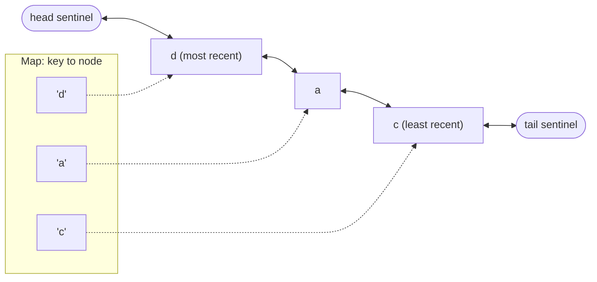

## Introduction

A **cache** keeps the results of expensive work — network responses, database rows, rendered thumbnails, computed values — so the next request for the same thing is fast. Every cache faces the same problem: memory is finite. A cache that only ever grows eventually becomes a memory leak. So a cache needs a **capacity** and an **eviction policy**: a rule for which entry to throw away when a new one must fit.

**Least Recently Used (LRU)** is the most widely used policy. It evicts the entry that has gone unused for the longest time. The bet behind it is **temporal locality**: things used recently are likely to be used again soon, and things untouched for a long time probably will not be. That bet holds for many real workloads — a user's current page, the products on today's front page, the last few files you opened — which is why LRU (or an approximation of it) shows up in CPU caches, operating-system page caches, databases, CDNs and browser memory caches.

"Implement an LRU cache with O(1) `get` and `set`" is one of the most common coding interview questions in any language. In JavaScript it has a twist: the built-in `Map` already remembers insertion order, which makes a very short correct solution possible. Interviewers often accept it and then ask for the classic version with a linked list, so this lesson teaches both.

## Before you start

- **Map** — `get`, `set`, `has`, `delete`, `size`, and iterating keys in insertion order. See [[b1-map]] and [[b1-map-vs-object]].
- **Hash maps** — why lookups by key take O(1) on average. See [[a1-hashmap]].
- **Classes and private fields** — see [[b1-classes]].
- **Big-O notation** — what O(1) and O(n) mean. See [[a1-big-o]].

Linked lists are explained in this lesson as far as they are needed.

## The intuition

Picture a desk with room for three books, stacked in a pile. Whenever you use a book, you put it back **on top**. When you need a fourth book and the desk is full, you take the book at the **bottom** of the pile — the one you have not touched for longest — and return it to the shelf.

That pile is an LRU cache with capacity 3. The two operations are:

- **`get(key)`** — find the book; if it is there, move it to the top and read it. If not, it is a miss.
- **`set(key, value)`** — put a book on top. If it was already on the desk, just move it to the top with its new contents. If it is new and the desk is full, first remove the bottom book.

Here is a trace with capacity 3, showing the pile from bottom (least recent) to top (most recent):

| Operation | Pile after (LRU → MRU) | Evicted |
|---|---|---|
| `set a` | a | |
| `set b` | a, b | |
| `set c` | a, b, c | |
| `get a` | b, c, a | |
| `set d` | c, a, d | b |
| `set c = 30` | a, d, c | |
| `get b` | a, d, c (miss) | |

Notice `b` was evicted even though it was added *after* `a`. Insertion time does not matter; **last use** does. That is the difference between LRU and a plain first-in-first-out queue.

The data-structure challenge is doing both jobs fast: *find a key* (a hash map is good at that) and *move an item to the top / remove from the bottom* (a list is good at that). The rest of the lesson is about getting both in O(1).

## Implementation 1: Map's insertion order

A JavaScript `Map` iterates its keys in **insertion order**, and this is guaranteed by the ECMAScript specification, not an engine accident. Two further facts make it an LRU structure:

```javascript title="map-order.mjs"
const m = new Map([['a', 1], ['b', 2], ['c', 3]]);
m.set('a', 100);                 // updating keeps the original position
console.log([...m.keys()]);
m.delete('a');
m.set('a', 100);                 // delete + set moves it to the end
console.log([...m.keys()]);
console.log(m.keys().next().value); // the oldest key
```

```output
[ 'a', 'b', 'c' ]
[ 'b', 'c', 'a' ]
b
```

`set` on an existing key updates the value **in place** — it does not move the key. Only `delete` followed by `set` puts the key at the end. And the first key yielded by `m.keys()` is the oldest one. So if we always move a key to the end when it is used, the Map's order *is* the LRU pile: first key = least recently used, last key = most recently used.

```javascript title="lru-map.mjs"
export class LRUCache {
  #capacity;
  #map = new Map(); // iteration order = least recently used first

  constructor(capacity) {
    if (!Number.isInteger(capacity) || capacity < 1) {
      throw new RangeError('capacity must be a positive integer');
    }
    this.#capacity = capacity;
  }

  get(key) {
    if (!this.#map.has(key)) return undefined;
    const value = this.#map.get(key);
    this.#map.delete(key); // move to the most-recent end
    this.#map.set(key, value);
    return value;
  }

  set(key, value) {
    if (this.#map.has(key)) {
      this.#map.delete(key); // re-insert below so it becomes most recent
    } else if (this.#map.size === this.#capacity) {
      const oldest = this.#map.keys().next().value;
      this.#map.delete(oldest);
    }
    this.#map.set(key, value);
    return this;
  }

  has(key) {
    return this.#map.has(key); // a peek: does not change recency
  }

  get size() {
    return this.#map.size;
  }

  keys() {
    return [...this.#map.keys()]; // least to most recently used
  }
}
```

```javascript title="lru-map-demo.mjs"
import { LRUCache } from './lru-map.mjs';
const cache = new LRUCache(3);
cache.set('a', 1).set('b', 2).set('c', 3);
console.log(cache.keys());
cache.get('a');               // a becomes most recent
console.log(cache.keys());
cache.set('d', 4);            // full: evicts b, the least recently used
console.log(cache.keys(), cache.has('b'));
cache.set('c', 30);           // update counts as a use
console.log(cache.keys(), cache.get('c'));
console.log(cache.get('zzz'), cache.size);
```

```output
[ 'a', 'b', 'c' ]
[ 'b', 'c', 'a' ]
[ 'c', 'a', 'd' ] false
[ 'a', 'd', 'c' ] 30
undefined 3
```

The output matches the trace table row by row. Walk through the decisions:

**`get` checks `has` before `get`.** A cached value might legitimately be `undefined`, `0` or `null`. Testing `if (!value)` would treat those as misses. Checking `has` separates "absent" from "stored falsy value". (The return value of `get` still cannot distinguish a miss from a stored `undefined`; if that matters, return a sentinel or offer `has`.)

**`set` handles three cases in a fixed order.** If the key exists, delete it so the final `set` re-inserts it at the most-recent end — without that delete, the update would stay in its old position, and a just-updated entry could be evicted next. Otherwise, if the cache is full, evict first. Evicting *before* inserting is important: inserting first and then evicting the oldest would be correct too, but evicting when the key already exists would throw away an innocent entry for no reason, which is why the `else` is there.

**Eviction reads the first key** with `this.#map.keys().next().value`. This creates an iterator and takes one step: O(1). It does *not* scan the map.

**`has` is a peek.** It deliberately does not count as a use. Deciding which operations refresh recency is part of the contract; most libraries offer a `peek` that does not.

**Complexity.** Every operation is a constant number of Map operations, and Map operations are O(1) on average (Maps are hash tables), so `get` and `set` are **O(1) average** and the cache uses **O(capacity)** memory.

> [!NOTE] Why this works only with Map
> Plain objects also have a defined key order, but integer-like keys (`'1'`, `'42'`) are always listed first in ascending numeric order, regardless of insertion. An object-based LRU would evict the wrong entries as soon as keys look like numbers. Map has no such rule.

## Implementation 2: hash map plus doubly linked list

Interviewers often say "do it without relying on Map's ordering", because that is the language-independent solution and it shows you understand *why* O(1) is possible. The design uses two structures that point at the same entries:

- A **doubly linked list** keeps entries in recency order. Each node has `prev` and `next` pointers. Moving a node or removing it takes O(1) — just re-wire a few pointers — *if you already hold the node*.
- A **hash map** from key to node gives you that node in O(1).

Together: look up the node by key in the map, then unlink it and relink it at the front of the list. Evict by removing the node at the back of the list, and delete its key from the map.



```javascript title="lru-list.mjs"
class Node {
  constructor(key, value) {
    this.key = key;     // kept so eviction can delete the map entry
    this.value = value;
    this.prev = null;
    this.next = null;
  }
}

export class LRUCacheList {
  #capacity;
  #map = new Map(); // key -> Node, for O(1) lookup
  #head = new Node(null, null); // sentinel: head.next is the most recent
  #tail = new Node(null, null); // sentinel: tail.prev is the least recent

  constructor(capacity) {
    if (!Number.isInteger(capacity) || capacity < 1) {
      throw new RangeError('capacity must be a positive integer');
    }
    this.#capacity = capacity;
    this.#head.next = this.#tail;
    this.#tail.prev = this.#head;
  }

  #unlink(node) {
    node.prev.next = node.next;
    node.next.prev = node.prev;
  }

  #pushFront(node) {
    node.prev = this.#head;
    node.next = this.#head.next;
    this.#head.next.prev = node;
    this.#head.next = node;
  }

  get(key) {
    const node = this.#map.get(key);
    if (!node) return undefined;
    this.#unlink(node);
    this.#pushFront(node);
    return node.value;
  }

  set(key, value) {
    let node = this.#map.get(key);
    if (node) {
      node.value = value;
      this.#unlink(node);
    } else {
      if (this.#map.size === this.#capacity) {
        const lru = this.#tail.prev;
        this.#unlink(lru);
        this.#map.delete(lru.key);
      }
      node = new Node(key, value);
      this.#map.set(key, node);
    }
    this.#pushFront(node);
    return this;
  }

  keys() {
    const out = [];
    for (let n = this.#tail.prev; n !== this.#head; n = n.prev) out.push(n.key);
    return out; // least to most recently used, to match the Map version
  }
}
```

```javascript title="lru-list-demo.mjs"
import { LRUCacheList } from './lru-list.mjs';
const cache = new LRUCacheList(3);
cache.set('a', 1).set('b', 2).set('c', 3);
cache.get('a');
cache.set('d', 4);
console.log(cache.keys(), cache.get('b'));
cache.set('c', 30);
console.log(cache.keys(), cache.get('c'));
```

```output
[ 'c', 'a', 'd' ] undefined
[ 'a', 'd', 'c' ] 30
```

Same behaviour as the Map version. The design decisions here are the ones interviewers ask about:

**Why doubly linked?** To unlink a node in O(1), you must update the node *before* it so that it skips over the removed node. In a singly linked list, finding that previous node means walking from the head: O(n). The `prev` pointer makes it immediate.

**Why sentinels?** `#head` and `#tail` are dummy nodes that never hold data. Because every real node always has a real `prev` and `next`, `#unlink` and `#pushFront` need no `if (node === first)` or `if (list is empty)` branches. Edge-case branches in pointer code are where bugs live; sentinels delete them.

**Why does the node store its key?** Eviction starts from the list (`#tail.prev`), not from the map. To delete the evicted entry from the map, the node must know its own key. Forgetting this is the most common bug in this implementation: the list shrinks but the map keeps growing.

**Why does `get` use the node, not `has`?** `Map.get` returns the node object or `undefined`, and nodes are always truthy, so `if (!node)` is a safe miss check — even when the cached *value* is falsy.

A step-by-step view of `set('d', 4)` on a full cache whose list is `head ⇄ a ⇄ c ⇄ b ⇄ tail` (most recent first):

| Step | Action | List (MRU → LRU) | Map keys |
|---|---|---|---|
| 1 | `map.get('d')` is `undefined`; size 3 equals capacity | a, c, b | a, b, c |
| 2 | `lru = tail.prev` is `b`; unlink it | a, c | a, b, c |
| 3 | `map.delete('b')` | a, c | a, c |
| 4 | create node `d`, `map.set('d', node)` | a, c | a, c, d |
| 5 | `#pushFront(d)` | d, a, c | a, c, d |

Every step is a constant number of pointer or map operations: **O(1)** per `get` and `set`, and **O(capacity)** memory — a little more than the Map version, because each entry carries a node object with two pointers.

## The O(n) trap: tracking order in an array

A natural first attempt keeps keys in an array ordered by use and calls `indexOf` and `splice` to move them. It is correct, but every `get` searches and shifts the array: O(n) per operation. The cost is easy to measure:

```javascript title="lru-bench.mjs"
import { LRUCache } from './lru-map.mjs';

class ArrayLRU {
  constructor(capacity) { this.capacity = capacity; this.order = []; this.data = new Map(); }
  get(key) {
    if (!this.data.has(key)) return undefined;
    this.order.splice(this.order.indexOf(key), 1); // O(n) search and shift
    this.order.push(key);
    return this.data.get(key);
  }
  set(key, value) {
    if (this.data.has(key)) this.order.splice(this.order.indexOf(key), 1);
    else if (this.data.size === this.capacity) this.data.delete(this.order.shift());
    this.order.push(key);
    this.data.set(key, value);
  }
}

function bench(Cache, capacity, ops) {
  const cache = new Cache(capacity);
  let x = 12345;
  const start = performance.now();
  for (let i = 0; i < ops; i++) {
    x = (x * 1103515245 + 12345) % 2147483648; // deterministic pseudo-random keys
    const key = x % (capacity * 2);
    if (cache.get(key) === undefined) cache.set(key, i);
  }
  return Math.round(performance.now() - start);
}

for (const capacity of [1_000, 100_000]) {
  console.log(`capacity ${capacity}: Map ${bench(LRUCache, capacity, 1_000_000)} ms,`,
    `array ${bench(ArrayLRU, capacity, 1_000_000)} ms`);
}
```

```output
capacity 1000: Map 164 ms, array 225 ms
capacity 100000: Map 167 ms, array 713 ms
```

These timings come from one run on Node 22 and will differ on your machine, but the shape will not: the Map-based cache costs the same per operation at any capacity, while the array-based one gets slower as the cache grows. (It degrades less than a naive O(n) estimate suggests because `indexOf` and `splice` on small integer arrays are fast memory scans — but they are still proportional to the array length.) `shift()` on eviction is O(n) for the same reason.

## Extending the cache: time-to-live

Real caches often combine LRU with a **time-to-live (TTL)**: an entry expires after a fixed time even if it is used, so stale data is not served forever. The simplest approach stores an expiry time with each value and checks it lazily on `get`:

```javascript title="lru-ttl.mjs"
class TtlLRU {
  #map = new Map(); // key -> { value, expiresAt }
  constructor(capacity, ttlMs, now = () => Date.now()) {
    this.capacity = capacity;
    this.ttlMs = ttlMs;
    this.now = now; // injectable clock for tests
  }
  get(key) {
    const entry = this.#map.get(key);
    if (!entry) return undefined;
    this.#map.delete(key);
    if (entry.expiresAt <= this.now()) return undefined; // expired: drop lazily
    this.#map.set(key, entry);
    return entry.value;
  }
  set(key, value) {
    this.#map.delete(key);
    if (this.#map.size === this.capacity) this.#map.delete(this.#map.keys().next().value);
    this.#map.set(key, { value, expiresAt: this.now() + this.ttlMs });
    return this;
  }
}
let fakeTime = 0;
const cache = new TtlLRU(100, 1_000, () => fakeTime);
cache.set('session', 'abc');
fakeTime = 999;
console.log(cache.get('session'));
fakeTime = 1_000;
console.log(cache.get('session'));
```

```output
abc
undefined
```

`set` deletes the key unconditionally first — if it existed, the size drops by one and no eviction is needed; if it did not, `delete` is a harmless no-op. **Lazy expiry** means an expired entry still occupies space until someone asks for it or LRU evicts it. That is usually fine because LRU pushes unused entries out anyway; if memory must be reclaimed promptly, add a periodic sweep or a timer per entry (more cost, more complexity). Injecting the clock makes the expiry testable without waiting.

## In real systems

**Libraries.** The `lru-cache` package on npm (maintained by the author of npm) is the standard choice in Node. It adds TTL, size limits measured in bytes or by a custom size function, `fetch` with de-duplication of concurrent loads, and disposal callbacks. Use it rather than your own class in production.

**Memoisation.** Unbounded memoisation (`const cache = new Map()` inside a `memoize` helper) is a common memory leak in long-running servers. Bounding it with LRU keeps the speed-up for hot inputs while capping memory. See [[b1-memoization]] and [[b1-memory-leaks]].

**Client-side data.** Data-fetching libraries keep recently viewed queries in memory and garbage-collect ones nobody has used for a while (TanStack Query's `gcTime`, five minutes by default), which is a time-based cousin of LRU. Image and tile caches in map viewers and galleries use LRU directly so scrolling back is instant but memory stays bounded.

**Infrastructure.** Redis's `allkeys-lru` eviction policy uses an *approximated* LRU: instead of maintaining a precise list, it samples a few keys (5 by default, `maxmemory-samples`) and evicts the least recently used among them, which saves memory per key. Operating systems use LRU approximations (such as the clock algorithm) for page caches. See [[d3-cache]] for caching in system design.

## Trade-offs and alternatives

LRU is simple and adapts well to changing popularity, but it has known weaknesses. A single **scan** — a batch job reading every record once — flushes the entire cache, replacing hot entries with items that will never be read again. **LFU (Least Frequently Used)** keeps items with high long-term hit counts and resists scans, but adapts slowly when popularity shifts and needs counters. Modern caches such as W-TinyLFU (used by Java's Caffeine) and ARC combine recency and frequency to get the best of both. For most application-level caches, LRU with a sensible capacity and TTL is the right default.

| Policy | Evicts | Strength | Weakness |
|---|---|---|---|
| FIFO | Oldest inserted | Trivial | Ignores usage |
| LRU | Least recently used | Adapts quickly; O(1) | Flushed by one-off scans |
| LFU | Least frequently used | Keeps long-term favourites | Slow to adapt; counter overhead |
| TTL only | Anything older than T | Bounds staleness | Does not bound memory |

Choosing between the two implementations: the Map version is shorter, harder to get wrong and uses less memory per entry; prefer it in JavaScript. The linked-list version is what you would write in languages without an ordered hash map, it makes the O(1) argument explicit, and it is easy to extend with operations such as "move to the back" or "peek at the LRU entry without iterating".

Finally, **`WeakMap` cannot be used** as the backing store. It cannot be iterated, so you cannot find the oldest key, and its entries vanish when keys are garbage-collected rather than by your eviction policy. See [[b1-weakmap]].

## Common mistakes

> [!MISTAKE] Updating with `set` alone
> `map.set(existingKey, newValue)` keeps the key's old position. The freshly updated entry can then be the next one evicted. Delete first, then set.

**Using an array for order.** `indexOf` plus `splice` on every access is O(n), and `shift()` for eviction is O(n) too.

**Scanning the map to find the LRU entry.** Looping over all entries to find the oldest timestamp is O(n). With Map order, the oldest is `keys().next().value`; with a list, it is `tail.prev`.

**Evicting when updating an existing key.** If the cache is full and you `set` a key that is already present, nothing needs to go. Evicting anyway shrinks the cache below capacity and loses a good entry.

**Treating falsy values as misses.** `if (!cache.get(k))` re-fetches values that are legitimately `0`, `''` or `false`. Check presence with `has`, or compare with `undefined`.

**Forgetting the key on list nodes.** The linked-list version evicts from the list and must delete from the map too; without `node.key`, the map grows forever.

**Not validating capacity.** A capacity of `0` makes the Map version evict from an empty map (`delete(undefined)`) and still insert, so the cache holds one item. Reject non-positive capacities, or define capacity 0 as "cache nothing" explicitly.

## Interview perspective

The typical prompt is LeetCode-style: "Design a data structure with `get(key)` and `put(key, value)`, both O(1), evicting the least recently used key when capacity is exceeded."

> [!INTERVIEW] How to present it
> "I need O(1) lookup and O(1) reordering. In JavaScript a `Map` gives both, because it iterates in insertion order: on every access I delete and re-insert the key to move it to the end, and to evict I delete `keys().next().value`. The language-independent version is a hash map from key to node plus a doubly linked list with sentinel head and tail; doubly linked so I can unlink in O(1), and each node stores its key so eviction can clean up the map."

Follow-ups to expect:

- **Why not a singly linked list?** Unlinking needs the previous node, which would take O(n) to find.
- **Is Map ordering guaranteed?** Yes, insertion order is specified by ECMAScript for `Map` iteration.
- **How would you make it thread-safe?** In single-threaded JavaScript, synchronous `get`/`set` cannot interleave. In multi-threaded languages you would lock around each operation, or use striped or concurrent structures.
- **How do you avoid two concurrent loads of the same missing key?** Cache the *promise* of the load instead of the value, so concurrent callers await the same promise; remove it if it rejects.
- **What about LFU?** Keep a frequency per key and buckets of keys per frequency (each bucket an ordered set), tracking the minimum frequency for O(1) eviction.

```quiz
Q: In the Map-based LRU, why does `get` delete the key and then set it again instead of just reading it?
- [ ] Map.get does not work on recently added keys
- [x] Deleting and re-inserting moves the key to the end of the Map's insertion order, marking it most recently used
- [ ] To free memory between reads
- [ ] Because Map.set on an existing key throws
> Map iterates in insertion order and updating an existing key does not move it. Delete plus set re-inserts at the end, so the first key in iteration order is always the least recently used, ready for O(1) eviction.

Q: Why does the classic LRU implementation use a doubly linked list rather than a singly linked one?
- [ ] Doubly linked lists use less memory
- [ ] Singly linked lists cannot store values
- [x] To unlink a node in O(1) you need its previous node, which a singly linked list can only find by walking from the head
- [ ] So the list can be iterated in both directions for printing
> The hash map hands you the node directly, and with prev and next pointers you can re-wire its neighbours immediately. In a singly linked list, finding the predecessor costs O(n), which defeats the purpose.

Q: A capacity-3 LRU cache receives: set a, set b, set c, get a, set d. Which key is evicted?
- [ ] a
- [x] b
- [ ] c
- [ ] d
> After get a, the recency order from least to most recent is b, c, a. Adding d to a full cache evicts the least recently used entry, b, even though a was inserted earlier.
```

## Practice

1. **`peek` and `delete`.** Add `peek(key)` (read without changing recency) and `delete(key)` to both implementations.
2. **LeetCode 146.** Solve *LRU Cache* with the linked-list design, without using `Map` iteration order. [[a4-lru-style]] covers the same design from the DSA side.
3. **Size-aware cache.** Change capacity from "number of entries" to "total bytes", where each `set` passes a size, and evict until the new entry fits.
4. **Promise cache.** Write `cachedFetch(url)` that stores in-flight promises in an LRU so concurrent calls share one request, and removes rejected promises.
5. **LFU.** Implement an O(1) LFU cache (LeetCode 460) and compare its hit rate with LRU on a workload that includes a one-off full scan.

## Quick revision {#quick-revision}

- LRU evicts the entry unused for the longest time; recency is updated by every `get` and `set`.
- Map version: Map iterates in insertion order; on use, `delete` + `set` moves a key to the end; evict `map.keys().next().value`.
- `map.set` on an existing key does **not** move it.
- `set` order: if key exists → delete; else if full → evict oldest; then insert.
- Classic version: hash map key → node + doubly linked list with head/tail sentinels; nodes store their key.
- Doubly linked because unlinking needs `prev`; sentinels remove empty/first/last edge cases.
- Both: O(1) average `get`/`set`, O(capacity) memory. Array + `indexOf`/`splice` is O(n).
- Check presence with `has` (or the node), not truthiness of the value.
- TTL: store `expiresAt`, expire lazily on `get`; inject the clock for tests.
- Weakness: scans flush LRU; LFU / W-TinyLFU / ARC address that. `WeakMap` cannot back an LRU.

## Key takeaways {#key-takeaways}

- An LRU cache bounds memory by evicting the least recently used entry, betting that recent use predicts future use.
- In JavaScript, `Map` insertion order plus delete-and-reinsert gives a correct O(1) LRU in a few lines.
- The language-independent design pairs a hash map (find a node) with a doubly linked list (move or remove it) to get O(1) operations.
- Updating an existing key must also refresh its position; otherwise fresh data can be evicted first.
- Arrays for ordering, or scanning for the oldest entry, turn O(1) into O(n).
- Use a maintained library such as `lru-cache` in production, and add TTL when staleness matters as much as memory.
