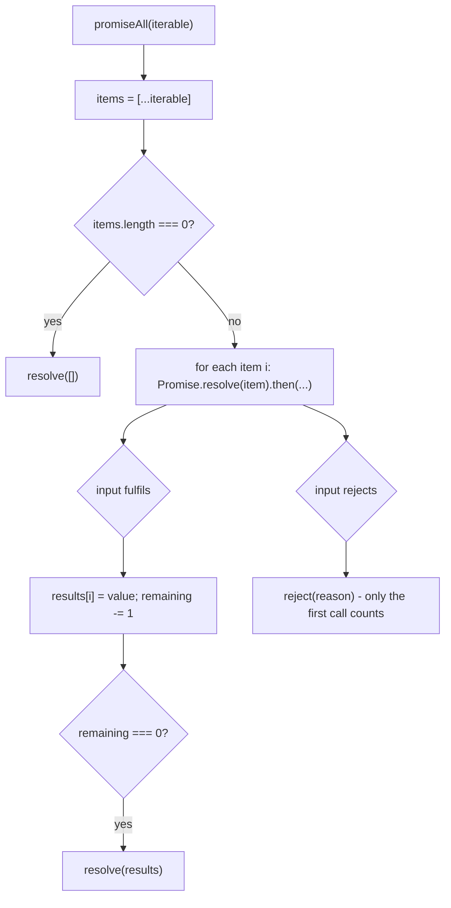

## Introduction

A page that loads a user, their orders and their notifications in parallel starts three requests and gets back three promises. Something has to turn those three promises into one answer: "everything is ready", "here is what succeeded and what failed", or "the first one is done". That is the job of the **promise combinators** — static methods on `Promise` that take many promises and return one.

| Combinator | Fulfils when… | Rejects when… | Result value |
|---|---|---|---|
| `Promise.all` | every input fulfils | the **first** input rejects | array of values, in input order |
| `Promise.allSettled` | every input settles (either way) | never (for valid input) | array of `{ status, value }` / `{ status, reason }` |
| `Promise.race` | the first input to settle fulfils | the first input to settle rejects | that first value or reason |
| `Promise.any` | the first input fulfils | **every** input rejects | first value, or an `AggregateError` |

"Implement `Promise.all`" is one of the most common JavaScript interview questions after "what is a promise". It looks short, and the first draft usually is — but the details are where the marks are: results in the right order, empty input, plain values mixed in with promises, rejecting only once, and knowing that the slow promises keep running after the race is lost. This lesson builds each combinator, explains every line, and then looks at how the specification does it.

## Before you start

- **Promise states and `then`** — pending, fulfilled, rejected, and that a promise settles only once. See [[b1-promises]] and [[b1-promise-states]].
- **The built-in combinators from the user side** — see [[b1-promise-combinators]], which this lesson builds on.
- **Microtasks** — `then` callbacks always run asynchronously, after the current code finishes. See [[b1-microtasks]].
- **`async`/`await`** — used in the test code. See [[b1-async-await]].

## The intuition

Think of `Promise.all` as a **seating chart** for a dinner. There is one numbered seat per guest. Guests arrive in any order, but each sits in their own numbered seat, not the next empty one. Dinner starts when every seat is full. If any guest calls to cancel, dinner is called off immediately — and nobody tells the other guests, who keep driving over anyway.

`Promise.allSettled` is the same chart, except a cancellation does not stop dinner: the host writes "cancelled" on that seat's card and waits until every seat has either a guest or a card.

`Promise.race` has no seats at all. The first guest through the door — whether arriving or calling to cancel — decides the outcome, and the door is locked behind them.

Two parts of the analogy matter for the code. "Their own numbered seat" is why results are stored **by index**. "Nobody tells the other guests" is why combinators do **not cancel** the losers: a promise is a receipt for work already started, not a handle that can stop it.

## The shared skeleton

All three implementations have the same outline:

1. Return a new promise, so the caller gets one thing to `await`.
2. Inside its executor, turn the input **iterable** (an array, a `Set`, a generator — anything `for...of` accepts) into an array.
3. Wrap each item with `Promise.resolve(item)`, so plain values and promise-like objects behave like promises.
4. Attach `then` handlers to every wrapped item; those handlers decide when to call the outer `resolve` or `reject`.

Two properties of promises make this skeleton simpler than it first looks. First, **a promise settles only once**: after the first call to `resolve` or `reject`, later calls are silently ignored. Second, `then` handlers **never run synchronously** — they are queued as microtasks — so all handlers are attached before any of them runs.

Step 3 deserves a word. `Promise.resolve(42)` returns a promise fulfilled with `42`. `Promise.resolve(p)` for a native promise `p` returns `p` itself. And `Promise.resolve(thenable)` for any object with a `then` method — a **thenable**, such as a promise from an older library — adopts its eventual state. Without that step, `promiseAll([1, fetchUser()])` would crash on `(1).then`.

## Implementing Promise.all

```js title="promiseAll.js"
function promiseAll(iterable) {
  return new Promise((resolve, reject) => {
    const items = [...iterable]; // a non-iterable throws here, which rejects
    const results = new Array(items.length);
    let remaining = items.length;

    if (remaining === 0) {
      resolve(results); // nothing to wait for
      return;
    }

    items.forEach((item, index) => {
      Promise.resolve(item).then(
        (value) => {
          results[index] = value; // seat by index, not by arrival
          remaining -= 1;
          if (remaining === 0) resolve(results);
        },
        reject, // first rejection wins; later calls are ignored
      );
    });
  });
}

const delay = (ms, value) => new Promise((res) => setTimeout(res, ms, value));

console.log(await promiseAll([delay(30, 'slow'), delay(10, 'fast'), 'plain']));
console.log(await promiseAll([]));
console.log(await promiseAll(new Set([1, Promise.resolve(2)])));

try {
  await promiseAll([delay(10, 'ok'), Promise.reject(new Error('boom'))]);
} catch (e) {
  console.log('rejected:', e.message);
}

try {
  await promiseAll(5);
} catch (e) {
  console.log(e.constructor.name);
}
```

```output
[ 'slow', 'fast', 'plain' ]
[]
[ 1, 2 ]
rejected: boom
TypeError
```

Read it top to bottom.

**`[...iterable]` runs inside the executor.** If the input is not iterable, the spread throws. An exception thrown inside a promise executor rejects that promise instead of escaping, so `promiseAll(5)` returns a rejected promise — exactly like `Promise.all(5)`. Doing the conversion before `new Promise` would make it throw synchronously, which the built-in never does.

**`results[index] = value` keeps input order.** The slow promise finished last but its value is first, because it was first in the input. The `forEach` callback's `index` is captured by each handler's closure, so each handler knows which seat it owns.

**`remaining` counts outstanding inputs.** It starts at the number of items and is decremented once per fulfilment. When it reaches zero every seat is filled. Counting this way, instead of checking the results array, is deliberate — see "Common mistakes".

**Empty input resolves immediately.** With no items, no handler would ever run and the promise would stay pending forever. The built-in resolves `Promise.all([])` with `[]`, so we special-case it.

**`reject` is passed directly as the rejection handler.** The first rejected input calls the outer `reject` and the outer promise rejects — this is **fail-fast** behaviour. Later rejections call `reject` again, which does nothing because the promise has already settled. No "already rejected" flag is needed.

Because every input has a rejection handler attached, the losing rejections are *handled* — Node will not print "unhandled rejection" for them. That is a real difference from code that starts promises and only awaits some of them.

### What happens to the losers

Fail-fast means the outer promise stops waiting. It does not mean the other work stops:

```js title="losers-keep-running.js"
function promiseAll(iterable) {
  return new Promise((resolve, reject) => {
    const items = [...iterable];
    const results = new Array(items.length);
    let remaining = items.length;
    if (remaining === 0) return resolve(results);
    items.forEach((item, i) => {
      Promise.resolve(item).then((v) => {
        results[i] = v;
        if (--remaining === 0) resolve(results);
      }, reject);
    });
  });
}

const job = (ms, label, fail = false) =>
  new Promise((res, rej) =>
    setTimeout(() => {
      console.log(`${label} settled`);
      fail ? rej(new Error(label)) : res(label);
    }, ms),
  );

try {
  await promiseAll([job(30, 'A'), job(10, 'B', true)]);
} catch (e) {
  console.log('all rejected with', e.message);
}
await new Promise((r) => setTimeout(r, 50)); // keep the process alive a little
```

```output
B settled
all rejected with B
A settled
```

`A` still ran to completion 20 ms after the combined promise had already rejected. With real network requests this means the request still finishes and its result is thrown away. To actually stop the work you need a cancellation mechanism such as an `AbortController` signal passed into each request — see [[b1-abort-controller-js]]. (The order of these lines depends on the timer delays; with the delays shown it is stable.)

## Implementing Promise.allSettled

`allSettled` never fails fast. It waits for every input and records each outcome in a small object.

```js title="promiseAllSettled.js"
function promiseAllSettled(iterable) {
  return new Promise((resolve) => {
    const items = [...iterable];
    const results = new Array(items.length);
    let remaining = items.length;

    if (remaining === 0) {
      resolve(results);
      return;
    }

    const settle = (index, outcome) => {
      results[index] = outcome;
      remaining -= 1;
      if (remaining === 0) resolve(results);
    };

    items.forEach((item, index) => {
      Promise.resolve(item).then(
        (value) => settle(index, { status: 'fulfilled', value }),
        (reason) => settle(index, { status: 'rejected', reason }),
      );
    });
  });
}

const results = await promiseAllSettled([
  Promise.resolve('profile'),
  Promise.reject(new Error('orders service down')),
  'cached settings',
]);

for (const r of results) {
  console.log(r.status, r.status === 'fulfilled' ? r.value : r.reason.message);
}
```

```output
fulfilled profile
rejected orders service down
fulfilled cached settings
```

The rejection handler converts a failure into a *value* (`{ status: 'rejected', reason }`), so both handlers go through the same `settle` function and the outer promise only ever resolves. The property names `status`, `value` and `reason` are fixed by the specification (ES2020); consumers check `status` before reading the other field.

Notice that the executor's parameter list does not even include `reject`. The only way the returned promise can reject is the one that applies to all three combinators: the input is not iterable, and `[...iterable]` throws inside the executor.

## Implementing Promise.race

`race` is the shortest, because the first call to `resolve` or `reject` decides the outcome and every later call is ignored automatically.

```js title="promiseRace.js"
function promiseRace(iterable) {
  return new Promise((resolve, reject) => {
    for (const item of iterable) {
      Promise.resolve(item).then(resolve, reject);
    }
  });
}

const delay = (ms, value) => new Promise((res) => setTimeout(res, ms, value));
const failAfter = (ms, msg) =>
  new Promise((_, rej) => setTimeout(() => rej(new Error(msg)), ms));

console.log(await promiseRace([delay(30, 'slow'), delay(10, 'fast')]));

try {
  await promiseRace([delay(50, 'data'), failAfter(20, 'timeout')]);
} catch (e) {
  console.log('race lost to:', e.message);
}

console.log(await promiseRace([delay(10, 'later'), 'already here']));

const empty = promiseRace([]);
const marker = await Promise.race([empty, delay(20, 'empty race still pending')]);
console.log(marker);
```

```output
fast
race lost to: timeout
already here
empty race still pending
```

There is no counter and no results array — `race` does not care about anyone except the winner.

**A plain value wins over a pending timer.** `'already here'` becomes an already-fulfilled promise, and its handler is queued as a microtask, which runs before any timer.

**An empty race never settles.** With no inputs, nothing ever calls `resolve` or `reject`, so the promise stays pending forever. That is what the built-in does too, and it is the specified behaviour, not a bug to "fix". The last test proves it by racing the empty race against a 20 ms timer, which wins. In real code, guard against racing an empty list if it can happen.

The most common use of `race` is a **timeout**: race the real work against a promise that rejects after a deadline. As with `all`, the loser — the slow request — keeps running unless you abort it.

## Bonus: Promise.any

`Promise.any` (ES2021) is the mirror image of `all`: it fulfils with the first *success* and rejects only if *every* input rejects, with an `AggregateError` whose `errors` array holds every reason in input order.

```js title="promiseAny.js"
function promiseAny(iterable) {
  return new Promise((resolve, reject) => {
    const items = [...iterable];
    const errors = new Array(items.length);
    let remaining = items.length;

    if (remaining === 0) {
      reject(new AggregateError(errors, 'All promises were rejected'));
      return;
    }

    items.forEach((item, index) => {
      Promise.resolve(item).then(resolve, (reason) => {
        errors[index] = reason;
        remaining -= 1;
        if (remaining === 0) {
          reject(new AggregateError(errors, 'All promises were rejected'));
        }
      });
    });
  });
}

console.log(await promiseAny([Promise.reject(new Error('mirror 1 down')), 'mirror 2']));

try {
  await promiseAny([Promise.reject(new Error('a')), Promise.reject(new Error('b'))]);
} catch (e) {
  console.log(e.constructor.name, e.errors.map((err) => err.message));
}
```

```output
mirror 2
AggregateError [ 'a', 'b' ]
```

The structure is `all` with the roles of fulfilment and rejection swapped: errors are seated by index, and the counter tracks rejections. Empty input rejects immediately, because "every input rejected" is vacuously true. See [[b1-promise-any]].

## How it works internally

The specification (ECMAScript 2023, section 27.2.4) describes `Promise.all` through an abstract operation called `PerformPromiseAll`. It differs from our version in three ways worth knowing.

**It iterates and subscribes in one pass.** Instead of converting the iterable to an array first, it walks the iterator and attaches handlers to each element as it goes. Because the total count is not known in advance, the counter (`remainingElementsCount`) starts at **1**, is incremented for each element, and is decremented once more after the loop ends. If every element had already been counted down, that final decrement brings it to zero and the promise resolves. Starting at 1 prevents a premature resolve while the iterator is still producing elements. Converting to an array first, as our version does, sidesteps the problem by knowing the length up front.

**Each element gets its own one-shot resolve function.** The specification creates a "resolve element function" per element with an `[[AlreadyCalled]]` flag, so a misbehaving thenable that calls its callback twice cannot decrement the counter twice. Native promises cannot do that, but arbitrary thenables can. In our version a thenable calling twice would be stopped by `Promise.resolve`, which wraps it in a real promise that settles once — so the protection comes from step 3 of the skeleton.

**It uses `this.resolve`, not `Promise.resolve`.** `Promise.all` is written to work for subclasses: it calls the `resolve` method of the constructor it was called on, and creates the result promise with that constructor. `class MyPromise extends Promise {}` therefore gets a `MyPromise` from `MyPromise.all(...)`. Interview implementations hard-code `Promise`, which is fine to state.

The specification also closes the iterator (calls its `return` method) if something throws mid-iteration, so a generator passed to `Promise.all` gets a chance to clean up.



**Timing details differ slightly.** The built-in and a hand-written version may take a different number of microtask turns to settle, so if you log from inside both and interleave them, the order can differ by a tick. Never write code that depends on how many microtask turns a combinator takes.

## Worked example: a dashboard with required and optional data

A realistic loader combines the three. The profile is required; widgets are optional; the whole page has a deadline.

```js title="dashboard.js"
const delay = (ms, value, fail = false) =>
  new Promise((res, rej) =>
    setTimeout(() => (fail ? rej(new Error(value)) : res(value)), ms),
  );

function withTimeout(promise, ms) {
  const timeout = new Promise((_, reject) =>
    setTimeout(() => reject(new Error(`timed out after ${ms} ms`)), ms),
  );
  return Promise.race([promise, timeout]);
}

async function loadDashboard() {
  const required = Promise.all([delay(20, 'profile'), delay(30, 'permissions')]);
  const optional = Promise.allSettled([
    delay(10, 'weather'),
    delay(15, 'news feed failed', true),
  ]);
  const [[profile, permissions], widgets] = await withTimeout(
    Promise.all([required, optional]),
    100,
  );
  const shown = widgets.filter((w) => w.status === 'fulfilled').map((w) => w.value);
  return { profile, permissions, shown, failed: widgets.length - shown.length };
}

console.log(await loadDashboard());
process.exit(0); // the losing timeout timer would otherwise keep Node alive for 100 ms
```

```output
{
  profile: 'profile',
  permissions: 'permissions',
  shown: [ 'weather' ],
  failed: 1
}
```

`Promise.all` makes the profile and permissions all-or-nothing: if either fails, the page cannot render. `Promise.allSettled` lets a broken widget fail on its own. `Promise.race` inside `withTimeout` puts a ceiling on the whole thing. The outer `Promise.all` combines the required and optional groups, and destructuring pulls the values out by position — which only works because `all` preserves order. The same code works unchanged with `promiseAll`, `promiseAllSettled` and `promiseRace` swapped in.

## In real systems

**Parallel fetching** is the everyday use: `await Promise.all(ids.map(fetchUser))` starts every request at once and waits for all, which is much faster than awaiting in a loop. See [[b1-sequential-vs-parallel]].

**Unbounded parallelism is a risk.** `Promise.all` over 10,000 ids starts 10,000 requests. Production code limits concurrency with a pool — see [[b1-concurrency-limiting]].

**Partial failure is normal.** Dashboards, batch jobs and notification fan-outs use `allSettled` so one failure does not discard the other results, then report the failures.

**Timeouts and fallbacks** use `race` and `any`: race a request against a deadline, or ask several mirrors and take the first success. Pair both with `AbortController` so losing requests are cancelled instead of wasting bandwidth.

## Trade-offs and alternatives

| Need | Use | Watch out for |
|---|---|---|
| All results, any failure is fatal | `all` | Losers keep running; abort them on failure |
| All outcomes, failures expected | `allSettled` | You must inspect every `status` |
| First outcome, success or failure | `race` | Empty input never settles; losers keep running |
| First success, failure only if all fail | `any` | Rejects with `AggregateError`, not the first reason |
| Results one by one as they arrive | a loop with `await` per promise, or async iteration | Order of arrival is not input order |

Hand-written combinators are for interviews and for understanding. In application code the built-ins are always available in supported runtimes (`allSettled` since ES2020, `any` since ES2021).

## Common mistakes

**Pushing results in completion order.** `results.push(value)` in the fulfilment handler gives `['fast', 'slow']` instead of `['slow', 'fast']`. Callers destructure by position, so this silently pairs data with the wrong request. Assign `results[index]`.

**Counting with `results.length`.** Checking `if (results.length === items.length)` after `results[index] = value` is wrong because assigning to the last index sets the array's length immediately:

```js title="length-bug.js"
const results = [];
results[2] = 'third'; // the last input happened to finish first
console.log(results.length, results);
```

```output
3 [ <2 empty items>, 'third' ]
```

The length is already 3 after one result, so a `length`-based check would resolve with two holes. Use a separate counter.

**Forgetting empty input.** Without the `remaining === 0` check before the loop, `promiseAll([])` never settles. (For `race`, never settling *is* the correct behaviour.)

**Calling `.then` on raw items.** `item.then(...)` crashes on plain values. Wrap with `Promise.resolve(item)`.

**Throwing synchronously.** Converting the iterable outside the executor makes `promiseAll(5)` throw instead of returning a rejected promise.

**Adding an "already rejected" flag.** It is harmless but unnecessary: a promise ignores every settle call after the first. Interviewers like to hear that you know why.

**Believing `all` cancels the others.** It stops waiting; it does not stop the work.

## Interview perspective

**"Implement `Promise.all`."** State the contract first: returns a promise; fulfils with values in input order once all fulfil; rejects with the first rejection; empty input gives `[]`; non-promise values are allowed. Then write it with an index-based results array and a counter. Mention that losers are not cancelled.

**"Why `Promise.resolve(item)`?"** It normalises plain values and thenables into promises so every item can be handled with `then`.

**"What does `Promise.race([])` do?"** It stays pending forever, because no input will ever settle it. Explain how you would guard against it.

**"How would you implement `allSettled` using only `Promise.all`?"** Map each input to a promise that never rejects:

```js title="settled-via-all.js"
const settledViaAll = (items) =>
  Promise.all(
    [...items].map((p) =>
      Promise.resolve(p).then(
        (value) => ({ status: 'fulfilled', value }),
        (reason) => ({ status: 'rejected', reason: reason.message }),
      ),
    ),
  );

console.log(await settledViaAll([1, Promise.reject(new Error('x'))]));
```

```output
[
  { status: 'fulfilled', value: 1 },
  { status: 'rejected', reason: 'x' }
]
```

(The real `allSettled` keeps the whole reason object; the snippet stores `reason.message` only to keep the printed output short.)

**Follow-ups:** "Add a concurrency limit" (see [[b1-concurrency-limiting]]), "add a timeout" (race with a rejecting timer, plus abort), "implement `Promise` itself" (see [[b1-impl-promise]]).

```quiz
Q: In a hand-written `promiseAll`, why is it wrong to resolve when `results.length === items.length`?
- [ ] `results.length` is always zero until all values arrive
- [x] Assigning `results[lastIndex]` sets the length immediately, so the check can pass while earlier slots are still empty
- [ ] Arrays cannot be assigned out of order
- [ ] It makes the promise reject instead of resolve
> An array's `length` is one more than its highest index, so if the last input finishes first, `results.length` already equals the input count and the promise resolves with holes. A separate counter decremented once per fulfilment is the only reliable "all done" signal.
```

```quiz
Q: `promiseAll([slowRequest, failsQuickly])` rejects after `failsQuickly` fails. What happens to `slowRequest`?
- [ ] It is cancelled automatically
- [ ] Its eventual rejection is reported as unhandled
- [x] It keeps running to completion and its result is ignored
- [ ] `promiseAll` waits for it before rejecting
> Combinators only stop *waiting*; a promise has no way to stop the work behind it. Because `promiseAll` attached a rejection handler to every input, a later failure is not reported as unhandled — but the request still uses the network unless you abort it with something like an `AbortController`.
```

```quiz
Q: What does `promiseRace([])` (and the built-in `Promise.race([])`) return?
- [ ] A promise fulfilled with `undefined`
- [ ] A promise rejected with a `TypeError`
- [x] A promise that stays pending forever
- [ ] It throws synchronously
> `race` settles when its first input settles. With no inputs, nothing ever calls `resolve` or `reject`. This differs from `all([])`, which fulfils with `[]`, and `any([])`, which rejects with an `AggregateError` — each follows from what "done" means for that combinator.
```

## Practice

1. Make `promiseAll` accept a generator: `promiseAll((function* () { yield 1; yield delay(10, 2); })())`. Does your implementation already work? Why?
2. Write `promiseAllWithLimit(tasks, limit)`, where `tasks` are functions returning promises, running at most `limit` at once and returning results in input order.
3. Change `promiseRace` so that it takes an `AbortController` and aborts it as soon as a winner is known.
4. Implement `promiseAll` using `async`/`await` and a `for` loop. Explain why the obvious version is not fail-fast and how to fix it.
5. Write a test that shows `promiseAll` resolves with values in input order even when inputs finish in reverse order.

## Quick revision {#quick-revision}

- Skeleton: `return new Promise((resolve, reject) => { const items = [...iterable]; … Promise.resolve(item).then(…) })`.
- Convert the iterable *inside* the executor so a non-iterable rejects instead of throwing.
- `Promise.resolve(item)` handles plain values and thenables.
- `all`: `results[index] = value`, separate `remaining` counter, resolve at zero, pass `reject` directly (first wins), empty → `[]`.
- `allSettled`: both handlers call `settle(index, { status, value | reason })`; never rejects for valid input; empty → `[]`.
- `race`: `Promise.resolve(item).then(resolve, reject)` for each; no counter; empty → pending forever.
- `any`: first fulfilment wins; all rejected (or empty) → `AggregateError` with `errors` in input order.
- A promise settles once: later `resolve`/`reject` calls are ignored, so no guard flag is needed.
- Losers keep running; abort them with `AbortController` if needed.
- The spec starts its counter at 1 while iterating, uses `this.resolve` for subclassing, and has one-shot element functions.

## Key takeaways {#key-takeaways}

- Every combinator is "attach a handler to each input, decide when to settle the outer promise".
- Store results by index with a separate counter; arrival order and `results.length` both lie.
- Edge cases follow from each combinator's meaning: `all([])` fulfils, `any([])` rejects, `race([])` never settles.
- Combinators stop waiting, not working — cancellation needs a separate signal.
- Saying what you simplified (subclassing, iterator closing, microtask timing) is part of a strong interview answer.
