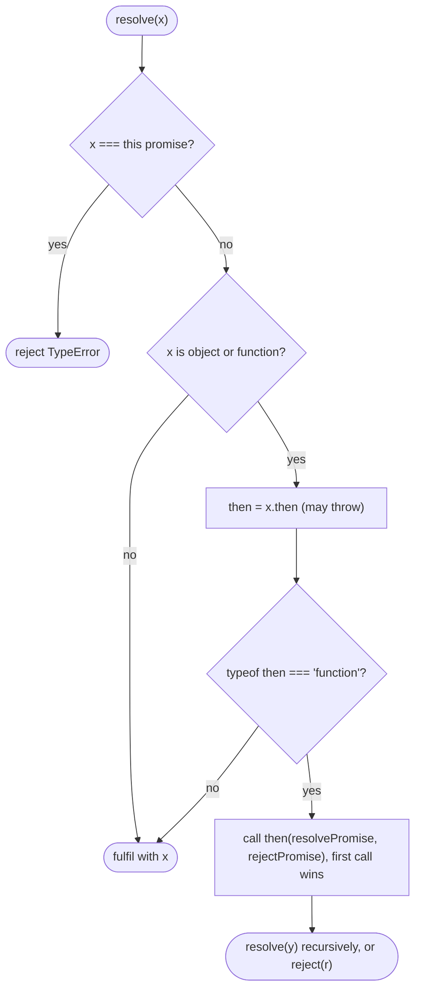

## Introduction

You use promises every day: `fetch(url).then(...)`, `await db.query(...)`. Most of the time you do not need to know how they work inside. But several everyday puzzles only make sense once you do: why `then` callbacks run after the current code even when the promise is already resolved; why returning a promise from `then` makes the chain wait; why `await` works on objects that are not real promises; why a thrown error in a handler turns up in a `catch` three lines later.

Implementing a promise answers all of these, which is why "implement a Promise" is a well-known (and hard) interview question for senior frontend roles. The behaviour you must reproduce is defined by the **Promises/A+** specification — a short community standard that the ECMAScript `Promise` follows for `then` — plus the extra methods (`catch`, `finally`, `Promise.resolve`) that ECMAScript adds. This lesson builds a class called `MyPromise` that follows A+ and behaves like the native promise in everything except some microtask timing details, which we will measure.

The static combinators (`all`, `race`, `allSettled`, `any`) are covered separately in [[b1-impl-promise-combinators]]; once `then` works, they are short.

## Before you start

- **Promises as a user** — states, `then`/`catch`/`finally` and chaining. See [[b1-promises]], [[b1-promise-states]] and [[b1-promise-chaining]].
- **Microtasks** — that promise callbacks run in the microtask queue after the current synchronous code, before timers. See [[b1-microtasks]] and [[b1-queue-microtask]].
- **Classes and private fields** — `#state`, `#value`, and private methods. See [[b1-classes]] and [[b1-private-state]].
- **Closures** — the `resolve` and `reject` functions remember which promise they belong to. See [[b1-closures]].

## The intuition

A promise is like an order ticket at a sandwich counter. When you order, you get a ticket immediately; the sandwich is not ready yet (**pending**). Later the ticket is either honoured with a sandwich (**fulfilled** with a value) or cancelled with a reason (**rejected**). Once that happens, it never changes: a fulfilled ticket cannot later be cancelled, and the counter cannot hand you a second sandwich for it.

You can tell the counter, "when my ticket is ready, do this" — that is `then`. If the ticket is still pending, the instruction is written down and carried out when it is ready. If it is already ready, the instruction is still carried out *after* you finish your current sentence, never in the middle of it. And each instruction you give produces a *new* ticket for its own result, which is why you can chain instructions.

The analogy covers the outside view. The inside has three moving parts:

1. **State and value** — `pending`, `fulfilled` or `rejected`, plus the value or reason.
2. **A list of waiting reactions** — handlers registered while pending.
3. **A resolution procedure** — the rule for what happens when you resolve a promise with *another promise-like thing*.

Most of the difficulty is in part 3.

## The promise contract

Before writing code, here are the rules the implementation must satisfy, in plain words:

| Rule | Meaning |
|---|---|
| Executor runs synchronously | `new MyPromise(executor)` calls `executor(resolve, reject)` immediately |
| Settles once | After the first `resolve` or `reject`, later calls are ignored |
| Executor throw = reject | An exception inside the executor rejects the promise |
| Handlers are always async | `then` callbacks run as microtasks, even if the promise is already settled |
| Handlers run in order | Multiple `then`s on one promise run in registration order |
| `then` returns a new promise | Resolved with the handler's return value, rejected with what the handler throws |
| Missing handler passes through | `then(onFulfilled)` on a rejected promise passes the rejection to the next promise |
| Thenables are adopted | Resolving with an object that has a `then` method makes the promise follow it |
| No self-resolution | Resolving a promise with itself rejects it with a `TypeError` |

A useful term: a promise is **settled** once it is fulfilled or rejected. It is **resolved** once its fate is locked in — either settled, or committed to follow another thenable. A promise can be resolved but still pending: `new Promise((r) => r(otherPendingPromise))` is locked to `otherPendingPromise` and calling `reject` afterwards does nothing.

## The complete implementation

Here is the whole class. The sections after it build it up piece by piece and explain each decision.

```javascript title="mypromise.mjs"
const PENDING = 'pending';
const FULFILLED = 'fulfilled';
const REJECTED = 'rejected';

export class MyPromise {
  #state = PENDING;
  #value = undefined;
  #handlers = []; // reactions registered while pending

  constructor(executor) {
    if (typeof executor !== 'function') {
      throw new TypeError('Promise resolver is not a function');
    }
    // One pair of resolving functions per promise; whichever is called first wins.
    let called = false;
    const resolve = (value) => {
      if (called) return;
      called = true;
      this.#resolveWith(value);
    };
    const reject = (reason) => {
      if (called) return;
      called = true;
      this.#settle(REJECTED, reason);
    };
    try {
      executor(resolve, reject);
    } catch (err) {
      reject(err); // a throwing executor rejects (ignored if already resolved)
    }
  }

  // The promise resolution procedure: adopt thenables, fulfil with anything else.
  #resolveWith(x) {
    if (x === this) {
      this.#settle(REJECTED, new TypeError('Chaining cycle detected for promise'));
      return;
    }
    if (x !== null && (typeof x === 'object' || typeof x === 'function')) {
      let then;
      try {
        then = x.then; // read once: a getter could return different values
      } catch (err) {
        this.#settle(REJECTED, err);
        return;
      }
      if (typeof then === 'function') {
        let called = false; // the thenable may call both callbacks, or one twice
        try {
          then.call(
            x,
            (y) => { if (!called) { called = true; this.#resolveWith(y); } },
            (r) => { if (!called) { called = true; this.#settle(REJECTED, r); } },
          );
        } catch (err) {
          if (!called) { called = true; this.#settle(REJECTED, err); }
        }
        return;
      }
    }
    this.#settle(FULFILLED, x);
  }

  #settle(state, value) {
    if (this.#state !== PENDING) return;
    this.#state = state;
    this.#value = value;
    const handlers = this.#handlers;
    this.#handlers = [];
    handlers.forEach((h) => this.#schedule(h));
  }

  #schedule(handler) {
    // Reactions always run asynchronously, as microtasks.
    queueMicrotask(() => {
      const fulfilled = this.#state === FULFILLED;
      const callback = fulfilled ? handler.onFulfilled : handler.onRejected;
      if (typeof callback !== 'function') {
        // No handler for this outcome: pass it through to the next promise.
        if (fulfilled) handler.resolve(this.#value);
        else handler.reject(this.#value);
        return;
      }
      try {
        handler.resolve(callback(this.#value));
      } catch (err) {
        handler.reject(err);
      }
    });
  }

  then(onFulfilled, onRejected) {
    return new MyPromise((resolve, reject) => {
      const handler = { onFulfilled, onRejected, resolve, reject };
      if (this.#state === PENDING) this.#handlers.push(handler);
      else this.#schedule(handler);
    });
  }

  catch(onRejected) {
    return this.then(undefined, onRejected);
  }

  finally(onFinally) {
    if (typeof onFinally !== 'function') return this.then(onFinally, onFinally);
    return this.then(
      (value) => MyPromise.resolve(onFinally()).then(() => value),
      (reason) => MyPromise.resolve(onFinally()).then(() => { throw reason; }),
    );
  }

  static resolve(value) {
    if (value instanceof MyPromise) return value;
    return new MyPromise((resolve) => resolve(value));
  }

  static reject(reason) {
    return new MyPromise((_, reject) => reject(reason));
  }
}
```

And a program that exercises the main paths. The same program run with the native `Promise` (replace the import with `const MyPromise = Promise;`) prints identical output.

```javascript title="basics.mjs"
import { MyPromise } from './mypromise.mjs';

console.log('1 sync start');
const p = new MyPromise((resolve) => {
  console.log('2 executor runs immediately');
  resolve(10);
  resolve(99);          // ignored: already resolved
});
p.then((v) => console.log('4 then got', v));
console.log('3 sync end');

new MyPromise((_, reject) => reject(new Error('nope')))
  .then(() => console.log('skipped'))
  .catch((e) => { console.log('6 caught', e.message); return 'recovered'; })
  .then((v) => console.log('7 after catch:', v));

MyPromise.resolve(1)
  .then((v) => v + 1)
  .then((v) => new MyPromise((r) => setTimeout(() => r(v * 10), 10)))
  .then((v) => { throw new Error(`failed at ${v}`); })
  .finally(() => console.log('8 finally runs, sees no value'))
  .catch((e) => console.log('9', e.message));

new MyPromise(() => { throw new Error('executor threw'); })
  .catch((e) => console.log('5', e.message));
```

```output
1 sync start
2 executor runs immediately
3 sync end
4 then got 10
5 executor threw
6 caught nope
7 after catch: recovered
8 finally runs, sees no value
9 failed at 20
```

Notice line 5 printing before line 6 even though its code comes last. The rejected promise in the second block has to pass through `.then(() => ...)` first — one microtask to forward the rejection — before `.catch` gets it in a second microtask. The last block's `.catch` is attached directly to the rejected promise, so it runs in the first round. Counting microtask "hops" like this is how event-loop puzzles are solved; see [[b1-event-loop-puzzles]].

## Step 1: state and the executor

The constructor stores nothing but state, and calls the executor straight away with two functions. Three details carry the contract:

**The executor runs synchronously.** That is why `2 executor runs immediately` prints before `3 sync end`. A promise does not make code asynchronous; it gives you a way to be told about a result that something else will produce asynchronously (a timer, a network response).

**`resolve` and `reject` share one `called` flag.** Once either has been called, both become no-ops. That implements "settles once" — `resolve(99)` is ignored — and also the subtler rule about being *resolved*: if you `resolve(somePendingThenable)` and then `reject(err)`, the rejection is ignored because the promise is already locked to the thenable.

**A throwing executor rejects.** The `try/catch` turns `throw` into `reject(err)`. If the executor had already called `resolve` before throwing, the `called` flag makes the throw harmless, which matches native behaviour.

`#settle` is the only place state changes. Its first line refuses to change a promise that is not pending — a second line of defence that keeps the "once" guarantee even if internal code calls it twice. It then takes the waiting handlers, clears the list (so they can be garbage-collected) and schedules each one.

## Step 2: then, and why handlers are always asynchronous

`then` does two jobs: it registers interest in this promise, and it creates the **next** promise in the chain. That is why its body is `return new MyPromise(...)`. The new promise's `resolve` and `reject` are stored alongside the user's callbacks in a `handler` record, so that when this promise settles, the handler's result can be fed into the next one.

If this promise is still pending, the handler is queued. If it has already settled, the handler is scheduled straight away — but **scheduled**, via `queueMicrotask`, never called directly. A+ requires this ("`onFulfilled` or `onRejected` must not be called until the execution context stack contains only platform code"), and the reason is consistency. Look at what happens when a callback API sometimes calls back synchronously and sometimes later:

```javascript title="sometimes-sync.mjs"
function syncThen(value, cb) { cb(value); }          // runs the callback right away
function asyncThen(value, cb) { queueMicrotask(() => cb(value)); }

for (const then of [syncThen, asyncThen]) {
  let ready = false;
  then(42, (v) => console.log(`${then.name}: got ${v}, ready = ${ready}`));
  ready = true;
}
```

```output
syncThen: got 42, ready = false
asyncThen: got 42, ready = true
```

With the synchronous version, the callback sees the world *before* the line after `then` ran. If the value were cached on one call and fetched on the next, the same code would observe different states depending on timing — a famous class of bug nicknamed "releasing Zalgo". By always deferring, promises guarantee that code after `.then(...)` has finished before any handler runs. You can see the same guarantee with `MyPromise`: a handler attached to an already-resolved promise still runs after the following synchronous lines.

```javascript title="late-handler.mjs"
import { MyPromise } from './mypromise.mjs';
const done = MyPromise.resolve('late');
let flag = 'before';
done.then((x) => console.log('late handler:', x, '| flag was', flag));
flag = 'after';
```

```output
late handler: late | flag was after
```

**Why microtasks rather than `setTimeout(fn, 0)`?** Microtasks run as soon as the current script finishes, before the browser renders or any timer fires. Using `setTimeout` would also satisfy A+, but promise reactions would then interleave with timers and rendering differently from native promises and add at least a few milliseconds of delay per hop. Native promises use the microtask queue, so `queueMicrotask` (available in browsers and Node 11+) reproduces their ordering.

## Step 3: running a handler and feeding the next promise

`#schedule` is where chaining happens. Inside the microtask:

1. Pick the callback for the outcome: `onFulfilled` if fulfilled, `onRejected` if rejected.
2. **If it is not a function, pass the outcome through.** `p.then(onlySuccess)` on a rejected `p` must still reject the next promise with the same reason, otherwise errors would vanish in the middle of chains. Similarly, `p.catch(fn)` on a fulfilled `p` passes the value through. This is why one `catch` at the end of a chain catches errors from any step.
3. **Otherwise call it**, and resolve the next promise with its return value. If it throws, reject the next promise with the exception.

That third point is the whole mechanism behind recovery and error propagation. In `basics.mjs`, `.catch` returned `'recovered'`, which *fulfilled* the next promise, so the following `then` received `'recovered'`. A handler that throws (like `throw new Error('failed at 20')`) rejects the next promise, skipping forward to the next rejection handler.

Note that the handler's return value goes through `handler.resolve` — the next promise's full resolution procedure — not straight to "fulfilled". That is what makes returning a promise from a handler work, which is the next step.

## Step 4: the resolution procedure and thenables

When a handler returns a promise, the chain waits for it: in `basics.mjs`, the step that returned `new MyPromise((r) => setTimeout(() => r(v * 10), 10))` delayed the following steps until the timer fired, and the next handler received `20`, not a promise object. This behaviour is called **adoption**: the outer promise follows the inner one's eventual state.

A+ defines adoption not for "promises" but for **thenables** — any object or function with a `then` method. That is how promise libraries written by different people (and native promises and your `MyPromise`) work together, and why `await` works on any thenable. `#resolveWith(x)` implements the procedure:

1. **If `x` is this same promise, reject with a `TypeError`.** Following yourself would wait forever.
2. **If `x` is an object or function, read `x.then` exactly once.** Reading can throw (a getter), so it is wrapped in `try`. Reading once matters because a getter could return a different function on each access.
3. **If `then` is a function, call it** with `x` as `this` and two callbacks. The first callback recursively resolves with `y` — because `y` might be another thenable — and the second rejects. A `called` flag ensures only the first call counts, because a thenable written by someone else might call both callbacks, or call one twice. If `then` throws before calling either callback, reject.
4. **Otherwise fulfil with `x`.** Numbers, strings, `null`, plain objects without `then` — all are just values.

These cases are where most hand-written promises fail. Here they are tested:

```javascript title="resolution.mjs"
import { MyPromise } from './mypromise.mjs';

// 1. A plain object with a then method is adopted, not used as the value.
const thenable = { then(onOk) { setTimeout(() => onOk('from thenable'), 5); } };
MyPromise.resolve(1).then(() => thenable).then((v) => console.log('adopted:', v));

// 2. A badly behaved thenable that calls both callbacks: only the first counts.
const messy = { then(ok, fail) { ok('first wins'); fail(new Error('ignored')); ok('ignored'); } };
new MyPromise((resolve) => resolve(messy)).then((v) => console.log('messy:', v));

// 3. Returning the promise from its own handler would wait forever, so it is a TypeError.
const self = MyPromise.resolve(0).then(() => self);
self.catch((e) => console.log('self:', e.constructor.name, '-', e.message));

// 4. Interop: native await adopts MyPromise because it is a thenable.
const v = await new MyPromise((r) => setTimeout(() => r('awaited'), 20));
console.log('await:', v);
```

```output
messy: first wins
self: TypeError - Chaining cycle detected for promise
adopted: from thenable
await: awaited
```

The `await` line is worth pausing on. `await` was designed for native promises, yet it works with `MyPromise` with no special support, because `await x` effectively does `Promise.resolve(x)`, and the native resolution procedure adopts any thenable. The same rule is what makes `await` on a plain non-promise value (`await 5`) simply produce `5`.

> [!WARNING] Accidental thenables
> Because adoption is based only on the presence of a `then` method, any object with a `then` function is treated as a promise. Resolving a promise with a query-builder object or a class that happens to define `then` will call that method instead of producing the object. Some libraries (Knex query builders, for example) are deliberately thenable so that `await query` runs the query.



## Step 5: catch, finally and the static helpers

With `then` in place, the rest is sugar.

**`catch(onRejected)`** is `then(undefined, onRejected)`. The missing fulfilment handler passes values through, so `catch` only reacts to rejections.

**`finally(onFinally)`** is more subtle. It runs a cleanup callback on either outcome, but it must be *transparent*: the cleanup receives no argument, its return value is ignored, and the original value or rejection continues down the chain. Two exceptions: if the cleanup returns a promise, the chain waits for it; and if the cleanup throws (or its promise rejects), that new error replaces the original outcome.

```javascript title="finally.mjs"
import { MyPromise } from './mypromise.mjs';
MyPromise.resolve('data')
  .finally(() => 'ignored return value')
  .then((v) => console.log('value passes through:', v));
MyPromise.resolve('data')
  .finally(() => new MyPromise((r) => setTimeout(r, 10)))
  .then((v) => console.log('waited for cleanup, then:', v));
MyPromise.reject(new Error('original'))
  .finally(() => { throw new Error('cleanup failed'); })
  .catch((e) => console.log('rejection replaced by:', e.message));
```

```output
rejection replaced by: cleanup failed
value passes through: data
waited for cleanup, then: data
```

The implementation achieves this by wrapping both paths: call `onFinally()`, wrap its result in `MyPromise.resolve` so a returned promise is waited for, and then *restore* the original outcome — return `value` on the success path, rethrow `reason` on the failure path. If `onFinally` throws, the exception escapes the wrapper handler, which rejects the next promise with the new error. (The first line of output appears first because that chain has the fewest asynchronous hops; the other two are waiting on a timer or an extra resolution step.)

**`MyPromise.resolve(value)`** returns `value` itself if it is already a `MyPromise`, otherwise a new promise resolved with it (so thenables are adopted). **`MyPromise.reject(reason)`** always creates a new rejected promise — it does *not* adopt, so `MyPromise.reject(somePromise)` rejects with the promise object as the reason, exactly as native `Promise.reject` does.

## How it works internally: comparing with native promises

Our class follows A+, so any code that relies only on A+ guarantees will behave the same with it. But the ECMAScript specification is more specific than A+ about *how many* microtasks some steps take, and that shows up when two chains race:

```javascript title="tick-count.mjs"
import { MyPromise } from './mypromise.mjs';
for (const P of [Promise, MyPromise]) {
  const log = [];
  await new Promise((done) => {
    P.resolve().then(() => P.resolve('x')).then(() => log.push('A'));
    P.resolve().then(() => log.push('b1')).then(() => log.push('b2'))
      .then(() => log.push('b3')).then(() => log.push('b4')).then(() => setTimeout(done, 0));
  });
  console.log(P.name.padEnd(9), log.join(' '));
}
```

```output
Promise   b1 b2 b3 A b4
MyPromise b1 b2 A b3 b4
```

When a handler returns a native promise, ECMAScript does not call its `then` immediately; it queues a separate job (`NewPromiseResolveThenableJob`) that calls `then`, and then the inner promise's reaction is another job. That adds two extra hops compared with returning a plain value. Our `#resolveWith` calls `then` synchronously, which A+ allows, so it adds only one. Both are correct promises; they just finish this race at different points.

Two lessons follow. First, **never rely on microtask counts across chains** in real code; if order matters, express it with `then` or `await`. Second, if an interviewer asks about this, the precise answer is that A+ specifies *what* happens and that handlers are asynchronous, while ECMAScript additionally fixes the job scheduling. V8 also optimises `await` of native promises (since V8 7.2, Node 12) to skip some of those hops, which is why `await nativePromise` is cheaper than `.then(() => nativePromise)`.

What else does the native implementation do that ours does not?

- **Unhandled-rejection tracking.** Browsers fire `unhandledrejection` and Node prints a warning (and, since Node 15, exits the process by default) when a rejected promise has no handler. Our class silently drops such rejections.
- **Subclassing and species.** Native `then` creates the next promise via the receiver's `constructor[Symbol.species]`, so subclasses chain to subclasses.
- **Async stack traces and debugging.** DevTools can show the chain of `await`s that led to an error because the engine records promise relationships.
- **Speed.** Native promises are implemented in the engine (V8's are written in its Torque language and C++), with far lower overhead per reaction.

## In real systems

Before ES2015, JavaScript had no built-in promise, and libraries such as Q, when.js, RSVP and Bluebird filled the gap. Promises/A+ (2012–2013) was written so these libraries would interoperate through thenables, and that is precisely why the resolution procedure is defined in terms of `then` methods rather than a specific class. Bluebird remained popular in Node for years because it was faster than early native promises and had extra features such as cancellation; today native promises are fast enough that new code should use them.

You will still meet custom thenables in production: ORM and query-builder objects that run when awaited, test utilities that make fake timers thenable, and polyfills such as `core-js` that ship a full promise implementation for old browsers. Understanding adoption explains all of them.

## Trade-offs and alternatives

Do not ship a hand-written promise. The native one is faster, integrates with `async`/`await` optimisations, unhandled-rejection reporting and DevTools, and is specified more tightly than A+. The value of this exercise is understanding.

If you need a promise you can resolve from outside its executor, use `Promise.withResolvers()` (ES2024; Node 22, current browsers) rather than writing a class: it returns `{ promise, resolve, reject }`. If you need cancellation, use `AbortSignal` alongside the promise rather than a custom promise type; see [[b1-abort-controller-js]].

## Common mistakes

> [!MISTAKE] Calling handlers synchronously when already settled
> `if (state === 'fulfilled') onFulfilled(value)` inside `then` breaks the guarantee that handlers run after the current code. Always schedule with `queueMicrotask`, whether the promise is pending or settled.

**Fulfilling with a thenable instead of adopting it.** `#settle(FULFILLED, x)` for every `x` means a handler that returns a promise passes the promise object down the chain instead of waiting for it.

**Not passing outcomes through missing handlers.** If `then(onFulfilled)` ignores rejections when `onRejected` is absent, errors disappear in the middle of chains and the final `catch` never fires.

**Letting a promise settle twice.** Without the `called` flag (or a pending check), `resolve(1); reject(err)` changes a fulfilled promise into a rejected one.

**Forgetting `try/catch` around the handler.** A handler that throws must reject the next promise; without the `try`, the exception escapes into the microtask and becomes an uncaught error.

**Trusting thenables.** A foreign `then` may throw, call both callbacks, or call one twice. Guard with a once-flag and a `try`.

**`finally` that passes its callback's return value on.** `finally(() => 'x')` must not change the value to `'x'`.

## Interview perspective

Interviewers rarely expect a complete A+ implementation in 45 minutes. They look for the right skeleton, then probe whether you know where the difficulty lies.

> [!INTERVIEW] A strong outline
> "I'll keep `state`, `value` and a list of handlers. The executor runs synchronously with `resolve` and `reject` that settle only once, and a throw rejects. `then` returns a new promise; if we're pending I queue the handler, otherwise I schedule it — always via `queueMicrotask`, so handlers are never synchronous. Running a handler resolves the next promise with its return value or rejects with what it throws, and a missing handler passes the outcome through. Resolving goes through the resolution procedure: reject self-resolution, adopt thenables by calling their `then` once with a called-once guard, otherwise fulfil."

Follow-ups to expect:

- **Why must `then` callbacks be asynchronous?** So behaviour is the same whether or not the promise has already settled; otherwise code after `then` could observe different state depending on timing.
- **What is a thenable and why does adoption use it?** Any object with a `then` method; it lets different promise implementations interoperate and lets `await` work on them.
- **What happens if you resolve a promise with itself?** It rejects with a `TypeError`, because waiting on yourself would never finish.
- **How would you implement `Promise.all`?** Count fulfilments into a results array by index, resolve when the count reaches the length, reject on the first rejection. See [[b1-impl-promise-combinators]].
- **How does `await` relate to this?** `await x` resolves a promise with `x` (adopting thenables) and resumes the function in a reaction job when it settles.

```quiz
Q: A promise is already fulfilled with 5. You call `p.then(v => console.log(v)); console.log('after');`. What is printed, and why?
- [ ] `5` then `after`, because the promise is already fulfilled
- [x] `after` then `5`, because then handlers always run as microtasks after the current synchronous code
- [ ] Only `after`; handlers added after fulfilment never run
- [ ] It depends on how long ago the promise was fulfilled
> Promises/A+ requires handlers to run asynchronously even when the promise is already settled. That keeps behaviour consistent regardless of timing. Handlers added late still run, just in a later microtask.

Q: A `then` handler returns `{ then(resolve) { resolve(42); } }`. What does the next handler in the chain receive?
- [ ] The object with the then method
- [x] `42`, because objects with a then method are adopted as thenables
- [ ] `undefined`
- [ ] A TypeError, because the object is not a real Promise
> The resolution procedure checks for a callable then property, calls it, and follows whatever it resolves with. That is why custom thenables and different promise libraries interoperate.

Q: What does `Promise.resolve('a').finally(() => 'b')` eventually fulfil with?
- [x] `'a'`
- [ ] `'b'`
- [ ] `undefined`
- [ ] `['a', 'b']`
> finally is transparent: its callback's return value is ignored and the original value passes through. Only a throw (or a rejected returned promise) inside finally changes the outcome, by replacing it with the new error.
```

## Practice

1. **Run the A+ suite.** The `promises-aplus-tests` package runs 872 tests against an adapter you write (`resolved`, `rejected`, `deferred`). Wire it up to `MyPromise` in a scratch project and fix any failures.
2. **`withResolvers`.** Add `static withResolvers()` returning `{ promise, resolve, reject }`.
3. **Combinators.** Implement `MyPromise.all`, `allSettled`, `race` and `any` using only `then`.
4. **Unhandled rejections.** When a promise is rejected with no handlers, schedule a `setTimeout` that logs a warning if still no handler has been attached by then.
5. **Timing.** Change `#resolveWith` to call a thenable's `then` inside `queueMicrotask` and re-run `tick-count.mjs`. Explain the new output.

## Quick revision {#quick-revision}

- State: `pending` → `fulfilled` (value) or `rejected` (reason), once and forever.
- Executor runs synchronously; `resolve`/`reject` share a called-once flag; a throw in the executor rejects.
- `then` returns a new promise; queue the handler if pending, else schedule it — always with `queueMicrotask`.
- Running a handler: missing handler → pass the outcome through; return value → resolve next; throw → reject next.
- Resolution procedure: `x === promise` → `TypeError`; object/function with callable `then` → call it once-guarded, recursively resolve with `y`; else fulfil with `x`.
- Read `x.then` once inside `try`; a foreign `then` may throw or call back twice.
- `catch(f)` = `then(undefined, f)`. `finally(f)` runs `f()`, waits for its promise, then restores the original value or reason; a throw in `f` replaces it.
- `Promise.resolve` adopts; `Promise.reject` does not.
- Native promises take extra microtask hops when adopting native promises (`NewPromiseResolveThenableJob`); never depend on cross-chain tick counts.

## Key takeaways {#key-takeaways}

- A promise is a state machine that settles once, plus a list of reactions and a rule for adopting other thenables.
- Handlers always run asynchronously as microtasks; that single rule makes promise code behave the same whether data is cached or not.
- `then` returns a new promise resolved with the handler's result, which is how chaining, recovery and error propagation all work.
- Thenable adoption, guarded against misbehaving `then` methods and self-resolution, is the hardest and most important part.
- `catch` and `finally` are thin layers over `then`; `finally` is transparent unless it throws.
- Hand-written promises are for understanding; production code should use the native `Promise`.
