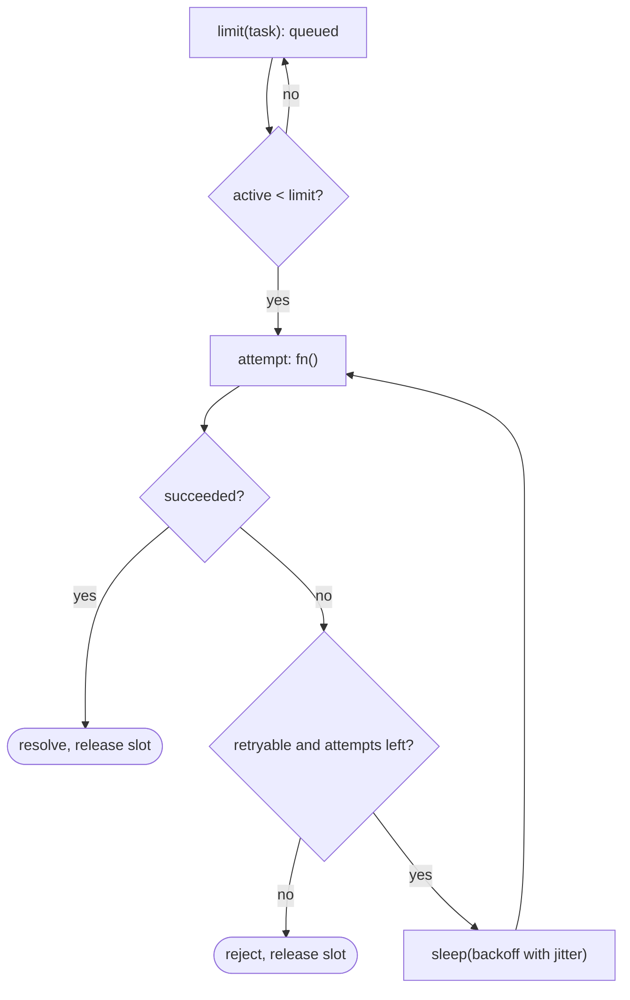

## Introduction

Networks fail in small, temporary ways all the time. A request times out because a server was briefly overloaded; a connection resets during a deploy; an API answers `503 Service Unavailable` for two seconds. Code that gives up on the first failure turns these hiccups into user-visible errors. Code that retries instantly and forever turns a two-second hiccup into an outage, because thousands of clients hammer the recovering server at once.

Three small utilities handle this well, and they build on each other:

- **`sleep(ms)`** — a promise that resolves after a delay, so `async` code can wait without blocking.
- **`retry(fn, options)`** — call an async function again after a failure, waiting longer each time (**exponential backoff**), with randomness (**jitter**) and a limit.
- **A concurrency limiter** — run at most N async tasks at once, queueing the rest, so a batch of 10,000 retries-with-requests does not open 10,000 connections.

Each one is short, but each has a well-known bug that interviewers look for. This lesson builds all three from promises alone — no libraries — and then combines them.

## Before you start

- **Promises and async/await** — creating a promise with `new Promise((resolve, reject) => ...)`, and `try/catch` around `await`. See [[b1-promises]] and [[b1-async-await]].
- **Timers** — `setTimeout` and `clearTimeout`. See [[b1-settimeout]].
- **AbortController** — how a signal tells async work to stop. See [[b1-abort-controller-js]].
- **The event loop** — why a timer callback runs later and why waiting does not block other work. See [[b1-event-loop]].

## The intuition

Think of calling a busy restaurant to book a table. The line is engaged. You do not redial a hundred times a second — that keeps the line busy for everyone. You wait a minute, try again, then wait two minutes, then four. If everyone who got the engaged tone waited exactly one minute, they would all call back at the same moment and collide again, so in practice people wait "about a minute", each a slightly different amount. After a few tries you give up and pick another restaurant. And if the restaurant said "we are closed on Mondays", you would not retry at all.

That is the whole design of a good retry: **wait between attempts** (`sleep`), **wait longer each time** (exponential backoff), **randomise the wait** (jitter), **stop eventually** (a retry limit and a delay cap), and **only retry failures that might go away** (retryable errors). A concurrency limiter is the restaurant's own rule: at most two phone lines, so callers queue instead of overwhelming the staff.

## sleep: a promise around setTimeout

`setTimeout` takes a callback. To use it with `await`, wrap it in a promise that resolves when the timer fires:

```javascript
const sleep = (ms) => new Promise((resolve) => setTimeout(resolve, ms));
```

`new Promise` runs the executor immediately, which starts the timer. Nothing happens until the timer fires and calls `resolve`, at which point any `await sleep(...)` continues. While waiting, the thread is free: other timers, network callbacks and UI events keep running. This is the key difference from a busy-wait loop such as `while (Date.now() < end) {}`, which blocks everything.

Two facts about timing: `setTimeout` guarantees *at least* `ms` milliseconds, not exactly `ms`, because the callback waits its turn in the task queue. Browsers clamp nested timers to at least 4 ms and throttle timers in background tabs heavily. So `sleep` is right for "wait roughly this long", not for precise scheduling.

### Making sleep cancellable

A retry loop that is waiting ten seconds before its next attempt should stop immediately when the user navigates away. The standard way to request cancellation is an `AbortSignal`:

```javascript title="sleep.mjs"
export function sleep(ms, { signal } = {}) {
  return new Promise((resolve, reject) => {
    if (signal?.aborted) return reject(signal.reason);
    const onAbort = () => {
      clearTimeout(timer); // don't leave a pending timer behind
      reject(signal.reason);
    };
    const timer = setTimeout(() => {
      signal?.removeEventListener('abort', onAbort); // avoid leaking the listener
      resolve();
    }, ms);
    signal?.addEventListener('abort', onAbort, { once: true });
  });
}
```

```javascript title="sleep-demo.mjs"
import { sleep } from './sleep.mjs';
const t0 = Date.now();
await sleep(100);
console.log('slept about', Math.round((Date.now() - t0) / 100) * 100, 'ms');

const controller = new AbortController();
setTimeout(() => controller.abort(), 50);
try {
  await sleep(10_000, { signal: controller.signal });
} catch (err) {
  console.log('aborted:', err.name);
}
try {
  await sleep(10, { signal: AbortSignal.abort(new Error('already cancelled')) });
} catch (err) {
  console.log(err.message);
}
console.log('process exits promptly: the 10 s timer was cleared');
```

```output
slept about 100 ms
aborted: AbortError
already cancelled
process exits promptly: the 10 s timer was cleared
```

Each line of the cancellable version prevents a specific problem:

- **Check `aborted` first.** An abort event that already fired will not fire again, so a signal aborted before `sleep` was called would otherwise wait the full time.
- **Reject with `signal.reason`.** `controller.abort()` with no argument sets the reason to a `DOMException` named `'AbortError'`; `abort(myError)` uses `myError`. Passing the reason through lets callers distinguish cancellation from failure.
- **`clearTimeout` on abort.** Rejecting the promise does not stop the timer. In Node, a pending timer keeps the process alive, so without this line the demo would hang for ten seconds before exiting.
- **Remove the listener when the timer wins.** Long-lived signals (one per page, say) would otherwise accumulate one dead listener per sleep.

Node ships an equivalent as `setTimeout` from `node:timers/promises` (`await setTimeout(100, undefined, { signal })`), so in Node-only code you can use that. Implementing it yourself is still the expected interview answer.

## retry: the basic loop

The core of retry is a loop of `try { return await fn() } catch { wait }`. The first important decision is the argument type: **retry takes a function**, not a promise.

### Why a function, not a promise

A promise is the *result* of starting some work, not the work itself. Once it rejects, it is rejected forever; awaiting it again just returns the same rejection.

```javascript title="reuse-bug.mjs"
let calls = 0;
const request = () => {
  calls++;
  return calls === 1 ? Promise.reject(new Error('flaky')) : Promise.resolve('ok');
};

async function retryPromise(promise, times) {
  let last;
  for (let i = 0; i < times; i++) {
    try { return await promise; } catch (e) { last = e; }
  }
  throw last;
}

try {
  await retryPromise(request(), 3); // the request runs once, here
} catch (e) {
  console.log('still failed:', e.message, '| request ran', calls, 'time(s)');
}
```

```output
still failed: flaky | request ran 1 time(s)
```

The second call would have succeeded, but it was never made. The loop "retried" three times by re-reading one settled result. A retry helper must receive a function that **starts a fresh attempt each time it is called**, such as `() => fetch(url)`.

### The full retry

Here is a production-shaped version. It adds the features the intuition section listed: exponential delays, a cap, jitter, a predicate for retryable errors, a hook for logging and cancellation.

```javascript title="retry.mjs"
import { sleep } from './sleep.mjs';

export async function retry(fn, options = {}) {
  const {
    retries = 3,            // extra attempts after the first one
    baseDelay = 100,        // ms before the first retry
    factor = 2,             // exponential growth per retry
    maxDelay = 10_000,      // cap so delays never explode
    jitter = true,          // spread clients out (full jitter)
    shouldRetry = () => true,
    onRetry = () => {},
    signal,
    random = Math.random,   // injectable for tests
  } = options;

  for (let attempt = 0; ; attempt++) {
    signal?.throwIfAborted();
    try {
      return await fn({ attempt, signal }); // a NEW promise every attempt
    } catch (err) {
      const isLast = attempt >= retries;
      if (isLast || signal?.aborted || !shouldRetry(err, attempt)) throw err;
      const exp = Math.min(maxDelay, baseDelay * factor ** attempt);
      const delay = jitter ? Math.floor(random() * exp) : exp;
      onRetry(err, attempt + 1, delay);
      await sleep(delay, { signal });
    }
  }
}
```

```javascript title="retry-demo.mjs"
import { retry } from './retry.mjs';

let calls = 0;
async function flakyFetch() {
  calls++;
  if (calls < 3) throw new Error(`timeout #${calls}`);
  return { status: 200, body: 'ok' };
}

const result = await retry(flakyFetch, {
  retries: 4,
  baseDelay: 50,
  jitter: false,
  onRetry: (err, n, delay) => console.log(`retry ${n} after ${delay} ms (${err.message})`),
});
console.log(result, 'calls:', calls);

class HttpError extends Error {
  constructor(status) { super(`HTTP ${status}`); this.status = status; }
}
let attempts = 0;
try {
  await retry(async () => { attempts++; throw new HttpError(404); }, {
    shouldRetry: (err) => err.status === undefined || err.status >= 500 || err.status === 429,
  });
} catch (err) {
  console.log(err.message, 'after', attempts, 'attempt(s)');
}

attempts = 0;
try {
  await retry(async () => { attempts++; throw new Error('down'); }, { retries: 2, baseDelay: 1 });
} catch (err) {
  console.log(err.message, 'after', attempts, 'attempts');
}
```

```output
retry 1 after 50 ms (timeout #1)
retry 2 after 100 ms (timeout #2)
{ status: 200, body: 'ok' } calls: 3
HTTP 404 after 1 attempt(s)
down after 3 attempts
```

Walk through the loop. Each iteration first checks the signal (`throwIfAborted`, available in browsers and Node 17.3+), then calls `fn` and returns its value on success. On failure it decides whether to stop: when this was the last allowed attempt, when the caller cancelled, or when `shouldRetry` says this error will not go away. Only then does it compute a delay and sleep.

Details worth defending:

- **`retries` counts extra attempts.** `retries: 2` means up to three calls in total, as the last demo shows. Name the option so its meaning is unambiguous; "times" is often misread.
- **No sleep after the last attempt.** A common draft sleeps in every `catch` and throws after the loop, which makes the caller wait one full delay before learning the operation failed.
- **The original error is rethrown.** The caller sees the real cause (`HTTP 404`), not a generic "retry failed". If you want every attempt's error, collect them and throw an `AggregateError`.
- **`fn` receives `{ attempt, signal }`.** Passing the signal lets the operation itself be cancelled, not only the waiting; passing the attempt number lets it log or vary behaviour.
- **`random` is injectable.** Tests can pass `() => 0.5` and assert exact delays; production uses `Math.random`.

## Exponential backoff and the delay cap

With `baseDelay = 100` and `factor = 2`, the un-jittered delay before retry *n* is `100 × 2^(n-1)`, capped at `maxDelay`:

| Retry | Raw delay | With 10 s cap |
|---|---|---|
| 1 | 100 ms | 100 ms |
| 2 | 200 ms | 200 ms |
| 3 | 400 ms | 400 ms |
| 4 | 800 ms | 800 ms |
| 5 | 1.6 s | 1.6 s |
| 6 | 3.2 s | 3.2 s |
| 7 | 6.4 s | 6.4 s |
| 8 | 12.8 s | 10 s |
| 12 | 204.8 s | 10 s |

**Why exponential?** A fixed delay retries a struggling server at a constant rate no matter how long it has been struggling. Doubling means the load from retries falls off quickly the longer an outage lasts, while short glitches still recover fast because early delays are small. **Why a cap?** Without one, the twelfth retry waits more than three minutes, and the twentieth waits more than a day. Nobody wants that; past some point the right move is to fail and let a human or a higher-level process decide.

## Jitter: why randomness helps

Imagine 1,000 browser tabs whose requests all failed at the same instant because a server restarted. With pure exponential backoff they all retry at exactly +100 ms, then all at +300 ms, and so on. Each retry wave arrives as a synchronised spike — the **thundering herd** — and can knock the server over again just as it recovers.

**Jitter** randomises each delay so the retries spread out. The implementation above uses **full jitter**: pick a random delay between 0 and the exponential value. An analysis published on the AWS Architecture Blog ("Exponential Backoff And Jitter", 2015) compared strategies by simulation and found full jitter completed the work with the least total load among the simple variants. Two other common forms:

| Strategy | Formula (`exp` = capped exponential delay) | Character |
|---|---|---|
| No jitter | `exp` | Synchronised spikes |
| Full jitter | `random(0, exp)` | Best spread; some retries happen almost immediately |
| Equal jitter | `exp / 2 + random(0, exp / 2)` | Always waits at least half; slightly less spread |

The equal-jitter formula is the same as `exp * (0.5 + Math.random() / 2)`, which you will see in many codebases. Either form is fine in an interview if you can explain why jitter exists.

> [!NOTE] Respect Retry-After
> When a server answers `429 Too Many Requests` or `503` with a `Retry-After` header, it is telling you exactly how long to wait. Prefer that value over your own backoff for that attempt. See [[c12-retry-after]].

## Which errors to retry

Retrying is only useful for **transient** failures — ones that might succeed if tried again unchanged:

| Retry | Do not retry |
|---|---|
| Network errors, connection resets, timeouts | `400 Bad Request` — the request is malformed |
| `502`, `503`, `504` — gateway or service temporarily unavailable | `401`/`403` — retrying will not grant permission |
| `429` — rate limited (after waiting) | `404` — the resource is not there |
| `500` — sometimes; often a bug that will fail again | `409`/`422` — business rule or validation failure |
| | Cancellation by the caller (`AbortError`) |

That is what the `shouldRetry` predicate encodes. Retrying a `400` five times wastes five requests and delays the real error message to the user by seconds.

The second question is **whether retrying is safe**. A `GET` can be repeated freely. A `POST /payments` that timed out may have succeeded on the server — the response was lost, not the request — so retrying it blindly can charge a customer twice. Operations are safe to retry only if they are **idempotent** (running them twice has the same effect as once), which APIs achieve with idempotency keys. See [[c12-idempotency]] and [[c12-idempotency-keys]].

> [!WARNING] Retries multiply
> If a browser retries 3 times, its backend service retries each call 3 times, and that service's database client retries 3 times, one user action can become 4 × 4 × 4 = 64 database attempts during an outage. Retry at one layer, usually the one closest to the user or the one that owns the operation, and see [[c12-retry-amplification]] and [[c12-retry-budgets]].

## Timeouts per attempt

A retry loop only helps if failed attempts actually *fail*. A request that hangs forever never throws, so `retry` never gets a chance to try again. Give each attempt its own time budget by combining the caller's signal with a timeout signal:

```javascript title="attempt-timeout.mjs"
import { retry } from './retry.mjs';
import { sleep } from './sleep.mjs';

let call = 0;
// Simulates a server that hangs on the first call and answers fast on the second.
async function fakeFetch(signal) {
  call++;
  await sleep(call === 1 ? 5_000 : 20, { signal });
  return `response from call ${call}`;
}

const outer = new AbortController(); // e.g. the user navigating away
const result = await retry(
  ({ signal }) => {
    // Each attempt gets its own 100 ms budget, still cancellable by the outer signal.
    const attemptSignal = AbortSignal.any([signal, AbortSignal.timeout(100)]);
    return fakeFetch(attemptSignal);
  },
  {
    signal: outer.signal,
    baseDelay: 10,
    jitter: false,
    onRetry: (err, n) => console.log(`attempt ${n} failed with ${err.name}`),
  },
);
console.log(result);
```

```output
attempt 1 failed with TimeoutError
response from call 2
```

`AbortSignal.timeout(ms)` creates a signal that aborts with a `TimeoutError` after `ms`. `AbortSignal.any([...])` aborts when any input does — available in Node 20.3+ and current browsers (Chrome 116, Firefox 124, Safari 17.4). With real `fetch`, you would pass `attemptSignal` as `fetch(url, { signal: attemptSignal })`. Note that `shouldRetry` should retry `TimeoutError` but not `AbortError`; the implementation already refuses to retry once the *outer* signal is aborted. [[b1-timeouts-retries]] covers timeout design further.

## The concurrency limiter

Retry decides *when* to run a task again. A **concurrency limiter** decides *how many* tasks run at the same time. Without one, `Promise.all(urls.map((u) => retry(() => fetch(u))))` starts every request at once: thousands of sockets, rate-limit errors, and then thousands of synchronised retries. [[b1-concurrency-limiting]] covers batching, worker pools and choosing a limit in depth; here is the compact limiter that interviewers usually ask for alongside retry.

The state is a counter of running tasks and a queue of waiting ones. `limit(task)` returns a promise for the task's result; internally it queues a starter function and tries to start work.

```javascript title="limiter.mjs"
export function createLimiter(limit) {
  let active = 0;
  const queue = []; // functions waiting for a free slot

  const next = () => {
    if (active >= limit || queue.length === 0) return;
    active++;
    const run = queue.shift();
    run();
  };

  return function limit_(task) {
    return new Promise((resolve, reject) => {
      queue.push(() => {
        Promise.resolve()
          .then(task)               // also catches a task that throws synchronously
          .then(resolve, reject)
          .finally(() => {
            active--;               // always release the slot, success or failure
            next();
          });
      });
      next();
    });
  };
}
```

```javascript title="limiter-demo.mjs"
import { createLimiter } from './limiter.mjs';
import { sleep } from './sleep.mjs';

const limit = createLimiter(2);
let inFlight = 0;
let peak = 0;

async function download(id, ms) {
  inFlight++;
  peak = Math.max(peak, inFlight);
  console.log(`start ${id} (in flight: ${inFlight})`);
  await sleep(ms);
  inFlight--;
  if (id === 'c') throw new Error(`${id} failed`);
  return `${id} done`;
}

const jobs = [['a', 30], ['b', 10], ['c', 10], ['d', 10], ['e', 10]];
const results = await Promise.allSettled(jobs.map(([id, ms]) => limit(() => download(id, ms))));
console.log(results.map((r) => r.value ?? r.reason.message));
console.log('peak concurrency:', peak);
```

```output
start a (in flight: 1)
start b (in flight: 2)
start c (in flight: 2)
start d (in flight: 2)
start e (in flight: 2)
[ 'a done', 'b done', 'c failed', 'd done', 'e done' ]
peak concurrency: 2
```

All five calls to `limit` happen synchronously; `a` and `b` start, the rest wait in the queue. When `b` finishes after about 10 ms, its `finally` decrements `active` and calls `next`, which starts `c`, and so on. The exact interleaving depends on timer timing, but the peak never exceeds two. Three points make it correct:

- **The slot is released in `finally`.** Task `c` failed, and the queue still drained. Releasing only on success is the classic limiter bug: each failure permanently loses a slot until the limiter deadlocks.
- **`Promise.resolve().then(task)`** converts a task that throws synchronously (before returning a promise) into a rejection, so it cannot escape and skip the `finally`.
- **Results map back to callers.** Each caller's promise resolves or rejects with its own task's outcome, so `Promise.allSettled` sees results in input order even though tasks finish out of order.

`queue.shift()` is O(n) on arrays; for very large queues use an index pointer or a linked-list queue. For a few thousand items it does not matter.

## Putting them together

The three utilities compose naturally. Wrap each unit of work in `retry`, and wrap the retrying task in the limiter, so at most N operations — including their retries and backoff waits — are in progress at once:

```javascript
const limit = createLimiter(4);
const pages = await Promise.all(
  urls.map((url) =>
    limit(() =>
      retry(({ signal }) => fetchJson(url, { signal }), {
        retries: 3,
        shouldRetry: isTransient,
        signal: pageController.signal,
      }),
    ),
  ),
);
```

Putting `retry` *inside* `limit` means a task holds its slot while backing off. That is usually what you want: it keeps total pressure on the server bounded during an outage. Putting `limit` inside `retry` releases the slot during the wait, which gives more throughput when only a few tasks fail but lets more requests through when everything is failing.



## In real systems

**HTTP clients.** Libraries such as `p-retry`, `axios-retry` and `ky` (which retries by default on certain status codes) implement exactly this loop with backoff and jitter. The AWS and Google Cloud SDKs retry throttling and 5xx errors with capped exponential backoff and jitter out of the box.

**Background jobs.** Job queues (BullMQ, Sidekiq, AWS SQS with redrive policies) retry failed jobs with backoff, then move them to a **dead-letter queue** after the limit so a human can inspect them, rather than retrying forever.

**Reconnecting clients.** WebSocket and Server-Sent Events clients reconnect with backoff and jitter after a disconnect so that a server restart does not produce a reconnect stampede. See [[b6-reconnect-backoff]].

**Batch scripts.** Migration and scraping scripts combine a limiter (to respect an API's limits) with retry (to survive transient errors), exactly like the composition above.

## Trade-offs and alternatives

Retries **hide transient failures** from users at the cost of **latency** (a request may take seconds longer) and **extra load** on whatever is failing. They are the wrong tool for persistent failures: when a dependency is down for minutes, a **circuit breaker** that stops calling it for a while and fails fast is better than every request waiting through four backoff steps. See [[c12-circuit-breakers]] and [[c12-breaker-vs-retry]].

A limit of three or four attempts with a cap of a few seconds suits interactive requests; background jobs can afford more attempts and longer caps. Always pair retries with timeouts, because a hanging attempt defeats the loop. In tests, retry delays make suites slow; inject a tiny `baseDelay`, inject `random`, or use fake timers (`vi.useFakeTimers()` in Vitest) to advance time instantly.

## Common mistakes

> [!MISTAKE] Passing a promise to retry
> `retry(fetch(url))` starts one request and re-awaits its settled result. Pass a function, `retry(() => fetch(url))`, so each attempt starts new work.

**Sleeping after the final failure.** The caller waits an extra delay for an error that was already decided. Check "was this the last attempt?" before sleeping.

**No cap, no jitter.** Uncapped exponential delays grow to minutes; un-jittered delays synchronise clients into spikes.

**Retrying everything.** Retrying `400`, `401`, `404` or validation errors wastes time and hides the real error. Retrying non-idempotent writes can duplicate side effects.

**Cancellable sleep that does not clear its timer.** Rejecting the promise is not enough; the timer still fires later and keeps a Node process alive. Call `clearTimeout`.

**A limiter that releases its slot only on success.** Each failure leaks a slot; after `limit` failures nothing runs again. Release in `finally`.

**Retrying at every layer.** Nested retries multiply load during exactly the moments the system is weakest.

## Interview perspective

These utilities appear as standalone prompts ("implement `sleep`", "implement `retry(fn, n)`", "implement `promisePool(tasks, limit)`") and as follow-ups to each other.

> [!INTERVIEW] Points that signal experience
> "Retry takes a function, because a rejected promise can't be re-run. I'll back off exponentially with a cap and full jitter so clients don't retry in lockstep, I won't sleep after the last attempt, and I'll only retry transient errors — timeouts, 5xx, 429 — and only idempotent operations. I'd thread an AbortSignal through so the sleep and the attempt can both be cancelled, and clear the timer on abort."

Likely follow-ups:

- **What does `await sleep(0)` do?** It yields to the event loop: the code after it runs in a later task, after pending microtasks and any other ready tasks.
- **How do you test retry without waiting?** Inject the delay function or `random`, use a tiny base delay, or use fake timers.
- **Why does jitter reduce load?** It spreads retries from many clients over the backoff window instead of synchronising them into spikes.
- **How would you add a per-attempt timeout?** Give each attempt an `AbortSignal.timeout`, combined with the caller's signal via `AbortSignal.any`, and treat `TimeoutError` as retryable.
- **What happens to the limiter if a task throws synchronously?** With `Promise.resolve().then(task)` it becomes a rejection and the slot is still released.

```quiz
Q: Why does `retry(fetchUser(), 3)` (passing a promise) never succeed after a first failure, even if the server recovers?
- [ ] Promises cannot be awaited more than once
- [x] A promise represents one already-started operation; once rejected it stays rejected, so no new request is made
- [ ] retry needs async functions, and promises are synchronous
- [ ] The retry count must be at least 4
> Awaiting a settled promise again returns the same outcome. Only calling a function that starts a new request produces a new promise that can succeed. That is why retry's argument is a function.

Q: 500 clients fail at the same moment and all retry with pure exponential backoff (100 ms, 200 ms, 400 ms...). What problem does adding jitter solve?
- [ ] It makes each retry faster
- [ ] It reduces the number of retries per client
- [x] It spreads the retries out so they no longer arrive at the server in synchronised spikes
- [ ] It lets the server send Retry-After headers
> Without randomness, every client computes the same delays and they retry together, creating a thundering herd. Jitter keeps the same average backoff but spreads clients across the window.

Q: A concurrency limiter decrements its `active` counter only inside the success handler. With a limit of 2, what happens after two tasks fail?
- [ ] The failed tasks are retried automatically
- [ ] The limiter raises its limit to compensate
- [x] Both slots are permanently occupied, so no queued task ever starts
- [ ] Nothing; failures don't affect the counter
> Each failure leaves active incremented, so after two failures active equals the limit and next() never starts anything. Releasing the slot in finally fixes it.
```

## Practice

1. **Deadline instead of count.** Change `retry` to accept `maxElapsedMs` and stop when the next sleep would cross that deadline.
2. **Retry-After.** Make `retry` honour a `retryAfterMs` property on the error, if present, instead of the computed backoff.
3. **Decorrelated jitter.** Implement `delay = min(cap, random(base, previousDelay * 3))` and compare its delays with full jitter over 10 retries.
4. **Limiter with `clearQueue()`.** Add a method that rejects every queued (not running) task with an `AbortError`.
5. **Fake-timer test.** Write a Vitest test that proves `retry` waits 100, 200 then 400 ms (no jitter) without the test taking 700 ms.

## Quick revision {#quick-revision}

- `sleep(ms)` = `new Promise((r) => setTimeout(r, ms))`; waits at least `ms`, never blocks the thread.
- Cancellable sleep: check `signal.aborted` first, reject with `signal.reason`, `clearTimeout` on abort, remove the listener when the timer fires.
- `retry` takes a **function** that starts a new attempt; a rejected promise stays rejected.
- Loop: try → success returns; failure → stop if last attempt, aborted or not retryable; else sleep and repeat. No sleep after the final failure.
- Backoff: `min(maxDelay, base × factor^attempt)`. Full jitter: `random(0, that)`. Equal jitter: `exp/2 + random(0, exp/2)`.
- Retry transient errors (network, timeout, 502/503/504, 429) and only idempotent operations; honour `Retry-After`.
- Per-attempt timeout: `AbortSignal.any([signal, AbortSignal.timeout(ms)])` (Node 20.3+, modern browsers).
- Limiter: `active` counter + queue; start when `active < limit`; release in `finally`; `Promise.resolve().then(task)` catches sync throws.
- Retry inside the limiter keeps load bounded during outages; avoid retrying at several layers.

## Key takeaways {#key-takeaways}

- `sleep` turns a timer into a promise; cancelling it properly means clearing the timer, not only rejecting.
- Retry must call a function each attempt, because a settled promise cannot be re-run.
- Exponential backoff with a cap and jitter helps a struggling service recover instead of hammering it in synchronised waves.
- Retry only failures that can go away, and only operations that are safe to repeat.
- A concurrency limiter bounds how much work is in flight; releasing slots in `finally` keeps it from deadlocking.
- Composed together — limiter outside, retry inside, signals throughout — these three small functions form the backbone of resilient client code.
