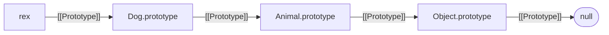

## Introduction

Code often needs to ask what *kind* of object it has been given. An error handler wants to know whether a failure is a validation problem or a missing record. A function that accepts "a date or a timestamp" needs to tell the two apart. A rendering helper wants to treat arrays differently from single items.

For primitives, `typeof` answers that question (see [[b1-typeof]]). For objects it is too coarse: `typeof` says `"object"` for a date, a map, an error and an instance of your own `Order` class alike. The `instanceof` operator fills the gap:

```javascript title="first-instanceof.js"
class Animal {}
class Dog extends Animal {}
const rex = new Dog();

console.log(rex instanceof Dog, rex instanceof Animal, rex instanceof Object);
console.log(rex instanceof Array);
console.log(typeof rex);
```

```output
true true true
false
object
```

`rex` is a `Dog`, and because `Dog` extends `Animal`, it is also an `Animal` — and, like nearly every object, an `Object`. That matches the everyday meaning of "is a". But `instanceof` does not actually check which constructor created the object or what the object looks like. It performs one very specific search, and the surprising results people meet — `false` for an array from an iframe, `true` for an object that never ran the constructor — all follow from that search. Once you know it, you can predict every case.

## Before you start

- **Prototypes** — every object has a hidden link, `[[Prototype]]`, to another object (or `null`), readable with `Object.getPrototypeOf`. See [[b1-prototypes]] and [[b1-internal-prototype]].
- **The prototype chain** — property lookup follows those links until it finds the property or reaches `null`. See [[b1-prototype-chain]].
- **Classes and `extends`** — what `class Dog extends Animal` sets up. See [[b1-classes]] and [[b1-class-inheritance]].
- **Wrapper objects** — the difference between `'hi'` and `new String('hi')`. See [[b1-autoboxing]].

## The intuition

Imagine each object carries a chain of membership cards linked together: its own card points to a parent card, which points to a grandparent card, and so on until the chain ends. Each constructor function owns exactly one card design — its `prototype` object. Asking `rex instanceof Animal` means: "walk up rex's chain of cards; do you ever reach the card that `Animal` owns?"

Two consequences follow immediately. First, the question is about the **chain**, not about birth: an object that never ran `Animal`'s constructor still passes if someone linked `Animal.prototype` into its chain, and an object that did run it fails if its chain is later rewired. Second, the answer depends on the **identity** of the card: a card that looks identical but belongs to a different `Animal` (from another page or another copy of a library) does not count.

## What `instanceof` actually checks

`obj instanceof C` is `true` exactly when `C.prototype` appears somewhere in `obj`'s prototype chain. For the classes above, the chain looks like this:



`rex instanceof Dog` finds `Dog.prototype` one step up. `rex instanceof Animal` finds `Animal.prototype` two steps up. `rex instanceof Array` walks the whole chain to `null` without meeting `Array.prototype`, so it is `false`. You can perform the same walk by hand, and there is a built-in method that asks the question from the prototype's side:

```javascript title="manual-walk.js"
class Animal {}
class Dog extends Animal {}
const rex = new Dog();

function isInstance(obj, C) {
  let p = Object.getPrototypeOf(obj);
  while (p !== null) {
    if (p === C.prototype) return true;
    p = Object.getPrototypeOf(p);
  }
  return false;
}

console.log(isInstance(rex, Animal), isInstance(rex, Array));
console.log(Animal.prototype.isPrototypeOf(rex));
```

```output
true false
true
```

`isInstance` is a simplified version of what the engine does (it skips primitives and the customisation hook covered later). `C.prototype.isPrototypeOf(obj)` is the built-in equivalent of the walk, and it is useful when you have a prototype object but no constructor.

## It checks the chain, not the constructor

Because only the chain matters, `instanceof` can disagree with how an object was created.

```javascript title="chain-not-constructor.js"
class Dog {}

const fake = Object.setPrototypeOf({}, Dog.prototype);   // never ran Dog's constructor
console.log(fake instanceof Dog);

const skipped = Object.create(Dog.prototype);            // same, using Object.create
console.log(skipped instanceof Dog);

function Legacy() {}
const old = new Legacy();
Legacy.prototype = {};                                   // replace the prototype object
console.log(old instanceof Legacy);

const bare = Object.create(null);                        // a chain with no Object.prototype
console.log(bare instanceof Object, typeof bare);
```

```output
true
true
false
false object
```

The first two objects pass even though no constructor ran, so `instanceof Dog` does not guarantee the object was initialised the way `Dog`'s constructor would do it. The third fails because `old` still links to the *original* `Legacy.prototype`, while `instanceof` now looks for the replacement. (Class `prototype` properties are non-writable, so this only happens with old-style constructor functions.) The last is an object whose chain is empty: it is a genuine object, yet it is not `instanceof Object`. Such "dictionary" objects are common in code that wants no inherited keys, so `x instanceof Object` is not a reliable "is this an object?" test.

## Primitives, wrappers and the right-hand side

The left operand can be anything. If it is a primitive, `instanceof` returns `false` straight away, because primitives have no prototype chain of their own. That includes `null` and `undefined`: they produce `false`, not an error.

```javascript title="left-operand.js"
console.log('hi' instanceof String, 5 instanceof Number);
console.log(new String('hi') instanceof String);
console.log(null instanceof Object, undefined instanceof Object);
```

```output
false false
true
false false
```

A wrapper object such as `new String('hi')` is an object whose chain contains `String.prototype`, so it passes. This is why `instanceof String` is useless for checking strings: it rejects every normal string and accepts only the wrapper objects you should never create. Use `typeof x === 'string'`.

The **right operand** is where errors come from. It must be an object; if it has no `Symbol.hasInstance` method it must also be callable (a function); and that function's `prototype` property must be an object.

```javascript title="right-operand.js"
class Dog {}
const d = new Dog();
try { d instanceof {}; } catch (e) { console.log(e.name + ': ' + e.message); }
try { d instanceof null; } catch (e) { console.log(e.name + ': ' + e.message); }
const arrow = () => {};
try { d instanceof arrow; } catch (e) { console.log(e.name + ': ' + e.message); }
```

```output
TypeError: Right-hand side of 'instanceof' is not callable
TypeError: Right-hand side of 'instanceof' is not an object
TypeError: Function has non-object prototype 'undefined' in instanceof check
```

Arrow functions and methods have no `prototype` property at all, because they cannot be used with `new`, so they are never valid right-hand sides. (Messages are from Node.js 22, which uses the V8 engine.)

## How it works internally

The specification defines `V instanceof target` in two layers.

**InstanceofOperator(V, target):**

1. If `target` is not an object, throw a `TypeError`.
2. Read `target[Symbol.hasInstance]`. If it exists, call it with `V` and return its result converted to a boolean.
3. Otherwise, if `target` is not callable, throw a `TypeError`.
4. Return **OrdinaryHasInstance(target, V)**.

**OrdinaryHasInstance(C, O):**

1. If `C` is not callable, return `false`.
2. If `C` is a **bound function** (created with `bind`), repeat the whole check against the original target function instead.
3. If `O` is not an object, return `false`.
4. Let `P` be `C.prototype`. If `P` is not an object, throw a `TypeError`.
5. Repeatedly replace `O` with its `[[Prototype]]`. If it becomes `null`, return `false`. If it is the same object as `P`, return `true`.

Step 2 of the first layer is less exotic than it sounds. Every function inherits a `Symbol.hasInstance` method from `Function.prototype`, and that default method simply calls OrdinaryHasInstance. So for normal functions and classes the outcome is the prototype walk; a class can override the method to change the answer.

Step 2 of the second layer explains bound functions. A bound function has no `prototype` of its own, so `instanceof` delegates to the function it was bound from:

```javascript title="bound.js"
function Point() {}
const BoundPoint = Point.bind(null);
console.log(BoundPoint.prototype, new Point() instanceof BoundPoint);
```

```output
undefined true
```

The walk itself costs one step per level of the chain, which is a handful of steps for real class hierarchies. Engines optimise common cases further, so `instanceof` is cheap enough to use freely in hot code.

## Customising with `Symbol.hasInstance`

A class can define a static method named `Symbol.hasInstance` to decide for itself what counts as an instance. This is how you would make `instanceof` express a rule rather than an ancestry:

```javascript title="has-instance.js"
class Even {
  static [Symbol.hasInstance](n) {
    return Number.isInteger(n) && n % 2 === 0;
  }
}
console.log(2 instanceof Even, 3 instanceof Even, 'x' instanceof Even);

function Duck() {}
Duck[Symbol.hasInstance] = () => true;     // silently ignored
console.log({} instanceof Duck);

Object.defineProperty(Duck, Symbol.hasInstance, {
  value: (o) => typeof o?.quack === 'function',
});
console.log({ quack() {} } instanceof Duck, {} instanceof Duck);
```

```output
true false false
false
true false
```

Notice that `2 instanceof Even` is `true` even though `2` is a primitive: the custom method replaces the whole default algorithm, including the "primitives return false" rule.

The `Duck` part shows a trap. `Function.prototype[Symbol.hasInstance]` is **non-writable**, and a non-writable inherited property blocks plain assignment of the same name on objects that inherit it. In sloppy mode the assignment is silently ignored (in strict mode it throws a `TypeError`). To install the method on an existing function, use `Object.defineProperty`, which creates an own property directly; in a class, a `static` method does the same.

Custom `hasInstance` methods are rare in application code because they make `instanceof` mean something readers do not expect. Their legitimate use is in libraries that want a familiar syntax for a structural check. If you only need a predicate, a plain function such as `isDuck(o)` is clearer.

## Realms: when the same class is not the same object

A **realm** is a complete set of built-in objects — its own `Array`, `Object`, `Error` and global object. Each browser page, each iframe and each Node.js `vm` context is a separate realm. An array created in one realm has that realm's `Array.prototype` in its chain, so it fails `instanceof Array` in another realm, even though it is a perfectly normal array. Node.js can demonstrate this without a browser:

```javascript title="realms.js"
const vm = require('node:vm');
const foreignArray = vm.runInNewContext('[1, 2, 3]');
const foreignError = vm.runInNewContext('new TypeError("boom")');

console.log(foreignArray instanceof Array, Array.isArray(foreignArray));
console.log(foreignError instanceof Error, foreignError.name);
```

```output
false true
false TypeError
```

`Array.isArray` exists precisely for this: it checks an internal property of the object (whether it is an array exotic object) rather than its chain, so it works across realms, and also sees through a `Proxy` wrapped around an array. For errors there is no equivalent in Node.js 22, so code that must handle foreign errors checks the shape it needs, such as `typeof err?.message === 'string'`. The realm concept itself is covered in [[b1-global-variables]], and iframes in [[b3-iframes]].

The same failure happens without any iframes when **two copies of a library** are loaded. If a project ends up with two versions of a package in `node_modules`, each copy defines its own `ValidationError` class, and an error created by one copy fails `instanceof` against the class imported from the other. Package managers deduplicate where they can, but this is a well-known source of "the error is clearly a `ValidationError` but `instanceof` says no" bugs. Libraries that care often add a property such as `isAxiosError` or a static `isXxxError()` helper for this reason.

## Transpiled subclasses of built-ins

One more historical failure is worth recognising. When TypeScript compiles a class that extends a built-in such as `Error` to ES5 (`target: "ES5"`), the generated code cannot set up the prototype chain the way native `class` syntax does, and the result loses its subclass prototype:

```typescript title="es5-error.ts"
class HttpError extends Error {
  constructor(public status: number) { super('HTTP ' + status); }
}
const e = new HttpError(404);
console.log(e instanceof HttpError, e instanceof Error, (e as any).status);
```

```output
false true 404
```

That output comes from compiling with TypeScript 6 and `--target es5` (which TypeScript 6.0 deprecates) and running the result in Node.js 22. The documented workaround is to call `Object.setPrototypeOf(this, new.target.prototype)` in the constructor. With any ES2015 or later target, native classes are emitted and `instanceof` works without the workaround — one more reason modern projects target ES2015+.

## Worked example: dispatching on an error hierarchy

A server converts thrown errors into HTTP responses. Custom error classes form a hierarchy, and `instanceof` picks the response (custom errors are covered in [[b1-custom-errors]]).

```javascript title="error-dispatch.js"
class AppError extends Error {
  constructor(message, options) {
    super(message, options);
    this.name = new.target.name;
  }
}
class NotFoundError extends AppError {}
class ValidationError extends AppError {
  constructor(field, message) {
    super(message);
    this.field = field;
  }
}

function toHttpResponse(err) {
  if (err instanceof ValidationError) return { status: 400, body: `${err.field}: ${err.message}` };
  if (err instanceof NotFoundError) return { status: 404, body: err.message };
  if (err instanceof AppError) return { status: 500, body: 'Application error' };
  if (err instanceof Error) return { status: 500, body: 'Unexpected error' };
  return { status: 500, body: `Non-error thrown: ${String(err)}` };
}

const failures = [
  new ValidationError('email', 'must contain @'),
  new NotFoundError('order 42 not found'),
  new AppError('payment provider timed out'),
  new TypeError('x is not a function'),
  'just a string',
];
for (const f of failures) console.log(toHttpResponse(f));

const e = new NotFoundError('gone');
console.log(e.name, e instanceof NotFoundError, e instanceof AppError, e instanceof Error);
```

```output
{ status: 400, body: 'email: must contain @' }
{ status: 404, body: 'order 42 not found' }
{ status: 500, body: 'Application error' }
{ status: 500, body: 'Unexpected error' }
{ status: 500, body: 'Non-error thrown: just a string' }
NotFoundError true true true
```

Walk through the design choices:

- **Most specific first.** A `NotFoundError` is also an `AppError` and an `Error`, as the last line shows. If the `AppError` check came first, it would catch every custom error and the 400 and 404 branches would never run. With `instanceof`, order the checks from the deepest subclass to the most general.
- **`new.target.name`** sets `name` to the actual class being constructed, so every subclass gets a correct name without repeating the line.
- **A final non-`Error` branch.** JavaScript lets you `throw` any value, including strings. `'just a string' instanceof Error` is `false` (it is a primitive), so the last branch handles it instead of crashing on `err.message`.
- **`TypeError` falls through to `Error`.** Built-in error types inherit from `Error`, so a programming bug ends up in the generic 500 branch.

The weak spot is the one described above: an error created in a different realm or by a duplicate copy of the classes would skip to the generic branch. If that can happen in your system, give each error a stable `code` property and dispatch on that instead.

## In real systems

**TypeScript narrowing.** Inside `if (value instanceof Date)`, TypeScript narrows `value` to `Date`, which is the main reason `instanceof` appears so often in typed code. See [[b2-instanceof-narrowing]].

**Error handling.** `catch (err) { if (err instanceof HttpError) … }` is the standard way to react to specific failures, both in your code and with library error classes such as `DOMException`.

**DOM code in browsers.** `event.target instanceof HTMLInputElement` checks the element type before reading `.value`. Elements moved between documents in different frames suffer from the realm problem, but within one page this check is reliable (described from the DOM specification, not run here).

**Libraries.** Validation and serialisation libraries use `instanceof Date`, `instanceof Map` and `instanceof Uint8Array` to decide how to handle values, and many pair it with fallbacks like `Array.isArray` for robustness.

## Trade-offs and alternatives

`instanceof` is the right tool when the classes live in your own code, in one realm, and you want "this object or any subclass". It reads well, works with inheritance, and TypeScript understands it. It is the wrong tool when values may cross realms or package copies, when the left side may be a primitive you care about, or when you need a guarantee that the object was really constructed by your class.

| Question | Better check | Why |
|---|---|---|
| Is it a string, number, boolean…? | `typeof x === 'string'` | Primitives always fail `instanceof` |
| Is it an array? | `Array.isArray(x)` | Realm-safe and Proxy-aware |
| Was it really built by my class? | `#field in obj` (private brand check, ES2022) | Cannot be faked with `setPrototypeOf` |
| Does it have the shape I need? | Duck typing: `typeof x.then === 'function'` | Works across realms and library copies |
| What built-in kind is it, for logging? | `Object.prototype.toString.call(x)` | Gives `[object Map]` etc.; forgeable, see [[b1-tostringtag]] |

The private brand check deserves a closer look, because it is the one alternative that is *stricter* than `instanceof`:

```javascript title="brand-check.js"
class Wallet {
  #balance = 0;
  static isWallet(o) { return #balance in o; }
}
const real = new Wallet();
const forged = Object.create(Wallet.prototype);
console.log(forged instanceof Wallet, Wallet.isWallet(real), Wallet.isWallet(forged));
```

```output
true true false
```

`forged` passes `instanceof` because its chain is right, but it has no `#balance` field, because only objects that ran the `Wallet` constructor get one. Use this when a method depends on private state being present.

## Common mistakes

**Using `instanceof` for primitives.** `'abc' instanceof String` is `false`. Use `typeof`.

**Using `instanceof Array` on data that may come from elsewhere.** Arrays created in iframes, other windows or `vm` contexts fail it. Use `Array.isArray`.

**Ordering checks from general to specific.** `if (err instanceof Error)` first swallows every subclass. Check subclasses first.

**Assuming `instanceof` means "initialised by the constructor".** `Object.create(C.prototype)` passes without running `C`. Use a private brand check if you depend on constructor-created state.

**Assigning `Symbol.hasInstance` on a function.** The assignment is ignored (or throws in strict mode) because the inherited property is non-writable. Use a `static` method or `Object.defineProperty`.

**Using `x instanceof Object` to mean "is an object".** It is `false` for `Object.create(null)` objects and for objects from other realms. Use `x !== null && (typeof x === 'object' || typeof x === 'function')`.

> [!MISTAKE] "`null instanceof Object` throws"
> It does not: a primitive on the left — `null` and `undefined` included — returns `false`. The `TypeError` cases are all about the *right* side: a non-object, a non-callable object without `Symbol.hasInstance`, or a function with no object `prototype`, such as an arrow function.

## Interview perspective

**"How does `instanceof` work?"** "It walks the left operand's prototype chain looking for the right operand's `prototype` object; `true` if found, `false` at `null`." Then mention `Symbol.hasInstance` as the override hook, and bound functions delegating to their target.

**"Why does `[] instanceof Array` sometimes return `false`?"** Realms: the array was created with a different realm's `Array`, so its chain has a different `Array.prototype`. Recommend `Array.isArray`. Bonus: duplicate package copies cause the same failure for library classes.

**"What does `Object.create(null) instanceof Object` give?"** `false`, because the chain is empty. Shows you understand that the check is structural.

**"How would you make `instanceof` lie?"** `Object.setPrototypeOf` on the object, reassigning a constructor function's `prototype`, or a custom `Symbol.hasInstance`. Then explain how a private brand check avoids being fooled.

**Follow-up: "`instanceof` vs `typeof` vs `Array.isArray`?"** `typeof` for primitives and functions, `Array.isArray` for arrays, `instanceof` for class hierarchies in one realm.

```quiz
Q: `class A {}; class B extends A {}; const b = new B();` Which expression is `false`?
- [ ] `b instanceof A`
- [ ] `b instanceof Object`
- [x] `A.prototype instanceof B`
- [ ] `B.prototype instanceof A`
> `A.prototype`'s chain is just `Object.prototype` then null; it never reaches `B.prototype`, so it is false. `B.prototype`'s own [[Prototype]] is `A.prototype`, which makes `B.prototype instanceof A` true, and `b` reaches both `A.prototype` and `Object.prototype`.

Q: What does `null instanceof Object` do?
- [ ] Throws a `TypeError`
- [x] Returns `false`
- [ ] Returns `true`, because `typeof null` is `"object"`
- [ ] Returns `undefined`
> A primitive on the left, including null, makes OrdinaryHasInstance return false before any walk. Errors come only from an invalid right-hand side. `typeof null` being "object" is a historical quirk that `instanceof` does not use.

Q: An array arrives from an iframe. Why can `arr instanceof Array` be `false`?
- [ ] Arrays are copied into plain objects when they cross frames
- [x] The iframe has its own `Array`, so the array's chain contains a different `Array.prototype`
- [ ] `instanceof` does not work on arrays
- [ ] The iframe array is a Proxy
> Each realm has its own built-ins. The array is a real array whose chain leads to the iframe's `Array.prototype`, not the parent's. `Array.isArray` checks an internal property instead of the chain, so it returns true in both realms.

Q: Why does `Duck[Symbol.hasInstance] = () => true` have no effect on a plain function `Duck` in sloppy mode?
- [ ] Symbols cannot be used as property keys on functions
- [ ] `instanceof` ignores `Symbol.hasInstance` on functions
- [x] The inherited `Function.prototype[Symbol.hasInstance]` is non-writable, which blocks the assignment
- [ ] The arrow function has no `prototype`
> A non-writable property inherited from the prototype prevents creating a same-named property by assignment; sloppy mode ignores the failure and strict mode throws. `Object.defineProperty` or a static class method creates the own property directly.
```

## Practice

1. **Predict the chain.** For `class Shape {}`, `class Circle extends Shape {}` and `const c = new Circle()`, draw the prototype chain of `c` and of `Circle.prototype`, then predict `Circle.prototype instanceof Shape`, `c instanceof Function` and `Circle instanceof Function`.
2. **Write your own.** Implement `myInstanceof(value, C)` including the primitive rule, the `TypeError` for a non-callable right side, the `Symbol.hasInstance` hook and bound functions (hint: you cannot detect bound functions portably — explain what you do instead).
3. **Realm-safe check.** Using `node:vm`, create a `Date` in a new context. Compare `instanceof Date`, `Object.prototype.toString.call(d)` and `typeof d.getTime === 'function'`, and decide which to use in a date-formatting library.
4. **Fix the order.** Rewrite an error handler that checks `instanceof Error`, then `instanceof HttpError`, then `instanceof NotFoundError`, and add a test proving each branch is reachable.
5. **Brand check.** Add a `static isWallet` brand check to a class that has private state and show an object that passes `instanceof` but fails the brand check.

## Quick revision {#quick-revision}

- `obj instanceof C` is true when `C.prototype` is somewhere on `obj`'s prototype chain.
- It checks the chain, not who constructed the object: `Object.create(C.prototype)` passes; reassigning `F.prototype` makes old instances fail.
- Primitive on the left (including `null`/`undefined`) → `false`. Wrapper objects pass (`new String('a') instanceof String`).
- `TypeError` when the right side is not an object, is not callable (and has no `Symbol.hasInstance`), or has a non-object `prototype` (arrow functions).
- Algorithm: `target[Symbol.hasInstance]` if present, else OrdinaryHasInstance; bound functions delegate to their target.
- `Function.prototype[Symbol.hasInstance]` is non-writable: install custom ones with `static` or `Object.defineProperty`.
- `Object.create(null)` objects are not `instanceof Object`.
- Cross-realm (iframes, `vm`) and duplicate package copies make `instanceof` fail; use `Array.isArray`, duck typing or stable `code` fields.
- TypeScript `--target es5` breaks `instanceof` for subclasses of `Error`; fix with `Object.setPrototypeOf(this, new.target.prototype)` or target ES2015+.
- Order class checks from most specific to most general.
- `#field in obj` is a brand check that cannot be faked by prototype tricks.

## Key takeaways {#key-takeaways}

- `instanceof` is a search for one specific object, `C.prototype`, up the left operand's prototype chain.
- It is reliable for your own classes in one realm and understood by TypeScript for narrowing.
- It is the wrong tool for primitives (`typeof`), arrays (`Array.isArray`) and values that can cross realms or package copies.
- It can be fooled by prototype manipulation and customised by `Symbol.hasInstance`; private brand checks are the strict alternative.
- When dispatching on a hierarchy, check subclasses before their parents.
