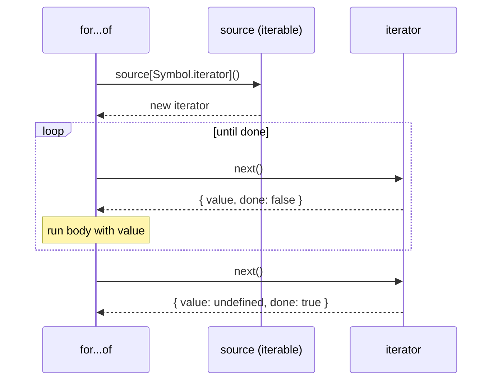

## Introduction

JavaScript has many things you can loop over: arrays, strings, `Map`s, `Set`s, the `arguments` object, DOM `NodeList`s, and objects that libraries define. It also has many language features that consume a sequence of values: the `for...of` loop, the spread syntax `[...x]`, array destructuring `const [a, b] = x`, `Array.from`, `new Map(x)`, `new Set(x)` and `Promise.all`.

If every feature had to know about every collection, adding a new collection type would mean changing the language. Instead, JavaScript defines a small agreement — the **iteration protocol** — between "something that can produce values one at a time" and "something that wants to consume them". Any object that follows the agreement works with every consumer, including ones written later. The built-in collections follow it, and so can your own classes.

This lesson builds the idea in layers. First the protocol itself: what an **iterator** and an **iterable** are, and what `for...of` really does. Then `Symbol.iterator`, the key that marks an object as iterable. Then **generators**, a kind of function that pauses and resumes and writes iterators for you, and `yield` / `yield*`, the operators that control it. Last, **async iterators**, which apply the same idea to data that arrives over time — pages from an API, chunks from a file, messages from a socket.

You need this knowledge in everyday frontend work: it explains why `for...of` works on a `Map` but not on a plain object, why spreading an iterator twice gives an empty array the second time, and how streaming `fetch` responses are read. It is also a frequent interview topic, because it touches symbols, closures, the call stack and promises at once.

## Before you start

- **Loops** — the difference between `for...of` and `for...in`. See [[b1-for-of-in]].
- **Spread and destructuring** — the syntax, which this lesson explains from the inside. See [[b1-spread-rest]] and [[b1-destructuring]].
- **Symbols** — a symbol is a unique, non-string property key. One paragraph below is enough to follow, and [[b1-symbols]] covers them fully.
- **Closures** — a function that keeps access to variables of the function that created it. Hand-written iterators keep their position this way. See [[b1-closures]].
- **Promises and `async`/`await`** — needed only for the async iterators section. See [[b1-promises]] and [[b1-async-await]].

## The intuition

Think of a ticket machine at a deli counter. The machine is not the queue of customers; it is a device that hands out the next number each time someone presses the button, and shows "closed" when the day is over. Pressing the button is the only operation. The customer does not need to know how the machine stores its numbers.

An **iterator** is that machine: an object with one method, `next()`, which hands out the next value and eventually reports that it is finished. An **iterable** is the deli itself: something you can ask for a *new* ticket machine. A `for...of` loop is a customer who asks the iterable for a machine, presses the button until it says "closed", and then leaves.

The split matters because the same collection can be walked many times, possibly at once. Two nested `for...of` loops over the same array each get their own iterator, each with its own position. The analogy stops working in one place: a real deli only has one machine, but an iterable can create as many independent iterators as you ask for — or, if it is badly designed, hand out the same exhausted one every time. The section on restartable iterables comes back to that.

## Iterable / Iterator Protocol {#b1-iterable-protocol}

The **iteration protocol** is a pair of conventions — the specification calls them the iterator protocol and the iterable protocol — that let any object produce a sequence of values for `for...of`, spread, destructuring and the other built-in consumers. They are conventions, not classes: there is nothing to inherit from. An object follows the protocol if it has methods with the right names that return the right shapes.

### The iterator protocol

An **iterator** is an object with a `next()` method. Each call returns an **iterator result**: a plain object with two properties.

- `value` — the next value in the sequence.
- `done` — `false` while values are being produced, `true` once the sequence is finished.

The array iterator shows the shape exactly:

```javascript title="array-iterator.js"
const letters = ['a', 'b'];
const it = letters[Symbol.iterator]();

console.log(it.next());
console.log(it.next());
console.log(it.next());
console.log(it.next());
```

```output
{ value: 'a', done: false }
{ value: 'b', done: false }
{ value: undefined, done: true }
{ value: undefined, done: true }
```

Two details are worth noticing. The final element comes with `done: false`; the iterator only reports `done: true` on the call *after* the last value. And once finished, it stays finished: further calls keep returning `done: true`. An iterator only moves forward. There is no way to rewind it or ask for its length.

Nothing about this requires a built-in. Here is an iterator written by hand. The variable `current` lives in the closure created by `countdown`, so each call to `next` sees and updates the same position:

```javascript title="countdown-iterator.js"
function countdown(from) {
  let current = from;
  return {
    next() {
      if (current < 1) return { value: undefined, done: true };
      return { value: current--, done: false };
    },
  };
}

const it = countdown(3);
let step = it.next();
while (!step.done) {
  console.log(step.value);
  step = it.next();
}
```

```output
3
2
1
```

The `while` loop at the bottom is the pattern every consumer follows: call `next`, stop if `done` is true, otherwise use `value`. If `next` returns something that is not an object (say, `undefined` or a number), the consumer throws a `TypeError`, because it cannot read `done` from it.

### The iterable protocol

The countdown object above is an iterator, but `for...of` cannot use it yet. Consumers do not accept iterators directly; they accept **iterables**. An iterable is an object with a method stored under the key `Symbol.iterator` that returns an iterator. A **symbol** is a primitive value used as a property key that can never clash with a string key; `Symbol.iterator` is a specific symbol built into the language for this purpose (see [[b1-symbol-iterator]] below).

Wrap the countdown in an iterable and every consumer accepts it:

```javascript title="countdown-iterable.js"
const countdown = {
  from: 3,
  [Symbol.iterator]() {
    let current = this.from;
    return {
      next() {
        if (current < 1) return { value: undefined, done: true };
        return { value: current--, done: false };
      },
    };
  },
};

for (const n of countdown) console.log(n);
console.log([...countdown]);
const [first, second] = countdown;
console.log(first, second);
console.log(Math.max(...countdown), new Set(countdown).size);
```

```output
3
2
1
[ 3, 2, 1 ]
3 2
3 3
```

Every consumer called `countdown[Symbol.iterator]()` and received a *new* iterator starting at 3, which is why spreading after the loop still produces all three values. Destructuring is notable: `const [first, second]` called `next` only twice. Consumers pull exactly as many values as they need.

### What `for...of` actually does

Seen from the inside, this loop:

```javascript title="for-of-shape.js"
for (const x of source) {
  // body
}
```

behaves roughly like the following steps, which the specification describes with operations called GetIterator, IteratorStep and IteratorClose:

1. Read `source[Symbol.iterator]`. If it is missing or not a function, throw `TypeError: source is not iterable`.
2. Call it with `this` set to `source`. If the result is not an object, throw a `TypeError`.
3. Call the iterator's `next()`. If the result's `done` is true, the loop ends.
4. Otherwise bind `x` to the result's `value`, run the body, and go back to step 3.
5. If the body exits early — `break`, `return`, or an exception — call the iterator's `return()` method, if it has one, so the iterator can clean up.



### Optional methods: `return()` and `throw()`

Step 5 is the part beginners do not expect. An iterator may have two optional methods besides `next`:

- `return(value)` — "the consumer is stopping early". Consumers call it when they abandon the iterator before it reports `done`. An iterator that holds a resource (an open file, a database cursor, a lock) uses it to release that resource.
- `throw(error)` — "an error happened on the consumer's side". It is used mainly by generators and by `yield*`; ordinary loops never call it.

Watch `return()` being called:

```javascript title="early-exit.js"
const resource = {
  [Symbol.iterator]() {
    let i = 0;
    return {
      next() {
        i++;
        console.log('next', i);
        return { value: i, done: i > 5 };
      },
      return() {
        console.log('return called: release the resource here');
        return { value: undefined, done: true };
      },
    };
  },
};

for (const n of resource) {
  if (n === 2) break;
}
console.log('---');
const [a] = resource;
console.log('a =', a);
```

```output
next 1
next 2
return called: release the resource here
---
next 1
return called: release the resource here
a = 1
```

The `break` triggered `return()`, and so did destructuring, which stopped after taking one value. Spread, by contrast, always runs to the end, so it never needs to call `return()`. If an iterator is exhausted normally (it returned `done: true`), consumers do not call `return()` — there is nothing left to abandon. The practical rule: if your iterator holds a resource, implement `return()`; if you consume an iterator manually with `next()` and stop early, call `return()` yourself.

### Built-in iterables

Most collection-like values in JavaScript are already iterable:

| Value | What it yields |
|---|---|
| `Array`, typed arrays | elements, in index order (`array.values()`) |
| `String` | Unicode code points, not UTF-16 code units |
| `Map` | `[key, value]` pairs, in insertion order |
| `Set` | values, in insertion order |
| `arguments` | the arguments of the call |
| `NodeList` (browsers) | DOM nodes; defined by the DOM standard, not by JavaScript |
| generator objects | whatever the generator yields |
| `array.keys()`, `map.entries()`, `set.values()` … | the iterator objects these methods return are themselves iterable |

Plain objects are **not** iterable. The loop fails before running a single step:

```javascript title="builtins.js"
console.log([...'hé🙂']);
console.log('hé🙂'.length);
console.log([...new Map([['x', 1], ['y', 2]])]);
console.log([...new Set([3, 3, 4])]);
function f() { return [...arguments]; }
console.log(f(1, 2));

const settings = { theme: 'dark' };
try {
  for (const x of settings) console.log(x);
} catch (e) {
  console.log(e.constructor.name + ': ' + e.message);
}
for (const [key, value] of Object.entries({ a: 1, b: 2 })) console.log(key, value);
```

```output
[ 'h', 'é', '🙂' ]
4
[ [ 'x', 1 ], [ 'y', 2 ] ]
[ 3, 4 ]
[ 1, 2 ]
TypeError: settings is not iterable
a 1
b 2
```

The string line deserves a second look. `'hé🙂'.length` is `4`, because the emoji is stored as two UTF-16 **code units** (a surrogate pair). The string iterator, however, yields whole **code points**, so spreading gives three characters. That makes `[...str]` and `for...of` the safe way to walk text that may contain emoji (see [[b1-unicode-strings]]). For plain objects, use `Object.keys`, `Object.values` or `Object.entries`, which return arrays — and arrays are iterable. Objects were deliberately left non-iterable, because it is not obvious whether iterating an object should give keys, values or pairs.

### Iterators are single-use; iterables can be restartable

Built-in iterators are also iterables: calling `it[Symbol.iterator]()` returns `it` itself. That convenience lets you pass an iterator to `for...of`. It also creates the most common iteration bug: an iterator can only be walked once.

```javascript title="single-use.js"
const arrIt = ['x', 'y'][Symbol.iterator]();
console.log(arrIt[Symbol.iterator]() === arrIt);
console.log([...arrIt], [...arrIt]);
```

```output
true
[ 'x', 'y' ] []
```

The second spread asked the iterator for a fresh iterator and got the same, already finished one. The fix is to keep the *iterable* (the array) around and ask it for a new iterator each time. When you write a collection, make its `[Symbol.iterator]()` return a new iterator per call, so it behaves like an array; the next section shows the contrast.

### Changing a collection while iterating

Built-in iterators read the collection live, as they go. They do not take a snapshot.

```javascript title="mutation.js"
const nums = [1, 2, 3];
for (const n of nums) {
  if (n === 1) nums.push(4); // appended while looping
  console.log(n);
}

const tags = new Set(['a', 'b', 'c']);
for (const t of tags) {
  if (t === 'a') tags.delete('b');
  console.log(t);
}
```

```output
1
2
3
4
a
c
```

The array iterator keeps an index and checks it against the current `length` on every `next()`, so the pushed `4` is visited. A loop that pushes on every step would never end. `Map` and `Set` iterators likewise visit entries added during the loop and skip entries deleted before they are reached. When you need to modify a collection based on its contents, iterate over a copy (`[...nums]`) or build a new collection instead.

```quiz
Q: `const it = new Set([1, 2])[Symbol.iterator](); console.log([...it].length, [...it].length);` — what is printed?
- [ ] `2 2`, because each spread creates a new iterator
- [x] `2 0`, because both spreads use the same iterator and the first one exhausts it
- [ ] A `TypeError`, because iterators cannot be spread
- [ ] `0 0`, because `it` was created before the spread
> Spread calls `it[Symbol.iterator]()`, and a built-in iterator returns itself. The first spread drains it, so the second gets an iterator that is already `done`. Spreading the `Set` itself twice would print `2 2`, because the `Set` creates a fresh iterator each time — that is the iterable/iterator distinction.
```

## Symbol.iterator {#b1-symbol-iterator}

`Symbol.iterator` is a built-in symbol that serves as the property key under which an object stores its "give me an iterator" method. Every consumer of the iteration protocol looks the method up by this key. Adding a method under `Symbol.iterator` is therefore exactly what makes an object iterable; nothing else is needed.

### Why a symbol and not a method called `iterator`

ES2015 added iteration to a language that already had twenty years of code in it. If the protocol had used a string key such as `"iterator"`, any existing object that happened to have an `iterator` property — say, a library's config object — would suddenly be treated as iterable, with confusing results. A symbol cannot collide with any string key, and it cannot collide with symbols created by your own code either, because every symbol is unique. JavaScript has a family of these built-in keys, called **well-known symbols**, that let objects hook into language behaviour; they are covered in [[b1-well-known-symbols]].

```javascript title="the-key.js"
console.log(Array.prototype[Symbol.iterator] === Array.prototype.values);
console.log(typeof Symbol.iterator, Symbol.iterator.toString());
```

```output
true
symbol Symbol(Symbol.iterator)
```

For arrays, the iterator method is the same function as `values()`. That is why `for (const x of arr)` gives elements rather than indices.

### Making a class iterable

Because the key is a symbol, you define the method with a **computed property name** in square brackets ([[b1-computed-properties]]). Here is a numeric range class, written without generators so the protocol stays visible:

```javascript title="range.js"
class Range {
  constructor(from, to) {
    this.from = from;
    this.to = to;
  }

  [Symbol.iterator]() {
    let next = this.from;
    const last = this.to;
    return {
      next: () =>
        next <= last
          ? { value: next++, done: false }
          : { value: undefined, done: true },
    };
  }
}

const r = new Range(1, 4);
console.log([...r]);
console.log([...r]);
console.log(Array.from(r, (n) => n * 10));
console.log(JSON.stringify(r));
```

```output
[ 1, 2, 3, 4 ]
[ 1, 2, 3, 4 ]
[ 10, 20, 30, 40 ]
{"from":1,"to":4}
```

Each spread produced the full range because `[Symbol.iterator]()` creates new local variables `next` and `last` on every call. The range object stores only its bounds; the position lives in the iterator. `Array.from` accepted the range and an optional mapping function. `JSON.stringify` ignored the iterator method entirely: JSON serialisation skips symbol-keyed properties, and it never consults the iteration protocol.

Compare a design that returns `this` from `[Symbol.iterator]()` and stores the position on the object:

```javascript title="one-shot.js"
class OneShot {
  constructor(items) {
    this.items = items;
    this.i = 0;
  }
  [Symbol.iterator]() {
    return this; // the object is its own iterator
  }
  next() {
    return this.i < this.items.length
      ? { value: this.items[this.i++], done: false }
      : { value: undefined, done: true };
  }
}

const once = new OneShot(['x', 'y']);
console.log([...once]);
console.log([...once]);
```

```output
[ 'x', 'y' ]
[]
```

`OneShot` is an iterator pretending to be a collection. The second spread finds `i` already at the end. Returning `this` is correct for objects that *are* cursors — built-in iterators and generator objects do it — but a collection should return a fresh iterator.

### What does and does not use `Symbol.iterator`

Several similar-looking features behave differently, and confusing them is a common source of errors:

| Operation | Uses `Symbol.iterator`? | On a plain object `{ a: 1 }` |
|---|---|---|
| `for...of`, `[...x]`, `const [a] = x` | yes | `TypeError: x is not iterable` |
| `Array.from(x)` | yes, if present; otherwise treats `x` as array-like (reads `length` and indices) | `[]` |
| `new Map(x)`, `new Set(x)`, `Promise.all(x)` | yes | `TypeError` (`Promise.all` returns a promise rejected with it) |
| `{ ...x }` (object spread) | **no** — copies own enumerable properties | `{ a: 1 }` |
| `for...in` | **no** — walks enumerable string keys | logs `a` |
| `JSON.stringify(x)` | **no** | `{"a":1}` |

The `Array.from` row explains why `Array.from({ length: 3 })` works even though that object is not iterable: without `Symbol.iterator`, `Array.from` falls back to reading `length` and the numeric keys. Object spread and array spread share three dots but are different operations — `{...map}` gives `{}`, because a `Map`'s entries are not own properties.

```quiz
Q: A class stores its data in an array and defines `[Symbol.iterator]() { return this.data.values(); }`. What happens when you spread an instance twice?
- [ ] The second spread is empty, because the iterator was exhausted
- [x] Both spreads give all the elements, because each call to the method returns a new array iterator
- [ ] It throws, because the method must be a generator
- [ ] It depends on whether the class also defines `next()`
> `this.data.values()` creates a new array iterator on every call, so each consumer starts at index 0. Delegating to an internal collection's iterator is a short, correct way to make a class iterable. Generators are optional — any method that returns an iterator works.
```

## Generators {#b1-generators}

A **generator function** is a function declared with `function*` that can pause in the middle of its body and later resume where it left off. Calling it does not run the body; it returns a **generator object**, which is an iterator. Each call to the generator object's `next()` runs the body until the next `yield`, hands out the yielded value, and freezes the function again. Generators exist because writing iterators by hand — tracking position in variables, building `{ value, done }` objects — is tedious and error-prone. A generator lets you write the sequence as ordinary straight-line code.

### Pausing and resuming

The logging below shows exactly when the body runs:

```javascript title="pause-resume.js"
function* greet() {
  console.log('started');
  yield 'hello';
  console.log('resumed');
  yield 'world';
  console.log('finishing');
  return 'done';
}

const g = greet();
console.log('generator created');
console.log(g.next());
console.log(g.next());
console.log(g.next());
console.log(g.next());
```

```output
generator created
started
{ value: 'hello', done: false }
resumed
{ value: 'world', done: false }
finishing
{ value: 'done', done: true }
{ value: undefined, done: true }
```

Walk through it. `greet()` logged nothing: the body has not started. The first `next()` ran from the top to the first `yield`, which produced `{ value: 'hello', done: false }` and suspended the function with its local state intact. The second `next()` resumed right after that `yield`. The third ran to the `return`, which produced `done: true` with the returned value. After that, the generator is finished and stays finished.

A generator object moves through four states: **suspended at the start** (created, not yet run), **executing** (inside a `next()` call), **suspended at a `yield`**, and **completed**. Calling `next()` on a generator that is currently executing — for example from inside its own body — throws a `TypeError`.

### How pausing works

An ordinary function call pushes a frame on the call stack ([[b1-call-stack]]) and pops it when the function returns; the local variables are gone. A generator is different. When it reaches `yield`, its execution context ([[b1-execution-contexts]]) — local variables, the position in the code, any enclosing `try` blocks — is removed from the stack *and kept* inside the generator object on the heap. `next()` puts that context back on the stack and continues. This is why a generator can keep a loop counter between calls without any closure tricks, and why its state costs memory for as long as the generator object is reachable.

Generators do not run in parallel with anything. Nothing happens inside a suspended generator; it is code that waits to be resumed by a caller.

### Generators are iterators and iterables

A generator object has `next`, `return` and `throw`, and its `[Symbol.iterator]()` returns itself. So you can loop over a generator call directly. Because the body only runs on demand, a generator can describe an **infinite sequence** safely, provided the consumer stops:

```javascript title="infinite.js"
function* naturals() {
  let n = 1;
  while (true) yield n++;
}

const out = [];
for (const n of naturals()) {
  if (n > 5) break; // without this the loop never ends
  out.push(n * n);
}
console.log(out);

const g = naturals();
console.log(g[Symbol.iterator]() === g);
console.log(Object.prototype.toString.call(g));
```

```output
[ 1, 4, 9, 16, 25 ]
true
[object Generator]
```

`while (true)` inside a generator is not a hang, because each `yield` hands control back. `[...naturals()]`, however, *would* hang until memory runs out, because spread never stops pulling. This is **lazy evaluation**: values are computed only when a consumer asks for them, so a sequence can be large or endless without being stored.

Since a generator object is an iterator, it is single-use like any other iterator. To make a restartable collection, put the generator on the iterable as its `[Symbol.iterator]` method — each call then creates a fresh generator object. The worked example later in this lesson does exactly that.

### Generator syntax forms

The `*` can appear in several places, always meaning "this function is a generator":

```javascript title="syntax-forms.js"
function* declared() { yield 1; }
const expressed = function* () { yield 2; };
const obj = {
  *method() { yield 3; },
  *[Symbol.iterator]() { yield 4; },
};
class Bag {
  *items() { yield 5; }
}
console.log([...declared(), ...expressed(), ...obj.method(), ...obj, ...new Bag().items()]);
```

```output
[ 1, 2, 3, 4, 5 ]
```

There is no generator arrow function: `*() => {}` is a syntax error. And `yield` only works directly inside the generator's own body — not inside a nested callback, because the callback is a separate, ordinary function. `function* g() { [1].forEach((x) => { yield x; }); }` is a `SyntaxError`; use a `for...of` loop instead.

### Stopping a generator from outside: `return()` and `throw()`

The consumer can end a generator early with `return(value)`, or inject an error with `throw(error)`. Both resume the generator at the paused `yield` as if that line had executed a `return` or a `throw` statement. The important consequence is that `finally` blocks run, which makes generators safe to use for resources:

```javascript title="generator-return.js"
function* lines() {
  try {
    yield 'line 1';
    yield 'line 2';
    yield 'line 3';
  } finally {
    console.log('cleanup: file closed');
  }
}

for (const line of lines()) {
  console.log(line);
  if (line === 'line 2') break;
}

const g = lines();
console.log(g.next());
console.log(g.return('stopped early'));
console.log(g.next());
```

```output
line 1
line 2
cleanup: file closed
{ value: 'line 1', done: false }
cleanup: file closed
{ value: 'stopped early', done: true }
{ value: undefined, done: true }
```

The `break` made `for...of` call the generator's `return()`, which ran the `finally` block. You do not need to call `return()` yourself when you use `for...of`, destructuring or iterator helpers; you do need to if you drive a generator manually with `next()` and abandon it.

`throw(error)` raises the error at the paused `yield`. If the generator catches it, it can recover and keep yielding. If it does not, the error propagates out of the `throw()` call and the generator is completed:

```javascript title="generator-throw.js"
function* retrying() {
  while (true) {
    try {
      yield 'working';
    } catch (err) {
      console.log('caught inside generator:', err.message);
      yield 'recovered';
    }
  }
}

const g = retrying();
console.log(g.next().value);
console.log(g.throw(new Error('timeout')).value);
console.log(g.next().value);

const fresh = retrying();
try {
  fresh.throw(new Error('too early'));
} catch (err) {
  console.log('thrown out:', err.message, fresh.next());
}
```

```output
working
caught inside generator: timeout
recovered
working
thrown out: too early { value: undefined, done: true }
```

The last block shows an edge case: a generator that has not started yet is not inside its `try`, so `throw()` completes it immediately and the error comes straight back to the caller.

> [!NOTE] Generators and `async`/`await`
> Before `async` functions arrived in ES2017, libraries such as `co` used generators to write asynchronous code: the generator yielded promises, and a runner called `next(result)` when each one resolved. `async`/`await` is that pattern built into the language. You will still meet it in Redux-Saga, which models side effects as generators that yield effect descriptions.

## yield / yield* {#b1-yield}

`yield` is the operator that pauses a generator and sends a value out to whoever called `next()`. It is also an expression with a result: when the generator is resumed with `next(x)`, the paused `yield` evaluates to `x`. `yield*` is a related operator that hands control to another iterable until that iterable is finished. Together they make generators two-way and composable.

### `yield` sends a value out

`yield expr` evaluates `expr`, pauses, and makes `expr` the `value` of the iterator result. Unlike `return`, it does not end the function. A generator may contain any number of `yield`s, inside loops, conditionals and `try` blocks.

`yield` has very low precedence, like assignment. `yield a + b` yields the sum. Inside a larger expression you need parentheses: `const x = (yield 1) + 10` pauses with `1` and later adds `10` to whatever is sent in, whereas `const x = yield 1 + 10` yields `11`.

### `yield` receives a value back

The argument you pass to `next(x)` becomes the result of the `yield` expression where the generator was paused. This lets a generator ask questions:

```javascript title="two-way.js"
function* conversation() {
  console.log('waiting for a name');
  const name = yield 'What is your name?';
  const age = yield `Hi ${name}, how old are you?`;
  return `${name} is ${age}`;
}

const chat = conversation();
console.log(chat.next('ignored').value);
console.log(chat.next('Ada').value);
console.log(chat.next(36));
```

```output
waiting for a name
What is your name?
Hi Ada, how old are you?
{ value: 'Ada is 36', done: true }
```

Follow the values. The first `next('ignored')` starts the body; there is no paused `yield` to receive `'ignored'`, so **the argument to the first `next()` is always discarded**. The body runs to the first `yield` and sends out the question. The second call, `next('Ada')`, resumes that `yield`, which evaluates to `'Ada'` and is stored in `name`. The third call resumes the second `yield` with `36`.

The off-by-one between "value out" and "value in" is the hardest part of two-way generators. A useful pattern is to call `next()` once with no argument to "prime" the generator, so that from then on each `next(input)` is answered by the next yielded output:

```javascript title="running-average.js"
function* runningAverage() {
  let total = 0;
  let count = 0;
  let average = NaN;
  while (true) {
    const value = yield average;
    total += value;
    count++;
    average = total / count;
  }
}

const avg = runningAverage();
avg.next(); // run to the first yield
console.log(avg.next(10).value);
console.log(avg.next(20).value);
console.log(avg.next(60).value);
```

```output
10
15
30
```

The generator keeps `total` and `count` between calls without any object or closure set up by the caller. Two-way generators are uncommon in application code — a class with a method is usually clearer — but they underpin coroutine-style libraries, and interviewers like to ask about the first-`next` rule.

### `return` inside a generator

`return value` ends the generator and produces `{ value, done: true }`. Be aware that almost every consumer ignores that final value. `for...of`, spread and `Array.from` stop as soon as they see `done: true` and never use its `value`. Only manual `next()` calls and `yield*` see it. If a value matters to consumers, `yield` it.

### `yield*` delegates to another iterable

`yield* iterable` takes the iterable's iterator and passes along every value it produces, as if each had been yielded by the current generator. When the inner iterator finishes, the `yield*` expression evaluates to the inner iterator's return value.

```javascript title="delegate.js"
function* inner() {
  yield 'a';
  yield 'b';
  return 'inner result';
}

function* outer() {
  yield 'start';
  const result = yield* inner();
  yield `inner said: ${result}`;
  yield* [1, 2];
  yield* 'hi';
}

console.log([...outer()]);
console.log([...inner()]);
```

```output
[ 'start', 'a', 'b', 'inner said: inner result', 1, 2, 'h', 'i' ]
[ 'a', 'b' ]
```

Three things happened. `yield* inner()` forwarded `'a'` and `'b'`, then gave the outer generator `'inner result'` — the one place where a generator's return value is easy to use. `yield*` worked on an array and a string too, because it accepts any iterable. And spreading `inner()` on its own dropped `'inner result'`, as described above.

Delegation is not only about values. While delegating, `next(x)` calls on the outer generator are passed through to the inner iterator, and so are `throw()` and `return()`. If the consumer stops early, the inner iterator's `return()` is called and its `finally` blocks run. That makes `yield*` the correct way to compose generators; a hand-written `for (const v of inner()) yield v;` loop produces the same values but does not forward `next` arguments or `throw()`, and it loses the return value.

A common slip is to write `yield` where `yield*` was meant:

```javascript title="yield-vs-delegate.js"
function* inner() { yield 'a'; }
function* wrong() {
  yield inner(); // yields the generator object itself
}
console.log([...wrong()].map((x) => Object.prototype.toString.call(x)));
```

```output
[ '[object Generator]' ]
```

### Recursive structures with `yield*`

`yield*` shines with recursive data. A tree walk becomes a few lines, and it is lazy: a consumer that stops early never visits the rest of the tree.

```javascript title="tree-walk.js"
const tree = {
  name: 'src',
  children: [
    { name: 'app.js', children: [] },
    {
      name: 'lib',
      children: [
        { name: 'math.js', children: [] },
        { name: 'text.js', children: [] },
      ],
    },
  ],
};

function* walk(node, depth = 0) {
  yield '  '.repeat(depth) + node.name;
  for (const child of node.children) {
    yield* walk(child, depth + 1);
  }
}

for (const line of walk(tree)) console.log(line);
```

```output
src
  app.js
  lib
    math.js
    text.js
```

Each level of the tree is its own suspended generator, so a value from a deep node is passed up through every level of `yield*` on its way out. For very deep trees (thousands of levels) this costs time per value and can hit the stack limit, just as ordinary recursion does; an explicit stack is the fix there (see [[b1-stack-overflow]]).

```quiz
Q: `function* g() { const x = yield 1; yield x * 2; }` — what do `const it = g(); it.next(5); it.next(10);` return?
- [ ] `{ value: 1 }` then `{ value: 10 }`
- [x] `{ value: 1, done: false }` then `{ value: 20, done: false }`
- [ ] `{ value: 5 }` then `{ value: 20 }`
- [ ] `{ value: 1 }` then `{ value: NaN }`, because `x` is `5`
> The first `next(5)` starts the body and runs to `yield 1`; there is no paused `yield` to receive `5`, so it is discarded. The second `next(10)` resumes that `yield`, so `x` becomes `10` and the generator yields `20`. Thinking the first argument is used is the classic off-by-one.
```

## Async Iterators / for await...of {#b1-async-iterators}

An **async iterator** is an iterator whose `next()` returns a *promise* of an iterator result instead of the result itself. It represents a sequence whose values arrive over time — pages of an API, lines of a file, chunks of a network response, messages on a socket. **`for await...of`** is the loop that consumes such a sequence, waiting for each value before asking for the next, and **async generators** (`async function*`) are the easy way to write one.

### Why a separate protocol is needed

Suppose a server returns users in pages of 100 and you want to process them as they arrive. A synchronous iterator cannot express this: `next()` must return `{ value, done }` immediately, but whether there is another page is only known after a network request finishes. Returning a promise of the result fixes that: the consumer awaits each `next()` call.

The protocol mirrors the synchronous one with two changes:

- The method key is **`Symbol.asyncIterator`** instead of `Symbol.iterator`.
- `next()` (and the optional `return()` and `throw()`) return promises that resolve to `{ value, done }`.

```javascript title="async-ticker.mjs"
const ticker = {
  [Symbol.asyncIterator]() {
    let n = 0;
    return {
      next() {
        n++;
        return new Promise((resolve) =>
          setTimeout(() => resolve({ value: `tick ${n}`, done: n > 3 }), 20),
        );
      },
    };
  },
};

for await (const t of ticker) console.log(t);

const it = ticker[Symbol.asyncIterator]();
const first = it.next();
console.log(first instanceof Promise, await first);
```

```output
tick 1
tick 2
tick 3
true { value: 'tick 1', done: false }
```

The file uses the `.mjs` extension because `for await` and `await` are only allowed inside `async` functions or at the top level of an ES module ([[b1-top-level-await]]).

### Async generators

Writing that by hand has the same drawbacks as hand-written sync iterators, plus promise plumbing. An **async generator** combines both features: inside `async function*` you can `await` promises and `yield` values. Calling it returns an async generator object, whose `next()` returns promises. Here is the paginated API case, with a fake `fetchPage` that answers after 50 ms:

```javascript title="paginated.mjs"
// A fake API: three pages of users, each response arrives after 50 ms.
const PAGES = [['ana', 'ben'], ['cho', 'dev'], ['eli']];

function fetchPage(page) {
  return new Promise((resolve) =>
    setTimeout(() => {
      console.log(`  (fetched page ${page})`);
      resolve({ users: PAGES[page], nextPage: page + 1 < PAGES.length ? page + 1 : null });
    }, 50),
  );
}

async function* allUsers() {
  let page = 0;
  while (page !== null) {
    const response = await fetchPage(page);
    yield* response.users;
    page = response.nextPage;
  }
}

for await (const user of allUsers()) {
  console.log(user);
  if (user === 'cho') break; // page 2 is never requested
}
```

```output
  (fetched page 0)
ana
ben
  (fetched page 1)
cho
```

The output shows the benefit of a **pull-based** design. Page 1 was requested only after the loop had consumed both users from page 0, and page 2 was never requested at all because the loop broke out. The caller decides how much to fetch, simply by how far it loops; `allUsers` contains no paging logic visible to the caller. `yield*` inside an async generator accepts sync or async iterables, so it could delegate to an array here.

In an async generator, `yield` also awaits: `yield somePromise` waits for the promise and yields its result, so consumers never receive a promise as a `value`.

### How `for await...of` treats different sources

`for await` first looks for `Symbol.asyncIterator`. If it is missing, it falls back to `Symbol.iterator` and wraps the sync iterator, awaiting each value. That makes it work on an array of promises — but it is easy to over-generalise:

```javascript title="for-await-sources.mjs"
const delayed = (value, ms) => new Promise((r) => setTimeout(() => r(value), ms));

// A sync iterable of promises: for await awaits each element in order.
for await (const v of [delayed('slow', 60), delayed('fast', 10), 'plain']) {
  console.log(v);
}

try {
  for await (const v of Promise.resolve([1, 2])) console.log(v);
} catch (e) {
  console.log(e.constructor.name);
}
for await (const v of await Promise.resolve([1, 2])) console.log(v);
```

```output
slow
fast
plain
TypeError
1
2
```

The array of promises came out in array order, not in completion order: `'fast'` resolved first but waited for `'slow'`. A **promise of an array** is a different thing: a promise has neither `Symbol.asyncIterator` nor `Symbol.iterator`, so the loop throws a `TypeError`. Await the promise first, as the last loop does.

> [!WARNING] An array of promises is not a safe stream
> In the first loop, all promises were created before the loop began. If a later one rejects while the loop is still waiting on an earlier one, nothing is handling it yet, and the runtime may report an unhandled rejection. For a batch of promises that already exist, use `Promise.all` or `Promise.allSettled` ([[b1-promise-combinators]]). Use `for await` for sources that produce the next value only when asked.

### Sequential by design

`for await` processes one value at a time: it does not call `next()` again until the loop body for the previous value has finished, including any `await` inside the body. That is a feature for paging, rate-limited APIs and ordered processing. It is a cost when the items are independent: fetching 20 URLs with `for await` takes the sum of their times, whereas `Promise.all` takes roughly the longest one. When you need some concurrency but not unlimited concurrency, a pool that runs a few at a time is the usual answer (see [[b1-concurrency-limiting]] and [[b1-sequential-vs-parallel]]).

### Errors and cleanup

A rejected `next()` promise behaves like a thrown exception inside the loop, so a normal `try...catch` around the loop handles it. Breaking out calls the async iterator's `return()`, which runs an async generator's `finally` block:

```javascript title="async-errors.mjs"
async function* flaky() {
  yield 1;
  throw new Error('connection reset');
}

try {
  for await (const v of flaky()) console.log('got', v);
} catch (e) {
  console.log('caught:', e.message);
}

async function* withCleanup() {
  try {
    yield 'a';
    yield 'b';
  } finally {
    console.log('closing connection');
  }
}
for await (const v of withCleanup()) {
  console.log(v);
  break;
}
console.log(await Array.fromAsync(withCleanup()));
```

```output
got 1
caught: connection reset
a
closing connection
closing connection
[ 'a', 'b' ]
```

The last line uses `Array.fromAsync`, which collects an async iterable into an array (available in Node.js 22 and current browsers; check support before relying on it in older ones). Collecting defeats the purpose for large streams, but it is handy in tests.

### Where you meet async iterables

- **Streams.** In Node.js, readable streams (`fs.createReadStream`, `process.stdin`) are async iterables, so `for await (const chunk of stream)` reads a file chunk by chunk. `readline.createInterface` gives lines, and `events.on(emitter, 'name')` turns events into an async iterable.
- **Web streams.** The `ReadableStream` behind `fetch`'s `response.body` is async iterable in Node.js and in recent Chrome and Firefox, but not in every browser; where it is missing, read it with `getReader()`. Streaming bodies are covered in [[b3-fetch-streaming]].
- **SDKs.** Many database drivers and cloud SDKs return async iterables for cursors and paginated listings, and AI SDKs stream model output as async iterables of chunks.

```quiz
Q: A loop runs `for await (const url of urls) results.push(await fetch(url));` over 10 URLs, each taking about 200 ms. Roughly how long does it take, and why?
- [ ] About 200 ms, because `for await` starts all requests at once
- [x] About 2 seconds, because each iteration waits for its request before the next one starts
- [ ] About 200 ms, because `fetch` runs on another thread
- [ ] It throws, because `urls` is not an async iterable
> `urls` is a sync iterable of strings, which `for await` accepts. Each request starts only when its iteration begins, and the body awaits it, so the requests run one after another: about 10 × 200 ms. `Promise.all(urls.map((u) => fetch(u)))` would start them together. The network work does happen outside JavaScript, but that only helps if the requests are started before waiting.
```

## Iterator helpers: lazy pipelines

Arrays have `map`, `filter` and friends, but those methods create a whole new array at every step. For a large or infinite sequence that is wasteful or impossible. **Iterator helpers**, standardised in ES2025 and supported in Node.js 22 and current browsers, add the same family of methods to iterators: `map`, `filter`, `take`, `drop`, `flatMap`, `reduce`, `toArray`, `forEach`, `some`, `every` and `find`. They live on `Iterator.prototype`, so every built-in iterator and every generator object has them.

The methods that return iterators (`map`, `filter`, `take`, `drop`, `flatMap`) are lazy: they build a pipeline but pull nothing until a consumer asks.

```javascript title="helpers.js"
function* naturals() {
  let n = 1;
  while (true) {
    console.log('  produce', n);
    yield n++;
  }
}

const firstThreeEvenSquares = naturals()
  .filter((n) => n % 2 === 0)
  .map((n) => n * n)
  .take(3);

console.log('pipeline built, nothing produced yet');
console.log(firstThreeEvenSquares.toArray());
```

```output
pipeline built, nothing produced yet
  produce 1
  produce 2
  produce 3
  produce 4
  produce 5
  produce 6
[ 4, 16, 36 ]
```

The infinite generator produced exactly six numbers: values flowed one at a time through `filter`, `map` and `take`, and once `take` had its three values it closed the source (calling its `return()`). The equivalent array code — build all numbers, then filter, then map — could not even start on an infinite source.

Helpers also work on `Map` and `Set` iterators, which previously needed an array conversion first, and `Iterator.from(obj)` wraps any object with a `next()` method (or any iterable) so it gains the helpers:

```javascript title="helpers-builtins.js"
const m = new Map([['a', 1], ['b', 2], ['c', 3]]);
console.log(m.values().filter((v) => v > 1).toArray());
console.log(m.keys().map((k) => k.toUpperCase()).toArray());

const wrapped = Iterator.from({
  next() {
    return { value: 42, done: false };
  },
});
console.log(wrapped.take(2).toArray());
console.log(m.entries().reduce((sum, [, v]) => sum + v, 0));
```

```output
[ 2, 3 ]
[ 'A', 'B', 'C' ]
[ 42, 42 ]
6
```

Two limits: the helpers are for sync iterators only (async iterator helpers are a separate, later proposal), and arrays do not gain them — `[1, 2].values().map(...)` works, `[1, 2].take(1)` does not exist. For a short array, the array methods remain the simpler choice.

## Worked example: an iterable collection class

Here is a small `LinkedList` that behaves like a built-in collection. It accepts any iterable in its constructor, can be iterated any number of times, offers an `entries()` method, and works with destructuring, `Map` and iterator helpers.

```javascript title="linked-list.js"
class LinkedList {
  #head = null;
  #size = 0;

  constructor(items = []) {
    for (const item of items) this.push(item); // accepts any iterable
  }

  push(value) {
    const node = { value, next: null };
    if (this.#head === null) {
      this.#head = node;
    } else {
      let last = this.#head;
      while (last.next !== null) last = last.next;
      last.next = node;
    }
    this.#size++;
    return this;
  }

  get size() {
    return this.#size;
  }

  // Each call starts a fresh walk from the head, so the list is restartable.
  *[Symbol.iterator]() {
    for (let node = this.#head; node !== null; node = node.next) {
      yield node.value;
    }
  }

  *entries() {
    let index = 0;
    for (const value of this) yield [index++, value];
  }
}

const list = new LinkedList(new Set(['red', 'green', 'blue']));
console.log(list.size, [...list]);

for (const [i, colour] of list.entries()) console.log(i, colour);

const [first, ...rest] = list;
console.log(first, rest);

console.log(list[Symbol.iterator]().filter((c) => c.length > 3).map((c) => c.toUpperCase()).toArray());
console.log(new Map(list.entries()).get(2));
```

```output
3 [ 'red', 'green', 'blue' ]
0 red
1 green
2 blue
red [ 'green', 'blue' ]
[ 'GREEN', 'BLUE' ]
blue
```

Step by step:

1. The constructor uses `for...of`, so it accepts an array, a `Set`, a generator or another `LinkedList` — the protocol makes the class's input flexible for free.
2. `*[Symbol.iterator]()` is a generator method. Every call creates a new generator object starting at `#head`, so spreading, destructuring and looping can all happen repeatedly. Writing the same method by hand would need an object with a `next` method and a `node` variable in a closure; the generator replaces about ten lines with three.
3. `entries()` is built on the class's own iteration (`for (const value of this)`), so there is one place that knows how to walk the nodes.
4. `const [first, ...rest] = list` takes one value, then the rest element drains the iterator.
5. The helper chain works because generator objects inherit from `Iterator.prototype`.
6. `new Map(list.entries())` works because `Map`'s constructor consumes any iterable of `[key, value]` pairs.

One edge case to consider: if code calls `push` while a loop is walking the list, the generator will visit the new node when it reaches it, because it follows `next` pointers live — the same behaviour as arrays. If that is unwanted, document it or snapshot the values before looping.

## In real systems

- **Collections in libraries.** Immutable.js collections, the `URLSearchParams` and `FormData` web APIs, and `Headers` from `fetch` are all iterable, so `for...of` and `Object.fromEntries(params)` work on them. When you publish a collection class, implementing `Symbol.iterator` is the expected interface.
- **Streaming I/O.** Server code reads files and HTTP request bodies with `for await (const chunk of stream)`. Frontend code reads streaming responses, such as chat-style AI output, chunk by chunk with an async iterator over a `ReadableStream` or with a reader loop.
- **Pagination.** SDKs expose "list all" operations as async generators that fetch pages on demand, exactly like the `allUsers` example; callers stop as soon as they have found what they need.
- **Lazy data processing.** Generators and iterator helpers process large log files or CSV exports row by row without building intermediate arrays, keeping memory flat.
- **Control-flow libraries.** Redux-Saga writes side effects as generators that yield instructions; test code can step through them with `next()` and check each yielded effect without running it.
- **Tree and graph traversal.** UI frameworks and compilers walk nested structures (DOM-like trees, ASTs) with recursive generators and `yield*`, which keeps traversal separate from what is done with each node.

## Trade-offs and alternatives

| Approach | Strengths | Costs | Use when |
|---|---|---|---|
| Array + array methods | Simple, random access, `length`, fast on small data, easy to debug | Builds the whole sequence in memory at every step | Data is already in memory and moderate in size |
| Hand-written iterator | Full control, no generator overhead | Verbose, easy to get `done` handling or `return()` wrong | Hot paths, or a library exposing a cursor with custom methods |
| Generator | Short, readable, lazy, `finally` runs on early exit | Single-use objects, suspended state is harder to inspect in a debugger, small per-value overhead | Custom iterables, traversals, large or infinite sequences |
| Iterator helpers | Lazy pipelines with familiar method names | ES2025; sync only; less familiar to some teams | Filtering or mapping large or endless iterators |
| Async generator + `for await` | Natural code for paged or streamed data, back-pressure built in | Sequential by default | Data that arrives over time |
| `Promise.all` | Concurrent | Everything at once; no early stop | A fixed batch of independent async tasks |

On performance: in modern engines a `for...of` over an array is usually optimised to be close to an indexed loop, and generators are fast enough for almost all application code. Only in measured hot loops is it worth replacing them with index loops. The bigger performance effect is memory: a lazy pipeline over a million rows holds one row at a time, where an array pipeline may hold several copies.

## Common mistakes

- **Reusing an exhausted iterator.** Storing `const it = map.entries()` and looping over `it` twice gives nothing the second time. Keep the collection, and ask it for a new iterator per loop.
- **Returning `this` from `[Symbol.iterator]()` on a collection.** The collection becomes single-use. Return a fresh iterator, most easily by making the method a generator.
- **Expecting `for...of` on a plain object to work.** Plain objects are not iterable. Use `Object.entries(obj)`, or convert to a `Map` if you need ordered key–value iteration as a core feature.
- **Mixing up `for...of` and `for...in`.** `for...in` iterates enumerable string keys, including inherited ones; `for...of` iterates values from the protocol. On an array, `for...in` gives index strings `'0'`, `'1'`.
- **Spreading an infinite generator.** `[...naturals()]` never finishes. Bound it with `take(n)` or a loop with `break`.
- **Losing a generator's return value.** `for...of` and spread ignore it. Use `yield` for values consumers should see, or capture it with `const r = yield* inner()`.
- **Expecting the first `next(x)` to deliver `x`.** The first call only starts the generator; its argument is discarded.
- **Writing `yield` inside a callback.** `items.forEach((x) => { yield x; })` is a syntax error; use `for...of` inside the generator.
- **Using `yield` instead of `yield*`.** `yield inner()` produces the generator object as a single value.
- **Abandoning a manual iterator without `return()`.** `finally` blocks and resource cleanup never run. Prefer `for...of`, which calls `return()` for you.
- **Using `for await` for independent requests.** It serialises them. Use `Promise.all` or a concurrency limit.
- **`for await` on a promise of an array.** It throws `TypeError: ... is not async iterable`; `await` the promise first.

## Interview perspective

**"What is the difference between an iterable and an iterator?"** An iterable has a `[Symbol.iterator]()` method that returns an iterator; an iterator has `next()` returning `{ value, done }`. Strong answers add that consumers such as `for...of` take iterables, that built-in iterators are also iterable (returning themselves), and that this is why an iterator can be walked only once while an array can be walked repeatedly.

**"Make this object iterable" / "Implement `range(start, end, step)`."** Show a `*[Symbol.iterator]()` generator method, then be ready to write the same thing without a generator: an object with `next()` and a position in a closure. Mention returning a fresh iterator per call and handling the empty range.

**"How does `for...of` know when to stop, and what happens on `break`?"** It stops when `done` is `true`. On `break`, `return` or a thrown exception it calls the iterator's `return()` so the source can clean up — which is why a generator's `finally` runs when you break.

**"Explain generators."** A function that can pause at `yield` and resume on `next()`, returning a generator object that is both an iterator and an iterable. Good follow-ups to anticipate: lazy and infinite sequences, `return()`/`throw()`, the fact that the first `next()` argument is ignored, and how the suspended execution context is kept on the heap rather than on the call stack.

**"What does `yield*` do that a loop does not?"** It forwards `next` arguments, `throw` and `return` to the inner iterator, and evaluates to the inner iterator's return value.

**"When would you use an async iterator?"** For data that arrives over time and should be pulled on demand: pagination, streams, event sources. A strong answer contrasts it with `Promise.all` — sequential and lazy versus concurrent and eager — and mentions that `break` closes the source.

Traps interviewers like: `[...it]` twice on the same iterator; `for...in` versus `for...of` on arrays; whether object spread uses `Symbol.iterator` (it does not); and the length of `'🙂'` versus `[...'🙂'].length` (2 versus 1).

## Practice

1. **Range with a step.** Write a class `Range(start, end, step = 1)` that is iterable and restartable. First write `[Symbol.iterator]` by hand, then as a generator method. Make `new Range(10, 0, -3)` yield `10, 7, 4, 1`.
2. **Trace by hand.** Without running it, write down what `function* g() { const a = yield 1; const b = yield a + 1; return a + b; }` produces for `const it = g(); it.next(9); it.next(2); it.next(3); it.next(4);`. Then check in Node.js.
3. **Cleanup you can see.** Write a generator that "opens" a resource (logs `open`), yields three items, and "closes" it in `finally`. Show that `close` is logged after a `break`, after destructuring one value, and after `take(1).toArray()`, but not when you call `next()` once and abandon it.
4. **Flatten.** Write `function* flatten(value)` that yields every non-array value in an arbitrarily nested array, using `yield*`. Compare its output with `arr.flat(Infinity)`.
5. **Paged search.** Using the fake `fetchPage` from the async section, write `async function findUser(predicate)` that stops fetching as soon as a match is found. Log each page request to prove that no extra pages are fetched.
6. **Concurrency contrast.** Fetch five fake 100 ms requests with `for await` and with `Promise.all`, and measure both with `performance.now()`. Explain the difference.

## Quick revision {#quick-revision}

- Iterator: object with `next()` → `{ value, done }`. Finished iterators keep returning `done: true`. Forward-only, no length.
- Iterable: object with `[Symbol.iterator]()` returning an iterator. Consumers (`for...of`, spread, array destructuring, `Array.from`, `new Map/Set`, `Promise.all`, `yield*`) take iterables.
- Built-in iterables: arrays, strings (by code point), `Map` (entries), `Set`, typed arrays, `arguments`, `NodeList`, generators. Plain objects are not — use `Object.entries`.
- Built-in iterators return themselves from `[Symbol.iterator]()` → single-use. Collections should return a fresh iterator per call.
- Early exit (`break`, `return`, throw, partial destructuring) calls the iterator's optional `return()` → cleanup.
- Iterators read collections live: elements appended during a loop are visited.
- `Array.prototype[Symbol.iterator] === Array.prototype.values`. Object spread, `for...in` and `JSON.stringify` do not use `Symbol.iterator`.
- `function*` returns a generator object without running; `next()` runs to the next `yield`; `return` gives `done: true`. Suspended state lives on the heap.
- Generator objects are iterator + iterable; they have `return()` and `throw()`; `finally` runs on early return.
- `yield` value out; `next(x)` sends `x` in as the result of the paused `yield`; the first `next()` argument is discarded. Parenthesise `(yield x)` inside expressions.
- `yield*` delegates to any iterable, forwards `next`/`throw`/`return`, and evaluates to the inner return value. Spread and `for...of` ignore return values.
- Async iterator: `[Symbol.asyncIterator]()`, `next()` returns a promise. `for await...of` in async functions or module top level; falls back to sync iterables (awaiting each value); a promise of an array is not iterable.
- `async function*` can `await` and `yield`; pull-based and sequential; `break` calls `return()`.
- Iterator helpers (ES2025): `map`, `filter`, `take`, `drop`, `flatMap`, `reduce`, `toArray`, … — lazy, sync only. `Iterator.from` wraps iterator-like objects. `Array.fromAsync` collects async iterables.

## Key takeaways {#key-takeaways}

- One small protocol — `[Symbol.iterator]()` returning an object with `next()` — is what every looping and spreading feature in JavaScript uses, so implementing it makes your own types first-class.
- An iterable can be walked many times; an iterator is a single-use cursor. Most "my loop printed nothing" bugs are an exhausted iterator.
- Generators let you write iterators as straight-line code that pauses at `yield`; they make lazy and infinite sequences practical and run `finally` blocks when a consumer stops early.
- `yield` is two-way and `yield*` is composition: together they turn recursive traversals into a few readable lines.
- Async iterators and `for await...of` apply the same pull-based model to data that arrives over time; they are sequential by design, so choose `Promise.all` for independent work.
- Iterator helpers bring `map`/`filter`/`take` to iterators without building intermediate arrays.
