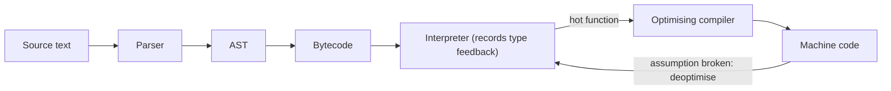

## Introduction

When you write `const total = items.reduce((sum, x) => sum + x.price, 0)` and press reload, something has to read that text, understand it, and make a CPU perform additions. The CPU knows nothing about `reduce`, arrow functions or objects. The program that bridges that gap is the **JavaScript engine**.

An engine is a large program, usually written in C++ (some newer ones in Rust or Zig), that does five jobs. It **parses** your source text into a structured form. It **compiles** that structure into something executable — first a compact bytecode, and for frequently run code, optimised machine code. It **executes** the code, keeping track of which function is running on the **call stack**. It provides the **built-in objects** the language defines: `Array`, `Map`, `Promise`, `JSON`, `Math`. And it **manages memory**: every object you create is allocated on a **heap**, and a **garbage collector** frees objects you can no longer reach.

What an engine does *not* do is just as important. It has no idea what a web page, a button, a file or a network socket is. It does not provide `setTimeout`, `fetch`, `document` or `fs`. Those come from the **host environment** — the browser or Node.js — that embeds the engine. Mixing the two up is the source of many beginner bugs ("`document is not defined`") and many interview misunderstandings ("`setTimeout` is part of JavaScript").

This lesson explains what engines are and how they are organised, then teaches the two ideas every engineer needs from this layer: the boundary between engine and host, and the heap where your data lives. How the engine turns source into fast machine code is covered in [[b1-parsing-jit]].

## Before you start

- **What JavaScript and ECMAScript are** — that ECMAScript (ECMA-262) is the specification and JavaScript is its implementation. See [[b1-ecmascript]].
- **JavaScript runtimes** — the idea that the same language runs in browsers, Node.js and elsewhere. See [[b1-runtimes]].
- **The call stack** — frames pushed and popped as functions call and return. See [[b1-call-stack]].
- **Primitives versus references** — that objects are accessed by reference. See [[b1-primitive-vs-reference]].

## The intuition

Think of a computer's CPU and operating system. The CPU executes instructions: arithmetic, comparisons, jumps, memory reads. The operating system provides everything else a program needs — files, network, windows, timers — and decides which program runs when. A program uses both, but they are separate components made by separate teams, and the same CPU runs under many operating systems.

The JavaScript engine is the CPU in this picture, and the host is the operating system. The engine knows how to evaluate `a + b`, call functions, create objects and resolve promises. The host knows how to draw pages, talk to the network, read files and wait for events, and it runs the event loop that decides when JavaScript code runs. Chrome and Node.js both use the same engine, V8, which is why the language behaves identically in both, while their globals are completely different.

The analogy stops working in one place: a real CPU runs any machine code you give it, while a JavaScript engine does far more work itself — compiling, optimising, collecting garbage. It is closer to a CPU that also contains a compiler and a memory manager.

## The major engines

| Engine | Made by | Used in |
|---|---|---|
| V8 | Google | Chrome, Edge, Opera and other Chromium browsers; Node.js; Deno; Electron; Cloudflare Workers |
| SpiderMonkey | Mozilla | Firefox |
| JavaScriptCore (JSC) | Apple | Safari and WebKit-based browsers; Bun |
| Hermes | Meta | React Native (the default engine since React Native 0.70) |
| QuickJS | Fabrice Bellard and contributors | Small embedded systems and tools |
| LibJS | Ladybird project | The Ladybird browser |

They are completely separate code bases with different internal designs, yet a correct program behaves the same on all of them. That is possible because they all implement the same specification.

## The specification is the contract

The behaviour of JavaScript is defined by **ECMA-262**, the ECMAScript Language Specification, published as a new edition every June (ES2023, ES2024, and so on). The spec describes, in precise pseudo-code called **abstract operations**, what every piece of syntax and every built-in must do. Engines are free to implement it however they like — interpreters, compilers, clever memory layouts — as long as the observable behaviour matches. A shared test suite, **Test262**, with tens of thousands of tests, checks that they do.

This separation of *behaviour* from *implementation* has practical consequences. Correctness questions are answered by the spec: "is `Array.prototype.sort` stable?" Yes — ES2019 made stability mandatory. (Before that, V8 used an unstable sort for arrays longer than ten elements, and code relying on stable order broke on Chrome while working on Firefox.) Performance questions, on the other hand, are engine-specific: hidden classes, inline caches and optimisation tiers are V8 implementation details that appear nowhere in the spec, as [[b1-hidden-classes]] explains. Write correct code against the spec first; reach for engine-specific performance knowledge only when a profiler tells you to.

## What happens when code runs

At a high level, every modern engine follows the same pipeline. Source text is **parsed** into an **Abstract Syntax Tree (AST)**. The AST is compiled to **bytecode**, a compact instruction format the engine's **interpreter** can run immediately. While the interpreter runs, it records what types of values flow through each operation. Functions that run often ("hot" functions) are handed to an **optimising compiler**, which uses those observations to produce fast machine code. If an observation later turns out wrong — a function that always received numbers suddenly gets a string — the engine **deoptimises**, discarding the optimised code and returning to the bytecode.



Alongside this pipeline sit the **call stack**, which records the active function calls, and the **heap**, which stores every object. [[b1-parsing-jit]] and [[b1-v8-architecture]] go through the pipeline in depth. The rest of this lesson focuses on the boundaries of the engine — what the host adds — and on the heap.

## Engine vs Host Environment {#b1-engine-vs-host}

The **engine** implements the JavaScript language: syntax, operators, functions, objects and the built-ins defined by ECMA-262. The **host environment** is the program that embeds the engine and gives JavaScript a world to act on: a browser provides the DOM, `fetch`, timers and rendering; Node.js provides files, network sockets, `process` and timers. The host also runs the **event loop**, which decides when your code and its callbacks run.

### Why the split exists

ECMA-262 cannot sensibly specify how to parse HTML, open a TCP connection or read a file: those depend on where the code runs. By keeping the language small and host-independent, the same engine can be embedded in a browser, a server runtime, a desktop app framework, a database or a game. The browser's additions are specified separately, mostly by the WHATWG HTML and DOM standards and the W3C; Node.js's additions are documented by the Node project.

### Telling them apart

A quick test: if the feature appears in ECMA-262 (or ECMA-402, the internationalisation spec behind `Intl`), it is language and exists everywhere. If not, it is a host API.

| Language (engine) | Browser host | Node.js host |
|---|---|---|
| `Array`, `Object`, `Map`, `Set`, `Promise`, `Proxy` | `document`, `window`, DOM events | `process`, `require`, `module` |
| `JSON`, `Math`, `Date`, `RegExp`, `Intl` | `localStorage`, `IndexedDB` | `fs`, `net`, `child_process` |
| `async`/`await`, generators, modules (`import`) | `requestAnimationFrame`, `alert` | `setImmediate`, `process.nextTick` |
| `globalThis` | `setTimeout`, `fetch`, `console`, `queueMicrotask`, `structuredClone` (both hosts) | the same shared web-style APIs |

The last row surprises people: `setTimeout`, `console`, `fetch`, `queueMicrotask` and `structuredClone` are **not** part of the language. They are host APIs that browsers and modern Node.js both choose to provide, defined by web standards. You can check what a host offers at run time:

```javascript title="engine-vs-host.js"
// Defined by ECMA-262: every engine provides these.
console.log('Math.hypot:', Math.hypot(3, 4));
console.log('Promise:', typeof Promise, '| JSON:', typeof JSON);

// Provided by the host: present or absent depending on where you run.
console.log('setTimeout:', typeof setTimeout);
console.log('document:', typeof document);
console.log('process:', typeof process);
console.log('fetch:', typeof fetch);
```

Running it with Node.js 22 prints:

```output
Math.hypot: 5
Promise: function | JSON: object
setTimeout: function
document: undefined
process: object
fetch: function
```

In a browser console, the first four lines are identical, but `document` is `object` and `process` is `undefined`. (`fetch` became a stable global in Node 21; older Node versions print `undefined`.) Using `typeof` is the safe way to test, because referring to an undeclared global directly throws a `ReferenceError`.

### How the engine and host cooperate

The spec defines **host hooks**: points where the engine must ask the host what to do. Three are worth knowing. `HostEnqueuePromiseJob` is how the engine hands a promise callback to the host to schedule; the host's event loop then runs it as a microtask, as [[b1-event-loop]] describes. `HostPromiseRejectionTracker` tells the host when a promise is rejected with no handler, which is how browsers fire `unhandledrejection` and Node prints its warning or exits. `HostEnsureCanCompileStrings` lets the host forbid `eval` and `new Function` — this is how a Content Security Policy without `'unsafe-eval'` blocks them.

Hosts also create **realms**: a realm is a complete set of built-ins (its own `Array`, `Object`, global object). Each iframe has its own realm, so an array created in an iframe fails `arr instanceof Array` in the parent page — the parent's `Array` is a different object. `Array.isArray(arr)` works across realms, which is why it exists. Web Workers get not only their own realm but their own engine instance and heap.

### Practical consequences

The same engine does not mean the same environment. Code that works in Chrome can fail in Node.js with `ReferenceError: document is not defined` — the classic server-side rendering bug in React or Next.js, where component code touches `window` during render on the server. The reverse happens when browser code uses `process.env` or `setImmediate`. For libraries that must run everywhere — browsers, Node, Deno, Bun and edge runtimes — the safest path is to use language features plus the common web-style APIs (`fetch`, `URL`, `TextEncoder`, `setTimeout`, `structuredClone`), the set the WinterCG effort, now Ecma's TC55 committee, works to standardise across server runtimes.

```quiz
Q: Which of these is defined by the ECMAScript specification rather than by the host?
- [ ] `setTimeout`
- [ ] `console.log`
- [x] `Promise.prototype.then`
- [ ] `fetch`
> Promises are part of ECMA-262, so every engine implements them. setTimeout, console and fetch are host APIs from web standards; browsers and Node choose to provide them, but an engine embedded elsewhere might not. Note that even promise callbacks only run because the host schedules them through its event loop.
```

## Heap {#b1-heap}

The **heap** is the large region of memory where a JavaScript engine stores objects: plain objects, arrays, functions, class instances, `Map`s and `Set`s, the environments that closures capture, and (in V8) strings and most numbers that do not fit a small-integer format. Unlike the call stack, whose frames disappear when a function returns, the heap holds data for as long as the program can still reach it, and a **garbage collector** reclaims the rest automatically.

### Stack versus heap

The call stack holds **frames**: one per active function call, containing that call's local variables, arguments and the place to return to. A frame is popped when its function returns. That works for data whose lifetime matches the call. But objects routinely outlive the function that created them: a function returns an object, stores it in an array, or passes it to a callback that runs later. Such data cannot live in a frame that is about to vanish, so it lives on the heap, and the frame (or another object) holds a **reference** — essentially an address — to it.

The spec does not say where values live; that is an engine decision. A common misconception is that "primitives live on the stack, objects on the heap". In V8, a local variable holds a tagged word: small integers ("Smis") are stored directly in it, while strings, larger or fractional numbers in many contexts, and all objects are pointers to the heap. What matters for your code is the language rule: objects are shared by reference, so two variables can point to the same heap object, and changing it through one is visible through the other.

### Closures keep data on the heap

A function that refers to variables from an outer function keeps them alive after the outer function returns:

```javascript title="closure-heap.js"
function makeCounter() {
  const history = new Array(1000).fill(0); // a large array, created per counter
  let count = 0;
  return () => {
    count++;
    return `${count} (history length ${history.length})`;
  };
}

const next = makeCounter();
console.log(next());
console.log(next());
```

```output
1 (history length 1000)
2 (history length 1000)
```

When `makeCounter` returns, its stack frame is gone, yet `count` keeps its value between calls and `history` still exists. The engine noticed that the inner function captures `count` and `history`, so it allocated them in a heap object (V8 calls it a **context**) that the function references. As long as `next` is reachable, so are `count` and the 1,000-element array. This is how closures work — and how they leak, when a long-lived callback captures something large it never needs. See [[b1-closure-memory]].

### Reachability and garbage collection

The garbage collector frees an object when it is no longer **reachable**: when there is no chain of references to it from a **root**. Roots include global variables, the variables in currently active stack frames, and references the host holds (for example, DOM nodes attached to the document and their event listeners). Anything reachable from a root stays; everything else can be collected. Note that "unused" is not the same as "unreachable": an object stored in a global array but never read again is still reachable and is never freed. That is the definition of a memory leak in JavaScript. [[b1-reachability]] and [[b1-garbage-collection]] cover this in depth.

V8 divides its heap into generations because most objects die young — temporary arrays, intermediate strings, callback objects. New objects go into a small **young generation** that is collected very often by a fast copying collector (the Scavenger). Objects that survive a couple of collections are moved to the **old generation**, which is collected less often by a mark-compact collector that does most of its marking concurrently on background threads to keep pauses short.

### Seeing the heap

Node.js reports heap usage through `process.memoryUsage()`. This program shows that ordinary objects are on the V8 heap, while the bytes of an `ArrayBuffer` live outside it, in a separately allocated **backing store** that the heap object points to:

```javascript title="heap-usage.js"
const mb = (bytes) => Math.round(bytes / 1024 / 1024);
const before = process.memoryUsage();

// One million small objects: each lives on the V8 heap.
const points = Array.from({ length: 1_000_000 }, (_, i) => ({ x: i, y: i }));

// A 100 MB binary buffer: its bytes live outside the V8 heap.
const buffer = new ArrayBuffer(100 * 1024 * 1024);

const after = process.memoryUsage();
console.log('heapUsed grew by more than 20 MB:', mb(after.heapUsed - before.heapUsed) > 20);
console.log('arrayBuffers grew by about', mb(after.arrayBuffers - before.arrayBuffers), 'MB');
console.log(points.length, buffer.byteLength);
```

```output
heapUsed grew by more than 20 MB: true
arrayBuffers grew by about 100 MB
1000000 104857600
```

This distinction matters in production: the V8 heap has a size limit (configurable in Node with `--max-old-space-size`, in megabytes), and exceeding it crashes the process with `FATAL ERROR: ... JavaScript heap out of memory`. Large binary data in `Buffer`s and `ArrayBuffer`s counts against process memory but not against that heap limit. In browsers, the Memory panel in DevTools takes **heap snapshots** — a list of every object and what keeps it alive — which is the main tool for finding leaks such as detached DOM nodes. See [[b1-heap-snapshots]].

### Common heap mistakes

Storing a large object in a global or module-level variable "temporarily" keeps it alive for the life of the page; set it to `null` when done. Adding event listeners or intervals that capture big objects and never removing them keeps both the listener and everything it captures reachable. Caches implemented with a plain `Map` grow forever; bound their size or use a `WeakMap` when entries should die with their keys ([[b1-weakmap]]).

## How engines are organised internally

An engine can be instantiated more than once in a process. V8 calls one instance an **isolate**: it has its own heap, its own garbage collector and its own set of compiled code, and only one thread may run JavaScript in it at a time. A browser tab's main thread uses one isolate; each Web Worker gets another; a Node.js `worker_threads` worker gets another; Cloudflare Workers run thousands of small isolates in one process to isolate customers from each other cheaply.

Because each isolate has its own heap, objects cannot be shared between threads directly. That is why `postMessage` *copies* data using the structured clone algorithm ([[b1-structured-clone]]) rather than passing references, and why only `SharedArrayBuffer` gives two threads access to the same memory. It is also what makes the single-threaded model of [[b1-run-to-completion|run-to-completion]] safe: no other thread can touch your heap.

Within an isolate, the engine runs code on the call stack, allocates on the heap, and periodically pauses (briefly, and increasingly in parallel or concurrently) to collect garbage. Each **execution context** — global code, a function call, a module — is an engine concept from the spec, tracked on that stack; [[b1-execution-contexts]] covers it.

## In real systems

**Same engine, different products.** Electron apps combine Chromium (V8 plus the browser host) with Node.js APIs in one process, so a single file can touch both `document` and `fs` — a power that requires care with security. Deno and Bun are alternative server runtimes: Deno embeds V8 with a Rust host; Bun embeds JavaScriptCore with a host written in Zig. Code that sticks to language features and web-standard APIs runs on all of them.

**Mobile.** React Native apps usually run on Hermes, an engine designed for fast start-up on phones: it compiles JavaScript to bytecode at build time, so the device skips parsing at launch. The trade-off is that Hermes has no optimising just-in-time compiler in the way V8 does, which matters less for UI code than start-up time.

**Cross-browser testing.** Because Chrome, Firefox and Safari use three different engines, a bug in one engine's implementation of a new feature can appear in only one browser. Teams test on all three engines (for example with Playwright, which drives Chromium, Firefox and WebKit) before relying on recently added language features.

**Memory incidents.** A Node.js service that grows from 200 MB to its heap limit over a day and then crashes is a heap problem. Engineers take heap snapshots at intervals, compare them, and look for object types whose count keeps rising, then follow the retainer chain back to a root — usually a cache, a listener list or a global map.

## Trade-offs and alternatives

Engines balance **start-up time** against **peak speed**. Interpreting bytecode starts quickly but runs slowly; optimised machine code runs fast but costs time and memory to produce. That is why modern engines use several tiers and only optimise hot code. They also balance **memory** against **speed**: hidden classes, inline caches and compiled code all consume memory, which matters on low-end phones. Hermes chooses fast start-up and small memory; V8 in Chrome chooses peak throughput for long-running web apps.

For you, the practical trade-off is how much to care about engine internals. Spec-correct, readable code is the default. Engine-aware techniques — stable object shapes, consistent types in hot functions — are worth applying when a profiler shows a hot path, and are explained in [[b1-parsing-jit]].

## Common mistakes

> [!MISTAKE] Treating host APIs as part of JavaScript
> `setTimeout`, `console`, `fetch` and the DOM are host APIs. Code that runs in more than one host — server-side rendering, tests in Node, Web Workers, edge functions — must check that the API exists (`typeof window !== 'undefined'`) or avoid it.

**Assuming "same engine" means "same environment".** Chrome and Node both use V8, but one has `document` and the other has `fs`. The engine guarantees language behaviour only.

**Relying on engine-specific behaviour.** Before ES2019, code that assumed `sort` was stable worked in some engines and not others. When in doubt, check the spec or MDN's browser-compatibility tables, not one engine's current behaviour.

**Thinking the garbage collector frees "unused" objects.** It frees *unreachable* objects. Anything still referenced from a global, a live closure, a listener or a cache stays in memory, used or not.

**Believing primitives always live on the stack.** Where values live is an engine detail; in V8, strings and many numbers are heap objects. Reason about the language rules (values versus references), not imagined memory locations.

## Interview perspective

Interviewers ask about engines to see whether you understand the layers your code runs on. Strong answers separate the language, the engine and the host cleanly, and avoid stating V8 details as if they were JavaScript rules.

> [!INTERVIEW] Explaining the engine in under a minute
> "The engine — V8 in Chrome and Node, SpiderMonkey in Firefox, JavaScriptCore in Safari — implements ECMAScript. It parses code to an AST, compiles it to bytecode, interprets it, and optimises hot functions to machine code using type feedback. It keeps the call stack and a garbage-collected heap where objects and closure environments live. Everything else — the DOM, timers, `fetch`, files, and the event loop — comes from the host, the browser or Node."

Questions to expect:

- **Is `setTimeout` part of JavaScript?** No; it is a host API (HTML Standard in browsers, implemented separately by Node). The language has no notion of time-based scheduling.
- **Who runs promise callbacks?** The engine queues them as jobs via a host hook; the host's event loop drains them as microtasks.
- **What is on the heap versus the stack?** Frames on the stack; objects, arrays, functions and captured closure variables on the heap. Mention that exact placement of primitives is an engine detail.
- **What causes a memory leak in a garbage-collected language?** Objects that remain reachable but are no longer needed — globals, uncleared listeners and timers, unbounded caches, detached DOM nodes still referenced from JavaScript.
- **Why does `instanceof Array` fail for an array from an iframe?** Different realm, different `Array` constructor; use `Array.isArray`.

## Practice

1. **Classify globals.** For each of `Map`, `structuredClone`, `Intl.DateTimeFormat`, `URL`, `queueMicrotask`, `Symbol`, `localStorage`, `Buffer` and `WeakRef`, decide whether it is language or host, then check ECMA-262's table of contents or MDN.
2. **Write a host-safe helper.** Write `getStorage()` that returns `localStorage` in a browser and an in-memory `Map`-backed object in Node, without throwing in either.
3. **Watch the heap.** Extend `heap-usage.js` to set `points = null` (change it to `let`), run Node with `--expose-gc`, call `global.gc()`, and observe `heapUsed` drop. Explain why it did not drop before.
4. **Find the leak.** Write a function that adds a `click` listener capturing a 10 MB array each time a modal opens, and never removes it. Use a browser heap snapshot to find what retains the arrays, then fix it.
5. **Realms.** Create an iframe, build an array inside it, and compare `instanceof Array` and `Array.isArray` on it from the parent page.

## Quick revision {#quick-revision}

- Engine = parser + compiler/interpreter (+ optimising JIT) + call stack + heap + garbage collector + ECMA-262 built-ins.
- Major engines: V8 (Chrome, Edge, Node, Deno), SpiderMonkey (Firefox), JavaScriptCore (Safari, Bun), Hermes (React Native).
- ECMA-262 defines behaviour; Test262 checks conformance. Hidden classes, tiers and inline caches are engine details, not spec.
- Host = browser or Node: DOM, `fetch`, timers, `console`, files, network, and the event loop. `setTimeout` is not part of the language.
- Host hooks: `HostEnqueuePromiseJob` (promise callbacks), `HostPromiseRejectionTracker` (unhandled rejections), `HostEnsureCanCompileStrings` (CSP blocks `eval`).
- Realms: separate sets of built-ins (iframes); `Array.isArray` works across realms, `instanceof` does not.
- Heap: objects, arrays, functions, captured closure variables, strings; stack: frames. Placement of primitives is engine-specific.
- GC frees **unreachable** objects (no path from roots: globals, active frames, host references). Leaks = reachable but unneeded.
- V8: young generation (fast copying Scavenger) and old generation (concurrent mark-compact). `ArrayBuffer` bytes live outside the V8 heap.
- One isolate (engine instance) per thread, each with its own heap; workers communicate by copying messages.

## Key takeaways {#key-takeaways}

- The engine runs the language; the host provides the world (DOM, network, files, timers) and the event loop.
- All engines implement the same specification, so correctness comes from the spec and performance tricks are engine-specific.
- Check for host APIs before using them in code that may run in more than one environment.
- Objects and captured variables live on the heap and survive as long as something reachable refers to them.
- Memory leaks in JavaScript are objects that stay reachable after they stop being useful; find them by following what retains them.
