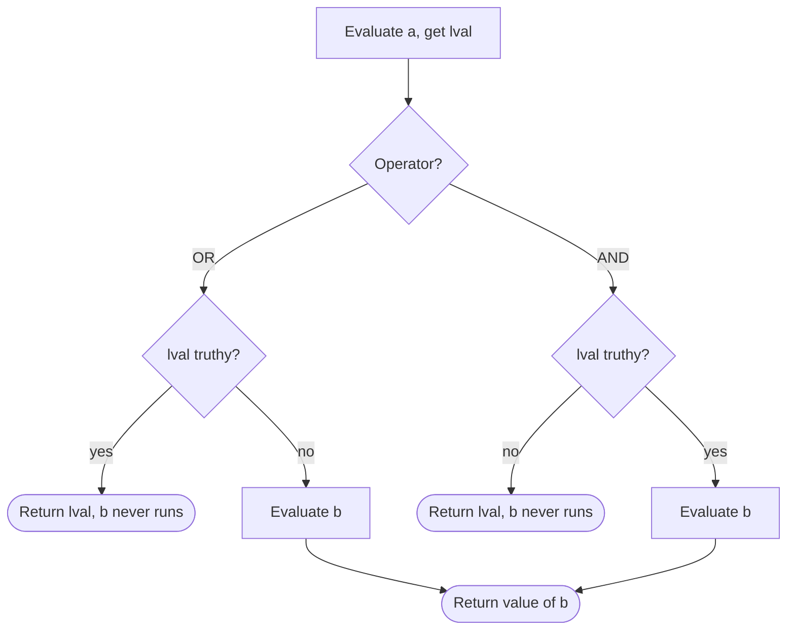

## Introduction

A music player remembers the user's volume. If nothing is saved, it should use 50:

```javascript title="volume-bug.js"
function getVolume(saved) {
  return saved || 50;
}
console.log(getVolume(80), getVolume(undefined), getVolume(0));
```

```output
80 50 50
```

The user who deliberately muted the player to 0 gets blasted at 50 every time the page loads. The `||` operator did not ask "is there a saved value?"; it asked "is the saved value truthy?", and `0` is not.

This is the key fact about JavaScript's **logical operators**: `&&` (AND) and `||` (OR) are not boolean factories. They **pick one of their operands** and return it unchanged, and they decide which one by testing truthiness. On top of that, they evaluate lazily — once the left operand decides the answer, the right operand is never evaluated at all. That second property, **short-circuit evaluation**, is what makes idioms like `user && user.name` safe, and it is also what makes `flag && save()` skip the save.

You will use these operators in almost every file: combining conditions in `if` statements, guarding against `null`, providing defaults, and conditionally rendering UI in React. This lesson teaches the exact rules so each of those uses is deliberate.

## Before you start

- **Truthy and falsy values** — the eight falsy values (`false`, `0`, `-0`, `0n`, `''`, `null`, `undefined`, `NaN`) and the rule that everything else is truthy. This lesson depends on it completely. See [[b1-truthy-falsy]].
- **Comparison operators** — the conditions you usually combine. See [[b1-comparison-operators]].
- **Expressions** — logical operators produce values, so they can appear anywhere an expression can. See [[b1-statements-expressions]].

## The intuition

Think of `||` as a **search for the first truthy operand**. It looks at its operands from left to right and returns the first one that is truthy. If it reaches the last operand without finding one, it gives up and returns that last operand, whatever it is.

Think of `&&` as a **search for the first falsy operand**. It returns the first falsy operand it finds. If every operand is truthy, it returns the last one.

Both searches stop the moment they find what they are looking for. Whatever lies to the right of that point is never looked at — never evaluated, never called. That is short-circuiting.

`!` is different: it is a converter, not a picker. It turns any value into a boolean and flips it.

The picture breaks down only when you treat these operators as if they returned booleans. In an `if` statement the difference is invisible, because `if` applies truthiness again to whatever the operator returned. Everywhere else — assignments, return values, template literals, JSX — you get the operand itself.

## The three classic operators

### `||` returns the first truthy operand

`a || b` evaluates `a`. If `a` is truthy, the result is `a` and `b` is not evaluated. Otherwise the result is `b`.

### `&&` returns the first falsy operand

`a && b` evaluates `a`. If `a` is falsy, the result is `a` and `b` is not evaluated. Otherwise the result is `b`.

### `!` returns the opposite boolean

`!a` converts `a` to a boolean using the truthiness rule and returns the opposite. It always returns `true` or `false`. Applying it twice, `!!a`, gives the plain boolean value of `a` — the same as `Boolean(a)`.

```javascript title="return-values.js"
const show = (v) => JSON.stringify(v);
console.log(show(0 || 2), show('' || 'fallback'), show('a' || 'b'), show(null || undefined));
console.log(show(1 && 2 && 3), show(1 && 0 && 3), show('x' && null), show('' && 'never'));
console.log(!0, !'', !'0', ![], !!'hello', !!NaN);
console.log(typeof (1 && 'two'), typeof !!(1 && 'two'));
```

```output
2 "fallback" "a" undefined
3 0 null ""
true true false false true false
string boolean
```

(`show` uses `JSON.stringify` so that empty strings are visible in the output.)

Read the first line as searches. `0 || 2`: `0` is falsy, keep looking, return `2`. `'a' || 'b'`: `'a'` is truthy, stop, return `'a'`. `null || undefined`: neither is truthy, so the last operand, `undefined`, is returned — `||` can return a falsy value.

The second line: `1 && 2 && 3` finds no falsy operand and returns the last, `3`. `1 && 0 && 3` stops at `0` and returns it; `3` is never evaluated. `'' && 'never'` stops immediately at the empty string.

The third line shows `!` always producing booleans: `!'0'` is `false` because `'0'` is a non-empty string and therefore truthy, and `![]` is `false` because every object, even an empty array, is truthy. The fourth line confirms the types: `1 && 'two'` is the string `'two'`; only `!!` turns it into a boolean.

The rules fit in one table:

| Expression | If `a` is truthy | If `a` is falsy |
|---|---|---|
| `a \|\| b` | returns `a` (skips `b`) | returns `b` |
| `a && b` | returns `b` | returns `a` (skips `b`) |
| `!a` | `false` | `true` |

## Combining conditions: precedence and De Morgan's laws

When you mix operators, **precedence** decides grouping: `!` binds tightest, then `&&`, then `||`. So `a || b && c` means `a || (b && c)`, just as `1 + 2 * 3` means `1 + (2 * 3)`.

```javascript title="precedence.js"
console.log(true || false && false);
console.log((true || false) && false);
console.log(!true || true);
const a = true, b = false;
console.log(!(a && b) === (!a || !b), !(a || b) === (!a && !b));
```

```output
true
false
true
true true
```

The first line is `true || (false && false)`, which is `true`. Adding parentheses to force the other grouping changes the answer. The third line is `(!true) || true`: `!` applies only to the operand right after it, not to the whole expression. When a condition mixes `&&` and `||`, add parentheses even where precedence makes them unnecessary; readers should not have to remember the table. The full precedence table is in [[b1-precedence]].

The last line checks **De Morgan's laws**, two rules for moving a `!` across a group:

- `!(a && b)` is the same as `!a || !b` — "not both" means "at least one is not".
- `!(a || b)` is the same as `!a && !b` — "neither" means "not this and not that".

They are useful when refactoring conditions. `if (!(isLoggedIn && hasPermission))` becomes `if (!isLoggedIn || !hasPermission)`, which reads as the list of reasons to reject. Both sides of each law always return a boolean, because every operand has been through `!`, so the rewrite is exactly equivalent.

### Where `??` fits

The **nullish coalescing operator** `??` (ES2020) is the third member of the family. `a ?? b` returns `a` unless `a` is `null` or `undefined`, in which case it returns `b`. It short-circuits the same way, but it ignores truthiness entirely:

```javascript title="nullish.js"
const show = (v) => JSON.stringify(v);
const x = 0;
console.log(x || 5, x ?? 5);
console.log(show('' ?? 'fallback'), null ?? 'fallback', undefined ?? 'fallback', false ?? true);
```

```output
5 0
"" fallback fallback false
```

`0`, `''` and `false` are all kept by `??`, because they are real values, not missing ones. This is the fix for the volume bug: `saved ?? 50`. Because `??` and `||` answer different questions, the language forbids mixing them without parentheses — `a || b ?? c` is a `SyntaxError: Unexpected token '??'` in Node.js 22 — so you must write `(a || b) ?? c` or `a || (b ?? c)` to say which you mean. `??` has its own lesson, [[b1-nullish-coalescing]].

## Defaults: `||` versus `??` versus explicit checks

The most common use of `||` in older code is supplying a default: `const name = input || 'Anonymous'`. Whether that is correct depends on one question: **can a falsy value be legitimate data?**

| Value type | Legitimate falsy values | Default with |
|---|---|---|
| Object or array (a user, a list) | none — it is an object or it is missing | `\|\|` or `??` |
| Display string where empty means "not set" | none in practice | `\|\|` |
| Number (volume, count, price, page index) | `0` | `??` |
| Boolean option (`showHelp: false`) | `false` | `??` |
| String where `''` is a real choice | `''` | `??` |

When the rule is neither "falsy" nor "nullish" — for example "default if missing or negative" — write the check explicitly: `const qty = Number.isFinite(input) && input >= 0 ? input : 1`. Hiding a non-trivial rule inside `||` makes the reader reverse-engineer it.

## Short-Circuit Evaluation {#b1-short-circuit}

**Short-circuit evaluation** means that the right operand of `&&`, `||` or `??` is evaluated **only if the left operand does not already decide the result**. If it is not needed, it is not run at all — no function calls, no property reads, no errors, no increments. This makes the logical operators a form of control flow that lives inside an expression: `a && b()` behaves like `if (a) b()`.

### Why the right side can be skipped

The result of `&&` is determined as soon as one operand is falsy: false AND anything is false. The result of `||` is determined as soon as one operand is truthy. So JavaScript (like C, Java, Python and most languages) does not bother to evaluate the rest. `??` follows the same idea with a different test: once the left side is a real value (not `null` or `undefined`), the right side is irrelevant.

You can watch it happen with a function that records its calls:

```javascript title="short-circuit.js"
let n = 0;
function bump() { n += 1; return n; }
console.log(true || bump(), n);
console.log(false && bump(), n);
console.log(null ?? bump(), n);
console.log(0 ?? bump(), n);
console.log(false || bump(), n);
```

```output
true 0
false 0
1 1
0 1
2 2
```

Line by line: `true || bump()` stops at `true`, so `bump` never runs and `n` stays 0. `false && bump()` stops at `false`. `null ?? bump()` needs the right side because the left is nullish, so `bump` runs and `n` becomes 1. `0 ?? bump()` stops, because `0` is not nullish — even though it is falsy. `false || bump()` needs the right side, so `bump` runs again.

Arguments to `console.log` are evaluated left to right, which is why the second argument `n` already reflects any call made by the first argument.

### Guards: skipping code that would fail

The oldest use of short-circuiting is the **guard**: put a check on the left that makes the right side safe to run.

```javascript title="guards.js"
const user = null;
console.log(user && user.name);
console.log(user?.name);
const items = [];
console.log(items.length > 0 && items[0].id);
try { console.log(items[0].id && items.length > 0); } catch (e) { console.log(e.name + ': ' + e.message); }
const isAdmin = false;
isAdmin || console.log('not an admin, skipping');
console.log(false && undefinedFunction());
```

```output
null
undefined
false
TypeError: Cannot read properties of undefined (reading 'id')
not an admin, skipping
false
```

`user && user.name` returns `null` without touching `user.name`, which would throw. Since ES2020, **optional chaining** (`user?.name`) does this job better: it checks specifically for `null` and `undefined`, returns `undefined` consistently, and reads well in long chains ([[b1-optional-chaining]]). The `&&` guard is still the right tool when the check is not about nullishness, like `items.length > 0`.

The third and fourth lines show that **order matters**. With the length check on the left, the risky read never happens. Swap the operands and the read runs first and throws. The same reasoning says to put **cheap checks before expensive ones**: in `isEnabled && hasPermission(user) && (await fetchQuota()) > 0`, a disabled feature never makes the network call.

The last line shows how complete the skipping is: `undefinedFunction` does not exist, but since that expression is never evaluated, no `ReferenceError` occurs. The engine does not even look the name up.

### Short-circuiting elsewhere in the language

The same "evaluate only what is needed" rule appears in several other constructs, which is worth knowing because they are often used together:

- **The ternary operator** `cond ? a : b` evaluates exactly one of `a` and `b` ([[b1-ternary]]).
- **Optional chaining** short-circuits the *whole rest of the chain*. In `obj?.method(count++)`, if `obj` is `null`, the call does not happen and `count++` is not evaluated either.
- **Logical assignment** `x ||= y`, `x &&= y`, `x ??= y` skips both the evaluation of `y` and the write when it is not needed ([[b1-logical-assignment]]).
- **`Array.prototype.some` and `every`** stop iterating as soon as the answer is known — the same idea applied to a list.

```javascript title="other-short-circuits.js"
const order = { customer: null };
console.log(order.customer?.address.city);
console.log(order.customer && order.customer.address && order.customer.address.city);
let count = 0;
const obj = null;
obj?.method(count++);
console.log(count);
```

```output
undefined
null
0
```

Note the different results of the two guards on the customer: optional chaining yields `undefined`, the `&&` chain yields the falsy operand it stopped on, `null`.

The bitwise operators `&` and `|` look similar but **do not short-circuit**: both operands are always evaluated, then converted to 32-bit integers.

```javascript title="no-short-circuit.js"
let calls = 0;
const expensive = () => { calls += 1; return true; };
const flag = false;
const r1 = flag & expensive();
const r2 = flag && expensive();
console.log(r1, r2, calls);
console.log([1, 2, 3, 4].some((v) => { console.log('check', v); return v > 1; }));
```

```output
0 false 1
check 1
check 2
true
```

`flag & expensive()` called the function and returned the number `0`; `flag && expensive()` skipped it and returned `false`. Typing `&` where you meant `&&` therefore changes both behaviour and result type. The `some` call stops after the second element because that already proves the answer.

### Side effects on the right: the hidden-control-flow trap

Because the right operand may not run, **anything that must happen should not be on the right side** of a logical operator.

```javascript title="skipped-effect.js"
let saved = 0;
function save() { saved += 1; return true; }
const isDirty = 0;        // "number of unsaved edits"
const ok = isDirty && save();
console.log(ok, saved);
```

```output
0 0
```

`isDirty` is a count of edits, and 0 means nothing to save, so here skipping is arguably right. But if the code were `validate() && save() && notify()`, a `validate` that returns `0` for "zero errors" (a natural API) would silently block the save. When the right side has side effects, write an `if` statement: it states the control flow openly, and it forces you to write the condition you actually mean. Many teams enable ESLint's `no-unused-expressions` rule, which flags statements like `isAdmin || showWarning()` for this reason.

### How short-circuiting works internally

The specification defines `a || b` as: evaluate `a` and get its value `lval`; if `ToBoolean(lval)` is `true`, return `lval`; otherwise evaluate `b` and return its value. `a && b` is the same with the test reversed, and `a ?? b` tests "is `lval` `null` or `undefined`?" instead of `ToBoolean`. The right operand is a separate piece of code that the evaluation simply does not reach. Engines compile it as a conditional jump, exactly like an `if`.



Short-circuiting is not an optimisation the engine may or may not apply; it is required behaviour. You can rely on the right side being skipped, and you must account for it.

## How it works internally

`!` is defined as: evaluate the operand, apply `ToBoolean`, return the negation. `ToBoolean` is a pure lookup — it never calls `valueOf` or `toString` — so `!` and the tests inside `&&` and `||` never run user code on the operand itself. That is why an object can never make itself falsy, and why logical operators are cheap.

Because `&&` and `||` return operands, JavaScript does not need separate "boolean" versions of values: `a || b` is literally "`a` if truthy, else `b`", which is the same as the ternary `a ? a : b` except that `a` is evaluated only once. This design dates from the first versions of JavaScript and enabled the defaulting idiom `x = x || 10` long before default parameters and `??` existed.

In V8, a condition like `if (a && b)` compiles to two conditional branches; the engine never materialises the intermediate value unless the expression's result is used as a value.

## Worked example: permissions and options

Two everyday functions show the right operator for each job.

```javascript title="permissions-options.js"
function canEdit(user, doc) {
  return Boolean(user) && !doc.locked && (user.role === 'admin' || doc.ownerId === user.id);
}

function buildOptions(input) {
  return {
    pageSize: input.pageSize ?? 20,         // an explicit 0 is kept
    title: input.title || 'Untitled',       // an empty title falls back
    showHelp: input.showHelp ?? true,       // false must survive
  };
}

const ada = { id: 1, role: 'editor' };
const doc = { ownerId: 1, locked: false };
console.log(canEdit(ada, doc));
console.log(canEdit(null, doc));
console.log(canEdit({ id: 2, role: 'admin' }, { ownerId: 1, locked: true }));
console.log(buildOptions({ pageSize: 0, title: '', showHelp: false }));
console.log(buildOptions({}));
```

```output
true
false
false
{ pageSize: 0, title: 'Untitled', showHelp: false }
{ pageSize: 20, title: 'Untitled', showHelp: true }
```

`canEdit` combines three conditions. `Boolean(user)` comes first and acts as a guard: if `user` is `null`, the evaluation stops before `user.role` or `user.id` are read. Wrapping it in `Boolean` matters for the return value — without it, `canEdit(null, doc)` would return `null` rather than `false`, which is falsy but is not the boolean a function named `canEdit` promises. The cheap `!doc.locked` check comes before the role comparison, and the parentheses around the `||` group make the intent explicit: "unlocked AND (admin OR owner)". Without them, precedence would group it as "(user AND unlocked AND admin) OR owner", letting owners edit locked documents.

`buildOptions` uses `??` for the number and the boolean, where `0` and `false` are valid choices, and `||` for the title, where an empty string should be treated as "not provided". The first call proves the difference: the zero page size and the `false` flag survive, the empty title is replaced.

### Conditional rendering and the stray `0`

React renders `{condition && <Element />}` by evaluating the `&&` expression and rendering whatever it returns. React renders nothing for `false`, `null` and `undefined`, but it renders numbers — including `0`. The same thing happens with template literals, which this snippet uses to simulate it:

```javascript title="stray-zero.js"
const unread = 0;
const badge = unread && `(${unread} new)`;
console.log(`Inbox ${badge}`);
console.log(`Inbox ${unread > 0 ? `(${unread} new)` : ''}`);
```

```output
Inbox 0
Inbox
```

`unread && …` returns `0`, the falsy operand, and `0` is printed. In JSX, `{unread && <Badge count={unread} />}` shows a stray "0" on the page for the same reason. Make the left side a real boolean (`unread > 0 && …`) or use a ternary.

## In real systems

**Guards before property access** were everywhere in pre-2020 code (`res && res.data && res.data.items`). Modern code uses optional chaining for nullish guards and keeps `&&` for conditions that are not about nullishness.

**Defaults** in configuration and component props now mostly use `??` or default parameters. A codebase full of `|| 0` and `|| false` is a sign of code written before `??` existed and is worth reviewing for lost zeros.

**Conditional rendering** in React and similar libraries uses `&&` and the ternary heavily. Lint rules such as `react/jsx-no-leaked-render` exist specifically to catch the stray-`0` bug.

**Feature checks** like `typeof window !== 'undefined' && window.matchMedia(...)` rely on short-circuiting so that server-side rendering does not touch browser-only globals.

## Trade-offs and alternatives

| Goal | Prefer | Why |
|---|---|---|
| Combine conditions in `if` | `&&`, `\|\|`, `!` with parentheses | Truthiness is applied by `if` anyway |
| Need an actual boolean value | `Boolean(x)`, `!!x`, or a comparison | `&&`/`\|\|` return operands |
| Default for possibly missing value | `??` | Keeps `0`, `''`, `false` |
| Default where every falsy value means "unset" | `\|\|` | Concise and correct for that rule |
| Guard property access on `null`/`undefined` | `?.` | Clearer, and does not return odd falsy values |
| Run a side effect conditionally | `if` statement | Visible control flow |

The concise forms are not wrong, but each hides a rule — truthiness, nullishness, or "skip this call". Use them where the hidden rule is exactly the one you mean.

## Common mistakes

> [!MISTAKE] Using `||` for numeric or boolean defaults
> `const page = query.page || 1` turns page 0 into 1; `const enabled = opts.enabled || true` makes it impossible to pass `false`. Use `??`.

**Expecting a boolean back.** `const hasItems = cart && cart.items.length` is a number or `null`, not a boolean. Comparisons such as `hasItems === true` then fail. Use `Boolean(...)` or a comparison like `cart?.items.length > 0`.

**Putting required work on the right.** `isValid && submit()` is a hidden `if`. If `submit` must run under specific conditions, write those conditions in an `if`.

**Wrong guard order.** `items[0].id && items.length` throws on an empty array; the safe check must come first.

**Mixing `&&` and `||` without parentheses.** `a || b && c` groups as `a || (b && c)`; if you meant `(a || b) && c`, the code silently does something else.

**`&` or `|` instead of `&&` or `||`.** The bitwise forms evaluate both sides and return numbers.

**Negating the wrong thing.** `!a === b` is `(!a) === b`, not `!(a === b)`. Use `!==`.

## Interview perspective

Interviewers ask about logical operators to check whether you know they return operands and short-circuit.

> [!INTERVIEW] What does `a || b` return?
> "Not necessarily a boolean. `||` returns the first truthy operand, or the last operand if none is truthy, and it stops evaluating as soon as it finds a truthy one. `&&` returns the first falsy operand, or the last one. That's why `count || 10` replaces a real 0 — I'd use `count ?? 10` there."

Expect questions like:

- **What do `'' || 'a'`, `0 && x()` and `null || undefined` return?** `'a'`; `0` without calling `x`; `undefined`.
- **Why might `{items.length && <List />}` render `0`?** `&&` returns the falsy operand `0`, and React renders numbers.
- **Difference between `||` and `??`?** `||` falls back on any falsy value; `??` only on `null`/`undefined`.
- **Why is `a || b ?? c` a syntax error?** The language requires parentheses to make the intended grouping explicit.
- **Does `false && undefinedFn()` throw?** No; the right operand is never evaluated.
- **Rewrite `!(a || b)` without the outer `!`.** `!a && !b` (De Morgan).

```quiz
Q: What does `null || 0 || '' || 'end'` return, and what does `1 && 'two' && 0 && 'four'` return?
- [ ] `true` and `false`
- [x] `'end'` and `0`
- [ ] `null` and `'four'`
- [ ] `''` and `'two'`
> `||` returns the first truthy operand: null, 0 and '' are falsy, so it returns 'end'. `&&` returns the first falsy operand: 1 and 'two' are truthy, 0 is falsy, so it returns 0 and never evaluates 'four'. Neither operator converts its result to a boolean.

Q: Given `let calls = 0; const f = () => ++calls;`, what is `calls` after `0 ?? f(); null || f(); 1 && f(); 0 && f();`?
- [ ] 4
- [ ] 1
- [x] 2
- [ ] 3
> `0 ?? f()` stops because 0 is not nullish. `null || f()` needs the right side, so f runs (1). `1 && f()` needs the right side because 1 is truthy, so f runs (2). `0 && f()` stops at the falsy 0. Two calls in total.

Q: A component renders `{messages.length && <Badge />}`. What appears when `messages` is an empty array?
- [ ] Nothing
- [ ] The Badge component
- [x] The text `0`
- [ ] React throws an error
> `messages.length` is 0, which is falsy, so `&&` returns 0 without evaluating the JSX. React renders nothing for false, null and undefined, but it renders numbers, so a 0 appears. Use `messages.length > 0 && …` or a ternary.

Q: Which default keeps a user's explicit choice of `false` for `options.animate`, while defaulting a missing value to `true`?
- [ ] `options.animate || true`
- [x] `options.animate ?? true`
- [ ] `options.animate && true`
- [ ] `!!options.animate`
> `??` falls back only when the value is null or undefined, so false is kept and undefined becomes true. `|| true` always produces true when animate is false. `&& true` returns undefined for a missing value. `!!` turns undefined into false, the opposite of the required default.
```

## Practice

1. Predict, then run: `[] || 'x'`, `'' && 'x'`, `NaN || null`, `!!'false'`, `0 ?? null ?? 3`, `(null || undefined) ?? 'd'`.
2. Rewrite `if (!(isOpen && !isLocked)) close();` using De Morgan's laws so no `!` applies to a group.
3. Find the bug: `const timeout = config.timeout || 3000;` is used where `0` means "no timeout". Fix it two ways.
4. Write `firstDefined(...values)` that returns the first argument that is not `null` or `undefined`, using `??` in a loop. Then explain why `values.find(Boolean)` is not equivalent.
5. Instrument `a() && b() || c()` with logging functions and record which run for each of the eight combinations of truthy/falsy returns.

## Quick revision {#quick-revision}

- `a || b`: `a` if truthy, else `b`. Returns an operand, not a boolean.
- `a && b`: `a` if falsy, else `b`. Returns an operand.
- `!a`: always a boolean; `!!a` ≡ `Boolean(a)`.
- Falsy: `false`, `0`, `-0`, `0n`, `''`, `null`, `undefined`, `NaN`. Everything else, including `[]` and `{}`, is truthy.
- Precedence: `!` > `&&` > `||`. Parenthesise mixed conditions.
- De Morgan: `!(a && b)` ≡ `!a || !b`; `!(a || b)` ≡ `!a && !b`.
- `a ?? b`: `a` unless `null`/`undefined`. Cannot mix with `&&`/`||` without parentheses.
- Short-circuit: the right operand runs only if needed — function calls, reads and throws on the right are skipped.
- Guards: put the safety check and cheap checks on the left; prefer `?.` for nullish guards.
- Also short-circuit: `?:`, `?.` (whole chain), `||=`/`&&=`/`??=`, `some`/`every`. Not: `&`, `|`.
- Side effects that must happen belong in an `if`, not on the right of `&&`/`||`.
- `{n && <X/>}` renders `0`; use `n > 0 &&` or a ternary.

## Key takeaways {#key-takeaways}

- `&&` and `||` pick and return one of their operands based on truthiness; only `!` produces a boolean.
- Short-circuit evaluation guarantees the right operand is skipped when the left decides the result, which makes guards safe and side effects conditional.
- Use `??` for defaults where `0`, `''` or `false` are valid, and `||` only when every falsy value means "not set".
- Order operands deliberately: safety checks and cheap checks first.
- Parentheses and De Morgan's laws keep combined conditions correct and readable.
- When the right side does real work, an `if` statement is clearer than a logical operator.
