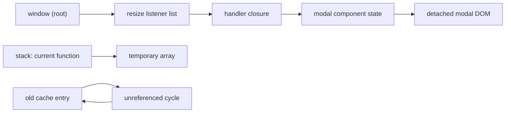

## Introduction

Every value a program works with has to live somewhere in memory. When you write `const user = { name: 'Ada' }`, the engine finds some free bytes, writes the object into them, and gives you a reference to that location. Later, when the program no longer needs the object, those bytes should become available again. If they never do, a page that runs for hours slowly fills the machine's memory until the tab is killed or the Node process crashes with `JavaScript heap out of memory`.

In languages such as C, the programmer does both halves: `malloc` to get memory and `free` to give it back. Forgetting `free` leaks memory; calling it too early leaves a pointer to bytes that now belong to something else, which is a famous source of crashes and security holes. JavaScript takes the second half away from you. You never free anything. Instead, a part of the engine called the **garbage collector (GC)** periodically works out which objects the program can no longer reach and reclaims them.

That does not mean memory is someone else's problem. The garbage collector can only reclaim what is unreachable, and *you* decide what is reachable through the references you keep: entries in a module-level `Map`, event listeners, timers, closures. Most real memory problems in front-end apps and Node services are not engine bugs; they are references the program forgot it was holding. This lesson builds the model you need to reason about that: the memory lifecycle, the reachability rule, and how your code controls lifetime indirectly. [[b1-garbage-collection]] then explains how engines carry out collection, and [[b1-memory-leaks]] applies the model to finding and fixing leaks.

## Before you start

- **Primitive vs reference values** — that objects are handled through references, so two variables can point at the same object. See [[b1-primitive-vs-reference]].
- **Closures** — that an inner function keeps access to the variables of the scope it was created in. See [[b1-closures]].
- **Call stack and heap** — the basic picture of function frames and long-lived objects. See [[b1-call-stack]] and [[b1-heap]].

Some examples call `globalThis.gc()`, which Node exposes only when started with `--expose-gc`. That flag is a diagnostic tool for experiments like these, never something production code relies on.

## The intuition

Picture memory as a city of buildings connected by roads. Each object is a building; each reference from one object to another is a one-way road. A few special buildings — the town hall, the train station — are always open; they correspond to the global object and the variables of currently running functions. A building is in use if you can drive to it from one of those special buildings. A building with no road leading to it from anywhere in use is abandoned, and the city can demolish it to make room.

This picture captures the two ideas that matter. First, what keeps an object alive is a *path* from somewhere permanent, not whether some code "is still using it" in a vague sense. Second, removing one road does not necessarily abandon a building: if another road still leads there, it stays. The analogy stops working in one place: real demolition does not happen the moment the last road closes. The garbage collector runs when the engine decides it is worth it, so an abandoned building can stand for a while before it is cleared.

## The memory lifecycle

Whatever the language, memory goes through three stages.

1. **Allocate.** Reserve space for a new value.
2. **Use.** Read and write it.
3. **Release.** Return the space once the value is no longer needed.

JavaScript automates the first and third stages. Allocation happens implicitly whenever you create something that needs storage: object and array literals, `new` expressions, string concatenation that builds a new string, function expressions (a function is an object), and closures (the captured variables need a home that outlives the call).

```javascript title="allocation.js"
const point = { x: 1, y: 2 };          // an object
const ids = [1, 2, 3];                 // an array object
const greeting = 'Hello, ' + 'Ada';    // a new string
const onClick = () => point.x;         // a function object, plus captured scope
const copy = { ...point };             // another, separate object
```

None of these lines asks for memory explicitly, and none of the values is ever explicitly freed. Release happens later, when the garbage collector finds that a value is unreachable.

### Where values live

You will often read that "primitives live on the stack and objects on the heap". It is a useful first approximation but not what engines actually do, and the ECMAScript specification does not mention a stack or a heap at all. In V8 (the engine in Chrome, Edge and Node), small integers are stored directly inside the value slot, while strings, objects, arrays, functions and most non-integer numbers are allocated on the **heap**, a large region of memory managed by the garbage collector. Local variables that a closure captures cannot live in a stack frame, because the frame disappears when the function returns, so the engine moves them into a heap-allocated context object.

For reasoning about lifetime, the precise layout matters less than this: **objects live on the heap and are reached through references**. A variable that "holds an object" actually holds a reference, which is why reassigning the variable changes what it points to without touching the object itself.

### Seeing allocation and release

Node's `process.memoryUsage().heapUsed` reports how many bytes of the heap are occupied by live (or not yet collected) objects. The following program allocates a million small objects, drops the only reference to them, and measures before and after a forced collection.

```javascript title="heap-usage.mjs"
// Run with: node --expose-gc heap-usage.mjs
const mb = () => (process.memoryUsage().heapUsed / 1024 / 1024).toFixed(1);

globalThis.gc();
console.log('start          ', mb(), 'MB');

let big = Array.from({ length: 1_000_000 }, (_, i) => ({ id: i }));
console.log('after allocate ', mb(), 'MB');

big = null;               // unreachable now, but not yet reclaimed
console.log('after null     ', mb(), 'MB');

globalThis.gc();          // force a full collection (diagnostics only)
console.log('after gc()     ', mb(), 'MB');
```

```output
start           3.3 MB
after allocate  41.6 MB
after null      41.6 MB
after gc()      3.5 MB
```

The exact numbers depend on the Node version and machine (this run used Node 22), but the shape is always the same. Allocation costs memory immediately. Setting `big = null` costs nothing and frees nothing by itself: it only removes a road. The memory comes back when the collector runs, which here we forced with `gc()`. In a normal program the engine decides when to collect, usually when allocation has filled a region of the heap.

> [!MISTAKE] "`null` frees memory"
> Assigning `null`, or using `delete obj.prop`, removes one reference. It frees nothing on its own and does not trigger a collection. The object becomes *eligible* for collection only if that was the last path to it from a root.

## Reachability and roots {#b1-reachability}

**Reachability** is the rule JavaScript engines use to decide what memory may be reclaimed: an object stays alive if, and only if, there is a chain of references leading to it from a **root**. A root is a reference the engine treats as always live, because the running program could use it right now without following any other pointer. Everything that is not reachable from some root is garbage and may be collected.

### What counts as a root

The exact root set is an engine detail, but in practice it includes:

- **The global object** (`window` in a page, `globalThis` in Node) and its properties, along with global `let`/`const`/`class` bindings and module-level variables of loaded modules.
- **The variables and temporaries of every function currently on the call stack**, including the arguments and local variables of the function running now and of all its callers.
- **Host references** held by the environment rather than by JavaScript: the DOM tree of the document, registered event listeners, pending timers created with `setTimeout`/`setInterval`, pending promise reactions and I/O callbacks in Node, and handles kept by browser APIs such as `MutationObserver`.

The third group is the one beginners miss, and it explains most leaks. When you call `element.addEventListener('click', handler)`, the browser stores `handler` in the element's listener list. As long as the element is in the document, the document is reachable, so the listener, the closure, and everything the closure captured are reachable too — even if no JavaScript variable mentions any of them.

### Reachability is about paths, not names

Here is a demonstration you can run. It uses a `WeakRef`, which lets us ask whether an object still exists without itself keeping the object alive (weak references are explained below and in [[b1-weak-references]]).

```javascript title="reachability.mjs"
// Run with: node --expose-gc reachability.mjs
// WeakRef targets survive until the current job ends, so wait one
// macrotask before forcing a collection.
async function collect() {
  await new Promise((resolve) => setTimeout(resolve, 0));
  globalThis.gc();
}

let user = { name: 'Ada' };
let alias = user;                 // a second strong reference
const ref = new WeakRef(user);    // observes the object without keeping it alive

user = null;
await collect();
console.log('user cleared: ', ref.deref()?.name);

alias = null;
await collect();
console.log('alias cleared:', ref.deref()?.name);

// A cycle that nothing else points to
let a = { label: 'a' };
let b = { label: 'b' };
a.partner = b;
b.partner = a;
const refA = new WeakRef(a);
a = null;
b = null;
await collect();
console.log('cycle:        ', refA.deref()?.label);
```

```output
user cleared:  Ada
alias cleared: undefined
cycle:         undefined
```

Walk through it. After `user = null`, the object `{ name: 'Ada' }` is still reachable through `alias`, a module-level variable, so the collection leaves it alone and `deref()` still returns it. After `alias = null`, no path from any root leads to the object, so the next collection reclaims it and `deref()` returns `undefined`.

The second half shows why the rule is phrased in terms of paths from roots. `a` and `b` point at each other, so each has an incoming reference. But once the variables are cleared, neither can be reached *from a root*, and the collector reclaims both. A simple "count the incoming references" scheme would keep them forever; [[b1-garbage-collection]] explains why JavaScript engines do not use that scheme.

The `collect()` helper waits a macrotask before calling `gc()` for a specification reason: an object that was the target of `new WeakRef(...)` or `deref()` is kept alive until the end of the current synchronous job, so that it cannot vanish halfway through code that just looked at it.

### Closures extend reachability

A closure keeps its captured variables reachable for as long as the function itself is reachable. That is the whole point of closures, and it is also how large data stays alive longer than intended.

```javascript title="closure-retention.mjs"
// Run with: node --expose-gc closure-retention.mjs
async function collect() {
  await new Promise((resolve) => setTimeout(resolve, 0));
  globalThis.gc();
}

function makeReporter() {
  const rows = new Array(1_000_000).fill(0);   // about 8 MB of numbers
  const rowsRef = new WeakRef(rows);
  const report = () => `rows: ${rows.length}`;  // closes over rows
  return { report, rowsRef };
}

let { report, rowsRef } = makeReporter();
await collect();
console.log('while report exists:', rowsRef.deref() !== undefined);

report = null;                                   // drop the closure
await collect();
console.log('after report = null:', rowsRef.deref() !== undefined);
```

```output
while report exists: true
after report = null: false
```

`makeReporter` has returned, so its stack frame is gone, yet `rows` survives: the path is *root (module variable `report`) → function object → captured scope → `rows`*. The function only uses `rows.length`, but the engine cannot keep "just the length"; it keeps the array. Dropping the function breaks the path and the array becomes collectable. [[b1-closure-memory]] goes deeper into how engines share captured scopes between closures.

### Drawing the graph

When you suspect an object is being kept alive, draw who points at it and keep walking backwards until you reach a root. The diagram below shows a typical case in a single-page app: a modal component was closed and removed from the page, but a listener registered on `window` still references its handler.



Everything on the top row stays alive because of one forgotten listener; removing that listener makes the whole chain collectable at once. The temporary array lives only while its function is running. The cycle in the bottom row has no incoming path from a root, so it is garbage despite its internal references.

> [!TIP] Debugging question
> Instead of asking "why wasn't this freed?", ask "what is the path from a root to this object?". Heap-snapshot tools answer exactly that question with their *retainers* view, covered in [[b1-memory-leaks]].

## Controlling lifetime through references

Since you cannot free objects, you control their lifetime by controlling the paths to them. In practice that means four habits.

**Keep data in the narrowest scope that works.** A variable declared inside a function is reachable only while that function is running (or while a closure created there is alive). The same data stored on a module-level object lives as long as the module, which in a page means until the tab closes.

**Undo every registration.** Anything you register with the environment — event listeners, intervals, observers, subscriptions to a store or an `EventEmitter` — becomes reachable from a host root. Pair each registration with its removal (`removeEventListener`, `clearInterval`, `observer.disconnect()`, `unsubscribe()`), ideally written next to each other. In React this is the cleanup function returned from an effect; see [[b4-effect-cleanup]].

**Bound every collection that grows.** A `Map` used as a cache keeps every value until you delete it. Give it a maximum size and evict old entries; [[b1-impl-lru]] shows the standard least-recently-used policy.

**Use weak references when the data belongs to another object.** If you want to attach information to an object you do not own — a DOM node, a request object — without extending its life, a strong `Map` is the wrong tool, because the map entry is itself a path to the key.

### WeakMap: data that dies with its key

A `WeakMap` holds its keys **weakly**: an entry does not keep its key reachable, and once the key is unreachable from anywhere else, the entry (and its value, unless something else references it) can be collected.

```javascript title="weakmap-metadata.js"
const clickCounts = new WeakMap();

function trackClicks(element) {
  clickCounts.set(element, 0);
  element.addEventListener('click', () => {
    clickCounts.set(element, clickCounts.get(element) + 1);
  });
}
// When the element is removed from the page and nothing else references it,
// both the element and its count become collectable. A Map would keep both.
```

This snippet needs a browser DOM to run. The trade-off for weak keys is that a `WeakMap` cannot be iterated and has no `size`: if you could list its keys, the result would depend on when the collector last ran. Keys must be objects (or, since ES2023, symbols that were not created with `Symbol.for`). [[b1-weakmap]] covers the API in detail.

### WeakRef and FinalizationRegistry

`WeakRef` (ES2021) wraps an object without keeping it alive; `deref()` returns the object, or `undefined` once it has been collected. `FinalizationRegistry` lets you request a callback after an object has been collected. Both expose garbage-collection timing to your program, and that timing is deliberately unspecified: collection may happen late, and a finalization callback may never run at all, for example if the page is closed first. Use them for optimisations such as caches that may drop entries, never for correctness. Closing a file, a socket or a database connection must be done explicitly.

## In real systems

**Single-page applications.** A traditional website throws away its whole heap on every navigation, which hides many mistakes. A single-page app (SPA) lives in one document for hours, mounting and unmounting views. Anything a view registers globally and forgets to unregister accumulates with each navigation. This is why frameworks put so much emphasis on cleanup functions.

**Node servers.** A Node process may run for weeks. Per-request objects are fine, because they become unreachable when the request finishes. Module-level caches, maps of "active sessions" without expiry, and listeners attached to long-lived emitters are the usual problems. V8 enforces a maximum heap size; when live data exceeds it, the process aborts with a fatal "heap out of memory" error. The limit can be raised with `--max-old-space-size=<megabytes>`, but that only buys time if the data keeps growing.

**Containers and scaling.** Each Node process has its own heap, so running eight processes per machine means eight copies of every in-memory cache. Container memory limits (for example in Kubernetes) should leave room above the expected heap size, and services should be monitored for steady heap growth rather than only for crashes.

**Measuring.** In Node, `process.memoryUsage()` and `v8.getHeapStatistics()` give numbers you can log or export as metrics. In Chromium browsers, the DevTools Memory panel takes heap snapshots ([[b1-heap-snapshots|heap snapshots]] are taught in the leaks lesson). The non-standard `performance.memory` property exists only in Chromium and is coarse; the standard replacement, `performance.measureUserAgentSpecificMemory()`, requires a cross-origin-isolated page.

## Trade-offs and alternatives

| Approach | What you gain | What you pay |
|---|---|---|
| Automatic GC (JavaScript, Java, Go) | No use-after-free or double-free bugs; simpler code | Collection pauses; release timing is not under your control; retained references still leak |
| Manual `malloc`/`free` (C) | Exact control of when memory is returned | Leaks, dangling pointers and double frees are easy to write |
| Ownership (Rust) | Deterministic release without a GC, checked by the compiler | Stricter rules to learn and design around |

Inside JavaScript you still have tools for the cases where automatic management is not enough. **Object pools** reuse objects in very hot code (game loops, particle systems) to reduce allocation and therefore collection work. **Typed arrays** store large numeric data in one compact block instead of millions of separate objects. **Web Workers** and Node `worker_threads` each have their own heap, which isolates memory-hungry work. WebAssembly modules manage their own linear memory, which the JavaScript collector does not scan object by object. All of these add complexity, so reach for them only after measuring a real problem.

## Common mistakes

**Believing `delete` or `null` frees memory.** Both remove a reference. Memory is reclaimed later, and only if no other path remains. If memory does not go down, look for the other path.

**Treating cycles as leaks.** Two objects that point at each other are collected normally when nothing else reaches them. Cycles were a problem for old reference-counting collectors (and for some old browsers that counted references across the DOM boundary), not for modern JavaScript engines.

**Forgetting host roots.** A listener, timer or observer registered with the browser keeps its callback, and everything that callback captures, alive. Removing the last JavaScript variable that mentions the callback changes nothing while the registration exists.

**Caching in a module-level `Map` without limits.** The cache is reachable from the module for the life of the program, so every entry is too. Add eviction or, if the key is an object whose lifetime should decide the entry's, use a `WeakMap`.

**Depending on finalizers or `WeakRef` for correctness.** Collection timing is not guaranteed. Code that only works if a finalization callback runs promptly will fail in production at the worst moment.

## Interview perspective

**"How does JavaScript free memory?"** A strong answer says the engine's garbage collector reclaims objects that are no longer reachable from the roots — globals, the current call stack and host-held references such as listeners and timers — and that developers influence this only through the references they keep. Mention that collection happens at times the engine chooses.

**"Does setting a variable to null free the object?"** No. It removes one reference. If that was the last path from a root, the object becomes eligible and will be reclaimed at some later collection. Good candidates add that in most code you do not need to null out locals at all, because they become unreachable when the function returns.

**"Are circular references a problem?"** Not for tracing collectors. Reachability is decided from the roots, so an isolated cycle is garbage. This is a common follow-up to check whether you confuse reference counting with tracing.

**"When would you use a WeakMap?"** To associate data with an object you do not control, such as a DOM node or a library object, without preventing that object from being collected. Expect a follow-up on why it cannot be iterated.

## Practice

1. Write a function that returns three closures created in the same scope, one of which captures a large array. Using `WeakRef` and `node --expose-gc`, find out whether dropping only the closure that uses the array lets the array be collected. Explain the result.
2. Take the reachability diagram above and list the exact code changes that would make the modal collectable.
3. A module exports `const sessions = new Map()` and adds an entry on every login. Describe two different fixes and when each is appropriate.
4. Explain why a `WeakMap` cannot have a `size` property, in terms of reachability and collection timing.

## Quick revision {#quick-revision}

- Lifecycle: allocate → use → release. JavaScript automates allocation and release; you control lifetime through references.
- Objects live on the heap and are reached through references; "primitives on the stack" is only an approximation.
- Reachability: an object stays alive iff a path of references leads to it from a root.
- Roots: global object and module bindings, everything on the call stack, host-held references (DOM tree, listeners, timers, observers, pending callbacks).
- `null` / `delete` remove a reference; memory is reclaimed later, by the GC, only if no other path remains.
- Cycles unreachable from roots are collected.
- Closures keep their captured variables reachable while the function is reachable.
- `WeakMap`: weak keys, not iterable; `WeakRef`/`FinalizationRegistry`: timing not guaranteed, never use for correctness.
- Long-lived programs (SPAs, Node servers) make retained references visible as steady heap growth.

## Key takeaways {#key-takeaways}

- JavaScript frees memory for you, but only memory that nothing can reach any more.
- An object's lifetime is decided by the paths from roots to it, so to release data you must break every such path.
- Host registrations — listeners, timers, observers — are roots in disguise and the most common reason data outlives its purpose.
- Clearing a reference makes an object eligible for collection; the engine decides when it is actually reclaimed.
- Use narrow scopes, paired register/unregister code, bounded caches and weak collections to keep lifetimes intentional.
- Cycles are harmless to a tracing collector; forgotten roots are not.

```quiz
Q: After `let a = {}; let b = a; a = null;`, what happens to the object?
- [ ] It is freed immediately because `a` was set to `null`
- [ ] It is freed at the next garbage collection
- [x] It stays alive because `b` still references it
- [ ] It becomes a memory leak
> Setting `a` to `null` removes one path. `b` is still a reachable variable that points at the object, so it is not garbage. Nothing is ever freed "immediately" by an assignment, and it is not a leak either: the program can still use the object through `b`.
```

```quiz
Q: Two objects reference each other, and no other variable or object references either of them. What does a modern JavaScript engine do?
- [ ] Keeps them forever, because each has a non-zero reference count
- [x] Collects both, because neither is reachable from a root
- [ ] Throws an error when the cycle is created
- [ ] Collects them only if you call `gc()`
> Engines use tracing collectors that start from the roots. An isolated cycle has no path from a root, so it is collected at a normal collection. Reference counts are irrelevant to a tracing collector, and `gc()` is only a diagnostic flag in Node.
```

```quiz
Q: A component calls `window.addEventListener('resize', onResize)` and is later removed from the page without calling `removeEventListener`. Why does its state stay in memory?
- [ ] Because the component's DOM is still in the document
- [x] Because `window` is a root, its listener list references `onResize`, and the closure references the state
- [ ] Because event listeners are never garbage collected under any circumstances
- [ ] Because `resize` events keep firing
> The path *window → listener list → onResize closure → captured state* keeps everything alive. The DOM was removed, so it is not the reason. Listeners are collected normally once removed or once their target becomes unreachable, and whether events fire has nothing to do with reachability.
```
