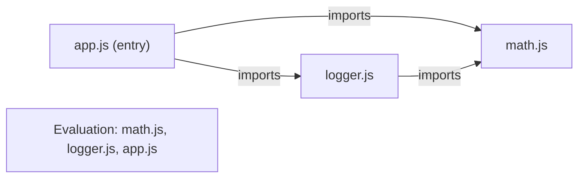

## Introduction

Early JavaScript had no way to split a program across files. A web page loaded several `<script>` tags, and every one of them ran in the **same global scope**. If `cart.js` declared a top-level function called `format` and `dates.js` also declared `format`, the second one silently replaced the first. If `checkout.js` used a helper from `utils.js`, nothing in either file said so; the only thing that made it work was that someone remembered to put the `utils.js` tag *above* the `checkout.js` tag. Large applications became a fragile web of hidden dependencies and name collisions.

A **module** solves both problems. It is a file whose top-level variables are private to that file, and which shares values with other files only by naming them in an `export` statement. Another file that needs one of those values asks for it by name with an `import` statement. Dependencies are now written in the code, so the runtime (and any tool) can see exactly which file needs which, load them in the right order, and refuse to start if something is missing.

JavaScript's built-in module system is called **ECMAScript modules (ESM)**. It was standardised in ES2015 and is supported by every current browser and by Node.js. Before ESM, the community invented several substitutes: the IIFE "module pattern" in browsers ([[b1-module-pattern]]) and CommonJS's `require` in Node.js ([[b1-esm-vs-cjs]]). You will meet all of them in real codebases, but new code is written as ES modules, and every modern tool — Vite, webpack, esbuild, Rollup, TypeScript, Deno, Bun — is built around them.

This lesson covers what a module is, the full `export`/`import` syntax, the choice between default and named exports, how the runtime loads a graph of modules, and dynamic `import()`. The behaviour that makes ESM different from CommonJS — live bindings, circular dependencies, top-level `await` and tree shaking — is the subject of [[b1-esm-vs-cjs]].

## Before you start

- **Scope** — the idea that a variable is visible only inside the block or function where it was declared. See [[b1-scope]] and [[b1-module-scope]].
- **Strict mode** — modules always run in it, so you should know what it changes. See [[b1-strict-mode]].
- **Promises and `async`/`await`** — dynamic `import()` returns a promise. See [[b1-promises]] and [[b1-async-await]].
- **How scripts load in a page** — `defer`, `async` and `type="module"`. See [[b1-script-loading]] and [[b1-script-module]].

The examples run in Node.js 22 with `"type": "module"` in `package.json`, which tells Node to treat `.js` files as ES modules. Browser-only behaviour is described from the HTML specification and was not run for this lesson.

## The intuition

Picture each file as a sealed room. Whatever is declared inside stays inside — other rooms cannot see it, and it cannot accidentally overwrite theirs. Each room has a hatch labelled with names (its **exports**). A room that wants something writes a request on its door: "I need `formatPrice` from the room called `./money.js`" (its **imports**).

Because every request is written on the outside of the door, someone can walk the corridor *before anybody starts working*, read all the requests, check that every requested name really exists, and decide in which order the rooms should start. That inspection step is the big difference from old scripts, where nobody knew what a file needed until it ran and crashed.

The analogy stops working in one important place: an import is not a copy of a value passed through the hatch. It is closer to a window that looks directly at the exporting room's variable. That detail, called a **live binding**, is taught in [[b1-live-bindings]].

## What makes a file a module

A module is not marked by anything inside the file. A file becomes a module because of *how it is loaded*: with `<script type="module">` in a browser, through an `import` from another module, or by Node.js when the file ends in `.mjs` or the nearest `package.json` says `"type": "module"`. Once loaded as a module, the file gets four properties that a classic script does not have.

**It has its own top-level scope.** A top-level `const`, `let`, `function` or even `var` in a module belongs to that module. It is not a property of `window` or `globalThis`, and other modules cannot see it unless it is exported. In a classic browser script, a top-level `var total` becomes `window.total` and is visible to every other script on the page.

**It is always in strict mode.** You do not write `'use strict'`; it is implied. Assigning to an undeclared variable throws a `ReferenceError` instead of creating a global, and duplicate parameter names are a syntax error.

**Top-level `this` is `undefined`.** In a classic script it is the global object. Code that relied on `this` meaning `window` breaks when moved into a module, which is usually a good thing.

**It runs at most once per realm.** However many files import `./config.js`, it is fetched, parsed and evaluated once, and every importer shares the same instance. This is why a module is a natural place for a single shared object such as an API client or a cache: importing it twice does not create two.

```javascript title="identity.js"
const a = await import('./math.js');
const b = await import('./locales/../math.js');
const c = await import('./math.js?fresh=1');
console.log(a === b, a === c);
```

```output
math.js evaluating
math.js evaluating
true false
```

(`math.js` is shown in the next section; its first line logs `math.js evaluating`. `import()` loads a module on demand and returns a promise, and modules may use `await` at the top level; both are explained later in this lesson and in [[b1-top-level-await]].) The first two specifiers are different strings but resolve to the same URL, so they yield the very same module and `math.js` runs once for both. The third adds a query string, which makes it a different URL and therefore a different module instance, so `math.js` runs a second time. The rule is precise: **modules are cached by resolved URL**, not by file contents and not by the string you typed.

## export / import {#b1-export-import}

`export` and `import` are the two statements that connect modules. `export` makes a top-level binding of the current module available to others under a name. `import` asks for named bindings from another module and makes them available in the current one. Both are **static declarations**: they must appear at the top level of the module (not inside a function, `if` or loop), and the module path must be a plain string literal. Those restrictions are deliberate — they let the runtime read every module's imports and exports without running any code.

### Exporting

There are two ways to export a named binding. You can put `export` in front of the declaration, or declare things normally and list them in an `export { … }` clause, optionally renaming with `as`:

```javascript title="math.js"
console.log('math.js evaluating');
export const PI = 3.14159;
export function square(x) { return x * x; }

function cube(x) { return x * x * x; }
export { cube as power3 };   // exported under a different name

export default function add(a, b) { return a + b; }
```

This module has four exports: `PI`, `square`, `power3` and `default`. The internal name `cube` is not visible outside; other modules can only ask for `power3`. The last line creates a **default export**, which is explained in [[b1-default-named-exports]]. For now, notice that `default` is just another export name with special syntax for importing it.

### Importing

The importing side mirrors the exporting side:

```javascript title="app.js"
console.log('app.js evaluating');
import add, { PI, square, power3 } from './math.js';
import * as math from './math.js';

console.log(add(2, 3), PI, square(4), power3(2));
console.log(Object.keys(math));
console.log(math.default === add);
```

```output
math.js evaluating
app.js evaluating
5 3.14159 16 8
[ 'PI', 'default', 'power3', 'square' ]
true
```

Three things are worth reading carefully in that output.

First, `math.js evaluating` printed *before* `app.js evaluating`, even though the `console.log` is the first line of `app.js`. Import declarations are **hoisted**: before any line of `app.js` runs, every module it imports has already been loaded and evaluated. Where you write the `import` inside the file makes no difference to when it happens. Most style guides put imports at the top precisely so the code reads in the order it behaves.

Second, `import add, { … }` combines a default import (no braces, any local name you like) with named imports (braces, names must match the exports). You can rename a named import with `as`: `import { square as sq } from './math.js'`.

Third, `import * as math` creates a **module namespace object** — an object whose properties are all of the module's exports, including `default`. It is useful when a module exports many related functions and you want them grouped under one name (`math.square`, `math.PI`). The namespace object has a `null` prototype and is read-only: assigning `math.PI = 3` throws a `TypeError` in a module.

### Imports are read-only

An imported name behaves like a `const` from the importer's point of view. You can read it and call it, but you cannot assign to it:

```javascript title="reassign.js"
import { PI } from './math.js';
try { PI = 3; } catch (e) { console.log(e.constructor.name + ': ' + e.message); }
```

```output
math.js evaluating
TypeError: Assignment to constant variable.
```

This holds even when the exporter declared the binding with `let`. Only the module that owns a variable can change it. If it does, importers see the new value — that is the live-binding behaviour described in [[b1-live-bindings]]. The read-only rule applies to the *binding*, not to the object behind it: if a module exports an object, importers can still mutate its properties, which is a common source of hidden shared state.

### Mistakes are caught before anything runs

Because imports and exports are declared statically, the runtime can check them before evaluating a single line. Asking for a name that does not exist is a `SyntaxError` at link time:

```javascript title="typo.js"
console.log('never printed');
import { add } from './math.js';
```

```output
SyntaxError: The requested module './math.js' does not provide an export named 'add'
```

`add` is the *default* export of `math.js`, not a named export, so the request fails. Notice that neither `never printed` nor `math.js evaluating` appears: the whole graph was rejected during linking, before any module ran. Compare that with a typo in an object property, which silently produces `undefined` at runtime. This early failure is one of the main practical benefits of static modules.

### Re-exports and barrel files

A module can pass along another module's exports without importing them into its own scope:

```javascript title="index.js"
export * from './greet.js';                 // all named exports, never the default
export * as mathNs from './math.js';        // one export holding a namespace
export { default as add } from './math.js'; // turn a default into a named export
```

A module that consists mostly of re-exports is called a **barrel file**, usually named `index.js`, and lets consumers write `import { add } from './utils/index.js'` instead of knowing the internal file layout. Two rules surprise people. `export *` never re-exports `default`; you must re-export it explicitly, as on the third line. And if two `export *` sources both export the same name, that name becomes ambiguous: it silently disappears from the barrel, and importing it explicitly fails with `contains conflicting star exports for name`.

### Side-effect imports

Sometimes you need a module to *run* but want nothing from it — for example, a polyfill that patches a missing built-in, or a file that registers a custom element:

```javascript
import './polyfills.js';
```

This form imports no bindings. It still participates in the graph: the module is loaded and evaluated once, before the importing module. Bundlers treat such imports as "must keep", which matters for tree shaking ([[b1-tree-shaking]]).

### Module specifiers

The string after `from` is a **module specifier**. There are three kinds, and they resolve differently:

| Specifier | Example | How it is resolved |
|---|---|---|
| Relative | `'./math.js'`, `'../lib/api.js'` | Against the importing module's URL |
| Absolute URL | `'https://cdn.example.com/x.js'` | Used as is (browsers); Node allows `file:` and `data:` URLs |
| Bare | `'react'`, `'lodash-es/debounce'` | Not a path at all; Node looks in `node_modules` and the package's `exports` field, browsers need an **import map**, bundlers apply their own rules |

In browsers and in Node's native ESM, relative specifiers must include the file extension: `'./math'` is a different URL from `'./math.js'`, and nothing guesses for you. Many projects get away with omitting extensions only because a bundler or TypeScript's resolver adds them.

> [!NOTE] Loading modules in a browser
> `<script type="module" src="app.js">` is deferred by default: it downloads in parallel with HTML parsing and runs after the document is parsed. Modules are fetched with CORS, so a module from another origin needs an `Access-Control-Allow-Origin` header, and opening an HTML file directly from disk (`file://`) usually fails. Serve the folder over HTTP during development. See [[b1-script-module]].

## Default vs Named Exports {#b1-default-named-exports}

A module can have any number of **named exports** and at most one **default export**. A named export is published under its own name, and importers must use that name (in braces, optionally renamed with `as`). The default export is published under the reserved name `default`, and the import syntax lets the importer pick any local name without braces.

```javascript title="greet.js"
export default function greet(name) { return `Hello, ${name}`; }
export const VERSION = 2;
```

```javascript title="use-greet.js"
import hi, { VERSION, default as greet2 } from './greet.js';
import * as g from './greet.js';

console.log(hi('Ada'), VERSION, greet2 === hi, g.default('Lin'));
console.log(hi.name);
```

```output
Hello, Ada 2 true Hello, Lin
greet
```

The importer called the default `hi`, and that worked even though the function is named `greet`. `import hi from` is shorthand for `import { default as hi } from`; the second form on the same line proves they are the same binding. Through a namespace, the default is the property `g.default`. Defaults and named exports can live in the same file and be imported in one statement.

### What `export default` actually exports

`export default` takes an **expression**, which leads to two details. If the expression is anonymous, the value still gets the name `default` for debugging purposes:

```javascript title="anon.js"
export default (a) => a * 2;
```

```javascript title="use-anon.js"
import dbl from './anon.js';
console.log(dbl(4), dbl.name);
```

```output
8 default
```

Stack traces and profiler entries will say `default` rather than something meaningful, which is one small argument for naming your default-exported functions.

The second detail catches many people: exporting an object as the default does **not** create named exports for its properties.

```javascript title="config.js"
export default { apiUrl: '/api', retries: 3 };
```

`import config from './config.js'` works and `config.apiUrl` is `'/api'`. But `import { apiUrl } from './config.js'` fails at link time with "does not provide an export named 'apiUrl'", because braces in an `import` are not object destructuring — they name exports, and this module has exactly one export, called `default`. If you want both styles to work, export the properties as named exports as well.

### Why both kinds exist

Default exports exist mainly for compatibility with CommonJS, where the common pattern was `module.exports = someFunction` — one module, one value. When importing a CommonJS module from ESM, Node presents `module.exports` as the default export, so `import express from 'express'` matches the old `const express = require('express')`. Named exports match the other CommonJS pattern, `exports.a = …; exports.b = …`, a module as a bag of tools.

### Choosing between them

The trade-offs are practical, not theoretical:

| Concern | Named exports | Default export |
|---|---|---|
| Name consistency | Importers use the exporter's name (or an explicit `as`) | Every importer can invent a different name, so searches miss usages |
| Rename refactoring | Editors rename the export and every import together | Renaming the function does not touch importers' local names |
| Typos | `import { Buton }` fails at link time | `import Buton from` succeeds — any name is valid |
| Auto-import in editors | Reliable: the name is known | Less reliable: the editor must guess a name |
| Tree shaking | Each export can be kept or dropped on its own | Fine for a single function; a default *object* of many functions is kept or dropped as a whole |
| Framework conventions | — | Some tools require it, such as `React.lazy` (expects a module whose `default` is a component) and file-based routes in Next.js |

For libraries and shared utility modules, most teams prefer **named exports**: they keep names consistent across a codebase and make mistakes fail loudly. For a module whose whole purpose is one thing — a page component, a route handler — a default export is reasonable, and some frameworks require it. Whichever you choose, be consistent within a project, because the most common bug in this area is importing a default with braces or a named export without them.

> [!MISTAKE] Importing a default with braces
> `greet.js` has `export default function greet`. Writing `import { greet } from './greet.js'` fails with "does not provide an export named 'greet'". Native ESM catches this at link time. Some older bundler and CommonJS interop setups instead give you `undefined` and the crash comes later as "greet is not a function". Drop the braces, or change the module to a named export.

## Dynamic import() {#b1-dynamic-import}

A **dynamic import** is the expression `import(specifier)`. It loads a module at runtime and returns a promise that fulfils with the module's namespace object — the same object `import * as ns` would give you. It exists because static `import` declarations, for all their benefits, have two limits: they must be at the top level, so they cannot be conditional, and their path must be a fixed string, so it cannot be computed.

```javascript title="locales/fr.js"
export default { hello: 'Bonjour' };
```

```javascript title="dynamic.js"
console.log('start');

async function loadLocale(lang) {
  const mod = await import(`./locales/${lang}.js`); // path computed at runtime
  return mod.default;
}

const fr = await loadLocale('fr');
console.log(fr.hello);

const p = import('./greet.js');
console.log(p instanceof Promise);
const { default: greet } = await p;
console.log(greet('Grace'));

try {
  await import('./locales/de.js'); // this file does not exist
} catch (e) {
  console.log(e.name, e.code);
}
```

```output
start
Bonjour
true
Hello, Grace
Error ERR_MODULE_NOT_FOUND
```

Walk through it. `start` prints first: nothing is loaded until `import()` is called, unlike a static import. `loadLocale` builds the path from its argument and awaits the namespace; the translations are on its `default` property. `import()` always returns a promise, even for a module that is already loaded. Destructuring `{ default: greet }` is the usual way to pull a default out of the namespace. A missing file, a network failure, a syntax error in the loaded module, or an exception thrown while it evaluates all reject the promise, so wrap dynamic imports in `try`/`catch` (or `.catch`) and show a fallback. In Node the missing-file error has `code` `ERR_MODULE_NOT_FOUND`; in browsers it is a `TypeError` about a failed fetch.

### What happens when you call it

`import(specifier)` resolves the specifier against the *current module's* URL (exactly as a static import would), then checks the module map. If the module is already loaded, the promise fulfils with the existing namespace — no second fetch and no second evaluation. Otherwise the runtime fetches the module and its entire static dependency graph, links it, evaluates it, and then fulfils the promise. Afterwards, static and dynamic imports of the same URL share that single instance.

Unlike `import` declarations, `import()` works in classic scripts and in CommonJS files too. In Node it is the standard way for a CommonJS file to load an ES module (see [[b1-esm-vs-cjs]]).

### What it is used for

**Code splitting.** A bundler that sees `import('./Chart.js')` puts `Chart.js` and its dependencies in a separate file (a **chunk**) that is only downloaded when that line runs. A dashboard can load its heavy charting library only when the user opens the charts tab, which keeps the initial download small. `React.lazy(() => import('./Settings.jsx'))` is built on exactly this; see [[b4-code-splitting]] and [[b4-route-lazy-loading]].

**Conditional and feature-based loading.** Load a polyfill only when a feature test fails, a locale only for the user's language, or a development-only tool only when `import.meta.env.DEV` is true.

**Optional dependencies and plugins.** A CLI can try `await import('optional-pkg')` and fall back gracefully if it is not installed.

### Limits and risks

Bundlers can only split and analyse imports whose path they can predict. `import('./locales/' + lang + '.js')` works with most bundlers because the directory is fixed — they bundle every file in `./locales/` as a possible chunk. A fully dynamic `import(userProvidedPath)` cannot be analysed at all, and it is also a security risk: on a server, letting a request decide which module to load is code-loading injection. Map user input to an allowlist instead:

```javascript
const loaders = {
  en: () => import('./locales/en.js'),
  fr: () => import('./locales/fr.js'),
};
const load = loaders[lang] ?? loaders.en; // unknown input falls back, never reaches import()
```

The other cost is latency. A dynamically imported module is not downloaded until it is requested, so the first click that needs it waits for the network. Production apps hide that delay by prefetching likely chunks when the browser is idle or the user hovers over a link (`<link rel="modulepreload">`, see [[b3-modulepreload]]).

> [!WARNING] Destructuring a dynamic import copies values
> `const { count } = await import('./counter.js')` reads `count` once and stores it in a new local constant. If the module later changes `count`, your copy does not update. Keep the namespace (`const counter = await import(…)`) and read `counter.count` when you need the current value.

```quiz
Q: `utils.js` contains `export default { slugify, capitalize }`. Another module writes `import { slugify } from './utils.js'`. What happens?
- [ ] It works, because the import destructures the default object
- [x] Linking fails with a SyntaxError because `utils.js` has no export named `slugify`
- [ ] `slugify` is `undefined` until `utils.js` finishes evaluating
- [ ] It works only if `utils.js` is imported elsewhere first
> Braces in an import name exports; they do not destructure an object. The only export of `utils.js` is `default`, so a named import of `slugify` is rejected during linking, before any code runs. Use `import utils from` and call `utils.slugify`, or change `utils.js` to export the functions by name.
```

## How it works internally

Loading a graph of ES modules happens in three phases. Keeping them apart explains nearly every surprising behaviour in this lesson.

**1. Construction (fetch and parse).** Starting from the entry module, the loader fetches the file, parses it, and records its import and export entries — which names it exports and which specifiers it imports. Parsing finds every static `import` without running anything, so the loader can immediately start fetching those dependencies, in parallel. Each module gets a **module record** stored in the **module map**, keyed by its resolved URL; a URL already in the map is not fetched again. This phase ends when the whole static graph is known.

**2. Linking (instantiation).** The runtime creates an environment for each module — the storage for its top-level variables — and wires every import to the matching export's storage slot. This is where "does not provide an export named" errors are raised. No module code has run yet, so the exported `let` and `const` variables exist but are uninitialised; functions declared with `function` are already usable, because function declarations are initialised during this phase.

**3. Evaluation.** The runtime runs each module's top-level code exactly once, in **depth-first post-order**: a module's dependencies run before it does, in the order its import declarations appear, and a module already evaluated is skipped. The entry module runs last.



Here is that graph running. `logger.js` imports `PI` from `math.js`, and `app.js` imports from both:

```javascript title="logger.js"
console.log('logger.js evaluating');
import { PI } from './math.js';
export const label = `PI is ${PI}`;
```

```javascript title="app2.js"
console.log('app2.js evaluating');
import { square } from './math.js';
import { label } from './logger.js';
console.log(square(3), label);
```

```output
math.js evaluating
logger.js evaluating
app2.js evaluating
9 PI is 3.14159
```

`app2.js` imports `math.js` first, so `math.js` evaluates. Next comes `logger.js`; its own dependency `math.js` is already done, so it is skipped and `logger.js` runs. Finally `app2.js` runs. `math.js` appears once even though two modules import it.

Separating the phases is what makes ESM analysable: the graph and every binding are known before code executes. It is also why static imports cannot be conditional — by the time an `if` could run, linking is already over. The phases also explain the two advanced behaviours covered in [[b1-esm-vs-cjs]]: cycles (a module can be linked to a binding that is not initialised yet) and top-level `await` (evaluation of one module can pause while others wait).

In a browser, the loader in phase 1 is the HTML module loader, which fetches over the network with CORS. In Node it is the ESM loader, which reads from disk and resolves bare specifiers through `node_modules`. The phases are the same; only the "host" part of fetching and resolving differs.

```quiz
Q: `main.js` starts with `console.log('main')` and then `import './a.js'`. `a.js` logs `'a'` and imports `./b.js`, which logs `'b'`. What is printed when `main.js` runs?
- [ ] main, a, b
- [ ] a, b, main
- [x] b, a, main
- [ ] main, b, a
> Imports are hoisted and dependencies are evaluated depth-first before their importers, so `b.js` runs first, then `a.js`, then `main.js`. The position of the `console.log` above the `import` in `main.js` does not matter, because no line of `main.js` runs until its whole dependency graph has evaluated.
```

## Worked example: a small feature split into modules

A product page formats prices, loads translations for the visitor's language, and opens a heavy review widget only when asked. Here it is as four modules.

```javascript title="money.js"
const formatters = new Map(); // private cache, invisible outside this module

export function formatPrice(cents, currency = 'USD') {
  if (!formatters.has(currency)) {
    formatters.set(currency, new Intl.NumberFormat('en-US', { style: 'currency', currency }));
  }
  return formatters.get(currency).format(cents / 100);
}
```

```javascript title="i18n.js"
const loaders = {
  en: () => import('./locales/en.js'),
  fr: () => import('./locales/fr.js'),
};

export async function loadMessages(lang) {
  const load = loaders[lang] ?? loaders.en;
  const mod = await load();
  return mod.default;
}
```

```javascript title="reviews.js"
console.log('reviews.js evaluating (heavy)');
export function renderReviews(id) {
  return `Reviews for product ${id}`;
}
```

```javascript title="page.js"
import { formatPrice } from './money.js';
import { loadMessages } from './i18n.js';

const messages = await loadMessages('fr');
console.log(messages.hello, formatPrice(1999));

async function onShowReviews(productId) {
  try {
    const { renderReviews } = await import('./reviews.js');
    console.log(renderReviews(productId));
  } catch (err) {
    console.log('Reviews unavailable:', err.message);
  }
}

console.log('page ready');
await onShowReviews(42); // simulates the user clicking "Show reviews"
```

```output
Bonjour $19.99
page ready
reviews.js evaluating (heavy)
Reviews for product 42
```

(`locales/en.js` exports `{ hello: 'Hello' }`, mirroring `fr.js`.) Each design decision has a reason. `money.js` keeps its `formatters` cache private: nothing outside can corrupt it, and because the module runs once, all importers share one cache. `i18n.js` maps languages to loader functions so the specifier is never built from untrusted input, and an unknown language falls back to English. `page.js` uses top-level `await` (allowed in modules, explained in [[b1-top-level-await]]) to wait for translations before continuing. The review widget is not part of the static graph at all: `reviews.js evaluating` prints only after `page ready`, at the moment it is needed. In a bundled app, `reviews.js` would become its own chunk.

## In real systems

Most production frontends are written as ES modules and then **bundled**: a tool such as Vite, webpack or esbuild reads the module graph from the static imports, combines modules into a few files, removes unused exports ([[b1-tree-shaking]]), and turns each dynamic `import()` into a separately loaded chunk. Browsers can load unbundled modules directly, and Vite's development server does exactly that for fast reloads; production builds still bundle because hundreds of small sequential requests and deep import chains are slower than a few optimised files.

Package authors describe their public entry points with the `exports` field in `package.json`. It maps specifiers such as `"my-lib"` and `"my-lib/client"` to files, can serve different files to `import` and `require`, and hides every file not listed. That is why `import 'some-lib/dist/internal.js'` can fail with `ERR_PACKAGE_PATH_NOT_EXPORTED` in Node even though the file exists.

Browsers without a bundler resolve bare specifiers through an **import map**, a `<script type="importmap">` JSON block that maps `"react"` to a URL. It is useful for small sites and prototypes that load packages from a CDN.

Large codebases often lint module boundaries: rules forbid importing another feature's internal files, require named exports, or ban `export *` in barrels. Barrel files are convenient, but importing one name from a big barrel makes the runtime (and, without good tree shaking, the bundle) load every module the barrel re-exports. Many teams import from the specific file in hot paths for that reason.

ES modules are also the format for Web Workers (`new Worker(url, { type: 'module' })`), Deno, Bun and Node's own newer APIs, and `import.meta` gives each module information about itself: `import.meta.url` is its URL in every environment, and Node 20.11+ adds `import.meta.dirname` and `import.meta.filename`.

## Trade-offs and alternatives

ES modules are the right default for new JavaScript. Their advantages come from being static: dependencies are explicit, missing exports fail before anything runs, tools can analyse and optimise the graph, and every module has its own scope without any wrapper code.

The costs are real but smaller. Static imports cannot be conditional, so optional or late code needs `import()`, which is asynchronous and makes the caller async too. Native ESM in Node and browsers requires exact file extensions and correct MIME types, which feels strict after bundlers that guessed. Interoperating with the large existing body of CommonJS code has rules of its own ([[b1-esm-vs-cjs]]). And because a module runs once and is shared, any mutable top-level state is effectively a singleton — convenient for a cache, harmful in tests that expect a fresh state per test.

The alternatives are mostly historical. **CommonJS** (`require`, `module.exports`) is still common in Node code and older packages. The **IIFE module pattern** and **AMD/UMD** wrappers ([[b1-module-pattern]]) are found in older browser libraries. You need to read all of them; you should write ES modules.

## Common mistakes

- **Leaving off the file extension.** `import { x } from './utils'` works under a bundler but fails in the browser and in Node's native ESM, which treat `./utils` and `./utils.js` as different URLs. Write the extension.
- **Mixing up default and named imports.** Braces for named exports, no braces for the default. When an import "does not provide an export named", check which kind the module uses.
- **Assuming `export default { a, b }` creates named exports.** It creates one export called `default` whose value is an object. Export `a` and `b` by name if importers should be able to ask for them.
- **Trying to make a static import conditional.** `if (debug) { import './devtools.js' }` is a syntax error. Use `if (debug) await import('./devtools.js')`.
- **Expecting a module to run again.** A module's top-level code runs once per URL. Code that should run on every use belongs in an exported function.
- **Opening the page from disk.** A module script loaded via `file://` is blocked by the browser's CORS rules. Serve the files from a local HTTP server.
- **Building `import()` paths from user input.** That disables bundler analysis and, on servers, lets callers choose which code runs. Use an allowlist of loader functions.
- **Assigning to an import.** Imported bindings are read-only; export a function such as `setLevel()` from the owning module if others need to change its state.

## Interview perspective

Interviewers use modules to check whether you understand JavaScript beyond syntax: why ESM is static, what that enables, and how it differs from `require`.

> [!INTERVIEW] What a strong answer sounds like
> "An ES module has its own scope, runs in strict mode, and is evaluated once per URL. Its imports and exports are static, so the runtime builds the whole graph in three phases — fetch and parse, link the bindings, then evaluate dependencies first. That's why a missing export fails before any code runs, and why bundlers can tree-shake. When I need conditional or lazy loading I use `import()`, which returns a promise of the namespace and lets the bundler split that code into its own chunk."

Questions to be ready for:

- **What is the difference between `import` and `import()`?** The declaration is static, hoisted, top-level only, with a literal path, and is resolved before evaluation. The expression runs when reached, accepts a computed specifier, works in scripts too, and returns a promise.
- **In what order do modules run?** Dependencies before dependents, depth-first in import order, each module once. Imports are hoisted, so a `console.log` above an `import` still runs after the imported module.
- **Named or default exports?** Explain the trade-offs: consistent names, refactoring and early errors favour named exports; single-purpose modules and some framework APIs use default.
- **What is a module namespace object?** The object from `import * as ns` or `import()`: all exports as read-only properties, including `default`, with a `null` prototype.
- **Follow-up: why can't bundlers tree-shake `import(variable)`?** The target is unknown until runtime, so the bundler must either include every candidate or give up on that import.

## Practice

1. **Convert a script.** Take a page with three classic `<script>` tags that share globals (`utils.js`, `api.js`, `app.js`). Turn each into a module with explicit exports and imports and a single `<script type="module" src="app.js">`. List the globals that disappeared.
2. **Predict the order.** `a.js` imports `b.js` and then `c.js`; `b.js` imports `c.js`; each file logs its name first. Write the output, then check it in Node.
3. **Fix the imports.** A colleague's module has `export default { fetchUser, fetchOrders }`, and three other files use `import { fetchUser } from './api.js'`. Rewrite `api.js` so both `import api from` and `import { fetchUser } from` work.
4. **Lazy feature.** Write a `loadEditor()` function that dynamically imports `./editor.js` on first call, returns the same promise on later calls, and shows a fallback message if loading fails.
5. **Barrel investigation.** Create a barrel with `export *` from two files that both export `parse`. Import `parse` from the barrel and explain the error.

## Quick revision {#quick-revision}

- A file is a module because of how it is loaded (`type="module"`, `.mjs`, `"type": "module"`, or imported by a module), not because of its content.
- Modules: own top-level scope, always strict, top-level `this` is `undefined`, evaluated once per resolved URL.
- `export` forms: `export const x`, `export function f`, `export { a as b }`, `export default expr`, re-exports `export { x } from`, `export * from` (no default), `export * as ns from`.
- `import` forms: `import x from` (default), `import { a, b as c } from` (named), `import * as ns from` (namespace), `import './x.js'` (side effects only).
- Static imports are top-level only, use literal paths, are hoisted, and missing names fail at link time.
- Imported bindings are read-only (assignment throws a `TypeError`); exported objects can still be mutated.
- Three phases: construction (fetch, parse, build module map) → linking (wire bindings) → evaluation (dependencies first, each once).
- Default export = export named `default`; importer picks the local name. Named exports keep names consistent and fail loudly on typos.
- `import(spec)` returns a promise of the namespace; computed paths allowed; works in scripts and CommonJS; cached like any import; rejects on load or evaluation errors.
- Use `import()` for code splitting and optional features; never pass unvalidated user input as the specifier.

## Key takeaways {#key-takeaways}

- Modules replace the shared global scope of scripts with private file scope and explicit, named dependencies.
- Because imports and exports are static, the runtime can build and check the whole graph before running any code, and tools can analyse and optimise it.
- Every module runs exactly once per URL, after its dependencies, and all importers share that one instance.
- Named exports suit most shared code; a default export is one value under the name `default`, not a set of named exports.
- Dynamic `import()` trades static analysis for flexibility: it loads code on demand, returns a promise, and is the basis of code splitting.
- What makes ESM behave differently from CommonJS — live bindings, cycles, top-level `await`, tree shaking — continues in [[b1-esm-vs-cjs]].
