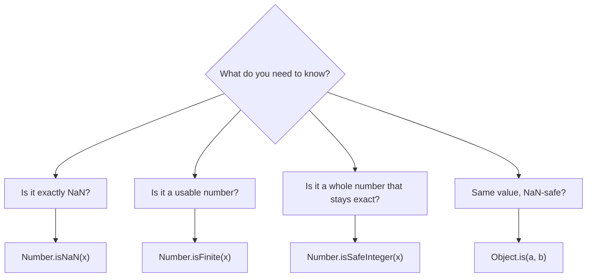

## Introduction

Ask most languages to divide by zero or convert `"abc"` to a number and they throw an exception. JavaScript returns a value instead. `1 / 0` is `Infinity`, `0 / 0` is `NaN`, and `Number('abc')` is `NaN`. The program keeps running, and the special value flows onward into whatever uses it next — a total, a chart, a CSS width, a database write.

That design comes from **IEEE 754**, the standard for floating-point arithmetic that JavaScript's `number` type follows (see [[b1-type-number]]). IEEE 754 defines a handful of special values so that arithmetic can always produce *some* result rather than halting:

- **`NaN`** ("Not a Number") — the result of an operation with no meaningful numeric answer.
- **`Infinity`** and **`-Infinity`** — results too large in magnitude to represent, or division of a non-zero number by zero.
- **`-0`** — a negative zero, distinct from `0` in a few observable ways.

On top of these, the number type has a limited range of **safe integers**: whole numbers up to 2⁵³ − 1 are exact, and beyond that integers start to collapse into each other.

None of these is an error object. They are ordinary values of type `number`, which is exactly what makes them dangerous: `typeof NaN` is `"number"`, so a type check will not catch them. This lesson teaches where each value comes from, how it behaves, and the precise tools for detecting it — [[b1-number-isnan|Number.isNaN()]] for NaN and [[b1-object-is|Object.is()]] for the comparisons where `===` gives the wrong answer.

## Before you start

- **The number type** — that JavaScript numbers are 64-bit floating-point values. See [[b1-type-number]].
- **Primitive types** — values, `typeof`, and the difference between number and bigint. See [[b1-primitive-types]].
- **Strict equality** — what `===` does. See [[b1-strict-equality]].

## The intuition

Think of `NaN` as a drop of ink in water. Once it gets into a calculation, everything it touches turns to `NaN`: `NaN + 1`, `NaN * 0`, `Math.max(5, NaN)` are all `NaN`. And it cannot even recognise itself — `NaN === NaN` is `false` — because "not a number" describes many different failed results (the square root of −1, `0 / 0`, parsing `"abc"`), and there is no reason to say one failure equals another.

Think of `Infinity` as the end of a ruler. It is still a position on the number line, larger than every finite number, and arithmetic with it mostly makes sense: `Infinity + 1` is `Infinity`, `1 / Infinity` is `0`. It only turns to `NaN` when the question has no answer, such as `Infinity - Infinity`.

And think of **safe integers** as the part of the ruler with a mark for every whole number. Beyond 2⁵³, the marks are spaced two apart, then four apart, and so on. A number that falls between marks snaps to the nearest one.

## NaN: where it comes from

`NaN` is produced whenever an operation is asked for a number that does not exist:

```javascript title="nan-sources.js"
console.log(0 / 0, Number('abc'), parseInt('px10', 10), Math.sqrt(-1));
console.log(Infinity - Infinity, 0 * Infinity, undefined + 1, Number(undefined));
const total = 10 + NaN * 3 - 2;           // NaN spreads through arithmetic
console.log(total, typeof total);
console.log(NaN === NaN, NaN == NaN, NaN < 1, NaN > 1, NaN >= NaN);
```

```output
NaN NaN NaN NaN
NaN NaN NaN NaN
NaN number
false false false false false
```

The sources fall into three groups. **Failed conversions**: `Number('abc')`, `parseInt` on a string that does not start with a digit, `Number(undefined)` and anything involving `undefined` in arithmetic — which makes `NaN` the usual symptom of a missing value (`null`, by contrast, converts to `0`; see [[b1-undefined-vs-null]]). **Undefined mathematical operations**: `0 / 0`, `Math.sqrt(-1)`, `Infinity - Infinity`, `0 * Infinity`. And **propagation**: any arithmetic with a `NaN` operand yields `NaN`, which is why `total` is `NaN` even though only one input was bad.

The last line is the defining oddity. `NaN` is **not equal to anything, including itself**, under both `===` and `==`, and every ordered comparison (`<`, `>`, `<=`, `>=`) with `NaN` is `false`. IEEE 754 specifies this so that a failed computation never accidentally matches a real value. The consequences ripple outward:

- `x === NaN` is always `false`, so it can never detect `NaN`. This is the most common NaN bug.
- `array.indexOf(NaN)` returns `-1` because `indexOf` uses `===`.
- Sorting an array containing `NaN` with `(a, b) => a - b` gives an inconsistent comparator (every comparison with `NaN` returns `NaN`), so the resulting order is unpredictable and can differ between engines. Filter `NaN` out before sorting.
- `if (x > 0) … else …` sends `NaN` into the `else` branch, where code usually assumes "zero or negative".

There is one `NaN` value at the language level. IEEE 754 allows many bit patterns for NaN, but JavaScript code cannot tell them apart (apart from via typed arrays, where the exact bits are implementation-dependent).

## Number.isNaN() {#b1-number-isnan}

`Number.isNaN(value)` returns `true` if and only if `value` is the number `NaN`. It performs no conversion: strings, `undefined`, objects and everything else return `false`. Added in ES2015, it is the correct way to ask "is this value NaN?", replacing the older global `isNaN` function, which answers a different and much less useful question.

### Why you need a special function

Because `NaN !== NaN`, the ordinary `===` operator cannot detect `NaN`. Before ES2015, JavaScript offered the global function `isNaN(value)`. Its flaw is that it **converts its argument to a number first** and then checks whether the *result* is `NaN`. So it does not answer "is this NaN?" but "would this become NaN if forced into a number?":

```javascript title="isnan-compare.js"
const cases = [['NaN', NaN], ["'NaN'", 'NaN'], ["'hello'", 'hello'], ['undefined', undefined],
  ['{}', {}], ["'42'", '42'], ["''", ''], ['null', null]];
console.log('value'.padEnd(10), 'Number.isNaN'.padEnd(13), 'isNaN');
for (const [label, v] of cases) {
  console.log(label.padEnd(10), String(Number.isNaN(v)).padEnd(13), isNaN(v));
}
```

```output
value      Number.isNaN  isNaN
NaN        true          true
'NaN'      false         true
'hello'    false         true
undefined  false         true
{}         false         true
'42'       false         false
''         false         false
null       false         false
```

The global `isNaN` says `'hello'`, `undefined` and `{}` are NaN, though none of them is — they merely convert to `NaN`. Worse, it says `''` and `null` are *not* NaN, because they convert to `0`. Only the first row is actually the value `NaN`, and only `Number.isNaN` agrees. The global function's behaviour made sense in 1990s code where "will this coerce to a valid number?" was the question, but it makes `isNaN` unreliable as a type check and unreliable as a validator.

### Other ways to detect NaN

```javascript title="nan-detection.js"
const x = 0 / 0;
console.log(x !== x, Object.is(x, NaN), [NaN].includes(NaN), [NaN].indexOf(NaN));
console.log([1, NaN, 3].findIndex(Number.isNaN));
const raw = ['10', 'abc', '', ' 7 ', '3e2', null];
console.log(raw.filter((s) => !isNaN(s)));
console.log(raw.map(Number).filter(Number.isFinite));
console.log(Number.isFinite('5'), isFinite('5'), Number.isFinite(Infinity));
```

```output
true true true -1
1
[ '10', '', ' 7 ', '3e2', null ]
[ 10, 0, 7, 300, 0 ]
false true false
```

`x !== x` is `true` only for `NaN`, since it is the only value not equal to itself. It is a classic interview answer and how polyfills of `Number.isNaN` work, but it reads like a typo, so prefer `Number.isNaN` in real code. `Object.is(x, NaN)` also works (next section). `includes` finds `NaN` because it uses a comparison called SameValueZero, whereas `indexOf` uses `===` and cannot. `Number.isNaN` is a convenient predicate to pass to `findIndex`, `some` or `filter`.

The third and fourth lines show why `!isNaN(x)` is a bad input filter: it keeps `''` and `null` (both convert to `0`) and does nothing to reject non-strings. Converting and then filtering with `Number.isFinite` is better, but still lets `''` and `null` through as `0` — a validation function must reject those *before* converting, as the worked example does.

### Number.isFinite: the validator you usually want

When validating input, "is it NaN?" is rarely the whole question. You usually want "is this a real, usable number?", which also excludes `Infinity` and `-Infinity`. `Number.isFinite(value)` returns `true` only for numbers that are neither `NaN` nor infinite, again without converting — `Number.isFinite('5')` is `false`. The global `isFinite` has the same coercion flaw as global `isNaN` and returns `true` for `'5'`. The same pattern holds for the whole family: the `Number.` versions (`isNaN`, `isFinite`, `isInteger`, `isSafeInteger`) never convert, which is what you want for checking values.

> [!TIP] Which check to use
> To detect NaN, use `Number.isNaN(x)`. To validate a number, use `Number.isFinite(x)` (and `Number.isInteger` or `Number.isSafeInteger` if it must be whole). Avoid the global `isNaN` and `isFinite` entirely; linters such as ESLint's `no-restricted-globals` configurations commonly forbid them.

## Infinity and the limits of the range

`Infinity` is a number greater than every finite number; `-Infinity` is smaller than every finite number. They appear when a result is too large to represent (**overflow**) or when a non-zero number is divided by zero:

```javascript title="infinity.js"
console.log(1 / 0, -1 / 0, 2 ** 1024, -(2 ** 1024));
console.log(Number.MAX_VALUE, Number.MAX_VALUE * 2);
console.log(Number.MAX_VALUE + 1 === Number.MAX_VALUE);
console.log(Infinity + 1, Infinity * -1, 1 / Infinity, Infinity > Number.MAX_VALUE);
console.log(Math.max(), Math.min());
console.log(Number.MIN_VALUE, Number.MIN_VALUE > 0, Number.MIN_VALUE / 2);
console.log(Number.EPSILON);
console.log(JSON.stringify({ a: NaN, b: Infinity, c: -Infinity }));
try { JSON.parse('{"a": NaN}'); } catch (e) { console.log(e.name); }
```

```output
Infinity -Infinity Infinity -Infinity
1.7976931348623157e+308 Infinity
true
Infinity -Infinity 0 true
-Infinity Infinity
5e-324 true 0
2.220446049250313e-16
{"a":null,"b":null,"c":null}
SyntaxError
```

**`Number.MAX_VALUE`** (about 1.8 × 10³⁰⁸) is the largest finite double. Doubling it overflows to `Infinity`. Adding `1` to it does nothing at all, because at that magnitude neighbouring doubles are about 10²⁹² apart and `+ 1` rounds straight back. Only results that round past `MAX_VALUE` become `Infinity`.

**Arithmetic with Infinity** behaves like the mathematical limit where one exists: `Infinity + 1` is `Infinity`, `1 / Infinity` is `0`. Where no limit exists — `Infinity - Infinity`, `0 * Infinity`, `Infinity / Infinity` — the result is `NaN`.

**`Math.max()` with no arguments is `-Infinity`**, and `Math.min()` is `Infinity`. This is not a quirk but a design: they are the identity values for max and min, so `Math.max(...[])` combined with any later value gives that value. It is also why `Infinity` is a standard initial value in "find the minimum" loops (`let best = Infinity`). The catch is that `Math.max(...emptyArray)` returns `-Infinity`, which can appear in a UI if you forget the empty case.

**`Number.MIN_VALUE` is not the most negative number.** It is the *smallest positive* double, about 5 × 10⁻³²⁴; halving it underflows to `0`. The most negative finite number is `-Number.MAX_VALUE`. This name misleads people regularly.

**`Number.EPSILON`** (2⁻⁵², about 2.2 × 10⁻¹⁶) is the gap between `1` and the next larger double. It is a reasonable tolerance for comparing numbers *near 1*; for larger magnitudes the tolerance must scale with the values ([[b1-floating-point]]).

**JSON has no NaN or Infinity.** `JSON.stringify` silently writes them as `null`, and `JSON.parse` rejects the literal `NaN`. A calculation that produced `NaN` therefore arrives at the server as `null` — often stored in a database as "no value" with no error anywhere. See [[b1-json-unsupported]].

## Safe integers

Numbers have 53 bits of precision. Every integer whose magnitude is at most 2⁵³ − 1 (9,007,199,254,740,991) can be represented exactly; JavaScript calls these **safe integers**, with limits `Number.MAX_SAFE_INTEGER` and `Number.MIN_SAFE_INTEGER`:

```javascript title="safe-integers.js"
console.log(Number.MAX_SAFE_INTEGER, Number.MIN_SAFE_INTEGER);
console.log(2 ** 53, 2 ** 53 + 1, 2 ** 53 + 2);
console.log(Number.isSafeInteger(2 ** 53 - 1), Number.isSafeInteger(2 ** 53));
console.log(9007199254740993 === 9007199254740992);
console.log(Number.MAX_SAFE_INTEGER + 2);
console.log(Number.isInteger(1e300), Number.isSafeInteger(1e300));
```

```output
9007199254740991 -9007199254740991
9007199254740992 9007199254740992 9007199254740994
true false
true
9007199254740992
true false
```

Above 2⁵³ the representable integers are two apart, so `2 ** 53 + 1` rounds to `2 ** 53`, and the literal `9007199254740993` is equal to `9007199254740992`. `MAX_SAFE_INTEGER + 2` gives an answer that is wrong by one with no warning. "Safe" means precisely this: within the range, distinct integers stay distinct and integer arithmetic stays exact; outside it, `a + 1 === a` can be true.

`Number.isSafeInteger` checks both conditions (an integer *and* in range). `Number.isInteger(1e300)` is `true` — every double that large is a whole number — but it is far from safe. For integers beyond the safe range, use [[b1-type-bigint|bigint]] or keep them as strings; [[b1-safe-integers]] goes deeper.

## Negative zero

IEEE 754 has a sign bit even for zero, so `-0` exists. It arises from operations such as `0 * -5`, `Math.round(-0.4)` and `-0` literals, and it survives because it preserves the sign of a quantity that underflowed towards zero (useful in some numerical code, such as knowing which side a limit was approached from).

```javascript title="negative-zero.js"
const negZero = -0;
console.log(negZero === 0, 1 / negZero, Object.is(negZero, 0));
console.log(0 * -5, Math.round(-0.4), -0 + 0, String(-0), JSON.stringify(-0));
console.log((-0).toFixed(1), `${-0}`, [-0]);
```

```output
true -Infinity false
-0 -0 0 0 0
0.0 0 [ -0 ]
```

`-0 === 0` is `true`, and string conversion prints `"0"`, so `-0` is almost invisible. It shows itself in three places: dividing by it gives `-Infinity`, `Object.is(-0, 0)` is `false`, and Node's `console.log` displays it as `-0`. In practice it matters for things like a temperature or velocity display that should not read "-0", and for code that divides by a value that might be a signed zero.

```quiz
Q: Which expression correctly tests whether `x` is NaN for every possible value of `x`?
- [ ] `x === NaN`
- [ ] `isNaN(x)`
- [x] `Number.isNaN(x)`
- [ ] `typeof x === 'NaN'`
> NaN is not equal to anything, including itself, so `x === NaN` is always false. Global `isNaN` converts first, so it returns true for strings like 'hello' and undefined. `typeof NaN` is 'number'. Only Number.isNaN checks for the actual NaN value without coercion.

Q: What does `Math.max()` (no arguments) return?
- [ ] 0
- [ ] NaN
- [x] -Infinity
- [ ] It throws
> -Infinity is the identity element for max: comparing it with any number yields that number. This is consistent but means `Math.max(...[])` on an empty array returns -Infinity, which must be handled explicitly.

Q: What is `Number.MIN_VALUE`?
- [ ] The most negative finite number
- [ ] -9007199254740991
- [x] The smallest positive number greater than 0
- [ ] -Infinity
> Despite the name, MIN_VALUE is about 5e-324, the smallest positive double. The most negative finite number is -Number.MAX_VALUE, and -9007199254740991 is Number.MIN_SAFE_INTEGER.
```

## Object.is() {#b1-object-is}

`Object.is(a, b)` tells you whether two values are **the same value**. It behaves exactly like `===` except for two cases: `Object.is(NaN, NaN)` is `true`, and `Object.is(0, -0)` is `false`. Added in ES2015, it exposes an algorithm the specification calls **SameValue**, which the language had been using internally for operations where "is this the very same value?" must have a precise answer.

```javascript title="object-is.js"
console.log(Object.is(NaN, NaN), NaN === NaN);
console.log(Object.is(0, -0), 0 === -0);
console.log(Object.is('a', 'a'), Object.is({}, {}), Object.is(null, undefined));
const set = new Set([0, -0, NaN, NaN]);
console.log(set.size, [...set]);
const m = new Map([[-0, 'zero']]);
console.log(m.get(0), [-0].includes(0), [NaN].includes(NaN));
```

```output
true false
false true
true false false
2 [ 0, NaN ]
zero true true
```

The first two lines are the two differences. The third shows everything else is identical to `===`: primitives compare by value, objects by identity (`Object.is({}, {})` is `false` — it is not a deep comparison), and there is no type conversion, so `null` and `undefined` differ.

### Three equality algorithms

The rest of the output reveals that JavaScript actually uses **three** strict-style comparisons, which differ only on `NaN` and signed zero:

| Algorithm | Where it is used | `NaN` vs `NaN` | `0` vs `-0` |
|---|---|---|---|
| Strict Equality | `===`, `!==`, `indexOf`, `lastIndexOf`, `switch` cases | not equal | equal |
| SameValueZero | `Set`, `Map` keys, `includes`, typed array `includes` | equal | equal |
| SameValue | `Object.is`, `Object.defineProperty` change checks | equal | not equal |

`Set` and `Map` use **SameValueZero**: `NaN` can be stored and found as a key (otherwise a `NaN` key could never be looked up again), but `0` and `-0` are treated as the same key — the `Set` above holds one zero, and the `Map` finds the `-0` entry under `0`. `includes` uses SameValueZero too, which is why it finds `NaN` while `indexOf` cannot. Only `Object.is` (SameValue) distinguishes the zeros.

SameValue appears inside the language as well. When you redefine a non-writable, non-configurable property with `Object.defineProperty`, the engine allows it only if the new value is the SameValue as the old one:

```javascript title="define-property-samevalue.js"
'use strict';
const o = {};
Object.defineProperty(o, 'z', { value: -0, writable: false, configurable: false });
try { Object.defineProperty(o, 'z', { value: -0 }); console.log('same value: ok'); }
catch (e) { console.log(e.name); }
try { Object.defineProperty(o, 'z', { value: 0 }); console.log('changed'); }
catch (e) { console.log(e.name + ': ' + e.message); }
```

```output
same value: ok
TypeError: Cannot redefine property: z
```

Redefining with `-0` again is a no-op and allowed; changing it to `0` is rejected because SameValue says `0` is a different value, even though `0 === -0`.

### Object.is in React

The best-known everyday user of `Object.is` is React. When you call a state setter, React compares the new value with the current one using `Object.is`, and if they are the same it can skip re-rendering. This little model reproduces the rule:

```javascript title="react-bailout-model.js"
// A tiny version of React's bail-out rule: skip work when Object.is says "same".
function makeState(initial, onRender) {
  let value = initial;
  return (next) => {
    if (Object.is(value, next)) return;          // no change: no re-render
    value = next;
    onRender(value);
  };
}
const renders = [];
const setValue = makeState(0, (v) => renders.push(v));
setValue(0); setValue(-0); setValue(NaN); setValue(NaN);
const list = [1];
const setList = makeState(list, (v) => renders.push(`list:${v.length}`));
list.push(2); setList(list);                     // mutated in place: same object
setList([...list]);                              // new array: re-render
console.log(renders);
```

```output
[ -0, NaN, 'list:2' ]
```

Setting `0` again does nothing. Setting `-0` *does* count as a change, because `Object.is(0, -0)` is `false` — an edge case you will rarely hit. Setting `NaN` twice re-renders only once, because `Object.is(NaN, NaN)` is `true`; with `===` the comparison would fail every time and a `NaN` state would re-render forever. Most importantly, mutating `list` in place and passing the same array is ignored, because it is the same object; only the new array from spread triggers a render. This is the identity rule from [[b1-objects-as-values]] in action, and the model is a simplification — real React also batches updates and may render once before bailing out ([[b4-usestate]]).

### When to use Object.is

For everyday comparisons, keep using `===`: it is what readers expect, and the two edge cases rarely matter. Reach for `Object.is` when you are implementing something that must treat `NaN` as equal to itself — a memoisation cache, a change detector, a `useMemo`-style dependency check — or when you need to detect `-0` specifically. When you do use it, a short comment saying why helps, so that a future reader does not "simplify" it back to `===`.

> [!WARNING] Object.is is not deep equality
> `Object.is({ a: 1 }, { a: 1 })` is `false`. It compares object identity exactly like `===`. For content comparison you need a shallow or deep equality function.

## How it works internally

A JavaScript number is 64 bits: 1 sign bit, 11 exponent bits and 52 fraction bits. Special values are particular bit patterns. An exponent of all ones with a zero fraction means infinity, with the sign bit choosing `+` or `-`. An exponent of all ones with a non-zero fraction means NaN. A zero exponent and zero fraction is zero, and the sign bit makes it `+0` or `-0`. Because these are ordinary bit patterns, the hardware's floating-point unit produces them directly: dividing by zero on the CPU yields the infinity pattern, without any exception reaching JavaScript.

The safe-integer limit falls out of the same layout. With 52 stored fraction bits plus one implied leading bit, a double can hold any integer up to 2⁵³ exactly. Past that, the exponent must grow, and the spacing between representable values becomes 2, then 4, and so on.

At the specification level, `===` on numbers is defined by the Number::equal operation (NaN never equal, `+0` equals `-0`), SameValueZero treats NaNs as equal, and SameValue additionally distinguishes the zeros. `Number.isNaN(x)` is specified as "x is a Number and x is NaN", while global `isNaN(x)` is "let n be ToNumber(x); return whether n is NaN" — the difference between the two functions is exactly that one `ToNumber` call.



## Worked example: validating a quantity field

An order form has a "quantity" input. Its value is always a string, and the code must turn it into a whole, non-negative, exactly representable number — or reject it — without letting `NaN`, `Infinity` or an accidental `0` through.

```javascript title="parse-quantity.js"
function parseQuantity(text) {
  if (typeof text !== 'string' || text.trim() === '') return null;   // '' would become 0
  const n = Number(text);
  if (!Number.isFinite(n)) return null;          // rejects NaN and ±Infinity
  if (!Number.isSafeInteger(n) || n < 0) return null;
  return n;
}
for (const t of ['3', ' 12 ', '', 'abc', '1e400', '2.5', '-1', '9007199254740993', '0x10']) {
  console.log(JSON.stringify(t).padEnd(20), parseQuantity(t));
}
```

```output
"3"                  3
" 12 "               12
""                   null
"abc"                null
"1e400"              null
"2.5"                null
"-1"                 null
"9007199254740993"   null
"0x10"               16
```

Each guard closes a specific hole. The blank check comes first because `Number('')` and `Number('   ')` are `0`, which would pass every later test and turn an empty field into an order for zero items. `Number(text)` is used rather than `parseInt` because it rejects trailing junk such as `'3abc'` instead of quietly returning `3`; it does trim surrounding whitespace, so `' 12 '` is accepted. `Number.isFinite` rejects both `'abc'` (NaN) and `'1e400'` (which overflows to `Infinity` — a value that would sail through a NaN-only check). `Number.isSafeInteger` rejects fractions and the unsafe `'9007199254740993'`, which would otherwise be silently rounded to a different number.

The last row is a judgement call the output makes visible: `Number` accepts hexadecimal, so `'0x10'` becomes `16`. If that is not acceptable for your form, add a pattern check such as `/^\d+$/.test(text.trim())` before converting. Returning `null` for invalid input (rather than `NaN`) is deliberate: `null` is a clear "no value" that callers can test with `=== null`, and it cannot quietly propagate through arithmetic the way `NaN` does. Note, though, that `null` converts to `0` if someone forgets to check it, so callers must still handle the `null` case.

## In real systems

**Silent NaN in UIs and charts.** A missing field turns into `undefined`, arithmetic turns it into `NaN`, and the page shows "NaN items" or "$NaN", or a chart library draws nothing. Validating at the boundary — when data enters from a form or API — is far cheaper than chasing `NaN` through a computation.

**JSON and databases.** `NaN` and `Infinity` become `null` in JSON. Analytics pipelines and APIs that compute ratios (`clicks / views` with zero views) frequently store these `null`s without anyone noticing. Guard divisions and decide explicitly what "no data" should be.

**CSS and layout.** Setting `element.style.width = value + 'px'` with a `NaN` value writes the string `"NaNpx"`, which the browser ignores as invalid — the element keeps its previous width, with no error (browser behaviour described from the CSS specification, not run here).

**React and memoisation.** React's state bail-out, `useMemo`, `useEffect` dependencies and `React.memo` all rely on `Object.is`, so a `NaN` dependency is stable rather than "changing" on every render ([[b4-usestate]]).

**IDs and counters.** Integer IDs from 64-bit databases can exceed `MAX_SAFE_INTEGER`; treat them as strings or bigints.

## Trade-offs and alternatives

Returning special values instead of throwing has real benefits: long numeric computations (graphics, simulations, statistics) keep running, and the result can still be inspected or partially used. The cost is that failures are silent and spread. Many teams compensate by validating inputs at boundaries, by checking results with `Number.isFinite` before displaying or storing them, and by using TypeScript or schema validators (such as Zod's `z.number().finite()`) to enforce numeric constraints.

| Tool | Answers | Converts input? | Use for |
|---|---|---|---|
| `Number.isNaN(x)` | Is `x` exactly NaN? | No | Detecting NaN |
| global `isNaN(x)` | Would `x` become NaN? | Yes | Avoid |
| `Number.isFinite(x)` | Is `x` a finite number? | No | Validating numbers |
| global `isFinite(x)` | Would `x` become finite? | Yes | Avoid |
| `Number.isSafeInteger(x)` | Exact whole number within ±(2⁵³ − 1)? | No | IDs, counts, quantities |
| `x !== x` | Is `x` NaN? | No | Polyfills, interviews |
| `Object.is(a, b)` | Same value (NaN equal, ±0 different)? | No | Change detection, caches, `-0` |
| `===` | Strictly equal (NaN unequal, ±0 equal)? | No | Everyday comparisons |

## Common mistakes

**Testing `x === NaN`.** Always `false`. Use `Number.isNaN(x)`.

**Using global `isNaN` for validation.** `isNaN('')` and `isNaN(null)` are `false`, so empty input passes; `isNaN('hello')` is `true` even though `'hello'` is not NaN. Use `Number.isFinite` on a converted value, after rejecting blanks.

> [!MISTAKE] Forgetting Infinity
> A check like `if (!Number.isNaN(n))` lets `Infinity` through, which can come from `'1e400'` or a division by zero. When you want a usable number, check `Number.isFinite(n)`.

**Assuming `Number.MIN_VALUE` is the most negative number.** It is the smallest positive value. Use `-Number.MAX_VALUE` or `-Infinity` as a "lowest possible" starting point.

**Ignoring the empty case of `Math.max(...arr)`.** It returns `-Infinity` for an empty array.

**Sending NaN in JSON.** It arrives as `null`. Validate before serialising.

**Using `indexOf` to find NaN.** It returns `-1`. Use `includes` or `findIndex(Number.isNaN)`.

**Expecting `Object.is` to compare contents.** It compares object identity, like `===`.

## Interview perspective

Special numeric values are a favourite source of short "what does this print?" questions, and `Number.isNaN` versus `isNaN` is a classic follow-up.

> [!INTERVIEW] "Why is NaN !== NaN, and how do you check for NaN?"
> "NaN represents an undefined or unrepresentable result, and IEEE 754 defines it as unequal to everything, including itself, so a failed computation never matches a real value. To test for it I use `Number.isNaN(x)`, which doesn't coerce. The global `isNaN` converts its argument first, so `isNaN('hello')` is true. `Object.is(x, NaN)` and `x !== x` also work, and `includes` finds NaN because it uses SameValueZero, while `indexOf` uses `===` and can't."

Other questions to prepare:

- **`typeof NaN`?** `"number"`.
- **`0.1 + 0.2 === 0.3`? `9007199254740992 === 9007199254740993`?** `false` and `true` — rounding and the safe-integer limit.
- **`Object.is` versus `===`?** Same except `NaN` equals `NaN` and `0` differs from `-0`. Follow-up: what do `Set` and `Map` use? SameValueZero.
- **`Math.max()` and `Math.min()` with no arguments?** `-Infinity` and `Infinity`, the identity values.
- **What is `Number.MAX_SAFE_INTEGER` and why 2⁵³ − 1?** 53 bits of precision in a double; past it, integers are no longer all representable.
- **How do you detect `-0`?** `Object.is(x, -0)` or `1 / x === -Infinity`.

## Practice

1. **Predict.** Write the results, then run: `NaN ** 0`, `Infinity / Infinity`, `-0 === 0`, `Object.is(-0, 0)`, `[NaN].indexOf(NaN)`, `[NaN].includes(NaN)`, `new Set([NaN, NaN]).size`, `Math.min(1, NaN)`, `parseInt('Infinity')`, `Number('Infinity')`.
2. **Safe average.** Write `average(values)` that ignores non-finite entries, returns `null` for an empty or all-invalid input, and never returns `NaN` or `Infinity`.
3. **Polyfill.** Implement `numberIsNaN(x)` and `objectIs(a, b)` without using the built-ins. (Hint for `-0`: `1 / x`.)
4. **Find the NaN.** Given a pipeline `parse → convert → aggregate → format` that outputs `"$NaN"`, add assertions with `Number.isFinite` after each stage so the first failing stage throws with a useful message.
5. **Overflow hunt.** Find the smallest integer `n` for which `2 ** n` is `Infinity`, and explain the result using `Number.MAX_VALUE`.

## Quick revision {#quick-revision}

- Special number values: `NaN`, `Infinity`, `-Infinity`, `-0`. All have `typeof` `"number"`; arithmetic produces them instead of throwing (IEEE 754).
- NaN sources: failed conversions (`Number('abc')`, `undefined + 1`), undefined maths (`0 / 0`, `Infinity - Infinity`, `Math.sqrt(-1)`), propagation from any NaN operand.
- `NaN` is unequal to everything, itself included; all ordered comparisons with it are `false`; `indexOf(NaN)` is `-1`; sorting with NaN is unpredictable.
- `Number.isNaN(x)`: true only for the NaN value, no coercion. Global `isNaN` coerces (`isNaN('hello')` true, `isNaN('')` false) — avoid. `x !== x` also detects NaN.
- `Number.isFinite(x)`: finite number, no coercion — the usual validator. Global `isFinite` coerces.
- `Infinity`: overflow past `Number.MAX_VALUE` (~1.8e308) or non-zero ÷ 0. `Math.max()` is `-Infinity`, `Math.min()` is `Infinity`.
- `Number.MIN_VALUE` (~5e-324) is the smallest positive number, not the most negative. `Number.EPSILON` = 2⁻⁵².
- Safe integers: ±(2⁵³ − 1) = ±9,007,199,254,740,991. Beyond, `2 ** 53 + 1 === 2 ** 53`. Check with `Number.isSafeInteger`; use bigint or strings beyond.
- `-0 === 0`, prints as `"0"`, but `1 / -0` is `-Infinity` and `Object.is(-0, 0)` is false.
- JSON writes NaN/±Infinity as `null`; `JSON.parse` rejects `NaN`.
- Equality algorithms: `===` (NaN ≠ NaN, +0 = -0); SameValueZero for `Set`, `Map`, `includes` (NaN = NaN, +0 = -0); SameValue for `Object.is`, `defineProperty` (NaN = NaN, +0 ≠ -0).
- React compares state with `Object.is`; it is identity for objects, not deep equality.

## Key takeaways {#key-takeaways}

- JavaScript arithmetic never throws for bad numeric results; it returns `NaN`, `Infinity` or `-0`, all of type `number`, so validation is your job.
- `NaN` is not equal to itself; detect it with `Number.isNaN`, and validate usable numbers with `Number.isFinite`.
- The global `isNaN` and `isFinite` coerce their arguments and answer the wrong question — avoid them.
- Integers are exact only up to 2⁵³ − 1; past that, values silently round, so use `Number.isSafeInteger`, bigint or strings.
- `Object.is` is `===` with two fixes — `NaN` equals itself and `-0` differs from `0` — and it underpins change detection in libraries such as React.
- Validate numbers at the boundary, before special values can spread through calculations, JSON and the UI.
