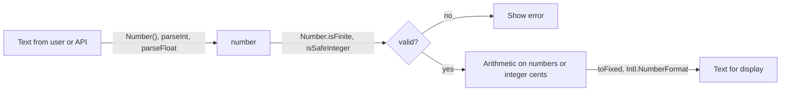

## Introduction

Numbers rarely stay numbers for long in a web application. They arrive as text — from form fields, URL query strings, CSV files, `data-` attributes — and they leave as text, rendered into the page as prices, percentages, file sizes and dates. In between, your code has to check whether a value is usable at all: is it a real number, a whole number, small enough to be exact?

JavaScript's number toolkit maps onto those three jobs:

- **Checking** a value: `Number.isNaN`, `Number.isFinite`, `Number.isInteger`, `Number.isSafeInteger`, plus constants such as `Number.MAX_SAFE_INTEGER` and `Number.EPSILON`.
- **Parsing** text into a number: `Number(text)`, `parseInt(text, radix)` and `parseFloat(text)`.
- **Formatting** a number as text: `toString(radix)`, `toFixed`, `toPrecision`, `toExponential`, `toLocaleString` and the more powerful `Intl.NumberFormat`.

Each function is small, but each has at least one behaviour that surprises people. `isNaN('hello')` is `true`. `parseInt('1e3')` is `1`. `(1.005).toFixed(2)` is `"1.00"`. `-2.5.toFixed(0)` is a number, not a string. This lesson explains those behaviours from first principles so you can choose the right tool and avoid the bug, and ends with a complete price-entry example that uses all three families together.

## Before you start

- **How numbers are stored** — a number is a 64-bit double, decimal fractions like 1.005 are stored approximately, and integers are exact only up to 2⁵³ − 1. See [[b1-number-representation]], especially [[b1-floating-point]] and [[b1-safe-integers]].
- **Explicit conversion** — `Number()`, `parseInt` and `parseFloat` are taught in full in [[b1-number-conversion]] and [[b1-parseint-parsefloat]]. This lesson summarises them and focuses on choosing between them.
- **NaN and Infinity** — what they are and where they come from. See [[b1-nan-infinity]].
- **Autoboxing** — how a primitive like `5` can have methods. See [[b1-autoboxing]].

## The intuition

Think of the three families as three different workers at a post office.

The **inspector** (`Number.is…`) looks at a parcel and answers yes or no: "is this a valid number?". The inspector never opens or repacks anything — if you hand over a string, the answer is simply "no, that is not a number".

The **scanner** (`parseInt`, `parseFloat`, `Number()`) reads a label written in text and produces a number. Different scanners have different tolerance: one reads as many digits as it can and stops at the first unexpected character; another rejects the label unless every character makes sense.

The **printer** (`toFixed`, `Intl.NumberFormat` and friends) takes a number and produces a label for humans. The label is text. It may be rounded, grouped with commas or translated for another country, and it is not meant to be fed back into a calculation.

Most bugs in this area come from asking one worker to do another's job: using the printer to "fix" arithmetic, or using a lenient scanner as an inspector.

## Calling methods on numbers

Number methods live on `Number.prototype`, and number primitives borrow them through autoboxing — when you write `(255).toString(16)`, the engine temporarily treats `255` as a `Number` object so the method can run, then discards the wrapper.

One syntax rule trips everyone once: a dot directly after an integer literal is read as a decimal point.

```javascript title="method-syntax.js"
// 255.toString(16);          // SyntaxError: Invalid or unexpected token
console.log((255).toString(16), 255..toString(16), 255 .toString(16));
const n = 255;
console.log(n.toString(16));  // variables need no parentheses
```

```output
ff ff ff
ff
```

`255.toString` fails because the parser reads `255.` as a number and then finds `toString` where it expected an operator. Parentheses, a second dot (`255..` is "255.0" followed by a property access) or a space all work, but parentheses are the readable choice. With a variable there is no ambiguity.

Never create numbers with `new Number(5)`. That produces a wrapper *object*: `typeof` is `"object"`, `new Number(5) === 5` is `false`, and `new Number(0)` is truthy because every object is truthy. Calling `Number(value)` *without* `new` is fine — it converts and returns a primitive.

## Constants on Number

The `Number` constructor carries the constants that describe the double format:

| Constant | Value | Meaning |
|---|---|---|
| `Number.MAX_SAFE_INTEGER` | 9007199254740991 (2⁵³ − 1) | Largest integer that is exact and unambiguous |
| `Number.MIN_SAFE_INTEGER` | −9007199254740991 | Smallest such integer |
| `Number.EPSILON` | 2⁻⁵² ≈ 2.22e-16 | Gap between 1 and the next double |
| `Number.MAX_VALUE` | ≈ 1.80e308 | Largest finite double; above this is `Infinity` |
| `Number.MIN_VALUE` | ≈ 5e-324 | Smallest **positive** double (not the most negative number) |
| `Number.POSITIVE_INFINITY` / `NEGATIVE_INFINITY` | `Infinity` / `-Infinity` | Same as the global `Infinity` |
| `Number.NaN` | `NaN` | Same as the global `NaN` |

Their meaning is explained in [[b1-number-representation]]. The one most often misused is `Number.MIN_VALUE`: if you need a starting value for "find the maximum", use `-Infinity`, not `Number.MIN_VALUE`, which is positive.

## Predicates: testing without coercion

ES2015 added four predicate functions on `Number`. They share one rule that makes them reliable: **they never convert their argument**. If the argument is not of type number, the answer is `false`.

- `Number.isNaN(x)` — is `x` the value `NaN`?
- `Number.isFinite(x)` — is `x` a number other than `NaN`, `Infinity` and `-Infinity`?
- `Number.isInteger(x)` — is `x` a finite number with no fractional part?
- `Number.isSafeInteger(x)` — is `x` an integer whose magnitude is at most `Number.MAX_SAFE_INTEGER`?

The older global functions `isNaN` and `isFinite` are different functions with the same names. They first convert the argument with `Number()` and then test the result, which gives answers about the *converted* value rather than the one you passed:

```javascript title="predicates.js"
const values = [42, '42', NaN, 'abc', Infinity, 4.5, 2 ** 53, null, ''];
for (const v of values) {
  console.log(String(typeof v === 'string' ? JSON.stringify(v) : v).padEnd(17),
    Number.isFinite(v), isFinite(v), Number.isNaN(v), isNaN(v),
    Number.isInteger(v), Number.isSafeInteger(v));
}
```

```output
42                true true false false true true
"42"              false true false false false false
NaN               false false true true false false
"abc"             false false false true false false
Infinity          false false false false false false
4.5               true true false false false false
9007199254740992  true true false false true false
null              false true false false false false
""                false true false false false false
```

Read the columns in pairs. The global `isFinite` says `null` and `''` are finite, because `Number(null)` and `Number('')` are both `0`. The global `isNaN` says `'abc'` is NaN, because `Number('abc')` is NaN — but `'abc'` is a string, not the NaN value. The `Number.` versions answer the question you meant. The last two columns show the difference covered in [[b1-safe-integers]]: 2⁵³ is an integer but not a safe one.

The practical rule: **validate with `Number.isFinite` (or `Number.isSafeInteger` for counts and IDs) after you have explicitly parsed the input.** The coercing globals belong to old code. [[b1-number-isnan]] covers NaN detection in depth.

## Parsing: three scanners with different tolerance

`Number.parseInt` and `Number.parseFloat` are the *same function objects* as the global `parseInt` and `parseFloat` (`Number.parseInt === parseInt` is `true`); they were added to `Number` in ES2015 only so that number utilities live in one namespace. `Number(text)` is a different algorithm. The difference is how much of the string each one insists on understanding:

```javascript title="parsers.js"
const inputs = ['42', '42px', '', '  8  ', '0x1F', '1e3', '1_000', '3.14abc', '12,5', 'Infinity'];
for (const s of inputs) {
  console.log(JSON.stringify(s).padEnd(11), String(Number(s)).padEnd(9),
    String(parseInt(s, 10)).padEnd(9), parseFloat(s));
}
```

```output
"42"        42        42        42
"42px"      NaN       42        42
""          0         NaN       NaN
"  8  "     8         8         8
"0x1F"      31        0         0
"1e3"       1000      1         1000
"1_000"     NaN       1         1
"3.14abc"   NaN       3         3.14
"12,5"      NaN       12        12
"Infinity"  Infinity  NaN       Infinity
```

The columns are `Number`, `parseInt(s, 10)` and `parseFloat`.

**`Number(text)` is all-or-nothing.** After trimming whitespace, the entire string must be a valid numeric literal — decimal, exponent, `0x`/`0o`/`0b` prefixes, or `Infinity` — or the result is `NaN`. Its notorious exception is that an empty or all-whitespace string becomes `0`, which is why "the user left the field empty" can silently turn into a quantity of zero. Numeric separators (`1_000`) are allowed in source code but not in strings.

**`parseInt` and `parseFloat` read a prefix.** They skip leading whitespace, read as many characters as form a number, and ignore the rest. `'42px'` gives `42`, which is handy for CSS values; `'3.14abc'` gives `3.14` (or `3` for `parseInt`), which is dangerous when you are trying to reject bad input. If no digits can be read at all, they return `NaN` — including for the empty string.

**`parseInt` only reads integers in the radix you give it.** With radix 10, it stops at `.`, `e`, `_` and `x`, so `'1e3'` gives `1` and `'0x1F'` gives `0`. Always pass the radix: without it, `parseInt` treats a `0x` prefix as hexadecimal, and the radix documents your intent. (Old engines also read a leading `0` as octal; ES5 removed that, but the habit of passing `10` remains good practice.)

**Neither understands locales.** `'12,5'` (twelve and a half in German or French) parses as `12` or `NaN`. JavaScript has no built-in locale-aware number parser; if you accept localised input, you must normalise it yourself, as shown later.

The choice therefore depends on what you are doing:

| Goal | Use | Why |
|---|---|---|
| Validate that a whole field is a number | `Number(s.trim())`, reject empty strings first, then `Number.isFinite` | Rejects trailing junk |
| Extract the number from `"16px"` or `"42 items"` | `parseFloat(s)` or `parseInt(s, 10)` | Prefix scanning is the point |
| Read hex, binary or base-36 text | `parseInt(s, 16)` etc. | Only `parseInt` takes a radix |
| Strict format (exactly two decimals, no exponent) | A regular expression, then convert | Neither parser enforces a format |

The full grammar of each parser, and traps like `parseInt(0.0000005)` returning `5` and `['1', '2', '3'].map(parseInt)` returning `[1, NaN, NaN]`, are in [[b1-parseint-parsefloat]].

## Formatting: numbers to strings

All the formatting methods return **strings**. That sounds obvious, but it is the root of the most common bug in this area: rounding a value with `toFixed`, then adding to it.

### `toString(radix)`

`toString()` with no argument gives the shortest decimal string that identifies the number (the algorithm is described in [[b1-number-representation]]). With a **radix** between 2 and 36 it writes the number in that base, using digits `0–9` and then letters `a–z`:

```javascript title="radix.js"
console.log((255).toString(16), (255).toString(2), (255).toString(36), (-255).toString(16));
console.log((0.5).toString(2), (0.1).toString(2));
console.log(Number.parseInt('ff', 16), Number.parseInt('11111111', 2));
```

```output
ff 11111111 73 -ff
0.1 0.0001100110011001100110011001100110011001100110011001101
255 255
```

The second line is a direct look at how doubles store fractions: 0.5 is exactly `0.1` in binary, while 0.1 is a long binary expansion cut off at 53 significant bits. `parseInt(text, radix)` is the inverse for integers. Negative numbers get a minus sign rather than a two's-complement bit pattern. Use radix 16 for colour values and hex dumps, radix 2 for inspecting bit flags (see [[b1-bitwise-operators]]), and radix 36 for compact identifiers. A radix outside 2–36 throws a `RangeError`.

### `toFixed(digits)`

`toFixed(d)` writes the number with exactly `d` digits after the decimal point, padding with zeros or rounding as needed. `d` may be 0 to 100 (ES2018 raised the limit from 20); anything else throws a `RangeError`.

```javascript title="tofixed.js"
console.log((3.14159).toFixed(2), (2).toFixed(2), (123.456).toFixed());
console.log((1.005).toFixed(2), (1.45).toFixed(1), (1.255).toFixed(2));
console.log((2.5).toFixed(0), (-2.5).toFixed(0));
console.log(-2.5.toFixed(0), typeof -2.5.toFixed(0));
console.log((1e21).toFixed(2));
```

```output
3.14 2.00 123
1.00 1.4 1.25
3 -3
-3 number
1e+21
```

The first line is the normal case: rounding, padding (`"2.00"` — useful for prices) and a default of 0 digits.

The second line looks wrong but is correct. The specification says `toFixed` picks the `d`-digit result closest to the **exact stored value** of the number. The literal `1.005` is stored as 1.00499999999999989…, which is closer to `1.00` than to `1.01`. Likewise `1.45` is stored slightly below 1.45 and `1.255` slightly below 1.255. This is fully specified behaviour and gives the same answer in every engine; it is the floating-point representation, not the rounding rule, that surprises people.

The third line shows the tie rule when the stored value really is halfway (2.5 is exact in binary): `toFixed` rounds **half away from zero**, because it handles the sign separately and rounds the magnitude up on a tie. That differs from `Math.round`, which rounds `-2.5` to `-2` (see [[b1-rounding]]).

The fourth line is an operator-precedence trap. Member access binds tighter than unary minus, so `-2.5.toFixed(0)` means `-(2.5.toFixed(0))`: the method returns the string `"3"`, and unary minus converts it back into the *number* `-3`.

The last line shows that for magnitudes of 10²¹ or more, `toFixed` gives up and returns the same exponential string as `toString`.

### `toPrecision(p)` and `toExponential(d)`

`toPrecision(p)` controls the number of **significant digits** rather than the digits after the point, switching to exponent notation when the number would otherwise need trailing zeros before the point. `toExponential(d)` always uses exponent notation with `d` digits after the point.

```javascript title="precision.js"
console.log((1234.5678).toPrecision(6), (1234.5678).toPrecision(2), (0.00012345).toPrecision(2));
console.log((1234.5678).toExponential(2), (1234.5678).toExponential(), (0).toExponential(2));
console.log((0.1).toPrecision(21));
```

```output
1234.57 1.2e+3 0.00012
1.23e+3 1.2345678e+3 0.00e+0
0.100000000000000005551
```

`toPrecision` is the natural fit for scientific or measurement values where relative precision matters ("three significant figures"). `toExponential` without an argument uses as many digits as needed to identify the number. The last line uses the largest precision allowed (100 is the maximum) as a debugging tool: it reveals the stored value behind `0.1`.

### `toLocaleString` and `Intl.NumberFormat`

`toFixed` produces programmer-format strings: a `.` decimal point and no thousands separators. Users in Germany expect `1.234.567,89`, users in India expect `12,34,567.891`, and everybody expects currency symbols in the right place. The **Internationalization API (Intl)**, built into all modern browsers and Node.js, does this. `number.toLocaleString(locale, options)` is a shortcut for formatting one value; `new Intl.NumberFormat(locale, options)` creates a reusable formatter.

```javascript title="intl.js"
const n = 1234567.891;
console.log(n.toLocaleString('en-US'), '|', n.toLocaleString('de-DE'), '|', n.toLocaleString('en-IN'));
const usd = new Intl.NumberFormat('en-US', { style: 'currency', currency: 'USD' });
console.log(usd.format(n), usd.format(-1234.5));
console.log(new Intl.NumberFormat('en-US', { style: 'percent', maximumFractionDigits: 1 }).format(0.4567));
console.log(new Intl.NumberFormat('en-US', { notation: 'compact' }).format(1234567));
console.log(new Intl.NumberFormat('en-US', { style: 'unit', unit: 'kilobyte' }).format(512));
console.log(new Intl.NumberFormat('en-US', { maximumSignificantDigits: 3 }).format(123456));
```

```output
1,234,567.891 | 1.234.567,891 | 12,34,567.891
$1,234,567.89 -$1,234.50
45.7%
1.2M
512 kB
123,000
```

The options cover most real formatting needs: `style` (`'decimal'`, `'currency'`, `'percent'`, `'unit'`), `currency` (an ISO 4217 code such as `'EUR'`), `minimumFractionDigits` / `maximumFractionDigits`, `maximumSignificantDigits`, `notation` (`'compact'`, `'scientific'`, `'engineering'`), `signDisplay` and, since the 2023 edition of the Intl specification, `roundingMode` (for example `'halfEven'` for banker's rounding). The currency style knows each currency's usual number of decimal places — yen are formatted with none.

Three practical notes:

- **The output is for humans only.** Formatted strings contain grouping separators, currency symbols and sometimes non-breaking spaces (`de-DE` writes `1.234,50` followed by a non-breaking space and `€`). Never parse them back, and never compare them with hand-typed strings in tests without accounting for those characters.
- **Create formatters once.** `toLocaleString` may build a new formatter on each call. When formatting hundreds of table cells, construct one `Intl.NumberFormat` and call `.format` repeatedly.
- **Output depends on locale data.** Exact strings come from the Unicode CLDR data bundled with the browser or Node.js and can change between versions. The outputs here were produced with Node.js 22.

`formatToParts` returns the pieces with their types, which is useful for styling the currency symbol differently or for discovering a locale's decimal separator:

```javascript title="parts.js"
const usd = new Intl.NumberFormat('en-US', { style: 'currency', currency: 'USD' });
console.log(usd.formatToParts(-1234.5).map((p) => `${p.type}:${p.value}`).join(' '));
const decimalIn = (locale) =>
  new Intl.NumberFormat(locale).formatToParts(1.5).find((p) => p.type === 'decimal').value;
console.log(decimalIn('en-US'), decimalIn('de-DE'));
```

```output
minusSign:- currency:$ integer:1 group:, integer:234 decimal:. fraction:50
. ,
```

Knowing the decimal separator lets you normalise localised input — replace the locale's group separator with nothing and its decimal separator with `.` — before handing the string to a strict parser.

## How it works internally

**Prototype methods receive `this`.** `toFixed`, `toString` and the other prototype methods start by extracting the numeric value from `this` (the specification calls the step *thisNumberValue*). It accepts a number primitive or a `Number` wrapper object and throws a `TypeError` for anything else, so `Number.prototype.toFixed.call('1.5', 1)` throws rather than converting the string.

**Predicates check the type first.** `Number.isFinite(x)` begins with "if `x` is not a Number, return false". The global `isFinite(x)` begins with "let `num` be ToNumber(`x`)". That one step is the whole difference between them.

**Parsers convert to a string first.** `parseInt` and `parseFloat` call ToString on their argument, then scan the string. This is why `parseInt(0.0000005)` is `5`: the number becomes the string `"5e-7"` and the scan stops at `e`.

**Rounding in `toFixed` uses the exact value.** The algorithm chooses the integer `n` for which `n / 10^d − x` is as close to zero as possible, using the mathematically exact value of `x`, and picks the larger `n` on a tie (after handling the sign separately). There is no intermediate decimal string, which is why the stored error in `1.005` decides the result.

**`Intl.NumberFormat` is a separate specification.** ECMA-402, the Internationalization API specification, defines it, and engines implement it on top of the ICU library. Its rounding works on a decimal value of the number and does not always agree with `toFixed` on inputs like `1.005`: in Node.js 22, `new Intl.NumberFormat('en-US', { maximumFractionDigits: 2 }).format(1.005)` gives `"1.01"` while `(1.005).toFixed(2)` gives `"1.00"`. Do not rely on either for financial rounding; round integer cents yourself and use the formatter only to display them.



## Worked example: a price input that is never off by a cent

A product editor has a text field for the price in dollars. The value must be stored as integer cents (see [[b1-floating-point]] for why) and displayed back with currency formatting. A common first attempt is `Math.floor(parseFloat(input) * 100)`. Here is a correct version next to that naive one:

```javascript title="price-input.js"
function parsePriceToCents(input) {
  const s = input.trim();
  if (!/^\d+(\.\d{1,2})?$/.test(s)) return null;   // digits, optional 1-2 decimals
  const [whole, frac = ''] = s.split('.');
  const cents = Number(whole) * 100 + Number(frac.padEnd(2, '0'));
  return Number.isSafeInteger(cents) ? cents : null;
}

const usd = new Intl.NumberFormat('en-US', { style: 'currency', currency: 'USD' });
for (const input of ['4.35', ' 12 ', '0.5', '19.999', '1e3', '', '12abc', '1,000']) {
  const cents = parsePriceToCents(input);
  const naive = Math.floor(parseFloat(input) * 100);
  console.log(JSON.stringify(input).padEnd(9), String(cents).padEnd(5),
    cents === null ? 'invalid' : usd.format(cents / 100), '| naive:', naive);
}
```

```output
"4.35"    435   $4.35 | naive: 434
" 12 "    1200  $12.00 | naive: 1200
"0.5"     50    $0.50 | naive: 50
"19.999"  null  invalid | naive: 1999
"1e3"     null  invalid | naive: 100000
""        null  invalid | naive: NaN
"12abc"   null  invalid | naive: 1200
"1,000"   null  invalid | naive: 100
```

Step through `parsePriceToCents`:

1. **Trim, then check the format with a regular expression.** The pattern `^\d+(\.\d{1,2})?$` accepts one or more digits, optionally followed by a point and one or two digits, and nothing else. This is stricter than any built-in parser: it rejects exponents, signs, empty strings, trailing junk and a third decimal place. (Regular expressions are taught in [[b1-regex-basics]].)
2. **Split the string instead of multiplying a float.** `'4.35'` becomes `'4'` and `'35'`. Both parts are small integers, so `Number` converts each exactly, and `4 * 100 + 35` is exactly 435. No fractional double is ever created, so there is nothing to round.
3. **Pad the fraction.** `'0.5'` has the fraction `'5'`, which means 50 cents, not 5. `padEnd(2, '0')` turns it into `'50'`.
4. **Check the range.** `Number.isSafeInteger` rejects absurdly long digit strings whose value would no longer be exact.

Now look at the naive column. `parseFloat('4.35') * 100` is `434.99999999999994`, so `Math.floor` charges 434 cents — off by one, silently. It also accepts `'19.999'`, `'1e3'` (one thousand dollars), `'12abc'` and `'1,000'` (which it reads as one dollar), because `parseFloat` reads a prefix and ignores the rest. And an empty field gives `NaN`, which would flow into the database unless something else catches it.

The display step divides by 100 only to hand the value to `Intl.NumberFormat`. That division can produce a fractional double, but the formatter rounds to two decimal places for display, and the stored value remains the exact integer. To accept localised input such as `'4,35'`, normalise it first using the locale's decimal separator from `formatToParts`, then run the same strict parser.

## In real systems

- **Form libraries parse explicitly.** An `<input type="number">` still gives you a string through `.value`; `.valueAsNumber` gives a number, or `NaN` for empty or invalid input (behaviour defined by the HTML specification; browser APIs were not run for this lesson). Validation libraries such as Zod offer `z.coerce.number()`, which calls `Number()` — and therefore turns `''` into `0` — so production schemas usually reject empty strings first.
- **Currency display goes through Intl.** E-commerce frontends store prices in minor units and format with `Intl.NumberFormat` using the user's locale and the order's currency code, never by concatenating `'$' + value.toFixed(2)`.
- **Compact notation for dashboards.** Follower counts, file sizes and metrics use `notation: 'compact'` or `style: 'unit'`, which handle pluralisation and localisation that hand-written `"1.2K"` code gets wrong.
- **Hex and base-36 in tooling.** Colour pickers use `toString(16).padStart(2, '0')` per channel; URL shorteners and cache keys use `toString(36)` for short identifiers.
- **Analytics and logs keep raw numbers.** Systems store the unformatted number and format at render time, so the same data can be shown in any locale and still be summed.

## Trade-offs and alternatives

| Tool | Strengths | Weaknesses |
|---|---|---|
| `Number(s)` | Strict about trailing junk; understands hex, exponents, `Infinity` | `''` → `0`; accepts formats you may not want (`'1e3'`, `'0x10'`) |
| `parseInt(s, 10)` / `parseFloat(s)` | Extracts numbers from mixed text; radix support | Ignores trailing junk, so poor for validation |
| Regex then convert | Exactly the format you specify | You must write and test the pattern |
| `toFixed(d)` | Fixed decimals with padding; spec-exact | Rounds the stored binary value; programmer format only |
| `toPrecision(p)` | Significant figures | Switches to exponent notation unexpectedly |
| `Intl.NumberFormat` | Locales, currencies, units, compact notation, rounding modes | Output varies with locale data; never parse it back |

The general advice: parse strictly at the boundary, keep values as plain numbers (or integer minor units) inside the program, and format only when rendering. If you need exact decimal arithmetic rather than display — tax engines, currency conversion — use a decimal library or do the computation on the server.

## Common mistakes

**Using the global `isNaN` or `isFinite` for validation.** `isFinite('')` and `isFinite(null)` are `true`. Use `Number.isFinite` after explicit parsing.

**Treating an empty field as zero.** `Number('')` is `0`. Check `s.trim() === ''` before converting, and decide explicitly what "empty" means.

**Validating with `parseFloat`.** `parseFloat('12abc')` is `12`. Use `Number()` or a regular expression for whole-string validation.

**Doing arithmetic on `toFixed` output.** `(0.1).toFixed(2) + 1` is the string `"0.101"`. Keep numbers numeric and format at the end.

**Expecting `toFixed` to round the decimal you typed.** `(1.005).toFixed(2)` is `"1.00"` because the stored value is just below 1.005. For money, work in integer cents so there is nothing ambiguous to round.

**Writing `-x.toFixed(2)`.** The minus applies after the method and turns the string back into a number. Write `(-x).toFixed(2)`.

**Concatenating currency symbols.** `'$' + price.toFixed(2)` breaks for other currencies, negative amounts (`$-5.00`) and locales. Use `Intl.NumberFormat` with `style: 'currency'`.

**Calling `parseInt` without a radix.** `parseInt('0x1F')` is 31, not 0; passing `10` makes the base explicit and predictable.

## Interview perspective

Interviewers use these methods for quick "what does this print?" questions and to see whether you know the difference between formatting and arithmetic.

> [!INTERVIEW] "What's the difference between isNaN and Number.isNaN?"
> "The global `isNaN` converts its argument to a number first and then checks for NaN, so `isNaN('abc')` is true even though the value is a string. `Number.isNaN` doesn't coerce — it's true only for the actual NaN value. The same distinction holds for `isFinite` and `Number.isFinite`, where the global version says `''` and `null` are finite because they convert to 0. I use the `Number.` versions."

> [!INTERVIEW] "Why does (1.005).toFixed(2) return '1.00'?"
> "Because 1.005 can't be stored exactly in binary; the nearest double is about 1.00499999999999989. `toFixed` rounds the exact stored value, which is below the halfway point, so it rounds down. It's not an engine bug — it's specified behaviour. For money I avoid the issue by storing integer cents and only formatting for display."

Other questions to prepare:

- **`parseInt('1e3')` vs `Number('1e3')`?** `1` versus `1000`; `parseInt` stops at `e`.
- **What does `toFixed` return?** A string. Follow-up: what is `typeof -1.5.toFixed(0)`? `"number"`, because of precedence.
- **How would you format a price for a German user?** `new Intl.NumberFormat('de-DE', { style: 'currency', currency: 'EUR' }).format(amount)`.
- **Why can't you write `5.toString()`?** The parser reads `5.` as a numeric literal; use `(5).toString()`.
- **`Number.isInteger(5.0)`?** `true` — `5.0` and `5` are the same value.
- **Is `Number.parseFloat` different from `parseFloat`?** No, they are the same function.

## Practice

1. **Predict, then run.** `Number('  ')`, `parseInt('  ', 10)`, `parseFloat('.5')`, `Number('.5')`, `parseInt('101', 2)`, `(255).toString(2).length`, `(0.000001).toString()`, `(0.0000001).toString()`, `(99.995).toFixed(2)`, `(1e21).toFixed(2)`.
2. **Hex colours.** Write `rgbToHex(r, g, b)` that returns `"#0a0bff"` style strings using `toString(16)` and `padStart`, and `hexToRgb(hex)` using `parseInt(…, 16)`. Validate inputs with `Number.isInteger` and range checks.
3. **Strict integer parser.** Write `parseQuantity(s)` that returns an integer from 1 to 999 or `null`, rejecting `''`, `'1.0'`, `'1e2'`, `'  '`, `'0x10'` and `'12abc'`.
4. **Locale-aware input.** Extend `parsePriceToCents(input, locale)` so `'4,35'` works for `'de-DE'`, using `formatToParts` to find the group and decimal separators.
5. **File sizes.** Write `formatBytes(n)` using `Intl.NumberFormat` with `style: 'unit'` that picks `byte`, `kilobyte`, `megabyte` or `gigabyte` and shows at most one decimal place.

```quiz
Q: What does `isFinite('')` return, and what does `Number.isFinite('')` return?
- [ ] `false` and `false`
- [x] `true` and `false`
- [ ] `false` and `true`
- [ ] Both throw a TypeError
> The global isFinite converts its argument with Number() first, and Number('') is 0, which is finite. Number.isFinite does not convert: '' is a string, not a number, so the answer is false. Neither function throws for non-number arguments.

Q: Why is `(1.005).toFixed(2)` equal to `"1.00"` in every engine?
- [ ] toFixed always rounds down
- [ ] toFixed uses banker's rounding
- [x] The stored double for 1.005 is slightly less than 1.005, and toFixed rounds the exact stored value
- [ ] The behaviour is engine-dependent and happens to be "1.00" in V8
> toFixed is fully specified: it picks the result closest to the mathematically exact value of the double. 1.005 is stored as about 1.00499999999999989, which is closer to 1.00. On a true tie, such as 2.5, toFixed rounds the magnitude up, so it is neither "always down" nor banker's rounding.

Q: A user types `"12abc"` into a quantity field. Which conversion rejects it?
- [ ] `parseInt(input, 10)`
- [ ] `parseFloat(input)`
- [x] `Number(input)`
- [ ] All three accept it as 12
> Number() requires the whole (trimmed) string to be numeric and returns NaN otherwise. parseInt and parseFloat read the longest numeric prefix and ignore the rest, returning 12, which is why they are poor validators.
```

## Quick revision {#quick-revision}

- Three families: predicates (`Number.is…`) test, parsers (`Number()`, `parseInt`, `parseFloat`) read text, formatters (`to…`, `Intl.NumberFormat`) produce display strings.
- `Number.isNaN`, `Number.isFinite`, `Number.isInteger`, `Number.isSafeInteger` never coerce; non-numbers → `false`. Global `isNaN`/`isFinite` coerce first (`isFinite('')` is `true`).
- `Number.parseInt === parseInt`, `Number.parseFloat === parseFloat`.
- `Number(s)`: whole string or `NaN`; `''` → `0`; accepts `0x`, `1e3`, `Infinity`; rejects `1_000`.
- `parseInt(s, radix)` / `parseFloat(s)`: longest numeric prefix; `NaN` if none; `parseInt('1e3', 10)` → `1`. Always pass the radix.
- No built-in locale parser: `'12,5'` → `12`/`NaN`. Normalise with `formatToParts` separators.
- `(255).toString(16)` → `'ff'`; radix 2–36; `255.toString()` is a SyntaxError.
- `toFixed(d)`: string, `d` 0–100, rounds the exact stored value (`(1.005).toFixed(2)` → `'1.00'`), ties half away from zero, ≥1e21 → exponential.
- `-2.5.toFixed(0)` → number `-3` (precedence).
- `toPrecision(p)`: significant digits; `toExponential(d)`: always exponent notation.
- `Intl.NumberFormat(locale, { style, currency, maximumFractionDigits, notation, roundingMode })`: reuse formatters; output has locale-specific separators and non-breaking spaces; never parse it back.
- Avoid `new Number()`: object, truthy even for 0.
- Validation recipe: trim → reject empty → strict parse (or regex) → `Number.isFinite` / `isSafeInteger`.

## Key takeaways {#key-takeaways}

- Use the `Number.is…` predicates for checks; they answer about the value you pass, not a converted version of it.
- `Number()` validates whole strings (except that `''` becomes `0`); `parseInt` and `parseFloat` extract a prefix and should not be used to reject bad input.
- Every `to…` method and `Intl.NumberFormat` returns a string meant for display — do arithmetic on numbers and format at the end.
- `toFixed` rounds the stored binary value, so decimal inputs like 1.005 can round "the wrong way"; integer cents avoid the problem.
- Use `Intl.NumberFormat` for anything a user sees: it handles locales, currencies, units and compact notation correctly.
- For money input, parse the text directly into integer cents rather than multiplying a parsed float by 100.
