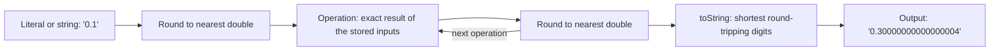

## Introduction

JavaScript has exactly one everyday numeric type, `number`, and it is used for everything: loop counters, prices, pixel offsets, timestamps, array indexes and scientific results. Most of the time it behaves the way school arithmetic does, which makes the exceptions surprising when they appear:

```javascript title="surprises.js"
console.log(0.1 + 0.2);
console.log(9007199254740993);
console.log(4.35 * 100);
```

```output
0.30000000000000004
9007199254740992
434.99999999999994
```

None of these are bugs in JavaScript. All three follow directly from one design decision: a JavaScript number is a **64-bit binary floating-point value** in the format defined by the IEEE 754 standard, the same format as `double` in Java, C and C#, and `float` in Python. Once you understand how that format stores a value, each of these results becomes something you can predict, and the fixes — comparing with a tolerance, storing money in cents, keeping large IDs as strings — stop being superstitions.

This matters in frontend work more often than people expect. A cart where three items at $1.10 total `$3.3000000000000003` (that is what `1.1 * 3` gives), an order ID whose last digits change during `JSON.parse`, a progress bar that never quite reaches 100% because a loop compares a running sum with `=== 1` — these are real bugs that ship. This lesson explains the representation, then teaches its two most important consequences in their own sections: [[b1-floating-point]] and [[b1-safe-integers]].

## Before you start

- **The number primitive** — what `typeof 42` returns and how number differs from bigint. See [[b1-type-number]].
- **Arithmetic operators** — `+`, `*`, `/`, `**` and what division by zero produces. See [[b1-arithmetic-operators]].
- **NaN and Infinity** — the special values exist and are of type number. This lesson shows how they are encoded; [[b1-nan-infinity]] teaches how to detect them.
- **Binary numbers** — knowing that `101` in base 2 means 4 + 1 = 5 is enough. Two's complement is only needed for the short section on 32-bit integers, and [[b1-bitwise-operators]] explains it.

## The intuition

Imagine a calculator whose display holds exactly four significant digits plus an exponent. It can show `1.234 × 10³` (1234) or `1.234 × 10⁻²` (0.01234), so it covers a huge range of sizes — but only four digits of each.

Ask it to store 12,345 and it must choose between `1.234 × 10⁴` (12,340) and `1.235 × 10⁴` (12,350). It cannot store 12,345 at all. Near 1, the numbers it can store are 0.001 apart (1.000, 1.001, 1.002…). Near 10,000 they are 10 apart (10,000, 10,010…). The **spacing between storable numbers grows with the size of the number**, because the number of digits is fixed and the exponent only moves the decimal point.

A JavaScript number is that calculator, with two changes. It works in **binary**, so it stores 53 binary digits (bits) instead of four decimal digits. And its exponent is a power of 2 rather than 10. Everything in this lesson follows from those two facts:

- Because it has 53 bits of precision, integers up to 2⁵³ are all storable, and beyond that some are skipped — just as the four-digit calculator skips 12,345.
- Because it works in binary, fractions like 1/2, 1/4 and 3/8 are exact, but 1/10 is not — just as a decimal calculator can store 1/4 (0.25) exactly but not 1/3 (0.333…).

Keep this picture. The analogy stops working in one place: the real format also has special bit patterns for zero, infinity and "not a number", which a calculator display does not.

## One type for every number

JavaScript does not distinguish integers from fractions. `42` and `42.0` are the same value, and there is no `int` or `float` keyword:

```javascript title="one-type.js"
console.log(typeof 42, typeof 42.5, 42 === 42.0, Number.isInteger(42.0));
console.log(0xff, 0o377, 0b1111_1111, 2.5e3, 1_000_000, .5, 5.);
console.log(7 / 2);
```

```output
number number true true
255 255 255 2500 1000000 0.5 5
3.5
```

The second line shows the **literal** forms — ways of writing a number in source code. `0x` is hexadecimal, `0o` octal, `0b` binary, `e` means "times ten to the power", and since ES2021 underscores may separate digits for readability. All of them produce the same kind of value; the literal form is only notation. `.5` and `5.` are legal but easy to misread, so most style guides ban them.

The third line is where the "one type" decision shows. In Java, `7 / 2` between two `int`s is `3`. In JavaScript there are no integers to divide, so the result is `3.5`. If you want integer division, you say so with `Math.trunc(7 / 2)` or `Math.floor(7 / 2)` (see [[b1-rounding]]).

Why one type? JavaScript was designed in 1995 to be small and forgiving, and Java's `double` was considered good enough for the arithmetic a web page needed. The decision cannot be undone without breaking the web, so later additions — typed arrays in ES2015 and `bigint` in ES2020 — were added *alongside* number rather than replacing it.

## Inside a double: the 64 bits

A **double** (short for double-precision floating-point number, formally IEEE 754 *binary64*) divides 64 bits into three fields:

| Field | Bits | What it stores |
|---|---|---|
| Sign | 1 | `0` for positive, `1` for negative |
| Exponent | 11 | The power of 2, stored with a **bias** of 1023 |
| Fraction (also called the significand or mantissa) | 52 | The binary digits after the leading `1.` |

For an ordinary value, the number represented is:

```text
value = (-1)^sign × 1.fraction (in binary) × 2^(exponent - 1023)
```

Two details make this work. First, the exponent is stored as an unsigned number from 0 to 2047, and 1023 is subtracted to get the real power. Storing `1023` therefore means 2⁰, storing `1024` means 2¹, and storing `1019` means 2⁻⁴. This **bias** lets one unsigned field represent both large and small powers.

Second, the leading `1.` is not stored. Any non-zero binary number can be written so it starts with `1.` — just as any decimal can be written as `d.ddd × 10ⁿ` with a non-zero first digit — so storing that 1 would waste a bit. This **implicit leading bit** is why a double has **53 bits of precision** even though only 52 are stored.

You can look at the bits directly. A `DataView` over an 8-byte buffer writes a number as raw bytes and reads them back as an integer (typed arrays and buffers are covered in [[b1-arraybuffer]]):

```javascript title="bits.js"
function bits(x) {
  const view = new DataView(new ArrayBuffer(8));
  view.setFloat64(0, x);
  const b = view.getBigUint64(0).toString(2).padStart(64, '0');
  return `${b[0]} ${b.slice(1, 12)} ${b.slice(12)}`;
}
for (const x of [1, 2, 0.5, -2, 0.1, 0]) console.log(String(x).padStart(4), bits(x));
```

```output
   1 0 01111111111 0000000000000000000000000000000000000000000000000000
   2 0 10000000000 0000000000000000000000000000000000000000000000000000
 0.5 0 01111111110 0000000000000000000000000000000000000000000000000000
  -2 1 10000000000 0000000000000000000000000000000000000000000000000000
 0.1 0 01111111011 1001100110011001100110011001100110011001100110011010
   0 0 00000000000 0000000000000000000000000000000000000000000000000000
```

Decode each row with the formula:

- **1** — exponent `01111111111` is 1023, so the power is 2⁰. The fraction is all zeros, so the value is `1.0 × 1` = 1.
- **2** — exponent 1024, power 2¹, value `1.0 × 2` = 2. Doubling a number only changed the exponent.
- **0.5** — exponent 1022, power 2⁻¹, value 0.5. Also exact.
- **−2** — identical to 2 except the sign bit.
- **0.1** — exponent 1019, power 2⁻⁴, and a fraction that is a repeating `1001 1001 1001…` pattern, cut off after 52 bits with the last digits rounded up to `1010`. That rounding is the entire story of 0.1 + 0.2, told in [[b1-floating-point]].
- **0** — all zeros. Zero cannot be written as `1.something`, so the format reserves the all-zero exponent for it (and for subnormals, below).

## The number line has gaps

Between two consecutive powers of two, a double has exactly 2⁵² evenly spaced values — one for every possible fraction. Between 1 and 2 those values are 2⁻⁵² apart. Between 2 and 4 the same count of values is spread over twice the distance, so they are 2⁻⁵¹ apart. Every time the exponent goes up by one, the **gap** between neighbouring doubles doubles.

The gap at 1 has a name: `Number.EPSILON`, equal to 2⁻⁵² ≈ 2.22 × 10⁻¹⁶. It is the difference between 1 and the next double above 1.

```javascript title="gaps.js"
console.log(Number.EPSILON, Number.EPSILON === 2 ** -52);
console.log(1 + Number.EPSILON > 1, 1 + Number.EPSILON / 2 > 1);
console.log(2 ** 52 + 0.5, 2 ** 53 + 1, 1e16 + 1, 1e16 + 2);
```

```output
2.220446049250313e-16 true
true false
4503599627370496 9007199254740992 10000000000000000 10000000000000002
```

Adding half an epsilon to 1 does nothing: the exact result 1 + 2⁻⁵³ lies exactly halfway between 1 and the next double, and the rounding rule (described below) picks 1. On the third line, the same thing happens at larger scales. Between 2⁵² and 2⁵³ the gap is exactly 1, so `2 ** 52 + 0.5` cannot be stored and is rounded. Above 2⁵³ the gap is 2, so `2 ** 53 + 1` rounds back to 2⁵³. Near 10¹⁶ the gap is also 2, so adding 1 is lost while adding 2 is kept.

This table summarises the spacing at a few magnitudes:

| Magnitude | Gap between neighbouring doubles | Consequence |
|---|---|---|
| Around 1 | 2⁻⁵² ≈ 2.2 × 10⁻¹⁶ | About 16 decimal digits after the point |
| Around 1,000,000 | 2⁻³³ ≈ 1.2 × 10⁻¹⁰ | Still fine for cents, but a tolerance of `Number.EPSILON` is far too small |
| 2⁵² to 2⁵³ | 1 | Every integer exists, no fractions |
| 2⁵³ to 2⁵⁴ | 2 | Only even integers exist |
| Around 10³⁰⁰ | About 10²⁸⁴ | Huge magnitude, still only ~16 significant digits |

The useful summary: **a double carries about 15 to 17 significant decimal digits wherever it is on the number line.** Any decimal number with at most 15 significant digits survives a trip into a double and back unchanged. Seventeen significant digits are always enough to pin down one specific double. Digits beyond that are not stored anywhere.

### The ends of the range

The exponent field also sets the limits of the range:

```javascript title="range.js"
console.log(Number.MAX_VALUE, Number.MIN_VALUE, 2 ** -1022);
console.log(Number.MAX_VALUE * 2, Number.MIN_VALUE / 2);
```

```output
1.7976931348623157e+308 5e-324 2.2250738585072014e-308
Infinity 0
```

`Number.MAX_VALUE` is the largest finite double. Exceeding it **overflows** to `Infinity`. At the small end, `Number.MIN_VALUE` is *not* the most negative number (that is `-Number.MAX_VALUE`); it is the smallest *positive* number, about 5 × 10⁻³²⁴. Results smaller than that **underflow** to 0.

Between 2.2 × 10⁻³⁰⁸ (2⁻¹⁰²² — the smallest number that still has an implicit leading 1) and `MIN_VALUE` lie the **subnormal** numbers. When the stored exponent is 0, the format drops the implicit leading bit and uses `0.fraction × 2⁻¹⁰²²` instead, which lets values fade gradually towards zero rather than jumping straight from 2⁻¹⁰²² to 0. You will rarely meet subnormals in application code, but they explain why `MIN_VALUE` is so much smaller than the "normal" limit.

### Special values in the bit patterns

The two extreme exponent values are reserved:

| Stored exponent | Fraction | Meaning |
|---|---|---|
| All zeros (0) | Zero | `0` or `-0`, depending on the sign bit |
| All zeros (0) | Non-zero | Subnormal number |
| 1 to 2046 | Anything | Ordinary ("normal") number |
| All ones (2047) | Zero | `Infinity` or `-Infinity` |
| All ones (2047) | Non-zero | `NaN` |

Two consequences are worth noticing. Because zero has a sign bit, **negative zero exists** — `-0` is a distinct bit pattern that `===` treats as equal to `0`. And because many fraction patterns mean NaN, the format has many NaNs; JavaScript hides that and exposes a single observable `NaN` value. How to detect each of these values is the subject of [[b1-nan-infinity]] and [[b1-object-is]].

## How numbers are printed

If 0.1 is stored as a value slightly larger than 0.1, why does `console.log(0.1)` print `0.1`?

Because converting a number to a string does not print the stored value exactly. The ECMAScript specification's `Number::toString` algorithm chooses the **shortest decimal string that converts back to the same double**. The stored value for 0.1 is 0.1000000000000000055511151231257827…, but no other double is closer to 0.1, so `"0.1"` is enough to identify it and that is what you see. You can ask for more digits explicitly:

```javascript title="printing.js"
console.log(0.1, (0.1).toPrecision(20), (0.1).toPrecision(17));
console.log(0.1 + 0.2, (0.1 + 0.2).toPrecision(17), (0.3).toPrecision(17));
console.log(123456789012345680000, 1e21, 0.000001, 0.0000001);
```

```output
0.1 0.10000000000000000555 0.10000000000000001
0.30000000000000004 0.30000000000000004 0.29999999999999999
123456789012345680000 1e+21 0.000001 1e-7
```

The second line is the key to [[b1-floating-point]]. The double nearest to 0.3 and the result of `0.1 + 0.2` are *different doubles*, so the shortest string for the sum has to show more digits to distinguish it from 0.3.

The third line shows when exponent notation is used: `toString` switches to `e` notation for values of 10²¹ and above, and for values below 10⁻⁶. The first number on that line also shows that a long integer literal is printed with trailing zeros once it passes the safe range — those zeros are not "real" digits.

Printing is therefore a *display decision* and can hide or reveal error. Never conclude from `console.log` output that a value is exact. Methods for controlling display — `toFixed`, `toPrecision`, `Intl.NumberFormat` — are taught in [[b1-number-methods]].

## Floating-Point and 0.1 + 0.2 {#b1-floating-point}

**Floating-point error** is the small difference between the number you wrote and the number a double actually stores, plus the extra rounding each arithmetic operation adds. The classic demonstration is that in JavaScript (and in every language that uses IEEE 754 doubles) `0.1 + 0.2` is `0.30000000000000004`, not `0.3`. The error is tiny, but it breaks `===` comparisons, accumulates in loops and leaks into displayed prices.

### Why 0.1 cannot be stored exactly

A decimal fraction is exact in binary only if its denominator, in lowest terms, is a power of two. ½, ¼, ⅜ and 0.75 qualify. 1/10 does not, because 10 = 2 × 5 and the factor 5 can never be produced by halving.

You can see the repeating pattern by converting 0.1 to binary by hand: repeatedly multiply by 2 and take the integer part as the next bit.

| Step | Value × 2 | Bit | Carry forward |
|---|---|---|---|
| 1 | 0.2 | 0 | 0.2 |
| 2 | 0.4 | 0 | 0.4 |
| 3 | 0.8 | 0 | 0.8 |
| 4 | 1.6 | 1 | 0.6 |
| 5 | 1.2 | 1 | 0.2 |
| 6 | 0.4 | 0 | 0.4 |
| 7 | 0.8 | 0 | 0.8 |
| 8 | 1.6 | 1 | 0.6 |

Step 5 brought us back to 0.2, the state after step 1, so the digits repeat forever: 0.1 in binary is `0.0001100110011…`. A double keeps 53 significant bits and rounds the rest, exactly as 1/3 becomes `0.33333333` on a calculator. The stored value is the **nearest double**, which happens to be slightly *above* 0.1. The same is true for 0.2, while the double nearest to 0.3 is slightly *below* 0.3.

### What happens in the addition

IEEE 754 defines every basic operation the same way: **compute the exact mathematical result of the two stored inputs, then round it to the nearest double.** So `0.1 + 0.2` is:

1. Take the stored 0.1 (≈ 0.1000000000000000055) and the stored 0.2 (≈ 0.2000000000000000111).
2. Add them exactly: ≈ 0.3000000000000000166.
3. Round to the nearest double. The candidates on either side are ≈ 0.2999999999999999889 (the double used for `0.3`) and ≈ 0.3000000000000000444. The exact sum is closer to the second one.

The result is a different double from the one the literal `0.3` produces, so `0.1 + 0.2 === 0.3` is `false`, and printing the result needs 17 digits to tell it apart from 0.3.

```javascript title="float-effects.js"
let total = 0;
for (let i = 0; i < 10; i++) total += 0.1;
console.log(total, total === 1);
console.log((0.1 + 0.2) + 0.3, 0.1 + (0.2 + 0.3));
console.log(0.1 * 3, 1.1 * 1.1, 4.35 * 100);
console.log(0.5 + 0.25 === 0.75, 0.125 + 0.375);
console.log(new Set([0.1 + 0.2, 0.3]).size, [0.3].includes(0.1 + 0.2));
```

```output
0.9999999999999999 false
0.6000000000000001 0.6
0.30000000000000004 1.2100000000000002 434.99999999999994
true 0.5
2 false
```

The first line shows **accumulation**: ten small rounding errors add up to a sum that is not 1. A loop that runs `while (progress !== 1)` with steps of 0.1 never stops.

The second line shows that floating-point addition is **not associative** — the order of operations changes the result, because each intermediate sum is rounded. This is why summing the same array in a different order (for example in parallel chunks) can give slightly different totals.

The third line shows that multiplication is affected in the same way. `4.35 * 100` is just below 435, so code that converts dollars to cents with `Math.floor(price * 100)` would charge 434 cents. Converting with `Math.round` is safer, and parsing the string `"4.35"` into cents directly is safest.

The fourth line is the reassuring one: values built from halves, quarters and eighths are exact, so their sums are exact too. Floating point is not "random"; it is exact whenever the inputs and results are representable.

The last line shows that the error affects data structures too. A `Set` or `Map` compares keys with the SameValueZero algorithm, which, like `===`, treats the two doubles as different. A computed price used as a `Map` key will not find the entry stored under the literal.

### Comparing with a tolerance

When you compare computed fractions, ask "are these close enough?" rather than "are these identical?". A common first attempt is `Math.abs(a - b) < Number.EPSILON`. It works for `0.1 + 0.2` but is wrong in general, because `Number.EPSILON` is the gap *at 1*. Around 1,000,000 the gap between neighbouring doubles is already about 10⁻¹⁰, a million times larger than epsilon, so two values that differ by a single rounding step look "unequal".

A robust comparison scales the tolerance with the size of the numbers (a **relative tolerance**) and keeps a small **absolute tolerance** for values near zero, where relative comparisons break down:

```javascript title="nearly-equal.js"
function nearlyEqual(a, b, relTol = 1e-9, absTol = 1e-12) {
  const scale = Math.max(Math.abs(a), Math.abs(b));
  return Math.abs(a - b) <= Math.max(relTol * scale, absTol);
}
const big = 1e6 + 0.1 + 0.2;
console.log(nearlyEqual(0.1 + 0.2, 0.3));
console.log(Math.abs(big - (1e6 + 0.3)) < Number.EPSILON);
console.log(nearlyEqual(big, 1e6 + 0.3));
```

```output
true
false
true
```

The tolerances are a decision about your data, not universal constants. For geometry in pixels, anything below 0.001 may be "equal". For physics simulations you would choose based on the accuracy you need. This is the same approach Python's `math.isclose` uses.

### Money: do not use fractional doubles

Tolerances are fine for measurements but wrong for money. An invoice must be exactly right, and rounding rules for money are set by law and accounting policy, not by binary arithmetic. The standard fix is to store amounts as **integers in the smallest currency unit** (cents for dollars, pence for pounds). Integer arithmetic on doubles is exact as long as values stay within the safe range, so adding and comparing cents never drifts:

```javascript title="cart-in-cents.js"
const pricesCents = [1999, 1999, 1999];               // $19.99 three times
const totalCents = pricesCents.reduce((sum, c) => sum + c, 0);
const taxCents = Math.round(totalCents * 0.0825);     // rounded once, by policy
const fmt = new Intl.NumberFormat('en-US', { style: 'currency', currency: 'USD' });
console.log(totalCents, taxCents);
console.log(fmt.format(totalCents / 100), fmt.format((totalCents + taxCents) / 100));
```

```output
5997 495
$59.97 $64.92
```

The only fractional step is the tax calculation, and it is followed immediately by one deliberate rounding to whole cents. Division by 100 happens only at the very end, for display. This is how payment APIs work: Stripe, for example, takes `amount: 1999` to mean $19.99. When you need decimal arithmetic beyond that — currency conversion, interest — use a decimal library or do the work on the server in a decimal type such as PostgreSQL's `numeric`.

A related trap: `toFixed(2)` *looks* like a fix, because `(0.1 + 0.2).toFixed(2)` prints `"0.30"`. But `toFixed` returns a **string** for display; it does not change the double. Converting that string back with `Number()` gives the double nearest to 0.3, which is fine for showing a value but is not a decimal-arithmetic policy. Rounding after every addition hides errors without defining which rounding rule your business needs. Rounding methods and their pitfalls are covered in [[b1-rounding]].

> [!NOTE] It is not a JavaScript quirk
> Java's `0.1 + 0.2`, Python's `0.1 + 0.2` and C's `0.1 + 0.2` all produce 0.30000000000000004. The behaviour comes from IEEE 754 and binary hardware. What is specific to JavaScript is only that there is no separate integer or decimal type to fall back on, so you must choose a representation deliberately.

## Safe Integers {#b1-safe-integers}

A **safe integer** is an integer that a double can represent exactly *and* whose neighbours are also representable, so it cannot be confused with any other integer. In JavaScript the safe integers are exactly those from −(2⁵³ − 1) to 2⁵³ − 1, that is, ±9,007,199,254,740,991. Inside that range, integer arithmetic on numbers is exact. Outside it, two different integers can become the same number without any error.

### Where the limit comes from

A double has 53 bits of precision. Every integer up to 2⁵³ fits in 53 bits, so each one has its own exact double. Above 2⁵³, the gap between neighbouring doubles is 2 (see the table in "The number line has gaps"), so only even integers exist. 2⁵³ itself is representable, but 2⁵³ + 1 is not, and it rounds to 2⁵³. That is why the limit is 2⁵³ − 1 rather than 2⁵³: 2⁵³ is exact but no longer *safe*, because the different integer 2⁵³ + 1 maps to the same value. JavaScript exposes the limits as constants:

```javascript title="safe-limits.js"
const max = Number.MAX_SAFE_INTEGER;
console.log(max, Number.MIN_SAFE_INTEGER, max === 2 ** 53 - 1);
console.log(max + 1, max + 2, max + 3, max + 4);
console.log(max + 1 === max + 2);
let n = 2 ** 53 - 2;
for (let i = 0; i < 4; i++) { console.log(n); n++; }
```

```output
9007199254740991 -9007199254740991 true
9007199254740992 9007199254740992 9007199254740994 9007199254740996
true
9007199254740990
9007199254740991
9007199254740992
9007199254740992
```

The loop is the scariest part. `n++` stops working at 2⁵³: adding 1 produces a value that rounds straight back to `n`. A counter that passed this point would stall silently, and no exception is ever thrown.

### `isSafeInteger` versus `isInteger`

`Number.isInteger(x)` asks only "does this double have no fractional part?". Every double above 2⁵² is a whole number, so `Number.isInteger(3e20)` is `true` even though 3 × 10²⁰ is far outside the safe range. `Number.isSafeInteger(x)` asks the question you usually mean: is `x` an integer *and* is its magnitude at most `MAX_SAFE_INTEGER`?

```javascript title="safe-checks.js"
console.log(Number.isInteger(3e20), Number.isSafeInteger(3e20));
console.log(Number.isSafeInteger(2 ** 53 - 1), Number.isSafeInteger(2 ** 53));
console.log(Number.isSafeInteger('5'), Number.isSafeInteger(5.0));
```

```output
true false
true false
false true
```

Neither function converts its argument, so the string `'5'` is not a safe integer. `5.0` is, because it is the same value as `5`.

There is a limit to what the check can tell you: it inspects a value that already exists. If precision was lost earlier, the check can flag the problem but cannot recover the lost digits. Worse, an unsafe *intermediate* can produce a safe-looking final answer: `(2 ** 53 + 1) - 10` evaluates to `9007199254740982`, which passes `Number.isSafeInteger`, but the correct answer is `9007199254740983`. Check inputs before you compute, not only results.

### The real-world trap: IDs in JSON

Many systems generate 64-bit integer IDs: database `BIGINT` primary keys, Twitter and Discord "snowflake" IDs, and distributed ID generators. A 64-bit ID can be as large as about 9.2 × 10¹⁸, a thousand times past the safe limit. JSON itself places no limit on number size, but `JSON.parse` converts every numeric literal to a double:

```javascript title="json-ids.js"
const body = '{"id": 1428734527302565889, "id_str": "1428734527302565889"}';
const data = JSON.parse(body);
console.log(data.id);
console.log(data.id_str);
console.log(Number.isSafeInteger(data.id), String(data.id) === data.id_str);
```

```output
1428734527302566000
1428734527302565889
false false
```

The numeric `id` was rounded to the nearest double *during parsing*, before any of your code ran. If the frontend then sends that ID back to fetch or delete a record, it asks for the wrong record. This is why Twitter's API added an `id_str` field alongside `id`, and why Discord sends all IDs as strings. The fix belongs at the API boundary: **send large integers as strings**, and convert them to [[b1-bigint|bigint]] only if you need to do arithmetic on them.

When you cannot change the server, newer engines let a `JSON.parse` reviver see the original source text of each value through a third `context` argument (part of the "JSON.parse source text access" feature). The snippet below was run in Node.js 22; not every browser supports it yet, so check compatibility before relying on it in frontend code.

```javascript title="json-source.js"
const body = '{"id": 1428734527302565889, "count": 3, "price": 9.5}';
const data = JSON.parse(body, (key, value, context) => {
  if (Number.isInteger(value) && !Number.isSafeInteger(value)) {
    return BigInt(context.source);   // the digits as written, not the rounded double
  }
  return value;
});
console.log(data);
```

```output
{ id: 1428734527302565889n, count: 3, price: 9.5 }
```

Revivers in general are taught in [[b1-json-replacer-reviver]].

### Other limits that look similar

The safe-integer range is not the only integer limit in JavaScript, and mixing them up causes bugs:

- **Array lengths and indexes** are limited to 2³² − 1. `new Array(2 ** 32)` throws `RangeError: Invalid array length`, even though 2³² is a perfectly safe integer.
- **Bitwise operators** convert their operands to 32-bit integers, so `3_000_000_000 | 0` is `-1294967296`. See the next section.
- **Timestamps** are safe. `Date` values are milliseconds since 1970 and are limited by the specification to ±8.64 × 10¹⁵, below 2⁵³ ≈ 9.007 × 10¹⁵. `Date.now()` will not run out of precision.

The rule of thumb: numbers are safe for counts, indexes, timestamps and amounts in cents. For identifiers produced by another system, assume they might be 64-bit and keep them as strings.

## 32-bit integers inside the double world

Although the language has one number type, some operations work on 32-bit integers internally. The **bitwise operators** (`|`, `&`, `^`, `~`, `<<`, `>>`, `>>>`) first convert each operand with the specification's ToInt32 operation: drop the fraction, then keep only the low 32 bits as a two's-complement signed integer (`>>>` uses ToUint32 instead). The result is converted back to a double.

```javascript title="int32.js"
console.log(4.7 | 0, -4.7 | 0, 2 ** 31 | 0, 3_000_000_000 | 0);
console.log(-1 >>> 0, (2 ** 32 + 5) | 0);
```

```output
4 -4 -2147483648 -1294967296
4294967295 5
```

For small values, `x | 0` behaves like `Math.trunc(x)`, which is why older code uses it as a "fast truncate". Outside ±2³¹ it wraps around and produces nonsense, so modern code should use `Math.trunc`. The details of each operator are in [[b1-bitwise-operators]].

**Typed arrays** provide fixed-width numeric storage when you need it: `Int32Array`, `Uint8Array`, `Float32Array` and others store raw binary values in an `ArrayBuffer`. Reading an element converts it back to an ordinary number. They matter for WebGL, audio, image data and binary file formats, where memory layout is fixed by someone else:

```javascript title="typed.js"
const f32 = new Float32Array([0.1]);
console.log(f32[0], Math.fround(0.1), Math.fround(0.1) === 0.1);
console.log(new Int32Array([2 ** 31])[0]);
```

```output
0.10000000149011612 0.10000000149011612 false
-2147483648
```

A `Float32Array` stores **single-precision** floats with only 24 bits of precision, so 0.1 is rounded more coarsely and reads back as 0.10000000149011612. `Math.fround` performs the same rounding without an array. Storing `2 ** 31` in an `Int32Array` wraps it to the most negative 32-bit value.

## How it works internally

Every numeric expression goes through the same pipeline: the source text or input string is converted to the nearest double, each operation computes an exact result and rounds it to the nearest double, and printing chooses the shortest string that identifies the final double.



The rounding rule throughout is **round to nearest, ties to even**: pick the closest representable double, and if the exact value is exactly halfway between two, pick the one whose last fraction bit is 0. That is why `2 ** 52 + 0.5` became `2 ** 52` earlier rather than rounding up. Ties-to-even avoids the systematic upward drift that "always round half up" would cause over millions of operations.

Error enters in only two places: when a value is first converted to a double, and when an operation's exact result is not representable. If both inputs and the result are representable — small integers, halves, quarters — no error occurs at all. This is why integer arithmetic within the safe range is completely reliable.

Engines add one more layer that you cannot observe but may read about. V8, the engine in Chrome and Node.js, stores small integers specially as **Smis** ("small integers": 31-bit signed values in Chrome's pointer-compressed builds) directly inside the value slot, and stores other numbers as heap-allocated doubles. This is an optimisation only. The language semantics are always those of IEEE 754 doubles, and a Smi that overflows becomes a double transparently. Engine internals are covered in [[b1-js-engine]].

## Worked example: an ID-safe API client

Here is a complete, realistic case. An orders API returns JSON in which `orderId` is a 64-bit database key, sometimes as a number (old endpoints) and sometimes as a string (new endpoints). The frontend must display totals and send IDs back unchanged. The program normalises both forms, detects precision loss, and keeps money in cents.

```javascript title="orders.js"
const responses = [
  '{"orderId": "1428734527302565889", "totalCents": 5997}',
  '{"orderId": 1428734527302565889, "totalCents": 1250}',
  '{"orderId": 4211, "totalCents": 100}',
];

function parseOrder(json) {
  const raw = JSON.parse(json);
  let orderId;
  if (typeof raw.orderId === 'string') {
    orderId = raw.orderId;                       // best case: exact digits
  } else if (Number.isSafeInteger(raw.orderId)) {
    orderId = String(raw.orderId);               // small enough to be exact
  } else {
    throw new Error(`orderId lost precision while parsing: ${raw.orderId}`);
  }
  if (!Number.isSafeInteger(raw.totalCents)) {
    throw new Error(`totalCents is not a safe integer: ${raw.totalCents}`);
  }
  return { orderId, totalCents: raw.totalCents };
}

const fmt = new Intl.NumberFormat('en-US', { style: 'currency', currency: 'USD' });
for (const json of responses) {
  try {
    const order = parseOrder(json);
    console.log(order.orderId, fmt.format(order.totalCents / 100));
  } catch (e) {
    console.log('Rejected:', e.message);
  }
}
```

```output
1428734527302565889 $59.97
Rejected: orderId lost precision while parsing: 1428734527302566000
4211 $1.00
```

Walk through the three cases. The first response sends the ID as a string, so the exact digits survive and the client keeps them as a string — it never needs to add or multiply an ID. The second sends a 64-bit number; by the time `parseOrder` sees it, `JSON.parse` has already rounded it, and `Number.isSafeInteger` detects that the value is outside the range where it could be trusted. Rejecting loudly is better than sending the wrong ID back to the server. The third ID is small, so a number is fine and is normalised to a string for consistency. Money is checked to be a safe integer of cents and only divided by 100 at the moment it is formatted.

Two edge cases to notice. The `isSafeInteger` test on the parsed ID is reliable here because parsing only rounds integers above 2⁵³, and every value it can round to also fails the check; what the client cannot do is *recover* the ID, which is why the real fix is for the API to send strings. And a `totalCents` of `59.97` (a dollar amount sent by mistake) is caught by the same `isSafeInteger` check, because it has a fraction.

## In real systems

- **APIs send 64-bit IDs as strings.** Twitter's `id_str`, Discord's string snowflakes and Google APIs that encode `int64` fields as JSON strings all exist because of the safe-integer limit. Protocol Buffers' standard JSON mapping also writes 64-bit integers as strings.
- **Money travels as integer minor units.** Payment providers such as Stripe accept and return amounts like `1999` for $19.99. Display formatting with `Intl.NumberFormat` happens only in the UI.
- **Timers and timestamps use doubles comfortably.** `Date.now()` returns integer milliseconds well inside the safe range; `performance.now()` returns fractional milliseconds, which is fine because nobody compares them with `===`.
- **Graphics uses single precision on purpose.** WebGL vertex data lives in `Float32Array`s because GPUs work in 32-bit floats and half the memory matters for large meshes. The precision loss shown above is accepted.
- **Layout uses fractional pixels.** `getBoundingClientRect()` and similar DOM APIs return fractional pixel values as doubles (the CSSOM specification defines them as `double`); code that tests positions with `===` is fragile for the same reason as `0.1 + 0.2`. This is described from the specification rather than run here.
- **Databases differ from JavaScript.** PostgreSQL's `bigint` is a true 64-bit integer and `numeric` is exact decimal. Node.js database drivers (for example `pg`) return `bigint` and `numeric` columns as strings by default rather than silently rounding them.

## Trade-offs and alternatives

| Representation | Exact for | Range | Speed | Use it for |
|---|---|---|---|---|
| `number` (double) | Integers up to 2⁵³ − 1, binary fractions | ±1.8 × 10³⁰⁸ | Fastest; hardware-native | Almost everything: counts, indexes, measurements, cents |
| `bigint` | All integers | Limited only by memory | Slower; allocates for large values | 64-bit IDs that need arithmetic, exact large counters |
| String | Whatever digits you store | Unlimited | No arithmetic | IDs you only display and send back |
| Integer cents in `number` | Money up to ~90 trillion dollars | 2⁵³ − 1 minor units | Fast | Prices, totals, carts |
| Decimal library | Decimal fractions to chosen precision | Library-defined | Much slower | Currency conversion, interest, tax engines |
| `Float32Array` | Fewer values than double | ±3.4 × 10³⁸ | Half the memory | GPU data, audio, large numeric buffers |

The double's strengths are speed, a vast range and simplicity — one type, one set of rules. Its cost is that you must know where exactness ends. For the majority of frontend code the answer is "never cross the safe range, never compare computed fractions with `===`, keep money in integers", and with those three habits number is the right choice. Reach for alternatives only at the boundaries: bigint for big integers ([[b1-bigint]]), strings for foreign IDs, decimal libraries or the server for financial calculations.

## Common mistakes

**Comparing computed fractions with `===`.** `if (total === 0.3)` fails when `total` came from `0.1 + 0.2`. Compare with a tolerance appropriate to the data, or restructure the data as integers.

**Using `Number.EPSILON` as a universal tolerance.** It is the gap at 1 and is too small for numbers above about 2, and meaningless near zero. Scale the tolerance to the operands as in `nearlyEqual`.

**Storing money as fractional dollars.** `19.99 + 0.01` sums are usually close but not always exact, and errors leak into displayed totals. Store cents; round once, by policy, at well-defined steps.

**Treating `toFixed` as rounding arithmetic.** It formats a string. Using `Number(x.toFixed(2))` after every operation hides symptoms without fixing representation. Format only at display time.

**Parsing 64-bit IDs as numbers.** `JSON.parse` rounds them before your code sees them. Ask for string IDs, and never call `parseInt` or `Number` on an ID string "to clean it up".

**Using `Number.isInteger` to validate an ID or count.** `Number.isInteger(1e20)` is `true`. Use `Number.isSafeInteger`.

**Truncating with `| 0` or `~~`.** These go through 32-bit conversion and wrap for values beyond ±2³¹. Use `Math.trunc`.

**Believing `Number.MIN_VALUE` is the most negative number.** It is the smallest positive one. The most negative finite number is `-Number.MAX_VALUE`; the most negative safe integer is `Number.MIN_SAFE_INTEGER`.

## Interview perspective

Number representation questions test whether you understand *why*, not whether you memorised outputs.

> [!INTERVIEW] "Why does 0.1 + 0.2 !== 0.3 in JavaScript?"
> "JavaScript numbers are IEEE 754 doubles, which store a binary fraction with 53 significant bits. 0.1 and 0.2 are repeating fractions in binary, like 1/3 in decimal, so each is stored as the nearest double. Their exact sum is then rounded again, and it lands on the double just above the one nearest 0.3. So they're different values. It's the same in Java or Python. For comparisons I'd use a tolerance scaled to the magnitudes, and for money I'd store integer cents so the arithmetic is exact."

> [!INTERVIEW] "What is Number.MAX_SAFE_INTEGER and when have you had to care?"
> "It's 2⁵³ − 1. Doubles have 53 bits of precision, so above 2⁵³ the gap between representable numbers is 2 and some integers can't be represented — 2⁵³ + 1 rounds to 2⁵³. In practice it bites with 64-bit IDs from databases or snowflake generators: `JSON.parse` rounds them, so the API should send them as strings, and I'd use bigint only if I need arithmetic."

Other questions to prepare:

- **How is a double laid out?** 1 sign bit, 11 exponent bits with bias 1023, 52 fraction bits plus an implicit leading 1. Follow-up: why 53 bits of precision from 52 stored? The implicit bit.
- **Why does `console.log(0.1)` print `0.1` if it is not exact?** `toString` prints the shortest string that round-trips to the same double.
- **Is floating-point addition associative?** No: `(0.1 + 0.2) + 0.3` is `0.6000000000000001` and `0.1 + (0.2 + 0.3)` is `0.6`.
- **What is `Number.EPSILON`, and is it a good tolerance?** 2⁻⁵², the gap at 1; only appropriate for values near 1.
- **What does `3_000_000_000 | 0` give and why?** `-1294967296`, because bitwise operators work on 32-bit signed integers.
- **How would you sum money in a cart?** Integer cents, one deliberate rounding step for tax, format with `Intl.NumberFormat` at the end.

## Practice

1. **Decode by hand.** Using the formula `(-1)^s × 1.f × 2^(e - 1023)`, work out the bit pattern for `-0.75` and `8`, then check with the `bits` function.
2. **Find the first gap.** Write a loop that starts at `1` and doubles `x` until `x + 1 === x`. Print `x` and explain the result in terms of 53 bits.
3. **Progress bar.** A loader increments `progress += 0.1` and stops when `progress === 1`. Explain why it never stops, then rewrite it with an integer step counter.
4. **Tolerance design.** Write `nearlyEqual` tests for values around `1e-10`, `1`, `1e6` and `1e15`. Find inputs where `Math.abs(a - b) < Number.EPSILON` gives the wrong answer.
5. **Invoice.** Given line items with prices in dollars as strings (`"19.99"`), convert each to integer cents *without* going through a fractional double (hint: split on the dot), total them, apply 8.25% tax rounded to the nearest cent, and format the result.
6. **ID audit.** Write `findUnsafeNumbers(jsonText)` that uses a reviver with `context.source` (Node.js 22) to list every key whose source digits differ from `String(value)`.

```quiz
Q: Why does a JavaScript number have 53 bits of precision when only 52 fraction bits are stored?
- [ ] One bit of the exponent is borrowed for precision
- [x] Normal numbers always start with a leading 1 in binary, so that bit is implied rather than stored
- [ ] The sign bit is reused as an extra digit for positive numbers
- [ ] Engines store integers in a separate 53-bit format
> Any non-zero binary number can be normalised to the form 1.xxxx × 2^e, so the leading 1 carries no information and is not stored. That gives 52 stored + 1 implicit = 53 bits. The exponent and sign are separate fields, and engine optimisations such as Smis do not change the semantics.

Q: What does `9007199254740993 === 9007199254740992` evaluate to, and why?
- [ ] `false`, because they are different integers
- [x] `true`, because the literal 9007199254740993 rounds to the nearest double, which is 9007199254740992
- [ ] It throws a RangeError for exceeding MAX_SAFE_INTEGER
- [ ] `true`, because `===` ignores the last digit of large numbers
> Above 2^53 the gap between doubles is 2, so 2^53 + 1 cannot be represented and rounds (ties to even) to 2^53 while the source is parsed. JavaScript never throws on precision loss, and `===` compares the stored values exactly — they just happen to be identical.

Q: Which comparison correctly checks that two computed lengths around 1,000,000 pixels are equal within rounding error?
- [ ] `a === b`
- [ ] `Math.abs(a - b) < Number.EPSILON`
- [x] `Math.abs(a - b) <= 1e-9 * Math.max(Math.abs(a), Math.abs(b))`
- [ ] `a.toFixed(2) == b`
> Number.EPSILON is the gap between doubles at 1; near 1,000,000 the gap is about 1e-10, so a single rounding step already exceeds EPSILON. A relative tolerance scales with the operands. `===` fails on any rounding difference, and comparing a string to a number coerces and mixes display with arithmetic.
```

```quiz
Q: An API returns `{"id": 1428734527302565889}`. What is the best fix?
- [ ] Call `Number.isSafeInteger(data.id)` and round the value if it fails
- [ ] Use `BigInt(data.id)` after `JSON.parse`
- [x] Have the API send the ID as a string, and convert to bigint only if arithmetic is needed
- [ ] Use `parseInt(data.id, 10)` to recover the exact digits
> JSON.parse rounds the number to the nearest double before your code runs, so every later conversion — BigInt, parseInt, rounding — starts from the wrong value. Only the original text holds the exact digits, which is why IDs should travel as strings (or be read through a reviver's context.source where supported).

Q: Why does `0.5 + 0.25 === 0.75` evaluate to `true` while `0.1 + 0.2 === 0.3` is `false`?
- [ ] Engines special-case common fractions
- [x] 0.5, 0.25 and 0.75 have power-of-two denominators, so they and their sum are exact doubles
- [ ] The first expression is evaluated with integer arithmetic
- [ ] Smaller numbers have more precision than larger ones
> A fraction is exact in binary only if its denominator is a power of two. 1/2, 1/4 and 3/4 are; 1/10 and 3/10 are not. When inputs and result are all representable, IEEE 754 arithmetic introduces no error at all.
```

## Quick revision {#quick-revision}

- Every `number` is an IEEE 754 binary64 double: 1 sign bit, 11 exponent bits (bias 1023), 52 fraction bits + implicit leading 1 = 53 bits of precision.
- Value = (−1)ˢ × 1.f × 2^(e − 1023). Exponent 0 → zero/subnormals; exponent 2047 → `Infinity`/`NaN`. `-0` exists.
- No integer type: `7 / 2` is `3.5`; `42 === 42.0`. Literals: `0x`, `0o`, `0b`, `e`, `_` separators (ES2021).
- Gaps double with each power of two. `Number.EPSILON` = 2⁻⁵² (gap at 1). Gap is 1 between 2⁵² and 2⁵³, 2 above 2⁵³.
- ~15–17 significant decimal digits: 15 always round-trip, 17 always identify a double.
- `Number.MAX_VALUE` ≈ 1.8e308 (overflow → `Infinity`); `Number.MIN_VALUE` ≈ 5e-324 is the smallest *positive* value.
- Each operation: exact result of the stored inputs, rounded to nearest, ties to even. Error enters only at conversion and at unrepresentable results.
- `toString` prints the shortest string that round-trips; use `toPrecision(17)` to see more. Exponent notation for ≥ 1e21 and < 1e-6.
- 0.1 is `0.000110011…` in binary → stored slightly high; `0.1 + 0.2` → `0.30000000000000004`. Not associative; errors accumulate.
- Compare fractions with a relative + absolute tolerance, not `===` and not bare `Number.EPSILON`.
- Money: integer cents, one deliberate rounding per policy step, `Intl.NumberFormat` for display. `toFixed` returns a string.
- Safe integers: ±(2⁵³ − 1) = ±9,007,199,254,740,991. `n++` stalls at 2⁵³. Use `Number.isSafeInteger`, not `isInteger`.
- `JSON.parse` rounds 64-bit IDs before your code sees them → send IDs as strings; reviver `context.source` in newer engines (Node.js 22).
- Other limits: array length ≤ 2³² − 1; bitwise ops use 32-bit ToInt32; `Date` ±8.64e15 ms is safe.
- Typed arrays give fixed widths (`Float32Array` → 24-bit precision, `Math.fround`). V8 Smis are an invisible optimisation.

## Key takeaways {#key-takeaways}

- A JavaScript number is a 64-bit binary double: about 16 significant digits at any magnitude, with gaps between representable values that grow as numbers get larger.
- Fractions are exact only when their denominator is a power of two, so decimal values like 0.1 are stored approximately and arithmetic on them can be off in the last digit.
- Never compare computed fractions with `===`; use a tolerance scaled to the operands, and keep money in integer cents.
- Integers are exact only within ±(2⁵³ − 1); beyond that, distinct integers collapse into one value without any error.
- Large IDs must cross JSON as strings, because `JSON.parse` rounds numbers before your code can check them.
- `console.log` shows the shortest round-tripping string, not the stored value — printing can hide error.
- Bitwise operators and typed arrays work with fixed-width integers and floats; reach for `bigint` when integers outgrow 53 bits.
