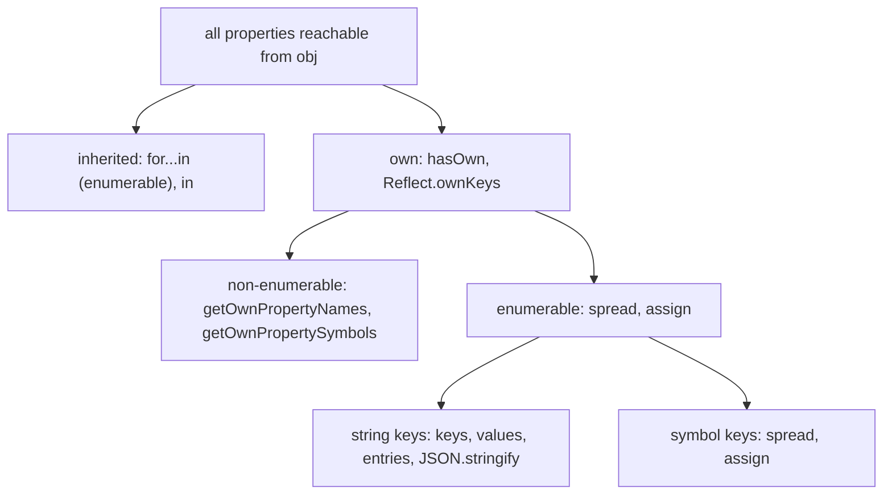

## Introduction

Objects in JavaScript double as two different things. Sometimes an object is a **record** with a fixed set of fields that your code names directly: `user.name`, `order.total`. Just as often it is **data you need to process as a whole**: count its fields, turn it into a list for rendering, convert every price to another currency, merge user options over defaults, make sure nothing modifies it, or check whether a key from a request really belongs to it.

None of those jobs can be done with dot or bracket access alone. You need functions that look at an object's *property table* from the outside. JavaScript provides them as **static methods on the `Object` constructor** — `Object.keys(obj)`, `Object.freeze(obj)`, `Object.hasOwn(obj, key)` and so on.

Why static functions rather than methods you call on the object, like `obj.keys()`? Because a method on the object could be **shadowed or missing**. If every object had a `keys` method inherited from `Object.prototype`, an object with its own `keys` property (`{ keys: ['a', 'b'] }` — perfectly normal data) would hide it, and an object created with no prototype at all would not have it. A static function takes the object as an argument and works on *any* object, regardless of what the object itself contains. You will see that design reason come up again and again in this lesson, most clearly in why `Object.hasOwn` replaced `obj.hasOwnProperty`.

The lesson covers the methods engineers use every day, grouped by job:

- **Listing and transforming** — [[b1-object-keys-values|`keys`, `values`, `entries` and `fromEntries`]].
- **Copying and creating** — [[b1-object-assign-create|`Object.assign` and `Object.create`]].
- **Locking** — [[b1-object-freeze-seal|`freeze`, `seal` and `preventExtensions`]].
- **Asking about ownership** — [[b1-object-hasown|`Object.hasOwn`]].

The remaining reflective methods — `getOwnPropertyDescriptor`, `defineProperty`, `getPrototypeOf` and friends — appear where they help explain these four, and are taught fully in [[b1-property-descriptors]] and [[b1-prototype-chain]].

## Before you start

- **Objects as values** — references, identity, string and symbol keys. See [[b1-objects-as-values]].
- **Object literals** — spread, computed keys and the `__proto__` key. See [[b1-object-literals]].
- **Own vs inherited properties** — the idea that an object can read properties from its prototype that it does not itself own. See [[b1-own-vs-inherited]]; this lesson recaps what it needs.
- **Array methods** — `map`, `filter` and `reduce`, used with `entries`. See [[b1-array-map-filter-reduce]].

## The intuition: two facts about every property

Every Object API in this lesson answers a question about properties, and almost every surprise comes from forgetting that properties differ along two independent dimensions.

The first is **ownership**. A property is either **own** — stored on the object itself — or **inherited** — found by walking up the prototype chain. `{ name: 'Ada' }` owns `name` but inherits `toString` from `Object.prototype`.

The second is **enumerability**. Each own property has a hidden `enumerable` flag. Properties you create normally (with a literal or by assignment) are enumerable; built-in methods such as `Array.prototype.map`, class methods, and properties created with `Object.defineProperty` without saying otherwise are **non-enumerable**. Enumerable means "show up when someone lists my properties".

On top of that, a key is either a **string** or a **symbol**.

So when you ask "what are this object's keys?", the honest answer is "which ones?". The methods differ precisely in which of these groups they include:

| Method | Own | Inherited | Non-enumerable | Symbol keys |
|---|---|---|---|---|
| `Object.keys` / `values` / `entries` | Yes | No | No | No |
| `for...in` | Yes | Yes (enumerable ones) | No | No |
| `Object.getOwnPropertyNames` | Yes | No | Yes | No |
| `Object.getOwnPropertySymbols` | Yes | No | Yes | Only symbols |
| `Reflect.ownKeys` | Yes | No | Yes | Yes |
| `JSON.stringify`, object spread | Yes | No | No | Spread yes, JSON no |
| `Object.assign` | Yes | No | No | Yes |
| `Object.hasOwn` (one key) | Yes | No | Yes | Yes |
| `in` operator (one key) | Yes | Yes | Yes | Yes |

You do not need to memorise the whole table now. Return to it while reading; by the end, each row will have a reason.

## A map of the `Object` toolkit

| Job | Methods | Since |
|---|---|---|
| List own enumerable string keys / values / pairs | `keys`, `values`, `entries` | ES5 / ES2017 |
| Build an object from pairs | `fromEntries` | ES2019 |
| Group array items into an object | `groupBy` | ES2024 |
| Copy properties onto a target | `assign` | ES2015 |
| Create with a chosen prototype | `create` | ES5 |
| Lock | `preventExtensions`, `seal`, `freeze` (+ `isExtensible`, `isSealed`, `isFrozen`) | ES5 |
| Ask about one own property | `hasOwn` | ES2022 |
| Describe and define properties | `getOwnPropertyDescriptor(s)`, `defineProperty`, `defineProperties` | ES5 / ES2017 |
| List all own keys | `getOwnPropertyNames`, `getOwnPropertySymbols` | ES5 / ES2015 |
| Read or change the prototype | `getPrototypeOf`, `setPrototypeOf` | ES5 / ES2015 |
| Compare values | `is` | ES2015 ([[b1-object-is]]) |

Everything here works in every current browser and Node.js release; `Object.groupBy` is the newest and needs Chrome 117, Firefox 119, Safari 17.4 or Node.js 21 and later.

## keys, values, entries and fromEntries {#b1-object-keys-values}

`Object.keys(obj)`, `Object.values(obj)` and `Object.entries(obj)` turn an object into an **array**: of its keys, of its values, or of `[key, value]` pairs. `Object.fromEntries(pairs)` goes the other way and builds a new object from pairs. Together they let you process an object with the array tools you already know — `map`, `filter`, `reduce`, `sort`, `for...of` — and then turn the result back into an object.

All three listing methods look at the same set of properties: the object's **own, enumerable, string-keyed** properties. Not inherited ones, not non-enumerable ones, not symbols.

```javascript title="listing.js"
const order = { b: 1, 2: 'two', a: 1, 1: 'one', [Symbol('s')]: 0 };
Object.defineProperty(order, 'hidden', { value: 'x', enumerable: false });

console.log(Object.keys(order));
console.log(Object.values(order));
console.log(Object.entries(order));
console.log(Object.getOwnPropertyNames(order));
console.log(Reflect.ownKeys(order));
```

```output
[ '1', '2', 'b', 'a' ]
[ 'one', 'two', 1, 1 ]
[ [ '1', 'one' ], [ '2', 'two' ], [ 'b', 1 ], [ 'a', 1 ] ]
[ '1', '2', 'b', 'a', 'hidden' ]
[ '1', '2', 'b', 'a', 'hidden', Symbol(s) ]
```

The symbol key and the non-enumerable `hidden` are missing from the first three lines. `getOwnPropertyNames` adds non-enumerable string keys; `Reflect.ownKeys` returns every own key of either type. To get only symbols, use `Object.getOwnPropertySymbols`.

### The order is defined

The order of keys is fixed by the current specification and followed by every modern engine, so you can rely on it:

1. keys that are **array indexes** — canonical non-negative integer strings such as `"1"` and `"2"` — in ascending numeric order;
2. all other **string keys** in the order they were created;
3. **symbols** in creation order (only for methods that include them).

That is why `'1'` and `'2'` jumped ahead of `'b'` and `'a'`. It matters in practice: an object keyed by numeric ids such as `{ 30: …, 10: …, 20: … }` will always list `10, 20, 30`, not the insertion order. If insertion order of numeric-looking keys matters, use a `Map`, which preserves insertion order for every key.

`values` and `entries` always follow the same order as `keys`, so `Object.keys(o)[i]` and `Object.values(o)[i]` belong together.

### Own only: comparing with `for...in`

```javascript title="for-in-vs-keys.js"
const parent = { inherited: true };
const child = Object.create(parent);
child.own = 1;
const seen = [];
for (const k in child) seen.push(k);
console.log(seen, Object.keys(child));
```

```output
[ 'own', 'inherited' ] [ 'own' ]
```

`for...in` walks the prototype chain and includes inherited **enumerable** properties; `Object.keys` never does. This is the main reason modern code prefers `for (const [key, value] of Object.entries(obj))` over `for...in`: it is limited to the object's own data and gives you the value in the same step ([[b1-for-of-in]]).

### Non-objects, arrays and Maps

The methods accept any value except `null` and `undefined`, converting primitives to their wrapper objects first:

```javascript title="edge-inputs.js"
console.log(Object.keys('hi'), Object.keys(42));
try { Object.keys(null); } catch (e) { console.log(`${e.name}: ${e.message}`); }

const arr = ['p', 'q'];
arr.extra = true;
console.log(Object.keys(arr));

const m = new Map([['a', 1]]);
console.log(Object.keys(m), [...m.keys()], Object.fromEntries(m));
```

```output
[ '0', '1' ] []
TypeError: Cannot convert undefined or null to object
[ '0', '1', 'extra' ]
[] [ 'a' ] { a: 1 }
```

A string has own index properties, so `Object.keys('hi')` is `['0', '1']`; a number has none. On an array you get the index keys *as strings* plus any extra properties, which is one reason not to iterate arrays with `Object.keys` or `for...in`. And a `Map` stores its entries in an internal slot, not as properties, so `Object.keys(map)` is `[]`. Use `map.keys()`, `map.values()` and `map.entries()` instead — and note that those return **iterators**, not arrays, so spread them (`[...m.keys()]`) when you need an array.

Because the listing methods guard against `null`, a function that receives an optional object should default it: `Object.keys(options ?? {})`.

### The transform pattern

The most useful idiom in this section converts an object to entries, processes the array, and rebuilds an object:

```javascript title="transform.js"
const prices = { apple: 1.2, bread: 2.5, milk: 0.99 };

const withTax = Object.fromEntries(
  Object.entries(prices).map(([item, p]) => [item, Math.round(p * 1.2 * 100) / 100]),
);
const cheap = Object.fromEntries(
  Object.entries(prices).filter(([, p]) => p < 2),
);
const total = Object.values(prices).reduce((sum, p) => sum + p, 0);

console.log(withTax);
console.log(cheap);
console.log(total);
```

```output
{ apple: 1.44, bread: 3, milk: 1.19 }
{ apple: 1.2, milk: 0.99 }
4.69
```

Each step is plain array work. `map` returns new pairs — destructuring `[item, p]` names the two halves — and `fromEntries` turns them back into an object. `filter` with `[, p]` skips the key and tests the value. `values` with `reduce` aggregates. Before ES2019 there was no `fromEntries`, and this was written with `reduce` and an accumulator object, which is longer and easier to get wrong.

None of these steps changes `prices`. The pattern always produces new objects, which is what immutable state updates need ([[b1-immutability-fp]]).

### `fromEntries` accepts any iterable of pairs

`Object.fromEntries` takes an **iterable** whose items are two-element array-like pairs. Arrays of pairs, `Map`s and `URLSearchParams` all qualify:

```javascript title="from-entries.js"
console.log(Object.fromEntries(new URLSearchParams('q=js&page=2&q=ts')));
console.log(Object.fromEntries([['x', 1], ['x', 2], [Symbol.for('s'), 3]]));
```

```output
{ q: 'ts', page: '2' }
{ x: 2, [Symbol(s)]: 3 }
```

Duplicate keys are processed in order and the **last one wins**, so a repeated query parameter (`q=js&q=ts`) silently keeps only `ts` — if you need all values, use `params.getAll('q')`. Unlike the listing methods, `fromEntries` accepts symbol keys. Every value is copied as-is: nothing is cloned, and parameter values stay strings (`page` is `'2'`, not `2`).

### Values and entries run getters

`keys` only reads names, but `values` and `entries` read every value, which runs any getter:

```javascript title="getters-run.js"
const lazy = { get now() { console.log('getter ran'); return 1; } };
console.log(Object.keys(lazy));
console.log(Object.values(lazy));
```

```output
[ 'now' ]
getter ran
[ 1 ]
```

The resulting array is a **snapshot**. Changing the object afterwards does not change an array you already received, and adding properties while looping over `Object.keys(obj)` does not add iterations.

### Grouping: `Object.groupBy`

ES2024 added `Object.groupBy(items, callback)`, which builds an object whose keys are the callback's results and whose values are arrays of the matching items:

```javascript title="group-by.js"
const tasks = [
  { title: 'Write tests', status: 'todo' },
  { title: 'Fix login', status: 'done' },
  { title: 'Review PR', status: 'todo' },
];
const byStatus = Object.groupBy(tasks, (t) => t.status);
console.log(Object.keys(byStatus), byStatus.todo.length);
console.log(Object.getPrototypeOf(byStatus));
```

```output
[ 'todo', 'done' ] 2
null
```

The returned object has a **null prototype**, so a group called `"constructor"` or `"toString"` cannot collide with inherited names. `Map.groupBy` does the same but returns a `Map`, which is the better choice when the group keys are not strings.

### A note for TypeScript users

In TypeScript, `Object.keys(user)` is typed as `string[]`, not as `(keyof User)[]`. This is deliberate: TypeScript types are structural, so a value typed as `User` may carry extra properties at runtime that the type does not mention. Claiming the keys are exactly `keyof User` would be unsound. When you know an object has no extra keys, a narrow cast is the usual workaround ([[b2-keyof]]).

## Object.assign and Object.create {#b1-object-assign-create}

These two methods both produce objects with properties, but they solve different problems. **`Object.assign(target, ...sources)`** copies properties from one or more source objects *onto an existing target* and returns that target — it is about **merging values**. **`Object.create(proto, descriptors?)`** makes a *brand new* object whose prototype is the object you choose — it is about **inheritance**: deciding where the new object looks up properties it does not own.

### `Object.assign`: copy onto a target

```javascript title="assign-basics.js"
const target = { a: 1 };
const result = Object.assign(target, { b: 2 }, null, { a: 3 });
console.log(result, result === target);

const s = Symbol('s');
const src = { visible: 1, [s]: 2 };
Object.defineProperty(src, 'hidden', { value: 3, enumerable: false });
console.log(Object.assign({}, src));
```

```output
{ a: 3, b: 2 } true
{ visible: 1, [Symbol(s)]: 2 }
```

Four rules show up here. `assign` **mutates and returns the target**: `result` is `target`, not a new object. Sources are processed **left to right**, so later sources overwrite earlier ones (`a` ended as `3`). `null` and `undefined` sources are skipped without error. And it copies a source's **own enumerable** properties, **including symbol keys**, but not non-enumerable or inherited ones.

The mutation is the first trap. `Object.assign(defaults, userOptions)` permanently changes `defaults` for every later caller. To get a new object, pass an empty object as the target: `Object.assign({}, defaults, userOptions)`. Today the same is usually written as `{ ...defaults, ...userOptions }`.

### Assign uses get and set, which is not what spread does

`Object.assign` reads each source property with an ordinary property read (so getters run) and writes it onto the target with an ordinary **assignment** (so setters on the target run). Spread, by contrast, *defines* properties on a brand-new object, so there are no setters to run. The difference is invisible for plain data and very visible otherwise:

```javascript title="assign-vs-spread.mjs"
const model = {
  _name: '',
  set name(v) { console.log('setter ran with', JSON.stringify(v)); this._name = v.trim(); },
  get name() { return this._name; },
};
Object.assign(model, { name: '  Ada  ' });
console.log(JSON.stringify(model.name));

const source = { get stamp() { return 'computed'; } };
const viaAssign = Object.assign({}, source);
const viaSpread = { ...source };
console.log(Object.getOwnPropertyDescriptor(viaAssign, 'stamp').get);
console.log(Object.getOwnPropertyDescriptor(viaSpread, 'stamp').value);
```

```output
setter ran with "  Ada  "
"Ada"
undefined
computed
```

`assign` went through the setter on `model`, which trimmed the value. On the source side, neither method copies a getter: both call it and store the result as a plain data property, so `viaAssign.stamp` has no `get` and `viaSpread.stamp` holds the value `'computed'`. If you need to copy accessors themselves, copy their **descriptors** — shown at the end of this section.

### Assign can fail halfway

Because `assign` assigns, writing to a read-only property or to a non-extensible object throws a `TypeError` — in every mode, not only strict mode. Properties copied before the failure stay copied:

```javascript title="assign-partial.mjs"
const partial = {};
Object.defineProperty(partial, 'b', { value: 0, writable: false, enumerable: true });
try {
  Object.assign(partial, { a: 1, b: 2, c: 3 });
} catch (e) {
  console.log(`${e.name}: ${e.message}`);
}
console.log(partial);
```

```output
TypeError: Cannot assign to read only property 'b' of object '#<Object>'
{ b: 0, a: 1 }
```

`a` was copied, `b` threw, and `c` was never reached. `assign` is not transactional; if that matters, build the result in a fresh object and swap it in only when complete.

### Assign is shallow

```javascript title="assign-shallow.js"
const defaults = { retries: 3, headers: { accept: 'json' } };
const opts = Object.assign({}, defaults);
opts.headers.accept = 'xml';
console.log(defaults.headers.accept, opts.headers === defaults.headers);
```

```output
xml true
```

`assign` copied the *reference* stored in `headers`, so both objects share one `headers` object, and changing it through `opts` changed `defaults`. This is a **shallow copy**, the subject of [[b1-copying-objects]]. Merging nested configuration needs either a deep merge or copying each level you change.

### `Object.create`: choose the prototype

`Object.create(proto)` returns a new, empty object whose `[[Prototype]]` is `proto`. Reading a property the new object does not own falls through to `proto`.

```javascript title="create.mjs"
const animal = {
  describe() { return `${this.name} says ${this.sound}`; },
};
const dog = Object.create(animal);
dog.name = 'Rex';
dog.sound = 'woof';
console.log(dog.describe(), Object.keys(dog), Object.getPrototypeOf(dog) === animal);

const cat = Object.create(animal, {
  name: { value: 'Tom', enumerable: true },
  sound: { value: 'meow' },
});
console.log(cat.describe(), Object.keys(cat));
try { cat.sound = 'purr'; } catch (e) { console.log(`${e.name}: ${e.message}`); }
```

```output
Rex says woof [ 'name', 'sound' ] true
Tom says meow [ 'name' ]
TypeError: Cannot assign to read only property 'sound' of object '#<Object>'
```

`dog` owns only `name` and `sound`; `describe` lives once on `animal` and is shared by every object created from it. That is **prototypal inheritance** without classes or constructor functions, and it is what `class` does underneath ([[b1-prototypes]]).

The optional second argument is a map of **property descriptors**, the same format `Object.defineProperties` takes. Every flag you leave out defaults to `false`. So `sound`, defined with only a `value`, is non-writable, non-enumerable and non-configurable: it is missing from `Object.keys`, and assigning to it throws in strict mode (and is silently ignored in sloppy mode). Forgetting those defaults is a common surprise; spell out `writable: true, enumerable: true, configurable: true` when you want normal properties ([[b1-writable-enumerable-configurable]]).

The argument must be an object or `null`. `Object.create(undefined)` throws `TypeError: Object prototype may only be an Object or null`.

### `Object.create(null)`: a dictionary with nothing inherited

Passing `null` creates an object with **no prototype** — it inherits nothing, not even `toString` or `hasOwnProperty`:

```javascript title="null-proto.mjs"
const dict = Object.create(null);
dict.toString = 'just a word';
dict.apple = 3;
console.log('valueOf' in dict, Object.keys(dict));
try { console.log(`${dict}`); } catch (e) { console.log(`${e.name}: ${e.message}`); }
```

```output
false [ 'toString', 'apple' ]
TypeError: Cannot convert object to primitive value
```

That makes it a safe store for arbitrary string keys: a key called `toString`, `constructor` or `__proto__` is an ordinary entry, so the word-count and prototype-pollution bugs from [[b1-dot-vs-bracket]] cannot happen. The price is that the object does not behave like a normal object everywhere: template literals and string concatenation throw because there is no `toString`, and calling `dict.hasOwnProperty(...)` fails because the method does not exist — use the static `Object.hasOwn(dict, key)`. The literal form `{ __proto__: null }` creates the same kind of object. For a dictionary with frequent additions and deletions or non-string keys, a `Map` is still the better tool.

### Faithful shallow copies

Combining `create` with descriptors gives a copy that keeps the prototype, getters, setters and non-enumerable properties — everything spread and `assign` lose:

```javascript title="faithful-copy.mjs"
function cloneShallow(o) {
  return Object.create(Object.getPrototypeOf(o), Object.getOwnPropertyDescriptors(o));
}
class Point {
  constructor(x) { this.x = x; }
  get double() { return this.x * 2; }
}
const copy = cloneShallow(new Point(2));
const spread = { ...new Point(2) };
console.log(copy instanceof Point, copy.double, copy);
console.log(spread instanceof Point, spread.double, spread);
```

```output
true 4 Point { x: 2 }
false undefined { x: 2 }
```

`getOwnPropertyDescriptors` returns every own property's full description, including accessors and flags, and `create` recreates them on a new object with the same prototype. Spread produced a plain object that has lost the class, so the getter `double` (which lives on `Point.prototype`) is gone. The copy is still shallow: nested objects are shared. It also cannot copy private fields (`#x`), which belong to the class instance, not to its property table.

## freeze, seal and preventExtensions {#b1-object-freeze-seal}

These three methods **lock an object's property table** to stop it being changed. Each one turns on more restrictions than the last. **`Object.preventExtensions(obj)`** stops new properties being added. **`Object.seal(obj)`** does that and also stops properties being deleted or reconfigured. **`Object.freeze(obj)`** does all of that and also makes every data property read-only. They exist so that you can hand an object to other code — a configuration, a set of constants, a shared state snapshot — and be sure it cannot be modified through that reference.

| Operation on the object | Normal | `preventExtensions` | `seal` | `freeze` |
|---|---|---|---|---|
| Add a new property | Yes | No | No | No |
| Delete a property | Yes | Yes | No | No |
| Change a property's flags / turn data into accessor | Yes | Yes | No | No |
| Change a data property's value | Yes | Yes | Yes | No |
| Change the prototype | Yes | No | No | No |
| Check with | | `Object.isExtensible` → `false` | `Object.isSealed` | `Object.isFrozen` |

Underneath, an object has an `[[Extensible]]` flag and each property has `writable` and `configurable` flags ([[b1-property-descriptors]]). `preventExtensions` clears `[[Extensible]]`. `seal` clears it and sets `configurable: false` on every own property. `freeze` does the same and also sets `writable: false` on every own data property. All three are **one-way**: there is no `unfreeze`. To "change" a frozen object, you create a modified copy.

### What happens when you break the rules

```javascript title="freeze-seal.mjs"
const settings = Object.freeze({ theme: 'dark', nested: { level: 1 } });
try { settings.theme = 'light'; } catch (e) { console.log(`${e.name}: ${e.message}`); }
try { settings.extra = 1; } catch (e) { console.log(`${e.name}: ${e.message}`); }
try { delete settings.theme; } catch (e) { console.log(`${e.name}: ${e.message}`); }
settings.nested.level = 99;
console.log(settings, Object.isFrozen(settings), Object.isFrozen(settings.nested));

const sealed = Object.seal({ count: 0 });
sealed.count = 5;
try { delete sealed.count; } catch (e) { console.log(`${e.name}: ${e.message}`); }
console.log(sealed, Object.isSealed(sealed), Object.isFrozen(sealed));

const ext = Object.preventExtensions({ a: 1 });
ext.a = 2;
delete ext.a;
try { ext.b = 1; } catch (e) { console.log(`${e.name}: ${e.message}`); }
console.log(ext, Object.isExtensible(ext), Object.isFrozen(ext));
```

```output
TypeError: Cannot assign to read only property 'theme' of object '#<Object>'
TypeError: Cannot add property extra, object is not extensible
TypeError: Cannot delete property 'theme' of #<Object>
{ theme: 'dark', nested: { level: 99 } } true false
TypeError: Cannot delete property 'count' of #<Object>
{ count: 5 } true false
TypeError: Cannot add property b, object is not extensible
{} false true
```

Every forbidden operation threw a `TypeError` because the file is an ES module, which is always in **strict mode**. In a classic script without `'use strict'`, the same operations **fail silently**: the assignment does nothing, and code carries on with the old value.

```javascript title="sloppy.js"
const o = Object.freeze({ n: 1 });
o.n = 2;
o.extra = true;
console.log(o.n, o.extra);
```

```output
1 undefined
```

Silent failure is worse than an error, because the bug surfaces later and somewhere else. Modules, classes and code compiled by most build tools are strict, so in modern code you usually get the error ([[b1-strict-mode]]).

Look at the last line of the main example: the empty, non-extensible `ext` reports `isFrozen` as `true`. The checks test the *state*, not which function was called: an object with no properties that cannot be extended has nothing left to change, so it counts as both sealed and frozen.

### Freezing is shallow

The most important fact about `freeze`, and the one interviews test: it locks **one level**. In the example, `settings.nested.level = 99` succeeded, because `settings.nested` is a reference to a separate object that was never frozen. Freezing `settings` made the *reference* read-only — you cannot point `nested` at a different object — but the object it points to is as mutable as ever.

To lock a whole tree, freeze recursively:

```javascript title="deep-freeze.mjs"
function deepFreeze(value) {
  if (value === null || typeof value !== 'object' || Object.isFrozen(value)) return value;
  Object.freeze(value);
  for (const key of Reflect.ownKeys(value)) deepFreeze(value[key]);
  return value;
}
const config = deepFreeze({ api: { urls: ['https://a.example'] } });
try { config.api.urls.push('https://b.example'); } catch (e) { console.log(`${e.name}: ${e.message}`); }
console.log(Object.isFrozen(config.api), config.api.urls);
```

```output
TypeError: Cannot add property 1, object is not extensible
true [ 'https://a.example' ]
```

The `push` now fails, because `urls` was frozen along with everything above it. Three details make the helper correct. It skips primitives, which cannot be frozen and do not need to be. It uses `Reflect.ownKeys` so that symbol-keyed and non-enumerable properties are included. And the `Object.isFrozen` check stops the recursion on objects it has already visited, which prevents infinite recursion on cyclic structures (with the side effect that it does not descend into objects someone else already froze shallowly). It reads values with `value[key]`, so it runs getters but does not freeze the objects a getter might return later.

### Frozen arrays and built-in objects

```javascript title="freeze-builtins.mjs"
const list = Object.freeze([1, 2, 3]);
try { list.push(4); } catch (e) { console.log(`${e.name}: ${e.message}`); }
try { list.sort((a, b) => b - a); } catch (e) { console.log(`${e.name}: ${e.message}`); }
console.log(list.toSorted((a, b) => b - a), list.map((n) => n * 2));

const cache = Object.freeze(new Map());
cache.set('still', 'works');
console.log(cache.size);

const day = Object.freeze(new Date(0));
day.setUTCFullYear(2030);
console.log(day.getUTCFullYear());

try { Object.freeze(new Uint8Array(2)); } catch (e) { console.log(`${e.name}: ${e.message}`); }
```

```output
TypeError: Cannot add property 3, object is not extensible
TypeError: Cannot assign to read only property '0' of object '[object Array]'
[ 3, 2, 1 ] [ 2, 4, 6 ]
1
2030
TypeError: Cannot freeze array buffer views with elements
```

A frozen array rejects every mutating method — `push`, `pop`, `sort`, `splice`, `reverse` — because they all work by writing index properties. Non-mutating methods such as `map` and the ES2023 copying methods `toSorted`, `toReversed` and `with` work fine, because they return new arrays.

A frozen `Map`, `Set` or `Date`, though, **can still change**. Their contents live in internal slots, not in properties, and `freeze` only locks properties. `cache.set` and `day.setUTCFullYear` work exactly as before. A typed array with elements cannot be frozen at all, because its elements are views onto a buffer that cannot be made read-only through `freeze`. If you need a read-only `Map`, wrap it in an object that exposes only reading methods.

### More things freeze does not stop

- **Inherited properties.** Freezing an object does not freeze its prototype. If the prototype changes, the frozen object sees the change when it reads an inherited property.
- **Accessors.** A frozen getter/setter pair still runs; freezing makes the property non-configurable, but a setter can still modify whatever state it closes over.
- **Rebinding the variable.** `freeze` is about the object; `const` is about the variable. `let s = Object.freeze({}); s = {}` works, and `const o = {}; o.x = 1` works. They solve different problems ([[b1-const]]).

`Object.freeze` called on a primitive returns it unchanged (since ES2015; ES5 threw a `TypeError`), and `Object.isFrozen` on a primitive returns `true`.

### Where freezing is useful

Freezing pays off for **constants and configuration** that many modules import: `export const ROLES = Object.freeze({ ADMIN: 'admin', EDITOR: 'editor' })` turns an accidental `ROLES.ADMIN = 'x'` into an immediate error. State libraries use it too: Immer, which Redux Toolkit uses inside reducers, freezes the objects it produces by default, so an accidental direct mutation of state fails instead of silently corrupting it ([[b4-redux-toolkit]]). TypeScript's `readonly` and `as const` give a similar guarantee at compile time with no runtime cost, but they disappear from the emitted JavaScript, so they do not protect against untyped code ([[b2-readonly-properties]]).

`seal` is used far less. It fits objects whose shape is fixed but whose values change — a record with exactly these fields — and catches typos such as `user.emial = …` that would otherwise add a new property silently. `preventExtensions` on its own is rarer still; you mostly meet it when writing Proxies, which can intercept it.

## hasOwn and ownership {#b1-object-hasown}

`Object.hasOwn(obj, key)` answers one question: **does this object itself have a property with this key?** It returns `true` for own properties — enumerable or not, string or symbol key — and `false` for properties that are only inherited from the prototype chain or do not exist. It was added in ES2022 (Chrome 93, Firefox 92, Safari 15.4, Node.js 16.9) as a safer replacement for the older `obj.hasOwnProperty(key)`.

You need this question whenever an object holds data and the answer "it is inherited" would be wrong: checking whether a key from a request really is a field of a lookup table, filtering out inherited keys in `for...in`, or telling "this property exists but is `undefined`" from "this property does not exist".

### Four ways to ask "is it there?"

```javascript title="ownership.mjs"
const proto = { inherited: 1 };
const o = Object.create(proto);
o.own = 2;
o.empty = undefined;
Object.defineProperty(o, 'hidden', { value: 3, enumerable: false });

console.log(Object.hasOwn(o, 'own'), Object.hasOwn(o, 'inherited'), Object.hasOwn(o, 'hidden'));
console.log(Object.hasOwn(o, 'empty'), o.empty !== undefined);
console.log('inherited' in o, 'toString' in o, Object.hasOwn(o, 'toString'));
console.log(o.inherited !== undefined, Object.keys(o).includes('hidden'));
```

```output
true false true
true false
true true false
true false
```

| Check | Includes inherited? | Non-enumerable? | Exists-but-`undefined`? |
|---|---|---|---|
| `Object.hasOwn(o, k)` | No | Yes | Reports `true` |
| `k in o` | Yes | Yes | Reports `true` |
| `o[k] !== undefined` | Yes | Yes | Reports `false` (wrong) |
| `Object.keys(o).includes(k)` | No | No | Reports `true`, but O(n) |

`hasOwn` and `in` differ only on inheritance: `'toString' in o` is `true` because every ordinary object inherits it. Use `in` when inherited properties count — "can I call this method?" — and `hasOwn` when only the object's own data counts. Comparing with `undefined` cannot tell a missing property from one explicitly set to `undefined`, which matters for partial updates such as a `PATCH` body where `{ nickname: undefined }` may mean "clear it". `Object.keys(...).includes` builds an array of every key just to check one, and misses non-enumerable properties.

### Why `hasOwnProperty` was replaced

`hasOwnProperty` is a **method inherited from `Object.prototype`**. Calling `obj.hasOwnProperty('x')` therefore depends on `obj` having that method and on nobody having replaced it. Two ordinary situations break that:

```javascript title="has-own-property-breaks.mjs"
const dict = Object.create(null);
dict.x = 1;
try { dict.hasOwnProperty('x'); } catch (e) { console.log(`${e.name}: ${e.message}`); }

const payload = JSON.parse('{"hasOwnProperty": "gotcha", "id": 1}');
try { payload.hasOwnProperty('id'); } catch (e) { console.log(`${e.name}: ${e.message}`); }

console.log(Object.prototype.hasOwnProperty.call(payload, 'id'));
console.log(Object.hasOwn(dict, 'x'), Object.hasOwn(payload, 'id'));
```

```output
TypeError: dict.hasOwnProperty is not a function
TypeError: payload.hasOwnProperty is not a function
true
true true
```

A null-prototype dictionary has no `hasOwnProperty` at all. And data from outside can contain a key named `hasOwnProperty` that **shadows** the inherited method — here with a string, so calling it throws; an attacker could also arrange for it to return a misleading result. The old workaround, `Object.prototype.hasOwnProperty.call(obj, key)`, borrows the method from the prototype and calls it with `obj` as `this`, which is correct but verbose. `Object.hasOwn` is that workaround made official: a static function that does not depend on anything the object contains. This is the same design reason, given in the introduction, for why the whole toolkit lives on `Object`. ESLint's `no-prototype-builtins` rule flags `obj.hasOwnProperty(...)`, and `prefer-object-has-own` suggests `Object.hasOwn`.

### Details worth knowing

```javascript title="has-own-details.mjs"
const s = Symbol('tag');
const tagged = { [s]: true };
const sparse = [1, , 3];
console.log(Object.hasOwn(tagged, s), Object.hasOwn(sparse, 1), 1 in sparse, Object.hasOwn(sparse, '0'));
console.log(Object.hasOwn('abc', 'length'), Object.hasOwn('abc', 0));
try { Object.hasOwn(null, 'x'); } catch (e) { console.log(`${e.name}: ${e.message}`); }

class User { #id = 1; name = 'Ada'; greet() {} }
const u = new User();
console.log(Object.hasOwn(u, 'name'), Object.hasOwn(u, 'greet'), 'greet' in u);
```

```output
true false false true
true true
TypeError: Cannot convert undefined or null to object
true false true
```

Symbols work as keys. On arrays, `hasOwn` distinguishes a **hole** in a sparse array (index `1` was never assigned) from a slot holding `undefined` ([[b1-sparse-arrays]]), and numeric keys are converted to strings, so `0` and `'0'` are the same question. Primitives are wrapped, so a string owns `length` and its indexes, while `null` and `undefined` throw. For class instances, **fields are own** properties of each instance while **methods live on the prototype**, so `hasOwn(u, 'greet')` is `false` even though `u.greet()` works. Private fields such as `#id` are not properties at all; check them with `#id in obj` inside the class.

## How it works internally

The specification gives every object a small set of **internal methods** — operations the engine performs on it, written in double brackets. The `Object` APIs are thin layers over them:

| API | Internal operations used |
|---|---|
| `keys`, `values`, `entries` | `[[OwnPropertyKeys]]`, then `[[GetOwnProperty]]` to filter enumerable string keys, then `[[Get]]` for values |
| `fromEntries` | Iterates the input, then defines each property (`CreateDataProperty`) |
| `assign` | `[[OwnPropertyKeys]]` and `[[GetOwnProperty]]` on each source, `[[Get]]` on the source, `[[Set]]` on the target |
| `create` | Creates an ordinary object with the given `[[Prototype]]`, then `[[DefineOwnProperty]]` for each descriptor |
| `preventExtensions`, `seal`, `freeze` | `[[PreventExtensions]]`, then `[[DefineOwnProperty]]` to clear `configurable` / `writable` |
| `hasOwn` | `[[GetOwnProperty]]` — true if it returns a descriptor |
| `in` | `[[HasProperty]]`, which walks the prototype chain |

Two consequences are useful. First, the difference between `assign` and spread is visible right in this table: `[[Set]]` versus defining. Second, a **Proxy** can intercept every one of these internal methods with a trap of the matching name — `ownKeys`, `getOwnPropertyDescriptor`, `defineProperty`, `preventExtensions`, `has` — so a Proxy can make `Object.keys` return anything it likes, within invariants the language enforces (for example, a Proxy cannot report a non-configurable property of its target as missing) ([[b1-proxy-traps]]).

For performance, engines such as V8 store an object's properties according to its hidden class ([[b1-hidden-classes]]). Freezing or sealing an object moves it to a hidden class that records the new flags; current V8 versions handle frozen and sealed objects efficiently, so there is no general performance reason to avoid freezing. `Object.keys` on objects of a stable shape can reuse a cached list of enumerable keys. None of this changes behaviour, and micro-benchmarks of these methods rarely matter compared with the algorithm around them.



## Worked example: loading user preferences safely

A settings screen stores preferences as JSON in `localStorage`. On load, the app must merge saved values over defaults, ignore unknown or dangerous keys from old versions or tampered storage, normalise values, and hand the rest of the app an object it cannot accidentally modify. Every API in this lesson has a job here.

```javascript title="preferences.mjs"
const DEFAULTS = Object.freeze({ theme: 'light', pageSize: 20, language: 'en' });

const VALIDATORS = {
  __proto__: null,                      // no inherited keys can match
  theme: (v) => v === 'light' || v === 'dark',
  pageSize: (v) => Number.isInteger(v) && v > 0 && v <= 100,
  language: (v) => typeof v === 'string' && v.length === 2,
};

function loadPreferences(json) {
  let saved;
  try {
    saved = JSON.parse(json) ?? {};
  } catch {
    saved = {};
  }
  const accepted = Object.fromEntries(
    Object.entries(saved).filter(([key, value]) =>
      Object.hasOwn(VALIDATORS, key) && VALIDATORS[key](value)),
  );
  const ignored = Object.keys(saved).filter((k) => !Object.hasOwn(accepted, k));
  const prefs = Object.freeze({ ...DEFAULTS, ...accepted });
  return { prefs, ignored };
}

const stored =
  '{"theme":"dark","pageSize":500,"constructor":"x","__proto__":{"admin":true},"beta":1}';
const { prefs, ignored } = loadPreferences(stored);
console.log(prefs);
console.log(ignored);
console.log(Object.isFrozen(prefs), {}.admin);
try { prefs.theme = 'light'; } catch (e) { console.log(`${e.name}: ${e.message}`); }
console.log(loadPreferences('not json').prefs);
```

```output
{ theme: 'dark', pageSize: 20, language: 'en' }
[ 'pageSize', 'constructor', '__proto__', 'beta' ]
true undefined
TypeError: Cannot assign to read only property 'theme' of object '#<Object>'
{ theme: 'light', pageSize: 20, language: 'en' }
```

Walk through it in order.

1. **`DEFAULTS` is frozen**, so no part of the app can change the defaults for everyone else by mistake.
2. **`VALIDATORS` has a null prototype.** If it were a normal object, `VALIDATORS['constructor']` would find the inherited `Object` function, and `Object.hasOwn` would be the only thing standing between the input and calling it. With `__proto__: null`, there is nothing to inherit at all — defence in depth.
3. **`JSON.parse` may throw** on corrupted storage, and returns `null` for the text `"null"`; both cases fall back to `{}` so that `Object.entries` never receives `null`.
4. **`entries` → `filter` → `fromEntries`** keeps only pairs whose key is an own key of `VALIDATORS` *and* whose value passes validation. `pageSize: 500` is rejected by its validator; `constructor`, `beta` and `__proto__` are rejected because `VALIDATORS` does not own them. Note that `JSON.parse` turned `"__proto__"` into an ordinary own key — that is why it appears in `Object.entries(saved)` and in `ignored`.
5. **Spread merges** accepted values over defaults into a brand-new object, so `DEFAULTS` stays untouched. Spread *defines* properties, so even an accepted key could not trigger a setter.
6. **`freeze`** makes the result read-only; the attempted change throws because this file is a module.
7. `{}.admin` is `undefined`: the `__proto__` key in the stored JSON never reached any prototype.

The result is shallow-frozen, which is enough here because every value is a primitive. If preferences contained nested objects, you would validate and freeze each level, or use `deepFreeze`.

## In real systems

**Rendering object data.** UI code constantly turns objects into lists: `Object.entries(errors).map(([field, msg]) => <li key={field}>…</li>)` renders validation errors; `Object.keys(cart).length` counts items. React needs arrays to render lists, and `entries` is the bridge.

**Normalised state.** Redux and similar stores keep collections as objects keyed by id (`{ u1: {...}, u2: {...} }`) for O(1) lookup, then use `Object.values(state.users)` for display and `fromEntries` to rebuild after filtering ([[b4-redux-reducers]]).

**Options merging.** Libraries merge user options over defaults with spread or `Object.assign({}, defaults, options)`. Many accept only known keys and warn on the rest — the `hasOwn` filter from the worked example.

**Constants and enums.** `Object.freeze` on exported constant maps is a cheap guard in plain JavaScript; TypeScript projects often add `as const` for literal types.

**Query strings and form data.** `Object.fromEntries(new URLSearchParams(location.search))` and `Object.fromEntries(new FormData(form))` turn browser key–value collections into plain objects in one line — remembering that duplicate keys collapse and every value is a string (or a `File` for form uploads).

**Security reviews.** Static analysis and code review flag `obj.hasOwnProperty(...)` on untrusted data, recursive merges without a `__proto__` check, and lookup tables with an ordinary prototype — exactly the defences in the worked example ([[b1-prototype-pollution]]).

## Trade-offs and alternatives

| Need | Good choice | Why not the alternative |
|---|---|---|
| List an object's own data | `Object.entries` | `for...in` includes inherited enumerable keys |
| Arbitrary or untrusted keys | `Map` or `Object.create(null)` | Plain objects inherit names like `constructor` |
| Merge into a new object | `{ ...a, ...b }` | `assign` mutates its target and runs setters |
| Merge into an existing object, run setters | `Object.assign(target, …)` | Spread always makes a new object |
| Keep prototype, accessors, flags | `Object.create(proto, getOwnPropertyDescriptors(o))` | Spread and `assign` flatten getters and lose the prototype |
| Stop accidental mutation at runtime | `Object.freeze` (deep if nested) | TypeScript `readonly` vanishes at runtime |
| Stop mutation at compile time, no runtime cost | TypeScript `readonly` / `as const` | `freeze` costs a call per object and is only shallow |
| Fixed shape, changing values | `Object.seal` | `freeze` would block the value changes |
| Own-property check | `Object.hasOwn` | `hasOwnProperty` can be missing or shadowed |

The listing methods allocate a new array every call, which is negligible in normal code but adds up in a tight loop over large objects; a `Map` iterated directly avoids it. Freezing large trees recursively costs time proportional to their size every time you build one; Immer avoids most of that cost by freezing only the parts of the tree that changed, and Redux Toolkit runs its deeper mutation checks only in development builds.

## Common mistakes

> [!MISTAKE] Believing `freeze` makes an object deeply immutable
> `Object.freeze(state)` followed by `state.user.age = 40` still works, because `state.user` is a separate, unfrozen object. Freeze recursively, or treat nested objects as read-only by convention and enforce it with TypeScript.

**Using `Object.assign(defaults, options)`.** The first argument is the target and is mutated. Use `Object.assign({}, defaults, options)` or spread.

**Expecting `Object.keys` to include symbols, inherited or non-enumerable properties.** It includes none of them. Pick `Reflect.ownKeys`, `getOwnPropertySymbols` or `getOwnPropertyNames` when you need them.

**Calling `Object.keys` on a `Map`.** It returns `[]`. A `Map` keeps its entries internally; use its own `keys()`, `values()` and `entries()` iterators.

**Calling `obj.hasOwnProperty(key)` on data.** It fails on null-prototype objects and on data with a `hasOwnProperty` key. Use `Object.hasOwn(obj, key)`.

**Checking existence with `obj[key] !== undefined`.** It treats inherited properties as present and explicit `undefined` values as absent. Use `Object.hasOwn` or `in`, depending on whether inherited properties count.

**Forgetting `Object.create` descriptor defaults.** Properties defined through the second argument are non-writable, non-enumerable and non-configurable unless you say otherwise.

**Assuming a frozen `Map`, `Set` or `Date` is read-only.** `freeze` locks properties, not internal slots; `set`, `add` and `setFullYear` still work.

## Interview perspective

Questions on this topic test whether you can name exactly which properties a method sees and whether you understand shallow behaviour. Use precise vocabulary: own, inherited, enumerable, string key, symbol key.

> [!INTERVIEW] Freeze versus const
> "What is the difference between `const` and `Object.freeze`?" A strong answer: "`const` makes the *variable binding* permanent — you cannot reassign it — but the object it points to is still mutable. `freeze` makes the *object's own properties* read-only and blocks additions and deletions, but only one level deep, and it does nothing to the variable. For a constant configuration I would use both, and deep-freeze if it is nested."

Questions you should be able to answer:

- **What does `Object.keys` return?** Own, enumerable, string keys: integer-like keys ascending, then other strings in insertion order.
- **How do you map over an object's values and get an object back?** `Object.fromEntries(Object.entries(o).map(([k, v]) => [k, f(v)]))`.
- **`Object.assign` versus spread?** Both are shallow and copy own enumerable string and symbol keys; `assign` mutates its target and uses assignment (setters fire, read-only properties throw), spread always creates a new object and defines properties.
- **What does `Object.create(null)` give you and why use it?** An object with no prototype — a dictionary where keys like `__proto__` or `toString` are plain data.
- **`seal` versus `freeze`?** Both block adding and deleting; only `freeze` also blocks changing values.
- **Why `Object.hasOwn` over `hasOwnProperty`?** It is static, so it works on null-prototype objects and cannot be shadowed by a data key.
- **Implement `deepFreeze`.** Recursively freeze object values via `Reflect.ownKeys`, skip primitives, and stop at already-frozen objects to handle cycles.

Follow-up to anticipate: *"Why is `Object.keys` typed as `string[]` in TypeScript?"* Because structural typing allows objects to have more keys at runtime than their static type lists.

## Practice

1. **Invert an object.** Write `invert(obj)` that turns `{ a: 'x', b: 'y' }` into `{ x: 'a', y: 'b' }` using `entries` and `fromEntries`. What happens when two keys share a value?
2. **Pick and omit.** Implement `pick(obj, keys)` and `omit(obj, keys)`. Make `pick` ignore keys the object does not own.
3. **Safe merge.** Write `mergeOptions(defaults, options)` that returns a new object, ignores keys not present in `defaults`, and never copies `__proto__`, `constructor` or `prototype`.
4. **Deep freeze with symbols.** Extend `deepFreeze` so that it also freezes values stored under symbol keys and inside `Map` values (hint: a frozen `Map` is still mutable — decide what "freezing" a `Map` should mean, and explain your choice).
5. **Predict.** For `const o = Object.create({ a: 1 }, { b: { value: 2 } }); o.c = 3;`, write down the results of `Object.keys(o)`, `Object.getOwnPropertyNames(o)`, `Object.hasOwn(o, 'a')`, `'a' in o` and `JSON.stringify(o)`, then check them.

```quiz
Q: `const o = Object.create({ inherited: 1 }); o.own = 2; o[Symbol('s')] = 3;` What does `Object.keys(o)` return?
- [ ] `['own', 'inherited']`
- [x] `['own']`
- [ ] `['own', Symbol(s)]`
- [ ] `['inherited', 'own', Symbol(s)]`
> `Object.keys` lists only own, enumerable, string-keyed properties. `inherited` lives on the prototype (a `for...in` loop would include it), and the symbol key is skipped by `keys`, `values` and `entries`; `Reflect.ownKeys` would include it.

Q: After `const cfg = Object.freeze({ db: { port: 5432 } }); cfg.db.port = 6543;` in a module, what happens?
- [ ] A `TypeError` is thrown because `cfg` is frozen
- [ ] The assignment is silently ignored
- [x] `cfg.db.port` becomes 6543
- [ ] `cfg.db` is replaced with a new object
> `freeze` is shallow: it makes `cfg`'s own property `db` read-only (you cannot point it at another object), but the object `db` refers to was never frozen, so its `port` can change. Strict mode only throws for writes to the frozen object itself.

Q: Which call changes the object passed as the first argument?
- [ ] `({ ...defaults, ...options })`
- [ ] `Object.fromEntries(Object.entries(defaults))`
- [x] `Object.assign(defaults, options)`
- [ ] `Object.create(defaults)`
> `Object.assign` copies onto its first argument and returns it, so `defaults` is modified. Spread and `fromEntries` build new objects, and `Object.create(defaults)` makes a new object that merely inherits from `defaults` without changing it.

Q: Why can `payload.hasOwnProperty('id')` throw for an object produced by `JSON.parse`?
- [ ] `JSON.parse` creates objects without a prototype
- [x] The JSON can contain its own `hasOwnProperty` key, shadowing the inherited method
- [ ] `hasOwnProperty` only works on class instances
- [ ] `id` is a reserved key in JSON
> Objects from `JSON.parse` do inherit from `Object.prototype`, but an own property named `hasOwnProperty` — here a string — hides the inherited method, so calling it throws `TypeError: ... is not a function`. `Object.hasOwn(payload, 'id')` does not depend on the object's contents, so it is always safe.

Q: What is the difference between `Object.seal(o)` and `Object.preventExtensions(o)`?
- [ ] There is none
- [ ] `seal` makes values read-only; `preventExtensions` does not
- [x] Both stop new properties, but only `seal` also stops deleting or reconfiguring existing ones
- [ ] `preventExtensions` is deep; `seal` is shallow
> `preventExtensions` only clears the extensible flag. `seal` additionally marks every own property non-configurable, which blocks `delete` and changes to the property's flags. Neither makes values read-only — that is what `freeze` adds — and all three are shallow.
```

## Quick revision {#quick-revision}

- Static `Object.*` functions work on any object and cannot be shadowed by the object's own keys.
- `keys` / `values` / `entries`: own + enumerable + string keys only; order = integer keys ascending, then strings in insertion order.
- `for...in` adds inherited enumerable keys; `getOwnPropertyNames` adds non-enumerable; `getOwnPropertySymbols` for symbols; `Reflect.ownKeys` = all own keys.
- `Object.keys(null)` throws; `Object.keys(map)` is `[]`; arrays give string indexes plus extra properties.
- Transform: `Object.fromEntries(Object.entries(o).map(([k, v]) => [k, f(v)]))`.
- `fromEntries` takes any iterable of pairs (`Map`, `URLSearchParams`); last duplicate wins; symbol keys allowed.
- `values` / `entries` run getters; results are snapshots. `Object.groupBy` (ES2024) returns a null-prototype object.
- `Object.assign(target, ...src)`: mutates and returns target; left to right; skips `null`; copies own enumerable string + symbol keys; get on source, **set** on target (setters fire, read-only throws, partial copy on failure); shallow.
- Spread vs `assign`: spread defines on a new object; getters become values in both.
- `Object.create(proto, descriptors)`: chosen prototype; omitted descriptor flags default to `false`; `create(null)` = no inherited keys.
- Faithful shallow copy: `Object.create(Object.getPrototypeOf(o), Object.getOwnPropertyDescriptors(o))`.
- `preventExtensions` < `seal` (+ no delete/reconfigure) < `freeze` (+ no value changes). One-way, shallow.
- Strict mode: violations throw `TypeError`; sloppy mode: silently ignored.
- `freeze` does not lock nested objects, prototypes, `Map`/`Set`/`Date` internals, or the variable.
- `Object.hasOwn(o, k)`: own only, includes non-enumerable and symbols, works on null-prototype objects; `in` includes inherited.

## Key takeaways {#key-takeaways}

- Every property is own or inherited, enumerable or not, string- or symbol-keyed, and each `Object` API sees a specific subset — knowing which one prevents most surprises.
- `keys`, `values` and `entries` turn an object's own enumerable string-keyed data into arrays, and `fromEntries` turns pairs back into an object, so objects can be processed with array methods.
- `Object.assign` merges into an existing target using ordinary assignment; `Object.create` makes a new object with a chosen prototype, and `create(null)` makes a dictionary that inherits nothing.
- `preventExtensions`, `seal` and `freeze` add increasing restrictions, cannot be undone, and only affect the object's own properties — nested objects stay mutable.
- `Object.hasOwn` is the reliable way to ask whether an object itself has a property, because it does not depend on the object's prototype or contents.
- When keys come from users or other systems, combine these tools — null-prototype objects, `hasOwn` filters and freezing — or use a `Map`.
