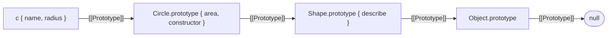

## Introduction

Suppose you have an object that already does something useful, and you want a second object that can do the same things without copying them.

```javascript title="basic.js"
const calculator = {
  add(a, b) {
    return a + b;
  },
};

const child = Object.create(calculator);

console.log(child.add(2, 3));
console.log(Object.keys(child));
console.log(Object.getPrototypeOf(child) === calculator);
```

```output
5
[]
true
```

`child` is empty: it has no own keys. It can still call `add`, because `Object.create(calculator)` produced a new object whose prototype is `calculator`, and a property that is missing on an object is looked up on its prototype ([[b1-prototype-chain]]).

That is the whole job of `Object.create`: **make a new object and choose its prototype at the moment of creation**. Every other way of creating an object chooses the prototype for you. A literal `{}` always gets `Object.prototype`. `new F()` always gets `F.prototype` and also runs `F`. `Object.create` lets you name the prototype directly, and runs no code of yours at all.

This lesson covers what the function does, its second argument (which surprises most people the first time), the special case `Object.create(null)`, and the role `Object.create` played in inheritance before classes existed.

## Before you start

You should be comfortable with:

- What a prototype is and how a missing property is found on it — [[b1-prototypes]] and [[b1-prototype-chain]].
- The difference between own and inherited properties — [[b1-own-vs-inherited]].
- Property descriptors (`value`, `writable`, `enumerable`, `configurable`) — [[b1-property-descriptors]]. The second argument of `Object.create` uses them; a short recap is included below.
- Constructor functions and `new` — [[b1-constructor-functions]], for the inheritance section.

## The intuition

Think of a paper form with a sticky note on it that says "for anything not written here, see form B". The form itself may be blank. Anyone reading it who does not find an answer follows the note to form B and reads the answer there. Nothing was copied from B. If someone later corrects B, readers of the blank form see the correction.

`Object.create(B)` hands you a blank form with that note already attached. You can then write your own answers on it. An answer you write takes priority over B's answer for the same question, and B is left unchanged.

Two consequences follow from "nothing was copied", and they explain most of the behaviour in this lesson:

- The new object is cheap. It holds one link, however many properties the prototype has.
- The new object is not independent. It sees later changes to its prototype, and if the prototype holds a mutable value such as an array, that one array is shared.

## What Object.create does

The signature is:

```text
Object.create(proto)
Object.create(proto, propertyDescriptors)
```

- `proto` must be an object or `null`. It becomes the new object's `[[Prototype]]`.
- `propertyDescriptors` is optional. If given, it describes own properties to define on the new object.
- The return value is the new object.

No constructor runs, no properties are copied from `proto`, and `proto` is not modified.

### Delegation in practice

```javascript title="delegate.js"
const account = {
  balance: 0,
  deposit(amount) {
    this.balance += amount;
    return this;
  },
  describe() {
    return `${this.owner}: ${this.balance}`;
  },
};

const ada = Object.create(account);
ada.owner = 'Ada';
ada.deposit(50);

const lin = Object.create(account);
lin.owner = 'Lin';

console.log(ada.describe());
console.log(lin.describe());
console.log(Object.keys(ada), Object.keys(lin));
console.log(account.balance);
```

```output
Ada: 50
Lin: 0
[ 'owner', 'balance' ] [ 'owner' ]
0
```

Trace `ada.deposit(50)`:

1. `ada` has no own `deposit`, so the lookup finds it on `account`.
2. The method is called with `this` set to `ada`, because `ada` is the object to the left of the dot. Where the method was *found* does not affect `this` ([[b1-this]]).
3. `this.balance += amount` reads `this.balance`. `ada` has no own `balance`, so the read finds `0` on `account`.
4. It then *writes* `50` to `this.balance`. A write creates an own property on `ada`. It does not change `account`.

So `ada` ends up with its own `balance`, `lin` still reads the inherited `0`, and `account.balance` is untouched. Reads go up the chain; ordinary writes land on the object you wrote to. This is the same rule you met in [[b1-property-lookup]], and it is what makes a prototype usable as a set of defaults.

### The link is live, and values are shared

```javascript title="live.js"
const defaults = { theme: 'light', tags: ['base'] };
const settings = Object.create(defaults);

defaults.theme = 'dark';
console.log(settings.theme);

settings.tags.push('mine');
console.log(defaults.tags);

settings.theme = 'solarized';
console.log(settings.theme, defaults.theme);
```

```output
dark
[ 'base', 'mine' ]
solarized dark
```

Three different things happen here:

- Changing `defaults.theme` changes what `settings.theme` reads, because `settings` has no copy.
- `settings.tags.push('mine')` does not assign to `settings`. It *reads* `settings.tags` (finding the array on `defaults`) and then mutates that array. The array belongs to `defaults`, so `defaults.tags` changed.
- `settings.theme = 'solarized'` is an assignment, so it creates an own property that shadows the inherited one.

> [!WARNING]
> `Object.create(obj)` is not a copy of `obj`, shallow or deep. It is an empty object that reads through to `obj`. If you need an independent copy, use spread or `structuredClone` ([[b1-copying-objects]], [[b1-structured-clone]]).

### No constructor runs

When the prototype you pass is a constructor's `prototype` object, the result looks like an instance but has not been initialised.

```javascript title="noctor.js"
function User(name) {
  console.log('constructor ran');
  this.name = name;
}
User.prototype.greet = function () {
  return `Hi, ${this.name}`;
};

const viaNew = new User('Ada');
const viaCreate = Object.create(User.prototype);

console.log(viaCreate instanceof User);
console.log(viaCreate.name);
console.log(viaCreate.greet());
```

```output
constructor ran
true
undefined
Hi, undefined
```

"constructor ran" is printed once, for `new User('Ada')`. `Object.create(User.prototype)` produced an object that passes `instanceof User` (that operator only checks the prototype chain, see [[b1-instanceof]]) and can call `greet`, but has no `name`, because the code that assigns `name` never ran.

This is a feature when you want the link without the side effects, which is exactly the inheritance case later in this lesson. It is a bug when you expected a working instance.

### What proto may be

```javascript title="errors.js"
for (const bad of [undefined, 5, 'text', true]) {
  try {
    Object.create(bad);
  } catch (error) {
    console.log(error.message);
  }
}
console.log(Object.getPrototypeOf(Object.create(null)));
console.log(typeof Object.create(function () {}));
```

```output
Object prototype may only be an Object or null: undefined
Object prototype may only be an Object or null: 5
Object prototype may only be an Object or null: text
Object prototype may only be an Object or null: true
null
object
```

Anything that is not an object or `null` throws a `TypeError`. That includes calling `Object.create()` with no argument, since the missing argument is `undefined`. Functions and arrays are objects, so they are accepted. The result is always an ordinary object: `Object.create(someFunction)` is not callable, and `Object.create([])` is not a real array (it inherits array methods, but `Array.isArray` returns `false` for it and its `length` does not track indices).

```quiz
Q: What does this print? `const a = { n: 1 }; const b = Object.create(a); b.n++; console.log(a.n, b.n, Object.keys(b));`
- [ ] `2 2 []`
- [x] `1 2 [ 'n' ]`
- [ ] `1 1 []`
- [ ] `2 2 [ 'n' ]`
> `b.n++` means `b.n = b.n + 1`. The read finds `1` on `a` through the prototype. The write creates an own property `n` on `b` with value `2`. `a` is never modified, so `a.n` stays `1`, and `b` now has one own key.

Q: Which statement about `const o = Object.create(Widget.prototype)` is correct?
- [ ] `Widget` is called with no arguments to initialise `o`
- [ ] `o` receives a copy of every method on `Widget.prototype`
- [x] `o instanceof Widget` is `true`, but nothing `Widget` assigns to `this` exists on `o`
- [ ] It throws, because a prototype object cannot be passed to `Object.create`
> `Object.create` only sets the `[[Prototype]]` link. `instanceof` checks that link, so it reports `true`. No constructor runs and nothing is copied, so per-instance fields that `Widget` would assign are missing.
```

## The second argument: property descriptors

The optional second argument defines own properties on the new object. It has the same shape as the argument of `Object.defineProperties`: an object whose keys are property names and whose values are **descriptors**, not plain values.

A descriptor is a small object describing one property. A data descriptor has `value` and `writable`; an accessor descriptor has `get` and/or `set`; both kinds have `enumerable` and `configurable` ([[b1-writable-enumerable-configurable]]).

```javascript title="props.js"
const point = Object.create(Object.prototype, {
  x: { value: 3 },
  y: { value: 4, writable: true, enumerable: true, configurable: true },
});

console.log(point.x, point.y);
console.log(Object.keys(point));
console.log(Object.getOwnPropertyDescriptor(point, 'x'));

point.x = 99;
console.log(point.x);
console.log(JSON.stringify(point));
```

```output
3 4
[ 'y' ]
{ value: 3, writable: false, enumerable: false, configurable: false }
3
{"y":4}
```

`x` was declared with only `value`. Every flag left out of a descriptor defaults to `false`, so `x` is:

- not enumerable — it is missing from `Object.keys` and from `JSON.stringify`;
- not writable — `point.x = 99` is ignored here, and would throw a `TypeError` in strict mode ([[b1-strict-mode]]);
- not configurable — it cannot be deleted or redefined.

That is the opposite of a property created by assignment or in a literal, where all three flags are `true`. `y` spells the flags out, so it behaves like a normal property.

> [!MISTAKE]
> Passing plain values as the second argument: `Object.create(proto, { x: 3 })`. This throws `TypeError: Property description must be an object: 3`. The second argument is not "initial properties"; each value must be a descriptor.

There is a quieter version of the same mistake:

```javascript title="props-wrong.js"
try {
  Object.create({}, { x: 3 });
} catch (error) {
  console.log(error.message);
}

const tricky = Object.create({}, { value: { value: 1, enumerable: true } });
console.log(tricky);
```

```output
Property description must be an object: 3
{ value: 1 }
```

The second call works and defines a property that happens to be called `value`. If you had written `{ value: 1 }` meaning "a property named value", the engine would instead have tried to read `1` as a descriptor and thrown. Keep the two levels apart: outer keys are property names, inner objects are descriptors.

Accessors are defined the same way:

```javascript title="accessor.js"
const temperature = Object.create(null, {
  celsius: { value: 25, writable: true, enumerable: true },
  fahrenheit: {
    get() {
      return this.celsius * 9 / 5 + 32;
    },
    enumerable: true,
  },
});

console.log(temperature.fahrenheit);
temperature.celsius = 100;
console.log(temperature.fahrenheit);
```

```output
77
212
```

In everyday code the second argument is used rarely, because it is verbose. Two patterns are more common:

- `Object.assign(Object.create(proto), { a: 1, b: 2 })` — create, then copy ordinary writable, enumerable properties onto the result ([[b1-object-assign-create]]).
- `Object.create(proto, Object.getOwnPropertyDescriptors(source))` — copy another object's properties with their exact flags, getters and setters intact. The worked example below uses this, and shows a case where the first pattern fails.

## Null-prototype objects

`Object.create(null)` makes an object with no prototype at all. Its chain has length zero.

```javascript title="nullproto.js"
const plain = {};
const bare = Object.create(null);

console.log('toString' in plain, 'toString' in bare);
console.log(plain.constructor === Object, bare.constructor);
console.log(Object.getPrototypeOf(bare));

bare.__proto__ = 'just a string';
console.log(Object.keys(bare), Object.getPrototypeOf(bare));
```

```output
true false
true undefined
null
[ '__proto__' ] null
```

A plain `{}` inherits about a dozen names from `Object.prototype`, including `toString`, `constructor`, `hasOwnProperty`, `valueOf` and the `__proto__` accessor. A null-prototype object inherits nothing. Even `__proto__` is an ordinary key on it: the special behaviour of `obj.__proto__ = x` comes from a setter that lives on `Object.prototype`, and `bare` does not inherit from `Object.prototype`.

### Why that matters: keys you do not control

When an object is used as a dictionary and the keys come from outside your code (user input, file contents, request parameters), inherited names collide with real data.

```javascript title="wordcount.js"
function countWords(text, counts) {
  for (const word of text.split(' ')) {
    counts[word] = (counts[word] ?? 0) + 1;
  }
  return counts;
}

const text = 'the constructor called the constructor';

console.log(countWords(text, {}));
console.log(countWords(text, Object.create(null)));
```

```output
{
  the: 2,
  constructor: 'function Object() { [native code] }11',
  called: 1
}
[Object: null prototype] { the: 2, constructor: 2, called: 1 }
```

With `{}`, the first time the word "constructor" appears, `counts['constructor']` is not `undefined`. It is the inherited `Object` function. `?? 0` does not apply, the function is converted to a string, and `1` is appended to it twice. With a null-prototype object there is nothing to inherit, so the count is correct.

The same class of collision is the root of prototype pollution, where an attacker-chosen key such as `__proto__` reaches `Object.prototype` through code like this. That attack and its defences are covered in [[b1-prototype-pollution]].

### What you give up

```javascript title="nullcost.js"
const bare = Object.create(null);
bare.id = 7;

try {
  console.log(`${bare}`);
} catch (error) {
  console.log(error.message);
}

try {
  bare.hasOwnProperty('id');
} catch (error) {
  console.log(error.message);
}

console.log(Object.hasOwn(bare, 'id'));
console.log(Object.keys(bare), JSON.stringify(bare));
console.log(bare instanceof Object);
console.log(bare);
```

```output
Cannot convert object to primitive value
bare.hasOwnProperty is not a function
true
[ 'id' ] {"id":7}
false
[Object: null prototype] { id: 7 }
```

- There is no `toString` or `valueOf`, so converting the object to a string or number throws. Template literals, string concatenation and `String(bare)` all fail.
- There is no `hasOwnProperty` method. Use the static `Object.hasOwn(obj, key)` instead, which works on any object ([[b1-object-hasown]]).
- `instanceof Object` is `false`, since `Object.prototype` is not in its chain.
- The static functions (`Object.keys`, `Object.entries`, `JSON.stringify`, spread, `for...in`) all work, because they do not rely on inherited methods.

Code that receives the object from you and calls `obj.toString()` or `obj.hasOwnProperty(...)` will break, so a null-prototype object is best kept as an internal detail or documented clearly.

> [!TIP]
> For a dictionary with arbitrary keys in new code, [[b1-map]] is usually the better tool: any key type, a `size` property, guaranteed insertion-order iteration and no inherited names. Reach for `Object.create(null)` when you specifically need a plain object, for example because the result is passed to `JSON.stringify` or to an API that expects object syntax. [[b1-map-vs-object]] compares the two.

## Inheritance with Object.create

Before `class` and `extends`, making one constructor inherit from another meant building the prototype chain by hand. `Object.create` is the piece that links the two prototypes.

```javascript title="inherit.js"
function Shape(name) {
  this.name = name;
}
Shape.prototype.describe = function () {
  return `${this.name} with area ${this.area()}`;
};

function Circle(radius) {
  Shape.call(this, 'circle');
  this.radius = radius;
}
Circle.prototype = Object.create(Shape.prototype, {
  constructor: { value: Circle, writable: true, configurable: true },
});
Circle.prototype.area = function () {
  return Math.round(Math.PI * this.radius ** 2);
};

const c = new Circle(2);
console.log(c.describe());
console.log(c instanceof Circle, c instanceof Shape);
console.log(c.constructor === Circle, Object.keys(Circle.prototype));
```

```output
circle with area 13
true true
true [ 'area' ]
```

There are three steps, each with a distinct purpose:

1. **`Shape.call(this, 'circle')`** runs the parent constructor on the new object, so per-instance fields such as `name` are set ([[b1-call]]).
2. **`Circle.prototype = Object.create(Shape.prototype, ...)`** replaces `Circle.prototype` with a fresh object whose prototype is `Shape.prototype`. Instances of `Circle` now reach `Shape`'s methods through two links.
3. **Restoring `constructor`**. The replaced prototype object no longer has the `constructor` property that the original one had, so it is put back ([[b1-constructor-property]]). Here it is done through the second argument, which is one of its natural uses: `enumerable` is left out, so `constructor` stays non-enumerable, matching the built-in behaviour. `Object.keys(Circle.prototype)` shows only `area`.



### Why not the alternatives

Two shorter versions of step 2 appear in old code, and both are wrong.

```javascript title="wrong-inherit.js"
function Shape() {}
Shape.prototype.describe = function () {
  return 'a shape';
};

function Circle() {}
Circle.prototype = Shape.prototype;          // same object, not a child of it
Circle.prototype.area = function () {
  return 3;
};

console.log(typeof new Shape().area);
```

```output
function
```

`Circle.prototype = Shape.prototype` makes both names refer to one object. Adding `area` for circles adds it to every shape. There is no separate level in the chain for the subclass.

The other version is `Circle.prototype = new Shape()`. It does create a separate object linked to `Shape.prototype`, but it runs the `Shape` constructor once, at setup time, with no arguments. Any side effect in the constructor happens when the script loads, any required argument is missing, and any field the constructor assigns (an array, for instance) ends up on `Circle.prototype`, shared by all circles. `Object.create(Shape.prototype)` gives the link without running anything, which is why it replaced that pattern.

> [!NOTE]
> `class Circle extends Shape` performs the same wiring: `Circle.prototype` is created with `Shape.prototype` as its prototype, and `super(...)` takes the place of `Shape.call(this, ...)`. It also links the constructors themselves (`Object.getPrototypeOf(Circle) === Shape`) so static methods are inherited, which the manual pattern above does not do. See [[b1-class-inheritance]].

## How it works internally

The specification defines `Object.create(O, Properties)` in three steps:

1. If `O` is not an object and not `null`, throw a `TypeError`.
2. Let `obj` be `OrdinaryObjectCreate(O)`: allocate a new ordinary object with its `[[Prototype]]` internal slot set to `O` and `[[Extensible]]` set to `true`.
3. If `Properties` is not `undefined`, return `ObjectDefineProperties(obj, Properties)`; otherwise return `obj`.

`ObjectDefineProperties` reads every own enumerable key of `Properties`, converts each value to a descriptor, and only then defines them one by one. Because all descriptors are validated before any is applied, a malformed descriptor throws before the object gets any of the properties.

`OrdinaryObjectCreate` is the same operation that sits underneath object literals (called with `%Object.prototype%`) and underneath `new` for ordinary constructors (called with the constructor's `prototype`). `Object.create` exposes it with the prototype as a parameter.

Engines treat the prototype as part of an object's shape. In V8, objects created with the same prototype and the same sequence of properties share a hidden class, so property access on them can be cached ([[b1-hidden-classes]]). Choosing the prototype at creation, as `Object.create` does, fits this model. Changing it afterwards with `Object.setPrototypeOf` forces the engine to discard what it assumed about the object, which is why MDN warns that it can be slow. V8 also represents null-prototype objects in a dictionary-style layout suited to adding and removing arbitrary keys; this is an implementation detail and can change between versions.

### Writing it yourself

"Implement `Object.create`" is a standard interview exercise. The classic answer predates ES5 and uses a throwaway constructor:

```javascript title="polyfill.js"
function objectCreate(proto, properties) {
  if (proto !== null && typeof proto !== 'object' && typeof proto !== 'function') {
    throw new TypeError(`Object prototype may only be an Object or null: ${proto}`);
  }
  function Temp() {}
  Temp.prototype = proto;
  const result = new Temp();
  if (proto === null) {
    Object.setPrototypeOf(result, null);   // new falls back to Object.prototype for null
  }
  if (properties !== undefined) {
    Object.defineProperties(result, properties);
  }
  return result;
}

const base = { hello() { return 'hello'; } };
const made = objectCreate(base, { n: { value: 7, enumerable: true } });

console.log(made.hello(), made.n);
console.log(Object.getPrototypeOf(made) === base);
console.log(Object.getPrototypeOf(objectCreate(null)));
```

```output
hello 7
true
null
```

The idea is that `new Temp()` links the new object to `Temp.prototype`, so pointing `Temp.prototype` at `proto` first yields an object linked to `proto`. `Temp` has an empty body, so nothing else happens.

The `null` case needs care. When a constructor's `prototype` property is not an object, `new` falls back to `Object.prototype` ([[b1-new-operator]]), so the trick alone cannot produce a null-prototype object. This version fixes the link afterwards. True ES3 environments had no way to do that, which is why old polyfills documented `null` as unsupported.

## Worked example: layered configuration

A common use of delegation is layered settings: built-in defaults, overridden by an environment, overridden again per request. Each layer stores only what it changes.

A first attempt uses `Object.assign`:

```javascript title="worked-broken.js"
const baseConfig = Object.freeze({ logLevel: 'info' });

function layer(parent, overrides) {
  return Object.assign(Object.create(parent), overrides);
}

try {
  layer(baseConfig, { logLevel: 'debug' });
} catch (error) {
  console.log(error.message);
}
```

```output
Cannot assign to read only property 'logLevel' of object '#<Object>'
```

The base is frozen so nobody can change the defaults by accident ([[b1-object-freeze-seal]]). `Object.assign` copies with ordinary assignment, and assignment consults the prototype chain first: if it finds an inherited data property that is not writable, the assignment is refused, even though the write would have created a property on the child and never touched the parent. `Object.assign` reports the refusal by throwing. This rule is often called the override mistake.

Defining properties, as opposed to assigning them, does not consult the chain. The second argument of `Object.create` defines properties, so it solves the problem:

```javascript title="worked.js"
const baseConfig = Object.freeze({
  retries: 3,
  timeoutMs: 5000,
  logLevel: 'info',
});

function layer(parent, overrides) {
  return Object.create(parent, Object.getOwnPropertyDescriptors(overrides));
}

const staging = layer(baseConfig, { logLevel: 'debug' });
const request = layer(staging, { timeoutMs: 500 });

console.log(request.retries, request.timeoutMs, request.logLevel);
console.log(Object.keys(request));

function origin(config, key) {
  let depth = 0;
  for (let o = config; o !== null; o = Object.getPrototypeOf(o)) {
    if (Object.hasOwn(o, key)) {
      return depth;
    }
    depth += 1;
  }
  return -1;
}
console.log(origin(request, 'timeoutMs'), origin(request, 'logLevel'), origin(request, 'retries'));

function flatten(config) {
  const result = {};
  for (const key in config) {
    result[key] = config[key];
  }
  return result;
}
console.log(flatten(request));
console.log(JSON.stringify(request));
```

```output
3 500 debug
[ 'timeoutMs' ]
0 1 2
{ timeoutMs: 500, logLevel: 'debug', retries: 3 }
{"timeoutMs":500}
```

Walking through it:

- `Object.getOwnPropertyDescriptors(overrides)` turns `{ logLevel: 'debug' }` into `{ logLevel: { value: 'debug', writable: true, enumerable: true, configurable: true } }`. That is exactly the shape the second argument expects, and the flags are all `true` because the source was a normal literal.
- `request.retries` is resolved two links up, `request.logLevel` one link up, and `request.timeoutMs` on the object itself. `origin` makes that visible by counting hops until `Object.hasOwn` succeeds.
- `Object.keys(request)` and `JSON.stringify(request)` report only `timeoutMs`. Both look at own properties only. This is the main practical cost of delegation: the object *behaves* as if it had three settings but *serialises* as if it had one.
- `flatten` uses `for...in`, which does visit inherited enumerable properties, nearest object first ([[b1-enumerable-properties]]), to produce a plain object when you need to log or send the effective configuration.

> [!IMPORTANT]
> Anything that enumerates own properties sees only the top layer of an object built with `Object.create`: `Object.keys`, `Object.entries`, spread, `Object.assign`, `JSON.stringify` and `structuredClone`. If the data has to leave your process, flatten it first.

## In real systems

- **Dictionaries and caches.** Parsers and libraries that build lookup tables from external keys use null-prototype objects so that keys such as `constructor` or `__proto__` are ordinary data. Node.js does this in its own APIs: `querystring.parse()` is documented as returning an object that does not inherit from `Object`, and `import * as ns` module namespace objects have a null prototype by specification.
- **Pre-class inheritance.** Code written before ES2015, and code generated by compilers targeting ES5, wires subclasses with `Object.create(Parent.prototype)`. Node's older `util.inherits` helper did the same job; current versions implement it with `Object.setPrototypeOf` and the documentation discourages it in favour of `class` and `extends`.
- **Faithful cloning.** `Object.create(Object.getPrototypeOf(obj), Object.getOwnPropertyDescriptors(obj))` produces a shallow clone that keeps the prototype, getters, setters and non-enumerable properties, all of which spread drops:

```javascript title="clone.js"
const original = {
  first: 'Ada',
  get shout() {
    return this.first.toUpperCase();
  },
};
Object.defineProperty(original, 'id', { value: 1, enumerable: false });

const spread = { ...original };
const faithful = Object.create(
  Object.getPrototypeOf(original),
  Object.getOwnPropertyDescriptors(original),
);

spread.first = 'Lin';
faithful.first = 'Lin';

console.log(spread.shout, spread.id);
console.log(faithful.shout, faithful.id);
```

```output
ADA undefined
LIN 1
```

  Spread evaluated the getter once and stored the result `'ADA'` as a fixed value, and skipped the non-enumerable `id`. The descriptor-based clone kept `shout` as a live getter and kept `id`.

- **Test doubles.** `Object.create(realService)` gives an object that behaves like the real one until you assign replacement methods on it, leaving the original untouched for other tests.

## Trade-offs and alternatives

| Way to create | Prototype of the result | Runs your code | Typical use |
| --- | --- | --- | --- |
| `{}` | `Object.prototype` | No | Records and ordinary data |
| `{ __proto__: p, ... }` | `p` | No | Literal with a chosen prototype and properties together |
| `Object.create(p)` | `p` (or none for `null`) | No | Delegation, null-prototype dictionaries, wiring inheritance |
| `new F(args)` | `F.prototype` | Yes, `F` | Initialised instances |
| `class` / `extends` | Built from the class hierarchy | Yes, constructors | Most modern object-oriented code |
| `Object.setPrototypeOf(o, p)` | `p`, changed after creation | No | Rare; can de-optimise the object |

The literal form deserves a note. `__proto__: p` inside an object literal is standard syntax that sets the prototype of the object being created. It is a different thing from the `obj.__proto__` accessor property, which is legacy.

```javascript title="literal.js"
const parent = { greet() { return 'hi'; } };

const viaCreate = Object.create(parent);
viaCreate.name = 'a';

const viaLiteral = { __proto__: parent, name: 'b' };

console.log(viaCreate.greet(), viaLiteral.greet());
console.log(Object.keys(viaLiteral));
console.log(Object.getPrototypeOf({}) === Object.prototype);
console.log(Object.getPrototypeOf(Object.create(Object.prototype)) === Object.prototype);
```

```output
hi hi
[ 'name' ]
true
true
```

The last two lines answer a frequent question: `{}` and `Object.create(Object.prototype)` produce equivalent objects. `Object.create` is only interesting when the prototype is something else.

When to prefer something other than `Object.create`:

- You want objects with identity, private state and a clear construction step: use a class ([[b1-classes]]) or a factory function ([[b1-classes-vs-factories]]).
- You want a dictionary: use a `Map`, unless you need a plain object.
- You want an independent copy: use spread, `Object.assign` or `structuredClone`.
- You want defaults merged once: `{ ...defaults, ...overrides }` is simpler than a prototype chain, and the result serialises fully. Delegation earns its place when the defaults must stay live or when there are many objects sharing large defaults.

## Common mistakes

- **Treating the result as a copy.** Mutating an inherited array or nested object through the child changes the prototype's value for every object that shares it. Assigning replaces only on the child; mutating reaches the shared value.
- **Passing values instead of descriptors** as the second argument, or forgetting that omitted flags are `false` and then wondering why a property cannot be changed or does not appear in `Object.keys`.
- **Expecting the constructor to run.** `Object.create(Foo.prototype)` gives an uninitialised object. Use `new Foo()` when you want an instance.
- **`Child.prototype = Parent.prototype`.** This shares one object between parent and child. Use `Object.create(Parent.prototype)`.
- **Forgetting to restore `constructor`** after replacing a prototype, so `instance.constructor` reports the parent.
- **Assigning `Child.prototype` after adding methods to it.** The assignment discards the old prototype object and the methods on it. Replace the prototype first, then add methods.
- **Calling inherited methods on a null-prototype object**, such as `dict.hasOwnProperty(key)` or `String(dict)`. Use `Object.hasOwn(dict, key)` and avoid implicit string conversion.
- **Serialising a delegating object** and losing every inherited setting.

## Interview perspective

Questions on this topic are usually short and test whether you hold the right model.

- **"What does `Object.create` do?"** It creates a new ordinary object whose `[[Prototype]]` is the first argument, optionally defines own properties from descriptors in the second argument, and runs no constructor.
- **"How is it different from `new`?"** `new F()` creates an object linked to `F.prototype`, then calls `F` with `this` bound to it, and may return a different object if `F` returns one. `Object.create` does only the linking step, with a prototype you pass directly.
- **"`Object.create(null)` versus `{}`?"** The first has no prototype, so no inherited names, which makes it safe as a dictionary for arbitrary keys; the second inherits from `Object.prototype`. Mention the costs: no `toString`, no `hasOwnProperty`, `instanceof Object` is `false`.
- **"Implement `Object.create`."** Write the temporary-constructor version shown above. Validate the argument, mention the `null` limitation, and mention that the second argument maps to `Object.defineProperties`.
- **"Set up inheritance without `class`."** `Parent.call(this, ...)` in the child constructor, `Child.prototype = Object.create(Parent.prototype)`, restore `constructor`. Be ready to say why `new Parent()` and `Parent.prototype` are wrong for the middle step.

> [!INTERVIEW]
> A strong answer names the trade-off unprompted: delegation shares rather than copies, so the child is cheap and stays in sync with its prototype, but shared mutable values and own-property-only operations such as `JSON.stringify` behave differently from what a copy would give.

A typical follow-up is a prediction question about writes: after `const b = Object.create(a)`, does `b.list.push(1)` change `a`? It does, because it mutates the value found on `a`. Does `b.list = []` change `a`? It does not, because assignment creates an own property on `b`.

## Practice

1. Write `inherit(Child, Parent)` that performs steps 2 and 3 of the inheritance recipe, keeping `constructor` non-enumerable. Check it with `Object.keys(Child.prototype)`.
2. Write `countBy(items, keyFn)` that returns a dictionary of counts and gives the right answer when a key is `'constructor'`, `'toString'` or `'__proto__'`. Write it once with `Object.create(null)` and once with a `Map`.
3. Using the `layer` function from the worked example, add a `diff(config)` function that returns only the keys a layer overrides relative to its parent chain.
4. Extend the `objectCreate` polyfill so a malformed descriptor in `properties` throws before any property is defined. Then check whether it already does, and explain why.
5. Predict the output, then run it: `const a = { items: [] }; const b = Object.create(a); const c = Object.create(a); b.items.push(1); c.items = [2]; console.log(a.items, b.items, c.items);`

## Quick revision {#quick-revision}

- `Object.create(proto)` returns a new empty object whose `[[Prototype]]` is `proto`. Nothing is copied and no constructor runs.
- `proto` must be an object or `null`; anything else throws a `TypeError`.
- Reads fall through to the prototype; assignments create own properties on the child; mutating an inherited object or array changes the shared value.
- The second argument is a map of property descriptors, as for `Object.defineProperties`. Omitted `writable`, `enumerable` and `configurable` default to `false`.
- `Object.create(null)` has no prototype: no inherited keys, no `toString`, no `hasOwnProperty`, and `__proto__` is an ordinary key. Use `Object.hasOwn` with it.
- Pre-class inheritance: `Parent.call(this)`, `Child.prototype = Object.create(Parent.prototype)`, restore `constructor`.
- `Child.prototype = Parent.prototype` shares one object; `Child.prototype = new Parent()` runs the constructor at the wrong time.
- Defining a property ignores the prototype chain; assigning does not, so assignment over an inherited read-only property fails.
- `Object.keys`, spread, `JSON.stringify` and `structuredClone` see own properties only, so delegated values are dropped.
- `{}` is equivalent to `Object.create(Object.prototype)`; `{ __proto__: p }` is the literal form of `Object.create(p)`.

## Key takeaways {#key-takeaways}

- `Object.create` is the direct way to choose an object's prototype at creation, which is the cheapest and most engine-friendly time to choose it.
- It links; it does not copy and it does not initialise. Most bugs with it come from expecting one of those two things.
- The second argument takes descriptors with restrictive defaults, which makes it precise for things like a non-enumerable `constructor` and awkward for ordinary data.
- Null-prototype objects remove collisions between your keys and inherited names, at the cost of the inherited conveniences; a `Map` is often the cleaner dictionary.
- `class` and `extends` build the same prototype links for you, so understanding `Object.create` is understanding what that syntax produces.
