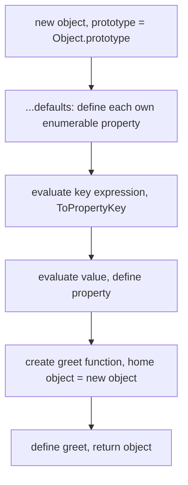

## Introduction

Almost every JavaScript program is built out of objects. A user is `{ id, name, email }`; a React component receives its props as an object; a fetch call takes an options object `{ method: 'POST', headers, body }`; a configuration file exports one big object. The way you write those objects most of the time is the **object literal**: a pair of braces containing a comma-separated list of properties.

```javascript
const user = { name: 'Ada', born: 1815 };
```

That one line does three things. It **creates a new object**, it **adds a property for each entry**, and it **gives the object a prototype** (`Object.prototype`, which is where `toString` and `hasOwnProperty` come from). The literal is an *expression*: like `2 + 3`, it produces a value, and you can put it anywhere a value is allowed — after `return`, as a function argument, inside an array, inside another literal.

Literals look simple, and the basic form is. But modern JavaScript (from ECMAScript 2015, usually called ES2015 or ES6, onwards) added several shorter and more powerful forms: **computed property names** (`{ [key]: value }`), **shorthand properties** (`{ name }` instead of `{ name: name }`), **shorthand methods** (`{ greet() {} }`), and **spread** (`{ ...other }`). Each of these has precise rules, and most object-related bugs in real code — a key that became the string `"undefined"`, a method where `this` is wrong, an object that was supposed to be copied but was not — come from not knowing them.

This lesson teaches the literal itself first, then the three nested concepts that every JavaScript developer uses daily: how to *read* properties with [[b1-dot-vs-bracket|dot and bracket notation]], how to *compute* keys with [[b1-computed-properties|computed property names]], and how to *shorten* literals with [[b1-property-shorthand|property and method shorthand]].

## Before you start

- **Objects as values** — that an object has identity, that variables hold references to objects, and that keys are strings or symbols. See [[b1-objects-as-values]].
- **Primitive types** — strings, numbers, symbols, `undefined` and `null`, because keys are converted from them. See [[b1-primitive-types]].
- **Functions and `this`** — enough to know that a function called as `obj.method()` receives `obj` as `this`. See [[b1-this]]; this lesson explains the parts that matter for literals.

All snippets run in Node.js 22 or any current browser console. Where strict mode changes the result, the snippet's title ends in `.mjs`, meaning it runs as an ES module (modules are always strict).

## The intuition

Think of an object literal as a **form you fill in on the spot**. The braces are a blank form; each `key: value` line writes one labelled field. When the line of code runs, JavaScript takes a fresh blank form, fills in the fields in the order you wrote them, and hands you the finished form.

Two consequences follow, and they matter more than they first appear:

1. **Every time the literal runs, you get a new form.** A literal inside a function or a loop creates a new, separate object on every call or iteration — even if the contents are identical. `{} === {}` is `false`.
2. **Fields are filled in order, and a later field with the same label overwrites an earlier one.** `{ a: 1, a: 2 }` produces `{ a: 2 }`.

The analogy breaks in one place: a paper form has fixed labels printed on it, while an object literal can *compute* a label while it is being filled in (`[key]: value`), and the finished object stays editable — you can add, change and delete fields afterwards.

## Anatomy of an object literal

A literal is a list of **property definitions** separated by commas. A trailing comma after the last one is allowed, and many teams require it because it makes diffs cleaner when a property is added.

```javascript title="anatomy.js"
const o = {
  name: 'Ada',            // identifier key
  'my-key': 2,            // quoted key: any string is allowed
  class: 1,               // reserved words are fine as keys
  1e3: 'a',               // numeric key: converted to the string "1000"
  0x10: 'b',              // hexadecimal literal: becomes "16"
  1.50: 'c',              // becomes "1.5"
};
console.log(Object.keys(o));
console.log({ a: 1, a: 2 });
```

```output
[ '16', '1000', 'name', 'my-key', 'class', '1.5' ]
{ a: 2 }
```

Every key ends up as a **string** (or a symbol, as you will see with computed keys). An unquoted key must be a valid **identifier name** — letters, digits, `_` and `$`, not starting with a digit — but unlike variable names, reserved words such as `class`, `if` and `default` are allowed. Anything else, such as a key containing a dash or a space, must be quoted. A number written as a key is converted to its canonical string form, which is why `1e3` became `"1000"` and `1.50` became `"1.5"`.

The order of `Object.keys` is not the order of the source. Keys that look like array indexes (`"16"`, `"1000"`) come first in ascending numeric order; the remaining string keys follow in the order they were created. That rule is part of the language specification and is covered in [[b1-object-apis]].

**Duplicate keys** are not an error. Since ES2015 they are allowed even in strict mode, and the last definition wins. That is rarely what you want by accident, but it is exactly what makes the "defaults, then overrides" pattern work with spread, as you will see below.

### Each evaluation creates a new object

```javascript title="new-each-time.js"
function makePoint() {
  return { x: 0, y: 0 };
}
const p1 = makePoint();
const p2 = makePoint();
console.log(p1 === p2, JSON.stringify(p1) === JSON.stringify(p2));
p1.x = 5;
console.log(p2.x);
```

```output
false true
0
```

`p1` and `p2` have equal contents but are two separate objects, so changing one does not affect the other. This is useful — a factory function returning a literal is a simple way to make independent objects — and occasionally a trap: in React, an object literal written inside a component body is a *new* object on every render, so passing it to a memoised child or listing it in an effect's dependency array makes the child re-render or the effect re-run every time (see [[b4-state-identity]]).

### Values are any expression

The value side of a property is an ordinary expression, evaluated when the literal runs. It can be a variable, a function call, a nested literal, an array or a function:

```javascript
const order = {
  id: crypto.randomUUID(),
  items: [{ sku: 'A1', qty: 2 }],
  total: 2 * 9.99,
  createdAt: new Date(),
  format: function () { return `${this.items.length} item(s)`; },
};
```

Nested literals create nested objects, each with its own identity. `order.items[0]` is a separate object that `order` holds a reference to — which is why copying `order` with spread does not copy `items` (see [[b1-copying-objects]]).

### Getters and setters in literals

A literal can also define **accessor properties**: properties whose value is computed by a function when read (`get`) or handled by a function when written (`set`).

```javascript title="accessors.js"
const temperature = {
  celsius: 20,
  get fahrenheit() { return this.celsius * 9 / 5 + 32; },
  set fahrenheit(f) { this.celsius = (f - 32) * 5 / 9; },
};
console.log(temperature.fahrenheit);
temperature.fahrenheit = 212;
console.log(temperature.celsius);
```

```output
68
100
```

Reading `temperature.fahrenheit` looks like reading a data property, but it runs the getter. Accessors are taught fully in [[b1-getters-setters]]; for this lesson, remember that they exist and that some copying techniques turn them into plain values.

### Spread inside a literal

**Object spread**, `{ ...source }` (ES2018), copies the source's own enumerable properties — string *and* symbol keys — into the new object at that position in the list. Because properties are processed left to right, position decides who wins:

```javascript title="spread.js"
const defaults = { theme: 'light', pageSize: 20, compact: false };
const saved = { pageSize: 50 };
const settings = { ...defaults, ...saved, compact: true };
console.log(settings);
console.log({ ...null, ...undefined, ...{ x: 1 } });
console.log({ ...'hi' });
const withGetter = { get now() { console.log('getter ran'); return 5; } };
const snapshot = { ...withGetter };
console.log(Object.getOwnPropertyDescriptor(snapshot, 'now'));
```

```output
{ theme: 'light', pageSize: 50, compact: true }
{ x: 1 }
{ '0': 'h', '1': 'i' }
getter ran
{ value: 5, writable: true, enumerable: true, configurable: true }
```

Read the output line by line. `pageSize` came from `defaults`, was overwritten by `saved`, and `compact` was overwritten by the explicit property written last. Spreading `null` or `undefined` is allowed and adds nothing, which makes `{ ...maybeOptions }` safe. Spreading a string spreads its characters as index keys. And spreading an object with a getter **runs the getter and stores its result** as a plain data property — the copy no longer computes anything.

Spread is a **shallow** copy: nested objects are shared, not duplicated. That is the subject of [[b1-copying-objects]]; spread syntax for arrays and function calls is covered in [[b1-spread-rest]].

### The special `__proto__` key

One key behaves unlike all others. Writing `__proto__: value` in a literal does **not** create a property called `__proto__`. It sets the new object's **prototype** — the object it inherits from (see [[b1-prototype-chain]]).

```javascript title="proto-key.js"
const base = { kind: 'base' };
const p = { __proto__: base, own: 1 };
console.log(p.kind, Object.keys(p), Object.getPrototypeOf(p) === base);

const q = { ['__proto__']: base };            // computed: an ordinary own property
console.log(Object.keys(q), Object.getPrototypeOf(q) === Object.prototype);

const dict = { __proto__: null };             // no prototype at all
console.log(Object.getPrototypeOf(dict), 'toString' in dict);

const parsed = JSON.parse('{"__proto__": {"admin": true}}');
console.log(Object.keys(parsed), parsed.admin);
```

```output
base [ 'own' ] true
[ '__proto__' ] true
null false
[ '__proto__' ] undefined
```

Only the plain, non-computed form `__proto__: value` is special. The computed form `['__proto__']: value` and the shorthand form `{ __proto__ }` create an ordinary own property with that name. If the value is neither an object nor `null` (for example `{ __proto__: 42 }`), it is silently ignored. Writing `__proto__:` twice in one literal is a `SyntaxError`. And `JSON.parse` always creates an ordinary own property, so parsing JSON cannot change a prototype by itself — the danger comes later, when code copies such keys into other objects with bracket assignment, as the next section shows.

`{ __proto__: null, ... }` is a legitimate, standard way to create a dictionary that inherits nothing; it is equivalent to `Object.create(null)` followed by assignments. Outside that use, prefer `Object.create(proto)` or classes, which say what they mean.

### Object literals are not JSON

JSON (JavaScript Object Notation) borrowed its syntax from object literals, which causes endless confusion. They are different things: a literal is **code** that runs and creates an object; JSON is **text** — a data format — that must be parsed.

| | Object literal | JSON text |
|---|---|---|
| What it is | JavaScript expression | A string in a data-interchange format |
| Keys | Identifiers, quoted strings, numbers, computed, symbols | Double-quoted strings only |
| Strings | `'single'`, `"double"` or `` `template` `` | `"double"` only |
| Values | Any expression: functions, `undefined`, `Date`, variables | Strings, numbers, booleans, `null`, arrays, objects |
| Trailing commas, comments | Allowed / allowed | Not allowed |

Convert between them with `JSON.stringify` and `JSON.parse` ([[b1-json-stringify-parse]]), and remember that the conversion loses anything JSON cannot represent ([[b1-json-clone-limits]]).

## Dot vs bracket notation {#b1-dot-vs-bracket}

Once an object exists, you read and write its properties with one of two **property accessors**. **Dot notation**, `obj.name`, uses a fixed name written in the source code. **Bracket notation**, `obj[expression]`, evaluates the expression inside the brackets and uses the result as the key. Both perform exactly the same lookup afterwards — find an own property with that key, otherwise walk the prototype chain — so the choice is only about *how the key is written*.

```javascript title="access.js"
const user = { name: 'Ada', 'full-name': 'Ada Lovelace', class: 'admin', 2: 'two' };
const key = 'name';
console.log(user.name, user[key], user['full-name'], user.class);
console.log(user.age);
console.log(user[2], user['2'], user[2.0], user['2.0']);

const id = Symbol('id');
user[id] = 7;
console.log(user[id], user.id);
```

```output
Ada Ada Ada Lovelace admin
undefined
two two two undefined
7 undefined
```

### When dot notation cannot be used

The text after a dot must be a valid identifier name. Reserved words are fine (`user.class`, `promise.catch`, `module.default`), but these are not:

- keys with characters outside identifiers: `user.full-name` parses as `user.full - name`, a subtraction;
- keys that start with a digit: `user.2` is a `SyntaxError`;
- keys held in a variable: `user.key` looks up the literal key `"key"`, not the value of the variable `key`;
- symbol keys: a symbol has no name you can type after a dot, so `user[id]` is the only way.

Bracket notation has none of these limits, because whatever is between the brackets is an expression.

### How the key is converted

The value inside the brackets is converted to a **property key** by an operation the specification calls `ToPropertyKey`: a symbol stays a symbol; anything else is converted to a string with the usual string conversion. That explains each result above. `user[2]`, `user['2']` and `user[2.0]` are the same property because `String(2)` and `String(2.0)` are both `"2"`. But `user['2.0']` is a different key — the string `"2.0"` is not converted to a number first.

The same rule produces two classic surprises:

```javascript title="key-conversion.js"
const arr = ['a'];
console.log(arr[0], arr['0'], arr['00'], arr[-0]);
const o = {};
o[{}] = 'x';          // the object becomes "[object Object]"
o[null] = 'n';        // null becomes "null"
console.log(Object.keys(o));
const settings = { 'theme.color': 'dark', theme: { color: 'light' } };
console.log(settings['theme.color'], settings.theme.color);
```

```output
a a undefined a
[ '[object Object]', 'null' ]
dark light
```

`arr['00']` is `undefined` because `"00"` is not the canonical form of any index; `arr[-0]` works because `String(-0)` is `"0"`. Using an object as a key turns it into `"[object Object]"`, so every object key collides — use a `Map` when keys are objects ([[b1-map-vs-object]]). And a string containing dots is one key, not a path: `settings['theme.color']` does not walk into `settings.theme`. Reading nested paths from a string needs a helper that splits the path ([[b1-impl-get-path]]).

### Missing properties and nullish bases

Reading a property that does not exist anywhere on the prototype chain gives `undefined`; it never throws. What *does* throw is reading any property of `null` or `undefined` itself:

```javascript title="nullish-base.js"
let profile = null;
try { profile.name; } catch (e) { console.log(`${e.name}: ${e.message}`); }
console.log(profile?.name, profile?.['name']);
```

```output
TypeError: Cannot read properties of null (reading 'name')
undefined undefined
```

The **optional chaining** forms `obj?.name` and `obj?.[key]` stop and return `undefined` when the base is `null` or `undefined` ([[b1-optional-chaining]]).

### User-controlled keys are dangerous

Bracket notation is how you work with keys that come from data — form field names, JSON from a server, URL parameters. That is also where it bites, because a plain object inherits properties from `Object.prototype`, and a key from outside can name one of them.

```javascript title="word-count.js"
const counts = {};
for (const word of ['toString', 'a']) {
  counts[word] = (counts[word] || 0) + 1;
}
console.log(counts);
```

```output
{ toString: 'function toString() { [native code] }1', a: 1 }
```

`counts['toString']` was not missing: it found the inherited `Object.prototype.toString` function, and `function + 1` concatenated the function's source text with `1`. The fix is to use a `Map`, a prototype-less object (`Object.create(null)`), or an own-property check such as `Object.hasOwn(counts, word)` ([[b1-object-hasown]]).

Writes are worse than reads. Code that copies data into nested objects by key can be tricked into writing onto `Object.prototype` itself:

```javascript title="pollution.js"
function setPath(target, path, value) {
  const parts = path.split('.');
  let node = target;
  for (let i = 0; i < parts.length - 1; i++) {
    node[parts[i]] ??= {};
    node = node[parts[i]];
  }
  node[parts.at(-1)] = value;
}
const prefs = {};
setPath(prefs, 'ui.theme', 'dark');
console.log(prefs);
setPath(prefs, '__proto__.isAdmin', true);   // path supplied by an attacker
const stranger = {};
console.log(stranger.isAdmin);
```

```output
{ ui: { theme: 'dark' } }
true
```

`prefs['__proto__']` reads the prototype of `prefs`, which is `Object.prototype`, so the final assignment adds `isAdmin` to the prototype of *every* plain object in the program. This is **prototype pollution**, a real class of security vulnerability that has affected widely used libraries ([[b1-prototype-pollution]]). The defence is to reject the keys `__proto__`, `constructor` and `prototype` when they come from outside, or to store such data in a `Map` or a null-prototype object.

### Choosing between them

Use **dot notation** whenever the key is a fixed, valid identifier known when you write the code — it is shorter, easier to read, and lets editors and TypeScript check the name. Use **bracket notation** when the key is in a variable, comes from data, is a symbol, or is not a valid identifier. Modern engines optimise `obj['name']` with a constant string exactly like `obj.name`, so there is no performance reason to prefer either; linters such as ESLint's `dot-notation` rule flag bracket access with constant identifier strings for readability.

When keys are arbitrary data rather than a fixed set of fields, ask whether you want an object at all: a `Map` accepts any key type, never collides with inherited names, and keeps insertion order for every key.

## Computed property names {#b1-computed-properties}

A **computed property name** lets an object literal use an expression as a key. Instead of creating the object and then assigning `obj[key] = value` on a second line, you write the key expression inside square brackets directly in the literal:

```javascript
const field = 'email';
const errors = { [field]: 'is required' };   // { email: 'is required' }
```

This is the literal-side twin of bracket access. The expression inside `[...]` is evaluated **when the object is created**, converted with the same `ToPropertyKey` rule (symbol stays symbol, everything else becomes a string), and the result becomes the key. Computed names arrived in ES2015 together with shorthand; before that, any dynamic key needed a temporary variable and a separate assignment.

### What keys do expressions produce?

```javascript title="computed.js"
const verb = 'get';
const api = { [`${verb}User`]() { return 'Ada'; } };
console.log(api.getUser(), api.getUser.name);

const n = 1;
console.log({ ['k' + n]: 1, ['k' + n]: 2 });
console.log(Object.keys({ [1 + 1]: 'two', [true]: 't' }));

let missing;
console.log({ [missing]: 1 });
console.log({ [{ id: 1 }]: 'v' });

const secret = Symbol('secret');
const withSym = { [secret]: 1, visible: 2 };
console.log(Object.keys(withSym), withSym[secret], JSON.stringify(withSym));
```

```output
Ada getUser
{ k1: 2 }
[ '2', 'true' ]
{ undefined: 1 }
{ '[object Object]': 'v' }
[ 'visible' ] 1 {"visible":2}
```

Each line teaches one rule. A template literal or concatenation can build a method name, and the method's `name` property is set to the computed key (`"getUser"`), which shows up in stack traces. Two computed keys that produce the same string collide, and the later one wins, exactly like duplicate plain keys. Numbers and booleans become strings. An `undefined` variable produces the literal key `"undefined"` — almost always a bug, typically a typo or a missing field that went unnoticed. An object becomes `"[object Object]"`. And a symbol stays a symbol: it is a real, usable key, but `Object.keys` and `JSON.stringify` skip it.

### Evaluation order

Keys and values are evaluated strictly left to right, interleaved: first key, first value, second key, second value.

```javascript title="order.js"
const log = [];
const t = (label, v) => { log.push(label); return v; };
const obj = {
  [t('key1', 'a')]: t('value1', 1),
  [t('key2', 'b')]: t('value2', 2),
};
console.log(log.join(' -> '));

let i = 0;
const ids = { [i++]: 'a', [i++]: 'b' };
console.log(ids, i);
```

```output
key1 -> value1 -> key2 -> value2
{ '0': 'a', '1': 'b' } 2
```

The order is guaranteed, so the `i++` example is well defined. It is still poor style: a key expression with side effects makes the literal hard to read. Keep key expressions small and pure — a variable, a template literal, a constant, a symbol.

### Symbols and protocol methods

Computed names are the only way to put a **symbol** key inside a literal, and that is how objects plug into language protocols. The iteration protocol, for example, looks for a method under the well-known symbol `Symbol.iterator` ([[b1-symbol-iterator]]):

```javascript title="iterable.js"
const range = {
  from: 1,
  to: 3,
  *[Symbol.iterator]() {
    for (let i = this.from; i <= this.to; i++) yield i;
  },
};
console.log([...range]);
```

```output
[ 1, 2, 3 ]
```

`*[Symbol.iterator]() { … }` combines three features: a computed name, a method shorthand and a generator. Spread and `for...of` call that method to get the values. `Symbol.toPrimitive`, `Symbol.asyncIterator` and `Symbol.toStringTag` hooks are written the same way ([[b1-well-known-symbols]]).

### Computed names in classes

Classes accept the same syntax for methods, accessors, and (since ES2022) fields:

```javascript title="class-computed.js"
const field = 'email';
class Form {
  [field] = '';
  [`validate_${field}`]() { return this[field].includes('@'); }
}
const form = new Form();
form.email = 'ada@example.com';
console.log(form.validate_email(), Object.keys(form));
```

```output
true [ 'email' ]
```

The computed field `[field]` became an own property `email` on each instance, while the computed method was placed on `Form.prototype`, so `Object.keys` lists only the field.

### Where computed names show up

The pattern you will meet most often is updating one field of a form object by its name:

```javascript
function handleChange(event) {
  const { name, value } = event.target;   // e.g. name = "email"
  setForm((prev) => ({ ...prev, [name]: value }));
}
```

One handler serves every input, because the key comes from the input's `name` attribute. Reducer "handler maps" (`{ [ADD_TODO]: addTodo, [REMOVE_TODO]: removeTodo }`), lookup tables keyed by enum constants, and CSS-in-JS media queries (`{ [`@media (min-width: ${bp}px)`]: { … } }`) all use the same idea. When the computed key is user input — as `name` above effectively is — the warnings from the previous section about `__proto__` apply here too, with one comfort: a *computed* `['__proto__']` key in a literal always creates an ordinary own property and never changes the prototype.

One limitation: there is no shorthand for computed keys. `{ [key] }` is a `SyntaxError`; you must write `{ [key]: value }`.

## Property and method shorthand {#b1-property-shorthand}

**Shorthand** is two pieces of ES2015 syntax that remove repetition from object literals. **Property shorthand** lets you write `{ name }` when the key you want has the same name as a variable in scope; it means exactly `{ name: name }`. **Method shorthand** lets you write `greet() { … }` instead of `greet: function () { … }` — but, unlike property shorthand, it is not merely shorter: a shorthand method is a slightly different kind of function.

### Property shorthand

Before ES2015, returning several local values from a function looked like this: `return { id: id, name: name, email: email };`. The repetition adds noise and invites typos (`{ id: id, name: email }`). With shorthand:

```javascript title="shorthand.js"
function makeUser(id, name) {
  const createdAt = '2026-01-01';
  return { id, name, createdAt, active: true };
}
console.log(makeUser(7, 'Ada'));
```

```output
{ id: 7, name: 'Ada', createdAt: '2026-01-01', active: true }
```

Shorthand and full properties mix freely in one literal, as `active: true` shows. The rules are strict and small:

- The name must be an **identifier that resolves to a binding in scope**. `{ notDeclared }` throws `ReferenceError: notDeclared is not defined`, and using a `let` or `const` before its declaration throws the usual temporal-dead-zone error ([[b1-tdz]]).
- It must be a plain identifier. `{ this }`, `{ user.name }` and `{ [key] }` are all syntax errors.
- The value is read **once, when the literal runs**. The property is a copy of the variable's current value; reassigning the variable later does not change the object.

Shorthand is the mirror image of **destructuring** ([[b1-destructuring]]): `const { id, name } = user` pulls properties out into same-named variables, and `{ id, name }` packs same-named variables back into an object. Together with spread you get compact, readable updates: `{ ...rest, id }`.

### Method shorthand

A **method** is a function stored as a property and called through the object, as in `user.greet()`. Method shorthand defines one with the `name() { … }` form. It also has variants for every kind of function:

```javascript title="method-forms.js"
const service = {
  load() { return 'sync'; },
  async fetchData() { return 'data'; },
  *ids() { yield 1; yield 2; },
  async *pages() { yield 'page 1'; },
  get label() { return 'service'; },
  ['dynamic' + 'Name']() { return 'computed'; },
};
console.log(service.load(), [...service.ids()], service.label, service.dynamicName());
service.fetchData().then((d) => console.log('async:', d));
```

```output
sync [ 1, 2 ] service computed
async: data
```

The `async:` line prints last because the promise's callback runs after the current script finishes (see [[b1-event-loop]]).

### How a shorthand method differs from `function` and arrow properties

Three ways of storing a function in a literal look interchangeable, and they are not:

```javascript title="method-vs-arrow.mjs"
const user = {
  name: 'Ada',
  greet() { return `Hi, I am ${this.name}`; },
  classic: function () { return `Hi, I am ${this.name}`; },
  arrowGreet: () => `Hi, I am ${this?.name}`,
};
console.log(user.greet(), '|', user.classic(), '|', user.arrowGreet());
console.log(typeof user.greet.prototype, typeof user.classic.prototype);
try { new user.greet(); } catch (e) { console.log(`${e.name}: ${e.message}`); }
console.log(user.greet.name, user.classic.name, user.arrowGreet.name);
```

```output
Hi, I am Ada | Hi, I am Ada | Hi, I am undefined
undefined object
TypeError: user.greet is not a constructor
greet classic arrowGreet
```

The **arrow function** is the one that breaks. An arrow function has no `this` of its own; it uses the `this` of the code *surrounding the literal* ([[b1-this-arrow]]). At the top level of an ES module that is `undefined` (the snippet uses `this?.name` to avoid a crash and show the value), and inside a regular function it is that function's `this`. Writing the arrow inside an object literal does not make the object its `this` — braces of a literal do not create a scope. So an arrow function is the wrong choice for a method that needs the object.

The shorthand method and the `function` expression both receive the object as `this` when called as `user.greet()`. They differ in three smaller ways:

| | `greet() {}` | `greet: function () {}` | `greet: () => {}` |
|---|---|---|---|
| `this` when called as `obj.greet()` | `obj` | `obj` | Surrounding code's `this` |
| Can be called with `new` | No (`TypeError`) | Yes | No |
| Has a `prototype` property | No | Yes | No |
| Can use `super` | Yes | No (`SyntaxError`) | Only the surrounding `super` |

A shorthand method is not a constructor and carries no unused `prototype` object, which is slightly leaner and prevents accidental `new`. All three get a `name` taken from the key, so stack traces stay readable.

### `super` in object methods

Shorthand methods remember the object they were defined in — the specification calls it the method's **home object** — and that lets them use `super` to call a method on the object's prototype:

```javascript title="super.js"
const base = { describe() { return 'base'; } };
const child = {
  __proto__: base,
  describe() { return `${super.describe()} -> child`; },
};
console.log(child.describe());
```

```output
base -> child
```

`super.describe()` looks up `describe` on the prototype of the home object (`base`) and calls it with the current `this`. A `function` expression property has no home object, so `super` there is a `SyntaxError`. The home object is fixed at definition time: if you copy the method onto another object, `super` still refers to the prototype of the original. This is rarely needed in object literals — classes use `super` far more — but it is the precise reason "method shorthand is more than sugar".

### Methods still lose `this` when detached

Method shorthand does not bind `this` permanently. `this` is decided by **how** the function is called, not where it was defined:

```javascript title="detached.mjs"
const user = { name: 'Ada', greet() { return `Hi, I am ${this.name}`; } };
const { greet } = user;
try { greet(); } catch (e) { console.log(`${e.name}: ${e.message}`); }
console.log(greet.call(user), user.greet.bind(user)());
```

```output
TypeError: Cannot read properties of undefined (reading 'name')
Hi, I am Ada Hi, I am Ada
```

Called as a plain function in strict mode, `this` is `undefined`. (In a non-module script without `'use strict'`, `this` would be the global object instead, and the call would quietly read the global object's `name` — usually `undefined` in Node.js and `window.name`, normally an empty string, in a browser — rather than throwing.) The same happens when you pass `user.greet` as a callback — to `setTimeout`, an event listener, or `array.map`. Use `bind`, a wrapping arrow function `() => user.greet()`, or a design that does not depend on `this` ([[b1-this-lost]]).

## How it works internally

When the engine evaluates an object literal, the specification describes these steps:

1. Create a new **ordinary object** whose `[[Prototype]]` internal slot is `Object.prototype`.
2. For each property definition, in source order:
   - for `key: value`, evaluate the key (computing and converting it if it is in brackets), evaluate the value, then **define** an own data property that is writable, enumerable and configurable;
   - for a shorthand property, look the identifier up in scope and define a property with its current value;
   - for a method, getter or setter, create the function, record the new object as its home object, and define the property (methods are enumerable too);
   - for `...source`, copy each own enumerable property of the source in order, defining each one;
   - for the non-computed `__proto__: value`, set `[[Prototype]]` instead of defining a property.
3. Return the object.

The word **define** matters. A literal and a spread create properties directly, as if by `Object.defineProperty`; they do not perform an assignment. Assignment (`obj.x = 1`) would look up the prototype chain for a setter called `x` and call it. Definition does not. You can observe the difference:

```javascript title="define-vs-set.js"
Object.defineProperty(Object.prototype, 'trap', {
  set(v) { console.log('setter fired with', v); },
  configurable: true,
});
const literal = { trap: 1 };
console.log(Object.hasOwn(literal, 'trap'));
const assigned = {};
assigned.trap = 2;
console.log(Object.hasOwn(assigned, 'trap'));
delete Object.prototype.trap;
```

```output
true
setter fired with 2
false
```

The literal defined `trap` as an own property and ignored the inherited setter; the assignment called the setter, which swallowed the value, so `assigned` never got an own `trap`. This is why `{ ...a }` and `Object.assign({}, a)` are not identical: `Object.assign` *assigns*, so setters on the target fire ([[b1-object-apis]]).

Engines make all of this fast. V8 notices that a given literal in your source always produces objects with the same keys in the same order, gives those objects a shared **hidden class** (V8 calls it a map) describing their layout, and can clone a prepared template — a "boilerplate" — instead of adding properties one at a time. Property reads on objects of that shape compile down to fixed memory offsets ([[b1-hidden-classes]]). You do not need these details to write correct code, but they explain a practical tip: creating objects of the same shape in the same key order, and not adding or deleting properties later, keeps hot code fast.



## Worked example: normalising API data

A common front-end task is turning an array of records from an API into a lookup table keyed by id, enriched with derived fields. This example uses every form from the lesson.

```javascript title="normalise.mjs"
const response = [
  { id: 'u1', first: 'Ada', last: 'Lovelace', role: 'admin' },
  { id: 'u2', first: 'Alan', last: 'Turing', role: 'editor' },
  { id: 'u3', first: 'Grace', last: 'Hopper', role: 'editor' },
];

function toUser({ id, first, last, role }) {
  const fullName = `${first} ${last}`;
  return {
    id,                                                // property shorthand
    fullName,
    role,
    [`is${role[0].toUpperCase()}${role.slice(1)}`]: true,   // computed key
    describe() { return `${this.fullName} (${this.role})`; }, // method shorthand
  };
}

const byId = {};
for (const raw of response) {
  const user = toUser(raw);
  byId[user.id] = user;                                // bracket write, key from data
}

console.log(Object.keys(byId));
console.log(byId.u1.isAdmin, byId.u2.isEditor, byId.u2.isAdmin);
console.log(byId['u3'].describe());

const updated = { ...byId, u2: { ...byId.u2, role: 'admin' } };
console.log(updated.u2.role, byId.u2.role, updated.u1 === byId.u1);
console.log(updated.u2.describe(), updated.u2.isEditor);
```

```output
[ 'u1', 'u2', 'u3' ]
true true undefined
Grace Hopper (editor)
admin editor true
Alan Turing (admin) true
```

Walk through it. `toUser` destructures its parameter, so `id`, `first`, `last` and `role` are local variables, and the returned literal uses shorthand for three of them. The computed key turns the role `"admin"` into the key `"isAdmin"`. `describe` is a shorthand method, so `this` is the user it is called on — including on copies, because `this` depends on the call, not the original object.

The loop writes `byId[user.id]`: bracket notation, because the key is data. A dot would have created a single property literally called `id`. Reading `byId.u2.isAdmin` gives `undefined` — not an error — because the property was never created.

The update builds a new outer object and a new `u2` object with spread, overriding `role`; `byId` is untouched, and `u1` is shared between the old and new tables (`updated.u1 === byId.u1` is `true`). That is the **immutable update** pattern React and Redux rely on ([[b4-update-state-objects]]).

The last line exposes a design flaw worth noticing: the copied user still has `isEditor: true` even though its role is now `admin`. The derived flag was computed once, when the literal ran, and spread copied the stale value. Either recompute derived fields whenever you update (call `toUser` again), or make them getters or functions of `role` rather than stored data. Storing values that can be derived from other values is a common source of inconsistent state.

## In real systems

**Options objects.** Instead of functions with five positional parameters, modern APIs take one literal: `fetch(url, { method: 'POST', headers, body })`, `addEventListener('scroll', onScroll, { passive: true })`. Callers name what they pass, can omit anything, and the order does not matter. Inside the function, destructuring with defaults unpacks it.

**Props and component state.** Every JSX element compiles to a call that receives its props as an object literal; `<Button {...props} disabled />` is object spread followed by a shorthand-like property. State updates in React use literals with spread and computed keys so that a new object identity signals the change ([[b4-state-immutability]]).

**Configuration files.** `vite.config.js`, `eslint.config.js` and `tailwind.config.js` export literals. Method shorthand appears in them for hooks (`configureServer(server) { … }`), and spread composes shared presets.

**Lookup tables.** Literals replace long `switch` statements: `const statusText = { 200: 'OK', 404: 'Not Found' }` or `const handlers = { [ActionType.Add]: add }`. When the keys come from users or the set of keys is open-ended, teams switch to `Map`.

**API payloads.** Requests are built as literals and serialised with `JSON.stringify`, and responses are parsed into plain objects. Knowing that `undefined` properties disappear in JSON, and that a `Date` becomes a string, prevents a family of serialisation bugs ([[b1-json]]).

## Trade-offs and alternatives

| Way to create an object | Prototype | Best for |
|---|---|---|
| Object literal `{ … }` | `Object.prototype` | Records, options, one-off objects, configuration |
| Factory function returning a literal | `Object.prototype` | Many similar objects without `class` or `this` |
| `class` with `new` | `ClassName.prototype` | Many objects sharing methods, inheritance, `instanceof` checks |
| `Object.create(proto)` | Any object or `null` | Explicit prototype, dictionaries with `null` ([[b1-object-assign-create]]) |
| `new Map()` | `Map.prototype` | Arbitrary or object keys, frequent adds and deletes, untrusted keys |

Literals win on readability and are what most code should use for data. Their limits: each literal with methods creates **new function objects per evaluation** — a factory that returns `{ greet() {} }` makes a fresh `greet` for every object, while a class shares one `greet` on its prototype. For a handful of objects this does not matter; for hundreds of thousands it costs memory. Literals also give you no type name at runtime (`instanceof` cannot distinguish one record shape from another) and no protection against unknown keys — TypeScript object types fill that gap at compile time ([[b2-as-const-objects]]).

Against `Map`: an object is the right tool for a **record** — a fixed set of named fields known in advance. A `Map` is the right tool for a **dictionary** — keys arriving at runtime, possibly from users, possibly not strings ([[b1-map-vs-object]]).

## Common mistakes

> [!MISTAKE] Returning an object literal from an arrow function
> `const make = () => { id: 1 };` returns `undefined`. The braces are parsed as a function body, `id:` as a statement label, and `1` as an expression statement. Wrap the literal in parentheses: `const make = () => ({ id: 1 });`.

**A literal at the start of a statement.** For the same reason, a line beginning with `{` is a block, not an object. `{ a: 1 }.a` at the start of a line is a syntax error; `({ a: 1 }).a` works. You will mostly meet this when experimenting in a console.

**Arrow functions as methods.** `{ greet: () => this.name }` does not see the object as `this`. Use method shorthand for anything that needs `this`; keep arrows for callbacks *inside* methods, where inheriting the method's `this` is exactly what you want.

**Using a dot when the key is in a variable.** `obj.key` reads the property named `"key"`. When the name is in a variable, write `obj[key]`.

**Computed keys that evaluate to `undefined`.** `{ [action.typ]: handler }` with a typo silently creates the key `"undefined"`. If an object suddenly has an `undefined` key, look for a computed name.

**Trusting keys from outside.** Counting words, merging JSON or setting nested paths with bracket notation on plain objects can hit inherited names or pollute `Object.prototype`. Use `Map`, null-prototype objects, `Object.hasOwn`, and reject `__proto__`, `constructor` and `prototype`.

**Expecting spread to deep copy.** `{ ...state }` creates one new object; every nested object is still shared, so mutating `copy.user.name` changes the original's user too. See [[b1-copying-objects]].

## Interview perspective

Interview questions on literals are usually short predict-the-output puzzles that test whether you know the conversion and `this` rules precisely. Explain the rule, not only the answer.

> [!INTERVIEW] Predict the output
> `const a = {}; const b = { key: 'b' }; const c = { key: 'c' }; a[b] = 1; a[c] = 2; console.log(a[b]);` prints `2`. Both `b` and `c` are converted to the same string key, `"[object Object]"`, so the second assignment overwrites the first. A strong answer adds: "use a `Map` if you need objects as keys."

Questions you should be able to answer:

- **What is the difference between `obj.x` and `obj[x]`?** The first reads the key `"x"`; the second evaluates the variable `x` and converts its value to a key. After that, the lookup is identical.
- **Why does `{ greet: () => this.name }` not work?** Arrow functions take `this` from the surrounding scope, and an object literal is not a scope.
- **What is the difference between `greet() {}` and `greet: function () {}`?** Both get the object as `this` when called as a method; the shorthand is not constructible, has no `prototype` property, and can use `super`.
- **What does `{ __proto__: x }` do?** Sets the prototype to `x` (if `x` is an object or `null`); it does not create a property. The computed form `['__proto__']` does create one.
- **What does `{ [undefined]: 1 }` produce?** `{ undefined: 1 }` — the key is the string `"undefined"`.
- **Is `{ ...a }` the same as `Object.assign({}, a)`?** Nearly: both copy own enumerable properties shallowly, but spread defines properties and `Object.assign` assigns them, so only `assign` triggers setters on the target.

A follow-up interviewers like: *"How would you safely build an object from untrusted key–value pairs?"* Use a `Map`, or `Object.create(null)` / `{ __proto__: null }` plus key validation, and never walk nested paths through `__proto__`, `constructor` or `prototype`.

## Practice

1. **Predict, then run.** Write down the output of `console.log({ 1: 'a', b: 'b', 0: 'c', [1 + 1]: 'd' })`, then check it. Explain the key order.
2. **Form reducer.** Write `updateField(form, name, value)` that returns a new object with one field changed, using spread and a computed key. Then make it reject the names `__proto__`, `constructor` and `prototype`.
3. **Fix the methods.** Given `const timer = { seconds: 0, start: () => { setInterval(() => { this.seconds++; }, 1000); } };`, explain why `seconds` never increases and fix it with the smallest change.
4. **Safe word counter.** Rewrite the word-count example so that the input `['toString', 'constructor', 'a', 'a']` produces correct counts, once with a `Map` and once with a null-prototype object.
5. **Iterable literal.** Create an object literal `countdown` with `from: 5` that can be spread into `[5, 4, 3, 2, 1]` using a computed `Symbol.iterator` generator method.

```quiz
Q: What does `const k = 'id'; const o = { [k]: 1, k: 2 }; console.log(o);` print?
- [ ] `{ id: 2 }`
- [x] `{ id: 1, k: 2 }`
- [ ] `{ k: 2 }`
- [ ] `{ id: 1, id: 2 }`
> `[k]` is a computed key, so it evaluates the variable and uses `"id"`. The plain key `k` is the literal string `"k"`; it does not read the variable. They are different keys, so both survive. Confusing the two forms is exactly what the question tests.

Q: Why does `const make = () => { name: 'Ada' }; console.log(make());` print `undefined`?
- [ ] Arrow functions cannot return objects
- [x] The braces are parsed as a function body, so nothing is returned
- [ ] `name` is a reserved word
- [ ] The object is garbage-collected before it is printed
> After `=>`, an opening brace starts a block body. `name:` is read as a label and `'Ada'` as an expression statement; with no `return`, the result is `undefined`. Parentheses, `() => ({ name: 'Ada' })`, force the braces to be parsed as an object literal.

Q: Which property definition can use `super` to call a method on the object's prototype?
- [x] `describe() { return super.describe(); }`
- [ ] `describe: function () { return super.describe(); }`
- [ ] `describe: () => super.describe()` written at the top level of a module
- [ ] Any of them, because `super` always refers to `Object.prototype`
> Only method definitions (shorthand methods, getters and setters) get a home object, which `super` needs to find the prototype. In a `function` expression property `super` is a `SyntaxError`, and an arrow function only sees a `super` from an enclosing method, which a module's top level does not have.

Q: A word counter does `counts[word] = (counts[word] || 0) + 1` on a plain `{}`. Which input gives a wrong result?
- [ ] `'hello'`
- [ ] `'__count'`
- [x] `'constructor'`
- [ ] `'123'`
> A plain object inherits `constructor` from `Object.prototype`, so `counts['constructor']` is the `Object` function, which is truthy; adding `1` produces a string of source text instead of `1`. `'__count'` and `'123'` are ordinary missing keys. A `Map` or a null-prototype object avoids inherited names entirely.
```

## Quick revision {#quick-revision}

- An object literal is an expression that creates a **new** object with prototype `Object.prototype` every time it runs.
- Keys become strings (or stay symbols); numbers are canonicalised (`1e3` → `"1000"`); duplicate keys: last wins.
- Unquoted keys must be identifier names (reserved words allowed); anything else needs quotes or brackets.
- `obj.name` uses a fixed name; `obj[expr]` evaluates and converts with `ToPropertyKey`. Same lookup afterwards.
- Missing property → `undefined`; property of `null`/`undefined` → `TypeError`; use `?.` / `?.[]`.
- Objects as keys become `"[object Object]"`; dotted strings are single keys, not paths.
- Keys from users can hit inherited names (`toString`, `constructor`) or pollute prototypes via `__proto__`.
- `{ [expr]: v }` computes the key at creation; left-to-right, key then value; `[undefined]` → `"undefined"`; symbols stay symbols.
- `{ name }` = `{ name: name }`, value read once; no shorthand for computed keys or `this`.
- Method shorthand: `this` from the call, not constructible, no `prototype`, can use `super`. Arrow properties take `this` from outside.
- `__proto__: x` (non-computed) sets the prototype; `['__proto__']`, shorthand and `JSON.parse` create own properties.
- Spread copies own enumerable string and symbol keys, shallowly, by **defining** (no setters fire); getters become values.
- `() => ({ … })` to return a literal from an arrow function.

## Key takeaways {#key-takeaways}

- An object literal is code that builds a fresh object each time it runs, filling properties in source order, with later keys overwriting earlier ones.
- Dot notation is for fixed identifier keys; bracket notation evaluates an expression and converts it to a string or symbol key, which is powerful and, with untrusted keys, dangerous.
- Computed property names put that bracket power inside the literal, so dynamic and symbol keys need no second assignment.
- Property shorthand only removes repetition, but method shorthand creates a real method with a home object; arrow functions are not methods.
- `__proto__` in a literal is prototype syntax, not a property, and spread is a shallow copy that defines properties rather than assigning them.
- When keys are data rather than a fixed set of fields, prefer a `Map`.
