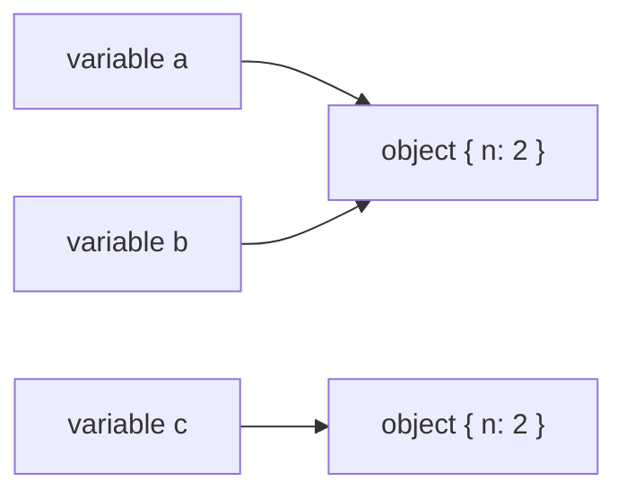

## Introduction

Primitives — strings, numbers, booleans and the rest — are single, unchangeable values. Real programs need more than that. A user has a name, an email and a list of roles; a shopping cart has items and a total; a DOM element has attributes, children and event listeners. JavaScript represents all structured data with one type: the **object**.

An object is a **collection of properties**, where each property pairs a **key** (a string or a symbol) with a value. Two facts set objects apart from primitives, and almost everything in this lesson follows from them:

1. **An object has identity.** Each object you create is a distinct thing, separate from every other object, even one with exactly the same properties. `===` asks "is this the same object?", not "do these look alike?".
2. **An object is mutable.** You can add, change and delete its properties after it is created, and everyone who holds that object sees the change.

The word "object" in JavaScript covers far more than `{}` literals. Arrays, functions, dates, regular expressions, `Map`s, `Set`s, `Promise`s, class instances and DOM nodes are all objects: the language has only seven primitive types, and *everything else* has type object. They differ in their prototype (which methods they inherit) and in some special internal behaviour, but they share the property system and the identity rules taught here.

The title, "objects as values", is the key idea. An object is a value like any other: you can store it in a variable, put it in an array, pass it to a function and return it. What gets stored and passed, though, is a **reference** to the object — a way of finding it — not a fresh copy of its properties. Understanding that one rule prevents a whole family of "why did my data change?" bugs.

## Before you start

- **Primitive types** — the seven non-object types and the fact that they are immutable and compared by value. See [[b1-primitive-types]].
- **Variables** — the difference between a variable (a name, or binding) and the value it holds. See [[b1-variables]].

Prototypes, classes and property descriptors each have their own lessons; this one explains only what you need to reason about objects as values.

## The intuition

Think of an object as a house and a variable as a slip of paper with the house's address written on it. Creating an object builds a new house somewhere in memory and hands you its address. Assigning that variable to another variable copies the *address* onto a second slip of paper; there is still one house. If someone uses either slip to walk in and rearrange the furniture, the house has changed for both of you.

Two houses built from the same blueprint, with identical furniture, are still two houses at two addresses. That is why two objects with the same contents are not `===`: the comparison checks the addresses.

The analogy is accurate about sharing and identity. Where it stops working: you can never see or print an object's address in JavaScript, do arithmetic on it, or hold an address to something that no longer exists. The engine manages addresses for you and frees an object only when no reachable reference to it is left (see [[b1-garbage-collection]]).

## Identity: same object versus same contents

Here is the core behaviour in six lines:

```javascript title="identity.js"
const a = { n: 1 };
const b = a;            // copies the reference, not the object
b.n = 2;
const c = { n: 2 };     // a different object with equal contents
console.log(a.n, a === b, a === c);
console.log(typeof a, typeof [1], typeof (() => {}), typeof new Date(0));
console.log([] === [], {} === {});
```

```output
2 true false
object object function object
false false
```

`const b = a` does not create a second object. Both names refer to the same one, so `b.n = 2` is visible through `a`, and `a === b` is `true`. `c` is a separate object that happens to contain `{ n: 2 }`; `a === c` is `false` even though `a` now contains `{ n: 2 }` as well. Every evaluation of an object literal (`{}`), array literal (`[]`) or function expression creates a **new** object, which is why `[] === []` is `false`.

The second line shows the type family. Arrays and dates report `typeof` `"object"`. Functions report `"function"`, a special case in the `typeof` operator — they are still objects, which is why you can put properties on them. ([[b1-typeof]] covers the operator's full rules.)

Contrast this with primitives: `'abc' === 'abc'` is `true` no matter how each string was produced, because primitives have no identity — only a value. For objects, `===`, `!==`, `==` between two objects, `Object.is`, `Set` membership and `Map` keys all use **identity**. If you want to know whether two objects *contain* the same data, you have to write or choose that comparison yourself, as the worked example below does.

## Creating objects

There are several ways to make an object, and they differ mainly in which prototype the new object gets.

```javascript title="creating.js"
const counter = {
  count: 0,
  increment() { this.count += 1; return this.count; },
};
const settings = Object.create(null);
settings.theme = 'dark';
console.log(counter.increment(), counter.increment());
console.log('toString' in settings, Object.keys(settings));
class Point { constructor(x, y) { this.x = x; this.y = y; } }
const p = new Point(1, 2);
console.log(p, p instanceof Point, typeof Point);
const key = 'y';
console.log(p[key], p['x']);
delete p.x;
console.log(p, p.x);
```

```output
1 2
false [ 'theme' ]
Point { x: 1, y: 2 } true function
2 1
Point { y: 2 } undefined
```

An **object literal** `{ … }` is the everyday form; it creates an object whose prototype is `Object.prototype`. A function stored as a property is a **method**, and inside it `this` refers to the object the method was called on (see [[b1-this]]). `Object.create(proto)` creates an object with a chosen prototype; `Object.create(null)` creates one with *no* prototype, so it does not inherit `toString` or anything else — useful for dictionaries that must not collide with inherited names. A **class** with `new` creates an instance whose prototype is the class's `prototype` object; `typeof Point` is `"function"` because a class is a special kind of function (see [[b1-classes]]).

Properties are read and written with **dot notation** (`p.x`) when the key is a fixed, valid identifier, and **bracket notation** (`p[key]`) when the key is computed or not a valid identifier, such as `obj['content-type']`. `delete p.x` removes the property; reading it afterwards gives `undefined`. [[b1-dot-vs-bracket]] and [[b1-object-literals]] go deeper.

## Property keys are strings or symbols

An object's keys can only be **strings or symbols**. Anything else used as a key is converted to a string first. This produces some of JavaScript's most confusing bugs:

```javascript title="keys.js"
const box = {};
box[1] = 'one';
box['1'] = 'uno';            // same key: numbers become strings
box[true] = 'yes';
const keyObj = { id: 7 };
box[keyObj] = 'object key';  // objects become "[object Object]"
console.log(Object.keys(box));
console.log(box[{ id: 99 }]);
const m = new Map([[keyObj, 'by identity']]);
console.log(m.get(keyObj), m.get({ id: 7 }));
```

```output
[ '1', 'true', '[object Object]' ]
object key
by identity undefined
```

`box[1]` and `box['1']` are the same property, so the second assignment overwrote the first. The real trap is the object key: `{ id: 7 }` converts to the string `"[object Object]"`, and so does *every* plain object, so `box[{ id: 99 }]` finds the value stored under a completely different object. If you need to associate data with objects, use a `Map` (or a `WeakMap` when the association should not keep the object alive). A `Map` keys by identity, so `m.get({ id: 7 })` — a new object — correctly finds nothing. See [[b1-map-vs-object]].

Arrays obey the same rule: an array is an object whose keys are the strings `'0'`, `'1'`, `'2'` and so on, with a special `length` property that the engine keeps in sync. Engines store dense arrays far more efficiently than that description suggests, but the observable behaviour is that of string keys.

Key order is defined, too. `Object.keys`, `for...in` and `JSON.stringify` list integer-like keys first in ascending numeric order, then other string keys in insertion order; symbol keys are skipped by all three:

```javascript title="key-order.js"
const order = { b: 1, 2: 'two', a: 1, 1: 'one', [Symbol('s')]: 0 };
console.log(Object.keys(order));
function makeUser(name) {
  return { name, createdAt: 0 };
}
const users = [makeUser('Ada'), makeUser('Lin')];
const byName = { ada: users[0] };
byName.ada.name = 'Ada L.';
console.log(users[0].name, users[0] === byName.ada);
```

```output
[ '1', '2', 'b', 'a' ]
Ada L. true
```

The second half of that program shows objects behaving as values: `makeUser` returns a new object each call, the array holds references to them, and `byName.ada` holds another reference to the same first user. Renaming through `byName` changes the one object that both collections point at.

## Inherited properties and the prototype chain

Objects can use properties they do not own. Every ordinary object has a hidden link to another object, its **prototype**. When you read a property that the object does not have, the engine looks on the prototype, then the prototype's prototype, and so on until it finds the property or reaches `null`. This is the **prototype chain** (taught fully in [[b1-prototype-chain]]).

```javascript title="inherited.js"
const user = { name: 'Ada' };
console.log(user.toString());                  // inherited, not own
console.log(Object.hasOwn(user, 'toString'), 'toString' in user);
console.log(Object.getPrototypeOf(user) === Object.prototype);
const arr = [10, 20];
console.log(Object.getPrototypeOf(arr) === Array.prototype, Object.keys(arr));
arr.label = 'scores';
console.log(arr.length, arr.label);
function add(x, y) { return x + y; }
add.calls = 0;
console.log(add.name, add.length, add.calls);
```

```output
[object Object]
false true
true
true [ '0', '1' ]
2 scores
add 2 0
```

`user` owns only `name`, yet `user.toString()` works because `Object.prototype` provides it. `Object.hasOwn` reports only **own** properties, while the `in` operator also searches the chain — a distinction that matters when you iterate or check for keys ([[b1-own-vs-inherited]]). Arrays get `map`, `push` and friends from `Array.prototype`. And because arrays and functions are objects, you can attach arbitrary properties to them: `arr.label` does not affect `length`, and `add.calls` sits beside the built-in `name` and `length` (the number of declared parameters). Attaching data to arrays or functions is rarely good style, but it proves the point that they are objects.

## How it works internally

The specification describes an **ordinary object** as having a list of properties plus a few internal slots, written in double brackets: `[[Prototype]]` (the link to its prototype, or `null`) and `[[Extensible]]` (whether new properties may be added — `Object.preventExtensions`, `seal` and `freeze` turn it off). Each property has a key and either a value with flags (writable, enumerable, configurable) or a getter/setter pair; [[b1-property-descriptors]] covers those flags.

Some built-in objects are **exotic**: they override one or more of the internal methods that every object has. Arrays override how properties are defined, so that writing index `5` updates `length` and setting `length` deletes elements. Functions have an internal `[[Call]]` method — that is literally what makes them callable, and what `typeof` checks to return `"function"`. Proxies can override every internal method. Exotic objects are still objects: they have identity and properties.

Engines then implement this model efficiently. V8, for example, does not store each object as a hash table. Objects created the same way share a hidden class (V8 calls them "maps") that records the layout of their properties, so a property read can compile down to "load the value at offset 16" ([[b1-hidden-classes]]). Variables hold a pointer to the object on the heap. The garbage collector periodically finds objects that can no longer be reached from any variable, closure or other live object and frees them ([[b1-reachability]]). None of these details change behaviour, but they explain two practical tips: objects created with the same shape in the same order are faster, and holding references you no longer need keeps memory alive.



## Worked example: when has the state changed?

User interfaces constantly ask "did this data change, so do I need to redraw?". React, for instance, compares state and props with `Object.is`, which for objects means identity, and `React.memo` compares props with a **shallow equality** check. Writing that check yourself makes the three levels of comparison concrete.

```javascript title="shallow-equal.js"
function shallowEqual(a, b) {
  if (Object.is(a, b)) return true;                    // same value or same object
  if (typeof a !== 'object' || a === null ||
      typeof b !== 'object' || b === null) return false;
  const keysA = Object.keys(a);
  const keysB = Object.keys(b);
  if (keysA.length !== keysB.length) return false;
  return keysA.every((k) => Object.hasOwn(b, k) && Object.is(a[k], b[k]));
}

const tags = ['js'];
const prev = { page: 1, sort: 'name', tags };
const sameRef = prev;
const sameContents = { page: 1, sort: 'name', tags };
const copiedTags = { page: 1, sort: 'name', tags: ['js'] };
const changed = { ...prev, page: 2 };

console.log(prev === sameRef, shallowEqual(prev, sameRef));
console.log(prev === sameContents, shallowEqual(prev, sameContents));
console.log(shallowEqual(prev, copiedTags));
console.log(shallowEqual(prev, changed));
console.log(JSON.stringify({ a: 1, b: 2 }) === JSON.stringify({ b: 2, a: 1 }));
```

```output
true true
false true
false
false
false
```

Step through it. The first check, `Object.is(a, b)`, is the cheapest possible answer: the same reference is trivially equal. The second guards against `null` (remember `typeof null` is `"object"`) and primitives. Then it compares own enumerable keys one level deep, using `Object.is` on each value.

The results show the three levels of "equal". `prev` and `sameRef` are **identical** — one object. `prev` and `sameContents` are different objects but **shallowly equal**: each property holds the same primitive or the *same* inner object (both point at the one `tags` array). `copiedTags` is not shallowly equal because its `tags` is a different array, even though it contains the same string — only a **deep** comparison, which recurses into nested objects, would call them equal. `changed` was built with spread, which copies the properties into a new object and overrides `page`.

The last line shows why `JSON.stringify(a) === JSON.stringify(b)` is a poor deep-equality test: the same data with keys inserted in a different order produces different strings. It also ignores `undefined` values, functions and symbols, and fails on `Map`, `Set` and `Date` contents. For real deep equality, use a tested library function or Node's `util.isDeepStrictEqual`.

Why does React use identity rather than deep comparison? Because identity is O(1) and deep comparison can be arbitrarily expensive. The price is a convention: **never mutate state in place; create a new object when something changes**, so that "new reference" reliably means "new data". That convention is the subject of [[b1-primitive-vs-reference]] and [[b4-state-immutability]].

```quiz
Q: What does this print? `const x = { v: 1 }; const y = x; y.v = 5; console.log(x.v, x === { v: 5 });`
- [ ] 1 false
- [x] 5 false
- [ ] 5 true
- [ ] 1 true
> `y = x` copies the reference, so both names reach the same object and `x.v` is 5. The literal `{ v: 5 }` creates a new object, and `===` compares identity, so it is false even though the contents match.

Q: After `const cache = {}; cache[{ id: 1 }] = 'a'; cache[{ id: 2 }] = 'b';`, how many keys does `cache` have?
- [ ] 2, one per object
- [x] 1, because both objects become the key "[object Object]"
- [ ] 0, because objects cannot be keys
- [ ] It throws a TypeError
> Plain-object keys must be strings or symbols, so each object is converted to the string "[object Object]" and the second assignment overwrites the first. Use a Map to key by object identity.

Q: Which comparison does React use by default to decide whether a state value changed?
- [ ] Deep equality of all nested properties
- [ ] JSON.stringify of old and new values
- [x] Object.is, which for objects compares identity
- [ ] == loose equality
> React compares old and new state with Object.is. Mutating an object in place keeps the same identity, so React sees "no change"; creating a new object is what signals an update.
```

## In real systems

**State management.** React, Redux, Vue's change tracking and many other libraries depend on object identity. React skips work when `Object.is(oldState, newState)` is true, and Redux selectors are memoised on reference equality. Mutating an object in place produces UI that does not update; returning new objects for changed data and reusing unchanged ones makes updates both correct and cheap.

**Caching by object.** Memoisation keyed on an argument object needs a `Map` or `WeakMap`, never a plain object, for the reasons shown above. A `WeakMap` keyed on DOM nodes or request objects lets the cache entry disappear when the key object is garbage collected ([[b1-weakmap]]).

**DOM nodes.** `document.querySelector('#app') === document.getElementById('app')` is `true` in a browser because both return the same node object; frameworks rely on node identity to move elements without recreating them. (Browser-only; described from the DOM specification, not run here.)

**API data.** Data from `JSON.parse` is a fresh tree of objects every time, so two fetches of the same resource produce objects that are never `===`. Comparing by a stable ID (`a.id === b.id`) is usually what you want for domain entities.

## Trade-offs and alternatives

| Question you are asking | Tool | Cost | Caveat |
|---|---|---|---|
| Is it literally the same object? | `===` or `Object.is` | O(1) | Equal contents in different objects are "different" |
| Same top-level properties? | shallow equality | O(number of keys) | Nested objects compared by identity |
| Same data all the way down? | deep equality (library, `util.isDeepStrictEqual`) | O(size of the whole structure) | Must handle cycles, `Map`, `Set`, `Date`, prototypes |
| Same domain entity? | compare IDs | O(1) | Requires a stable identifier |

Choosing objects for structured data is not optional in JavaScript, but you do choose *which* object. Plain objects are best for records with known, fixed fields. `Map` is better for dictionaries with arbitrary or non-string keys, frequent additions and deletions, or when you need the size and insertion-order iteration without prototype surprises. `Object.create(null)` gives a prototype-free dictionary when you need plain-object syntax without inherited keys.

The cost of identity semantics is aliasing: any holder of a reference can mutate shared data. The usual mitigations — copying, freezing, and immutable-update conventions — trade some memory and allocation for predictability, and are discussed in [[b1-object-mutability]].

## Common mistakes

**Thinking assignment copies.** `const copy = original` creates a second name for the same object. Later changes through either name affect both. Use `{ ...original }` or `structuredClone(original)` when you need a copy, and know which one is shallow ([[b1-copying-objects]]).

**Comparing objects with `===` to check contents.** `{ a: 1 } === { a: 1 }` is `false`. Decide whether you need identity, shallow, deep or ID comparison.

> [!MISTAKE] Using objects as keys in a plain object
> Every plain object converts to the key `"[object Object]"`, so all object keys collide silently. Use `Map` or `WeakMap`, which key by identity.

**Assuming an array is a separate type.** `typeof []` is `"object"`. Use `Array.isArray(value)` to detect arrays ([[b1-array-from-isarray]]).

**Forgetting `null` in object checks.** `typeof value === 'object'` is also true for `null`, so code like `if (typeof v === 'object') v.id` crashes on `null`. Add `v !== null`.

**Iterating inherited keys by accident.** `for...in` visits enumerable inherited properties too. Prefer `Object.keys`, `Object.entries` or `for...of` over them, which list only own properties.

## Interview perspective

Questions on this topic test whether you can predict behaviour from the identity and reference rules rather than from intuition.

> [!INTERVIEW] "Why is `{} === {}` false?"
> "Each object literal creates a new object with its own identity, and `===` on objects compares identity — whether both sides refer to the same object — not contents. Two separately created empty objects are two different objects. If I need content equality I'd use a shallow or deep comparison, or compare a stable ID."

Be ready for:

- **What types of values are objects?** Everything that is not one of the seven primitives: plain objects, arrays, functions, dates, regexes, maps, sets, promises, class instances, DOM nodes.
- **What can an object key be?** A string or a symbol; other values are converted to strings. Follow-up: how do you key by object? A `Map` or `WeakMap`.
- **What does `const` mean for an object?** The binding cannot be reassigned, but the object can still be mutated ([[b1-const]]).
- **Implement shallow equality.** As in the worked example — identity check, null/primitive guard, key count, per-key `Object.is`.
- **How does `JSON.stringify` comparison fail?** Key order, `undefined`, functions, symbols, `Map`/`Set`, `Date` objects becoming strings, and cycles throwing.
- **Why are functions objects?** They have properties (`name`, `length`, `prototype`), can be stored and passed like any value, and are distinguished only by the internal ability to be called.

## Practice

1. **Predict, then run.** `const a = [1, 2]; const b = a; const c = [...a]; b.push(3);` — what are `a`, `b`, `c`, `a === b` and `a === c`?
2. **Fix the cache.** A colleague memoises `price(product)` with `const cache = {}; cache[product] = result;`. Explain the bug and rewrite it with a `WeakMap`.
3. **Deep equality.** Extend `shallowEqual` into `deepEqual` for plain objects and arrays. Then list three inputs it still handles incorrectly (hint: `Date`, cycles, `Map`).
4. **Key order.** Predict `Object.keys({ z: 1, 10: 1, 2: 1, a: 1 })`, then check.
5. **Prototype-free dictionary.** Count word frequencies in a text where words may include `"constructor"` and `"toString"`. Show what goes wrong with `{}` and fix it with `Object.create(null)` or a `Map`.

## Quick revision {#quick-revision}

- Object = collection of properties (key → value); the only non-primitive type. Arrays, functions, dates, maps, class instances, DOM nodes are all objects.
- Objects have identity and are mutable. Every `{}`, `[]` or function expression creates a new object.
- Variables, array slots and properties hold references; assignment copies the reference, so several names can share one object.
- `===`, `Object.is`, `Set` and `Map` compare objects by identity; `{ a: 1 } === { a: 1 }` is `false`.
- Keys are strings or symbols; numbers become strings, plain objects become `"[object Object]"`. Use `Map`/`WeakMap` to key by object.
- Key order: integer-like keys ascending, then string keys in insertion order; symbols skipped by `Object.keys`, `for...in`, JSON.
- Reads that miss an own property walk the prototype chain; `Object.hasOwn` checks own only, `in` checks the chain.
- Comparison levels: identity (O(1)), shallow (one level), deep (whole tree), or ID-based for entities. `JSON.stringify` is not a reliable deep-equality test.

## Key takeaways {#key-takeaways}

- Everything that is not a primitive is an object, and every object has its own identity.
- Variables hold references to objects, so assignment and passing share the object rather than copying it.
- `===` on objects asks "same object?", never "same contents?" — choose a shallow, deep or ID comparison when you need content equality.
- Plain-object keys are always strings or symbols; use `Map` when keys are objects or arbitrary values.
- Frameworks such as React rely on identity to detect change, which is why updates should create new objects instead of mutating old ones.
