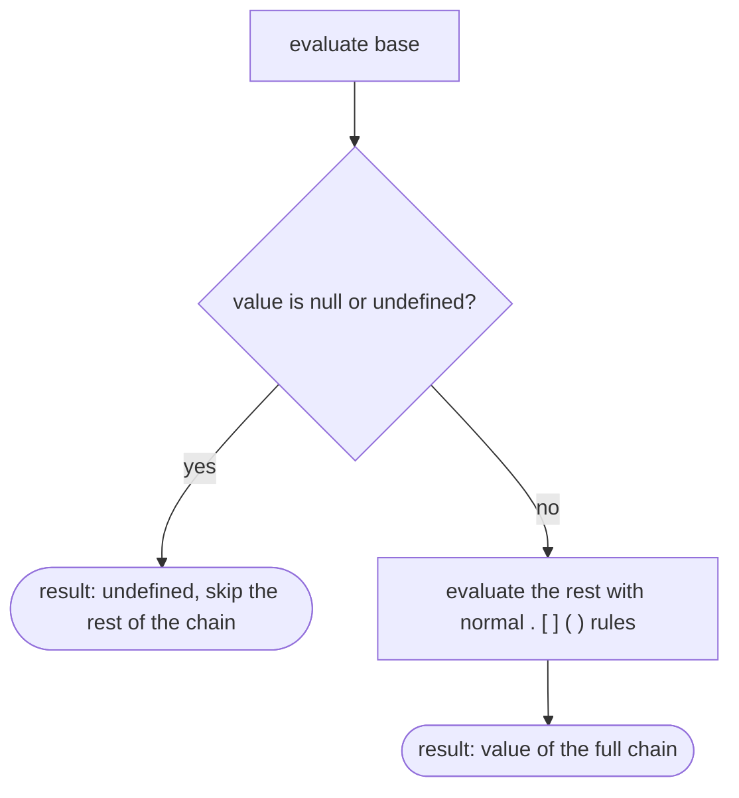

## Introduction

An app fetches a user from an API and shows their city:

```javascript title="crash.js"
const response = { user: { name: 'Ada', address: null } };

try {
  console.log(response.user.address.city);
} catch (e) {
  console.log(e.constructor.name + ': ' + e.message);
}
```

```output
TypeError: Cannot read properties of null (reading 'city')
```

Reading a property from `null` or `undefined` is one of the most common run-time errors in JavaScript. Data from APIs, forms, local storage and the Document Object Model (DOM) is often incomplete: a user may not have entered an address, an element may not be on the page, an optional callback may not have been passed. Before 2020 the standard defence was a chain of `&&` guards:

```javascript
const city = response && response.user && response.user.address && response.user.address.city;
```

That works, but it repeats every step of the path, and it guards against *falsy* values rather than missing ones — so it can return `0`, `''` or `false` from the middle of the chain instead of a consistent "nothing here".

**Optional chaining**, written `?.`, was added in ES2020 to make this guard part of the language. `response.user.address?.city` means: *if `response.user.address` is `null` or `undefined`, stop and produce `undefined`; otherwise read `.city` as usual.* It is supported in every current browser and in Node.js 14 and later.

The operator is small, but there are precise rules about what it checks, how much of the expression it skips, and where it is not allowed. Those rules are the difference between code that is safely tolerant of missing data and code that silently hides bugs.

## Before you start

- **`undefined` and `null`** — the two "nullish" values `?.` reacts to, and how they differ from other falsy values. See [[b1-undefined-vs-null]] and [[b1-truthy-falsy]].
- **Dot and bracket access** — `obj.key` versus `obj[expr]`. See [[b1-dot-vs-bracket]].
- **Short-circuit evaluation** — the idea that an operator can skip evaluating the rest of an expression. See [[b1-short-circuit]].

## The intuition

Picture a chain of property reads as a walk along a path: from `response`, step to `user`, then to `address`, then to `city`. With plain `.`, if any step lands on nothing, you fall through the floor — a `TypeError`.

Writing `?.` at a step puts a checkpoint there. The checkpoint looks at the value you are currently standing on. If it is `null` or `undefined`, the whole walk is abandoned and the expression's value is `undefined`. If it is anything else — including `0`, `''` or `false` — the checkpoint lets you through, and the walk continues as if you had written a normal `.`.

Two parts of that picture matter later. The checkpoint tests the value **to its left**, not the property it is about to read. And when it abandons the walk, it abandons **everything after it in the same chain**, not only the next step.

## The three forms

Optional chaining comes in three shapes, matching the three ways you can continue an expression.

| Form | Meaning | Plain equivalent when the base is present |
|---|---|---|
| `a?.b` | Read property `b` | `a.b` |
| `a?.[expr]` | Read a computed property or array index | `a[expr]` |
| `a?.(args)` | Call `a` as a function | `a(args)` |

In every form, if `a` is `null` or `undefined`, the result is `undefined` and nothing else in the chain runs.

```javascript title="three-forms.js"
const response = { user: { name: 'Ada', tags: ['admin'] } };
const key = 'name';

console.log(response.user?.name, response.profile?.name);   // property
console.log(response.user?.tags?.[0], response.list?.[0]);  // index
console.log(response.user?.[key]);                          // computed key

const onSave = undefined;
console.log(onSave?.('draft'));                              // call
```

```output
Ada undefined
admin undefined
Ada
undefined
```

`response.profile` is `undefined`, so `response.profile?.name` stops before reading `.name`. `response.list` is `undefined`, so the index is never read. `onSave` is `undefined`, so the call never happens.

The bracket and call forms need the dot: `a?.[0]` and `fn?.()`, not `a?[0]` or `fn?()`. The dot is what distinguishes optional chaining from the conditional operator `a ? b : c`. The lexer treats `?.` followed by a digit as the conditional operator followed by a decimal number, so `cond?.5:1` still means `cond ? 0.5 : 1`.

### Optional calls and methods

The call form has two common placements, and they protect against different things.

`obj?.method()` checks `obj`. If `obj` is nullish, nothing happens. If `obj` exists but has no `method`, the call still throws, because nothing checked `method` itself.

`obj.method?.()` checks `method`. It is the form for optional callbacks and for features that may not exist. If `obj.method` is nullish, the call is skipped; if it exists, it is called **with `this` set to `obj`**, exactly as a normal method call would be.

```javascript title="optional-calls.js"
const api = {
  name: 'api',
  describe() { return 'this.name = ' + this.name; },
  label: 'not a function',
};

console.log(api.describe?.());   // exists: called with this === api
console.log(api.missing?.());    // nullish: skipped

try {
  api.label?.();                 // exists but is not callable
} catch (e) {
  console.log(e.constructor.name + ': ' + e.message);
}
```

```output
this.name = api
undefined
TypeError: api.label is not a function
```

The last case is the important one: `?.()` checks only for `null` and `undefined`. A value that exists but is not a function — a string, a number, an object — still produces a `TypeError`. Optional chaining is not a type check.

## Only `null` and `undefined` stop the chain

`?.` does not test truthiness. `0`, `''`, `false` and `NaN` are real values, so the chain continues through them:

```javascript title="falsy-values.js"
const stats = { count: 0, title: '', enabled: false };

console.log(stats.count?.toFixed(1));
console.log(stats.title?.length);
console.log(stats.enabled?.toString());

const nothing = null;
console.log(nothing?.length);
```

```output
0.0
0
false
undefined
```

This is the main improvement over `&&` guards. `stats.count && stats.count.toFixed(1)` would return `0` (the number) instead of `'0.0'`, because `&&` stops on any falsy value.

Note also that a failed `?.` always produces `undefined`, even when the base was `null`. `nothing?.length` is `undefined`, not `null`. If your code needs to distinguish "the object was `null`" from "the object was missing", optional chaining erases that difference and you need an explicit check.

## How far a short-circuit reaches

When `?.` finds a nullish base, it skips **the rest of the chain** — every `.`, `[ ]` and `( )` that follows in the same expression. This is called **long short-circuiting**, and it is why you do not need a `?.` at every step after the first uncertain one:

```javascript title="short-circuit-reach.js"
const config = null;
console.log(config?.server.port.toString());   // all of .server.port.toString() skipped

let count = 0;
config?.log(count++);                            // the argument is not evaluated either
config?.[count++];
console.log('count', count);
```

```output
undefined
count 0
```

`config?.server.port.toString()` does not throw even though `.port` and `.toString()` have no `?.`: once `config` was found to be `null`, the whole remainder was skipped. The same skip covers arguments and computed keys — `count++` never ran.

The flip side is that `?.` protects **only the step it is written on**. If the base is present, the chain continues with ordinary `.` semantics, and a later missing value throws:

```javascript title="partial-protection.js"
const response = { user: { address: null } };

console.log(response?.user.address);           // fine: user exists

try {
  console.log(response?.user.address.city);    // address is null, read without ?.
} catch (e) {
  console.log(e.message);
}

console.log(response?.user.address?.city);     // checkpoint where it is needed
```

```output
null
Cannot read properties of null (reading 'city')
undefined
```

`response` is not nullish, so the first `?.` lets the walk continue. `.user` is fine, `.address` is `null`, and `.city` is a plain read on `null` — a `TypeError`. The fix is to put `?.` **immediately after the value that may be missing**, which here is `address`. A useful habit is to ask, for each step, "can the thing on the left of this dot legitimately be missing?" and add `?.` only there.

### Parentheses end the chain

The skip applies to the *chain*, and parentheses end a chain. `(a?.b).c` first evaluates `a?.b` completely — producing `undefined` if `a` is nullish — and then reads `.c` from that result:

```javascript title="parentheses.js"
const a = null;
console.log(a?.b.c);              // whole chain skipped
try {
  console.log((a?.b).c);          // the parentheses produce undefined, then .c is read
} catch (e) {
  console.log(e.message);
}
```

```output
undefined
Cannot read properties of undefined (reading 'c')
```

You rarely write the parentheses on purpose, but they appear when code is refactored — for example, when `a?.b` is moved into a helper variable and `.c` is read from the variable later.

## Combining `?.` with `??`

A failed chain produces `undefined`, which is exactly the value that the **nullish coalescing operator** `??` replaces. Together they express "read this nested value, or use a default":

```javascript title="with-nullish.js"
function themeFor(user) {
  return user?.settings?.theme ?? 'light';
}

console.log(themeFor({ settings: { theme: 'dark' } }));
console.log(themeFor({ settings: {} }));
console.log(themeFor(null));
console.log(JSON.stringify(themeFor({ settings: { theme: '' } })));
```

```output
dark
light
light
""
```

Both operators react only to `null` and `undefined`, so they compose cleanly: a stored empty string survives (the last line prints it as `""`), while a missing path falls back to the default. With `||` instead of `??`, the empty string would also be replaced, which may or may not be what you want. `??` is covered fully in [[b1-nullish-coalescing]].

## Where `?.` is not allowed

Optional chaining is for **reading** and **calling**. It cannot appear where a value would be written or constructed. All of these are syntax errors, so the script will not load:

| Code | Error in Node.js 22 | Why |
|---|---|---|
| `a?.b = 1` | `Invalid left-hand side in assignment` | If `a` were nullish there would be nothing to assign to |
| `a?.b++` | `Invalid left-hand side expression in postfix operation` | Same reason: `++` writes |
| `new a?.b()` | `Invalid optional chain from new expression` | Constructing something that might not exist is ambiguous |
| ``a?.b`text` `` | `Invalid tagged template on optional chain` | Tagged templates are excluded by the grammar |
| `for (a?.b of list) {}` | `Invalid left-hand side in for-loop` | The loop head writes to its target |

To write to an optional path, check it first: `if (a) a.b = 1;`, or create the missing object with logical assignment — `a.settings ??= {}` followed by `a.settings.theme = 'dark'` ([[b1-logical-assignment]]).

Two related cases are allowed. `delete a?.b` is valid: if `a` is nullish, nothing is deleted and the expression returns `true`, which is what `delete` returns for a property that does not exist. And `?.` can appear on the right side of a destructuring assignment, as in `({ x } = obj?.point)` — though if `obj` is nullish, destructuring `undefined` then throws.

Optional chaining also does **not** protect against an undeclared variable. `undeclaredName?.x` still throws `ReferenceError: undeclaredName is not defined`, because the variable lookup fails before `?.` can look at a value. For possibly undeclared globals, use `typeof name !== 'undefined'` or read them as properties of the global object, such as `globalThis.someName`, which gives `undefined` instead of throwing.

## How it works internally

The specification defines an **OptionalChain** as a sequence of accesses attached to a base expression. Evaluating `base?.rest` works like this:

1. Evaluate `base` and get its value.
2. If the value is `undefined` or `null`, the result of the entire optional expression is `undefined`. The `rest` is never evaluated.
3. Otherwise, evaluate `rest` against the value, step by step, with ordinary property access and call semantics.



Step 3 is why a later plain `.` can still throw: it is ordinary property access. Step 2 is why arguments and computed keys after a failed check are never evaluated: they are part of `rest`. For calls, the specification keeps track of the object the function was read from, so `obj.method?.()` calls the method with `this === obj`.

Because there is no special run-time machinery, optional chaining is cheap. It compiles to the same conditional jump you would write by hand. When code targets an older runtime, TypeScript and Babel rewrite it into that hand-written form. Compiling `s?.name?.first` with TypeScript 6.0 and `--target es2019` produces:

```javascript title="downlevel-output.js"
var _a;
const first = (_a = s === null || s === void 0 ? void 0 : s.name) === null || _a === void 0
  ? void 0
  : _a.first;
```

The temporary `_a` exists so that `s.name` is evaluated only once, and `void 0` is a reliable way to write `undefined` (see [[b1-in-delete-void]]). The output is longer than the source, but it behaves identically.

## Worked example: rendering an order summary

A function formats an order for display. The data comes from an API where the customer may be a guest (no account), the shipping address is optional, and a discount callback is supplied only for some promotions.

```javascript title="order-summary.js"
function summarize(order) {
  const name = order.customer?.name ?? 'Guest';
  const city = order.shipping?.address?.city ?? 'pickup in store';
  const firstItem = order.items?.[0]?.title ?? 'no items';
  const total = order.applyDiscount?.(order.total) ?? order.total;
  return `${name} | ${city} | ${firstItem} | ${total.toFixed(2)}`;
}

console.log(summarize({
  customer: { name: 'Ada' },
  shipping: { address: { city: 'Oslo' } },
  items: [{ title: 'Keyboard' }],
  total: 100,
  applyDiscount: (t) => t * 0.9,
}));

console.log(summarize({ customer: null, items: [], total: 40 }));
console.log(summarize({ total: 0 }));
```

```output
Ada | Oslo | Keyboard | 90.00
Guest | pickup in store | no items | 40.00
Guest | pickup in store | no items | 0.00
```

Walk through the second call. `order.customer` is `null`, so `order.customer?.name` is `undefined` and `??` supplies `'Guest'`. `order.shipping` is `undefined`, so the whole `?.address?.city` chain is skipped. `order.items` is an empty array — present, so `?.[0]` reads index 0, which is `undefined`, and the next `?.title` stops there. `order.applyDiscount` is `undefined`, so the call is skipped and its argument `order.total` is never even read; `??` falls back to the plain total.

Two design decisions are worth noticing. First, `order.total` has no `?.`: an order without a total is a bug in the API, and the code *should* throw (`total.toFixed` on `undefined`) so the bug is found. Second, the third call passes `total: 0`, and `??` keeps it. With `||`, `order.applyDiscount?.(...) || order.total` would also work here, but `order.customer?.name || 'Guest'` would turn a customer literally named `''` into `'Guest'`. Choosing `??` keeps the meaning "missing", not "falsy".

## In real systems

**Optional callback props in React.** Components often accept optional event handlers. `props.onChange?.(value)` calls the handler only if the parent passed one, replacing `if (props.onChange) props.onChange(value)`.

**API responses and JSON.** Optional chaining is the standard way to read deeply nested, partially populated JSON — GraphQL responses, configuration files and third-party webhooks. It is usually followed by `??` to supply a default.

**Feature detection.** Code that runs in several environments checks for optional APIs with calls such as `navigator.clipboard?.writeText(text)` or `window.matchMedia?.('(prefers-color-scheme: dark)')`. These depend on browser APIs and were not run for this lesson; the pattern skips the call where the API is absent.

**TypeScript narrowing.** With `strictNullChecks`, the type of `user?.address` is the address type plus `undefined`, and TypeScript forces you to handle the `undefined` case before using the value. The typescript-eslint rule `no-unnecessary-condition` goes further and reports a `?.` on a value whose type can never be nullish ([[b2-strict-null-checks]]).

**DOM queries.** `document.querySelector('#banner')?.remove()` removes the element if it exists and does nothing otherwise — useful in scripts that run on several pages.

## Trade-offs and alternatives

| Approach | Example | Behaviour | Best when |
|---|---|---|---|
| Plain access | `a.b.c` | Throws if a step is missing | The data is guaranteed; a missing value is a bug |
| Optional chaining | `a?.b?.c` | `undefined` if a checked step is nullish | Absence is a legitimate, expected state |
| `&&` guard | `a && a.b && a.b.c` | Stops on any falsy value, returns it | Pre-ES2020 code; or when the test really is truthiness |
| Explicit `if` | `if (!a) return …;` | Full control, can log or throw | Absence needs specific handling, not just a default |
| Defaults at the boundary | Normalise API data once | Rest of the code uses plain access | Large codebases with one entry point for external data |

The main cost of optional chaining is not performance; it is **meaning**. Every `?.` tells the reader "this can legitimately be missing". Scattering it everywhere hides which values are truly optional, and turns crashes — which point at the bug — into `undefined` values that surface far away as "undefined is shown in the UI" or `NaN` in a calculation. Use it at the boundaries where data is genuinely optional, and keep plain access where a missing value means something has gone wrong.

> [!WARNING] Silent failures travel
> `const price = product?.price;` followed by `price * quantity` gives `NaN` when `product` is missing, and that `NaN` may be displayed or saved many lines later. If a value is required for the next step, check it and fail early instead of chaining past it.

## Common mistakes

> [!MISTAKE] Putting `?.` in the wrong place
> `user?.address.city` protects against a missing `user`, not a missing `address`. Put the `?.` immediately after the value that may be missing: `user.address?.city`, or `user?.address?.city` if both may be.

**Expecting `?.()` to check that something is a function.** It checks only for `null`/`undefined`. A non-function value still throws `TypeError: … is not a function`.

**Trying to assign through an optional chain.** `settings?.theme = 'dark'` is a `SyntaxError`. Create or check the object first.

**Expecting `null` back.** A failed chain always yields `undefined`. Code that compares the result with `=== null` will never match.

**Using `?.` to silence a bug.** If a value should always be present, a `TypeError` is useful information. Adding `?.` until the error disappears moves the failure somewhere harder to debug.

**Assuming it handles undeclared variables.** `missingVar?.x` still throws a `ReferenceError`.

## Interview perspective

Interviewers use optional chaining to check whether you know the precise rules rather than the rough idea. Explain it in terms of the base value and the rest of the chain.

> [!INTERVIEW] What a strong answer sounds like
> "`a?.b` evaluates `a`; if it is `null` or `undefined`, the whole rest of the chain is skipped and the result is `undefined`. Otherwise it continues as a normal property access, so a later plain dot can still throw. It does not react to other falsy values like `0` or `''`, and it cannot be used on the left of an assignment."

Questions you should be able to answer:

- **What is the difference between `obj?.fn()` and `obj.fn?.()`?** The first checks `obj`; the second checks `fn`. Use the second for optional callbacks.
- **Does `a?.b.c` throw if `a` is `null`?** No — the whole chain is skipped. It throws only if `a` exists and `a.b` is nullish.
- **What does `(a?.b).c` do when `a` is `null`?** Throws, because the parentheses end the chain and `.c` is read from `undefined`.
- **Why is `?.` better than `&&` for guards?** It checks only nullish values, returns a consistent `undefined`, and does not repeat the path.
- **How is it compiled for old browsers?** Into a conditional that compares the base with `null` and `undefined`, using a temporary variable so the base is evaluated once.
- **When should you not use it?** When the value is required; failing loudly is better than propagating `undefined`.

```quiz
Q: `const config = { server: null };` What does `config.server?.port.number` evaluate to?
- [ ] It throws a TypeError because `.number` has no `?.`
- [x] `undefined`, because the nullish `server` stops the rest of the chain
- [ ] `null`, because `server` is `null`
- [ ] `0`
> When `?.` finds a nullish base, the entire rest of the chain — `.port.number` — is skipped. The result is always `undefined`, never `null`, even when the base was `null`.

Q: Which line throws?
- [ ] `const s = null; s?.trim();`
- [ ] `const s = ''; s?.trim();`
- [x] `const o = { s: null }; o?.s.trim();`
- [ ] `const o = null; o?.s.trim();`
> In the third line `o` exists, so the chain continues; `o.s` is `null`, and `.trim()` is a plain call on `null`. The `?.` protects only the step it is written on. In the fourth line `o` itself is nullish, so everything after `?.` is skipped.

Q: `const handlers = { onSave: 'save' };` What happens on `handlers.onSave?.()`?
- [ ] Nothing, because `?.()` skips non-functions
- [ ] It returns `undefined`
- [x] It throws `TypeError: handlers.onSave is not a function`
- [ ] It is a SyntaxError
> `?.()` only checks whether the callee is `null` or `undefined`. `'save'` is neither, so the call proceeds and fails because a string is not callable.

Q: Which of these is a SyntaxError?
- [ ] `delete user?.token`
- [x] `user?.token = 'x'`
- [ ] `user?.[key]`
- [ ] `callback?.(1, 2)`
> Optional chains cannot be assignment targets: if `user` were nullish there would be no object to write to. `delete` through an optional chain is allowed and returns `true` when the base is nullish.
```

## Practice

1. **Rewrite the guards.** Convert `a && a.b && a.b.c && a.b.c()` to optional chaining. Then find an input for which the two versions behave differently (one value differs, or one throws and the other does not), and explain why.
2. **Place the checkpoints.** For a type where `user` is always present, `user.profile` is optional and `user.profile.avatar` is optional, write the shortest correct expression to read `user.profile.avatar.url`, with `'/default.png'` as the fallback.
3. **Optional events.** Write a `Button` function that takes an options object with optional `onClick` and `onHover` callbacks and calls them safely, preserving `this` where it matters.
4. **Spot the masked bug.** Review a function that computes `order?.items?.length * order?.unitPrice`. Explain what happens when `order` is missing and rewrite it to fail early.
5. **Read the output.** Compile `a?.b?.()` with TypeScript and `--target es2019` and explain each part of the generated code.

## Quick revision {#quick-revision}

- `a?.b`, `a?.[expr]`, `a?.(args)`: if `a` is `null` or `undefined`, result is `undefined`; otherwise behave like `.`, `[ ]`, `( )`. ES2020, Node.js 14+.
- Only nullish values stop the chain; `0`, `''`, `false`, `NaN` pass through.
- A failed chain always yields `undefined`, never `null`.
- Long short-circuit: a nullish base skips the entire rest of the chain, including arguments and computed keys.
- `?.` protects only the step it is on; a later plain `.` on a nullish value still throws.
- Parentheses end the chain: `(a?.b).c` throws when `a` is nullish.
- `obj?.fn()` checks `obj`; `obj.fn?.()` checks `fn` and keeps `this === obj`; non-functions still throw.
- Not allowed: assignment targets, `++`/`--`, `new a?.b()`, tagged templates, `for…of` targets. Allowed: `delete a?.b`.
- Undeclared variables still throw `ReferenceError`.
- Pair with `??` for defaults: `user?.settings?.theme ?? 'light'`.

## Key takeaways {#key-takeaways}

- Optional chaining turns "reading from nothing" from a crash into `undefined`, but only at the steps where you write `?.`.
- It reacts only to `null` and `undefined`, which makes it more precise than `&&` guards and a natural partner for `??`.
- A nullish base skips everything after it in the chain; a present base lets ordinary access rules resume.
- It reads and calls; it never assigns or constructs.
- Each `?.` documents that a value is legitimately optional — use it where that is true, and let required values fail loudly.
