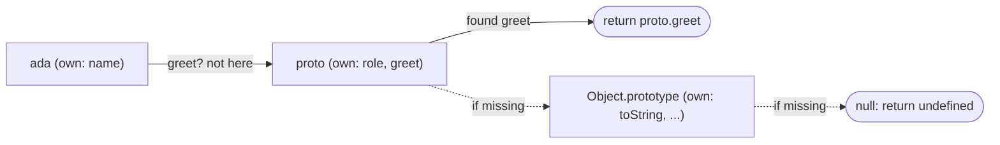

## Introduction

Create the smallest object you can and ask it a few questions:

```javascript title="mystery.js"
const user = { name: 'Ada' };

console.log(user.name);
console.log(typeof user.toString);
console.log(Object.keys(user));
console.log(JSON.stringify(user));
```

```output
Ada
function
[ 'name' ]
{"name":"Ada"}
```

You wrote one property, `name`. Yet `user.toString` is a function, even though you never wrote it. And `Object.keys` and `JSON.stringify` agree with you that the object has only `name`. So does `user` have a `toString` property or not?

The answer is: **it can reach one, but it does not own one**. `name` is an **own property** — it is stored on the `user` object itself. `toString` is an **inherited property** — it is stored on another object, `Object.prototype`, and `user` can see it because `Object.prototype` is `user`'s **prototype**. When you read `user.toString`, JavaScript looks on `user`, does not find it, and continues the search on the prototype, where it does.

This split is how JavaScript shares behaviour. Every array you create can call `push` because `push` lives once on `Array.prototype`, not copied into each array. Every instance of a class can call its methods because the methods live once on the class's prototype object. The design saves memory and lets a change in one place reach every object — but it also means that "does this object have property `x`?" has two honest answers, and every JavaScript operation picks one of them. `user.toString` and `'toString' in user` look through the prototype chain. `Object.keys`, `Object.hasOwn`, spread and `JSON.stringify` look only at own properties.

Most of the bugs in this area come from using an operation that answers the wrong one of those two questions: a word counter that thinks it has already seen the word `"constructor"`, a `for...in` loop that suddenly iterates a key some library added to a prototype, a class instance that serialises to `{}`. This lesson teaches where each operation looks, why it looks there, and how to choose. Its nested concept, [[b1-enumerable-properties|enumerable properties]], explains the second filter that decides what shows up when you list, copy or serialise an object.

## Before you start

- **Object literals and property access** — creating objects with `{ … }`, and reading properties with `obj.key` and `obj[key]`. See [[b1-object-literals]].
- **Objects as values** — that an object has identity and variables hold references to it. See [[b1-objects-as-values]].
- **`Object.create`** — this lesson uses `Object.create(proto)` to make an object whose prototype is `proto`. That one sentence is all you need here; the full story is in [[b1-object-assign-create]] and [[b1-object-create]].
- **Prototypes** — you do not need to know them in depth. This lesson explains the part that matters: an object has a link to one other object (or `null`), and reads that fail on the object continue there. The full mechanism is taught in [[b1-prototypes]] and [[b1-prototype-chain]].
- **Strict mode** — some failed writes throw in strict mode and fail silently otherwise. See [[b1-strict-mode]]. Snippets whose title ends in `.mjs` run as ES modules, which are always strict.

All snippets were run in Node.js 22; current browsers behave the same, except where console formatting is mentioned.

## The intuition

Think of an object as **your backpack**, and its prototype as **the reference handbook in the school library**. Your backpack holds your own things: your name tag, your notes. When someone asks you a question you cannot answer from your backpack, you walk to the library and look it up in the handbook. Every student shares that one handbook.

That picture explains the four everyday behaviours:

1. **Reading** checks your backpack first, then the handbook. If both have an answer, your backpack wins.
2. **Writing** puts a new paper in your backpack. It never scribbles in the shared handbook. If your paper covers the same topic as a handbook page, from now on you see your paper — you have **shadowed** the handbook page.
3. **Deleting** removes a paper from your backpack. If it was covering a handbook page, the handbook's answer becomes visible again.
4. **Listing "what's in your backpack"** shows only your own papers, not the handbook.

The analogy breaks in two places, and both are worth remembering. First, the handbook is *live*: if the librarian edits it, every student immediately sees the new text, because nobody copied it. Second, a few handbook pages are marked "this answer is final" (read-only) or "hand your paper to the librarian" (a setter) — in those cases writing does *not* simply put a paper in your backpack. Both exceptions are covered below.

## Own properties

An **own property** is a property stored directly on the object — the object's own entry for that key. Everything you write in an object literal, every property you assign with `obj.key = value`, and every class field is an own property.

```javascript title="own-properties.js"
const proto = { role: 'user', greet() { return `hi, I am ${this.name}`; } };
const ada = Object.create(proto);   // ada's prototype is proto
ada.name = 'Ada';                   // own property

console.log(ada.name, ada.role, ada.greet());
console.log(Object.hasOwn(ada, 'name'), Object.hasOwn(ada, 'role'));
console.log(Object.keys(ada));
```

```output
Ada user hi, I am Ada
true false
[ 'name' ]
```

`ada` has exactly one own property, `name`. It can still read `role` and call `greet`, because both live on `proto`. Notice that inside `greet`, `this.name` found `'Ada'`: the method lives on the prototype, but it runs with `this` set to the object you called it on. That is why one shared method can serve every object that inherits it.

The same layout appears everywhere in the language:

| Object | Own properties | Inherited from the prototype |
|---|---|---|
| `{ name: 'Ada' }` | `name` | `toString`, `hasOwnProperty`, `valueOf` (from `Object.prototype`) |
| `[10, 20]` | `'0'`, `'1'`, `length` | `push`, `map`, `filter` (from `Array.prototype`) |
| `new Account()` from `class Account { owner = 'Ada'; deposit() {} }` | `owner` (class fields are own) | `deposit` (class methods live on `Account.prototype`) |
| `'hi'` wrapped as an object | `'0'`, `'1'`, `length` | `toUpperCase`, `slice` (from `String.prototype`) |

The class row is the one beginners most often get wrong. A class field such as `owner = 'Ada'` runs once per instance and creates an own property on each instance. A method such as `deposit() {}` is created once and stored on `Account.prototype`. A hundred accounts share one `deposit` function. See [[b1-public-private-fields]] for fields and [[b1-classes]] for the rest of the class syntax.

## Reading: the lookup walks the chain

When you read `obj.key`, JavaScript performs a lookup that is defined in the specification as the object's **[[Get]]** internal method. (Double square brackets mark the language's internal operations; you cannot call them directly, but every property access runs one.) For ordinary objects it works like this:

1. Look for an own property named `key` on `obj`. If found, return its value.
2. Otherwise, move to `obj`'s prototype and repeat step 1 there.
3. If the prototype is `null` — the end of the chain — return `undefined`.



Two consequences follow directly from that algorithm.

**The first match wins.** If both `ada` and `proto` have `role`, the read returns `ada`'s and never looks at `proto`. That is shadowing, and it is how an instance overrides a default.

**Prototype changes are seen immediately.** Nothing is copied when an object is created, so if the prototype gains or changes a property later, every object that inherits from it sees the change on its next read.

```javascript title="live-prototype.js"
const defaults = { theme: 'light', fontSize: 14 };
const settings = Object.create(defaults);
settings.fontSize = 18;              // shadows defaults.fontSize

console.log(settings.theme, settings.fontSize);
defaults.theme = 'dark';             // edit the shared object
console.log(settings.theme);
```

```output
light 18
dark
```

`settings` never had its own `theme`, so each read goes to `defaults`, and the second read sees `'dark'`. This "live defaults" behaviour can be useful, but it is also why mutating a prototype that many objects share — and above all a built-in prototype such as `Object.prototype` — affects code far away from yours. That is the root of [[b1-prototype-pollution|prototype pollution]].

> [!NOTE] Is walking the chain slow?
> Conceptually every read can walk several objects. In practice, engines such as V8 remember where a property was found at each access site (a technique called inline caching), so reading an inherited method in a hot loop is not something to optimise away in everyday code. Write for clarity; [[b1-js-engine]] explains the engine side.

## Writing: assignment creates or updates an own property

The rule for `obj.key = value` is short: in the normal case, **assignment writes an own property on `obj`**. If `obj` already owns `key`, its value is replaced. If it does not, a new own property is created — even when a prototype has a property with the same name. The prototype is left untouched.

```javascript title="shadowing.js"
const proto = { role: 'user' };
const ada = Object.create(proto);

ada.role = 'admin';                  // creates an own property on ada
console.log(ada.role, proto.role, Object.keys(ada));
```

```output
admin user [ 'role' ]
```

This is what makes prototypes safe to share: an instance writing to "its" `role` cannot change the value every other instance sees.

The full assignment algorithm (the **[[Set]]** internal method) does look up the chain first, though, and what it finds there can change the outcome. There are three exceptions to "assignment creates an own property":

| What the lookup finds for `key` | What `obj.key = value` does |
|---|---|
| Nothing anywhere, or a writable data property on a prototype | Creates or updates an own data property on `obj` (the normal case) |
| A **read-only** data property on a prototype (`writable: false`) | Does nothing. Fails silently in sloppy mode, throws `TypeError` in strict mode |
| An **accessor** (getter/setter pair) on a prototype | Calls the inherited setter with `this` set to `obj`. No own property named `key` is created. If there is a getter but no setter, the write fails as above |
| Nothing, and `obj` is non-extensible (`Object.preventExtensions`, `seal`, `freeze`) | Fails: silently in sloppy mode, `TypeError` in strict mode |

The first exception surprises people because it means a frozen prototype stops instances from shadowing its properties by assignment:

```javascript title="override-mistake.mjs"
const frozenProto = Object.freeze({ color: 'red' });
const car = Object.create(frozenProto);

try {
  car.color = 'blue';
} catch (e) {
  console.log(e.constructor.name + ': ' + e.message);
}

// defineProperty does not consult the prototype, so it can still create an own property
Object.defineProperty(car, 'color', {
  value: 'blue', writable: true, enumerable: true, configurable: true,
});
console.log(car.color, Object.hasOwn(car, 'color'));
```

```output
TypeError: Cannot assign to read only property 'color' of object '#<Object>'
blue true
```

The behaviour is deliberate in the specification — a read-only inherited property is treated as read-only for every object that inherits it — but it is often called the **override mistake** because it blocks a reasonable thing you might want to do. `Object.defineProperty` gets around it because it defines a property directly on the object instead of performing an assignment; [[b1-define-property]] explains the difference.

The setter case matters as soon as you use classes with `set` accessors: `instance.value = 5` runs the setter defined on the class prototype, and the instance gains no own `value` property. [[b1-getters-setters]] covers it in detail.

## Deleting: only own properties are removed

`delete obj.key` removes an own property from `obj` and nothing else. It never walks the chain. If the deleted property was shadowing an inherited one, the inherited value becomes visible again; deleting a property the object does not own does nothing and still returns `true`.

```javascript title="delete-reveals.js"
const proto = { role: 'user' };
const ada = Object.create(proto);
ada.role = 'admin';

delete ada.role;
console.log(ada.role);               // the inherited value shows through again
console.log(delete ada.role, ada.role, proto.role);
```

```output
user
true user user
```

The second `delete` returned `true` but did not touch `proto.role`. To remove the inherited property you must delete it from the object that owns it — `delete proto.role` — which, as with any prototype change, affects every object that inherits from it. The `delete` operator's return value and its strict-mode behaviour are covered in [[b1-in-delete-void]].

## Asking "does it have this property?"

There are three common ways to ask whether an object has a property, and they answer different questions.

**`key in obj`** asks: *can a read of `obj[key]` find a property anywhere on the chain?* It returns `true` for own and inherited properties, including non-enumerable ones such as `toString`.

**`Object.hasOwn(obj, key)`** asks: *does `obj` itself own `key`?* It ignores the prototype completely. It was added in ECMAScript 2022 (Node.js 16.9, and all current browsers).

**`obj.hasOwnProperty(key)`** asks the same thing as `Object.hasOwn`, but it is a method inherited from `Object.prototype` — and that inheritance is its weakness. An object created with `Object.create(null)` has no prototype, so it has no `hasOwnProperty` method at all. And any object can have its own property called `hasOwnProperty` that shadows the real one, for example when the object was parsed from user-supplied JSON.

```javascript title="existence-checks.js"
const proto = { role: 'user' };
const ada = Object.create(proto);
ada.name = 'Ada';
console.log('role' in ada, Object.hasOwn(ada, 'role'), Object.hasOwn(ada, 'name'));
console.log('toString' in ada, Object.hasOwn(ada, 'toString'));

const dict = Object.create(null);    // no prototype at all
dict.a = 1;
try {
  dict.hasOwnProperty('a');
} catch (e) {
  console.log(e.constructor.name + ': ' + e.message);
}
console.log(Object.hasOwn(dict, 'a'));

const fromUser = JSON.parse('{"hasOwnProperty": 1}');
try {
  fromUser.hasOwnProperty('x');
} catch (e) {
  console.log(e.constructor.name + ': ' + e.message);
}
console.log(Object.hasOwn(fromUser, 'x'));
```

```output
true false true
true false
TypeError: dict.hasOwnProperty is not a function
true
TypeError: fromUser.hasOwnProperty is not a function
false
```

Before `Object.hasOwn` existed, the safe spelling was `Object.prototype.hasOwnProperty.call(obj, key)`, which borrows the real method and so works on any object. You will still see it in older code and libraries; `Object.hasOwn` is the same check with less ceremony, and is what you should write today. [[b1-object-hasown]] covers it as part of the Object API.

> [!WARNING] `obj.key !== undefined` is not an existence check
> It cannot tell "missing" from "present with the value `undefined`", and it looks through the prototype chain like `in` does. `({ a: undefined }).a !== undefined` is `false` even though `a` exists. Use `Object.hasOwn` or `in`, depending on which question you mean.

Here is the choice in one table:

| You want to know… | Use | Sees inherited? |
|---|---|---|
| Will `obj[key]` find something? | `key in obj` | Yes |
| Did this object itself get `key`? | `Object.hasOwn(obj, key)` | No |
| The same, in code that must run on pre-2022 engines | `Object.prototype.hasOwnProperty.call(obj, key)` | No |
| Does `obj[key]` hold a usable value? | `obj[key] !== undefined` or `obj[key] != null` | Yes, and conflates missing with `undefined` |

## Listing properties

The last group of operations lists keys. Here the own/inherited split combines with two other properties of a key: whether it is **enumerable** (a per-property flag explained in the next section) and whether it is a **string or a symbol** (see [[b1-symbols]]).

```javascript title="listing.js"
const proto = { inherited: 1 };
const obj = Object.create(proto);
obj.visible = 2;
obj[Symbol('tag')] = 3;
Object.defineProperty(obj, 'hidden', { value: 4, enumerable: false });

const forIn = [];
for (const key in obj) forIn.push(key);

console.log('for...in            ', forIn);
console.log('Object.keys         ', Object.keys(obj));
console.log('getOwnPropertyNames ', Object.getOwnPropertyNames(obj));
console.log('getOwnPropertySymbols', Object.getOwnPropertySymbols(obj));
console.log('Reflect.ownKeys     ', Reflect.ownKeys(obj));
```

```output
for...in             [ 'visible', 'inherited' ]
Object.keys          [ 'visible' ]
getOwnPropertyNames  [ 'visible', 'hidden' ]
getOwnPropertySymbols [ Symbol(tag) ]
Reflect.ownKeys      [ 'visible', 'hidden', Symbol(tag) ]
```

Read the table this produces as three questions per API:

| API | Own | Inherited | Non-enumerable | Symbol keys |
|---|---|---|---|---|
| `for...in` | Yes | Yes | No | No |
| `Object.keys` / `values` / `entries` | Yes | No | No | No |
| `Object.getOwnPropertyNames` | Yes | No | Yes | No |
| `Object.getOwnPropertySymbols` | Yes | No | Yes | Only symbols |
| `Reflect.ownKeys` | Yes | No | Yes | Yes |
| Spread `{ ...obj }` and `Object.assign` | Yes | No | No | Yes |
| `JSON.stringify` | Yes | No | No | No |

`for...in` is the only listing operation that walks the prototype chain. That is why code written before `Object.keys` existed (ES5, 2009) used the guard pattern:

```javascript
for (const key in obj) {
  if (!Object.hasOwn(obj, key)) continue;   // skip inherited keys
  // ... use obj[key]
}
```

In modern code, `for (const key of Object.keys(obj))` (or `Object.entries`) says "own enumerable string keys" directly and needs no guard. Linters keep the rule alive as `guard-for-in` in ESLint. The full comparison of `for...in` and `for...of` is in [[b1-for-of-in]], and the `keys`/`values`/`entries` family in [[b1-object-keys-values]].

Notice the last row of the table: **`JSON.stringify` serialises only own enumerable properties**. An inherited value, however visible it is to `obj.key`, does not appear in the JSON. That explains why `settings` from the live-defaults example would serialise to `{"fontSize":18}` — its `theme` is inherited — and why a class instance with getters defined on the class serialises without them.

```quiz
Q: `const p = { a: 1 }; const o = Object.create(p); o.b = 2;` Which expression is `true`?
- [ ] `Object.keys(o).includes('a')`
- [x] `'a' in o && !Object.hasOwn(o, 'a')`
- [ ] `JSON.stringify(o) === '{"a":1,"b":2}'`
- [ ] `o.hasOwnProperty('a')`
> `in` walks the prototype chain and finds `a` on `p`, while `Object.hasOwn` checks only `o`'s own properties, so the combined expression is true. `Object.keys`, `JSON.stringify` and `hasOwnProperty` all consider own properties only, so none of them sees the inherited `a`; the JSON is `{"b":2}`.

Q: After `const p = { x: 1 }; const o = Object.create(p); o.x = 2; delete o.x;`, what is `o.x`?
- [ ] `undefined`, because `x` was deleted
- [ ] `2`, because `delete` cannot remove assigned properties
- [x] `1`, because deleting the own `x` reveals the inherited one
- [ ] It throws, because `x` is inherited
> `o.x = 2` created an own property that shadowed `p.x`. `delete` removed only that own property, so the next read falls through to `p` and returns `1`. `delete` never touches prototypes.
```

## Enumerable Properties {#b1-enumerable-properties}

An **enumerable property** is a property whose `enumerable` flag is `true`. Every property — own or inherited, string-keyed or symbol-keyed — carries this flag, and it answers one question: *should this property be included when code asks for "all the properties" of the object?* It has no effect on reading, writing or `in`. An object can have a non-enumerable property that you read and write normally; it just does not appear in `Object.keys`, `for...in`, spread or `JSON.stringify`.

The flag exists because JavaScript needed a way to list the data on an object without also listing machinery. `Object.prototype` holds methods such as `toString` and `hasOwnProperty`; if they were enumerable, every `for...in` over every object would iterate them. The same applies to an array's `length` and to the methods on `Array.prototype`. Making them non-enumerable keeps them reachable but out of the way.

Think of the flag as a **"list me" checkbox** on each property. Most properties you create by ordinary means have it ticked; most properties the language creates for itself have it unticked.

### Where the default comes from

Whether a property starts out enumerable depends only on *how* it was created:

| How the property was created | Enumerable? |
|---|---|
| Object literal `{ a: 1 }`, including getters in literals | Yes |
| Assignment `obj.a = 1` creating a new property | Yes |
| Class field `a = 1` | Yes |
| `Object.defineProperty(obj, 'a', { value: 1 })` with no `enumerable` | **No** — `defineProperty` defaults missing flags to `false` |
| Class method `m() {}` and class getter/setter | **No** |
| Built-in methods (`Array.prototype.push`, `Object.prototype.toString`) | No |
| Array `length`; `Error` instance `message` and `stack` | No |
| Array elements `arr[0]`, string characters of a `String` object | Yes |

You can check the flag with `obj.propertyIsEnumerable(key)`, which (despite the name) returns `true` only for an **own** enumerable property, or by reading the full flag set with `Object.getOwnPropertyDescriptor(obj, key)`.

```javascript title="enumerable-defaults.js"
const o = { visible: 1 };
Object.defineProperty(o, 'hidden', { value: 2 });     // enumerable defaults to false
console.log(Object.keys(o), o.hidden, 'hidden' in o, { ...o });
console.log(o.propertyIsEnumerable('visible'), o.propertyIsEnumerable('hidden'));

class Counter {
  count = 0;                 // field: own, enumerable
  increment() { this.count += 1; }
}
console.log(Object.keys(new Counter()), Object.keys(Counter.prototype));
console.log(Object.getOwnPropertyNames(Counter.prototype));
console.log(Object.getOwnPropertyDescriptor(Counter.prototype, 'increment').enumerable);
```

```output
[ 'visible' ] 2 true { visible: 1 }
true false
[ 'count' ] []
[ 'constructor', 'increment' ]
false
```

`o.hidden` reads normally and `'hidden' in o` is `true`; only the listing and copying operations skip it. `Counter.prototype` has two own properties, `constructor` and `increment`, and neither is enumerable, so `Object.keys(Counter.prototype)` is empty. Class methods are non-enumerable on purpose: if they were enumerable, `for...in` over an instance would list them, because `for...in` walks the prototype chain.

### Which operations respect the flag

Operations split cleanly into those that **list** properties, which honour `enumerable`, and those that **look up** or **inspect** a specific property, which ignore it:

| Respects `enumerable` (skips non-enumerable) | Ignores `enumerable` |
|---|---|
| `for...in` | `obj.key`, `obj[key]`, assignment |
| `Object.keys`, `Object.values`, `Object.entries` | `key in obj`, `Object.hasOwn` |
| Spread `{ ...obj }`, `Object.assign` | `Object.getOwnPropertyNames`, `Reflect.ownKeys` |
| `JSON.stringify` | `Object.getOwnPropertyDescriptor(s)` |
| `structuredClone` (for plain objects) | `delete` |

Node's `console.log` also omits non-enumerable properties by default, which is why `{ ...o }` and `o` itself both print without `hidden`. Browser developer tools usually *do* show non-enumerable properties, in a dimmer colour, so the same object can look different in the two consoles.

Enumerability and symbol keys are separate filters. `Object.keys`, `for...in` and `JSON.stringify` skip symbol keys even when they are enumerable; spread and `Object.assign` copy enumerable symbol keys. So the precise description of `Object.keys` is "own, enumerable, string keys" — three filters, and each one matters.

### The `JSON.stringify(error)` surprise

A real case where the default bites: `Error` objects store `message` and `stack` as own **non-enumerable** properties. `JSON.stringify` serialises only own enumerable properties, so it finds nothing.

```javascript title="error-json.js"
const err = new Error('payment declined');
console.log(JSON.stringify(err));
console.log(Object.keys(err), Object.getOwnPropertyNames(err));

const payload = JSON.stringify({ name: err.name, message: err.message });
console.log(payload);
```

```output
{}
[] [ 'stack', 'message' ]
{"name":"Error","message":"payment declined"}
```

Logging pipelines that send `JSON.stringify(err)` to a server receive `{}` and lose the error entirely. The fix is to pick the fields you need explicitly, as in the last lines, or pass a replacer function to `JSON.stringify` ([[b1-json-replacer-reviver]]). The property order `[ 'stack', 'message' ]` is what V8 produces; `stack` itself is not part of the ECMAScript standard, so other engines may differ.

### A subtle `for...in` rule: hidden names still shadow

`for...in` visits own enumerable keys, then the prototype's enumerable keys, and so on up the chain — but it never visits a name twice, and a name counts as "already seen" even if the own property with that name was non-enumerable. A non-enumerable own property therefore hides an enumerable inherited one from the loop.

```javascript title="forin-shadow.js"
const base = { a: 1, b: 2 };
const child = Object.create(base);
Object.defineProperty(child, 'a', { value: 9, enumerable: false });

for (const key in child) console.log(key);
```

```output
b
```

The specification states this explicitly: enumerability is not considered when deciding whether a prototype's property has already been processed. You will rarely rely on it, but it is a good test of whether you understand that `for...in` reasons about *names along the chain* and enumerability separately.

### Making a property non-enumerable

You turn the flag off with `Object.defineProperty`, either when you create the property or later, as long as the property is still configurable:

```javascript
const order = { id: 7, total: 40 };
Object.defineProperty(order, '_cacheKey', { value: 'order:7', enumerable: false });
// JSON.stringify(order) === '{"id":7,"total":40}'
```

Libraries use this to attach bookkeeping that should travel with an object without polluting its serialised form or its `Object.keys`. Polyfills use it to add methods to built-in prototypes without making them appear in every `for...in`. The details of `defineProperty`, and the other two flags that sit next to `enumerable`, are in [[b1-property-descriptors]] and [[b1-writable-enumerable-configurable]].

> [!MISTAKE] Treating non-enumerable as private
> A non-enumerable property is hidden from listings, not from code. Anyone can read it with `obj._cacheKey`, list it with `Object.getOwnPropertyNames`, or overwrite it. If you need data that outside code genuinely cannot reach, use a class private field (`#cacheKey`), a closure, or a `WeakMap` — see [[b1-private-state]] and [[b1-public-private-fields]].

```quiz
Q: Which call includes a property defined with `Object.defineProperty(o, 'k', { value: 1 })`?
- [ ] `Object.keys(o)`
- [ ] `JSON.stringify(o)`
- [x] `Object.getOwnPropertyNames(o)`
- [ ] `{ ...o }`
> `defineProperty` defaults `enumerable` to `false` when it creates a property. `Object.keys`, `JSON.stringify` and spread all list only enumerable properties, so they skip `k`. `Object.getOwnPropertyNames` lists every own string key regardless of enumerability.

Q: Why does `Object.keys(new Counter())` not include the class's `increment` method?
- [ ] Class methods are private by default
- [ ] `Object.keys` skips functions
- [x] `increment` is stored on `Counter.prototype`, not on the instance, and it is non-enumerable as well
- [ ] Methods only appear after they are first called
> `Object.keys` looks at own properties only, and methods live on the prototype. Even `Object.keys(Counter.prototype)` is empty, because class methods are created with `enumerable: false`. `Object.keys` does not filter by value type; an own enumerable function-valued property is listed like any other.
```

## How it works internally

Every property operation in JavaScript is defined in terms of a small set of **internal methods** that each object has. Knowing which one an operation uses tells you whether it looks at the prototype chain.

| Internal method | Looks at prototypes? | Used by |
|---|---|---|
| `[[GetOwnProperty]](key)` | No | `Object.hasOwn`, `Object.getOwnPropertyDescriptor`, `propertyIsEnumerable` |
| `[[OwnPropertyKeys]]()` | No | `Object.keys`, `getOwnPropertyNames`, `Reflect.ownKeys`, spread, `JSON.stringify` |
| `[[Get]](key, receiver)` | Yes — walks until found or `null` | `obj.key`, `obj[key]`, destructuring |
| `[[HasProperty]](key)` | Yes | `key in obj` |
| `[[Set]](key, value, receiver)` | Yes — to decide *how* to write | `obj.key = value` |
| `[[Delete]](key)` | No | `delete obj.key` |
| `[[DefineOwnProperty]](key, desc)` | No | `Object.defineProperty`, class fields, object literals |

The `receiver` parameter is what makes inherited methods and accessors work. When `[[Get]]` finds a getter on a prototype, it calls the getter with `this` set to the receiver — the object you originally read from — not to the prototype that owns the getter. `[[Set]]` passes the receiver the same way to an inherited setter, and in the normal case creates the new own property *on the receiver*. That is the precise version of "writes go into your backpack".

The ordinary `[[Set]]` algorithm (called **OrdinarySet** in the specification) is worth seeing as steps, because it explains every row of the assignment table:

1. Find the property: call `[[GetOwnProperty]]` on the object; if absent, repeat on its prototype, and so on. If nothing is found, treat it as a writable data property that does not exist yet.
2. If what was found is a **data property** and it is not writable, fail (return `false`; strict-mode code turns that into a `TypeError`).
3. If it is a writable data property, define or update an **own** data property on the receiver. If the receiver already owns `key`, only its value changes; otherwise a new property is created with all flags `true` — which fails if the receiver is non-extensible.
4. If what was found is an **accessor**, call its setter with `this` = receiver. If it has no setter, fail.

`for...in` uses a separate operation, **EnumerateObjectProperties**, which walks the chain, lists string keys, skips non-enumerable ones and skips names already seen. The specification leaves some details to engines (for example, what happens if properties are added during the loop), but the order of own keys follows the same rule as `Object.keys`: integer-like keys in ascending numeric order first, then other string keys in creation order.

Exotic objects can override any of these internal methods. Arrays override `[[DefineOwnProperty]]` to keep `length` in sync. A **Proxy** can override all of them with traps such as `get`, `has` and `ownKeys`, which is why a Proxy can make `in` and `Object.keys` disagree with what you would expect from its target ([[b1-proxy]]).

## Worked example: a word counter that miscounts

A classic interview and production bug. The task: count how often each word appears in a sentence. The natural first version uses a plain object as a dictionary and `in` to check whether a word has been seen:

```javascript title="word-count-bug.js"
function countWords(text) {
  const counts = {};
  for (const word of text.split(' ')) {
    if (word in counts) {
      counts[word] += 1;
    } else {
      counts[word] = 1;
    }
  }
  return counts;
}

const counts = countWords('the constructor calls toString on the object');
console.log(counts.the, counts.object);
console.log(counts.constructor);
console.log(counts.toString);
```

```output
2 1
function Object() { [native code] }1
function toString() { [native code] }1
```

Walk through what happened for the word `constructor`. `counts` is an object literal, so its prototype is `Object.prototype`, which owns a property called `constructor` (pointing at the `Object` function). `'constructor' in counts` walks the chain and returns `true`, so the code takes the "seen before" branch and runs `counts.constructor += 1`. That reads the inherited function, converts it to a string, appends `1`, and then *assigns* the result — creating an own property that shadows the inherited one. `toString` suffers the same fate. The words that do not collide with `Object.prototype` (`the`, `object`) are counted correctly, which is what makes the bug hard to spot in testing.

The root cause is a mismatch of questions: the code meant "have *I* stored this word?" (an own-property question) and asked "can a read find this key?" (a chain question). There are three good fixes, and each is worth knowing.

**Fix 1: ask the right question.** Replace `word in counts` with `Object.hasOwn(counts, word)`. The object still has a prototype, but the check now ignores it.

**Fix 2: remove the prototype.** Create the dictionary with `Object.create(null)`. With no prototype there is nothing to inherit, so `in`, `obj[key]` and `??` all behave like pure dictionary operations.

**Fix 3: use the data structure built for this.** A `Map` stores keys in its own internal table, separate from properties, so no key can ever collide with a method name. See [[b1-map-vs-object]].

```javascript title="word-count-fixed.js"
function countWordsMap(text) {
  const counts = new Map();
  for (const word of text.split(' ')) {
    counts.set(word, (counts.get(word) ?? 0) + 1);
  }
  return counts;
}
console.log(countWordsMap('the constructor calls toString on the object'));

function countWordsObject(text) {
  const counts = Object.create(null);   // a dictionary with no inherited keys
  for (const word of text.split(' ')) {
    counts[word] = (counts[word] ?? 0) + 1;
  }
  return counts;
}
const c = countWordsObject('the constructor calls toString on the object');
console.log(c.constructor, c.toString, JSON.stringify(c));
```

```output
Map(6) {
  'the' => 2,
  'constructor' => 1,
  'calls' => 1,
  'toString' => 1,
  'on' => 1,
  'object' => 1
}
1 1 {"the":2,"constructor":1,"calls":1,"toString":1,"on":1,"object":1}
```

Choose the `Map` when the keys come from data (user input, file contents, IDs) and you control the code that reads the result. Choose the null-prototype object when the result must be a plain object, for example because it is passed to `JSON.stringify` or to an API that expects an object. One caveat for the null-prototype version: because it has no `toString`, using it in string concatenation (`'' + c`) throws a `TypeError`.

## In real systems

**Class instances and serialisation.** Data you put on an instance (fields, assignments in the constructor) is own and enumerable, so `JSON.stringify` includes it. Methods and getters live on the prototype, so they are not serialised. An API response built from `JSON.stringify(user)` therefore contains `firstName` and `lastName` but not the `fullName` getter. Teams handle this with a `toJSON` method, a mapping function, or a serialisation library.

**The DOM.** In browsers, properties such as `element.id`, `element.className` and `node.textContent` are not own properties of each element. The Web IDL specification defines them as accessor properties on the interface prototypes (`Element.prototype`, `Node.prototype`, and so on). As a result, `Object.keys(document.body)` is typically empty or close to it, even though `document.body.id` works, and copying an element with spread produces an object with none of those fields. (Described from the specifications; not run here.)

**Defaults through the prototype.** Some libraries implement option defaults by creating the options object with the defaults object as its prototype, exactly like the `settings` example. It is cheap and keeps defaults live, but remember the cost: `JSON.stringify` and `Object.keys` will not see defaulted values, so code that serialises or validates the options must account for it. Most modern code prefers an explicit merge, `{ ...defaults, ...options }`, which produces own properties.

**Security.** Any object created by a literal inherits from `Object.prototype`, so if an attacker can make your code write to `Object.prototype` — classically through a recursive merge of user-supplied JSON containing a `__proto__` key — every object in the process gains that property through inheritance. Checks written with `in` or plain reads are fooled; checks with `Object.hasOwn` and dictionaries built with `Object.create(null)` or `Map` are not. See [[b1-prototype-pollution]].

**Linting.** ESLint's `guard-for-in` rule flags `for...in` loops without an own-property check, `no-prototype-builtins` flags direct calls such as `obj.hasOwnProperty(key)`, and `prefer-object-has-own` suggests `Object.hasOwn` over the `.call` form, for the reasons shown above.

## Trade-offs and alternatives

Putting something on the prototype versus on each object is a real design choice, and both sides have costs.

| | Own property on each object | Inherited from a shared prototype |
|---|---|---|
| Memory | One copy per object | One copy total |
| Changes | Affect one object | Affect every inheriting object immediately |
| Visible to `Object.keys`, spread, JSON | Yes (if enumerable) | No |
| Typical contents | Per-object data (`name`, `balance`) | Behaviour (methods) and shared defaults |

The usual rule — **data as own properties, behaviour on the prototype** — follows from the table. Data differs per object and needs to be serialised and copied; methods are identical across objects and should not be.

There is one common exception: methods written as arrow-function class fields (`handleClick = () => { … }`) are own properties, created once per instance. Teams accept that memory cost in UI code because an arrow function captures `this` lexically and so can be passed as a callback without `bind` ([[b1-this-arrow]]). Know that you are making that trade when you write it.

For dictionaries, a plain object, a null-prototype object and a `Map` are the three choices. Plain objects are convenient but inherit keys; null-prototype objects fix that but lack all `Object.prototype` methods and print as `[Object: null prototype]` in Node; a `Map` has no collisions, accepts any key type, and keeps insertion order, but needs conversion (`Object.fromEntries(map)`) before `JSON.stringify`.

## Common mistakes

**Using `in` (or a plain read) to check a dictionary.** `'constructor' in {}` is `true`. For data-driven keys, use `Object.hasOwn`, a null-prototype object or a `Map`, as in the worked example.

**Iterating with `for...in` when you meant own keys.** `for...in` includes enumerable inherited properties. It works on your objects today and breaks the day a dependency adds an enumerable property to a prototype. Use `Object.keys`/`Object.entries`, or guard with `Object.hasOwn`.

**Using `for...in` on arrays.** It yields string keys (`'0'`, `'1'`) rather than elements, skips holes, and includes any extra enumerable property on the array or on `Array.prototype`. Use `for...of` or an array method.

**Calling `obj.hasOwnProperty(key)` on objects you did not create.** It throws on null-prototype objects and is wrong when the object has its own `hasOwnProperty` key. Use `Object.hasOwn(obj, key)`.

**Expecting `delete` to remove an inherited value.** It only removes own properties. If the value is still there after `delete`, it is coming from the prototype.

> [!MISTAKE] Expecting JSON or spread to include inherited data
> `JSON.stringify(obj)`, `{ ...obj }` and `Object.assign({}, obj)` copy own enumerable properties only. If an object gets values from its prototype — defaults, class getters — they are silently dropped. Flatten deliberately (`{ ...defaults, ...obj }`) or write a `toJSON` method.

**Assuming assignment always shadows.** If a prototype has a read-only property or a setter with that name, `obj.key = value` does not create an own property. Use `Object.defineProperty` when you truly need to define an own property regardless of the prototype.

## Interview perspective

This topic appears in interviews in three forms: direct "what is the difference between…" questions, output-prediction puzzles, and as the hidden cause in a debugging question.

> [!INTERVIEW] What a strong answer sounds like
> "An own property is stored on the object; an inherited one is found by walking the prototype chain. Reads and `in` walk the chain; `Object.hasOwn`, `Object.keys`, spread and `JSON.stringify` only look at own properties, and the listing ones also skip non-enumerable keys. Assignment normally creates an own property that shadows the prototype, unless the inherited property is read-only or a setter, and `delete` only removes own properties."

Questions you should be ready for:

- **What is the difference between `in` and `Object.hasOwn`?** `in` checks the whole prototype chain (`'toString' in {}` is `true`); `Object.hasOwn` checks only the object.
- **Why was `Object.hasOwn` added when `hasOwnProperty` existed?** `hasOwnProperty` is itself inherited, so it is missing on `Object.create(null)` objects and can be shadowed by an own key with that name. `Object.hasOwn` is a static function and works on every object.
- **`Object.keys` vs `Object.getOwnPropertyNames` vs `Reflect.ownKeys`?** All own-only. `keys` lists enumerable string keys; `getOwnPropertyNames` adds non-enumerable string keys; `Reflect.ownKeys` adds symbols too.
- **Why does `JSON.stringify(new Error('x'))` return `{}`?** `message` and `stack` are own but non-enumerable, and `JSON.stringify` serialises own enumerable properties only.
- **What does `for...in` iterate?** Enumerable string keys, own first and then inherited, never the same name twice. Follow up with why `Object.keys` or `Object.entries` is usually preferred.
- **Predict the output** of shadow-then-delete sequences like the one in the quiz. Narrate the lookup: "own first; not found; go to the prototype".

A frequent follow-up is *"how would you implement a safe dictionary?"* A strong answer names `Map` first, then `Object.create(null)` when a plain object is required, and explains the `constructor` collision that motivates both.

## Practice

1. **Predict, then run.** For `const a = { x: 1 }; const b = Object.create(a); b.y = 2;` write down the result of `Object.keys(b)`, `'x' in b`, `Object.hasOwn(b, 'x')`, `JSON.stringify(b)` and the keys visited by `for...in`. Then check your answers.
2. **Own-keys helper.** Write `ownEntries(obj)` that returns `[key, value]` pairs for *all* own properties, including non-enumerable and symbol keys. (Hint: `Reflect.ownKeys`.)
3. **Inherited listing.** Write `allPropertyNames(obj)` that returns every string key `obj` can read, own and inherited, enumerable or not, without duplicates, stopping at `Object.prototype`. Use `Object.getPrototypeOf` to walk the chain.
4. **Fix the logger.** A logger does `send(JSON.stringify({ level: 'error', error: err }))` and the server receives `"error":{}`. Fix it two ways: by building the object explicitly, and with a replacer function.
5. **Shadowing a frozen default.** Given `const defaults = Object.freeze({ retries: 3 })` and `const opts = Object.create(defaults)`, explain why `opts.retries = 5` has no effect in sloppy mode and throws in a module, and write the line that gives `opts` its own `retries` of `5`.

## Quick revision {#quick-revision}

- **Own** property: stored on the object itself. **Inherited**: found on a prototype by walking the chain.
- Reads (`obj.key`) and `key in obj` walk the chain; first match wins (shadowing).
- Assignment normally creates/updates an **own** property on the receiver; the prototype is untouched. Exceptions: inherited read-only property (write fails), inherited setter (setter runs, no own property), non-extensible object (write fails). Strict mode throws; sloppy mode fails silently.
- `delete` removes only own properties; deleting a shadowing property reveals the inherited one.
- `Object.hasOwn(obj, key)` (ES2022) is the safe own check; `hasOwnProperty` breaks on null-prototype objects and shadowed keys.
- `obj.key !== undefined` cannot distinguish missing from `undefined` and looks through the chain.
- Only `for...in` lists inherited keys. `Object.keys`/`values`/`entries`, spread, `Object.assign`, `JSON.stringify` are own + enumerable. `getOwnPropertyNames` adds non-enumerable; `Reflect.ownKeys` adds symbols.
- **Enumerable** is a per-property "list me" flag. Respected by listing/copying/serialising; ignored by reads, writes, `in`, `hasOwn`.
- Enumerable by default: literals, assignment, class fields, array elements. Not enumerable: `defineProperty` defaults, class methods and accessors, built-in methods, array `length`, `Error` `message`/`stack`.
- `JSON.stringify(err)` is `{}` because `message`/`stack` are non-enumerable.
- Non-enumerable is not private. Use `#private` fields, closures or `WeakMap` for privacy.
- Dictionaries with data-driven keys: `Map`, `Object.create(null)`, or `Object.hasOwn` checks — never `in` on a plain object.

| Operation | Own | Inherited | Non-enumerable | Symbols |
|---|---|---|---|---|
| `obj.key`, `in` | Yes | Yes | Yes | Yes |
| `Object.hasOwn` | Yes | No | Yes | Yes |
| `for...in` | Yes | Yes | No | No |
| `Object.keys`, `JSON.stringify` | Yes | No | No | No |
| Spread, `Object.assign` | Yes | No | No | Yes |
| `getOwnPropertyNames` | Yes | No | Yes | No |
| `Reflect.ownKeys` | Yes | No | Yes | Yes |

## Key takeaways {#key-takeaways}

- An object owns some properties and inherits others from its prototype chain; inheritance is how JavaScript shares methods without copying them.
- Reads and `in` search the chain; existence checks with `Object.hasOwn`, listing APIs, spread and `JSON.stringify` see only own properties.
- Assignment writes to the object itself and shadows the prototype, except when the inherited property is read-only or an accessor; `delete` only ever removes own properties.
- The enumerable flag decides what is listed, copied and serialised — it never hides a property from direct access.
- Most bugs here come from asking a chain question when you meant an own question; choose the operation by the question you actually mean.
- For dictionaries keyed by data, use a `Map` or a null-prototype object so no key can collide with an inherited name.
