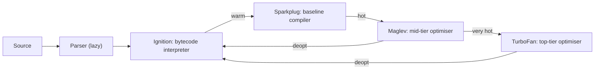
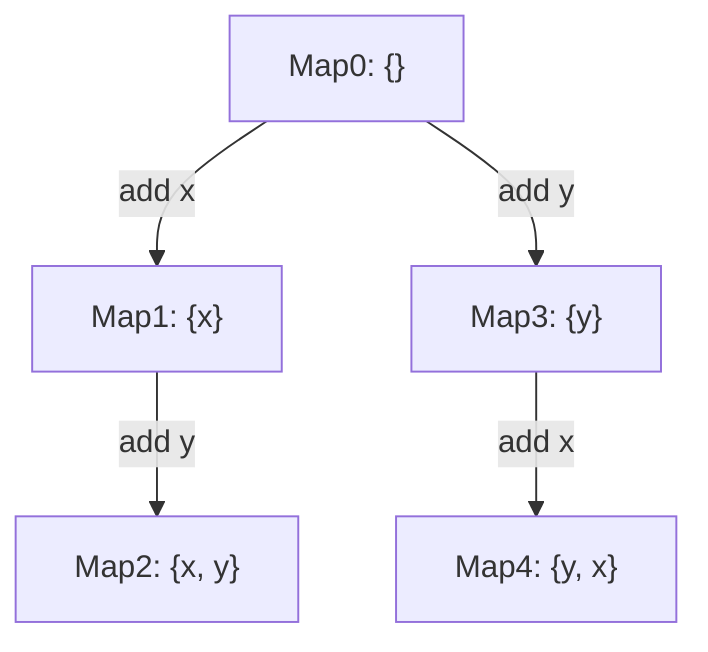

## Introduction

JavaScript is often called an "interpreted language", as if the engine read your source text line by line and acted on each line. No modern engine works that way. Between the text you write and the instructions the CPU executes there is a pipeline: the source is **parsed** into a tree, the tree is compiled to **bytecode**, the bytecode is **interpreted**, and functions that run often are compiled again, **just in time (JIT)**, into machine code specialised for the values the engine has actually seen.

Why should an application developer care? Three reasons. First, it explains behaviour you will observe: why a single syntax error anywhere in a file stops *all* of it from running, while a type error stops only the line that hits it; why a function gets faster after it has run a few thousand times; and why it can suddenly get slower again. Second, it is the basis of the few performance rules that genuinely matter in JavaScript — keep object shapes stable, keep types consistent in hot code — and it lets you tell those apart from folklore. Third, "how does V8 run JavaScript?" is a common question in senior front-end and Node.js interviews.

This lesson walks the pipeline in order, using V8 (the engine in Chrome and Node.js) for concrete examples. Its two nested sections, [[b1-v8-architecture]] and [[b1-hidden-classes]], each stand on their own.

## Before you start

- **What a JavaScript engine is** — the component that parses, compiles and executes code, with a call stack and a heap, embedded in a host. See [[b1-js-engine]].
- **Objects and properties** — creating objects, adding and deleting properties. See [[b1-object-literals]].
- **Error types** — `SyntaxError`, `TypeError` and `ReferenceError`. See [[b1-error-types]].
- **Basic profiling** — what a CPU profile shows. Helpful but not required; see [[b1-profiling-basics]].

## The intuition

Imagine a musician given a new piece of sheet music. First they read it through to check it makes sense — every bar has the right number of beats, every repeat sign has a matching end. That is **parsing**. Then they play it slowly, reading each note as they go — that is **interpreting**. While playing, they notice patterns: "this passage is always in C major, always this rhythm". After playing a section many times, they stop reading it note by note and play it from muscle memory, much faster — that is **JIT compilation**. If the composer changes a note in that passage, the muscle memory is wrong; they slow down and read the sheet again until they have relearned it — that is **deoptimisation**.

The analogy captures the key economic idea: careful preparation is expensive, so you only do it for passages you play often, and you can only play fast because you assume things will stay the same. It stops working in one respect: the engine's "muscle memory" is exact. Optimised code checks its assumptions on every run and bails out the instant one fails, so it can never play a wrong note.

## Stage 1: parsing

The engine first breaks the source text into **tokens** — keywords, identifiers, numbers, strings, punctuation — a step called **scanning** or lexing. `const total = price * qty;` becomes `const`, `total`, `=`, `price`, `*`, `qty`, `;`. The **parser** then checks those tokens against the language's grammar and builds an **Abstract Syntax Tree (AST)**: a tree in which each node is a construct (a declaration, an expression, a call) and its children are its parts.

Tools such as Babel, ESLint and Prettier use a standard AST format called ESTree. In that format, the statement above looks like this (location fields omitted):

```json title="AST for: const total = price * qty;"
{
  "type": "VariableDeclaration",
  "kind": "const",
  "declarations": [
    {
      "type": "VariableDeclarator",
      "id": { "type": "Identifier", "name": "total" },
      "init": {
        "type": "BinaryExpression",
        "operator": "*",
        "left": { "type": "Identifier", "name": "price" },
        "right": { "type": "Identifier", "name": "qty" }
      }
    }
  ]
}
```

The tree has already resolved questions the flat text left open: the multiplication is the initial value of `total`, and `price` and `qty` are its operands. Engines use their own internal AST formats, but the idea is identical. During parsing the engine also works out **scopes** — which variables each function declares and which outer variables it refers to — which it needs later to decide, for example, which variables must live on the heap because a closure captures them.

### Early errors stop the whole script

ECMA-262 defines a category called **early errors**: problems that must be reported when code is parsed, before any of it runs. Malformed syntax is the obvious case, but the spec also lists rules such as "a `let` variable may not be declared twice in the same scope". Because parsing happens before execution, an early error anywhere in a script means *none* of the script runs — not even the lines above the error:

```javascript title="early-errors.js"
try {
  eval(`
    console.log('first line ran');
    function neverCalled() { let x = 1; let x = 2; }
  `);
} catch (e) {
  console.log(e.name + ':', e.message);
}

try {
  eval(`
    console.log('first line ran');
    function neverCalled() { return undefinedVariable.length; }
    console.log('defined neverCalled without error');
  `);
} catch (e) {
  console.log(e.name + ':', e.message);
}
```

```output
SyntaxError: Identifier 'x' has already been declared
first line ran
defined neverCalled without error
```

(The example uses `eval` only so both cases fit in one runnable file.) In the first block, the duplicate `let` is inside a function that is never called, yet the whole block fails to start: `first line ran` never prints. In the second block, `undefinedVariable` does not exist, but that is a **runtime** error — a `ReferenceError` that would only be thrown if `neverCalled` were actually called. Parsing succeeds, and both logs appear. This is why a missing bracket at the bottom of a bundle produces a blank page, while a `TypeError` in one click handler breaks only that handler.

### Lazy parsing

Fully parsing every function on page load would be wasteful: a typical page ships far more code than it runs during start-up. V8 therefore parses **lazily**. On the first pass, inner functions are only **pre-parsed**: the pre-parser checks their syntax (so early errors are still reported) and records which variables they use, but it does not build an AST or generate code. The function is fully parsed and compiled the first time it is actually called. V8 uses heuristics to parse eagerly when a function will clearly run immediately — for example, a function wrapped in parentheses and called on the spot, an immediately invoked function expression (IIFE). Browsers also keep a **code cache**, so scripts loaded repeatedly can skip some of this work on later visits.

## Stage 2: bytecode and the interpreter

The AST is a good representation for analysing code but a poor one for running it. V8 compiles each function's AST into **bytecode**: a compact sequence of simple instructions for a virtual machine, which V8's interpreter, **Ignition**, executes. You can ask Node.js to print it:

```javascript title="add.js"
function add(a, b) {
  return a + b;
}
console.log(add(2, 3));
```

Running `node --print-bytecode --print-bytecode-filter=add add.js` with Node.js 22 prints (trimmed to the instructions):

```output
[generated bytecode for function: add (0x31cb9c45b731 <SharedFunctionInfo add>)]
Bytecode length: 6
Parameter count 3
Register count 0
Frame size 0
   23 S> 0x56b14e81ea8 @    0 : 0b 04             Ldar a1
   32 E> 0x56b14e81eaa @    2 : 3b 03 00          Add a0, [0]
   36 S> 0x56b14e81ead @    5 : ae                Return
5
```

Three instructions. `Ldar a1` loads the second argument (`b`) into the **accumulator**, a special register most instructions read and write. `Add a0, [0]` adds the first argument (`a`) to it. `Return` returns the accumulator. The final `5` is the program's own output. ("Parameter count 3" includes the implicit `this`.)

The `[0]` on the `Add` is the important part. It is an index into the function's **feedback vector**, a small array where the interpreter records what it observes at that operation each time it runs: "both operands were small integers", or "one was a string". Property loads, calls and comparisons have feedback slots too. The interpreter is slower than machine code, but it starts instantly and collects the information the optimising compilers will need.

## Stage 3: just-in-time compilation

The `+` operator in JavaScript is generic. It might add two integers, two floating-point numbers, concatenate strings, or call `valueOf` on objects. Bytecode has to handle every case, so each `Add` checks types at run time. But in a real program, a given `+` almost always sees the same kinds of values. If the feedback says this particular `Add` has only ever seen small integers, an optimising compiler can emit a single machine instruction for it, guarded by a quick check.

That is the core of JIT compilation: **speculative optimisation**. The compiler speculates that the future will look like the past, generates fast code under that assumption, and inserts **guards** that verify the assumption cheaply on each run. When a function becomes **hot** — called often or running long loops — the engine compiles it in the background and swaps in the optimised version. For a long-running loop already in progress, it can even switch to the optimised code mid-execution, a technique called **on-stack replacement (OSR)**.

### Deoptimisation

When a guard fails, the optimised code is no longer valid for this input. The engine **deoptimises**: it reconstructs the interpreter's state for the current point in the function, discards (or stops using) the optimised code, and continues in the bytecode. Nothing incorrect ever happens — the program just runs more slowly until the engine re-optimises with the new feedback. You can watch this with V8's tracing flags:

```javascript title="deopt.js"
function add(a, b) {
  return a + b;
}
let total = 0;
for (let i = 0; i < 200_000; i++) total = add(total, i); // numbers only
console.log(total);
console.log(add('1', 2)); // a string arrives
```

Running `node --trace-opt --trace-deopt deopt.js` on Node.js 22 prints many lines; here are the relevant ones, shortened:

```output
[marking <JSFunction add> for optimization to TURBOFAN, ConcurrencyMode::kConcurrent, reason: hot and stable]
[completed optimizing <JSFunction add> (target TURBOFAN)]
[bailout (kind: deopt-eager, reason: not a Smi): begin. deoptimizing <JSFunction add> ...]
[marking <JSFunction add> for optimization to TURBOFAN, ConcurrencyMode::kConcurrent, reason: hot and stable]
[completed optimizing <JSFunction add> (target TURBOFAN)]
19999900000
[bailout (kind: deopt-eager, reason: not a Number or Oddball): begin. deoptimizing <JSFunction add> ...]
12
```

The trace tells a story. `add` became hot and was optimised for **Smis** — V8's small-integer representation. Then `total` grew beyond the small-integer range and became a heap-allocated floating-point number, so the guard failed ("not a Smi") and the function deoptimised. V8 re-optimised it for general numbers. Finally, the string argument broke that assumption too ("not a Number or Oddball"), and it deoptimised again — and still returned the correct `'12'`.

An occasional deoptimisation is normal and cheap. The problem is a function that deoptimises and re-optimises repeatedly, or one that sees so many different types that the compiler gives up specialising it. That is where the practical rule comes from: **in hot code, keep the types flowing through each operation consistent.**

### Why `eval` and `with` hurt

Optimisers rely on knowing, from the source, which variable each name refers to. Direct `eval(code)` can declare or read local variables from a string that only exists at run time, and `with (obj)` makes every name inside it possibly a property of `obj`. Either one forces the engine to keep the enclosing scope in a slow, dynamic form, and a string passed to `eval` or `new Function` must also be parsed and compiled at run time. Strict mode forbids `with` entirely, and Content Security Policies commonly forbid `eval`. Use `JSON.parse` for data, and functions or objects for configurable behaviour.

```quiz
Q: A 5,000-line bundle has a missing `}` near the very end. What happens when the browser loads it?
- [ ] The first 4,999 lines run, then a SyntaxError is thrown
- [x] Nothing in the file runs, because the error is found while parsing, before execution starts
- [ ] Only the function containing the error is skipped
- [ ] The engine guesses where the brace belongs and continues
> Syntax errors are early errors: the whole script is parsed before any of it is executed, and a parse failure means execution never begins. Runtime errors such as TypeError are different — they occur only when the faulty line actually runs, and everything before it has already executed.
```

## V8 Architecture Conceptually {#b1-v8-architecture}

**V8** is Google's open-source JavaScript and WebAssembly engine, written in C++. It runs JavaScript in Chrome and other Chromium-based browsers, in Node.js and Deno, and in platforms such as Electron and Cloudflare Workers. Conceptually, V8 is a pipeline of compilers of increasing power, a garbage collector beside them, and an embedding interface through which a host plugs in its own APIs and event loop.

### The compilation tiers



**Ignition** is the interpreter described above: it generates and runs bytecode and fills the feedback vectors. Everything starts here.

**Sparkplug** (shipped in Chrome 91, 2021) is a **baseline compiler**. It translates bytecode almost one-to-one into machine code, without analysing or optimising it. That removes the interpreter's per-instruction dispatch overhead and is so fast to run that V8 can apply it to warm functions early. Because Sparkplug code keeps the same frame layout as the interpreter, switching between them is cheap.

**Maglev** (shipped in Chrome 117, 2023) is a **mid-tier optimising compiler**. It uses feedback to specialise code — for example, compiling a property load into a direct memory read guarded by a shape check — but compiles roughly ten times faster than TurboFan. It fills the gap between "starts fast" and "runs fastest" for code that is hot but not hot enough to justify the top tier.

**TurboFan** is the **top-tier optimising compiler**, used for the hottest functions. It performs aggressive optimisations — inlining small functions into their callers, removing redundant checks, eliminating allocations of objects that never escape a function, and register allocation. For years TurboFan was known for its "Sea of Nodes" intermediate representation; the V8 team has since been moving its JavaScript pipeline to a more conventional control-flow-graph representation called Turboshaft, as described on the V8 blog in 2025. You do not need these internals, but if you mention Sea of Nodes in an interview, say that it is being replaced.

Tiers are not fixed across products. In Chrome all four are enabled. Node.js 22 ships V8 12.4 with Maglev disabled by default (`node --v8-options` shows `default: --no-maglev`), which is why the deoptimisation trace above went straight to TurboFan. Older material describes a completely different pipeline — **Full-codegen** and **Crankshaft** — which V8 removed in 2017 (V8 5.9, Chrome 59) when Ignition and TurboFan took over. Citing Crankshaft as current is a red flag in interviews; the safe statement is "an interpreter plus several JIT tiers whose names change over time".

### Memory management: Orinoco

V8's garbage collector project is called **Orinoco**. It manages a generational heap: a small young generation collected frequently by a parallel copying **Scavenger**, and a large old generation collected by a **mark-compact** collector that does most of its marking concurrently on background threads and its sweeping in parallel. The goal is to keep main-thread pauses short — a few milliseconds — so they do not drop animation frames. V8 also schedules some GC work in idle time between frames when the browser reports it. On 64-bit Chrome, **pointer compression** stores heap references as 32-bit offsets, cutting heap memory substantially; Node.js builds do not enable it by default. [[b1-garbage-collection]] covers collection algorithms in general.

### Isolates, contexts and embedders

V8 is a library. A host **embeds** it through a C++ API built on two concepts. An **isolate** is an independent engine instance with its own heap and garbage collector; only one thread runs JavaScript in an isolate at a time. A **context** is a global environment — a realm — inside an isolate, with its own global object and built-ins; a browser creates one per frame. The embedder adds its own objects and functions to the global object (this is how `document` or `process` appear) and runs the event loop that calls into V8.

In Chrome, the embedder is **Blink**, the rendering engine, which supplies the DOM and web APIs. In Node.js, the embedder is Node's own C++ layer, which binds V8 to **libuv** — the library that provides Node's event loop, asynchronous file and network I/O, and a thread pool for blocking operations such as file access and some crypto. V8 itself never does I/O. [[b1-engine-vs-host]] explains this boundary from the language side.

### What this means for your code

You never call V8's tiers directly, and the right default is to write clear code and measure. When a profile shows a hot function, the architecture suggests where to look: is it deoptimising repeatedly (check with `--trace-deopt`)? Do the objects it receives have many different shapes (see the next section)? Is it allocating heavily so that GC pauses show up? Chrome DevTools' Performance panel and Node's `--cpu-prof` flag give you the profile; the architecture tells you how to read it.

## Hidden Classes / Inline Caching {#b1-hidden-classes}

**Hidden classes** are an engine's internal description of an object's layout: which properties it has, in what order, and where each one is stored in memory. V8 calls them **maps**, SpiderMonkey calls them **shapes**, and JavaScriptCore calls them **structures**. **Inline caches (ICs)** are small caches attached to individual property accesses in your code that remember which hidden classes they have seen and where the property was found. Together, they let engines read properties of dynamic JavaScript objects almost as fast as fields of a C struct. Neither appears in the ECMAScript specification; they are an optimisation, and they never change what your program computes — only how fast it runs.

### The problem they solve

A JavaScript object can gain and lose properties at any time, so the simplest implementation is a hash table per object: every `obj.x` would hash the string `"x"` and search. That is far slower than a compiled language, where the compiler knows that `x` is always at offset 0 of a `Point`. Hidden classes recover that knowledge at run time: objects built the same way get the same hidden class, and the hidden class records the offset of each property.

### How hidden classes form

V8 builds hidden classes through **transitions**. An empty object starts with an empty map. Adding `x` moves it to a new map "has `x` at offset 0"; adding `y` next moves it to "has `x` at 0, `y` at 1". V8 remembers these transitions in a tree, so the next object that adds `x` then `y` follows the same path and ends up sharing the same maps. But order matters: an object that adds `y` first takes a different branch and ends up with a different map, even though it has the same keys.



V8 exposes internal functions you can call with the `--allow-natives-syntax` flag, which let us check this directly. (These are debugging tools for experiments, never for production code.)

```javascript title="shapes.js"
// Run with: node --allow-natives-syntax shapes.js
class Point {
  constructor(x, y) {
    this.x = x;
    this.y = y;
  }
}

function makeLoose(x, y, flip) {
  const o = {};
  if (flip) { o.y = y; o.x = x; } else { o.x = x; o.y = y; }
  return o;
}

const p1 = new Point(1, 2);
const p2 = new Point(3, 4);
console.log('two Points share a hidden class:', %HaveSameMap(p1, p2));

const l1 = makeLoose(1, 2, false);
const l2 = makeLoose(1, 2, true);
console.log('same keys, different order:', %HaveSameMap(l1, l2));

p2.label = 'late';
console.log('after adding a property later:', %HaveSameMap(p1, p2));

const p3 = new Point(5, 6);
delete p3.x;
console.log('after delete, fast properties:', %HasFastProperties(p3));
```

```output
two Points share a hidden class: true
same keys, different order: false
after adding a property later: false
after delete, fast properties: false
```

Instances created by the same constructor share a map. Objects with the same keys added in a different order do not. Adding a property to one instance afterwards moves it to a new map, away from its siblings. And `delete` usually pushes an object into **dictionary mode** — a slower hash-table representation without a shared map — which is why `delete` on objects in hot paths is discouraged.

### How inline caches use them

Each property access in your code, such as `o.x` inside a function, has its own inline cache (in V8, stored in the function's feedback vector). The first time it runs, it looks up `x` the slow way and records "for map M, `x` is at offset 0". Next time, it compares the object's map with M; if they match, it reads offset 0 directly. Optimising compilers turn this into a single comparison and a single memory load.

An IC's state depends on how many different maps it sees:

| State | Maps seen at this access | Cost |
|---|---|---|
| Uninitialised | None yet | First lookup is slow |
| **Monomorphic** | One | Fastest: one check, one load; easy to inline |
| **Polymorphic** | A few (up to 4 in V8) | Checks each known map in turn; still reasonably fast |
| **Megamorphic** | More than that | Falls back to a generic lookup through a global cache; much slower, hard to optimise |

So a function like `function getX(o) { return o.x; }` is fastest when every object passed to it has the same hidden class. Feeding it objects built in five different ways makes that access megamorphic, and it stays slow for the life of the function.

### Writing shape-friendly code

The guidance that follows from this is short, and it is worth applying to hot paths — code in tight loops, rendering, parsers, data processing — rather than everywhere:

- **Initialise every property in the constructor**, in the same order, even if some start as `null` or `0`. Class fields (`class Point { x = 0; y = 0; }`) do this automatically, in declaration order.
- **Do not add properties to an object after creation** in hot code; declare optional fields up front.
- **Prefer setting a property to `null` or `undefined` over `delete`** when you need to clear it.
- **Keep the value types of a property consistent** — a field that is sometimes a number and sometimes a string forces a more general representation.
- **Use a `Map` for genuinely dynamic keys.** If keys come from user data, an object used as a dictionary will churn through hidden classes or end up in dictionary mode anyway; `Map` is designed for this.

Arrays have a parallel mechanism: V8 tracks **elements kinds**, such as packed small integers, packed doubles, generic values, and "holey" variants for arrays with gaps. Transitions only go towards more general kinds, so pushing one string into an array of numbers, or creating holes with `arr[1000] = x` on a short array, makes later operations on that array slightly slower.

> [!WARNING] Measure before you optimise
> Hidden classes and IC states are V8 internals that change between versions, and other engines use different heuristics. Apply these habits where a profiler shows a hot path; do not contort ordinary code around them, and never trade correctness or clarity for a guessed speed-up.

```quiz
Q: A hot function `area(shape)` reads `shape.width` and `shape.height`. It receives objects created by six different factory functions that add the same properties in different orders. What is the likely performance effect in V8?
- [ ] None — objects with the same properties always share a hidden class
- [x] The property accesses become megamorphic, so each read falls back to a slower generic lookup
- [ ] The function throws a TypeError
- [ ] V8 converts all six objects to the same hidden class automatically
> Hidden classes depend on the order in which properties are added, so six construction patterns can produce six maps. More maps than the polymorphic limit (4 in V8) make the inline caches megamorphic. Behaviour stays correct; only speed is affected. Creating the objects through one constructor or class would make the accesses monomorphic.
```

## How the pieces fit together

Follow one function through its life in Chrome. The page's script is downloaded and pre-parsed; the function's syntax is checked but no code is generated. The first call triggers a full parse and bytecode generation, and Ignition runs it, filling the feedback vector — including inline-cache entries recording the hidden classes of objects it touches. After some calls, Sparkplug compiles the bytecode to baseline machine code. If the function stays hot, Maglev and eventually TurboFan compile optimised versions in the background, using the feedback to specialise property accesses and arithmetic, with guards for every assumption. If a guard fails, the function deoptimises to the interpreter, gathers new feedback, and may be optimised again. Throughout, objects it creates are allocated in the young generation and mostly collected there.

| Stage | Input | Output | Optimised for |
|---|---|---|---|
| Parser | Source text | AST + scope information | Correctness; lazy for start-up |
| Ignition | AST | Bytecode + feedback | Fast start, low memory |
| Sparkplug | Bytecode | Baseline machine code | Very fast compilation |
| Maglev | Bytecode + feedback | Optimised machine code | Good code, quickly |
| TurboFan | Bytecode + feedback | Highly optimised machine code | Peak speed for hot code |

## In real systems

**Start-up performance.** On many sites, more main-thread time goes to parsing and compiling JavaScript than to running it during load. That is why shipping less JavaScript, code-splitting with dynamic `import()`, and deferring non-critical scripts improve start-up so much: code that is never downloaded is never parsed. React Native's Hermes engine goes further and compiles to bytecode at build time.

**Server workloads.** A Node.js service's hot paths — request routing, JSON serialisation, template rendering — run in optimised code most of the time. A deployment that suddenly gets slower after a change can be caused by a function that started deoptimising, for example because a field became sometimes-string, sometimes-number. `--trace-deopt` and CPU profiles find it.

**Benchmarking traps.** Micro-benchmarks that call a function in a loop measure the optimised steady state, often with inputs the optimiser has specialised for — and sometimes with work the optimiser removed entirely because the result was unused. Real performance must be measured with realistic data, after warm-up, and preferably in the real application.

**Frameworks.** Libraries such as React have historically paid attention to object shapes — for example, initialising every field of internal objects in their constructors — because those objects are created and read millions of times.

## Trade-offs and alternatives

| Approach | Start-up | Peak speed | Memory | Example |
|---|---|---|---|---|
| Pure interpreter | Fast | Slow | Low | QuickJS; JIT-less modes |
| Ahead-of-time bytecode | Fastest (no parse at run time) | Interpreter speed | Low | Hermes |
| Tiered JIT | Fast start, improves over time | Very high | Higher (compiled code, feedback) | V8, SpiderMonkey, JavaScriptCore |

JIT compilers also have security costs: they generate executable machine code at run time, which has been a source of serious vulnerabilities. Some environments disable JIT entirely — Microsoft Edge offers an "enhanced security" mode that turns it off, iOS restricts which apps may generate code, and V8 has a `--jitless` mode — accepting slower JavaScript in exchange for a smaller attack surface.

## Common mistakes

> [!MISTAKE] Calling JavaScript "interpreted, line by line"
> Modern engines parse the whole script, compile it to bytecode, and JIT-compile hot functions to machine code. The "line by line" picture fails to explain early errors, warm-up, and deoptimisation.

**Using `eval` or `new Function` to "speed up" dynamic logic.** Every call parses and compiles a string, and direct `eval` slows the surrounding function. Build behaviour from functions and objects instead.

**Micro-optimising everything for V8.** Shape and type advice matters in hot paths identified by a profiler. Elsewhere, readability wins, and other engines may behave differently.

**Mixing types in hot functions without noticing.** A field that is `null` in some objects and a number in others, or a numeric string from a form, can make a hot function polymorphic or trigger repeated deoptimisation. Normalise data at the boundary.

**Deleting properties in hot objects.** `delete` usually switches the object to slow dictionary mode. Set the property to `undefined` or restructure the data.

**Quoting outdated pipelines.** Full-codegen and Crankshaft were removed in 2017. Describe "an interpreter plus tiered JIT compilers", and name Ignition, Sparkplug, Maglev and TurboFan if you know them.

## Interview perspective

Interviewers ask this to test depth and honesty. They want the pipeline in the right order, a clear reason why JIT engines speculate, and a clean separation between language rules and engine heuristics.

> [!INTERVIEW] A strong answer to "How does V8 run JavaScript?"
> "V8 parses source into an AST — lazily, so functions that never run are only pre-parsed. Ignition compiles the AST to bytecode and interprets it, recording type feedback for each operation. Hot code is compiled to machine code by tiered JIT compilers — Sparkplug as a quick baseline, then Maglev and TurboFan as optimisers — which speculate based on the feedback, for example that an object always has the same hidden class. Guards check those assumptions; if one fails, the code deoptimises back to bytecode. Hidden classes and inline caches make property access fast when objects have consistent shapes. None of this changes semantics — it only affects speed."

Questions to expect:

- **What is the difference between a SyntaxError and a TypeError in terms of when they happen?** SyntaxErrors (early errors) occur at parse time and stop the whole script; TypeErrors occur at run time when the line executes.
- **What is deoptimisation and what triggers it?** Discarding optimised code when a speculative assumption — a type, a hidden class, an array's elements kind — fails at a guard.
- **Why do engines have several tiers?** The start-up versus peak-performance trade-off: optimising everything would make start-up slow; interpreting everything would make long-running code slow.
- **What are hidden classes and why does property order matter?** Internal layout descriptions shared by objects built the same way; different insertion orders produce different hidden classes.
- **Monomorphic versus megamorphic?** An inline cache that sees one hidden class versus many; the latter falls back to slow generic lookup.

A good follow-up answer to *"So should I always care about this?"*: "Only in hot paths, after profiling. The habits are cheap — initialise all fields in constructors, avoid `delete`, keep types consistent — but I would not sacrifice readability for them without measurements."

## Practice

1. **Read bytecode.** Run `node --print-bytecode --print-bytecode-filter=greet file.js` on a function that builds a template string from an object property. Identify the property load and its feedback slot.
2. **Provoke a deoptimisation.** Write a hot function that sums an array's `price` fields, run it with `--trace-deopt`, then pass in one object whose `price` is a string. Find the bailout reason in the trace.
3. **Count hidden classes.** Using `--allow-natives-syntax` and `%HaveSameMap`, compare objects created by an object literal, a class, `Object.create(null)` with properties added later, and a constructor that conditionally adds a field.
4. **Refactor for shapes.** Take a factory that adds `discount` only for some products, and rewrite it so every product has the same shape. Explain the change to a teammate in two sentences without mentioning V8 by name.
5. **Early versus runtime errors.** Write two scripts that each contain one mistake inside a function that is never called: one a duplicate `let`, one a call to an undefined function. Predict which script prints anything, then run both.

## Quick revision {#quick-revision}

- Pipeline: scan → parse → AST → bytecode → interpret (collect feedback) → JIT-compile hot code → deoptimise when assumptions fail.
- Early errors (syntax, duplicate `let`) are reported at parse time: nothing in the script runs. Runtime errors occur only when the line executes.
- Lazy parsing: inner functions are pre-parsed (syntax checked, scopes recorded) and fully compiled on first call.
- Ignition: register-plus-accumulator bytecode interpreter; feedback vectors record types and hidden classes per operation.
- V8 tiers: Ignition → Sparkplug (baseline, Chrome 91) → Maglev (mid-tier optimiser, Chrome 117) → TurboFan (top tier). Node 22 has Maglev off by default. Full-codegen/Crankshaft removed in 2017.
- Speculative optimisation + guards; failed guard → deoptimisation (correct, but slower). OSR switches tiers mid-loop.
- `eval`/`with` defeat static scope analysis; `eval`/`new Function` parse at run time.
- Orinoco GC: young-generation Scavenger, old-generation concurrent mark-compact. Isolate = engine instance + heap; context = realm. Chrome embeds V8 in Blink; Node binds V8 to libuv.
- Hidden classes (maps/shapes/structures): same properties in the same order → shared map. Different order, late additions, `delete` → different maps or dictionary mode.
- Inline caches: monomorphic (1 map) → polymorphic (≤4 in V8) → megamorphic (slow generic lookup).
- Habits for hot paths: initialise all fields in constructors in order, avoid `delete`, keep types consistent, use `Map` for dynamic keys. Measure first.

## Key takeaways {#key-takeaways}

- JavaScript is parsed in full, compiled to bytecode, interpreted, and selectively JIT-compiled — not executed line by line.
- Parse-time errors stop the whole script; runtime errors stop only the code that hits them.
- JIT compilers speculate from observed types and shapes, guard their assumptions, and deoptimise safely when an assumption fails.
- V8 uses several tiers to balance fast start-up against peak speed, and the tier names change over time.
- Objects built the same way share hidden classes, which keeps inline caches monomorphic and property access fast.
- These are engine optimisations, not language rules: write correct, clear code first, and apply shape and type habits where profiling shows they matter.
