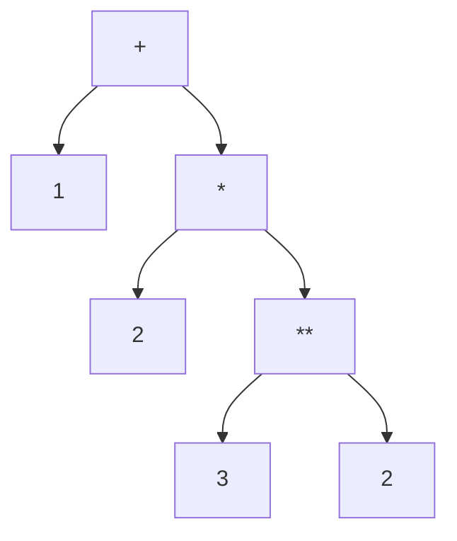

## Introduction

A shopping cart prints its total:

```javascript title="cart-total.js"
const qty = 3;
const unitPrice = 10;
const shipping = 5;
console.log('Total: ' + qty * unitPrice + shipping);
```

```output
Total: 305
```

The customer is not paying 305. Two rules worked together to produce that line. First, `*` is applied before `+`, so `qty * unitPrice` became `30`. Second, the two `+` operators were applied from left to right: `'Total: ' + 30` produced the string `'Total: 30'`, and then `'Total: 30' + 5` glued a `5` onto the end. Nothing here is a coercion bug or an engine quirk. The expression was grouped exactly as the language says it should be, and that grouping was not the one the author had in mind.

Every expression with more than one operator is ambiguous on paper. `1 + 2 * 3` could mean `(1 + 2) * 3` or `1 + (2 * 3)`. A programming language cannot leave that open, so it fixes two rules:

- **Precedence** decides which of two *different* operators grabs its operands first. `*` has higher precedence than `+`, so `1 + 2 * 3` means `1 + (2 * 3)`.
- **Associativity** decides how a chain of operators with the *same* precedence is grouped. `-` is left-associative, so `10 - 3 - 2` means `(10 - 3) - 2`, which is `5`, not `10 - (3 - 2)`, which would be `9`.

Parentheses override both. Whatever is inside `( )` is grouped first.

You rarely need to recite the whole precedence table, but you do need three things: the handful of rows that everyday code depends on, the few rows where JavaScript surprises people, and the habit of adding parentheses whenever a reader might hesitate. This lesson gives you all three, and also separates precedence from a different question that interviews love to blur: the **order in which operands are evaluated**.

## Before you start

- **Expressions** — operators combine expressions into larger expressions; this lesson is about how that combining is grouped. See [[b1-statements-expressions]].
- **Arithmetic operators** — `+`, `-`, `*`, `/`, `%`, `**`, and the fact that `+` concatenates when either side is a string. See [[b1-arithmetic-operators]].
- **Comparison and logical operators** — `<`, `===`, `&&`, `||`, `!` and what they return. See [[b1-comparison-operators]] and [[b1-logical-operators]].

## The intuition

Think of every operator as a magnet with a certain strength. When an operand sits between two operators, the stronger magnet takes it. In `1 + 2 * 3`, the `2` sits between `+` and `*`. The `*` magnet is stronger, so `2` belongs to `*`, and `*` then becomes a single unit, `(2 * 3)`, which `+` takes as its right operand. That strength is **precedence**; parser writers often call it **binding power**.

When the two magnets are equally strong, as in `10 - 3 - 2`, the tie needs a rule. For most operators the leftmost one wins (**left-associative**), so the left `-` takes the `3` and the expression is `(10 - 3) - 2`. A few operators break ties to the right (**right-associative**) because that is what their meaning requires — `a = b = 5` must assign to `b` first, so it means `a = (b = 5)`.

The result of this grabbing is a tree. The parser turns your source text into a tree of operations, and grouping is simply the shape of that tree:



The deepest operation in the tree is computed first: `3 ** 2` is `9`, then `2 * 9` is `18`, then `1 + 18` is `19`. Parentheses in your source simply force a particular tree.

The magnet picture has one limit worth stating now. It explains **grouping** — which operator owns which operand. It says nothing about **when** each operand is evaluated. That is a separate rule, covered in its own section below.

## The precedence table, in the order you need it

The full table has eighteen levels. The version below lists every operator family from the strongest binding (top) to the weakest (bottom), following the grouping used by MDN. Operators in the same row have equal precedence.

| Binds | Operators | Associativity |
|---|---|---|
| Strongest | `( … )` grouping | n/a |
| | `a.b`, `a?.b`, `a[b]`, `a(b)`, `new A(b)` | left-to-right |
| | `new A` (without argument list) | n/a |
| | postfix `a++`, `a--` | n/a |
| | prefix `!a`, `~a`, `+a`, `-a`, `++a`, `--a`, `typeof`, `void`, `delete`, `await` | n/a (applied innermost first) |
| | `**` | **right-to-left** |
| | `*`, `/`, `%` | left-to-right |
| | `+`, `-` | left-to-right |
| | `<<`, `>>`, `>>>` | left-to-right |
| | `<`, `<=`, `>`, `>=`, `in`, `instanceof` | left-to-right |
| | `==`, `!=`, `===`, `!==` | left-to-right |
| | `&` | left-to-right |
| | `^` | left-to-right |
| | `\|` | left-to-right |
| | `&&` | left-to-right |
| | `\|\|`, `??` | left-to-right (and `??` cannot be mixed with `&&`/`\|\|` unparenthesised) |
| | `=`, `+=`, `&&=`, `??=` and other assignments, `a ? b : c`, `=>`, `yield`, `...` | **right-to-left** |
| Weakest | `,` comma | left-to-right |

You do not need to memorise this. You need a short ladder that covers almost all real code, and you can derive the rest from the table when you hit an unusual case:

1. Property access and calls (`user.name`, `fn()`) bind tightest — an operand is always "the whole `a.b.c()` thing".
2. Unary operators (`!`, `-`, `typeof`) come next, so `!user.active` means `!(user.active)`.
3. Arithmetic: `**`, then `* / %`, then `+ -` — the school-maths order.
4. Comparisons (`<`, `>=`), then equality (`===`).
5. Logical: `&&` before `||`.
6. The conditional operator `? :` and assignment come last, so the whole right-hand side is computed before it is stored.

That ladder explains why the expression people write most often needs no parentheses at all:

```javascript title="ladder.js"
const age = 20;
const hasTicket = true;
const isStaff = false;
const canEnter = age >= 18 && hasTicket || isStaff;
// grouped as: canEnter = (((age >= 18) && hasTicket) || isStaff)
console.log(canEnter);
```

```output
true
```

`>=` binds tighter than `&&`, `&&` binds tighter than `||`, and `=` binds weakest of all, so the parser builds exactly the tree the comment shows. Even so, many style guides ask for parentheses around `a && b || c`, because a human reader has to stop and recall that `&&` wins. Writing `(age >= 18 && hasTicket) || isStaff` costs two characters and removes the pause.

## Associativity: breaking ties

Most binary operators are **left-associative**. For addition and multiplication of numbers the direction would not change the answer, but for subtraction, division and string concatenation it does:

```javascript title="left-assoc.js"
console.log(10 - 3 - 2);           // (10 - 3) - 2
console.log(16 / 4 / 2);           // (16 / 4) / 2
console.log(1 + 2 + ' items');     // (1 + 2) + ' items'
console.log('items: ' + 1 + 2);    // ('items: ' + 1) + 2
```

```output
5
2
3 items
items: 12
```

The last two lines are the concatenation version of the cart bug. In `1 + 2 + ' items'`, the left `+` sees two numbers and adds them before the string ever appears. In `'items: ' + 1 + 2`, the left `+` sees a string first, produces a string, and every later `+` concatenates. If you mean arithmetic inside a string, parenthesise it — or better, use a template literal: `` `items: ${1 + 2}` ``.

Three operator groups are **right-associative**, and each has a reason.

**Exponentiation.** `2 ** 3 ** 2` means `2 ** (3 ** 2)`, which is `2 ** 9 = 512`, not `(2 ** 3) ** 2 = 64`. This matches mathematical notation, where a tower of exponents is read from the top down.

**Assignment.** `a = b = 5` means `a = (b = 5)`. An assignment expression produces the value it assigned, so `b = 5` evaluates to `5`, which is then assigned to `a`. Left-associativity would make no sense here: `(a = b) = 5` tries to assign to a value, which is a `SyntaxError`.

**The conditional operator.** `a ? b : c ? d : e` means `a ? b : (c ? d : e)`. That is what makes a readable `else if` chain possible:

```javascript title="right-assoc.js"
console.log(2 ** 3 ** 2, (2 ** 3) ** 2);

let a, b;
a = b = 5;
console.log(a, b);

const n = 5;
const sign = n > 0 ? 'positive' : n < 0 ? 'negative' : 'zero';
console.log(sign);
```

```output
512 64
5 5
positive
```

Unary prefix operators have no associativity in the usual sense — they apply to whatever follows them, innermost first. `typeof typeof 1` is `typeof (typeof 1)`, which is `typeof 'number'`, which is `'string'`. `!!x` is `!(!x)`.

## Precedence is not evaluation order

This is the most common misunderstanding about precedence, and the one interviewers probe. Precedence decides the **shape** of the tree. It does not decide **when** each operand runs. JavaScript always evaluates the operands of a binary operator **left to right**: first the left operand completely, then the right operand, then the operator itself.

You can watch this happen by replacing each operand with a function that logs:

```javascript title="evaluation-order.js"
function v(name, value) {
  console.log('evaluate', name);
  return value;
}

const r = v('a', 1) + v('b', 2) * v('c', 3);
console.log('result', r);

const p = v('x', 2) ** v('y', 3) ** v('z', 2);
console.log('result', p);
```

```output
evaluate a
evaluate b
evaluate c
result 7
evaluate x
evaluate y
evaluate z
result 512
```

In the first expression `*` binds tighter, so the multiplication happens before the addition. But `a` is still *evaluated* first, because it is the left operand of `+`. The engine evaluates `a` (gets `1`), then evaluates the right operand of `+` — which is the whole `b * c` subtree, so it evaluates `b`, then `c`, multiplies, and finally adds. The same holds for the right-associative `**`: grouping is `x ** (y ** z)`, yet `x`, `y` and `z` are evaluated in source order.

Here is a timeline of the first expression. "Evaluate" means computing an operand's value; "apply" means performing an operator on values already computed.

| Step | Action | Value so far |
|---|---|---|
| 1 | evaluate `a` | `1` |
| 2 | evaluate `b` | `2` |
| 3 | evaluate `c` | `3` |
| 4 | apply `*` to `2` and `3` | `6` |
| 5 | apply `+` to `1` and `6` | `7` |

Left-to-right evaluation is guaranteed by the language specification, which is stricter than C or C++, where the order of operand evaluation is largely unspecified. It matters whenever operands have **side effects**:

```javascript title="side-effects.js"
let j = 1;
console.log(j + j++ + j);   // 1 + 1 + 2: j++ yields 1, then j is 2

let i = 1;
const arr = [10, 20, 30];
arr[i] = i++;               // the target arr[1] is chosen before i++ runs
console.log(arr, i);
```

```output
4
[ 10, 1, 30 ] 2
```

The first line reads `j` (1), then `j++` (yields 1 and sets `j` to 2), then `j` again (2). In the assignment, the left side is evaluated first, so the target is `arr[1]` before `i++` changes `i`. Both results are fully defined in JavaScript, but code like this is still a bad idea: a reader should not need to know the evaluation order to understand a line. Split side effects into their own statements.

> [!IMPORTANT] Grouping versus timing
> Precedence and associativity answer "which operator owns which operand?". Evaluation order answers "which operand is computed first?". In JavaScript the answer to the second question is always left to right, except where an operator deliberately skips its right side — `&&`, `||`, `??`, `?.` and `? :` short-circuit. See [[b1-short-circuit]].

## The rows that cause real bugs

Most of the table matches intuition. These are the places where it does not.

### Bitwise operators sit below equality

The bitwise operators `&`, `^` and `|` have *lower* precedence than `===`. JavaScript inherited this from C, where it is a well-known design wart. It means a flag test without parentheses compares first and masks afterwards:

```javascript title="bitwise-precedence.js"
const READ = 1, WRITE = 2;
const perms = READ;                    // only READ is set

console.log(perms & WRITE === WRITE);  // perms & (WRITE === WRITE) -> 1 & true
console.log((perms & WRITE) === WRITE);

const x = 6;
console.log(x & 1 === 0);              // 6 & (1 === 0) -> 6 & false
console.log((x & 1) === 0);            // the intended "is x even?"
```

```output
1
false
0
true
```

`WRITE === WRITE` is `true`, `true` converts to `1`, and `1 & 1` is `1` — truthy. The unparenthesised check says the user can write when they cannot. The even-number check fails the opposite way: `x & false` is always `0`, so every number looks odd. The rule is simple: **always parenthesise a bitwise operation that is combined with anything else**. The bitwise operators themselves are taught in [[b1-bitwise-operators]].

### `!` binds tighter than `in` and `instanceof`

Logical NOT is a unary operator, so it applies to the operand immediately after it, before `in` or `instanceof` get a chance:

```javascript title="negation-precedence.js"
class Admin {}
const user = { name: 'Ada' };

console.log(!'role' in user, !('role' in user));
console.log(!user instanceof Admin, !(user instanceof Admin));
```

```output
false true
false true
```

`!'role' in user` means `(!'role') in user`. `!'role'` is `false`, so the test becomes "does `user` have a property named `'false'`?" — almost always no. `!user instanceof Admin` means `(!user) instanceof Admin`, and a boolean is never an instance of a class, so it is always `false`. Both mistakes are silent: no error, just a condition that never fires. ESLint's recommended rule `no-unsafe-negation` reports exactly these two patterns. The operators themselves are covered in [[b1-in-delete-void]].

### `typeof` binds tighter than `+`

`typeof x + 'suffix'` is `(typeof x) + 'suffix'`, which is usually what you want. The surprise is the reverse case: `typeof 1 + 2` is `'number2'`, not `typeof 3`. The common idiom `typeof value === 'string'` works because `typeof` binds tighter than `===`. See [[b1-typeof]].

### Chained comparisons are not range checks

Mathematics lets you write `1 < x < 3`. JavaScript parses it as `(1 < x) < 3`, compares a boolean with a number, and converts the boolean to `0` or `1`:

```javascript title="chained-comparison.js"
console.log(1 < 2 < 3);     // (1 < 2) < 3  -> true < 3  -> 1 < 3
console.log(3 > 2 > 1);     // (3 > 2) > 1  -> true > 1  -> 1 > 1
const x = 10;
console.log(1 < x < 5);     // true < 5 -> 1 < 5, although 10 is not below 5
console.log(1 < x && x < 5);
```

```output
true
false
true
false
```

`1 < x < 5` is `true` for every number `x`, because the first comparison produces `0` or `1`, both below 5. JavaScript has no "between" operator; write `low < x && x < high`. [[b1-comparison-operators]] covers the conversion rules behind this.

## Rules the language enforces for you

In two places the designers decided that the "correct" precedence was too easy to misread, so they made the ambiguous form a **SyntaxError**. Because these are syntax errors, the whole script fails to load, not just the line.

**A unary operator directly before `**`.** In mathematics, −2² means −(2²) = −4. Many programmers would expect `(-2) ** 2 = 4`. Rather than pick one and surprise half its users, ES2016 forbids the unparenthesised form:

```javascript title="unary-exponent.js"
console.log((-2) ** 2, -(2 ** 2));
// console.log(-2 ** 2);  // SyntaxError: Unary operator used immediately before
//                        // exponentiation expression...
```

```output
4 -4
```

The same applies to `typeof`, `!`, `~`, `void`, `delete` and unary `+` before `**`. A negative *exponent* is fine: `2 ** -2` is `0.25`, because the restriction is only on the left operand.

**Mixing `??` with `&&` or `||`.** The nullish coalescing operator `??` (ES2020) cannot appear in the same unparenthesised expression as `&&` or `||`. `a || b ?? c` and `a ?? b && c` are both syntax errors (Node.js 22 reports `Unexpected token '??'` and `Unexpected token '&&'`). You must write `(a || b) ?? c` or `a || (b ?? c)`. The reasoning is explained in [[b1-nullish-coalescing]].

## Member access, calls and `new`

At the very top of the table, property access, calls and `new` with an argument list share one level and group left to right. That is why `user.getName().toUpperCase()` reads naturally: call `getName` on `user`, then call `toUpperCase` on the result.

`new` has two forms. With an argument list, `new Foo(args)` binds as tightly as member access, so `new Date(0).getTime()` means `(new Date(0)).getTime()` — construct the date, then call a method on it. Without an argument list, `new Foo` binds slightly *less* tightly than member access, so `new Foo.Bar` means `new (Foo.Bar)` — the property is looked up first and the result is constructed.

```javascript title="new-precedence.js"
console.log(new Date(0).getTime());

function Outer() {}
Outer.Inner = function () { this.kind = 'inner'; };
console.log(new Outer.Inner());   // new (Outer.Inner)()
```

```output
0
{ kind: 'inner' }
```

If you ever want "construct `Foo`, then read `.Bar` from the instance", you need `new Foo().Bar` with explicit empty parentheses. The [[b1-new-operator]] lesson explains what `new` does once it runs.

## Line breaks do not group

Precedence works on tokens, not on lines. A line break does not end an expression unless automatic semicolon insertion (ASI) adds a semicolon, and ASI only does that in specific situations. Two consequences matter.

A `return` followed by a newline returns `undefined`, because ASI inserts a semicolon right after `return`:

```javascript title="return-newline.js"
function total(a, b) {
  return
    a + b;
}
console.log(total(1, 2));
```

```output
undefined
```

The opposite problem happens when a line *starts* with `(`, `[` or a template literal. No semicolon is inserted before it, so the previous line continues:

```javascript title="no-asi.js"
const config = { debug: true }
const run = config
(function () { console.log('setup'); })();
```

```output
TypeError: config is not a function
```

The program crashes on the third line (Node.js prints that message with a stack trace). The parser reads `config(function () { ... })()` — a call, because calls bind tightly and nothing separated the lines. If you write code without semicolons, put one at the start of any line that begins with `(` or `[`. The full rules are in [[b1-asi]].

## How it works internally

The precedence table is not stored anywhere in the ECMAScript specification. It is a consequence of the **grammar**. The specification defines expressions as a stack of nested rules, roughly like this (simplified):

```text
AdditiveExpression :
    MultiplicativeExpression
    AdditiveExpression + MultiplicativeExpression
    AdditiveExpression - MultiplicativeExpression

MultiplicativeExpression :
    ExponentiationExpression
    MultiplicativeExpression * ExponentiationExpression

ExponentiationExpression :
    UnaryExpression
    UpdateExpression ** ExponentiationExpression
```

Read the second line of `AdditiveExpression`: the right operand of `+` must be a `MultiplicativeExpression`. So in `1 + 2 * 3`, the only way to parse the text is to treat `2 * 3` as one `MultiplicativeExpression` and hand it to `+`. Higher precedence simply means "lower in this stack of rules".

The same grammar encodes associativity. `AdditiveExpression + MultiplicativeExpression` puts the recursive rule on the **left**, so `10 - 3 - 2` can only be parsed as `(10 - 3) - 2` — left-associative. `UpdateExpression ** ExponentiationExpression` puts the recursion on the **right**, so `2 ** 3 ** 2` nests to the right. And because the left side of `**` must be an `UpdateExpression`, not a `UnaryExpression`, the form `-2 ** 2` has no valid parse at all. That is where the SyntaxError comes from.

Real engines do not usually implement each rule as a separate function, which would be slow for deeply nested grammars. Hand-written parsers, including those in the major JavaScript engines, typically use **precedence climbing** (also known as Pratt parsing): they keep a table that maps each binary operator token to a numeric precedence, and a single loop keeps absorbing operators whose precedence is higher than the current minimum. The resulting **abstract syntax tree** (AST) is the same tree you saw in the diagram, and later stages — bytecode generation in V8's Ignition interpreter, for example — walk that tree left to right, which is how left-to-right evaluation order falls out. See [[b1-parsing-jit]] for what happens after parsing.

## Worked example: reading a condition like the parser

A checkout button should be enabled when the cart has items and the user is not blocked, or when the user is an admin (admins can always test checkout). The original code:

```javascript title="checkout.js"
function canCheckout(cart, user) {
  return cart.items.length > 0 && !user.blocked || user.role === 'admin';
}

const empty = { items: [] };
const full = { items: ['book'] };
console.log(canCheckout(full, { blocked: false, role: 'user' }));
console.log(canCheckout(full, { blocked: true, role: 'user' }));
console.log(canCheckout(empty, { blocked: false, role: 'admin' }));
console.log(canCheckout(empty, { blocked: false, role: 'user' }));
```

```output
true
false
true
false
```

To check that the code means what the requirement says, parenthesise it step by step, strongest operators first.

1. **Member access**: `cart.items.length`, `user.blocked` and `user.role` each become single operands.
2. **Unary `!`**: `!user.blocked` becomes `(!user.blocked)` — it negates the property, not the whole `&&`.
3. **Comparison `>`**: `(cart.items.length > 0)`.
4. **Equality `===`**: `(user.role === 'admin')`.
5. **`&&`**: `((cart.items.length > 0) && (!user.blocked))`.
6. **`||`**: the `&&` group on the left, the `===` group on the right.

The fully grouped form is `((cart.items.length > 0) && (!user.blocked)) || (user.role === 'admin')`, which matches the requirement. The code is correct, but a reviewer had to work through six steps to be sure. A version that states the grouping costs nothing at run time:

```javascript title="checkout-clear.js"
function canCheckout(cart, user) {
  const hasItems = cart.items.length > 0;
  const isAdmin = user.role === 'admin';
  return (hasItems && !user.blocked) || isAdmin;
}
console.log(canCheckout({ items: [] }, { blocked: false, role: 'admin' }));
```

```output
true
```

Now suppose a new requirement arrives: "blocked users can never check out, not even admins". Someone edits the original line to `cart.items.length > 0 && !user.blocked || user.role === 'admin' && !user.blocked`. It happens to work because `&&` binds tighter than `||`, but the intent is buried. In the named-variable version the change is obvious: `return !user.blocked && (hasItems || isAdmin);`. Parentheses and well-named variables do the same job — they make the tree visible.

## In real systems

**Linters encode the dangerous rows.** ESLint's recommended configuration includes `no-unsafe-negation`, which flags `!key in obj` and `!obj instanceof C`. The rule `no-mixed-operators` (now maintained in `@stylistic/eslint-plugin`) can require parentheses when operators such as `&&` and `||`, or bitwise and comparison operators, are mixed.

**TypeScript catches several precedence bugs as type errors.** In `flags & 4 === 4`, the right operand of `&` is a boolean, and TypeScript 6.0 reports `TS2363: The right-hand side of an arithmetic operation must be of type 'any', 'number', 'bigint' or an enum type`. `!user instanceof Admin` produces `TS2358`. The checker is not looking for precedence mistakes; it simply notices that the grouped expression has nonsensical types.

**Formatters and code review.** Teams typically keep parentheses that clarify mixed logical operators even when they are redundant, and remove clutter elsewhere. The working rule in most codebases: arithmetic follows school maths without parentheses; anything mixing `&&` with `||`, bitwise with comparison, or `??` with anything gets parentheses.

**Template literals replace concatenation chains.** The `'Total: ' + a + b` class of bug has largely disappeared from modern code because `` `Total: ${a + b}` `` makes the arithmetic grouping explicit.

## Trade-offs and alternatives

| Choice | Benefit | Cost |
|---|---|---|
| Rely on precedence (`a * b + c`) | Short, idiomatic where the rule is universally known | Readers must know the rule; risky for uncommon rows |
| Add parentheses (`(a && b) \|\| c`) | Intent visible at a glance; immune to precedence mistakes | Slightly longer; redundant parentheses can clutter simple maths |
| Extract named variables | Self-documenting; easy to change and to debug | More lines; can feel heavy for trivial expressions |
| Template literals instead of `+` chains | No string/number grouping surprises | None worth mentioning in modern runtimes |

Parentheses have no run-time cost: they only shape the tree and do not survive into bytecode. The only reason not to add them is readability, so the deciding question is always "would a competent reader hesitate here?".

## Common mistakes

> [!MISTAKE] Testing a flag without parentheses
> `if (mask & FLAG === FLAG)` parses as `mask & (FLAG === FLAG)` and is truthy whenever bit 0 of `mask` is set. Write `if ((mask & FLAG) !== 0)` or `if ((mask & FLAG) === FLAG)`.

**Negating the wrong thing.** `!key in obj` and `!obj instanceof C` negate the left operand, not the test. Write `!(key in obj)` and `!(obj instanceof C)`.

**Writing range checks as chains.** `0 <= i < length` is always `true`. Write `0 <= i && i < length`.

**Mixing strings and arithmetic in a `+` chain.** `'Sum: ' + a + b` concatenates. Use `'Sum: ' + (a + b)` or a template literal.

**Assuming higher precedence means "runs first".** `f() + g() * h()` calls `f` first. If the functions have side effects that depend on each other, split them into separate statements.

**Mixing `&&` and `||` without parentheses in a long condition.** It is correct by the rules but easy to misread, and the next edit often breaks it. Group the `&&` parts explicitly.

## Interview perspective

Precedence questions in interviews usually come in two shapes: "what does this print?" puzzles, and questions that check whether you separate grouping from evaluation order. In both, the strongest answer shows your working: rewrite the expression with full parentheses, then evaluate it left to right.

> [!INTERVIEW] What a strong answer sounds like
> "Precedence decides how the expression is grouped into a tree; associativity breaks ties between operators of the same level. Evaluation order is separate — JavaScript always evaluates operands left to right. So in `a() + b() * c()`, the multiplication is applied first, but `a` is still called first."

Questions you should be able to answer:

- **What does `2 ** 3 ** 2` evaluate to, and why?** `512`, because `**` is right-associative: `2 ** (3 ** 2)`.
- **Why is `3 > 2 > 1` false?** It groups as `(3 > 2) > 1`, which is `true > 1`; `true` converts to `1`, and `1 > 1` is false.
- **What is `'5' + 3 - 2`?** Left to right: `'5' + 3` is `'53'`, then `'53' - 2` converts to a number and gives `51`.
- **Why is `-2 ** 2` a SyntaxError?** The language refuses to guess between `(-2) ** 2` and `-(2 ** 2)`; you must parenthesise.
- **What is wrong with `if (flags & MASK === MASK)`?** Equality binds tighter than `&`, so it masks with a boolean.
- **In `a = b = c`, which assignment happens first?** `b = c`, because assignment is right-associative; its value is then assigned to `a`.
- **Does `a || b && c` evaluate `a` first?** Yes. Grouping is `a || (b && c)`, but `a` is the left operand of `||` and is evaluated first; if it is truthy, `b && c` is never evaluated at all.

A good follow-up to anticipate: *"How would you make this code safer?"* Mention parentheses, named intermediate variables, template literals, and lint rules such as `no-unsafe-negation`.

```quiz
Q: What does `console.log(1 + 2 + '3' + 4 + 5)` print?
- [ ] `15`
- [ ] `12345`
- [x] `3345`
- [ ] `339`
> `+` is left-associative. `1 + 2` is `3` (both numbers). `3 + '3'` is the string `'33'`. From then on every `+` concatenates: `'334'`, then `'3345'`. `339` would need `4 + 5` to be grouped first, which only happens with parentheses.

Q: In `f() + g() * h()`, which function is called first?
- [x] `f`, because operands are evaluated left to right regardless of precedence
- [ ] `g`, because `*` has higher precedence than `+`
- [ ] `h`, because the deepest operation is evaluated first
- [ ] The order is unspecified, as in C
> Precedence only decides that `g() * h()` is grouped as the right operand of `+`. Evaluation still starts with the left operand of `+`, which is `f()`. JavaScript, unlike C, fully specifies left-to-right evaluation.

Q: Why does `if (!('admin' in roles))` work while `if (!'admin' in roles)` does not?
- [ ] `in` requires parentheses in all cases
- [ ] `!` cannot be used with strings
- [x] `!` binds tighter than `in`, so the second form tests whether `roles` has a property named `'false'`
- [ ] The second form throws a TypeError
> Unary operators bind tighter than relational operators. `!'admin'` evaluates to `false`, which becomes the property key `'false'`. No error is thrown, which is why this bug is easy to miss.

Q: Which expression is a SyntaxError?
- [ ] `2 ** -2`
- [ ] `(-2) ** 2`
- [x] `-2 ** 2`
- [ ] `-(2 ** 2)`
> A unary operator directly before the base of `**` is forbidden because readers disagree about whether it means `(-2) ** 2` or `-(2 ** 2)`. A unary minus on the exponent, as in `2 ** -2`, is allowed.
```

## Practice

1. **Parenthesise by hand.** Rewrite each expression with full parentheses, then predict its value and check it in Node.js: `2 + 3 * 4 ** 2 / 8`, `'a' + 1 + 2 * 3`, `!0 + !0`, `typeof null === 'object' && 1 || 2`.
2. **Find the bug.** `const isEven = n => n & 1 === 0;` returns `0` for every input. Explain the grouping, then explain why the similar `n => n & 1 === 1` appears to work as an odd test, and fix both so they return booleans.
3. **Evaluation order.** Write a function that logs its name and returns a value, and use it to show the evaluation order of `a() ** b() ** c()` and of `a() || b() && c()` when `a()` returns `true`.
4. **Refactor.** Take a condition with four operands mixing `&&`, `||` and `!` from code you have written, and rewrite it with named variables so that no reader needs the precedence table.
5. **ASI hunt.** Write a short semicolon-free file where a line beginning with `[` silently changes the meaning of the line above. Explain what the parser saw.

## Quick revision {#quick-revision}

- **Precedence**: which of two different operators groups first. **Associativity**: how equal-precedence operators chain. **Parentheses** override both.
- Everyday ladder (strongest first): member access and calls → unary (`!`, `-`, `typeof`) → `**` → `* / %` → `+ -` → `< > <= >=` → `=== !==` → `&&` → `||`/`??` → `? :` and assignment → comma.
- Right-associative: `**` (`2 ** 3 ** 2` is `512`), assignment (`a = b = 5`), conditional (`a ? b : c ? d : e`).
- Evaluation order is always left to right, independent of precedence; only `&&`, `||`, `??`, `?.` and `? :` skip operands.
- Bitwise `& ^ |` are below `===`: parenthesise `(flags & F) !== 0`.
- `!` binds tighter than `in`/`instanceof`: write `!(k in o)`, `!(x instanceof C)`.
- `a < b < c` is `(a < b) < c` — use `a < b && b < c`.
- SyntaxErrors by design: `-2 ** 2`, and `??` mixed with `&&`/`||` without parentheses.
- `new Foo(args).bar` constructs then reads; `new Foo.Bar` constructs `Foo.Bar`.
- Newlines do not group: `return` + newline returns `undefined`; a line starting with `(` or `[` continues the previous one.

## Key takeaways {#key-takeaways}

- Precedence and associativity decide the shape of the expression tree; they come straight from the grammar, which is why some forms are syntax errors rather than surprises.
- Grouping is not timing: JavaScript evaluates operands left to right even when a later operator binds tighter.
- Only a few rows cause real bugs — bitwise versus equality, `!` versus `in`/`instanceof`, chained comparisons and `+` chains with strings — and each has a simple parenthesised fix.
- Parentheses are free at run time; add them whenever a reader might hesitate, especially around mixed `&&`/`||` and any bitwise operation.
- When you are asked to predict an expression, rewrite it with full parentheses first, then evaluate left to right.
