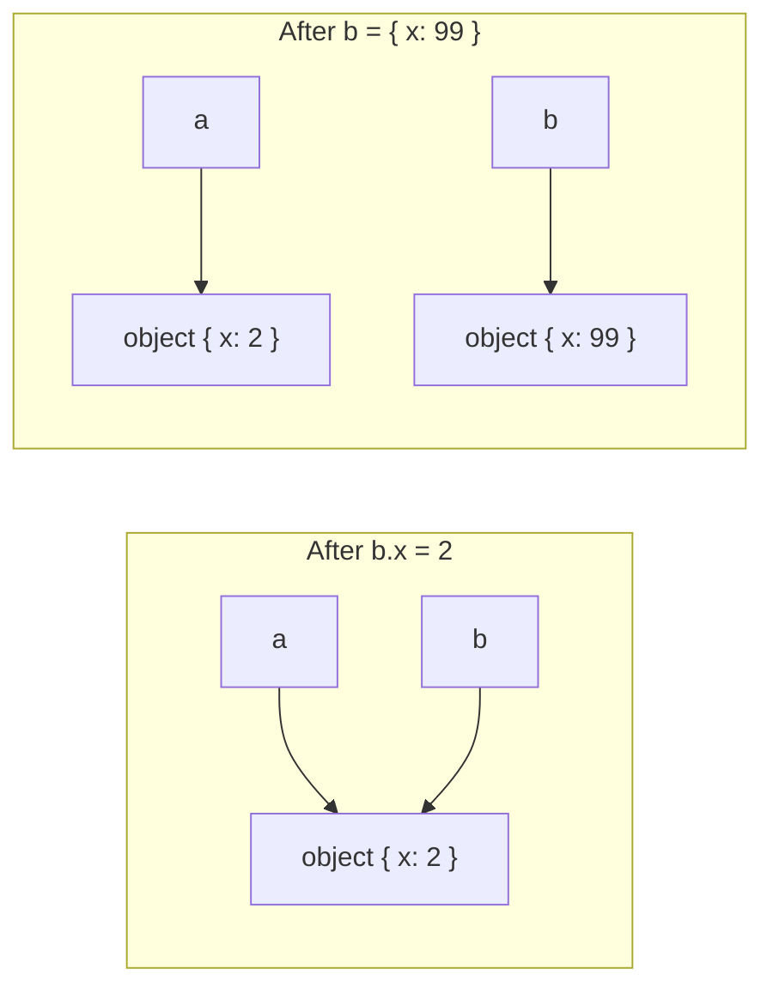
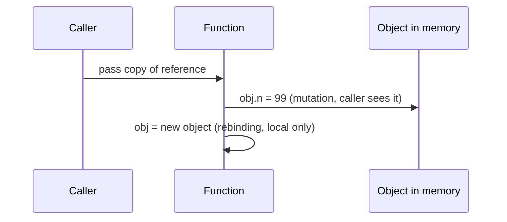

## Introduction

Here is a bug that every JavaScript developer writes at least once. A function receives a list of products, sorts it for display — and suddenly another part of the page, which used the same list in its original order, is sorted too. Or a form keeps a "default settings" object, the user edits a field, and the defaults change as well. Nothing in the code *looks* like it touched the second variable.

The cause is the distinction between **primitive values** and **references**. When you assign a value to a variable, put it in an array or pass it to a function, JavaScript copies the value. For a primitive — a number, string, boolean, `null`, `undefined`, bigint or symbol — the copy is the value itself, and the two copies are independent. For an object (including arrays and functions), the value that gets copied is a **reference** — a pointer to the object — so both copies lead to the *same* object. Change the object through one, and the other sees it.

You may have heard this described as "primitives are passed by value, objects by reference". That phrasing is close but misleading, and it leads to wrong predictions about functions. The accurate rule is simpler: **JavaScript always copies the value; for objects, that value is a reference.** This lesson builds that model and then applies it to three questions engineers face daily:

- Why can a primitive never be changed in place? → [[b1-immutability-primitives|Primitive immutability]]
- When does changing an object affect other code, and how do you prevent it? → [[b1-object-mutability|Object mutability]]
- What can a function do to the arguments it receives? → [[b1-call-by-sharing|Call-by-sharing]]

## Before you start

- **Primitive types** — the seven primitive types and what makes them primitive. See [[b1-primitive-types]].
- **Objects as values** — object identity, and why `{} === {}` is `false`. See [[b1-objects-as-values]].
- **Variables and `const`** — a variable is a name bound to a value; `const` stops reassignment, not mutation. See [[b1-variables]] and [[b1-const]].

## The intuition

Picture each variable as a labelled box that holds exactly one thing.

For a primitive, the box holds the value itself — think of a sticky note with `5` written on it. `let m = n` photocopies the note into a second box. Writing `10` on the copy does nothing to the original.

For an object, the object lives elsewhere, and the box holds a slip of paper with the object's **address**. `let b = a` photocopies the *address*. Now two boxes hold the same address. Using either one to walk to the object and move the furniture (`b.x = 2`) changes the one object both addresses point to. But writing a *new* address into box `b` (`b = { x: 99 }`) changes only box `b` — box `a` still holds the old address.

That gives you two different operations, and keeping them apart is the whole skill:

| Operation | Example | What changes | Visible through other variables? |
|---|---|---|---|
| **Reassignment** | `b = { x: 99 }`, `n = 10` | Which value a variable holds | No — only that variable |
| **Mutation** | `b.x = 2`, `arr.push(1)` | The contents of an object | Yes — every reference to that object |

Primitives support only reassignment, because they cannot be mutated at all.

## Assignment copies the value

The same program from both sides:

```javascript title="assignment.js"
let n = 5;
let m = n;        // copies the number 5
m = 10;
console.log(n, m);

let a = { x: 1 };
let b = a;        // copies the reference
b.x = 2;          // mutation: changes the shared object
console.log(a.x);

b = { x: 99 };    // reassignment: b now refers to a new object
console.log(a.x, b.x);
```

```output
5 10
2
2 99
```

Trace it line by line. `m = n` copies `5`; reassigning `m` leaves `n` alone. `b = a` copies the reference, so `a` and `b` refer to one object; `b.x = 2` mutates that object and `a.x` reads `2`. Then `b = { x: 99 }` creates a second object and points `b` at it. `a` is unaffected: it still refers to the first object, which still has `x: 2`.



The same rule applies everywhere a value is stored, not only in variables. Putting an object into an array stores a reference; reading it out gives you that same reference. Setting `config.db = dbSettings` stores a reference. Returning an object from a function returns a reference. Spreading or destructuring copies each property's *value* — which, for nested objects, is again a reference. Once you see every storage location as "a box that holds a primitive or a reference", you can predict sharing anywhere.

### What about stack and heap?

Many explanations say "primitives live on the stack, objects live on the heap". That is a reasonable first picture, but it is a description of one possible implementation, not of the language. Engines store long strings, bigints and many numbers on the heap, and may keep short-lived objects out of the heap entirely when they can prove nobody else sees them. What the language guarantees is the *behaviour*: primitives are immutable and compared by value; objects have identity and are compared by reference. Reason from behaviour, and you will be right on every engine. (Memory layout is covered in [[b1-heap]].)

### Equality follows the same rule

Because objects are compared by reference, `===` is `true` only when both sides hold the same reference. Two primitives are `===` when they have the same type and value:

| Expression | Result | Why |
|---|---|---|
| `'ab' === 'a' + 'b'` | `true` | Primitives compare by value |
| `[1] === [1]` | `false` | Two different array objects |
| `a === b` after `b = a` | `true` | Same reference |
| `NaN === NaN` | `false` | A special case for numbers, see [[b1-nan-infinity]] |

## Primitive Immutability {#b1-immutability-primitives}

**Primitive immutability** means that a primitive value can never be changed after it exists. You cannot alter the characters of a string, flip a boolean in place or adjust the digits of a number. Every operation that appears to change a primitive actually produces a *new* primitive, and the old one is left exactly as it was.

This is easy to accept for numbers — nobody expects `5 + 1` to change the number `5` everywhere in the program. Strings are where it surprises people, because strings have methods and indexes that look like they could modify the text:

```javascript title="immutable-strings.js"
let s = ' ada ';
s.trim();
console.log(`[${s}]`);
s = s.trim().toUpperCase();
console.log(`[${s}]`);
const n = 1;
console.log(n.toFixed(2), n);
let greeting = 'hello';
const before = greeting;
greeting += ' world';           // builds a new string, rebinds greeting
console.log(before, '|', greeting);
```

```output
[ ada ]
[ADA]
1.00 1
hello | hello world
```

`s.trim()` on the second line computes a trimmed string and returns it — and because nothing stores it, it is thrown away. `s` still holds the padded original. The fix is to **store the returned value**: `s = s.trim().toUpperCase()` makes a new trimmed string, makes another new uppercase string from that, and *reassigns* `s` to the result. `n.toFixed(2)` returns the new string `'1.00'` while `n` stays `1`.

The last example is subtle. `greeting += ' world'` looks like it appends to the string. It actually means `greeting = greeting + ' world'`: build a brand-new string from the two pieces, then point `greeting` at it. `before` still holds `'hello'`, which proves the original string was never modified. Immutability is about the **value**, while `let` versus `const` is about the **binding**: a `let` variable can be reassigned to a different string, but no string can ever be edited.

Index assignment does not work either. `s[0] = 'A'` is silently ignored in sloppy mode and throws `TypeError: Cannot assign to read only property '0'` in strict mode and ES modules. To change one character you build a new string, for example `'A' + s.slice(1)`, or go through an array, which *is* mutable:

```javascript title="new-not-changed.js"
const word = 'cat';
const upper = word.toUpperCase();
const parts = word.split('');
parts[0] = 'b';
console.log(word, upper, parts.join(''));
let count = 0;
const snapshot = count;
count++;
console.log(snapshot, count);
```

```output
cat CAT bat
0 1
```

`split('')` creates an array of one-character strings; mutating the *array* is allowed, and `join` builds a new string from it. `word` is untouched throughout. Likewise `count++` reassigns `count` to a new number; `snapshot` still holds `0`. Notice that this means a primitive stored in one variable can never be changed "behind your back" by code holding another variable — there is nothing to change.

### Why primitives are immutable

Immutability makes primitives safe to share. If strings could be edited in place, then `const role = user.role` would give you a value that might change whenever any other code holding the same string decided to edit it, and every string used as an object key or `Map` key would have to be defensively copied. Because they cannot change, engines can share one copy of a string among many variables, deduplicate (intern) strings used as property names, and use strings as hash keys without worrying that the hash will go stale. Value comparison (`'a' === 'a'`) also only makes sense for values that cannot change under you.

The cost is that building a large string piece by piece creates many intermediate strings. Modern engines mitigate this — V8, for instance, represents `a + b` as a lightweight "rope" that is flattened later — so a loop of `+=` is usually fine for moderate sizes. For very large outputs, collecting parts in an array and calling `join('')` once is a common and predictable pattern.

### What immutability does not mean

Primitive immutability is not the same as `const`, and not the same as `Object.freeze`. `const` stops a *variable* from being reassigned; it makes no promise about the value (a `const` array can still be pushed to). `Object.freeze` makes an *object's* own properties read-only, and only one level deep; that is covered in the next section. Primitives need neither: they are immutable by nature, whatever kind of variable holds them.

> [!MISTAKE] Discarding the result
> `name.trim()`, `email.toLowerCase()` and `text.replace('a', 'b')` all return new strings. Calling them without using the result is a no-op. The same applies to `Number.prototype.toFixed` and every other primitive method.

## Object Mutability {#b1-object-mutability}

**Object mutability** means that objects — plain objects, arrays, maps, sets, dates and every other non-primitive — can be changed after they are created. You can add, update and delete properties, push to arrays, and set entries in maps, and the object keeps the same identity throughout. Every variable, array slot or property holding a reference to that object sees the change immediately.

Mutability is the default for good reasons. Updating a field in place is cheap, while cloning a large object for every small change costs memory and time. Some objects *must* keep their identity: a DOM node, a WebSocket connection, a cache that many modules share. The risk is **aliasing** — more than one reference to the same object — when one holder mutates data that another holder assumed was stable.

```javascript title="mutability.js"
const state = { user: { name: 'Ada' }, tags: ['js'] };
const alias = state;
alias.tags.push('html');             // mutates the one shared array

const shallow = { ...state };        // new outer object, same inner objects
shallow.user.name = 'Lin';           // still the shared user object
shallow.tags = [...state.tags, 'css']; // replaced: only shallow sees this

const deep = structuredClone(state);
deep.user.name = 'Grace';

console.log(state.tags, shallow.tags);
console.log(state.user.name, deep.user.name);
console.log(state.user === shallow.user, state.user === deep.user);
```

```output
[ 'js', 'html' ] [ 'js', 'html', 'css' ]
Lin Grace
true false
```

This one program shows the three kinds of "copy" you will meet.

An **alias** (`alias = state`) is not a copy at all. `alias.tags.push('html')` changed the one array that `state.tags` also refers to.

A **shallow copy** (`{ ...state }`, `Object.assign({}, state)`, `[...array]`, `array.slice()`) creates a new outer object and copies each property's value into it. For nested objects, those values are references, so the inner objects are *shared*. That is why `shallow.user.name = 'Lin'` changed `state.user.name` as well — and why `state.user === shallow.user` is `true`. Replacing a property on the copy (`shallow.tags = […]`) is safe, because it reassigns a property of the new outer object rather than mutating a shared inner one.

A **deep copy** (`structuredClone(state)`) recursively copies everything, so nothing is shared. Changing `deep.user.name` left `state` alone. `structuredClone` is available in browsers since 2022 and in Node.js 17+ (see [[b1-structured-clone]]).

### Choosing between the copying tools

```javascript title="clone-compare.js"
const s = { when: new Date(0), tags: new Set(['a']), skip: undefined, n: NaN };
const viaJson = JSON.parse(JSON.stringify(s));
const viaClone = structuredClone(s);
console.log(typeof viaJson.when, viaJson.tags, 'skip' in viaJson, viaJson.n);
console.log(viaClone.when instanceof Date, viaClone.tags, 'skip' in viaClone, viaClone.n);
try { structuredClone({ f() {} }); } catch (e) { console.log(e.name); }
```

```output
string {} false null
true Set(1) { 'a' } true NaN
DataCloneError
```

The old trick `JSON.parse(JSON.stringify(x))` is a lossy deep copy: dates become strings, `Map` and `Set` become empty objects, `undefined` properties disappear and `NaN` becomes `null` ([[b1-json-clone-limits]]). `structuredClone` preserves all of these and handles circular references, but it cannot clone functions, DOM nodes or class behaviour (a class instance comes back as a plain object), and throws a `DataCloneError` when it meets something it cannot copy. Deep copies also cost time proportional to the whole structure. In practice, most code uses neither: it copies **only the path that changes** with spread syntax, as the next part shows.

### Preventing mutation: freeze is shallow

`Object.freeze(obj)` makes an object's own properties read-only and stops new ones from being added. Writes to a frozen object are silently ignored in sloppy mode and throw in strict mode. But freezing affects **one level only**:

```javascript title="freeze.js"
'use strict';
const config = Object.freeze({ api: { retries: 3 }, mode: 'prod' });
try { config.mode = 'dev'; } catch (e) { console.log(e.name + ': ' + e.message); }
config.api.retries = 0;              // freeze is shallow
console.log(config.mode, config.api.retries, Object.isFrozen(config), Object.isFrozen(config.api));
const sorted = [3, 1, 2];
const result = sorted.sort();
console.log(result === sorted, sorted);
const original = [3, 1, 2];
const copy = original.toSorted();
console.log(original, copy);
```

```output
TypeError: Cannot assign to read only property 'mode' of object '#<Object>'
prod 0 true false
true [ 1, 2, 3 ]
[ 3, 1, 2 ] [ 1, 2, 3 ]
```

`config.mode` is protected, but `config.api` is a separate, unfrozen object, so `config.api.retries = 0` succeeds. To freeze a whole tree you must freeze each nested object (a "deep freeze"). See [[b1-object-freeze-seal]].

The second half of the program shows a mutation many people do not notice: **`Array.prototype.sort` sorts in place** and returns the same array. That is exactly the bug from the introduction. `reverse`, `splice`, `push`, `pop`, `shift`, `unshift` and `fill` also mutate. ES2023 added non-mutating versions — `toSorted`, `toReversed`, `toSpliced` and `with` — that return new arrays (available in Node.js 20+ and current browsers). `map`, `filter`, `slice` and `concat` have always returned new arrays. See [[b1-array-mutation]].

### Mutate or copy?

A practical rule: **mutate objects you own; copy objects you were given.** An object you created inside a function and have not shared yet is yours to build up with mutations — that is fast and clear. An object that came from a caller, from shared state or from a cache belongs to someone else; changing it surprises them. In that case, create a new object with the change (copy-on-write), reusing the unchanged parts:

```javascript title="copy-on-write.js"
const prev = { user: { name: 'Ada', city: 'London' }, tags: ['js'] };
const next = { ...prev, user: { ...prev.user, city: 'Paris' } };
console.log(prev.user.city, next.user.city);
console.log(prev.tags === next.tags, prev.user === next.user);
```

```output
London Paris
true false
```

Only the objects on the path to the change (`next` and `next.user`) are new; `tags` is shared because it did not change. This is the update style React and Redux expect: changed parts get new identities, unchanged parts keep theirs, so an identity comparison tells you precisely what changed ([[b4-update-state-objects]]). Libraries such as Immer let you write ordinary mutations against a draft and produce this result for you.

> [!WARNING] React state
> Mutating a state object and passing the same reference back to the setter (`items.push(x); setItems(items)`) does not re-render, because React compares old and new state with `Object.is` and sees the same object. Create a new array: `setItems([...items, x])`.

## Call-by-Sharing / Parameter Passing {#b1-call-by-sharing}

**Call-by-sharing** describes how JavaScript passes arguments to functions. When you call a function, each argument's value is copied into the corresponding parameter, exactly as an assignment would copy it. For primitives the parameter gets its own copy of the value. For objects, the parameter gets a copy of the *reference*, so the caller and the function **share** the same object. The term was coined by Barbara Liskov for the CLU language; Python, Ruby and Java (for objects) work the same way.

This produces two rules that together predict every case:

1. A function **can mutate** an object it receives, and the caller will see the change, because both hold references to one object.
2. A function **cannot reassign** the caller's variable. Assigning a new value to a parameter changes only the parameter, which is a separate local variable.

```javascript title="sharing.js"
function rebind(obj) { obj = { n: 99 }; }   // changes only the local parameter
function mutate(obj) { obj.n = 99; }        // changes the shared object
const a = { n: 1 };
const b = { n: 1 };
rebind(a);
mutate(b);
console.log(a.n, b.n);

function swap(x, y) { const t = x; x = y; y = t; }
let left = 'L', right = 'R';
swap(left, right);
console.log(left, right);
```

```output
1 99
L R
```

`rebind(a)` copied `a`'s reference into `obj`, then pointed `obj` at a new object. The caller's `a` never moved, so `a.n` is still `1`. `mutate(b)` used its copy of the reference to reach the shared object and change it, so `b.n` is `99`. And a `swap` function cannot swap the caller's variables, because `x` and `y` are separate local bindings — reassigning them affects only the function.

### Why "pass by reference" is the wrong name

In languages with true **pass-by-reference** — C++ `int&` parameters, C# `ref`, PHP `&$x` — the parameter is an alias for the caller's *variable*, so reassigning the parameter reassigns the caller's variable and a `swap` function works. JavaScript has nothing like that: `rebind` and `swap` above would behave differently in those languages. Calling JavaScript "pass by reference for objects" predicts that `rebind(a)` changes `a`, which is wrong. The accurate one-liner is: **JavaScript is always pass-by-value, and the value of an object is a reference.** "Call-by-sharing" is the name for exactly that.



### Designing functions around sharing

Because any function can mutate what it receives, the convention you choose matters more than the mechanism. Compare two ways to add an item to a cart:

```javascript title="pure-vs-mutating.js"
function addItem(cart, item) {          // mutates its argument
  cart.items.push(item);
  return cart;
}
function withItem(cart, item) {         // returns a new cart, leaves the input alone
  return { ...cart, items: [...cart.items, item] };
}
const cart = { items: ['apple'] };
const next = withItem(cart, 'pear');
console.log(cart.items, next.items, cart === next);
const same = addItem(cart, 'plum');
console.log(cart.items, same === cart);
function swapPair([x, y]) { return [y, x]; }
let [p, q] = ['L', 'R'];
[p, q] = swapPair([p, q]);
console.log(p, q);
```

```output
[ 'apple' ] [ 'apple', 'pear' ] false
[ 'apple', 'plum' ] true
R L
```

`withItem` is a **pure function** with respect to its inputs: it builds and returns a new cart, so callers can trust that their data was not touched ([[b1-pure-functions]]). `addItem` mutates its argument and returns the same object, which is faster but means every caller must know about the side effect. Both are legitimate; what causes bugs is a mutating function that *looks* pure. Name and document mutating functions clearly, and prefer returning new values in shared code. The last example shows how to get a "swap" effect: return the new values and let the caller reassign its own variables, here with destructuring.

### Default parameters are evaluated per call

A note for readers coming from Python: in JavaScript a default parameter expression runs **each time** the function is called without that argument, so a default `[]` is a fresh array every call. Shared mutable state appears only when the default refers to an object that already exists outside the function:

```javascript title="defaults.js"
function tag(list = []) { list.push('x'); return list; }
console.log(tag(), tag());               // a fresh [] on every call
const SHARED = [];
function tagShared(list = SHARED) { list.push('x'); return list; }
tagShared(); tagShared();
console.log(SHARED);
```

```output
[ 'x' ] [ 'x' ]
[ 'x', 'x' ]
```

### Closures, callbacks and async code

Sharing does not stop when the function returns. If a function stores the reference — in a closure, a cache, an event handler or a pending `Promise` callback — it can mutate the object later, long after the call. A common example is passing a request options object to a library that stores it, then reusing and changing that object for the next request. When you hand an object to code that may keep it, either stop mutating it afterwards or pass a copy.

```quiz
Q: What does this print? `function f(arr) { arr.push(4); arr = [9]; } const x = [1, 2, 3]; f(x); console.log(x);`
- [ ] [9]
- [x] [1, 2, 3, 4]
- [ ] [1, 2, 3]
- [ ] [9, 4]
> The parameter receives a copy of the reference. `push` mutates the shared array, so the caller sees 4. Reassigning `arr = [9]` only rebinds the local parameter; the caller's `x` still refers to the original, now mutated, array.

Q: After `const a = { inner: { v: 1 } }; const b = { ...a }; b.inner.v = 2;`, what is `a.inner.v`?
- [ ] 1, because spread made a copy
- [x] 2, because spread is shallow and both objects share `inner`
- [ ] undefined
- [ ] It throws because a is const
> Spread creates a new outer object but copies the `inner` property's value, which is a reference. Both `a.inner` and `b.inner` refer to the same object, so the mutation is visible through `a`.

Q: Which statement about `let s = 'hi'; s += '!';` is correct?
- [ ] The original string 'hi' was modified to 'hi!'
- [x] A new string 'hi!' was created and s was reassigned to it
- [ ] It throws because strings are immutable
- [ ] It only works if s is declared with const
> Strings are immutable, so `+=` builds a new string and reassigns the variable. Any other variable that held 'hi' still holds 'hi'. With const the reassignment would throw.
```

## How it works internally

In specification terms, every variable and parameter is a **binding** in an environment record — a slot that holds one ECMAScript language value. A language value is either a primitive or a reference to an object. Assignment evaluates the right-hand side to a value and stores it in the slot. A function call evaluates each argument to a value and initialises a *new* binding for each parameter in the function's own environment with that value. There is no operation that makes one binding an alias for another binding; that is precisely why `swap` cannot work and why "pass by reference" does not exist in JavaScript.

Mutation operations — `[[Set]]` and `[[DefineOwnProperty]]` in the spec — act on the object a reference points to, not on any binding. That is why their effect is visible through every reference.

At the engine level, a reference is a pointer into the heap, so copying it is one machine word regardless of how big the object is. That makes passing a 10 MB array to a function as cheap as passing a number — another reason the language shares rather than copies. Engines perform **escape analysis** to discover objects that never leave a function and can avoid allocating them on the heap at all; this is an optimisation that never changes behaviour. Garbage collection uses the same reference graph: an object stays alive while any binding, closure or other live object references it ([[b1-reachability]]).

## Worked example: the shared-defaults bug

A settings panel starts from a default configuration and lets each user customise it. Here is the buggy version and the fix:

```javascript title="defaults-bug.js"
const DEFAULTS = { theme: 'light', notify: { email: true, sms: false } };

function settingsFor(user) {
  const s = DEFAULTS;                         // bug: alias, not a copy
  if (user.prefersDark) s.theme = 'dark';
  return s;
}
const ada = settingsFor({ prefersDark: true });
const lin = settingsFor({ prefersDark: false });
console.log(ada.theme, lin.theme, DEFAULTS.theme, ada === lin);

// DEFAULTS is now corrupted, so the fix starts from an untouched object.
const BASE = { theme: 'light', notify: { email: true, sms: false } };
function settingsForFixed(user) {
  const s = structuredClone(BASE);            // independent copy, including notify
  if (user.prefersDark) s.theme = 'dark';
  return s;
}
const grace = settingsForFixed({ prefersDark: true });
grace.notify.sms = true;
const alan = settingsForFixed({ prefersDark: false });
console.log(grace.theme, alan.theme, alan.notify.sms, BASE.notify.sms);
```

```output
dark dark dark true
dark light false false
```

In the buggy version, `const s = DEFAULTS` copies the reference, so `s.theme = 'dark'` mutates the shared defaults object. Ada's preference leaks into Lin's settings and into `DEFAULTS` itself, and `ada === lin` shows that every user received the same object. The bug is order-dependent and only shows up once a second user arrives, which is why it slips through quick manual testing. Worse, the damage is permanent for the life of the program: every later call starts from the corrupted `DEFAULTS`, which is why the fixed half of the program starts from a fresh `BASE` object.

The fix gives each user an independent copy. `structuredClone` is used rather than `{ ...BASE }` because `notify` is nested: with a shallow copy, `grace.notify.sms = true` would still have mutated the shared `notify` object. An alternative fix is to never mutate at all and build the result with spread — `{ ...BASE, theme: user.prefersDark ? 'dark' : BASE.theme }` — while also freezing `BASE` (deeply) so that any accidental mutation throws in strict mode instead of corrupting shared state.

## In real systems

**Front-end state.** React, Redux and similar libraries detect change by reference. Updates therefore follow copy-on-write: copy the objects on the path to the change, reuse everything else. Mutating state in place is one of the most common causes of "the UI did not update" bugs ([[b4-state-immutability]]).

**Library APIs document mutation.** Node's and the browser's APIs, and well-designed libraries, state whether they mutate their arguments. `Array.prototype.sort` mutates; `toSorted` does not. `Object.assign(target, …)` mutates `target`. When writing your own utilities, make the choice visible in the name or documentation.

**Server code and shared caches.** In a Node.js server, a module-level object is shared by every request. Returning a cached object and letting a request handler modify it corrupts the cache for all later requests. Return copies or frozen objects from caches.

**Performance.** Sharing references is what makes passing large data cheap. Deep-cloning in hot paths — for example on every keystroke — can become a measurable cost. Structural sharing (copy only what changed) gives immutability's safety without the full cost.

## Trade-offs and alternatives

| Strategy | Safety | Cost | Use when |
|---|---|---|---|
| Mutate in place | Low if shared | Cheapest | You own the object and nobody else holds it |
| Shallow copy (spread, `slice`) | Top level only | O(top-level size) | Changing top-level fields; nested parts unchanged |
| Copy-on-write along the changed path | High | O(depth of the change) | UI state, reducers, shared data |
| `structuredClone` | Full | O(whole structure) | You need an independent snapshot of data without functions |
| `Object.freeze` (deep) | Enforced at runtime | Freezing cost; writes throw in strict mode | Constants and configuration that must never change |
| Immutable data libraries (Immer) | High, ergonomic | Library overhead | Complex nested updates |

The underlying trade-off is between performance and predictability. Mutation is fast but makes it hard to know who changed what; immutable updates are predictable but allocate more. Most production code mixes them: mutate freely inside a function while building a new value, and treat values as immutable once they are shared.

## Common mistakes

**Believing assignment or spread makes an independent copy.** `const b = a` is an alias; `{ ...a }` is shallow. Decide how deep the copy must be.

**Believing objects are "passed by reference".** A function cannot reassign the caller's variable. Return the new value and assign it at the call site.

**Mutating arguments in a function that looks pure.** `function sortedNames(users) { return users.sort(…) }` reorders the caller's array. Use `toSorted` or `[...users].sort(…)`.

**Discarding the result of a primitive method.** `str.trim()` without assignment does nothing.

**Thinking `const` or `Object.freeze` makes a deep constant.** `const` only blocks reassignment; `freeze` only protects one level.

> [!MISTAKE] Mutating React state
> `state.items.push(item); setState(state)` keeps the same reference, so React skips the update. Create new objects along the changed path: `setState({ ...state, items: [...state.items, item] })`.

## Interview perspective

This is one of the most frequently asked JavaScript fundamentals topics, usually as a "what does this print?" snippet.

> [!INTERVIEW] "Is JavaScript pass-by-value or pass-by-reference?"
> "Always pass-by-value. For objects, the value is a reference, so the function gets a copy of the reference — this is often called call-by-sharing. That means a function can mutate the object and the caller sees it, but if the function reassigns its parameter, the caller's variable is unaffected. A swap function can't swap the caller's variables, which wouldn't be true in a real pass-by-reference language like C++ with reference parameters."

Questions to expect:

- **Predict output of an alias-then-mutate snippet** (`b = a; b.x = 2; a.x?`) and of a reassign snippet (`b = {}`; does `a` change?). Name the operation — mutation or reassignment — before answering.
- **Shallow versus deep copy.** Spread, `Object.assign` and `slice` are shallow; `structuredClone` is deep; `JSON` round-trip is a lossy deep copy. Mention what each loses.
- **Why are strings immutable, and what does `s += 'x'` do?** It creates a new string and reassigns the variable.
- **How would you make an object immutable?** `Object.freeze` recursively, or immutable update patterns; note that freeze is shallow.
- **Which array methods mutate?** `sort`, `reverse`, `splice`, `push`, `pop`, `shift`, `unshift`, `fill`, `copyWithin`; non-mutating counterparts `toSorted`, `toReversed`, `toSpliced`, `with` (ES2023).

A strong signal is reasoning out loud with the boxes-and-addresses model rather than reciting a rule.

## Practice

1. **Trace sharing.** For `const a = { list: [1] }; const b = { ...a }; const c = structuredClone(a); b.list.push(2); c.list.push(3);`, write the final `a.list`, `b.list` and `c.list` before running.
2. **Write `deepFreeze(obj)`** that freezes an object and every nested object, and test that writes throw in strict mode.
3. **Fix the sort bug.** A function `topThree(scores)` returns `scores.sort((x, y) => y - x).slice(0, 3)`. Explain the side effect and fix it two ways.
4. **Immutable update.** Given `{ user: { address: { city: 'Rome' } }, cart: [] }`, write an expression that produces a new object with `city: 'Milan'` and shares `cart` with the original. Verify with `===`.
5. **Explain swap.** Write a function that "swaps" two variables using destructuring at the call site, and explain why it cannot be done inside the function.

## Quick revision {#quick-revision}

- Every storage location holds either a primitive or a reference to an object. Assignment, argument passing and returning copy that value.
- Primitive copy → independent value. Reference copy → two holders, one object.
- Reassignment changes which value one variable holds (local); mutation changes an object (visible through all references).
- Primitives are immutable: methods return new values; `s[0] = 'x'` fails (throws in strict mode); `s += 'x'` creates a new string and rebinds.
- `const` blocks reassignment, not mutation. `Object.freeze` blocks mutation one level deep.
- Shallow copies (spread, `Object.assign`, `slice`) share nested objects; `structuredClone` deep-copies data (no functions, keeps `Date`/`Map`/`Set`, handles cycles); JSON round-trip is lossy.
- In-place array mutators: `sort`, `reverse`, `splice`, `push`, `pop`, `shift`, `unshift`, `fill`. ES2023 copies: `toSorted`, `toReversed`, `toSpliced`, `with`.
- Call-by-sharing: functions get a copy of the reference — they can mutate the caller's object but cannot reassign the caller's variable. JavaScript has no pass-by-reference.
- JavaScript default parameters are evaluated on every call; a default only shares state if it refers to an existing outer object.
- Copy-on-write (new objects along the changed path) makes identity checks reliable for UI state.

## Key takeaways {#key-takeaways}

- JavaScript always copies values; for objects, the copied value is a reference, so both copies reach the same object.
- Ask "is this a mutation or a reassignment?" — only mutation is visible through other references.
- Primitives can never change; any apparent change produces a new value that you must store.
- Spread and `Object.assign` are shallow; reach for `structuredClone` or path copying when nested data must not be shared.
- Functions can mutate objects they receive but can never rebind the caller's variables — that is call-by-sharing, not pass-by-reference.
- Mutate what you own, copy what you were given, and treat shared state as immutable.
