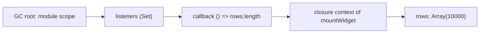

## Introduction

"The app feels slow" is the start of an investigation, not a diagnosis. The slowness might come from JavaScript running too long, from the browser recalculating layout over and over, from a slow network request, from huge images being decoded, or from memory growing until garbage collection runs constantly. Each has a different fix, and fixing the wrong one wastes days. Engineers who guess often "optimise" code that was never the bottleneck.

**Profiling** means measuring where a program spends its time and memory while it runs. In the browser, two DevTools panels do most of this work. The **Performance** panel records a timeline of everything the main thread did — running JavaScript, computing styles, laying out, painting — and shows it as a **flame chart**. The **Memory** panel captures **heap snapshots**, listings of every object in memory and what keeps it alive, which is how you find leaks. Alongside them, the **User Timing API** (`performance.mark` and `performance.measure`) lets you put named measurements into your own code.

This lesson teaches the basics of each well enough to answer the first question in any performance investigation: *where is the time (or memory) actually going?* The broader browser-performance picture — rendering pipeline, Core Web Vitals, loading strategy — is covered in [[b3-browser-performance]] and [[b3-runtime-performance]].

## Before you start

- **Browser DevTools** — opening panels and reading the call stack. See [[b1-devtools]].
- **The event loop** — the main thread runs one task at a time, and rendering happens between tasks. See [[b1-event-loop]] and [[b3-event-loop-rendering-sync]].
- **The rendering steps** — style, layout and paint, at least by name. See [[b3-render-steps]].
- **Garbage collection** — objects are freed when nothing reachable refers to them. See [[b1-garbage-collection]] and [[b1-memory-leaks]].

## The intuition

Think of the Performance panel as a stopwatch that also films the kitchen. Not only does it tell you the meal took forty minutes; it shows that thirty of them were spent chopping onions one at a time. Memory profiling is a warehouse inventory: walk through, count every box, and for each pile ask "who ordered this, and why is it still here?" A leak is a pile of boxes that nobody will ever use but that somebody's order form still lists, so the cleaners are not allowed to throw them away.

The stopwatch analogy needs one correction. A CPU profiler does not record every function call — that would slow the program so much that the measurement would be meaningless. It takes **samples**: snapshots at regular intervals. More like a photographer who takes a picture of the kitchen every millisecond and later counts how many photos show someone chopping onions.

## Why the main thread matters

In a browser tab, your JavaScript, style calculation, layout, painting setup and input handling all share **one main thread**. While any task runs on it, nothing else can — a click waits, an animation frame is skipped, scrolling may stutter. A display refreshing 60 times a second leaves about 16.7 ms per frame for everything.

A task that runs longer than **50 ms** is called a **long task**. Fifty milliseconds is the threshold the web-performance community chose because a response within roughly 100 ms feels instant; if a task blocks for 50 ms, there is still time to handle an input that arrives during it. Long tasks are the main cause of poor **Interaction to Next Paint (INP)**, the Core Web Vital that measures how quickly the page responds to clicks, taps and key presses (INP replaced First Input Delay as a Core Web Vital in March 2024; see [[b3-inp]] and [[b1-long-tasks]]). Long tasks are not a Core Web Vital themselves; they are the most common reason INP is bad.

So most CPU profiling in the browser asks: which tasks were long, and what was each one doing?

## Recording a Performance profile

The workflow in Chrome's Performance panel is:

1. Open the page in a clean profile (an incognito window disables most extensions, which otherwise add their own scripts to the recording).
2. In the panel's settings, set **CPU throttling** — 4× or 6× slowdown — so that your fast development laptop behaves more like a typical phone.
3. Click **Record**, perform the slow interaction (open the menu, type in the search box, scroll the list), then stop. Keep the recording short and focused; a few seconds is ideal.
4. Read the result.

The recording has several tracks: screenshots across the top, a **Network** track, a **Frames** track, an **Interactions** track showing each input and its duration, and the **Main** track — the flame chart of the main thread, which is where most answers are.

### Reading a flame chart

In the Main track, time runs left to right and the call stack grows downward. Each bar is a function call (or a browser activity), its width is how long it lasted, and the bars below it are the functions it called. A wide bar with a tall stack beneath it is a deep call tree; a wide bar with *nothing* beneath it is a function spending time in its own code.

Colours tell you the kind of work. In Chrome, **yellow** is scripting (JavaScript), **purple** is rendering (style recalculation and layout), **green** is painting and compositing, and grey is other browser work. That colour split is often the first diagnosis:

- **Mostly yellow** — your JavaScript is the bottleneck. Look at which functions are widest.
- **Lots of purple** — layout and style work. Many small purple bars alternating with yellow is the signature of **layout thrashing**: code that writes to the DOM, then reads a layout property such as `offsetHeight`, forcing a synchronous layout, again and again. Chrome flags these as *Forced reflow*. See [[b3-layout-thrashing]].
- **Large green blocks** — expensive painting, often from large blurred shadows or animating properties that cannot be composited.

Tasks longer than 50 ms are marked with a red triangle in the corner, and the portion beyond 50 ms is shaded red.

### Summary, Bottom-Up and Call Tree

Clicking a bar, or selecting a range, fills the tabs at the bottom. **Summary** shows a pie of time by category. **Call Tree** shows the time in each root activity, expanded top-down. **Bottom-Up** lists functions sorted by **self time** — time spent in the function's own code, excluding the functions it called. **Total time** includes everything the function called.

The distinction matters. A `render()` function may have 400 ms of total time but 2 ms of self time — it is not slow itself, it calls something slow. Bottom-Up sorted by self time points straight at the code that actually burns the CPU; Call Tree tells you how you got there.

## How a sampling profiler works

V8's CPU profiler — used by Chrome's Performance panel and by Node.js — interrupts the program at a fixed interval and records the current JavaScript call stack. Every sample is "at this instant, this stack was running". Time is then estimated statistically: if 900 of 1,000 samples have `countPrimes` at the top of the stack, `countPrimes` has about 90 % of the self time. Total time for a function is the share of samples where it appears anywhere in the stack.

Node.js can write the same profile to a file with `--cpu-prof`, and its default sampling interval is 1,000 microseconds (change it with `--cpu-prof-interval`). The resulting `.cpuprofile` file can be loaded into Chrome's Performance panel, but because it is plain JSON we can also read it directly, which shows exactly what the profiler collected. Here is a program with one CPU-heavy function and one string-building function:

```js title="work.mjs"
function isPrime(n) {
  for (let d = 2; d * d <= n; d++) if (n % d === 0) return false;
  return n > 1;
}
function countPrimes(limit) {
  let count = 0;
  for (let n = 0; n < limit; n++) if (isPrime(n)) count++;
  return count;
}
function buildReport(rows) {
  let html = '';
  for (let i = 0; i < rows; i++) html += `<tr><td>${i}</td></tr>`;
  return html.length;
}
console.log(countPrimes(3_000_000), buildReport(300_000));
```

And a script that turns the samples into a self-time table:

```js title="summarize.mjs"
import { readFileSync, readdirSync } from 'node:fs';
const dir = process.argv[2];
const file = readdirSync(dir).find((f) => f.endsWith('.cpuprofile'));
const profile = JSON.parse(readFileSync(`${dir}/${file}`, 'utf8'));

// Each sample is the id of the node (stack frame) that was on top when the timer fired.
const hits = new Map();
for (const id of profile.samples) hits.set(id, (hits.get(id) ?? 0) + 1);

const selfByName = new Map();
for (const node of profile.nodes) {
  const name = node.callFrame.functionName || '(anonymous)';
  selfByName.set(name, (selfByName.get(name) ?? 0) + (hits.get(node.id) ?? 0));
}
const total = profile.samples.length;
console.log('samples:', total);
[...selfByName].sort((a, b) => b[1] - a[1]).slice(0, 4).forEach(([name, n]) =>
  console.log(`${name.padEnd(20)} ${((100 * n) / total).toFixed(1)}% self`));
```

```bash
node --cpu-prof --cpu-prof-dir=out work.mjs
node summarize.mjs out
```

```output
216816 7088890
samples: 449
countPrimes          89.3% self
(garbage collector)  8.2% self
buildReport          0.9% self
(anonymous)          0.4% self
```

These numbers come from Node.js 22 on one machine; the sample count and percentages vary slightly from run to run. The file format is simple: `nodes` is the call tree, each with a `callFrame` naming the function, and `samples` is the list of which node was on top at each tick. Counting samples per function gives self time.

Two things in this output are instructive. First, `(garbage collector)` takes about 8 %: building a 7-million-character string allocates many intermediate strings, and the time spent cleaning them up shows up as its own entry. Allocation has a CPU cost that a profile makes visible.

Second, **`isPrime` does not appear at all**, even though it is where the arithmetic happens. The reason is **inlining**: V8's optimising compiler copied `isPrime`'s body into `countPrimes` because it is small and called in a hot loop, so at runtime there was no separate `isPrime` frame to sample. Running the same profile with `node --no-turbo-inlining` (a V8 flag used here only for the experiment) attributes about 88 % of samples to `isPrime` instead. In Chrome the effect is the same. When a profile blames a function that "only loops", check whether small functions it calls were inlined into it.

Sampling has one more limit: a function that runs for much less than the sampling interval may never be caught, or its share may be noisy. That is fine for finding bottlenecks — anything that matters will be sampled many times — but it means a profile is not an exact call count. For exact counts, use `console.count` or instrumentation.

## Measuring your own code: User Timing

A profile shows everything; sometimes you want a precise measurement of one operation, in code, by name. The **User Timing API** provides it. `performance.mark(name)` records a high-resolution timestamp, and `performance.measure(name, startMark, endMark)` records the duration between two marks and returns a `PerformanceMeasure` entry. It is a web standard on the `performance` object, and Node.js provides the same global.

```js title="timing.mjs"
function slugify(title) {
  return title.toLowerCase().trim().replace(/[^a-z0-9]+/g, '-').replace(/^-|-$/g, '');
}
const titles = Array.from({ length: 200_000 }, (_, i) => `  Post Number ${i}: Hello, World!  `);

performance.mark('slugify:start');
const slugs = titles.map(slugify);
performance.mark('slugify:end');
const m = performance.measure('slugify', 'slugify:start', 'slugify:end');

console.log(slugs[7]);
console.log(m.name, m.entryType, `${m.duration.toFixed(1)}ms`);
console.log(performance.getEntriesByType('mark').map((e) => e.name));
```

```output
post-number-7-hello-world
slugify measure 106.4ms
[ 'slugify:start', 'slugify:end' ]
```

The duration varies by machine and run. Three things make marks better than ad-hoc `Date.now()` subtraction. Timestamps come from `performance.now()`, which is monotonic (it never jumps backwards when the system clock changes) and has sub-millisecond resolution, although browsers deliberately coarsen it to limit timing attacks. Marks and measures appear by name in the **Timings** track of a Chrome Performance recording, so your own labels line up with the flame chart. And a `PerformanceObserver` can collect them in production and send them to analytics, which is how teams track the real-world duration of operations such as "time to render search results". See [[b3-user-timing]] and [[b3-performance-observer]].

Clear entries you no longer need with `performance.clearMarks()` and `performance.clearMeasures()`; in a long-running page, recording marks in a loop without clearing them is itself a slow memory leak.

## Memory profiling

JavaScript frees memory automatically: the garbage collector starts from **GC roots** — the global object, the current call stacks, active handles such as timers and DOM event listeners — and keeps every object reachable from them. Anything unreachable is freed. A **memory leak** in JavaScript is therefore not "forgotten `free()`"; it is an object that you no longer need but that is still **reachable**, usually through a forgotten reference — a listener never removed, a cache that only grows, a timer never cleared, a closure holding a large array. See [[b1-memory-leaks]] and [[b1-closure-memory]].

### Seeing a leak happen

The program below simulates a common UI leak. Each "widget" subscribes to a global event bus with a callback that closes over the widget's data. When the widget is unmounted, the buggy version forgets to unsubscribe. It mounts and unmounts 100 widgets per round and measures the heap after forcing a garbage collection — the `--expose-gc` flag makes `gc()` available for exactly this kind of experiment.

```js title="leak.mjs"
// Run with: node --expose-gc leak.mjs
const listeners = new Set();
const bus = {
  subscribe(fn) { listeners.add(fn); return () => listeners.delete(fn); },
};

function mountWidget({ unsubscribeOnUnmount }) {
  const rows = new Array(10_000).fill('row'); // the widget's private data
  const unsubscribe = bus.subscribe(() => rows.length);
  return function unmount() {
    if (unsubscribeOnUnmount) unsubscribe();
  };
}

function heapMB() {
  globalThis.gc(); // collect first, so we only count what is still reachable
  return (process.memoryUsage().heapUsed / 1024 / 1024).toFixed(1);
}

for (const unsubscribeOnUnmount of [false, true]) {
  listeners.clear();
  const readings = [];
  for (let round = 0; round < 4; round++) {
    for (let i = 0; i < 100; i++) mountWidget({ unsubscribeOnUnmount })();
    readings.push(heapMB());
  }
  console.log(`unsubscribe=${unsubscribeOnUnmount}`, readings.join(' -> '), 'MB,',
    `listeners alive: ${listeners.size}`);
}
```

```output
unsubscribe=false 10.9 -> 18.6 -> 26.3 -> 33.9 MB, listeners alive: 400
unsubscribe=true 3.5 -> 3.5 -> 3.5 -> 3.5 MB, listeners alive: 0
```

Exact megabyte values depend on the Node.js version and machine; the pattern does not. Without unsubscribing, every round adds about 7.7 MB that garbage collection cannot reclaim, because each widget's `rows` array (10,000 slots of 8 bytes ≈ 80 KB) is reachable from a GC root: global `listeners` set → callback → closure → `rows`. With the fix, memory is flat. Notice also *how* the leak was proven: repeat the same action several times and check whether memory returns to a baseline after GC. One measurement proves nothing, since heaps legitimately grow and shrink.

### Heap snapshots

That chain from root to leaked object is called a **retainer path**, and finding it is the purpose of a heap snapshot. In Chrome's Memory panel, choose *Heap snapshot* and click *Take snapshot*; Chrome runs a garbage collection first, then records every object, its size and its references. Node.js can write the same format with `v8.writeHeapSnapshot()` or through `node --inspect`.

Each row of a snapshot reports two sizes. **Shallow size** is the memory the object itself occupies. **Retained size** is the memory that would be freed if this object were deleted — itself plus everything only reachable through it. A tiny closure can have a huge retained size because it keeps a large array alive, which is exactly the situation in `leak.mjs`.

The standard technique for leaks is the **three-snapshot comparison**:

1. Load the page and take snapshot 1 as a baseline.
2. Perform the suspected leaky action several times (open and close a dialog five times), then take snapshot 2.
3. Repeat the action the same number of times and take snapshot 3.
4. View snapshot 3 in **Comparison** mode against snapshot 2, sorted by *# Delta* or *Size Delta*. Objects that grow by a multiple of the repetition count are suspects.
5. Select one and read the **Retainers** pane at the bottom: it shows the path from a GC root to the object. The first link in that path that *you* own — a listener set, a cache map, a module-level array — is the bug.

In the browser, a common leak is the **detached DOM node**: an element removed from the document but still referenced from JavaScript (stored in a variable, an array, or a closure of a listener attached elsewhere). The snapshot's class filter accepts `Detached`, which lists such elements; their retainers show what still holds them.

The Memory panel offers two more recording types. **Allocations on timeline** records allocations over time with blue bars for objects still alive at the end — useful for seeing *when* leaked objects were created. **Allocation sampling** is a low-overhead sampling view of which functions allocate the most memory, the memory counterpart to a CPU profile.



## Profiling conditions: getting numbers you can trust

A profile is only useful if it reflects what users experience. Several common setups distort the results:

- **Development builds.** React's development build performs extra checks and warnings that make it several times slower than production, and in development **Strict Mode** intentionally renders components twice and runs effects twice to surface bugs ([[b4-strict-mode-double-run]]). Profile a production build (for example `vite build` then `vite preview`) for absolute numbers. React's own Profiler ([[b4-profiler]]) is still useful in development for *relative* questions such as "which component re-renders most".
- **Fast hardware.** A developer laptop may be five to ten times faster than a mid-range phone. Use CPU throttling, and confirm important findings on a real device.
- **Extensions and DevTools.** Browser extensions inject scripts; DevTools itself adds overhead when open, and features such as async stack traces cost time. Use a clean profile and treat small differences (a few percent) as noise.
- **Single runs.** JIT compilation means the first run of a function is slower than later ones. Repeat measurements and compare medians, not one-off values.

Field data closes the gap: Real User Monitoring (RUM) tools collect metrics such as INP and LCP from actual users, and the Performance panel's landing view in recent Chrome versions shows your local metrics next to field data where available. Lab profiling finds *why*; field data tells you *whether it matters*. See [[b3-core-web-vitals]].

## Worked example: a sluggish filter box

A product page has a text box that filters 5,000 rows as you type. Typing feels laggy on phones. Here is how the investigation goes.

1. **Record.** With 4× CPU throttling, record while typing five characters. The Interactions track shows each keypress taking around 300 ms before the next paint; the Main track shows five long tasks with red corners.
2. **Classify.** Each long task is roughly two-thirds yellow and one-third purple. Both JavaScript and layout matter.
3. **Bottom-Up.** Sorted by self time, the top entries are `normalize` (a function that lower-cases and strips accents from every row's name — on every keystroke) and *Layout*.
4. **Purple bars.** Expanding a task shows many small *Layout* entries interleaved with a loop that sets each row's `style.display` and then reads `row.offsetHeight` to compute a scroll position. Chrome marks them *Forced reflow*. That is layout thrashing.
5. **Fix and measure.** Precompute normalised names once when data loads instead of per keystroke; batch all writes before a single read; add `performance.mark`/`measure` around the filter so the improvement is recorded by name. A new recording shows keypresses under 50 ms with no long tasks.

The fixes came from the profile, not intuition. A typical first guess — "debounce the input" — would have hidden the problem by doing the same slow work less often, while every remaining keypress still blocked the thread.

## How it works internally

- **CPU sampling.** V8's profiler runs a sampling thread that periodically interrupts the JavaScript thread, captures the stack using V8's code maps (which translate machine-code addresses back to functions), and records a sample. Inlined functions may or may not be split out depending on the tool and the position information available, which is why they sometimes vanish.
- **Trace events.** The rest of the Performance timeline comes from Chrome's tracing system: the renderer emits events for tasks, style, layout, paint and network, and DevTools merges them with the CPU samples to draw the flame chart.
- **Heap snapshots.** A snapshot walks the object graph from the GC roots and records every node (object) and edge (property, closure variable, internal reference). Retained sizes are computed with a **dominator tree**: an object *dominates* another if every path from the roots to the second passes through the first, and an object's retained size is the sum of what it dominates. Taking a snapshot pauses the page and can use a lot of memory for large heaps.
- **User Timing.** Marks and measures are entries on the page's performance timeline, stored until cleared, and observable through `PerformanceObserver`.

## Trade-offs and alternatives

| Tool | Answers | Cost / limit |
|---|---|---|
| Performance panel recording | Where main-thread time goes, including rendering | Overhead while recording; lab conditions only |
| `--cpu-prof` / `.cpuprofile` | CPU hot spots in Node.js | Sampling; short functions and inlined code blur |
| `performance.mark`/`measure` | Exact duration of named operations, in lab and field | You must choose what to measure |
| `console.time` | Quick duration during development | Wall-clock only; not visible in the timeline |
| Heap snapshot comparison | What leaks and why it is retained | Pauses the page; large files |
| Allocation timeline / sampling | When and where memory is allocated | Timeline mode has high overhead |
| RUM / field metrics | Whether users actually experience the problem | Aggregated; little detail on cause |

## Common mistakes

**Optimising without a profile.** The bottleneck is rarely where you expect. Measure first, change one thing, measure again.

**Profiling a development build and reporting the numbers.** Dev builds and Strict Mode inflate times. Use production builds for absolute numbers.

**Reading total time as self time.** A wide top-level bar is often only the caller of the slow function. Use Bottom-Up to find self time.

**Mistaking a growing heap for a leak.** Heaps grow until GC runs. A leak is memory that does not return to a baseline after repeated identical actions and a forced GC.

**Ignoring layout in "JavaScript is slow" problems.** Purple forced reflows inside your JavaScript tasks are caused by your code's DOM reads and writes; they will not appear in a pure CPU profile of the functions.

**Recording for a minute.** Long recordings are hard to read and expensive to collect. Record the single interaction that is slow.

## Interview perspective

- *"A page is slow. How do you start?"* Reproduce with throttling, record a Performance profile of the slow interaction, classify the long tasks by colour (scripting, rendering, painting), use Bottom-Up for self time, then fix and re-measure. Mention production builds.
- *"What is the difference between self time and total time?"* Self excludes callees; total includes them.
- *"How does a sampling profiler work, and what can it miss?"* Periodic stack samples; statistical; very short or inlined functions may be under-represented.
- *"How do you find a memory leak?"* Three-snapshot comparison, sort by delta, read the retainer path; detached DOM nodes in browsers. Explain retained versus shallow size.
- *"What is a long task and why does it matter?"* Over 50 ms on the main thread; blocks input and rendering; the main driver of poor INP.
- Follow-up: *"Why doesn't my function show up in the profile even though it does the work?"* It may have been inlined into its caller.

```quiz
Q: In a Bottom-Up view, `renderList` shows 420 ms total time and 3 ms self time. What does this tell you?
- [ ] `renderList` itself is the bottleneck and should be rewritten
- [x] Almost all the time is spent in functions that `renderList` calls
- [ ] The profiler failed to sample `renderList`
- [ ] `renderList` ran 140 times
> Self time counts only samples where `renderList` was on top of the stack; total time counts samples where it appears anywhere. A large total with tiny self time means the cost is in its callees, so expand it to find them. A profile also says nothing exact about call counts.
```

```quiz
Q: After opening and closing a dialog ten times, heap snapshot 3 compared with snapshot 2 shows 10 new `HTMLDivElement` objects marked Detached. What is the most likely explanation?
- [ ] The garbage collector has not run yet
- [ ] Detached elements are normal and are always freed later
- [x] Something in JavaScript still references the removed dialog elements, so they cannot be collected
- [ ] The dialog uses too much CSS
> Taking a snapshot forces garbage collection, so these elements survived a collection. Detached means they are no longer in the document; surviving means something reachable — a listener, an array, a closure — still points at them. The Retainers pane shows that path. Growth matching the repetition count is the classic leak signature.
```

```quiz
Q: Why might a small helper function that does most of the arithmetic not appear in a CPU profile?
- [ ] Profilers only record functions that take longer than 50 ms
- [x] The optimising compiler inlined it into its caller, so its time is attributed to the caller
- [ ] Functions declared with `function` are hidden from profiles
- [ ] It ran on a different thread
> V8 copies small hot functions into their callers when optimising, so there is no separate frame for the sampler to see. Disabling inlining for an experiment moves the samples back to the helper. There is no 50 ms threshold for samples, and ordinary JavaScript runs on the main thread.
```

## Practice

1. Profile `work.mjs` with `--cpu-prof`, load the `.cpuprofile` into Chrome's Performance panel, and find `countPrimes` in the flame chart.
2. Change `buildReport` to collect parts in an array and `join` them. Predict how the `(garbage collector)` share will change, then measure.
3. Add `performance.mark`/`measure` around a slow operation in an app you work on and find the measure in the Timings track of a recording.
4. In a browser page, create a leak by storing removed elements in an array. Find them with the three-snapshot technique and the `Detached` filter.
5. Record the same interaction with and without 6× CPU throttling and compare which tasks become long.

## Quick revision {#quick-revision}

- Profile before optimising; change one thing and re-measure.
- Main thread runs JS, style, layout, paint and input; a frame at 60 Hz is about 16.7 ms; a long task is over 50 ms and is the main cause of poor INP (a Core Web Vital since March 2024).
- Flame chart: time left→right, stack downward, width = duration. Yellow scripting, purple rendering, green painting.
- Self time excludes callees; total includes them. Bottom-Up sorts by self time.
- Sampling profiler: stack snapshots at an interval (Node `--cpu-prof`, default 1,000 µs). Statistical; short or inlined functions may vanish.
- User Timing: `performance.mark`, `performance.measure` → `PerformanceMeasure`; shows in the Timings track; observable in production; clear old entries.
- Leak = unneeded but reachable. Prove by repeating an action and checking memory after GC.
- Heap snapshots: shallow vs retained size; three-snapshot comparison; Retainers pane; `Detached` filter for DOM leaks.
- Trustworthy numbers: production build, CPU throttling, clean profile, repeated runs; Strict Mode and dev builds inflate times.

## Key takeaways {#key-takeaways}

- Profiling replaces guesses with evidence about whether time goes to JavaScript, layout, painting or memory management.
- Read flame charts by colour first, then use self time to find the code that actually burns CPU.
- A CPU profile is statistical sampling, so inlining and very short functions can hide work in a caller.
- `performance.mark` and `measure` put named, high-resolution measurements into your own code and into the timeline.
- A leak is a reachable object you no longer need; the retainer path in a heap snapshot shows who keeps it alive.
- Profile in production-like conditions, or the numbers describe your dev setup rather than your users.
