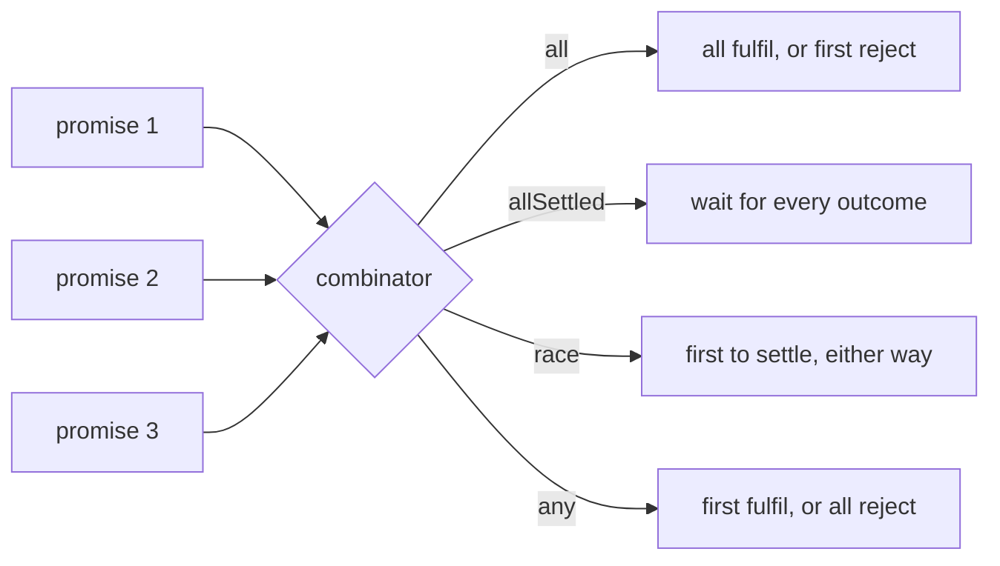

## Introduction

As soon as a program does more than one asynchronous thing at a time, it needs a way to wait for several promises at once. A page needs the user *and* their permissions before it can render. A dashboard wants all six widgets, but should still show five if one breaks. A client wants whichever of two mirror servers answers first. A request should give up after three seconds.

You could write each of those with counters and flags inside `.then` callbacks, but that code is fiddly and easy to get wrong — forgetting the empty case, recording results in the wrong order, settling twice. JavaScript instead provides four **promise combinators**: static methods on `Promise` that take an iterable of promises (usually an array) and return a single promise whose outcome is derived from theirs by a fixed rule.

| Method | Added | Fulfils when | Rejects when | Fulfilment value |
|---|---|---|---|---|
| `Promise.all` | ES2015 | every input fulfils | the first input rejects | array of values, in input order |
| `Promise.allSettled` | ES2020 | every input has settled | never (for a valid iterable) | array of `{ status, value }` / `{ status, reason }` |
| `Promise.race` | ES2015 | the first input to settle fulfils | the first input to settle rejects | that input's value |
| `Promise.any` | ES2021 | the first input fulfils | every input rejects | that input's value; rejection is an `AggregateError` |

The table is the whole API, but using it well needs more: what happens to the promises that "lose", how each method behaves with an empty array, why none of them cancels anything, and how to combine them. This lesson covers each combinator in its own section — [[b1-promise-all]], [[b1-promise-allsettled]], [[b1-promise-race]] and [[b1-promise-any]] — which also stand on their own.

## Before you start

- **Promises** — states, `.then`/`.catch`, and that a promise settles once. See [[b1-promises]] and [[b1-promise-states]].
- **Error propagation** — how rejections flow and what an unhandled rejection is. See [[b1-error-propagation]].
- **`async`/`await`** — the examples use `await` to read a combinator's result. You need only that `await p` pauses until `p` settles and throws if it rejects; see [[b1-async-await]].
- **Why waiting in parallel is faster** — covered in [[b1-sequential-vs-parallel]], which pairs naturally with this lesson.

All snippets run in Node.js 22 as ES modules (`.mjs`, which allows top-level `await`). Times printed by examples are rounded to 10 ms and can vary slightly from run to run.

## The intuition

Imagine sending four colleagues to fetch four things, and deciding *when you can stop waiting*. There are only a few sensible rules:

- "I need everything. If anyone comes back empty-handed, the plan is off." — `all`.
- "Let everyone come back, then tell me what each of you got or why you failed." — `allSettled`.
- "Whoever comes back first, with news good or bad, decides." — `race`.
- "Whoever comes back first *with the thing* wins. Only if all of you fail am I in trouble." — `any`.

One part of the analogy needs correcting straight away. When you stop waiting, your colleagues do not stop walking. A combinator decides when *its own* promise settles; it has no power over the operations behind the input promises, which keep running to completion. Stopping them is a separate job, done with `AbortController`, as you will see.

## How combinators work internally

All four share one mechanism. The combinator creates a new result promise, iterates over the input once, passes each item through `Promise.resolve` (so plain values and thenables are accepted), and attaches a fulfilment and a rejection reaction to each. Each reaction updates a little shared state — a results array and a counter of how many inputs are still outstanding — and calls the result promise's `resolve` or `reject` when the method's rule is met.

Two consequences follow directly from that design. First, because a promise settles only once, any later attempt to settle the result promise is ignored; that is how "first rejection wins" and "first to settle wins" are implemented without extra flags. Second, because every input has handlers attached, **a rejection from a losing input is not an unhandled rejection** — the combinator handled it, even though nobody sees it.

Iteration happens synchronously when you call the combinator, so a generator or `Set` is consumed immediately. Passing something that is not iterable does not throw; it returns a rejected promise with a `TypeError`.



## Promise.all {#b1-promise-all}

`Promise.all(iterable)` waits for **all** of its inputs to fulfil and then fulfils with an array of their values, in the **same order as the input** — not the order they finished in. If **any** input rejects, the result rejects immediately with that input's reason. This is called **fail-fast** behaviour. It is the combinator you will use most, because the most common need is "load these independent things at the same time, and I need all of them".

```javascript title="all-order.mjs"
const delay = (ms, value) => new Promise((resolve) => setTimeout(() => resolve(value), ms));
const t0 = Date.now();
const since = () => `${Math.round((Date.now() - t0) / 10) * 10} ms`;

const results = await Promise.all([
  delay(60, 'slow'),
  delay(10, 'fast'),
  42,                        // not a promise: treated as Promise.resolve(42)
]);
console.log(results, 'after', since());
console.log(await Promise.all([]));
```

```output
[ 'slow', 'fast', 42 ] after 60 ms
[]
```

Three details are visible. `'fast'` finished first but sits in position 1 because results are matched to inputs by position, so you can destructure them safely: `const [user, perms] = await Promise.all([getUser(), getPerms()])`. The total time is the time of the slowest input, 60 ms, not the sum, because all three were already running. Plain values are allowed and passed through. And an empty array fulfils immediately with `[]` — there is nothing to wait for.

### Fail-fast, and what it does not do

```javascript title="all-fail-fast.mjs"
const t0 = Date.now();
const since = () => `${Math.round((Date.now() - t0) / 10) * 10} ms`;
const job = (ms, name, fail = false) =>
  new Promise((resolve, reject) =>
    setTimeout(() => {
      console.log(`  ${name} finished at ${since()}`);
      fail ? reject(new Error(`${name} failed`)) : resolve(name);
    }, ms));

try {
  await Promise.all([job(50, 'profile'), job(10, 'settings', true), job(30, 'feed')]);
} catch (err) {
  console.log('all rejected at', since(), 'with', err.message);
}
```

```output
  settings finished at 10 ms
all rejected at 10 ms with settings failed
  feed finished at 30 ms
  profile finished at 50 ms
```

The combined promise rejects at 10 ms, the moment `settings` fails — the caller does not wait for the others. But `feed` and `profile` keep running and finish later; their results are simply discarded. **`Promise.all` does not cancel anything.** If those were expensive requests or writes, they still happened. When that matters, pass an `AbortSignal` to the operations and abort it in the `catch`. Also note that only the *first* rejection is reported; if several inputs fail, the later reasons are lost. If you need all of them, you want `allSettled`.

### Implementing it

"Implement `Promise.all`" is a classic interview question because it tests whether you understand the details above.

```javascript title="promise-all-impl.mjs"
function promiseAll(iterable) {
  return new Promise((resolve, reject) => {
    const items = Array.from(iterable);       // consume the iterable once, up front
    const results = new Array(items.length);
    let remaining = items.length;
    if (remaining === 0) {
      resolve(results);
      return;
    }
    items.forEach((item, index) => {
      Promise.resolve(item).then((value) => {
        results[index] = value;               // by index, not push: keeps input order
        remaining -= 1;
        if (remaining === 0) resolve(results);
      }, reject);                             // first rejection wins; later calls ignored
    });
  });
}

const delay = (ms, value) => new Promise((resolve) => setTimeout(() => resolve(value), ms));
console.log(await promiseAll([delay(20, 'a'), delay(5, 'b'), 'c']));
console.log(await promiseAll(new Set([1, 2])));
console.log(await promiseAll([]));
await promiseAll([delay(5, 'x'), Promise.reject(new Error('bad')), Promise.reject(new Error('worse'))])
  .catch((e) => console.log('rejected with', e.message));
```

```output
[ 'a', 'b', 'c' ]
[ 1, 2 ]
[]
rejected with bad
```

Each decision has a reason. `Array.from` accepts any iterable, as the real method does. Results are written by index because `push` would record them in completion order. The counter, not `results.length`, decides completion, because writing to index 2 before index 0 makes `length` 3 while index 0 is still empty. The empty case must resolve explicitly — with no inputs, no callback would ever decrement the counter, and the promise would hang. `Promise.resolve(item)` handles plain values and thenables. And passing `reject` directly is safe because a promise ignores every settle call after the first.

> [!MISTAKE] Forgetting `return` in the `map`
> `Promise.all(ids.map((id) => { fetchUser(id); }))` fulfils immediately with `[undefined, undefined, …]`. The block-bodied arrow returns nothing, so `all` receives plain `undefined` values. Write `ids.map((id) => fetchUser(id))`.

**When to use it:** independent operations whose results you all need — a page's required data, uploading parts of a file, validating several fields against a server. **When not to:** when partial success is useful (use `allSettled`), when the steps depend on each other (run them in order), or when the input list is large and unbounded — `Promise.all(tenThousandIds.map(fetchUser))` starts ten thousand requests at once. Limit concurrency instead; see [[b1-concurrency-limiting]].

## Promise.allSettled {#b1-promise-allsettled}

`Promise.allSettled(iterable)` (ES2020) waits until **every** input has settled, whether it fulfilled or rejected, and then fulfils with an array describing each outcome in input order. It does not fail fast and, for a valid iterable, **it never rejects**: failures become data in the result instead of a rejection of the whole.

Each entry in the result is one of two shapes:

- `{ status: 'fulfilled', value }` for an input that fulfilled;
- `{ status: 'rejected', reason }` for an input that rejected.

```javascript title="all-settled.mjs"
const results = await Promise.allSettled([
  Promise.resolve('profile'),
  Promise.reject(new Error('feed: 503')),
  'static value',
]);
console.log(results.map((r) => r.status));
console.log(results[0], results[1].reason.message);

const ok = results.filter((r) => r.status === 'fulfilled').map((r) => r.value);
const failed = results.filter((r) => r.status === 'rejected').map((r) => r.reason.message);
console.log({ ok, failed });
```

```output
[ 'fulfilled', 'rejected', 'fulfilled' ]
{ status: 'fulfilled', value: 'profile' } feed: 503
{ ok: [ 'profile', 'static value' ], failed: [ 'feed: 503' ] }
```

The pattern after `allSettled` is almost always the same: split the outcomes by `status`, use the successes, and report or retry the failures. Because the outcome array lines up with the input array, you can also map each outcome back to the input that produced it — `outcomes.forEach((o, i) => …inputs[i]…)` — which is how batch jobs report "rows 4 and 17 failed".

`allSettled` fits wherever **partial success is still success**: a dashboard whose widgets load independently, a bulk email send where each failure should be logged but should not stop the others, a cleanup step that must close every connection even if some closes fail. Contrast this with `Promise.all`, where the first failure throws away every result, including the ones that succeeded.

It costs you two things. It always waits for the slowest input, even when an early failure means the result is no longer useful. And the combined promise looks successful, so it is easy to forget to inspect the failures — an `allSettled` whose rejected entries are never examined silently swallows errors.

> [!MISTAKE] Reading `value` without checking `status`
> A rejected entry has `reason`, not `value`, so `results.map((r) => r.value)` puts `undefined` in place of every failure. In TypeScript the entries are typed as a discriminated union (`PromiseFulfilledResult<T> | PromiseRejectedResult`), and the compiler forces you to check `status` before reading `value`.

Like the other combinators, `allSettled` cancels nothing and accepts plain values. An empty input fulfils immediately with `[]`. Before ES2020 people wrote it by hand by mapping each promise through `.then((value) => ({ status: 'fulfilled', value }), (reason) => ({ status: 'rejected', reason }))` and passing the result to `Promise.all` — a useful way to remember exactly what it does.

## Promise.race {#b1-promise-race}

`Promise.race(iterable)` settles as soon as **the first input settles**, and copies that input's outcome: if the first one to finish fulfilled, the race fulfils with its value; if it rejected, the race rejects with its reason. "First to settle", not "first to succeed" — that distinction is what separates it from `Promise.any`.

```javascript title="race.mjs"
const delay = (ms, value) => new Promise((resolve) => setTimeout(() => resolve(value), ms));
const failAfter = (ms, msg) =>
  new Promise((_, reject) => setTimeout(() => reject(new Error(msg)), ms));

console.log(await Promise.race([delay(30, 'slow'), delay(10, 'fast')]));

try {
  await Promise.race([delay(30, 'would have succeeded'), failAfter(10, 'fast failure')]);
} catch (err) {
  console.log('race rejected:', err.message);
}

console.log(await Promise.race([Promise.resolve('first in list'), Promise.resolve('second')]));

const never = Promise.race([]);
setTimeout(() => console.log('empty race still pending:', never), 20);
```

```output
fast
race rejected: fast failure
first in list
empty race still pending: Promise { <pending> }
```

The second case is the important one: a fast failure beats a slower success, so `race` rejects even though one input would have succeeded. The third case shows that when several inputs are already settled, the winner is the first one **in iteration order**, because their reactions are queued in the order `race` attached them. The fourth is a trap: with no inputs, nothing can ever settle the result, so **an empty race stays pending forever**. If the input list can be empty, guard for it.

### The main use: timeouts

`race` is the standard way to put a deadline on an operation. You race the work against a promise that rejects after a delay:

```javascript
const timeout = (ms) =>
  new Promise((_, reject) => setTimeout(() => reject(new Error(`timed out after ${ms} ms`)), ms));

const data = await Promise.race([loadReport(), timeout(3000)]);
```

This works for the *caller*, who stops waiting after three seconds. It has two weaknesses. The slow `loadReport()` keeps running after it loses — a request still reaches the server, a query still holds a database connection. And the timer keeps running after the work wins, which in Node.js can keep the process alive until it fires. The worked example at the end of this lesson fixes both, by aborting the work with an `AbortController` and clearing the timer in `finally`. For `fetch` specifically, `fetch(url, { signal: AbortSignal.timeout(3000) })` does both in one line.

> [!WARNING] `race` is not cancellation
> Winning the race only decides which outcome the combined promise takes. The other inputs continue to run and use resources. Cancellation needs cooperation from the operation itself, through an `AbortSignal` or a similar mechanism ([[b1-abort-controller-js]]).

Other uses are rarer: taking whichever of several equivalent event sources fires first, or racing a request against a "user navigated away" promise. If what you actually want is "the first one that *works*", use `any`.

## Promise.any {#b1-promise-any}

`Promise.any(iterable)` (ES2021) fulfils with the value of **the first input to fulfil**, ignoring rejections along the way. It rejects only if **every** input rejects, and then it rejects with an **`AggregateError`** — an `Error` subclass with an `errors` array holding every rejection reason, in input order. It is the mirror image of `Promise.all`: `all` needs every input to succeed and fails on the first failure; `any` needs one success and fails only when everything fails.

```javascript title="any.mjs"
const delay = (ms, value) => new Promise((resolve) => setTimeout(() => resolve(value), ms));
const failAfter = (ms, msg) =>
  new Promise((_, reject) => setTimeout(() => reject(new Error(msg)), ms));

console.log(await Promise.any([failAfter(5, 'mirror A down'), delay(20, 'mirror B data')]));

try {
  await Promise.any([failAfter(5, 'A down'), failAfter(10, 'B down')]);
} catch (err) {
  console.log(err.name, '-', err.message);
  console.log(err.errors.map((e) => e.message));
}

try {
  await Promise.any([]);
} catch (err) {
  console.log('empty any:', err.name, err.errors.length);
}
```

```output
mirror B data
AggregateError - All promises were rejected
[ 'A down', 'B down' ]
empty any: AggregateError 0
```

In the first call, mirror A fails at 5 ms, but `any` ignores it and waits; mirror B succeeds at 20 ms and wins. With `race`, the same inputs would have rejected at 5 ms. In the second call both fail, and the `AggregateError` carries both reasons, so you can log exactly why each source failed. The message text "All promises were rejected" is V8's wording and may differ between engines; check `err.name` or `instanceof AggregateError`, not the message. An empty input **rejects immediately** with an empty `AggregateError` — the opposite of `race`, which hangs — because "every input rejected" is trivially true when there are none.

`any` is built for **redundancy**: fetching the same resource from several mirrors or CDNs, trying a cache and the network at once, querying replicas and using whichever answers. As with the other combinators, the slower inputs are not stopped once one wins; abort them if they are costly. And be careful what you race in a fallback chain: if a fast but stale cache and a slow but fresh network both fulfil, `any` takes the cache every time, which may not be what you meant.

> [!INTERVIEW] `race` versus `any`
> Both return "the first one", but `race` means first to *settle* and `any` means first to *fulfil*. A good answer gives the consequence: with `race`, one fast failure loses the whole operation; with `any`, failures are tolerated until all inputs have failed. Mention `AggregateError` and the empty-input behaviour (race hangs, any rejects).

## Worked example: a dashboard with required data, optional widgets and timeouts

Real code often combines combinators. This dashboard needs the user and their permissions — without those there is nothing to show — so it loads them with `all`. Its three widgets are optional, so it loads them with `allSettled` and shows a placeholder for any that fail. Each widget also gets a 100 ms deadline built from `race`, and a widget that misses the deadline is actually cancelled.

```javascript title="dashboard.mjs"
const t0 = Date.now();
const since = () => `${Math.round((Date.now() - t0) / 10) * 10} ms`;

// A fake API call that honours an AbortSignal, like fetch does.
function api(name, ms, { fail = false, signal } = {}) {
  return new Promise((resolve, reject) => {
    const timer = setTimeout(() => {
      fail ? reject(new Error(`${name}: 500`)) : resolve(`${name} data`);
    }, ms);
    signal?.addEventListener('abort', () => {
      clearTimeout(timer);
      console.log(`  ${name} cancelled at ${since()}`);
      reject(signal.reason);
    });
  });
}

// Run work(signal); give up after ms and tell the work to stop.
async function withTimeout(work, ms) {
  const controller = new AbortController();
  let timer;
  const timeout = new Promise((_, reject) => {
    timer = setTimeout(() => {
      const err = new Error(`timed out after ${ms} ms`);
      controller.abort(err);
      reject(err);
    }, ms);
  });
  try {
    return await Promise.race([work(controller.signal), timeout]);
  } finally {
    clearTimeout(timer);               // the work won: stop the timer
  }
}

async function loadDashboard() {
  // Required: the page is useless without both, so fail fast.
  const [user, perms] = await Promise.all([api('user', 20), api('permissions', 30)]);
  console.log(`required ready at ${since()}:`, user, '+', perms);

  // Optional: each widget may fail or be slow on its own.
  const widgets = ['feed', 'recommendations', 'ads'];
  const outcomes = await Promise.allSettled([
    withTimeout((signal) => api('feed', 40, { signal }), 100),
    withTimeout((signal) => api('recommendations', 500, { signal }), 100),
    withTimeout((signal) => api('ads', 10, { fail: true, signal }), 100),
  ]);
  outcomes.forEach((o, i) => {
    const shown = o.status === 'fulfilled' ? o.value : `placeholder (${o.reason.message})`;
    console.log(`  ${widgets[i]}: ${shown}`);
  });
  console.log(`dashboard rendered at ${since()}`);
}

await loadDashboard();
```

```output
required ready at 30 ms: user data + permissions data
  recommendations cancelled at 130 ms
  feed: feed data
  recommendations: placeholder (timed out after 100 ms)
  ads: placeholder (ads: 500)
dashboard rendered at 140 ms
```

Follow the timeline. `user` and `permissions` start together, so the required phase takes 30 ms (the slower of 20 and 30), not 50. If either had failed, `Promise.all` would have rejected and `loadDashboard` would have rejected with it — correct, because there is no page without them.

The widgets then start together at 30 ms. `ads` fails at 40 ms; `feed` succeeds at 70 ms. `recommendations` would take 500 ms, so at 130 ms its timer wins the race: it aborts the controller — the fake API hears the `abort` event, clears its own timer and logs the cancellation — and rejects. Because `allSettled` is waiting for all three, the widgets phase ends at 130 ms with one success and two failures, each turned into a placeholder. The final timestamp may print as 130 or 140 ms because of rounding.

Inside `withTimeout`, the `finally` clears the timer whenever the work finishes first, so a fast `feed` does not leave a pending timer behind. Without that line, each stray timer would still fire later, call `abort()` on work that had already finished, and keep a Node.js process alive until it did — harmless here, but in a server handling thousands of requests those leftover timers add up. Try changing `ads` to `fail: false`, or the deadline to 30 ms, and predict the output before running it.

## In real systems

**Page and API loading.** Server-rendered pages and API gateways fan out to several backend services and join the results with `Promise.all`; React data loaders and server components do the same. Required data uses `all`; optional sections use `allSettled` or per-section error handling.

**Batch processing.** Jobs that process many independent items — sending notifications, resizing images, syncing records — use `allSettled` over a bounded batch so one failure is logged and retried without stopping the batch. The bounding matters: production code limits concurrency rather than passing thousands of promises to a combinator at once.

**Deadlines.** Service-to-service calls almost always have timeouts. In modern code these are usually `AbortSignal.timeout(ms)` passed to `fetch`, or the client library's own timeout option, rather than a hand-written `race` — but they are built on the same idea.

**Redundant sources.** `Promise.any` appears in multi-CDN loaders and in "hedged requests", where a client sends a second copy of a slow request to another replica and takes whichever answers first.

## Trade-offs and choosing

| Situation | Combinator | Why |
|---|---|---|
| Need every result; one failure makes the rest useless | `all` | Fails fast, ordered results |
| Want every result; failures are reported individually | `allSettled` | Never rejects, keeps every outcome |
| Deadline, or "whichever event happens first" | `race` | First outcome of any kind |
| Several equivalent sources; any success will do | `any` | Tolerates failures until all fail |
| Steps depend on each other's results | none — `await` in order | Combinators run inputs concurrently |
| Hundreds or thousands of jobs | a concurrency limiter | Combinators start everything at once |

Remember the limits they all share. None of them cancels the losing or remaining work. All of them start nothing themselves — the operations started when you created the input promises, usually in the `map` that built the array. And all accept plain values and thenables through `Promise.resolve`.

## Common mistakes

**Using `all` when partial results matter.** One failed widget blanks the whole page. Use `allSettled`, or give each input its own `.catch` that returns a fallback before passing it to `all`.

**Using `race` for "first success".** A quick failure wins. Use `any`.

**Assuming the losers stopped.** They did not. Abort them, or make sure their side effects are harmless.

**Empty inputs.** `race([])` never settles and `any([])` rejects at once, while `all([])` and `allSettled([])` fulfil with `[]`. Check what your code does when a filtered list comes back empty.

**Forgetting `return` when mapping.** The combinator receives `undefined` values and fulfils immediately.

**Unbounded fan-out.** `Promise.all(hugeArray.map(doRequest))` can exhaust sockets, hit rate limits or overload a database. Batch or limit concurrency.

**Ignoring `allSettled` failures.** The combined promise fulfils, so errors are silent unless you inspect `status`.

## Interview perspective

Expect a comparison question, an implementation question and edge-case follow-ups.

- **"Compare `all`, `allSettled`, `race`, `any`."** Use the four-row rule: when it fulfils, when it rejects, what the value is. Mention ordering, fail-fast and `AggregateError`.
- **"Implement `Promise.all`."** Write the index-based version above and explain the counter, the empty case, `Promise.resolve` wrapping, and why calling `reject` many times is safe. Follow-ups: implement `allSettled` on top of `all`, or `any`.
- **"Implement a timeout."** `race` plus a rejecting timer — then volunteer the two flaws (work not cancelled, timer not cleared) and the `AbortController` fix. That volunteering is a strong signal.
- **"Does `Promise.all` run things in parallel?"** It does not run anything; the operations are already in flight when the promises are created. JavaScript runs your callbacks on one thread; the waiting (network, timers, disk) overlaps.

[[b1-impl-promise-combinators]] has more implementation practice.

## Practice

1. Implement `promiseAllSettled(iterable)` using only `Promise.all` and `.then`.
2. Implement `promiseAny(iterable)` from scratch, including the `AggregateError` and the empty case.
3. Implement `promiseRace(iterable)`. Why is it the shortest of the four?
4. Modify the dashboard so the required phase also has a 200 ms deadline, and cancel the other required request if one fails.
5. Given `mirrors = ['a', 'b', 'c']`, write code that fetches from all of them with `any` and aborts the others as soon as one succeeds.

```quiz
Q: `Promise.all([delay(50, 'a'), delay(10, 'b')])` fulfils with what, and after roughly how long?
- [ ] `['b', 'a']` after 50 ms
- [x] `['a', 'b']` after 50 ms
- [ ] `['a', 'b']` after 60 ms
- [ ] `'b'` after 10 ms
> Results are stored by input position, not completion order, so `'a'` stays first. Both delays were already running, so the wait is the slowest one (50 ms), not the sum. A single value after 10 ms would be `race` or `any`.
```

```quiz
Q: One input of `Promise.all` rejects at 10 ms; the other two would fulfil at 50 ms. What happens?
- [ ] The combined promise waits until 50 ms, then rejects
- [x] It rejects at 10 ms, and the other two operations keep running
- [ ] It rejects at 10 ms and cancels the other two operations
- [ ] It fulfils at 50 ms with `undefined` for the failed input
> `all` is fail-fast: it rejects as soon as any input rejects. It has no power to stop the operations behind the other promises, which complete and are discarded. Keeping every outcome is `allSettled`'s job.
```

```quiz
Q: Inputs: A rejects after 5 ms, B fulfils after 20 ms. What do `race` and `any` do?
- [ ] Both fulfil with B's value
- [ ] Both reject with A's reason
- [x] `race` rejects with A's reason; `any` fulfils with B's value
- [ ] `race` fulfils with B's value; `any` rejects with an `AggregateError`
> `race` takes the first input to settle in any way, which is A's rejection. `any` ignores rejections until all inputs have failed, so it waits for B's success. `AggregateError` appears only when every input rejects.
```

```quiz
Q: Which call never settles?
- [ ] `Promise.all([])`
- [ ] `Promise.allSettled([])`
- [x] `Promise.race([])`
- [ ] `Promise.any([])`
> With no inputs, `race` has nothing that could settle it, so it stays pending forever. `all` and `allSettled` fulfil with `[]`, and `any` rejects immediately with an empty `AggregateError`.
```

## Quick revision {#quick-revision}

- Combinators take an iterable, wrap each item with `Promise.resolve`, attach handlers to all, and return one promise.
- `all` (ES2015): fulfils with values **in input order** when all fulfil; **rejects on the first rejection** (fail-fast); `[]` → `[]`.
- `allSettled` (ES2020): waits for every input; fulfils with `{status:'fulfilled', value}` / `{status:'rejected', reason}`; never rejects for a valid iterable; `[]` → `[]`.
- `race` (ES2015): copies the **first input to settle**, success or failure; `[]` → **pending forever**; ties between already-settled inputs go to iteration order.
- `any` (ES2021): fulfils with the **first fulfilment**; rejects with `AggregateError` (`.errors`) only when all reject; `[]` → rejects immediately.
- **None cancels anything.** Losers keep running; use `AbortController` / `AbortSignal.timeout`.
- Losing rejections are handled by the combinator, so they are not unhandled rejections.
- Non-iterable input → returned promise rejects with `TypeError` (no synchronous throw).
- Timeout = `race([work, rejectAfter(ms)])` + abort the work + clear the timer.
- Implementing `all`: store by index, count remaining, resolve the empty case, pass `reject` directly.
- Large fan-outs need concurrency limits, not one giant `all`.

## Key takeaways {#key-takeaways}

- The four combinators differ only in their rule for when the combined promise settles: all succeed, all finish, first finishes, or first succeeds.
- `all` is for required, independent data; `allSettled` for partial success; `race` for deadlines; `any` for redundant sources.
- Results from `all` and `allSettled` line up with the input, regardless of completion order.
- Empty input is an edge case worth memorising: `race` hangs, `any` rejects, the others fulfil with `[]`.
- Combinators decide when *you* stop waiting; stopping the work itself takes an `AbortSignal`.
