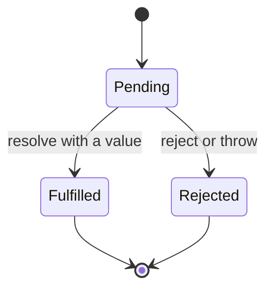

## Introduction

Most interesting work in a JavaScript program does not finish immediately. A network request takes tens or hundreds of milliseconds, reading a file waits on the disk, a timer waits on the clock. JavaScript runs your code on a single thread, so it cannot stop and wait for those results — if it did, the page would freeze. Instead, the runtime starts the operation, carries on with other work, and lets you know later when the result is ready.

The first way JavaScript offered to "let you know later" was the **callback**: you pass a function, and the runtime calls it when the work is done. Callbacks work, but they compose badly. Doing three dependent steps means nesting three functions inside each other, every step needs its own error check, and you are trusting the library to call your function exactly once. [[b1-callback-hell]] covers those problems in detail.

A **promise** solves them by turning "a result that will arrive later" into an ordinary value you can hold. A function such as `fetch(url)` returns a promise immediately. You can store it in a variable, pass it to another function, return it, or attach code that should run when the result arrives. The promise guarantees that it settles at most once, that the code you attach runs at most once, and that a failure travels along a single, predictable path.

Promises are the foundation of modern asynchronous JavaScript. `fetch`, the Node.js `fs/promises` module, database drivers, and `async`/`await` ([[b1-async-await]]) are all built on them. If you understand promises precisely — their states, what `.then` returns, and when their callbacks run — then `async` functions, combinators such as `Promise.all`, and most "what does this print?" interview puzzles become straightforward.

This lesson has three nested sections that also stand on their own: [[b1-promise-states]], [[b1-then-catch-finally]] and [[b1-promise-chaining]].

## Before you start

- **Callbacks** — passing a function to be called later. See [[b1-callback-concept]].
- **The event loop** — that JavaScript runs one piece of code at a time and picks the next piece from queues. See [[b1-event-loop]].
- **Microtasks** — the high-priority queue that promise callbacks go into. You only need the headline from [[b1-microtasks]]: microtasks run as soon as the current code finishes, before timers.
- **Arrow functions and `throw`/`try`/`catch`** — see [[b1-arrow-functions]] and [[b1-throw-try-catch]].

Every snippet in this lesson runs in Node.js 22 as an ES module (save as `.mjs`). The output blocks are what Node printed.

## The intuition

Think of ordering at a busy café. You pay, and instead of your coffee you get a numbered receipt. The receipt is not coffee, but it is a real object you can hold right now, and it represents the coffee you will get. While you wait you can do other things. Eventually one of two things happens: your number is called and you get the coffee, or the barista tells you they have run out of oat milk. Either way, that outcome is final — they will not call your number twice or hand you coffee after saying it is unavailable.

A promise is that receipt. It is returned immediately, it represents a future result, and it ends in exactly one outcome that never changes. Attaching `.then(drink)` is like telling a friend "when my number is called, drink it" — you register what should happen, and it happens at the right time, even if the number was already called before you asked.

The analogy stops working in one place: a café receipt only tells you to come and collect. A promise also lets you build a new receipt from the old one — "when the coffee arrives, add sugar, and give me a receipt for the sweetened coffee". That is what `.then` returns, and it is what makes chaining possible.

## Creating a promise

Most of the time you receive promises from APIs. When you need to create one — usually to wrap an older callback-based API — you use the `Promise` constructor. It takes one function, called the **executor**, which receives two functions: `resolve` to report success and `reject` to report failure.

```javascript title="executor.mjs"
console.log('1: before');
const p = new Promise((resolve) => {
  console.log('2: inside the executor');
  resolve('done');
});
p.then((value) => console.log('4: then got', value));
console.log('3: after');
```

```output
1: before
2: inside the executor
3: after
4: then got done
```

Two facts are visible here, and both surprise beginners. First, **the executor runs synchronously**, immediately, inside the `new Promise(...)` call — line 2 prints before line 3. Creating a promise does not move any code onto another thread or delay it. Second, **the `.then` callback runs later**, even though the promise was already fulfilled by the time `.then` was called. Promise callbacks are always queued as microtasks and run after the currently executing code finishes. This guarantee is deliberate: a callback attached to a promise never runs in the middle of the code that attached it, whether the promise is already settled or not. Callback-based APIs that sometimes call back synchronously and sometimes asynchronously were a notorious source of bugs; promises remove that inconsistency.

### Wrapping a callback API

The real use of the constructor is to adapt an operation that reports completion through a callback. Here is a Node-style error-first callback API and its promise wrapper:

```javascript title="wrap-callback.mjs"
// A callback-style API (error-first), as older Node.js libraries use.
function readSetting(key, callback) {
  setTimeout(() => {
    if (key === 'theme') callback(null, 'dark');
    else callback(new Error(`unknown setting "${key}"`));
  }, 10);
}

// Wrap it once; every caller then gets a promise.
function readSettingAsync(key) {
  return new Promise((resolve, reject) => {
    readSetting(key, (err, value) => {
      if (err) reject(err);
      else resolve(value);
    });
  });
}

readSettingAsync('theme').then((v) => console.log('theme =', v));
readSettingAsync('font').catch((e) => console.log('failed:', e.message));
```

```output
theme = dark
failed: unknown setting "font"
```

The executor starts the operation and connects its two possible outcomes to `resolve` and `reject`. Node.js ships this exact adapter as `util.promisify`, and most Node core modules now offer promise versions directly (`fs/promises`, `timers/promises`).

A small but common helper is a promise-returning delay, which this lesson uses in several examples:

```javascript
const delay = (ms, value) => new Promise((resolve) => setTimeout(() => resolve(value), ms));
```

> [!MISTAKE] The constructor anti-pattern
> Wrapping something that already returns a promise — `new Promise((res, rej) => fetch(url).then(res, rej))` — adds code and nothing else, and it is easy to forget the `rej` and lose errors. If you already have a promise, return it or call `.then` on it. Use `new Promise` only around callback or event APIs.

### Resolving from the outside

Occasionally the code that decides the outcome lives somewhere other than the executor — for example, a promise that should fulfil when the user clicks a button. ES2024 added `Promise.withResolvers()` for this (available in Node.js 22 and current browsers):

```javascript title="with-resolvers.mjs"
const { promise, resolve } = Promise.withResolvers();
promise.then((v) => console.log('resolved from outside with', v));
setTimeout(() => resolve('click'), 10);
```

```output
resolved from outside with click
```

Before ES2024 people wrote the same thing by hand, copying `resolve` and `reject` out of the executor into outer variables — the "deferred" pattern.

## Pending / Fulfilled / Rejected {#b1-promise-states}

A promise is a small **state machine**: an object that is always in exactly one of a fixed set of states and changes between them only by specific rules. A promise has three states.

- **Pending** — the outcome is not known yet. Every promise starts here.
- **Fulfilled** — the operation succeeded. The promise now holds a **value** (which may be `undefined`).
- **Rejected** — the operation failed. The promise now holds a **reason**, conventionally an `Error` object.

A promise that is fulfilled or rejected is called **settled**. Settling is one-way and permanent: a pending promise can move to fulfilled or to rejected, once, and a settled promise never changes again.



### The first outcome wins

Because settling is permanent, every attempt after the first is silently ignored:

```javascript title="first-wins.mjs"
const p = new Promise((resolve, reject) => {
  resolve('first');
  reject(new Error('ignored'));
  resolve('also ignored');
});
p.then((v) => console.log('fulfilled with', v));

const q = new Promise(() => {
  throw new Error('executor blew up');
});
q.catch((err) => console.log('rejected with', err.message));

const r = new Promise((resolve) => {
  resolve(42);
  throw new Error('too late');
});
r.then((v) => console.log('r still fulfilled with', v));
```

```output
fulfilled with first
rejected with executor blew up
r still fulfilled with 42
```

The three promises show three rules. `p` keeps its first outcome; the later `reject` and `resolve` calls do nothing and raise no error. `q` shows that an exception thrown inside the executor rejects the promise — the constructor catches it for you. `r` shows that the same exception is ignored once the promise has already settled. This "first wins" rule is what makes promises safer than callbacks: a buggy library that tries to report success twice cannot make your code run twice.

### "Resolved" is not the same as "fulfilled"

The function is called `resolve`, not `fulfil`, for a reason. If you resolve a promise with another promise, the outer promise does not fulfil with a promise object. It **adopts** the state of the inner one: it stays pending until the inner promise settles, then settles the same way.

```javascript title="adopt.mjs"
const slow = new Promise((resolve) => setTimeout(() => resolve('slow value'), 100));
const outer = new Promise((resolve) => resolve(slow));
console.log(outer === slow);
outer.then((v) => console.log('outer fulfilled with', v));

const thenable = {
  then(onFulfilled) {
    console.log('thenable.then called');
    onFulfilled('from thenable');
  },
};
Promise.resolve(thenable).then((v) => console.log(v));
const real = Promise.resolve(7);
console.log(Promise.resolve(real) === real);
const failing = new Promise((_, reject) => reject(slow));
failing.catch((reason) => console.log('reason is a promise?', reason instanceof Promise));
```

```output
false
true
thenable.then called
reason is a promise? true
from thenable
outer fulfilled with slow value
```

So a promise can be **resolved** (its fate is locked in — calling `resolve` again does nothing) while still **pending** (the promise it is following has not finished). This distinction is the official one in the specification, and it explains why `outer` prints last: it waits the full 100 ms for `slow`.

Adoption works with any **thenable** — any object with a `then` method — not only real promises. That is how promises from different libraries interoperate. Note that the thenable's `then` is called in a later microtask, not immediately, which is why "thenable.then called" prints after the synchronous logs. `Promise.resolve(x)` uses the same rule: it returns `x` itself if `x` is already a native promise, adopts `x` if it is a thenable, and otherwise returns a promise fulfilled with `x`.

`reject` has no such rule. `reject(slow)` rejects immediately, and the reason is the promise object itself — almost never what you want, which is why reasons should be `Error` objects.

### You cannot read the state directly

There is no `promise.state` property. The state lives in an internal slot that ordinary code cannot read; Node's `console.log(p)` and browser devtools display it (`Promise { <pending> }`), but that is a debugging view, not an API. The only way to act on the outcome is to attach a reaction with `.then`, `.catch` or `.finally` — which guarantees your code handles both the "already settled" and "not yet settled" cases identically.

> [!WARNING] A promise that never settles looks like a hang, not an error
> If an executor forgets to call `resolve` or `reject` on some path — an `if` without an `else`, a callback that is never invoked — the promise stays pending forever. Nothing is logged and nothing throws; the code after it never runs. When a feature "just stops", check that every path in the executor settles the promise.

## .then / .catch / .finally {#b1-then-catch-finally}

`.then`, `.catch` and `.finally` are the three methods for attaching **reactions** — functions that run when a promise settles. The single most important fact about them is that **each call returns a new promise**, whose outcome depends on what your reaction does. Everything about chaining follows from that.

### `.then(onFulfilled, onRejected)`

`.then` takes up to two functions. When the original promise fulfils, `onFulfilled` is called with the value; when it rejects, `onRejected` is called with the reason. Only one of them ever runs. The new promise that `.then` returns then settles according to this rule:

| Your reaction… | The promise returned by `.then`… |
|---|---|
| returns a plain value `v` | fulfils with `v` |
| returns nothing | fulfils with `undefined` |
| returns a promise or thenable | adopts it — waits, then settles the same way |
| throws an error `e` | rejects with `e` |
| is missing (not a function) | copies the original outcome unchanged |

```javascript title="then-returns.mjs"
const p = Promise.resolve(5);
const q = p.then((n) => n * 2);
console.log(p === q);
console.log(q instanceof Promise);
q.then((n) => console.log('q fulfilled with', n));
Promise.resolve('passes through').then().then(undefined, undefined).then((v) => console.log(v));
Promise.reject(new Error('skips')).then((v) => console.log('not called')).catch((e) => console.log('caught', e.message));
```

```output
false
true
q fulfilled with 10
caught skips
passes through
```

`q` is a different promise from `p`, fulfilled with what the callback returned. The last two lines show the "missing reaction" row: a value passes untouched through `.then()` calls that have no handler for it, and a rejection passes untouched through a `.then` that has only a success handler. That pass-through is exactly how an error "skips ahead" to the nearest `.catch`. Notice also that "passes through" prints last: each extra `.then` it travels through costs one more microtask, even though nothing is done.

### `.catch(onRejected)`

`.catch(fn)` is defined as `.then(undefined, fn)`. It reacts only to rejection; a fulfilled value passes straight through. Like any reaction, what `fn` does decides the next promise: returning a value **recovers** (the next promise fulfils), and throwing or rethrowing keeps the chain rejected.

There is a subtle difference between passing two functions to one `.then` and splitting them into `.then(...).catch(...)`:

```javascript title="then-vs-catch.mjs"
const fail = () => Promise.reject(new Error('load failed'));

fail().then(
  (v) => console.log('success', v),
  (e) => console.log('two-arg then handled:', e.message),
);

Promise.resolve('ok')
  .then(
    () => { throw new Error('bug in success handler'); },
    (e) => console.log('never runs for this error', e.message),
  )
  .catch((e) => console.log('catch handled:', e.message));
```

```output
two-arg then handled: load failed
catch handled: bug in success handler
```

An `onRejected` handler only sees failures of the promise it is attached to. It **cannot** catch an exception thrown by its sibling `onFulfilled` in the same `.then`, because that exception rejects the *next* promise. A trailing `.catch` sits further down and sees both. That is why the usual style is `.then(success).catch(failure)`; the two-argument form is for the rarer case when you deliberately want to handle only the original failure.

### `.finally(onFinally)`

`.finally` (ES2018) is for cleanup that must happen either way — hiding a loading spinner, closing a connection, releasing a lock. Its callback receives **no arguments**, because it is not supposed to care how the promise ended. Its key property is that it is **transparent**: the promise it returns settles with the *original* outcome, not with what the callback returns. There is one exception: if the callback throws (or returns a rejected promise), that new error replaces the original outcome.

```javascript title="finally.mjs"
// Report how a promise settled, then let the next case start.
const report = (label, p) =>
  p.then(
    (v) => console.log(label, 'fulfilled with', v),
    (e) => console.log(label, 'rejected with', e.message),
  );

report('A', Promise.resolve('data').finally(() => console.log('cleanup A')))
  .then(() =>
    report('B', Promise.reject(new Error('net down')).finally(() => console.log('cleanup B'))))
  .then(() => report('C', Promise.resolve('data').finally(() => 'ignored')))
  .then(() =>
    report('D', Promise.resolve('data').finally(() => {
      throw new Error('cleanup failed');
    })));
```

```output
cleanup A
A fulfilled with data
cleanup B
B rejected with net down
C fulfilled with data
D rejected with cleanup failed
```

Case A and B show the cleanup running on both paths with the outcome passing through. Case C shows that a returned value is ignored — `finally` cannot accidentally replace your data. Case D shows the exception: a throwing cleanup turns success into failure, and would also replace an earlier error, hiding the original cause. If the callback returns a promise, `finally` waits for it before passing the original outcome on, so `finally(() => connection.close())` finishes closing before the chain continues.

> [!TIP] Keep cleanup safe
> Because an exception inside `finally` replaces the real outcome, keep cleanup code simple, and wrap anything that can fail in its own `try`/`catch` so it cannot mask the error you actually need to see.

### When reactions run

All three methods queue their callback as a **microtask** once the promise is settled (or immediately, if it already is). Microtasks run after the current synchronous code and before the next timer or event:

```javascript title="ordering.mjs"
console.log('A');
setTimeout(() => console.log('B timeout'), 0);
Promise.resolve()
  .then(() => console.log('C then 1'))
  .then(() => console.log('D then 2'));
queueMicrotask(() => console.log('E microtask'));
console.log('F');
```

```output
A
F
C then 1
E microtask
D then 2
B timeout
```

`A` and `F` are synchronous. The first `.then` and the `queueMicrotask` callback were queued during that synchronous code, so they run next, in the order queued. `D` is queued only when `C`'s promise fulfils — after `E` was already in the queue — so it runs third. The timer is a task, which waits until the microtask queue is empty. [[b1-event-loop-puzzles]] has many more of these.

## Promise chaining {#b1-promise-chaining}

**Promise chaining** means attaching each step to the promise returned by the previous `.then`, so that a sequence of asynchronous steps reads top to bottom instead of nesting inward. It works because, as the previous section showed, every `.then` returns a new promise whose outcome is whatever its callback returned or threw.

### Values flow down, promises are waited for

Each step receives what the step before it returned. If a step returns a promise, the next step waits for that promise and receives its value — the chain **flattens** it, so you never get a promise of a promise.

```javascript title="chain-values.mjs"
const delay = (ms, value) => new Promise((resolve) => setTimeout(() => resolve(value), ms));

Promise.resolve(2)
  .then((n) => n + 1)                 // plain value: next step gets 3
  .then((n) => delay(50, n * 10))     // promise: next step waits 50 ms, gets 30
  .then((n) => {
    console.log('step 3 got', n);
    delay(50, 'lost');                // no return: next step gets undefined at once
  })
  .then((v) => console.log('step 4 got', v));
```

```output
step 3 got 30
step 4 got undefined
```

Step 3 is the **missing return** bug, the most common mistake in promise code. A function with a `{ }` body returns `undefined` unless you write `return`. The chain has no idea that a 50 ms operation was started inside step 3; step 4 runs immediately with `undefined`, and if the delayed operation had failed, its rejection would not be connected to the chain at all — an unhandled rejection. Arrow functions with an expression body, like `(n) => delay(50, n * 10)`, return implicitly, which is one reason they are popular in chains.

### Errors skip ahead to the nearest handler

A rejection anywhere in the chain — a rejected promise that was returned, or an exception thrown in a callback — skips every following success handler until it reaches a `.catch` (or the second argument of a `.then`). That gives the whole chain **one error path**, much like a single `try`/`catch` around several synchronous statements. A handler that returns normally recovers, and the chain continues from there. [[b1-error-propagation]] follows that path in depth.

### Chain versus fork

Calling `.then` twice on the *same* promise does not build a chain. It creates two independent branches, a **fork**, each of which receives the original value:

```javascript title="chain-vs-fork.mjs"
const p = Promise.resolve(1);

// Fork: both handlers receive p's value, independently.
p.then((n) => n + 1).then((n) => console.log('fork A', n));
p.then((n) => n * 100).then((n) => console.log('fork B', n));

// Chain: each step receives the previous step's result.
p.then((n) => n + 1).then((n) => n * 100).then((n) => console.log('chain', n));
```

```output
fork A 2
fork B 100
chain 200
```

Forks are legitimate — several parts of an app can react to one shared request — and handlers on the same promise run in the order they were registered. But a fork also means each branch needs its own error handling: a `.catch` on branch A does nothing for branch B.

### Nesting versus flat chains

A beginner coming from callbacks often writes `.then` inside `.then`:

```javascript
getUser(id).then((user) => {
  getPosts(user.id).then((posts) => {
    render(user, posts);
  });
});
```

This brings back the pyramid, and the inner promise is not returned, so the outer chain cannot wait for it or see its errors. Return the inner promise and continue at the outer level instead. Nesting *is* justified in one case: when a later step needs a value from an earlier one that would otherwise be lost. Then nest one level and return a combined object — the worked example below does exactly this. (`async`/`await` removes the problem altogether, since every earlier value stays in scope; see [[b1-async-await]].)

## How it works internally

The ECMAScript specification describes a promise as an object with a few internal slots: `[[PromiseState]]` (pending, fulfilled or rejected), `[[PromiseResult]]` (the value or reason), and two lists of **reactions** — records saying "when fulfilled, run this handler and settle that derived promise" and the same for rejection.

When you call `p.then(onF, onR)`, the engine creates a new promise (the derived one), wraps your two handlers in reaction records that point at it, and then does one of two things. If `p` is still pending, it appends the records to `p`'s reaction lists. If `p` has already settled, it immediately queues a **reaction job** for the matching handler. When a pending promise later settles, it moves to its final state, stores its result, queues a job for every waiting reaction in registration order, and clears the lists.

Jobs go into the host's microtask queue. When a job runs, it calls your handler inside an internal `try`. A normal return resolves the derived promise with the returned value (which triggers adoption if it is a thenable); an exception rejects it. That is the whole mechanism behind the "returns / throws" table above, and behind error skipping: when the handler slot is empty, the job forwards the original value or rethrows the original reason.

Resolving with a thenable queues one more job (`NewPromiseResolveThenableJob`) that calls the thenable's `then` method. That extra job is why chains involving returned promises take a couple of microtasks longer than chains returning plain values — a detail that matters only when predicting exact interleavings.

Finally, the host tracks rejected promises that have no handlers. In browsers, when a rejected promise still has no handler after the current microtasks are processed, the window fires an `unhandledrejection` event and the console shows "Uncaught (in promise)". Node.js 15 and later go further and, by default, crash the process:

```javascript title="unhandled.mjs"
Promise.reject(new Error('nobody listened'));
setTimeout(() => console.log('still alive?'), 10);
```

```output
file:///app/unhandled.mjs:1
Promise.reject(new Error('nobody listened'));
               ^

Error: nobody listened
    at file:///app/unhandled.mjs:1:16
```

The timer never fires: the process exited. (The output is trimmed; the file path is wherever you saved the script.)

## Worked example: load a profile with a fallback

This example puts states, reactions and chaining together. A fake network layer answers after a delay and rejects for unknown records. `loadProfile` fetches a user, then that user's posts, formats a line of text, falls back to a placeholder on any error, and always turns the spinner off.

```javascript title="profile.mjs"
// A fake network layer: answers after a delay, fails for unknown ids.
const USERS = { 1: { id: 1, name: 'Asha' } };
const POSTS = { 1: ['Hello', 'Promises are values'] };

function request(table, id, ms) {
  return new Promise((resolve, reject) => {
    setTimeout(() => {
      if (id in table) resolve(table[id]);
      else reject(new Error(`404: no record ${id}`));
    }, ms);
  });
}

function loadProfile(userId) {
  console.log(`[${userId}] start`);
  return request(USERS, userId, 30)
    .then((user) => {
      console.log(`[${userId}] got user ${user.name}`);
      return request(POSTS, user.id, 20).then((posts) => ({ user, posts }));
    })
    .then(({ user, posts }) => `${user.name} has ${posts.length} posts`)
    .catch((err) => `fallback view (${err.message})`)
    .finally(() => console.log(`[${userId}] spinner off`));
}

loadProfile(1)
  .then((text) => console.log('render:', text))
  .then(() => loadProfile(99))
  .then((text) => console.log('render:', text));
```

```output
[1] start
[1] got user Asha
[1] spinner off
render: Asha has 2 posts
[99] start
[99] spinner off
render: fallback view (404: no record 99)
```

Walk through the successful run. `loadProfile(1)` logs "start" synchronously and returns a promise at once — the caller holds it before any network work is done. After 30 ms the user request fulfils, so the first `.then` runs. It starts the posts request and *returns* a promise for `{ user, posts }`; the inner `.then` is the one justified piece of nesting, because the next step needs `user` as well as `posts`. The chain waits 20 ms for that, the formatting step turns the object into text, `.catch` is skipped because nothing failed, and `.finally` logs while passing the text through untouched. Only then does the caller's `.then` print "render".

For `loadProfile(99)` the user request rejects. Both success steps are skipped, `.catch` converts the error into a fallback string — a recovery, so the chain is fulfilled again — and `.finally` runs. The caller cannot tell that anything failed, which is exactly the contract we wanted: this function always produces something renderable. Notice also that the outer chain runs the two loads one after the other, because the second starts inside a `.then`; [[b1-sequential-vs-parallel]] shows how to start them together.

Two edge cases to try. Delete the `return` in the first `.then`: the second `.then` receives `undefined` and throws a `TypeError` while destructuring, which `.catch` then reports as the fallback — a bug hidden by recovery. Move `.catch` above the formatting step: an error now produces a string that the formatter tries to destructure. Order in a chain is meaning.

## In real systems

**`fetch` and HTTP clients.** `fetch(url)` returns a promise that fulfils with a `Response` as soon as headers arrive, and `response.json()` returns a second promise for the body. Note that `fetch` rejects only on network failure; an HTTP 404 or 500 *fulfils*, so production code checks `response.ok` and throws. See [[b3-fetch]] and [[b3-fetch-error-handling]].

**Promise-based libraries everywhere.** Node.js core (`fs/promises`, `timers/promises`, `stream/promises`), database drivers, cloud SDKs and test frameworks return promises. Test runners such as Vitest and Jest wait for a returned promise before deciding whether a test passed — forgetting to `return` it in a test is the missing-return bug in a place where it silently produces false passes.

**Request caching.** Because a promise is a value that can be read many times, a cache can store the promise itself instead of the result. Two components asking for the same user at the same moment get the same pending promise, so only one request goes out. Data-fetching libraries such as TanStack Query rely on this.

**Global safety nets.** Production apps register a last-resort handler — `window.addEventListener('unhandledrejection', …)` in the browser, `process.on('unhandledRejection', …)` in Node — to report errors that escaped every chain to a monitoring service. It is a reporting tool, not a substitute for handling errors where they can be dealt with.

## Trade-offs and alternatives

Promises give you one composable value per operation, guaranteed single settlement, consistent asynchronous callback timing, and an error path that works like `try`/`catch`. They interoperate across libraries through thenables, and `async`/`await` is built directly on top of them.

They also have limits. A promise represents **one** result; a stream of values (WebSocket messages, file chunks) is better modelled with async iterators ([[b1-async-iterators]]) or observables. A promise **cannot be cancelled** — it is a handle to a result, not to the work — so stopping a request needs a separate mechanism such as `AbortController` ([[b1-abort-controller-js]]). Promises are **eager**: the work starts when the promise is created, not when someone calls `.then`, so building a list of promises means starting all of that work. And a forgotten rejection is easy to create, which is why runtimes have grown increasingly strict about unhandled ones.

| Need | Reach for |
|---|---|
| One future result | A promise (usually through `async`/`await`) |
| Several results over time | Async iterator or observable |
| Waiting on several promises together | [[b1-promise-combinators]] |
| Stopping the underlying work | `AbortController` passed to the operation |
| Readable multi-step logic with loops and conditions | `async`/`await` over promises |

## Common mistakes

**Forgetting `return` inside `.then`.** The next step receives `undefined` immediately and the inner work's errors go unhandled. Return every promise you create inside a reaction, or use expression-bodied arrows.

**Thinking `.then` runs immediately on a settled promise.** It never does; the callback is always a microtask. Code written right after `.then(...)` runs first.

**Thinking a promise runs code on another thread.** The executor runs synchronously on the main thread. Expensive synchronous work inside a promise still blocks the page. Promises coordinate waiting; they do not create parallelism.

**Never handling rejection.** A chain without a final `.catch`, or a promise-returning function called and ignored (a **floating promise**), produces an unhandled rejection, which crashes Node.js by default.

**Rejecting with strings.** `reject('failed')` works, but a string has no stack trace and no `.message`. Reject with `Error` objects.

**Expecting `.finally` to change the value.** It passes the original outcome through. Use `.then` if you want to transform the result.

**Placing `.catch` too early.** An early `.catch` that recovers lets later steps run with the fallback value, which they may not expect. Put recovery where you can actually produce a sensible value, usually near the end.

## Interview perspective

Promise questions test whether you understand timing and return values, not API trivia.

- **"Is the executor synchronous?"** Yes. The constructor calls it immediately; only the reactions are deferred. A good answer adds that throwing in the executor rejects the promise.
- **"What does `.then` return?"** A new promise, settled according to what the callback returns or throws. Mention adoption of returned promises and pass-through when a handler is missing — that is what makes error skipping work.
- **"What prints?"** puzzles mixing `console.log`, `setTimeout` and `.then`. State the rule out loud: synchronous code first, then all microtasks (including ones queued while draining), then the next task.
- **"Difference between `.then(a, b)` and `.then(a).catch(b)`?"** In the first form, `b` cannot see errors thrown by `a`.
- **"Implement `Promise.all`"** or **"implement a promise"** — see [[b1-impl-promise]] and [[b1-impl-promise-combinators]].

Follow-ups often go to cancellation (promises cannot be cancelled; use `AbortController`) and to how `async`/`await` relates (an `async` function returns a promise and `await` is a `.then` in disguise). A strong signal is explaining that `resolve` with a promise adopts it, and that "resolved" therefore does not mean "fulfilled".

## Practice

1. Without running it, write down the output of the ordering example after swapping the `queueMicrotask` line above the `Promise.resolve()` line. Then run it.
2. Write `timeout(promise, ms)` returning a promise that rejects with `Error('timeout')` if `promise` has not settled within `ms`. (Hint: one `new Promise` whose executor attaches to `promise` and starts a timer — first outcome wins.)
3. Wrap Node's `fs.readFile(path, 'utf8', callback)` by hand in a `readFileAsync(path)` function, then compare with `util.promisify`.
4. Given `getUser(id)`, `getTeam(user.teamId)` and `getManager(team.managerId)`, write a flat chain that ends with `{ user, team, manager }` and a single `.catch`.
5. Find the bug: `items.forEach((i) => save(i).then(log))` followed by `console.log('all saved')`.

```quiz
Q: What does this print? `new Promise((r) => { console.log('x'); r(); }).then(() => console.log('y')); console.log('z');`
- [ ] y x z
- [ ] x y z
- [x] x z y
- [ ] z x y
> The executor runs synchronously inside the constructor, so `x` is first. The `.then` callback is a microtask, so it waits until the synchronous `console.log('z')` finishes. `x y z` would require `.then` to run immediately on an already-resolved promise, which promises never do.
```

```quiz
Q: A `.then` callback contains `fetch(url);` with no `return`. What does the next `.then` receive?
- [ ] The `Response` from `fetch`, once it arrives
- [x] `undefined`, without waiting for the request
- [ ] A pending promise object
- [ ] Nothing — the chain stops
> A block-bodied function without `return` returns `undefined`, so the derived promise fulfils with `undefined` immediately. The chain cannot wait for a promise it was never given; adding `return` makes it adopt the fetch promise.
```

```quiz
Q: What does `Promise.resolve(1).finally(() => 2).then(console.log)` print?
- [x] 1
- [ ] 2
- [ ] undefined
- [ ] Nothing; finally swallows the value
> `finally` is transparent: its callback's return value is ignored and the original outcome passes through. Only a throw (or a rejected promise) inside `finally` changes the outcome.
```

```quiz
Q: `const outer = new Promise((res) => res(slowPromise));` What is `outer`'s state while `slowPromise` is still pending?
- [x] Pending — it has been resolved, but follows `slowPromise`
- [ ] Fulfilled, with `slowPromise` as its value
- [ ] Rejected, because a promise is not a valid value
- [ ] Fulfilled with `undefined`
> Resolving with a thenable makes the outer promise adopt the inner one's state. It is "resolved" (its fate is fixed) but still pending until `slowPromise` settles; promises never fulfil with another promise as their value.
```

## Quick revision {#quick-revision}

- A promise is an object for a future result; it is returned immediately and settles at most once.
- States: **pending** → **fulfilled** (value) or **rejected** (reason). Settled = fulfilled or rejected; never changes again.
- The executor runs **synchronously**; throwing in it rejects. Later `resolve`/`reject` calls are ignored.
- `resolve(thenable)` **adopts** its state ("resolved" but possibly still pending); `reject(x)` does not unwrap.
- `Promise.resolve(nativePromise)` returns the same promise; no public `.state` property exists.
- `.then(onF, onR)` returns a **new promise**: return value → fulfil; return promise → adopt; throw → reject; missing handler → pass through.
- `.catch(fn)` = `.then(undefined, fn)`; returning recovers, throwing keeps it rejected.
- `.finally(fn)`: no arguments, original outcome passes through, return value ignored, a throw replaces the outcome; waits for a returned promise.
- Reactions are **microtasks**: after current sync code, before timers, in registration order.
- Chain = each `.then` on the previous result; fork = several `.then` on the same promise.
- Always `return` inner promises; end chains with `.catch`; reject with `Error` objects.
- Node.js 15+ crashes on unhandled rejections by default; browsers fire `unhandledrejection`.
- `Promise.withResolvers()` (ES2024) exposes `resolve`/`reject` outside the executor.

## Key takeaways {#key-takeaways}

- A promise turns "a result later" into a value you hold now, with one permanent outcome.
- The executor is synchronous; every reaction is asynchronous, even on an already-settled promise.
- `.then`, `.catch` and `.finally` each return a new promise, and what your callback returns or throws decides that promise's outcome — the whole of chaining rests on this.
- Errors skip success handlers until something handles them, giving a chain one error path.
- The commonest bug is a missing `return`; the second is a rejection nobody handles.
- Promises cannot be cancelled and represent one value; reach for `AbortController` and async iterators for those needs.
