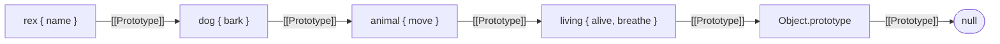

## Introduction

In [[b1-prototypes]] you saw that an object which lacks a property asks its prototype for it. That raises an obvious next question: what if the prototype does not have the property either?

The answer is that a prototype is an ordinary object, so it has a prototype of its own. The lookup moves on to that object, then to *its* prototype, and keeps going until the property is found or there are no more objects to ask. The sequence of objects visited is called the **prototype chain**.

You use the chain every time you write a line like this:

```javascript title="everyday-chain.js"
const scores = [70, 85];

console.log(scores.length);                  // own property of the array
console.log(scores.includes(85));            // found on Array.prototype
console.log(scores.hasOwnProperty('0'));     // found on Object.prototype
console.log(scores.average);                 // found nowhere
```

```output
2
true
true
undefined
```

Four reads, four different stopping points: the object itself, one step up, two steps up, and the end of the chain. The chain is how JavaScript does inheritance. `class Dog extends Animal` does nothing more exotic than link `Dog.prototype` to `Animal.prototype`, so that a method missing on the first is found on the second. `instanceof` is a question about the chain. `super` starts a lookup partway up the chain.

Reading is the simple half. Writing is where the surprises live. Assigning to a property you inherited does **not** change the prototype; it usually creates a new property on your own object that hides the inherited one. Sometimes it runs a setter instead, and sometimes it is refused outright. Those rules are the subject of this lesson's nested concept, [[b1-property-lookup|property lookup and shadowing]], and they explain two classic questions: "why did my assignment not change the shared value?" and "why did changing one object change all of them?"

## Before you start

- **Prototypes** — every object has a `[[Prototype]]` link, read with `Object.getPrototypeOf`, and a function's `prototype` property is a different thing. See [[b1-prototypes]] and [[b1-internal-prototype]].
- **`Object.create(proto)`** — creates an empty object whose prototype is `proto`. See [[b1-object-create]].
- **Own versus inherited properties** — `Object.hasOwn(obj, key)` is `true` only for properties stored on `obj` itself. See [[b1-own-vs-inherited]].
- **Getters and setters** — a property can be backed by functions instead of a stored value. See [[b1-getters-setters]]. Needed for the section on writes.
- **`this`** — a method runs with `this` set to the object it was called on. See [[b1-this]].

Snippets were run with Node.js 22. Files named `.mjs` are ES modules and therefore run in strict mode ([[b1-strict-mode]]), which matters for failed writes.

## The intuition

Picture a company where every question goes up the reporting line. You ask a developer. If they know the answer, you are done. If not, the question goes to their team lead, then to the department head, then to the CEO. If the CEO does not know either, the answer is "nobody knows" — and that is not an error, only an empty answer.

Three properties of this picture carry over exactly. The search goes **one way, upward**, and never sideways or back down. It **stops at the first answer**, so a developer's own answer wins over the CEO's. And an unanswered question yields **`undefined`**, not an exception.

The analogy fails in one important place: giving instructions. If you tell the developer "from now on, the deadline is Friday", that does not rewrite company policy for everyone. The developer writes it on their own notepad and uses it from then on, while every other employee still sees the company policy. Writes stay local. That asymmetry between reading (travels up) and writing (stays put) is the single most important fact about the chain.

## Building and walking a chain

A chain is nothing more than several `[[Prototype]]` links in a row. You can build one by hand:

```javascript title="four-level-chain.js"
const living = {
  alive: true,
  breathe() {
    return `${this.name} breathes`;
  },
};
const animal = Object.create(living);
animal.move = function () {
  return `${this.name} moves`;
};
const dog = Object.create(animal);
dog.bark = function () {
  return `${this.name} barks`;
};
const rex = Object.create(dog);
rex.name = 'Rex';

console.log(rex.bark());
console.log(rex.move());
console.log(rex.breathe());
console.log(rex.alive, typeof rex.toString, rex.fly);
```

```output
Rex barks
Rex moves
Rex breathes
true function undefined
```

`rex` owns exactly one property, `name`. Everything else it can do is found further up:



Trace `rex.breathe()`. The engine checks `rex` (no `breathe`), `dog` (no), `animal` (no), `living` (yes) and stops. The function it found is then called with `this` set to `rex`, the object the lookup *started* from, which is why it prints `Rex`. The table shows where each read in the example ends:

| Expression | Objects checked, in order | Result |
|---|---|---|
| `rex.name` | `rex` | `'Rex'` |
| `rex.bark` | `rex`, `dog` | the function |
| `rex.alive` | `rex`, `dog`, `animal`, `living` | `true` |
| `rex.toString` | `rex`, `dog`, `animal`, `living`, `Object.prototype` | the function |
| `rex.fly` | all five, then `null` | `undefined` |

The last row matters. A missing property is not an error; the lookup falls off the end of the chain and produces `undefined`. The error people actually see, `TypeError: rex.fly is not a function`, comes one step later, from trying to *call* that `undefined`.

### Every chain ends at null

`Object.prototype` is the last object in almost every chain, and its own `[[Prototype]]` is `null`. Since ES2016 that cannot be changed, and `Object.setPrototypeOf` rejects any change that would create a cycle, so a lookup always terminates. An object created with `Object.create(null)` has an empty chain: it inherits nothing, not even `toString`.

### The chains you get by default

| Value | Chain |
|---|---|
| `{}` | `Object.prototype` → `null` |
| `[]` | `Array.prototype` → `Object.prototype` → `null` |
| `function f() {}` | `Function.prototype` → `Object.prototype` → `null` |
| `new Person()` | `Person.prototype` → `Object.prototype` → `null` |
| `new Dog()` where `Dog extends Animal` | `Dog.prototype` → `Animal.prototype` → `Object.prototype` → `null` |
| `Object.create(null)` | `null` |

`Person.prototype` is itself a plain object created alongside the function, which is why its prototype is `Object.prototype`. That is the general reason nearly everything ends up inheriting `toString` and `hasOwnProperty`.

## Inheritance is a longer chain

Before `class` existed, inheritance was written by linking one constructor's prototype object to another's. `extends` does the same linking for you:

```javascript title="extends-chain.js"
class Animal {
  static create(name) {
    return new this(name);
  }
  constructor(name) {
    this.name = name;
  }
  speak() {
    return `${this.name} makes a sound`;
  }
}
class Dog extends Animal {
  speak() {
    return `${super.speak()}, then barks`;
  }
}

const rex = Dog.create('Rex');
console.log(rex.speak());
console.log(Object.getPrototypeOf(Dog.prototype) === Animal.prototype);
console.log(Object.getPrototypeOf(Dog) === Animal);
console.log(rex instanceof Dog, rex instanceof Animal);
```

```output
Rex makes a sound, then barks
true
true
true true
```

`extends` creates **two** chains. The first is the one instances use: `Dog.prototype` delegates to `Animal.prototype`. When `rex.speak()` runs, the lookup finds `speak` on `Dog.prototype` first and stops; `Animal.prototype.speak` is still there but hidden. A subclass method hiding a parent method of the same name is **method overriding** ([[b1-method-overriding]]), and it is ordinary first-match-wins lookup, not a separate feature.

The second chain links the constructor functions themselves: `Dog`'s prototype is `Animal`. That is why static methods are inherited — `Dog.create` is not defined on `Dog`, so the lookup continues to `Animal` and finds it there, and `this` inside it is `Dog`.

`super.speak()` is also defined in terms of the chain. It means: look up `speak` starting from the prototype of the object where the current method is *defined* (`Dog.prototype`'s prototype, `Animal.prototype`), but call it with the current `this`. So the parent implementation runs against `rex`. The full rules are in [[b1-class-inheritance]].

`instanceof` asks a chain question as well: `rex instanceof Animal` is `true` because `Animal.prototype` appears somewhere in `rex`'s chain. See [[b1-instanceof]] for the cases where that surprises people.

## Chain-aware and own-only operations

Because a property can live on the object or anywhere above it, every operation that touches properties has to pick which of those it considers:

```javascript title="chain-vs-own.js"
const base = { inherited: 1 };
const obj = Object.create(base);
obj.own = 2;

console.log('inherited' in obj, Object.hasOwn(obj, 'inherited'));
console.log('toString' in obj);
for (const key in obj) console.log('for...in:', key);
console.log('Object.keys:', Object.keys(obj));
console.log(base.isPrototypeOf(obj));
```

```output
true false
true
for...in: own
for...in: inherited
Object.keys: [ 'own' ]
true
```

| Walks the whole chain | Looks at own properties only |
|---|---|
| `obj.key`, `obj[key]` (reading) | `Object.hasOwn(obj, key)`, `obj.hasOwnProperty(key)` |
| `key in obj` | `Object.keys`, `Object.values`, `Object.entries` |
| `for...in` (enumerable string keys) | `Object.getOwnPropertyNames`, `Reflect.ownKeys` |
| `obj instanceof C`, `p.isPrototypeOf(obj)` | Spread `{...obj}`, `Object.assign`, `JSON.stringify` |
| Optional chaining `obj?.key` | `delete obj.key` |

`for...in` is the odd one. It visits enumerable properties from the entire chain, which is why it printed `inherited` but not `toString` (built-in methods are non-enumerable). If any code adds an enumerable property to `Object.prototype`, every `for...in` loop in the program starts visiting it. Prefer `Object.keys` or `for...of` over `Object.entries`. The details of each API are in [[b1-own-vs-inherited]].

## Property Lookup & Shadowing {#b1-property-lookup}

**Property lookup** is the procedure JavaScript follows to find a property: check the object itself, and if the key is not there, check each object along its prototype chain in turn. **Shadowing** is what happens when an object has an own property with the same name as one further up the chain: the own property is found first, so the inherited one becomes invisible through that object. This section gives the precise rules for reading, the less obvious rules for writing, and the consequences of each.

### Reading: first match wins

To read `obj.key`, the engine asks `obj` for an own property named `key`. If one exists, the search is over. If it is a **data property** (one that stores a value) the value is returned; if it is an **accessor property** (one defined by a getter) the getter is called with `this` set to the object the read started on. If `obj` has no such property, the same question is put to `Object.getPrototypeOf(obj)`, and so on. Reaching `null` produces `undefined`.

Two consequences are easy to miss. First, lookup stops at the first property with that *name*, whatever its value. An own property holding `undefined` still shadows an inherited one:

```javascript title="undefined-shadows.js"
const hidden = Object.create({ x: 1 });
hidden.x = undefined;
console.log(hidden.x, 'x' in hidden, Object.hasOwn(hidden, 'x'));
```

```output
undefined true true
```

That is why `obj.x === undefined` cannot tell "missing" from "present but undefined". Second, an own data property shadows an inherited *getter* too. The getter on the prototype is never reached.

### Writing: assignment does not travel up

Reading follows the chain to find a value. Assignment follows the chain only to decide *whether it is allowed* and *whether a setter should run*; if it stores a value, it stores it on the object you assigned through.

```javascript title="shadowing.js"
const defaults = { theme: 'light', fontSize: 14 };
const settings = Object.create(defaults);

console.log(settings.theme, Object.hasOwn(settings, 'theme'));

settings.theme = 'dark';              // creates an own property
console.log(settings.theme, defaults.theme);
console.log(Object.hasOwn(settings, 'theme'));

delete settings.theme;                // removes the own property only
console.log(settings.theme);

delete settings.theme;                // nothing own to delete: no effect
console.log(settings.theme, defaults.theme);
```

```output
light false
dark light
true
light
light light
```

At first `settings` has no `theme` and reads `'light'` from `defaults`. The assignment `settings.theme = 'dark'` creates a new own property on `settings`. `defaults.theme` is untouched, and any other object that delegates to `defaults` still sees `'light'`. From then on, reads through `settings` stop at the own property: `settings.theme` shadows `defaults.theme`.

`delete` works only on own properties. The first `delete` removes the shadow and the inherited value becomes visible again. The second finds nothing own to remove and does nothing — it does **not** reach up and delete from the prototype. There is no way to remove an inherited property through the inheriting object; you would have to delete it from the prototype itself, which affects everyone.

This design is deliberate. If writes travelled up, changing one user's settings would change every user's, and assigning `arr.toString = ...` on one array would replace `toString` for every array in the program.

### The three outcomes of an assignment

"Assignment creates an own property" is the common case but not the complete rule. When you write `obj.key = value` and `obj` has no own `key`, the engine looks up the chain for a property with that name, and what it finds decides what happens:

| What the chain holds for `key` | What `obj.key = value` does |
|---|---|
| Nothing | Creates an own data property on `obj` (if `obj` is extensible) |
| A writable data property | Creates an own data property on `obj`, shadowing it |
| A **non-writable** data property | Refused: silently ignored in sloppy mode, `TypeError` in strict mode |
| An accessor with a **setter** | Calls the setter with `this = obj`; no own property is created by the assignment itself |
| An accessor with **no setter** | Refused: silently ignored in sloppy mode, `TypeError` in strict mode |

The setter case is the one that surprises people, because the assignment appears to do nothing to the property you named:

```javascript title="inherited-setter.mjs"
const proto = {
  get fullName() {
    return `${this.first} ${this.last}`;
  },
  set fullName(value) {
    [this.first, this.last] = value.split(' ');
  },
};
const person = Object.create(proto);

person.fullName = 'Ada Lovelace';     // runs the inherited setter
console.log(Object.keys(person));
console.log(Object.hasOwn(person, 'fullName'));
console.log(person.fullName);
console.log(Object.keys(proto));
```

```output
[ 'first', 'last' ]
false
Ada Lovelace
[ 'fullName' ]
```

The assignment found a setter on `proto` and called it with `this` set to `person`. The setter wrote `first` and `last`, and because `this` is `person`, those landed on `person` as own properties. No own `fullName` was created; the accessor on the prototype still handles it. This is how class accessors work: `set` methods written in a class body live on the prototype, yet they store data on each instance. The same mechanism is why assigning to `obj.__proto__` changes an object's prototype instead of creating a key: `__proto__` is an inherited setter on `Object.prototype`.

The two "refused" rows surprise people in the other direction — a property on a *prototype* can prevent you from creating one on your *own* object:

```javascript title="blocked-assignment.mjs"
const config = Object.create(
  Object.freeze({ version: 1 }),
);

try {
  config.version = 2;
} catch (err) {
  console.log(err.name + ': ' + err.message);
}
console.log(config.version, Object.hasOwn(config, 'version'));

Object.defineProperty(config, 'version', {
  value: 2, writable: true, enumerable: true, configurable: true,
});
console.log(config.version, Object.hasOwn(config, 'version'));

const readOnly = Object.create({
  get id() {
    return 7;
  },
});
try {
  readOnly.id = 8;
} catch (err) {
  console.log(err.name + ': ' + err.message);
}
```

```output
TypeError: Cannot assign to read only property 'version' of object '#<Object>'
1 false
2 true
TypeError: Cannot set property id of #<Object> which has only a getter
```

`config` is an ordinary, extensible object, but its prototype is frozen, so `version` there is non-writable. The language treats an inherited read-only property as read-only through its heirs as well, and the assignment is refused. In a non-module script without `'use strict'` the same line would fail **silently**: no error, no own property, and `config.version` still `1`.

The refusal applies to *assignment* only. `Object.defineProperty` does not consult the chain at all; it defines an own property directly, which is how the example shadows `version` anyway. Class field declarations and object literals also define rather than assign, so they are not blocked either. See [[b1-define-property]] for the distinction between defining and assigning.

> [!NOTE] Why frozen prototypes are not used everywhere
> This rule is the reason freezing `Object.prototype` as a security measure can break libraries: code that does `obj.toString = myFn` by plain assignment starts failing, because `toString` is now a non-writable inherited property. It is sometimes called the "override mistake".

### Mutating is not assigning

Shadowing protects a prototype from *assignment through an heir*. It does not protect an object or array stored on the prototype from being *mutated*, because mutation starts with a read:

```javascript title="shared-mutable-default.js"
const teamDefaults = { tags: ['new'], count: 0 };
const a = Object.create(teamDefaults);
const b = Object.create(teamDefaults);

a.count += 1;            // read inherited 0, write own 1
a.tags.push('urgent');   // read inherited array, mutate it in place

console.log(a.count, b.count, teamDefaults.count);
console.log(b.tags, Object.hasOwn(a, 'tags'));
```

```output
1 0 0
[ 'new', 'urgent' ] false
```

`a.count += 1` is shorthand for `a.count = a.count + 1`: a read (which finds the inherited `0`) followed by an assignment (which creates an own `count` of `1` on `a`). `b` and the prototype are unaffected.

`a.tags.push('urgent')` contains no assignment to `a.tags`. It *reads* `a.tags`, gets the one array that lives on `teamDefaults`, and changes that array. `b` sees the change because `b.tags` is the same array. This is the most common prototype bug in real code: a mutable value (array, object, `Map`) placed on a prototype is shared by every instance.

> [!MISTAKE] Mutable state on the prototype
> Put methods and immutable constants on prototypes; give each object its own arrays and objects by creating them in the constructor (`this.tags = []`) or as class fields. A class field initialiser runs once per instance, so `tags = [];` in a class body is safe.

### Shadowing on purpose

Shadowing is also a tool. Overriding one built-in behaviour for one object is done by giving that object an own property:

```javascript title="shadow-one-object.js"
const arr = [1, 2, 3];
arr.toString = () => 'custom';
console.log(String(arr), String([4, 5]));
delete arr.toString;
console.log(String(arr));
```

```output
custom 4,5
1,2,3
```

Only `arr` is affected; `Array.prototype.toString` is intact, and deleting the own property restores normal behaviour. Test code uses the same idea to stub one method on one instance. Contrast this with assigning to `Array.prototype.toString`, which would change every array.

### Summary of the rules

- **Read**: nearest property with that name wins; getters run with `this` as the starting object; nothing found gives `undefined`.
- **Write**: an inherited setter runs; an inherited read-only property blocks; otherwise an own property is created or updated.
- **Delete**: affects own properties only; deleting a shadow reveals the inherited property again.
- **Mutation** of an inherited object is a read followed by a change to shared state.
- `Object.hasOwn(obj, key)` tells you whether lookup would stop at `obj` itself.

```quiz
Q: `const base = { n: 1 }; const o = Object.create(base); o.n = 5; delete o.n; delete o.n;` What are `o.n` and `base.n` afterwards?
- [ ] `undefined` and `undefined`
- [ ] `5` and `5`
- [x] `1` and `1`
- [ ] `undefined` and `1`
> The assignment creates an own `n` on `o` that shadows `base.n`. The first `delete` removes that own property, revealing the inherited `1` again. The second `delete` finds no own `n` and does nothing: `delete` never reaches into the prototype, so `base.n` is still `1`.

Q: A prototype defines `set total(v) { this._total = v; }`. For `const o = Object.create(proto); o.total = 10;`, which statement is true?
- [ ] `o` gets an own property `total` with value `10`
- [ ] `proto` gets an own property `_total`
- [x] `o` gets an own property `_total`; no own `total` is created
- [ ] The assignment throws because `total` is inherited
> Assignment finds an inherited setter and calls it with `this` set to `o`, the object assigned through. The setter stores `_total` on `this`, so it lands on `o`. An own `total` would only be created if the inherited property were a writable data property or absent.

Q: Two objects share a prototype that has `items: []`. After `first.items.push('x')`, what does `second.items` contain?
- [ ] `[]`, because writes always create own properties
- [x] `['x']`, because `push` mutates the single array stored on the prototype
- [ ] `undefined`, because `items` was moved to `first`
- [ ] It throws, because inherited arrays are read-only
> `first.items.push('x')` reads `items` (finding the prototype's array) and mutates it. No assignment to `first.items` happens, so no shadowing occurs. Shadowing would require `first.items = [...first.items, 'x']`.
```

## How it works internally

The specification describes property access through internal methods that every object implements. Reading uses `[[Get]](key, receiver)`. For ordinary objects it calls `[[GetOwnProperty]]`, which looks only at the object itself; if nothing is found, it calls `[[Get]]` on the object's `[[Prototype]]` with the **same receiver**. The receiver is the object the access started on, and it is what a getter receives as `this`. The `in` operator uses `[[HasProperty]]`, which walks the chain in the same way.

Writing uses `[[Set]](key, value, receiver)`. It walks the chain looking for a descriptor for the key. If it finds an accessor, it calls the setter with the receiver as `this`, or fails if there is no setter. If it finds a non-writable data property, it fails. Otherwise — a writable data property or nothing at all — it defines or updates a data property **on the receiver**. That last step is why writes land on the object you assigned through. A failed `[[Set]]` returns `false`; strict mode turns that `false` into a `TypeError`, and sloppy mode ignores it.

Proxies ([[b1-proxy]]) sit in front of these internal methods. A proxy's `get` and `set` traps run before any chain walk, and if a proxy is used as a *prototype*, its traps fire for lookups that fall through from the objects below it.

Walking a chain on every access would be slow, so engines avoid it. V8 groups objects with the same layout and prototype under a hidden class ([[b1-hidden-classes]]) and attaches an **inline cache** to each property-access site in the code. After the first lookup, the cache records "for objects of this hidden class, the property is at this slot on this prototype", and later accesses check the hidden class and jump straight there. The engine keeps validity information on prototypes so that modifying one invalidates the dependent caches. Two practical consequences: chain depth costs very little when chains are stable, and code that keeps changing prototypes or creating objects with many different shapes loses those optimisations. A miss — a property that exists nowhere — has to consider the whole chain, though engines cache those results too.

## Worked example: finding where a property comes from

When a value is not what you expect, the useful question is "which object in the chain supplied this?" This helper answers it by walking the chain and returning how many steps up the property was found, along with its descriptor:

```javascript title="find-owner.js"
function findOwner(obj, key) {
  let current = obj;
  let depth = 0;
  while (current !== null) {
    if (Object.hasOwn(current, key)) {
      return { depth, descriptor: Object.getOwnPropertyDescriptor(current, key) };
    }
    current = Object.getPrototypeOf(current);
    depth += 1;
  }
  return null;
}

class Shape {
  get area() {
    return 0;
  }
  describe() {
    return `area ${this.area}`;
  }
}
class Circle extends Shape {
  constructor(r) {
    super();
    this.r = r;
  }
  get area() {
    return Math.round(Math.PI * this.r ** 2);
  }
}

const c = new Circle(2);
console.log(c.describe());
console.log(findOwner(c, 'r').depth);
console.log(findOwner(c, 'area').depth, typeof findOwner(c, 'area').descriptor.get);
console.log(findOwner(c, 'describe').depth);
console.log(findOwner(c, 'hasOwnProperty').depth);
console.log(findOwner(c, 'radius'));
```

```output
area 13
0
1 function
2
3
null
```

`findOwner` is the read algorithm written out: test for an own property with `Object.hasOwn`, otherwise move to `Object.getPrototypeOf(current)`, and stop at `null`. It returns the descriptor rather than the value so you can see whether the property is data or an accessor without triggering a getter.

The results map onto the chain `c` → `Circle.prototype` → `Shape.prototype` → `Object.prototype`. `r` is own (depth 0). `area` is found at depth 1 as a getter: `Circle.prototype.area` shadows `Shape.prototype.area`. `describe` comes from `Shape.prototype` at depth 2.

Now look at the first line of output. `describe` is defined on `Shape`, yet it printed `13`, the circle's area. Inside `describe`, `this` is `c`, so `this.area` begins a fresh lookup at `c` and finds `Circle`'s getter first. A parent method calling `this.something` always gets the most specific version in the actual object's chain. This is **polymorphism**, and in JavaScript it is nothing more than lookup starting at the receiver.

## In real systems

**Framework base classes.** When you extend `React.Component`, an `EventEmitter` or a framework's base controller, your methods sit one link above the instance and the framework's sit one link further up. Overriding a lifecycle method works because your prototype is reached first.

**Error hierarchies.** `class NotFoundError extends HttpError` relies on the chain twice: for inherited behaviour such as `toString`, and for `err instanceof HttpError` in a catch block.

**The DOM.** A `<div>`'s chain is `HTMLDivElement.prototype` → `HTMLElement.prototype` → `Element.prototype` → `Node.prototype` → `EventTarget.prototype` → `Object.prototype`. Knowing that tells you where a method is documented: `appendChild` belongs to `Node`, `querySelector` to `Element`, `addEventListener` to `EventTarget`. (Stated from the DOM specification; not run for this lesson.)

**Defaults by delegation.** Configuration layers are sometimes modelled as a chain — an environment config delegating to shared defaults — so that unset keys fall through and set keys shadow. The same structure is how JavaScript scopes resolve variable names, although scopes are not objects you can access (see [[b1-scope-chain]]).

**Debugging.** In browser devtools, expanding an object's `[[Prototype]]` entry repeatedly shows the chain, and greyed-out or faded property names indicate non-enumerable properties.

## Trade-offs and alternatives

Delegation along a chain keeps one copy of each method, lets a subclass override selectively, and gives built-ins and user code one uniform model. Its costs appear as chains grow. Each extra level makes "where does this come from?" harder to answer, and a change to a base prototype can alter the behaviour of every descendant — the fragile base class problem. Shared mutable state on a prototype is a trap. And a chain supports only **single inheritance**: an object has exactly one prototype, so it cannot directly inherit from two unrelated parents.

| Need | Chain-based approach | Alternative |
|---|---|---|
| Shared methods for many objects | Methods on a prototype (`class`) | Per-object closures in a factory |
| Specialise behaviour | `extends` and override | Pass behaviour in as a function or strategy object |
| Combine unrelated capabilities | Not possible with one chain | Mixins via `Object.assign`, or composition |
| Per-object defaults | Delegate to a defaults object | Spread: `{ ...defaults, ...overrides }` (a snapshot, not live) |
| Dictionary of arbitrary keys | `Object.create(null)` to remove the chain | `Map` |

Keep hierarchies shallow — one or two levels of your own classes is typical — and prefer composition when a class would otherwise inherit only to reuse a helper. [[b1-js-oop-principles]] discusses composition versus inheritance.

## Common mistakes

**Expecting an assignment to update the prototype.** `instance.sharedValue = x` creates an own property and leaves the prototype alone. To change the shared value, assign on the prototype object itself — and be sure you want every instance to see it.

**Storing arrays or objects on a prototype.** `Thing.prototype.items = []` gives every instance the same array. Initialise mutable state per instance.

**Using `for...in` on objects without filtering.** It visits enumerable inherited keys. Use `Object.keys(obj)`, or guard with `Object.hasOwn(obj, key)`.

**Testing existence with `in` when you mean "own".** `'constructor' in {}` and `'toString' in {}` are both `true`. For dictionaries built from user input, use `Object.hasOwn`, a null-prototype object or a `Map` ([[b1-map-vs-object]]).

**Calling `obj.hasOwnProperty(key)` on arbitrary objects.** It fails on null-prototype objects (no such method in the chain) and can be shadowed by an own property called `hasOwnProperty`. `Object.hasOwn(obj, key)` (ES2022) has neither problem.

**Assuming a failed write will tell you.** In sloppy mode, writes blocked by an inherited read-only property or a getter-only accessor are silently ignored. Use modules or `'use strict'` so they throw.

**Modifying built-in prototypes.** Adding to `Array.prototype` or `Object.prototype` changes every array or object in the process, including inside libraries.

## Interview perspective

Interviewers use the chain to check whether you can reason about lookup step by step. Narrate the walk: "not on the instance, so check `Dog.prototype`; not there, so `Animal.prototype`…".

> [!INTERVIEW] What a strong answer sounds like
> "Reading a property checks the object, then each prototype in turn until it finds the key or reaches `null`, where the result is `undefined`. Writing is different: it does not modify the prototype. Unless the chain has a setter or a read-only property for that key, assignment creates an own property that shadows the inherited one."

Questions to prepare:

- **What happens when you read a property that does not exist?** The whole chain is searched and the result is `undefined`; no error unless you then call it or read a property of it.
- **How does `instanceof` work?** It checks whether `Constructor.prototype` appears anywhere in the object's prototype chain.
- **`hasOwnProperty` versus `in`?** Own only versus the whole chain.
- **If two instances share a prototype with an array property and one pushes to it, what happens?** Both see the change; `push` mutates the shared array. Assigning a new array would shadow instead.
- **How does `extends` set up prototypes?** `Sub.prototype`'s prototype is `Super.prototype` (instance methods), and `Sub`'s prototype is `Super` (statics).
- **Can assignment to an own-less property ever fail or not create a property?** Yes: an inherited setter runs instead, and an inherited non-writable property or getter-only accessor blocks it.
- **Where do class methods live?** On `Class.prototype`, non-enumerable; class fields are own properties of each instance.

A follow-up worth anticipating: *"Is a long prototype chain slow?"* Engines cache lookups per call site, so stable chains are fast in practice; the cost that matters is readability, and deep hierarchies are avoided for design reasons.

## Practice

1. **Trace it.** For `class A { m() {} } class B extends A {} const b = new B();`, list every object visited when evaluating `b.m`, `b.toString` and `b.nope`.
2. **Predict the output.** `const p = { v: 1 }; const c = Object.create(p); c.v++; console.log(c.v, p.v, Object.hasOwn(c, 'v'));` Explain each value.
3. **Fix the shared state.** Given `function Cart() {}` with `Cart.prototype.items = []`, show the bug with two carts and fix it two ways (constructor assignment and a class field).
4. **Blocked write.** Create an object whose prototype has a non-writable `id`. Show what plain assignment does in a `.mjs` file and in a sloppy `.js` file, then shadow it with `Object.defineProperty`.
5. **Write `ownerOf`.** Using `findOwner` as a base, write a function that returns the name of the constructor whose prototype owns a given method, and test it on `[].map`, `[].hasOwnProperty` and a method of your own subclass.

## Quick revision {#quick-revision}

- The prototype chain is the sequence of `[[Prototype]]` links from an object up to `null`.
- **Read**: check own properties, then each prototype in turn; first match wins; nothing found → `undefined`.
- Methods and getters found on the chain run with `this` as the object the access started on.
- Default chains: `{}` → `Object.prototype`; `[]` → `Array.prototype` → `Object.prototype`; instances → `C.prototype` → … → `Object.prototype` → `null`.
- `extends` links `Sub.prototype` → `Super.prototype` and `Sub` → `Super`; overriding is first-match-wins.
- **Write**: creates/updates an own property (shadowing) unless the chain has a setter (runs it) or a read-only property / getter-only accessor (refused; `TypeError` in strict mode).
- `delete` removes own properties only; deleting a shadow reveals the inherited value.
- Mutating an inherited array or object changes shared state; assignment does not.
- Chain-aware: property reads, `in`, `for...in`, `instanceof`. Own-only: `Object.hasOwn`, `Object.keys`, spread, `JSON.stringify`, `delete`.
- `Object.defineProperty` ignores the chain and always defines on the target.

| Chain holds for `key` | `obj.key = v` (no own `key`) |
|---|---|
| Nothing / writable data property | Own property created on `obj` |
| Setter | Setter called with `this = obj` |
| Non-writable data / getter only | Refused (throws in strict mode) |

## Key takeaways {#key-takeaways}

- Lookup walks upward one object at a time and stops at the first property with the requested name; the end of every chain is `null`.
- Inheritance in JavaScript, including `extends`, `super` and `instanceof`, is expressed entirely through this chain.
- Reads travel up the chain; writes stay on the object you assigned through, shadowing whatever is above.
- The exceptions to shadowing are inherited setters, which run, and inherited read-only properties, which block the assignment.
- Never keep mutable arrays or objects on a prototype: mutation goes through a read and reaches the shared value.
- Use own-only operations (`Object.hasOwn`, `Object.keys`) when you mean "this object's data", and do not modify built-in prototypes.
