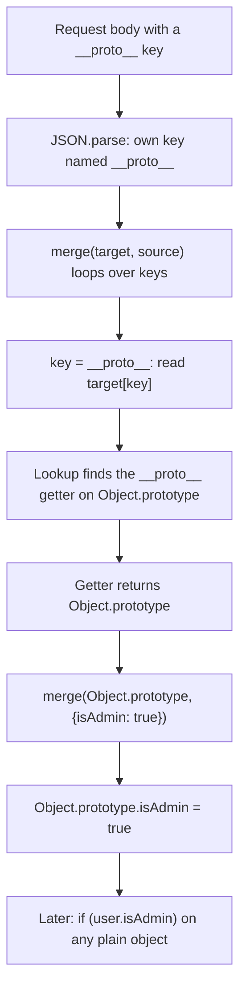

## Introduction

Here is a short program that merges a user's saved settings into some defaults. The settings arrive as JSON from the network, which is ordinary in a web application.

```javascript title="first-look.js"
function merge(target, source) {
  for (const key in source) {
    if (typeof source[key] === 'object' && source[key] !== null) {
      if (typeof target[key] !== 'object') target[key] = {};
      merge(target[key], source[key]);
    } else {
      target[key] = source[key];
    }
  }
  return target;
}

const body = '{"theme":"dark","__proto__":{"isAdmin":true}}';
const settings = merge({ theme: 'light' }, JSON.parse(body));

const someOtherUser = {};
console.log(settings.theme);
console.log(someOtherUser.isAdmin);
console.log(Object.keys(someOtherUser));
```

```output
dark
true
[]
```

`someOtherUser` was created *after* the merge, has no keys of its own, and was never touched by the request. It still answers `isAdmin` with `true`. The merge did not write to `settings`; it wrote to `Object.prototype`, the object that nearly every object in the program inherits from. That is **prototype pollution**: untrusted input changes a shared prototype, and the change shows up in objects that have nothing to do with the input.

It matters because JavaScript code constantly reads properties that may be missing and treats "missing" as "use the default": `if (user.isAdmin)`, `options.timeout ?? 5000`, `if (config.allowHtml)`. Once `Object.prototype` has been written to, "missing" stops meaning missing. Depending on which reads exist in the program and its libraries, the result ranges from a crash to bypassed authorisation checks, cross-site scripting in the browser, or remote code execution on a Node.js server. Real vulnerabilities of this kind have been fixed in widely used libraries, including jQuery and lodash.

This lesson is about the concept: why the language makes it possible, what vulnerable code looks like, and how to write code that is not vulnerable. It is not a feature you use; it is a bug you learn to recognise.

## Before you start

This lesson applies the whole prototype module to one security problem. You need:

- What a prototype is and that `Object.prototype` is shared by ordinary objects — [[b1-prototypes]].
- How a read walks the chain and how an assignment creates an own property instead — [[b1-prototype-chain]] and especially [[b1-property-lookup]]. Pollution is a case where an assignment ends up somewhere you did not expect.
- That `__proto__` is an accessor on `Object.prototype`, not an ordinary key — [[b1-internal-prototype]].
- `Object.create(null)` and null-prototype objects — [[b1-object-create]], used in the defences.
- `JSON.parse` — [[b1-json-stringify-parse]], because most payloads arrive as JSON.

## The intuition

Picture a school where each student has a personal notebook, and the school also prints one shared handbook. When a student is asked a question their notebook does not answer, they look it up in the handbook. That is delegation through a prototype: the notebook is the object, the handbook is `Object.prototype`.

Now suppose the school runs a form that copies whatever a student writes into "their section" of the records. The form has a bug: if a student writes the section name "handbook", the form opens the shared handbook and copies the student's text into it. One student adds a page saying "this student is a prefect". From then on, every student who looks up "am I a prefect?" and finds nothing in their own notebook reads the handbook's answer: yes.

Three things had to be true for that to happen, and the same three are true of every prototype pollution bug:

1. **The attacker controls a key name**, not only a value. Here the section name "handbook".
2. **Some code follows keys to decide where to write**, and one of those keys leads to the shared object. Here the copying form.
3. **Some other code later reads a property that is usually missing** and trusts the answer. Here "am I a prefect?". Security researchers call such a read a **gadget**.

The analogy stops working in one place: in JavaScript the "handbook" is not reached through a special name the attacker has to guess. It is reached through `__proto__` and `constructor.prototype`, names that exist on every ordinary object.

## How a key can lead to Object.prototype

An ordinary key such as `theme` names a property of the object it is used on. Two families of key behave differently because of what they resolve to.

### `__proto__` reads the prototype

`__proto__` is defined once, as a getter/setter pair on `Object.prototype` ([[b1-internal-prototype]]). An ordinary object does not have an own `__proto__`, so reading `obj['__proto__']` walks up the chain, finds the accessor, and calls its getter. The getter returns the object's prototype.

```javascript title="proto-key.js"
const target = {};

console.log(target['__proto__'] === Object.prototype);
console.log(Object.hasOwn(target, '__proto__'));

target['__proto__'].polluted = 'yes';
console.log(({}).polluted);
delete Object.prototype.polluted;
```

```output
true
false
yes
```

So any code that does `target[key]` with `key === '__proto__'` and then writes into the result is writing into `Object.prototype`. That is exactly what the merge in the introduction did when it recursed: `merge(target['__proto__'], source['__proto__'])`.

### `constructor.prototype` reaches it too

Every ordinary object inherits a `constructor` property that points to `Object` ([[b1-constructor-property]]), and `Object.prototype` is, by definition, `Object`'s `prototype` property. Two hops reach the same place without ever spelling `__proto__`:

```javascript title="constructor-key.js"
const target = {};

console.log(target['constructor'] === Object);
console.log(target['constructor']['prototype'] === Object.prototype);
```

```output
true
true
```

This is why a filter that blocks only `__proto__` is incomplete. A payload such as `{"constructor": {"prototype": {"isAdmin": true}}}` takes the second route.

### Where the key comes from

`__proto__` is special only when it is *looked up*. When it is *created* as data, it is an ordinary string key. `JSON.parse` creates every property as plain own data, so parsing a payload is harmless on its own:

```javascript title="json-parse.js"
const parsed = JSON.parse('{"__proto__":{"isAdmin":true}}');

console.log(Object.keys(parsed));
console.log(Object.getPrototypeOf(parsed) === Object.prototype);
console.log(parsed.isAdmin, ({}).isAdmin);
```

```output
[ '__proto__' ]
true
undefined undefined
```

The parsed object has an own key literally named `"__proto__"`; its real prototype is unchanged and nothing was polluted. Some older notes and blog posts claim `JSON.parse` itself pollutes, or that its behaviour varies by engine; the specification requires `JSON.parse` to define plain data properties, and current engines follow it. The danger starts when *another* piece of code reads that own key and then uses it as a property name on a different object. An own `"__proto__"` key is the delivery vehicle; the merge is what opens it.

The same is true of URL query strings and form bodies: a parser that turns `?__proto__[isAdmin]=true` into nested objects produces an object with an own `"__proto__"` key, and the bug is in whatever consumes it.

### How common operations treat the key

Whether an operation creates an own property or triggers the accessor depends on how it writes. **Assignment** (`obj[key] = value`) performs a lookup first, so it finds the inherited `__proto__` setter and calls it. **Defining** (`Object.defineProperty`, spread, `JSON.parse`, `structuredClone`) creates an own property directly, with no lookup.

```javascript title="operations.js"
const payload = JSON.parse('{"__proto__":{"isAdmin":true}}');

const assigned = Object.assign({}, payload);
console.log('assign:', Object.keys(assigned), assigned.isAdmin, ({}).isAdmin);

const spread = { ...payload };
console.log('spread:', Object.keys(spread), spread.isAdmin);

const cloned = structuredClone(payload);
console.log('clone: ', Object.keys(cloned), cloned.isAdmin);

const literal = { __proto__: { isAdmin: true } };
console.log('literal:', Object.keys(literal), literal.isAdmin);
```

```output
assign: [] true undefined
spread: [ '__proto__' ] undefined
clone:  [ '__proto__' ] undefined
literal: [] true
```

| Operation | Effect of a `"__proto__"` key | Global pollution? |
|---|---|---|
| `JSON.parse` | Own data property named `"__proto__"` | No |
| `{ ...obj }`, `structuredClone` | Copies it as an own data property | No |
| `Object.assign(target, obj)` | Calls the setter: replaces `target`'s own prototype | No, but `target` now inherits attacker data |
| `{ __proto__: x }` in a literal | Sets the new object's prototype (literal syntax rule) | No |
| Recursive merge or path setter that does `target[key]` then writes into the result | Writes into `Object.prototype` | Yes |

`Object.assign` is not a global pollution route, but it is not safe either: `assigned.isAdmin` is `true` because `assigned`'s prototype was replaced with the attacker's object. If that object is later checked with `if (assigned.isAdmin)`, the attacker wins for that object. The global case needs code that *reads* through the key and then *writes* into what it got back, which is what recursive helpers do.

## Vulnerable patterns

Most real prototype pollution bugs come from a small number of utility shapes. Each one has the same flaw: it treats every key in the input as a safe property name.

### Recursive merge and deep clone

The introduction's `merge` is the classic case. Tracing the payload `{"__proto__": {"isAdmin": true}}` through it:

1. `for (const key in source)` yields the own key `"__proto__"` (a `for...in` loop includes own enumerable string keys, and the parsed key is one).
2. `source['__proto__']` is the inner object `{ isAdmin: true }`, so the recursive branch runs.
3. `typeof target['__proto__']` is `'object'`: the read walks up to the accessor and returns `Object.prototype`. The `= {}` reset is skipped.
4. The function recurses as `merge(Object.prototype, { isAdmin: true })`, and the final assignment is `Object.prototype.isAdmin = true`.

Deep-clone helpers written as "create an empty object, then recursively copy each key into it" have the identical flaw, as do "defaults deep" helpers that fill in missing nested settings.

### Path setters

Many libraries offer a function that sets a value at a dotted path, like `set(obj, 'a.b.c', 1)`. They are used for form libraries, configuration overrides and admin panels, which means the path often comes from a request.

```javascript title="path-set.js"
function setPath(obj, path, value) {
  const keys = path.split('.');
  let node = obj;
  for (const key of keys.slice(0, -1)) {
    node[key] ??= {}; // create missing levels
    node = node[key];
  }
  node[keys.at(-1)] = value;
}

const form = {};
setPath(form, 'address.city', 'Pune');
console.log(form);

setPath({}, 'constructor.prototype.isAdmin', true);
console.log(({}).isAdmin);
```

```output
{ address: { city: 'Pune' } }
true
```

For the ordinary path the function creates `address` and sets `city`, as intended. For the malicious path it never creates anything until the last step. `node['constructor']` already has a value (the inherited `Object` function), so `??=` leaves it alone and `node` becomes `Object`. `Object['prototype']` also exists, so `node` becomes `Object.prototype`. The final line is then `Object.prototype.isAdmin = true`.

Notice that the payload never mentions `__proto__`. The reason the function is vulnerable is that it follows *inherited* properties while walking: "this level already exists" was true only because it existed on a prototype. A walker that creates or descends only through *own* properties cannot be steered this way, which is one of the guards in the worked example below.

### Parsers that build nested objects

Query-string and form-body parsers often support bracket syntax, so `?user[name]=Ada` becomes `{ user: { name: 'Ada' } }`. Internally that is a path setter driven by the URL, so a parser without guards turns `?__proto__[isAdmin]=true` or `?constructor[prototype][isAdmin]=true` into pollution before your route handler runs. Maintained parsers have added guards against these keys; a hand-written parser, or an old version of a library, may have none. The same applies to anything that expands dotted environment variables or command-line flags into a configuration object.

## What an attacker gains: gadgets

Writing to `Object.prototype` does nothing by itself. It becomes harmful when the program later reads a property from an object that does not have it as an own property and acts on the inherited answer. That read is the **gadget**. Pollution is the "write anywhere" half of an exploit; a gadget is the "something useful happens" half.

Gadgets are ordinary code, which is what makes them hard to rule out:

```javascript title="gadgets.js"
Object.prototype.isAdmin = true;      // pretend an earlier merge did this
Object.prototype.timeoutMs = 0;

function canDelete(user) {
  return user.isAdmin === true;        // gadget: isAdmin is usually absent
}

function fetchOptions(opts = {}) {
  return { timeoutMs: opts.timeoutMs ?? 5000 }; // gadget: default never applies
}

console.log(canDelete({ name: 'mallory' }));
console.log(fetchOptions());
```

```output
true
{ timeoutMs: 0 }
```

`canDelete` was written for user records that have `isAdmin` only when it is true. `fetchOptions` relies on `??` to fill in a default. Both assumptions break once the missing property is inherited instead of missing. Broadly, gadgets fall into three groups:

| Outcome | Typical gadget | Example consequence |
|---|---|---|
| Logic or authorisation bypass | `if (user.isAdmin)`, `if (options.skipValidation)` | Privileges or checks granted to everyone |
| Denial of service | Code that calls an inherited method such as `toString` | Every string conversion of an object throws |
| Code execution | A library option that names a command, a script URL or HTML to insert | Remote code execution on a server, cross-site scripting ([[b3-xss]]) in a browser |

The denial-of-service case needs no special gadget at all, because the runtime itself calls inherited methods:

```javascript title="dos.js"
Object.prototype.toString = 'polluted';

try {
  console.log(`${{}}`);
} catch (e) {
  console.log(e.constructor.name + ': ' + e.message);
}
```

```output
TypeError: Cannot convert object to primitive value
```

Template literals, string concatenation and many library functions convert objects to strings by calling `toString`. Replacing it with a non-function makes all of them throw, for every request the process handles until it restarts.

Code-execution gadgets are found in libraries rather than in your own code: a templating engine that reads an optional setting from an options object, or a process-spawning helper that reads an optional environment or shell setting. Published security research has demonstrated such chains in both Node.js applications and browser code. The practical lesson is that you cannot prove a program has no gadgets, because they live in every dependency that reads optional properties. The defence therefore focuses on never letting the write happen.

> [!IMPORTANT] Pollution is process-wide
> On a server, one malicious request pollutes `Object.prototype` for the whole Node.js process, so every later request from every user sees the change until the process restarts. In a browser, it affects the whole page (each frame and worker has its own set of built-in prototypes).

## How it works internally

Three pieces of the language combine to make pollution possible.

1. **Property reads walk the chain.** A read (`[[Get]]` in the specification) looks for an own property, then repeats on the prototype until it finds one or reaches `null` ([[b1-property-lookup]]). That is why `node['constructor']` finds `Object` and `node['__proto__']` finds the accessor.
2. **Assignments look up before they write.** An assignment (`[[Set]]`) first searches the chain. If it finds an inherited **setter**, it calls that setter instead of creating an own property. `__proto__` is such a setter, which is why `target['__proto__'] = x` changes `target`'s prototype rather than storing a property.
3. **Built-in prototypes are ordinary, mutable objects.** Nothing stops a write to `Object.prototype` unless someone freezes it.

A vulnerable helper reads through a key (step 1) to get a reference to a shared object, then performs a plain assignment on that reference (step 3). Defining properties with `Object.defineProperty`, spread or `JSON.parse` skips step 2, which is why those operations treat `"__proto__"` as plain data.



## Defences

No single measure is sufficient in every codebase, so production systems layer several. They are listed from the most effective to the most drastic.

### 1. Do not merge untrusted input into plain objects

The strongest defence is to never let unvalidated input decide property names. Validate request bodies against a schema that lists the allowed keys and rejects or strips the rest, then copy the fields you need explicitly:

```javascript title="explicit-copy.js"
const body = JSON.parse('{"theme":"dark","__proto__":{"isAdmin":true}}');

const ALLOWED_THEMES = new Set(['light', 'dark']);
const settings = {
  theme: ALLOWED_THEMES.has(body.theme) ? body.theme : 'light',
};

console.log(settings, ({}).isAdmin);
```

```output
{ theme: 'dark' } undefined
```

Unknown keys are never looked at, so they cannot steer anything. This is also how most servers already treat input for other reasons ([[c6-validation]] covers the same idea on a Java backend).

### 2. Make merge and path helpers refuse dangerous keys

When you genuinely need a generic merge, the helper itself must be safe. That takes two guards, not one:

- **Skip the keys `__proto__`, `constructor` and `prototype`.** This blocks the known routes by name.
- **Descend and copy only through own properties of the source and target.** Use `Object.keys` (own enumerable keys) rather than `for...in`, and before recursing into `target[key]` check `Object.hasOwn(target, key)` ([[b1-object-hasown]]). If the target does not *own* that key, create a fresh object instead of following whatever is inherited.

The second guard is the important one, because it does not depend on knowing every dangerous name: a walker that only follows own properties can never step from your object onto a prototype. The worked example below implements both.

### 3. Store attacker-chosen keys in containers without a prototype

If keys come from users by design (a lookup table of usernames, tags or headers), store them where a key cannot mean anything special:

```javascript title="containers.js"
const counts = new Map();
counts.set('__proto__', 1);
console.log(counts.get('__proto__'), ({}).polluted);

const dict = Object.create(null);
dict['__proto__'] = { polluted: true };
console.log(Object.keys(dict), ({}).polluted);
```

```output
1 undefined
[ '__proto__' ] undefined
```

A `Map` keeps keys entirely separate from properties ([[b1-map-vs-object]]). An object created with `Object.create(null)` has no prototype, so there is no inherited `__proto__` accessor and no `constructor` to follow; the key becomes an ordinary own property ([[b1-object-create]]).

### 4. Read security-relevant properties as own properties

Gadgets read inherited values. For a flag that grants something, check that the object itself owns the property:

```javascript title="hasown-check.js"
Object.prototype.isAdmin = true; // simulate pollution

const user = { name: 'mallory' };
console.log(user.isAdmin === true);
console.log(Object.hasOwn(user, 'isAdmin') && user.isAdmin === true);
```

```output
true
false
```

This hardens your own checks, but it cannot fix gadgets inside dependencies, so it complements the earlier defences rather than replacing them.

### 5. Freeze `Object.prototype` or disable `__proto__`

At application start-up you can make the shared prototype read-only, so later writes fail:

```javascript title="freeze.js"
Object.freeze(Object.prototype);

try {
  Object.prototype.isAdmin = true;
} catch (e) {
  console.log(e.constructor.name + ': ' + e.message);
}
console.log(({}).isAdmin);

const obj = {};
try {
  obj.toString = () => 'custom';
} catch (e) {
  console.log(e.constructor.name + ': ' + e.message);
}
```

```output
TypeError: Cannot add property isAdmin, object is not extensible
undefined
TypeError: Cannot assign to read only property 'toString' of object '#<Object>'
```

The write is refused (with a `TypeError` in strict mode, as in ES modules, and silently in sloppy mode — [[b1-strict-mode]]). The second half of the output shows the cost. After freezing, *assigning* a property whose name exists on `Object.prototype` — `toString`, `valueOf`, `constructor`, `hasOwnProperty` — fails on every ordinary object, because an inherited read-only property blocks assignment ([[b1-property-lookup]]). Object literals and `Object.defineProperty` still work, but older libraries and polyfills that assign such properties or patch built-ins will break. Freezing is worth doing in a security-sensitive service only if you test the whole dependency tree against it ([[b1-object-freeze-seal]]).

Node.js also has a command-line flag, `--disable-proto=delete` (removes the `__proto__` accessor) or `--disable-proto=throw` (makes using it throw an error with code `ERR_PROTO_ACCESS`). It closes the `__proto__` route but not the `constructor.prototype` route, so it is a partial measure.

### 6. Keep dependencies current

Many pollution bugs live in utility libraries. Dependency audit tools flag known vulnerable versions, and upgrading is often the whole fix. That only covers *known* bugs, which is why the earlier layers still matter.

## Worked example: a merge that resists pollution

The task: deep-merge user preferences (parsed JSON) into defaults, so that nested objects are merged and other values are replaced, without any input being able to reach a prototype.

```javascript title="safe-merge.js"
const BLOCKED = new Set(['__proto__', 'constructor', 'prototype']);

function isPlainObject(value) {
  if (value === null || typeof value !== 'object') return false;
  const proto = Object.getPrototypeOf(value);
  return proto === Object.prototype || proto === null;
}

function safeMerge(target, source) {
  for (const key of Object.keys(source)) {      // own enumerable keys only
    if (BLOCKED.has(key)) continue;            // guard 1: known routes
    const value = source[key];
    if (isPlainObject(value)) {
      const existing = Object.hasOwn(target, key) ? target[key] : undefined;
      // guard 2: descend only into something the target owns
      const next = isPlainObject(existing) ? existing : {};
      target[key] = safeMerge(next, value);
    } else {
      target[key] = value;
    }
  }
  return target;
}

const defaults = { theme: 'light', editor: { tabSize: 2, wrap: false } };
const attacks = [
  '{"editor":{"wrap":true},"__proto__":{"isAdmin":true}}',
  '{"constructor":{"prototype":{"isAdmin":true}}}',
  '{"editor":{"__proto__":{"isAdmin":true}}}',
];

for (const body of attacks) {
  const result = safeMerge(structuredClone(defaults), JSON.parse(body));
  console.log(JSON.stringify(result), ({}).isAdmin);
}
```

```output
{"theme":"light","editor":{"tabSize":2,"wrap":true}} undefined
{"theme":"light","editor":{"tabSize":2,"wrap":false}} undefined
{"theme":"light","editor":{"tabSize":2,"wrap":false}} undefined
```

Walking through the design:

- **`Object.keys(source)`** returns only the source's own enumerable string keys. A `for...in` loop would also visit enumerable properties inherited by the source, so if the process were already polluted, a `for...in` merge would copy the pollution into every result.
- **`BLOCKED`** skips the three names that lead to prototypes. In the first payload the legitimate `editor.wrap` change goes through and the `__proto__` key is dropped; the third payload shows the check also applies at nested levels, because the function calls itself.
- **`Object.hasOwn(target, key)`** decides whether to descend into an existing value. Even if a new dangerous name were discovered, the merge never follows an inherited property: a key the target does not own gets a fresh `{}`.
- **`isPlainObject`** limits recursion to plain data. Arrays, dates and class instances are replaced as values rather than merged, which avoids walking into objects whose structure the merge does not understand.
- **`structuredClone(defaults)`** gives each merge its own copy, so one user's preferences never mutate the shared defaults object — a separate bug, but one that tends to appear in the same code.

Either guard alone stops these three payloads; having both means a mistake in one is caught by the other. For a dictionary of user-named keys, the right tool is still a `Map`, not a cleverer merge.

## In real systems

**Library vulnerabilities.** jQuery's deep `$.extend(true, ...)` could be polluted through a `__proto__` key until it was fixed in jQuery 3.4.0 (CVE-2019-11358). lodash's `merge`, `defaultsDeep` and related functions received several pollution fixes across the 4.17 releases. Query-string and object-path libraries have had similar advisories. When a scanner reports one of these, the fix is usually an upgrade.

**Server-side impact.** In Node.js services, a polluting endpoint affects the whole process, so impact ranges from every request failing (a `toString` or `hasOwnProperty` overwrite) to privilege escalation and, with a suitable library gadget, command execution.

**Client-side impact.** In the browser, pollution usually comes from the URL: a client-side parser reads `location.search` or `location.hash` into an object. Combined with a gadget in a front-end library that reads an optional HTML or script-URL setting, this becomes DOM-based cross-site scripting ([[b3-xss-dom-based]]). A Content Security Policy ([[b3-csp]]) limits what injected script can do, but does not stop the pollution.

**Code review heuristics.** Engineers look for: functions that recurse over the keys of request data; `obj[a][b] = c` where `a` or `b` come from input; helpers named `merge`, `extend`, `deepAssign`, `set`, `setIn`, `unflatten`; and `for...in` loops over parsed input. Each one should either be fed only validated data or carry the guards shown above.

## Trade-offs and alternatives

| Defence | Protects against | Cost or limit |
|---|---|---|
| Schema validation and explicit copying | Both routes, and unrelated bad input | Needs a schema per endpoint; the best default |
| Guarded merge or path helper | Both routes in that helper | Only protects code that uses it; easy to forget elsewhere |
| `Map` or `Object.create(null)` for user-named keys | Key collisions and prototype routes for that data | Loses object conveniences; `Map` needs conversion for JSON |
| `Object.hasOwn` on security checks | Gadgets in your own code | Does nothing for gadgets in dependencies |
| `Object.freeze(Object.prototype)` | Writes to `Object.prototype` | Breaks code that assigns `toString` and similar names, and some polyfills; other built-in prototypes stay writable unless frozen too |
| `--disable-proto` (Node.js) | The `__proto__` route | Leaves `constructor.prototype` open |
| Dependency updates | Known library bugs | Only known ones |

A sensible baseline for an application is: validate input at the boundary, use `Map` or null-prototype objects for user-named keys, use well-maintained merge utilities (or none), and treat freezing as an extra layer you adopt only after testing.

## Common mistakes

> [!MISTAKE] Blocking only `__proto__`
> A filter that checks `key === '__proto__'` misses `constructor.prototype`. Block all three names, and also make the walker follow only own properties so unknown routes are covered too.

**Checking the key after it has been used.** Validation must happen before the key is used to read from the target. A merge that recurses first and checks later has already reached the prototype.

**Assuming `JSON.parse` is the problem.** Parsing creates an own `"__proto__"` property and pollutes nothing. Removing `JSON.parse` or switching parsers does not fix a vulnerable merge; fixing the merge does.

**Trusting `Object.assign` or spread as a merge.** They are shallow, so they cannot pollute `Object.prototype`, but `Object.assign` with an own `"__proto__"` key replaces the target's prototype, and the target then inherits attacker values. Spread is the safer shallow copy because it defines properties instead of assigning.

**Using `for...in` over input.** It visits inherited enumerable properties, so once anything is polluted, every `for...in` copy spreads it further. Use `Object.keys` or `Object.entries`.

**Cleaning up with `delete` and calling it fixed.** Deleting `Object.prototype.isAdmin` after noticing it removes one symptom. The vulnerable code path is still there and the next request can repeat the attack.

## Interview perspective

**"What is prototype pollution?"** A strong answer names the mechanism, not only the effect: attacker-controlled keys such as `__proto__` or `constructor.prototype` are followed by code that reads through them and then assigns, so the write lands on `Object.prototype` and every object inherits it. Mention that it needs a gadget to matter.

**"Why does `JSON.parse('{"__proto__": ...}')` not pollute, but merging it does?"** `JSON.parse` defines data properties, so `"__proto__"` becomes an ordinary own key. A merge then reads `target['__proto__']`, which runs the inherited getter and returns `Object.prototype`, and assigns into it.

**"Write a safe deep merge."** Interviewers look for `Object.keys` instead of `for...in`, a block-list of the three names, and an own-property check before descending. Explaining why the own-property check matters even with the block-list is a sign of real understanding.

**"How would you defend an Express or Node.js API?"** Validate bodies and queries with a schema that rejects unknown keys; avoid generic deep-merge of request data; use `Map` for user-keyed data; keep dependencies patched; optionally freeze `Object.prototype` after testing. Follow-up: why freezing has a cost (assignments to inherited read-only names fail).

**"Is `Object.create(null)` enough?"** It protects that container. It does not protect other plain objects in the program, and a nested object created inside it with `{}` has `Object.prototype` again.

## Practice

1. Take the introduction's `merge` and send it `{"constructor":{"prototype":{"x":1}}}`. Predict whether `({}).x` becomes `1`, then run it and explain the result by tracing `typeof target[key]` at each level.
2. Write `unflatten(obj)` that turns `{ 'a.b': 1, 'a.c': 2 }` into `{ a: { b: 1, c: 2 } }`, then show a key that pollutes your first version and fix it with own-property checks.
3. Modify `safeMerge` so it accepts arrays by concatenating them. Check that the array path cannot be used to reach a prototype.
4. Freeze `Object.prototype` at the top of a small script that uses a library of your choice and note what, if anything, breaks.
5. Write a gadget-free version of `fetchOptions` from the gadgets section that still supplies defaults.

```quiz
Q: A handler does `const prefs = JSON.parse(body)` and nothing else with the parsed object. The body is `{"__proto__":{"isAdmin":true}}`. What is `({}).isAdmin` afterwards?
- [ ] `true`, because `JSON.parse` sets the prototype of the parsed object
- [ ] `true`, because `JSON.parse` writes to `Object.prototype` when it sees `__proto__`
- [x] `undefined`, because `JSON.parse` creates an own data property named `"__proto__"`
- [ ] It depends on the JavaScript engine
> `JSON.parse` defines properties instead of assigning them, so no accessor runs and nothing outside the parsed object changes. The parsed object even keeps `Object.prototype` as its prototype. Pollution needs a later step that reads through the key and assigns.
```

```quiz
Q: A merge function skips the key `__proto__` but otherwise recurses into `target[key]` whenever that value already exists. Which payload still pollutes?
- [ ] `{"__proto__":{"x":1}}`
- [x] `{"constructor":{"prototype":{"x":1}}}`
- [ ] `{"prototype":{"x":1}}`
- [ ] None; skipping `__proto__` is sufficient
> `target.constructor` is inherited and equals `Object`, and `Object.prototype` is the shared prototype, so the merge reaches it without the blocked name. A bare `prototype` key on a plain object is not inherited, so it creates an ordinary property.
```

```quiz
Q: Why does `Object.freeze(Object.prototype)` make `obj.toString = fn` fail on an ordinary object?
- [ ] Freezing also freezes every object that inherits from the prototype
- [x] An inherited read-only property blocks assignment of the same name on objects below it
- [ ] `toString` cannot be overridden on any object
- [ ] It does not fail; only writes to `Object.prototype` fail
> Assignment first looks up the name; finding a non-writable `toString` on the prototype, it refuses to create an own property. The object itself is not frozen: other names can be assigned, and `Object.defineProperty` can still create an own `toString`.
```

## Quick revision {#quick-revision}

- **Prototype pollution**: untrusted keys make code write onto a shared prototype, usually `Object.prototype`, so every plain object inherits the value.
- Two routes: `obj['__proto__']` (inherited getter returns the prototype) and `obj['constructor']['prototype']` (inherited `Object`, then `Object.prototype`).
- `JSON.parse`, spread and `structuredClone` create an own `"__proto__"` key and pollute nothing; the bug is in code that later reads through that key and assigns.
- `Object.assign` with an own `"__proto__"` key calls the setter: it replaces the target's prototype (local, not global, but still attacker-controlled inheritance).
- Vulnerable shapes: recursive merge, deep clone, defaults-deep, path setters (`set(obj, 'a.b', v)`), bracket-syntax query parsers, `for...in` over input.
- A **gadget** is a read of a usually-missing property that the program trusts; impact ranges from denial of service (`toString` overwritten) to authorisation bypass, XSS and remote code execution.
- On a Node.js server, pollution persists for the whole process until restart.
- Defences, strongest first: schema validation and explicit copying; merges that skip `__proto__`/`constructor`/`prototype` and follow only own properties (`Object.keys`, `Object.hasOwn`); `Map` or `Object.create(null)` for user-named keys; `Object.hasOwn` for security flags; `Object.freeze(Object.prototype)` or `--disable-proto` after testing; patched dependencies.
- Freezing `Object.prototype` breaks assignment of inherited names such as `toString` on all ordinary objects.

## Key takeaways {#key-takeaways}

- Prototype pollution turns one bad write into a change seen by every object, because ordinary objects share `Object.prototype`.
- The language rules behind it are the ones from this module: reads walk the chain, assignments call inherited setters, and built-in prototypes are mutable.
- Parsing input is safe; using input keys to navigate and assign is where the bug lives.
- Blocking `__proto__` alone is not enough; also block `constructor` and `prototype`, and only ever descend through own properties.
- It is dangerous only together with a gadget, but gadgets hide in every dependency, so prevent the write rather than hunting gadgets.
- For data whose keys users choose, use a `Map` or a null-prototype object, and validate request shapes at the boundary.
