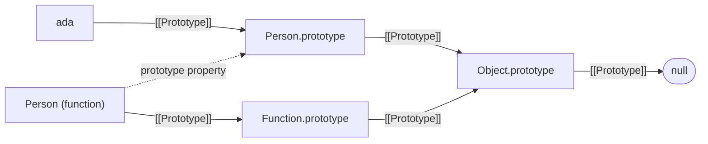

## Introduction

Suppose you are building a chat app and need an object for every user. Each user has a name, and each user needs a `greet` method. The most direct way to write that is a function that returns a fresh object:

```javascript title="copy-per-object.js"
function makeUser(name) {
  return {
    name,
    greet() {
      return `Hi, I am ${this.name}`;
    },
  };
}

const ada = makeUser('Ada');
const linus = makeUser('Linus');

console.log(ada.greet());
console.log(ada.greet === linus.greet);
```

```output
Hi, I am Ada
false
```

It works, but look at the second line of output. Every call to `makeUser` creates a **new function object** for `greet`. A thousand users means a thousand identical `greet` functions in memory, and if you later want to change how greeting works for users who already exist, there is no single place to change it.

What you really want is for the *data* (`name`) to belong to each object while the *behaviour* (`greet`) lives in one shared place that every user can reach. JavaScript builds this into the language. Every object carries a hidden link to one other object, called its **prototype**. When you read a property the object does not have, JavaScript follows the link and looks on the prototype instead. Put `greet` on one prototype object, link every user to it, and all users share one function.

This idea, called **prototypal delegation**, is not a niche feature. It is how `[1, 2].map` works without every array storing a `map` method, how `'abc'.toUpperCase()` works on a primitive string, how `new` and constructor functions give instances their methods, and what `class` syntax produces under the hood. Interviewers ask about it because it separates people who use JavaScript from people who understand it, and debugging tools show it to you constantly as the `[[Prototype]]` entry in the console.

This lesson teaches what a prototype is, why the language works this way, and how the link is created, read and changed. Its nested concept, [[b1-internal-prototype|[[Prototype]] and getPrototypeOf]], covers the APIs for the link in detail. The next lesson, [[b1-prototype-chain]], follows the link further — prototypes have prototypes too — and explains exactly how lookup and assignment travel along it.

## Before you start

- **Objects and property access** — creating objects with literals and reading `obj.key` and `obj[key]`. See [[b1-object-literals]].
- **Objects are references** — two variables can point at the same object, and changing it through one is visible through the other. See [[b1-objects-as-values]].
- **`this` in methods** — when you call `obj.method()`, `this` inside the method is `obj`. See [[b1-this]]. This lesson relies on that rule heavily, because shared methods only work if `this` refers to the object the method was called on.
- **Own and inherited properties** — helpful but not required; this lesson introduces the distinction. The full treatment is in [[b1-own-vs-inherited]].

All snippets were run with Node.js 22. Current browsers behave the same unless a section says otherwise.

## The intuition

Think of a new employee and the company handbook. The employee keeps personal things at their desk: their name badge, their own notes. When a question comes up that their desk cannot answer — "how do I book leave?" — they do not invent an answer or photocopy the whole handbook onto their desk. They look it up in the one shared handbook.

An object is the desk. Its prototype is the handbook. Three things follow from the picture:

1. **Reads fall through.** If the desk has an answer, that answer is used. Otherwise the handbook is consulted.
2. **Sharing is cheap.** One handbook serves every employee, however many there are.
3. **Changes to the handbook reach everyone at once.** Update a page and every employee sees the new version the next time they look, including employees hired years ago.

Where the analogy stops working: in JavaScript the handbook can itself have a handbook. A prototype is an ordinary object with its own prototype, so a failed lookup can continue several levels up. That chain is the subject of [[b1-prototype-chain]]; this lesson mostly looks at one link at a time.

## Delegation: sharing behaviour without copying

Here is the chat-user example rewritten with a prototype. `Object.create(proto)` makes a new, empty object whose prototype is `proto` — that one sentence is all you need for now; [[b1-object-create]] covers it fully.

```javascript title="shared-prototype.js"
const userMethods = {
  greet() {
    return `Hi, I am ${this.name}`;
  },
};

const ada = Object.create(userMethods);
ada.name = 'Ada';
const linus = Object.create(userMethods);
linus.name = 'Linus';

console.log(ada.greet(), '|', linus.greet());
console.log(ada.greet === linus.greet);
console.log(Object.keys(ada));
console.log(Object.getPrototypeOf(ada) === userMethods);
```

```output
Hi, I am Ada | Hi, I am Linus
true
[ 'name' ]
true
```

Walk through what happens when `ada.greet()` runs. JavaScript looks for a property named `greet` on `ada`. `ada` only has `name`, so the search moves to `ada`'s prototype, `userMethods`, which does have `greet`. That function is then called with `this` set to `ada`, because the call expression was `ada.greet()`. The method was *found* on the prototype but *runs* against the original object. That is why one shared function can print two different names.

The output confirms the important facts. Both users reach the very same function object (`true`). `Object.keys(ada)` lists only `name`: the method is not stored on `ada` at all. And `Object.getPrototypeOf(ada)` returns `userMethods`, the object we linked to.

Two terms are worth fixing now. A property stored on the object itself, like `ada.name`, is an **own property**. A property the object reaches through its prototype, like `ada.greet`, is an **inherited property**. "Inherited" can be misleading if you come from Java or C#: nothing is copied into `ada` when it is created. JavaScript **delegates** the lookup to the prototype every time the property is read. Some people prefer the phrase "behaviour delegation" for exactly this reason.

> [!IMPORTANT] Found on the prototype, run on the object
> A method found on a prototype is called with `this` set to the object before the dot, not to the prototype that holds it. This is what makes shared methods useful. It also means the method breaks if you detach it from its object, as in `const g = ada.greet; g();`, because then there is no object before the dot. See [[b1-this-lost]].

## Built-in objects use the same mechanism

You have been relying on prototypes since your first JavaScript program. Arrays, functions, dates, maps and even strings get their methods by delegation:

```javascript title="builtin-prototypes.js"
const nums = [3, 1, 2];

console.log(Object.hasOwn(nums, 'push'));
console.log(nums.push === Array.prototype.push);
console.log(Object.getPrototypeOf(nums) === Array.prototype);
console.log(Object.getPrototypeOf(Array.prototype) === Object.prototype);
console.log(Object.getPrototypeOf(Object.prototype));
console.log(typeof nums.hasOwnProperty);
```

```output
false
true
true
true
null
function
```

The array `nums` does not own `push` (`false`). Its prototype is `Array.prototype`, an object the JavaScript engine creates at startup that holds every array method: `push`, `map`, `filter`, `sort` and the rest. Every array you create is linked to that one object, so there is exactly one `push` function shared by every array in the program.

`Array.prototype` has a prototype too: `Object.prototype`, which holds the methods every ordinary object can use, such as `hasOwnProperty`, `toString` and `valueOf`. That is why `nums.hasOwnProperty` is a function even though neither `nums` nor `Array.prototype` defines it. And `Object.prototype` has no prototype at all — `Object.getPrototypeOf` returns `null`, which is where every lookup finally stops.

These are the prototypes each common kind of value starts with:

| How the value is created | Its prototype |
|---|---|
| `{ a: 1 }` (object literal) | `Object.prototype` |
| `[1, 2]` | `Array.prototype` |
| `function f() {}`, `() => {}` | `Function.prototype` |
| `new Date()`, `new Map()` | `Date.prototype`, `Map.prototype` |
| `new Person()` (constructor function) | `Person.prototype` |
| `new User()` (class) | `User.prototype` |
| `Object.create(p)` | `p` |
| `Object.create(null)` | none (`null`) |

### Primitives borrow from prototypes too

Strings, numbers and booleans are **primitives**, not objects, so they cannot store properties or have a prototype link of their own. Yet this works:

```javascript title="primitive-methods.js"
const word = 'hello';

console.log(word.toUpperCase());
console.log(Object.getPrototypeOf(word) === String.prototype);
console.log(typeof word);

String.prototype.shout = function () {
  return this.toUpperCase() + '!';
};
console.log(word.shout());
delete String.prototype.shout; // undo the patch so it cannot leak elsewhere
```

```output
HELLO
true
string
HELLO!
```

When you read a property on a primitive, JavaScript temporarily wraps it in the matching wrapper object (`String`, `Number`, `Boolean`, `Symbol` or `BigInt`) and looks the property up on that wrapper, whose prototype is `String.prototype` and so on. The value itself stays a primitive (`typeof` still says `"string"`). This wrapping is called **autoboxing**; [[b1-autoboxing]] explains it. The consequence for this lesson: adding a method to `String.prototype` makes it available on every string in the program, as `shout` shows.

## The link is live

Because lookup happens at the moment a property is read, a prototype is not a template that was copied once. It is a live object, and changes to it are visible through every object linked to it — including objects created before the change:

```javascript title="live-link.js"
const animal = {
  describe() {
    return `${this.name} says ${this.sound}`;
  },
};

const cat = Object.create(animal);
cat.name = 'Tom';
cat.sound = 'meow';

// Added after cat was created: cat sees it immediately.
animal.sleep = function () {
  return `${this.name} is asleep`;
};

console.log(cat.describe());
console.log(cat.sleep());
```

```output
Tom says meow
Tom is asleep
```

This liveness is what makes **polyfills** possible: a library can check whether `Array.prototype.at` exists in an older browser and, if not, add it, and every array in the page gains the method. It is also what makes changing built-in prototypes dangerous. Adding a method to `Array.prototype` or `Object.prototype` in application code — called **monkey-patching** — changes the behaviour of every array or object in the program, including those inside third-party libraries that never expected the extra property. The web platform has paid for this: when the language committee wanted to add `Array.prototype.flatten`, it broke sites that used an old library which had already patched in its own incompatible `flatten`, and the method was renamed `flat` instead.

> [!WARNING] Do not modify built-in prototypes in shared code
> Patching `Object.prototype`, `Array.prototype` or `String.prototype` affects every object of that kind everywhere in the process. Polyfills that add a *standard* method only when it is missing are the accepted exception. For your own helpers, write ordinary functions (`shout(word)`) instead.

## Two different things called "prototype"

The word "prototype" names two related but different things, and confusing them is the most common source of trouble in this topic.

1. **An object's prototype** is the hidden link every object has. The specification calls it the `[[Prototype]]` internal slot (the double square brackets mark something internal that your code cannot name directly). You read it with `Object.getPrototypeOf(obj)`.
2. **A function's `prototype` property** is an ordinary, visible property that most functions have. It holds an object that will *become the `[[Prototype]]`* of objects created by calling that function with `new`.

The second exists to set up the first. Here is a **constructor function** — a regular function intended to be called with `new` — and its `prototype` property:

```javascript title="two-prototypes.js"
function Person(name) {
  this.name = name;
}
Person.prototype.greet = function () {
  return `Hi, I am ${this.name}`;
};

const ada = new Person('Ada');

console.log(ada.greet());
console.log(Object.getPrototypeOf(ada) === Person.prototype);
console.log(Object.getPrototypeOf(Person) === Function.prototype);
console.log(Object.getPrototypeOf(Person) === Person.prototype);
console.log(ada.prototype);
console.log(Object.keys(ada));
```

```output
Hi, I am Ada
true
true
false
undefined
[ 'name' ]
```

Read the four middle lines slowly. `new Person('Ada')` created an object and set its `[[Prototype]]` to `Person.prototype` — that is the job of `new`, explained step by step in [[b1-new-operator]]. So `ada` delegates to `Person.prototype`, which is where `greet` lives.

`Person` itself is a function, and functions are objects, so `Person` has its own `[[Prototype]]` too. It is `Function.prototype` (which is where `call`, `apply` and `bind` come from), **not** `Person.prototype`. The property named `prototype` on a function does not describe that function's own prototype. It describes the prototype that the function hands to the objects it constructs.

Finally, `ada.prototype` is `undefined`. Ordinary objects do not have a `prototype` property; only functions that can be used as constructors do. Asking an instance for `.prototype` is a frequent beginner mistake.



Solid arrows are `[[Prototype]]` links — the ones lookup follows. The dotted arrow is an ordinary property that happens to point at an object. The table makes the distinction explicit:

| | `[[Prototype]]` | `F.prototype` |
|---|---|---|
| Who has it | Every object (it may be `null`) | Most non-arrow, non-method functions |
| What it is | Internal link used by property lookup | Ordinary property holding an object |
| How to read it | `Object.getPrototypeOf(obj)` | `F.prototype` |
| What it is for | Finding inherited properties | Becoming the `[[Prototype]]` of `new F()` results |
| Legacy spelling | `obj.__proto__` | — |

## Classes are built on prototypes

ES2015 added `class` syntax, which looks like classes in Java or C#. It is a more convenient and stricter way to write the same constructor-and-prototype pattern shown above, not a separate object model:

```javascript title="class-is-prototypes.js"
class User {
  constructor(name) {
    this.name = name;
  }
  greet() {
    return `Hi, I am ${this.name}`;
  }
}

const ada = new User('Ada');

console.log(typeof User);
console.log(Object.hasOwn(ada, 'greet'));
console.log(Object.hasOwn(User.prototype, 'greet'));
console.log(Object.getPrototypeOf(ada) === User.prototype);
```

```output
function
false
true
true
```

A class is a function (`typeof User` is `"function"`). Methods written in the class body are placed on `User.prototype`, not on each instance, and instances are linked to `User.prototype` exactly as with a constructor function. Classes do add real rules on top — they cannot be called without `new`, their bodies are always in strict mode, class methods are non-enumerable — and `extends` wires two prototype links for you. Those details belong to [[b1-classes]] and [[b1-class-inheritance]]. The point for now: if you understand prototypes, you understand what a class produces.

One difference matters for memory. **Class fields** (`count = 0;` written in the class body) and anything assigned with `this.x = …` in the constructor are own properties of each instance. Only methods go on the prototype. If you write an arrow function as a field (`handleClick = () => {}`), each instance gets its own copy, which is sometimes exactly what you want (it fixes `this`) and sometimes a memory cost you did not intend.

```quiz
Q: After `function Car() {}` and `const c = new Car();`, which expression is `true`?
- [ ] `Object.getPrototypeOf(Car) === Car.prototype`
- [x] `Object.getPrototypeOf(c) === Car.prototype`
- [ ] `c.prototype === Car.prototype`
- [ ] `Object.getPrototypeOf(c) === Car`
> `new Car()` links the new object to `Car.prototype`, so that is `c`'s `[[Prototype]]`. `Car` itself is a function whose `[[Prototype]]` is `Function.prototype`; the `prototype` property describes what Car's instances get, not Car's own link. `c.prototype` is `undefined` because ordinary objects have no `prototype` property, and an instance is never linked to the constructor function itself.

Q: Why does `[1, 2].includes(2)` work even though the array has no own `includes` property?
- [ ] JavaScript copies all `Array` methods into each array when it is created
- [x] Property lookup falls through to the array's prototype, `Array.prototype`, which holds `includes`
- [ ] `includes` is a global function that arrays call automatically
- [ ] Arrays are special objects that do not use property lookup
> Arrays are linked to `Array.prototype`. A read that misses on the array continues on that object, and the method runs with `this` set to the array. Nothing is copied, which is why `Object.hasOwn([1, 2], 'includes')` is `false`.
```

## [[Prototype]] and getPrototypeOf {#b1-internal-prototype}

Every JavaScript object has an internal link called **`[[Prototype]]`** that points either at another object or at `null`. When a property read misses on the object, the engine continues the search on the object `[[Prototype]]` points to. The double brackets are the specification's way of naming something internal: you cannot write `obj.[[Prototype]]`. Instead, the language gives you a small set of functions for reading and writing the link, and this section covers each of them, what it is for, and where it can surprise you.

### Why the slot has a special name

Functions already had an ordinary property called `prototype` long before the language was specified carefully. If the specification had also called each object's parent link "the prototype", the sentence "the prototype of `F`" would be ambiguous: does it mean `F.prototype` (the object `F` gives its instances) or the object `F` itself delegates to (`Function.prototype`)? Naming the internal link `[[Prototype]]` keeps the two apart. A useful mental model: **`F.prototype` is a toolbox the constructor hands out; `[[Prototype]]` is each object's pointer to the toolbox it was given.** `new` connects the two.

### Reading the link

The standard way to read the link is **`Object.getPrototypeOf(value)`**. A second function, **`Reflect.getPrototypeOf(value)`**, does the same thing for objects; the difference is how they treat non-objects. `Object.getPrototypeOf` converts a primitive to its wrapper first, while `Reflect.getPrototypeOf` refuses (the `Reflect` functions mirror the engine's internal operations exactly and never convert their arguments — see [[b1-reflect]]):

```javascript title="read-prototype.js"
console.log(Object.getPrototypeOf(42) === Number.prototype);
try {
  Reflect.getPrototypeOf(42);
} catch (err) {
  console.log(err.name + ': ' + err.message);
}
```

```output
true
TypeError: Reflect.getPrototypeOf called on non-object
```

Both throw for `null` and `undefined`, which have no wrapper. To ask the reverse question — "is `p` somewhere in `obj`'s chain?" — use **`p.isPrototypeOf(obj)`**. It checks the whole chain, not only the first link, which is the same search `instanceof` performs (see [[b1-instanceof]]).

### The `__proto__` accessor

You will see `obj.__proto__` in older code, in tutorials and in quick console experiments. It reads and writes the same link, but it is not the slot itself. It is an **accessor property** — a property backed by a getter and a setter function — that lives on `Object.prototype`:

```javascript title="dunder-proto.js"
const base = { kind: 'base' };
const obj = Object.create(base);

console.log(Object.getPrototypeOf(obj) === base);
console.log(obj.__proto__ === base);
console.log(Object.hasOwn(obj, '__proto__'));
console.log(base.isPrototypeOf(obj), Object.prototype.isPrototypeOf(obj));

const other = { kind: 'other' };
Object.setPrototypeOf(obj, other);
console.log(obj.kind);
```

```output
true
true
false
true true
other
```

`obj.__proto__` works only because the lookup for the name `__proto__` misses on `obj`, continues up the chain, reaches `Object.prototype`, and finds the getter there; the getter returns the `[[Prototype]]` of whatever object it was called on. `obj` itself has no `__proto__` property (`false`). Because the accessor is inherited, it stops working on any object whose chain does not reach `Object.prototype`:

```javascript title="null-prototype-proto.js"
const dict = Object.create(null);

console.log(Object.getPrototypeOf(dict));
console.log(dict.__proto__);
console.log(typeof dict.toString);

dict.__proto__ = { admin: true };      // no accessor to find: an ordinary key
console.log(Object.keys(dict));
console.log(dict.admin);
console.log(Object.getPrototypeOf(dict));
```

```output
null
undefined
undefined
[ '__proto__' ]
undefined
null
```

On a **null-prototype object** there is no inherited getter or setter, so `__proto__` is an ordinary property name like any other: assigning to it creates an own key and leaves the real link at `null`. This difference — the name `__proto__` sometimes changes the prototype and sometimes is a plain key — is the root of the security bug in [[b1-prototype-pollution]].

The accessor is specified in Annex B of the ECMAScript standard, the section for legacy features kept for web compatibility, and documentation such as MDN marks it as deprecated. Node.js can remove it entirely with `node --disable-proto=delete`, and `--disable-proto=throw` makes any use throw. Prefer `Object.getPrototypeOf` and `Object.setPrototypeOf` in real code: they work on every object, say what they mean, and cannot be confused with a data key.

> [!WARNING] `__proto__` in a literal is different again
> Inside an object literal, a non-computed `__proto__: value` entry sets the new object's prototype — `({ __proto__: base }).kind` reads `'base'`. A computed key, `{ ['__proto__']: value }`, creates an own property instead. Both are standard; they are easy to mix up when reading code.

### Setting the link

There are two moments when the link can be set, and they are not equally good.

**At creation** is the normal case. `Object.create(proto)`, `new F()`, class instantiation and the `{ __proto__: proto }` literal form all create the object with the right `[[Prototype]]` from the start. Literals and arrays get `Object.prototype` and `Array.prototype` automatically.

**After creation**, `Object.setPrototypeOf(obj, proto)` (or assigning `obj.__proto__`) changes the link of an existing object. It works, but engines strongly discourage it. Modern engines optimise property access by assuming that an object's shape and its prototype rarely change: in V8, for example, the prototype is part of the object's **hidden class** (see [[b1-hidden-classes]]), and cached lookups depend on the chain staying the same. Changing the prototype of a live object forces the engine to discard those assumptions, and code that touches the object afterwards can run slower. MDN's documentation for `setPrototypeOf` carries a warning to that effect. Use it in setup code if you must, never in a hot path, and prefer creating the object with the right prototype in the first place.

`Object.setPrototypeOf` also enforces rules that keep the chain sane:

```javascript title="set-prototype-rules.js"
const frozen = Object.preventExtensions({});
console.log(Reflect.setPrototypeOf(frozen, {}));
try {
  Object.setPrototypeOf(frozen, {});
} catch (err) {
  console.log(err.name + ': ' + err.message);
}

const a = {};
const b = Object.create(a);
try {
  Object.setPrototypeOf(a, b);
} catch (err) {
  console.log(err.name + ': ' + err.message);
}

try {
  Object.setPrototypeOf(Object.prototype, {});
} catch (err) {
  console.log(err.name + ': ' + err.message);
}
```

```output
false
TypeError: #<Object> is not extensible
TypeError: Cyclic __proto__ value
TypeError: Immutable prototype object 'Object.prototype' cannot have their prototype set
```

Three rules show up here. A **non-extensible** object (made with `Object.preventExtensions`, `Object.seal` or `Object.freeze`) cannot have its prototype changed; `Reflect.setPrototypeOf` reports this by returning `false`, while `Object.setPrototypeOf` throws. **Cycles** are forbidden: `b` already delegates to `a`, so making `a` delegate to `b` would create a loop that lookup could never escape. And since ES2016 `Object.prototype` is an **immutable prototype exotic object**: its `[[Prototype]]` is permanently `null`, which guarantees every chain has an end. Browsers apply the same protection to the `window` object's prototype chain for security reasons. The proto argument itself must be an object or `null`; anything else throws a `TypeError`. Passing a primitive as the *first* argument does nothing and returns the primitive unchanged, because a primitive has no link to change.

### When the answer can lie: proxies

For ordinary objects, `Object.getPrototypeOf` returns the slot's value directly. A **Proxy** (see [[b1-proxy]]) can intercept the read with a `getPrototypeOf` trap and return something else:

```javascript title="proxy-prototype.js"
const target = {};
const liar = new Proxy(target, {
  getPrototypeOf() {
    return Array.prototype;
  },
});

console.log(Object.getPrototypeOf(liar) === Array.prototype);
console.log(liar instanceof Array);
console.log(Array.isArray(liar));
console.log(typeof liar.push);
```

```output
true
true
false
undefined
```

The trap changes what `getPrototypeOf`, `isPrototypeOf` and `instanceof` *report*, but not how property lookup behaves: reading `liar.push` is forwarded to `target`, whose real prototype is `Object.prototype`, so there is no `push`. `Array.isArray` is not fooled either, because it checks whether the object really is an array rather than consulting the prototype. The language does limit the lie: if the target is non-extensible, the trap must return the target's real prototype or a `TypeError` is thrown. The practical lesson is that a prototype check tells you what an object claims about its ancestry, which is usually but not always what it is.

### Choosing the right tool

| Task | Use | Avoid |
|---|---|---|
| Read the link | `Object.getPrototypeOf(obj)` | `obj.__proto__` (fails on null-prototype objects) |
| Check ancestry | `proto.isPrototypeOf(obj)` or `instanceof` | Comparing `obj.constructor` (easily changed) |
| Create with a given prototype | `Object.create(proto)`, `new`, `class` | Creating then `setPrototypeOf` |
| Create a dictionary with no inherited keys | `Object.create(null)` or `Map` | `{}` for untrusted keys |
| Change an existing link | `Object.setPrototypeOf` in setup code only | Doing it in loops or hot paths |

## How it works internally

In the specification, an object is a collection of properties plus a few **internal slots** that hold hidden state. Every ordinary object has a `[[Prototype]]` slot and an `[[Extensible]]` flag. Every object also supports a fixed set of **internal methods**, two of which matter here: `[[GetPrototypeOf]]` and `[[SetPrototypeOf]]`. For ordinary objects, `[[GetPrototypeOf]]` returns the slot's value and `[[SetPrototypeOf]]` changes it after checking extensibility and cycles. Exotic objects — proxies, and immutable prototype objects like `Object.prototype` — supply their own versions of those internal methods, which is how a proxy can lie and how `Object.prototype` refuses to change.

Property lookup is another internal method, `[[Get]]`. For an ordinary object it checks the object's own properties; if the key is missing, it calls `[[Get]]` on the object in `[[Prototype]]`, passing along the original object as the **receiver**. The receiver is what becomes `this` if the property turns out to be a getter or a method you call. That one detail is why `ada.greet()` runs with `this === ada` even though `greet` lives elsewhere. If `[[Prototype]]` is `null`, the result is `undefined`. [[b1-prototype-chain]] and its section on [[b1-property-lookup|lookup and shadowing]] follow this algorithm in detail, including the very different rules for writing.

Engines implement this efficiently. Rather than searching dictionaries on every access, V8 and other engines give objects with the same layout a shared hidden class that records where each own property is stored and which prototype the object has. When a line of code like `user.greet()` runs repeatedly against objects of the same hidden class, an **inline cache** remembers "`greet` was found on this particular prototype object" and skips the search next time, re-checking only that the chain has not been modified. That is why a stable chain is fast and why changing prototypes on live objects — which invalidates those caches — is discouraged.

## Worked example: printing an object's ancestry

When you meet an unfamiliar object in a debugger, the first question is often "what can this thing do, and where do its methods come from?" The following helper walks the `[[Prototype]]` links and names each object it passes, using the `constructor` property that prototypes usually carry (explained in [[b1-constructor-property]]):

```javascript title="describe-chain.js"
function describeChain(value) {
  const names = [];
  let current = Object.getPrototypeOf(value);
  while (current !== null) {
    const ctor = Object.hasOwn(current, 'constructor') ? current.constructor : null;
    names.push(ctor ? `${ctor.name}.prototype` : '(anonymous object)');
    current = Object.getPrototypeOf(current);
  }
  names.push('null');
  return names.join(' -> ');
}

class Animal {}
class Dog extends Animal {}

console.log(describeChain([1, 2]));
console.log(describeChain(() => {}));
console.log(describeChain(new Dog()));
console.log(describeChain(Object.create({ x: 1 })));
console.log(describeChain('text'));
console.log(describeChain(Object.create(null)));
```

```output
Array.prototype -> Object.prototype -> null
Function.prototype -> Object.prototype -> null
Dog.prototype -> Animal.prototype -> Object.prototype -> null
(anonymous object) -> Object.prototype -> null
String.prototype -> Object.prototype -> null
null
```

The loop starts at the value's prototype and keeps calling `Object.getPrototypeOf` until it reaches `null`. It uses `Object.getPrototypeOf` rather than `__proto__` so that it also works for the null-prototype object on the last line. It checks `Object.hasOwn(current, 'constructor')` before reading `constructor` because an anonymous prototype (the `{ x: 1 }` object) would otherwise *inherit* `constructor` from `Object.prototype` and be mislabelled `Object.prototype`.

Each line of output teaches something. Arrays and functions sit one level below `Object.prototype`. A class that extends another adds one link per level of inheritance. The string primitive is described through its wrapper's prototype, because `Object.getPrototypeOf` boxes primitives. And an object made with `Object.create(null)` has no chain at all. Browser devtools show the same information when you expand the `[[Prototype]]` entry of a logged object; this helper prints it in one line.

## In real systems

**Every method call on a built-in.** `array.map`, `promise.then`, `element.addEventListener`, `map.get` — each is found by delegation to a shared prototype (`Array.prototype`, `Promise.prototype`, `EventTarget.prototype` and so on). The DOM is a deep example: a `<button>` element's chain runs through `HTMLButtonElement.prototype`, `HTMLElement.prototype`, `Element.prototype`, `Node.prototype` and `EventTarget.prototype`, which is why every element can call `addEventListener`.

**Classes in application code.** React class components, Node.js streams and `EventEmitter`, Angular services and error hierarchies built by extending `Error` are all prototypes underneath. When a method "is not a function" on an instance, the cause is often that the instance is not linked to the prototype you expected — for example an object rebuilt from JSON, which has `Object.prototype` and none of your class's methods.

**Polyfills.** Libraries such as `core-js` add missing standard methods to built-in prototypes in older environments, relying on the live link so that existing objects gain the method too.

**Memory-sensitive code.** Putting methods on a shared prototype rather than creating them per object is a real saving when you create many objects, such as nodes in a large tree or entities in a game loop.

**Security.** Because one `Object.prototype` is shared by almost every object, an attacker who can write to it affects the whole program. That attack, prototype pollution, has produced vulnerabilities in widely used libraries and is covered in [[b1-prototype-pollution]].

## Trade-offs and alternatives

Delegation through prototypes gives JavaScript a few genuine strengths. Methods are stored once however many objects use them. Behaviour can be extended at runtime, which enables polyfills. And the model is uniform: built-ins, constructor functions, classes and plain `Object.create` objects all work the same way, so one mental model explains them all.

The costs are equally real. The two meanings of "prototype" confuse newcomers. Shared prototypes are shared *mutable* state: a change anywhere is visible everywhere, which is useful for polyfills and dangerous for everything else. Deep chains make it harder to see where a property comes from. And `instanceof` checks depend on prototype identity, so they fail for objects that come from another realm such as an iframe (see [[b1-instanceof]]).

| Approach | How behaviour is shared | Good for | Watch out for |
|---|---|---|---|
| Methods on a prototype (`class`, constructor, `Object.create`) | One copy, found by delegation | Many objects of one kind | `this` binding when methods are detached |
| Methods created per object (factory with closures) | A copy per object | Real privacy through closures; few objects | Memory per object; no shared update point |
| Mixins (`Object.assign(target, methods)`) | Copied as own properties | Combining small capabilities | Copies do not see later changes; name collisions |
| Plain functions (`greet(user)`) | Not attached to objects | Utilities, data-oriented code | No polymorphism without extra dispatch |

In everyday code, write `class` syntax: it produces the prototype structure for you and is what other developers expect to read. Reach for `Object.create` when you want delegation without a constructor, and for composition when you are tempted to build a deep hierarchy. [[b1-classes-vs-factories]] compares these styles in depth.

## Common mistakes

> [!MISTAKE] Reading `.prototype` on an instance
> `ada.prototype` is `undefined`. Instances do not have a `prototype` property; only constructor functions do. To get an instance's prototype, write `Object.getPrototypeOf(ada)`.

**Thinking methods are copied into instances.** They are not. `Object.hasOwn(instance, 'method')` is `false` for prototype methods, they do not show up in `Object.keys` or `JSON.stringify`, and changing the method on the prototype changes it for every instance immediately. If you need an object's methods to survive serialisation, they never will: rebuild the instance with `new` or `Object.create` after parsing.

**Expecting `Object.getPrototypeOf(F)` to be `F.prototype`.** A function's own prototype is `Function.prototype`. `F.prototype` is what *instances* of `F` get.

**Using `__proto__` on objects that may not inherit from `Object.prototype`.** On a null-prototype object, `obj.__proto__` is `undefined` and assigning to it creates a plain key. Use `Object.getPrototypeOf` and `Object.setPrototypeOf`.

**Calling `Object.setPrototypeOf` in a loop or hot path.** It is correct but defeats engine optimisations. Create objects with the right prototype instead.

**Patching built-in prototypes.** Adding `Array.prototype.last` in an app feels convenient until a library iterates arrays with `for...in` (which visits enumerable inherited properties) or the language later adds a standard method with the same name and different behaviour. Write a helper function.

## Interview perspective

Prototype questions test whether you can explain JavaScript's object model without hand-waving. Drawing the diagram — instance, `Constructor.prototype`, `Object.prototype`, `null`, with the constructor's `prototype` property as a separate arrow — is usually the strongest answer you can give.

> [!INTERVIEW] What a strong answer sounds like
> "Every object has an internal `[[Prototype]]` link. If a property is not found on the object, lookup continues on the prototype, and so on until `null`. Methods live once on the prototype and run with `this` as the original object. A function's `prototype` property is different: it is the object that `new` installs as the `[[Prototype]]` of the instances it creates. Classes produce the same structure."

Questions you should be ready for:

- **What is the difference between `prototype` and `__proto__`?** `F.prototype` is an ordinary property on a function holding the object instances will delegate to. `obj.__proto__` is a legacy accessor on `Object.prototype` that reads or writes `obj`'s own `[[Prototype]]`. For an instance, `inst.__proto__ === F.prototype`.
- **Are methods copied when you create an instance?** No; they are found by delegation at lookup time. Demonstrate with `Object.hasOwn(inst, 'method') === false`.
- **Why does `'abc'.toUpperCase()` work on a primitive?** Autoboxing: the primitive is temporarily wrapped in a `String` object whose prototype is `String.prototype`.
- **What is at the end of every prototype chain?** `null`. `Object.prototype`'s prototype is `null`, and since ES2016 it cannot be changed.
- **Why avoid `Object.setPrototypeOf`?** It invalidates engine optimisations that assume prototypes are stable; set the prototype at creation instead.
- **Are classes "real" classes in JavaScript?** They are functions plus prototype objects, with extra rules such as mandatory `new`, strict mode and non-enumerable methods. The underlying model is still delegation.

A good follow-up to anticipate: *"What happens if you add a method to a prototype after instances exist?"* Every existing instance sees it immediately, because lookup happens at read time.

## Practice

1. **Predict, then run.** For `const d = new Date()`, write down `Object.getPrototypeOf(d)`, its prototype, and that object's prototype. Check your answer with the `describeChain` helper.
2. **Shared methods.** Rewrite `makeUser` from the introduction three ways — with `Object.create`, with a constructor function and with a class — and confirm in each case that two users share the same `greet` function.
3. **Spot the difference.** Explain why `Object.getPrototypeOf(Array) === Array.prototype` is `false`, and say what each side actually is.
4. **Null-prototype dictionary.** Create a dictionary with `Object.create(null)`, store the keys `'toString'`, `'__proto__'` and `'constructor'` in it, and show that all three are stored as own keys. Then try the same with `{}` and explain each difference.
5. **Ancestry of the DOM.** In a browser console (not run for this lesson), log the prototype chain of `document.createElement('button')` with the `describeChain` helper and identify where `addEventListener` and `click` are defined.

## Quick revision {#quick-revision}

- Every object has an internal `[[Prototype]]` link to another object or `null`.
- A property read that misses on the object continues on its prototype: this is **delegation**, not copying.
- Methods found on a prototype run with `this` set to the object the method was called on.
- Literals → `Object.prototype`; arrays → `Array.prototype`; functions → `Function.prototype`; `new F()` → `F.prototype`; `Object.create(p)` → `p`.
- Primitives borrow methods through their wrapper's prototype (autoboxing).
- The link is live: changes to a prototype are visible to all linked objects, including existing ones.
- `F.prototype` (property on a function) ≠ `Object.getPrototypeOf(F)` (`Function.prototype`).
- Instances have no `.prototype` property; use `Object.getPrototypeOf(obj)`.
- `__proto__` is a legacy accessor on `Object.prototype`; it is a plain key on null-prototype objects.
- `Object.setPrototypeOf` works but deoptimises; it throws on non-extensible objects, cycles and `Object.prototype`.
- Classes are functions plus prototype objects; methods live on `Class.prototype`, fields on instances.

| API | Does | Notes |
|---|---|---|
| `Object.getPrototypeOf(x)` | Reads the link | Boxes primitives; throws for `null`/`undefined` |
| `Reflect.getPrototypeOf(x)` | Reads the link | Throws for any non-object |
| `p.isPrototypeOf(x)` | Is `p` anywhere in `x`'s chain? | Same search as `instanceof` |
| `Object.create(p)` | New object linked to `p` | `p` must be an object or `null` |
| `Object.setPrototypeOf(o, p)` | Changes the link | Throws on failure; avoid in hot paths |
| `Reflect.setPrototypeOf(o, p)` | Changes the link | Returns `false` on failure |

## Key takeaways {#key-takeaways}

- JavaScript shares behaviour by delegation: an object that lacks a property asks its prototype, and the method runs against the original object.
- One prototype object can serve any number of objects, which saves memory and gives a single place to change shared behaviour.
- Keep the two meanings apart: `[[Prototype]]` is every object's link; `F.prototype` is the object a constructor installs as that link in its instances.
- Built-ins, constructor functions and classes all rest on the same mechanism, so one mental model explains them all.
- Read and set prototypes with `Object.getPrototypeOf`, `Object.create` and (sparingly) `Object.setPrototypeOf`; treat `__proto__` as legacy.
- Shared prototypes are shared mutable state: never patch built-in prototypes in shared code.
