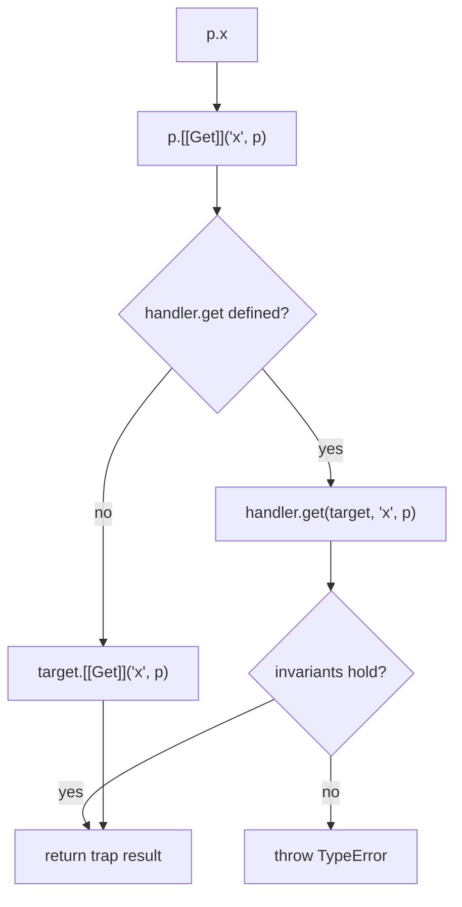

## Introduction

Ordinary JavaScript objects are passive. When code writes `user.age = -5`, the engine stores `-5` and nobody gets a say. When a component reads `state.count`, nothing records that the component cares about `count`. When someone mistypes `config.timout`, they get `undefined` and a bug that surfaces three files away.

A **Proxy** changes that. It is an object that stands in front of another object, the **target**, and lets you run your own function whenever certain operations happen through it: reading a property, writing one, checking `in`, deleting, listing keys, calling it as a function, constructing it with `new`, and a few more. Those functions are called **traps**, and they live on a plain object called the **handler**. Code that holds the proxy uses it exactly like a normal object; it does not know your functions are running.

**Reflect** is the companion piece. It is a built-in namespace object whose methods perform those same operations in their default form: `Reflect.get(target, key, receiver)` does what a normal property read does, `Reflect.set(...)` does what a normal assignment does, and so on. Inside a trap, Reflect is how you say "now do the usual thing", without accidentally changing the meaning of `this` or losing a success flag.

Both arrived in ECMAScript 2015 (ES6) and are supported in every current browser, Node.js and Deno. You meet them in production in several places: Vue 3's `reactive()` and Solid's stores track which properties a component read, Immer and MobX intercept writes to produce immutable updates or notify observers, test libraries build mocks that accept any method call, and API clients expose `api.users.list()` without defining `users` anywhere. This lesson teaches the mechanism underneath all of them:

- the core idea and the full list of traps, with the four you will use most — `get`, `set`, `has` and `deleteProperty` — in detail ([[b1-proxy-traps]]);
- the Reflect API and the **receiver** argument that most hand-written traps get wrong ([[b1-reflect]]);
- the two patterns that justify Proxy in real code, validation and reactivity ([[b1-reactivity-concept]]).

## Before you start

You need these ideas; each link explains them in full:

- **Objects and property access** — dot versus bracket access, and that keys are strings or symbols. See [[b1-dot-vs-bracket]] and [[b1-symbols]].
- **Property descriptors** — that a property has `writable`, `enumerable` and `configurable` flags, which Proxy's rules refer to. See [[b1-property-descriptors]] and [[b1-object-freeze-seal]].
- **Getters and `this`** — how `this` is chosen when a method or getter runs. See [[b1-getters-setters]] and [[b1-this]].
- **The prototype chain** — how a property read walks from an object to its prototype. See [[b1-prototype-chain]].
- **`Map`, `Set` and `WeakMap`** — used in the reactivity section. See [[b1-map]] and [[b1-weakmap]].

## The intuition

Picture a company switchboard. Callers dial one number (the proxy). Behind the switchboard sits the office they really want (the target). The operator has a sheet of instructions (the handler) with one line per kind of call: "if someone asks to *read* a file, log it and put them through", "if someone asks to *change* the payroll, check the amount first", "if someone asks whether a department *exists*, never admit to Legal". Any kind of call without an instruction is connected straight through, as if the switchboard were not there.

That captures the three facts that matter. First, the caller cannot tell they are talking to a switchboard. Second, the operator chooses per kind of operation, not per property: one `get` trap handles every property read, whatever the key. Third, operations with no trap pass straight through to the target.

Where the analogy stops working: the operator is not free to say anything. The language enforces **invariants** — rules a trap cannot break, such as "do not claim a frozen property has a different value" — and throws a `TypeError` if you try. You will see those rules in the traps section.

## Creating a proxy

The constructor takes two objects:

```javascript title="first-proxy.js"
const user = { name: 'Ada', age: 36 };

const logged = new Proxy(user, {
  get(target, key, receiver) {
    console.log(`read ${String(key)}`);
    return Reflect.get(target, key, receiver);
  },
  set(target, key, value, receiver) {
    console.log(`write ${String(key)} = ${value}`);
    return Reflect.set(target, key, value, receiver);
  },
});

logged.age = logged.age + 1;
console.log(user.age);
console.log(logged === user, typeof logged, Array.isArray(new Proxy([], {})));
```

```output
read age
write age = 37
37
false object true
```

Walk through it. `logged.age + 1` is a property read, so the engine calls the `get` trap with the target, the key `'age'` and the receiver (the object the read started on — here the proxy itself). The trap logs and then forwards with `Reflect.get`, which returns `36`. The assignment calls the `set` trap, which forwards with `Reflect.set`. Because both forward to `user`, the change is visible on the original object: `user.age` is `37`.

Several details in this small program are deliberate:

- **`String(key)`** — keys can be symbols, and a template literal throws a `TypeError` when you interpolate a symbol directly. Built-in operations read symbol keys too: converting a proxy to a string reads `Symbol.toPrimitive` and `Symbol.toStringTag` through your `get` trap, so traps meet symbols more often than you expect.
- **The proxy is a different object.** `logged === user` is `false`. Code that still holds `user` bypasses every trap. If you want all access to be intercepted, hand out only the proxy.
- **A proxy keeps the target's "shape".** A proxy of an array still passes `Array.isArray`, and a proxy of a function is still callable with `typeof` `'function'`. You cannot detect a proxy from ordinary JavaScript: there is no `Proxy.prototype`, so `x instanceof Proxy` throws. (Node.js exposes `util.types.isProxy()` for debugging tools.)
- **`new` is required.** Calling `Proxy({}, {})` without `new` throws a `TypeError`.

An empty handler, `new Proxy(target, {})`, forwards everything. That is a useful baseline: anything you add to the handler is a deliberate change from "behave exactly like the target".

### Revocable proxies

`Proxy.revocable(target, handler)` returns `{ proxy, revoke }`. After `revoke()` is called, every operation on the proxy throws, and the proxy drops its references to the target and handler so they can be garbage-collected.

```javascript title="revocable.js"
const { proxy, revoke } = Proxy.revocable({ secret: 'token-123' }, {});
console.log(proxy.secret);
revoke();
try {
  proxy.secret;
} catch (error) {
  console.log(`${error.name}: ${error.message}`);
}
```

```output
token-123
TypeError: Cannot perform 'get' on a proxy that has been revoked
```

This is the **membrane** idea: give a plugin or a callback access to an object for a limited time, then cut the access off, even if the plugin kept a reference. The exact wording of the error message is V8's (Node.js and Chrome); other engines word it differently but all throw `TypeError`.

## Traps (get/set/has/deleteProperty) {#b1-proxy-traps}

A **trap** is a handler method that intercepts one kind of fundamental object operation. The specification defines every object in terms of a small set of **internal methods** — `[[Get]]`, `[[Set]]`, `[[HasProperty]]`, `[[Delete]]`, `[[OwnPropertyKeys]]` and so on. Syntax and built-ins are all expressed through them: `obj.x` calls `[[Get]]`, `'x' in obj` calls `[[HasProperty]]`, `Object.keys(obj)` calls `[[OwnPropertyKeys]]` and then `[[GetOwnProperty]]` for each key. A proxy is an object whose internal methods look up a trap on the handler first; if the trap is missing, they perform the operation on the target instead.

There are thirteen traps, one per internal method:

| Trap | Triggered by (examples) | Must return |
|---|---|---|
| `get(target, key, receiver)` | `p.x`, `p[k]`, destructuring, reading inherited props through `p` | any value |
| `set(target, key, value, receiver)` | `p.x = v`, `Object.assign(p, …)`, `p[k]++` | `true` on success |
| `has(target, key)` | `k in p`, `with` | boolean |
| `deleteProperty(target, key)` | `delete p.x` | boolean |
| `ownKeys(target)` | `Object.keys`, `Reflect.ownKeys`, `for...in`, `JSON.stringify`, spread | array of strings/symbols |
| `getOwnPropertyDescriptor(target, key)` | `Object.getOwnPropertyDescriptor`, and `Object.keys` (to check enumerability) | descriptor or `undefined` |
| `defineProperty(target, key, desc)` | `Object.defineProperty`, class field definitions | boolean |
| `getPrototypeOf(target)` | `Object.getPrototypeOf`, `instanceof` | object or `null` |
| `setPrototypeOf(target, proto)` | `Object.setPrototypeOf` | boolean |
| `isExtensible(target)` | `Object.isExtensible` | boolean |
| `preventExtensions(target)` | `Object.preventExtensions`, `Object.freeze` | boolean |
| `apply(target, thisArg, args)` | `p(...)`, `p.call(...)` — only if the target is a function | any value |
| `construct(target, args, newTarget)` | `new p(...)` — only if the target is a constructor | an object |

You rarely implement more than a few. Implement the traps you need and let the rest default to the target.

### `get`, `set`, `has` and `deleteProperty` together

The four traps in this concept's title cover reading, writing, testing and removing properties. The best way to see how they cooperate is to build something that needs all of them. The following proxy makes properties whose names start with `_` invisible from outside:

```javascript title="hide-private.js"
const isPrivate = (key) => typeof key === 'string' && key.startsWith('_');

function hidePrivate(target) {
  return new Proxy(target, {
    get(t, key, receiver) {
      return isPrivate(key) ? undefined : Reflect.get(t, key, receiver);
    },
    set(t, key, value, receiver) {
      if (isPrivate(key)) return false;
      return Reflect.set(t, key, value, receiver);
    },
    has(t, key) {
      return !isPrivate(key) && Reflect.has(t, key);
    },
    deleteProperty(t, key) {
      if (isPrivate(key)) return false;
      return Reflect.deleteProperty(t, key);
    },
    ownKeys(t) {
      return Reflect.ownKeys(t).filter((key) => !isPrivate(key));
    },
  });
}

const account = hidePrivate({ owner: 'Ada', _pin: '0000' });
console.log(account._pin, '_pin' in account, Object.keys(account));
console.log(JSON.stringify(account));
for (const key in account) console.log('for...in sees', key);
account._pin = '1234';            // sloppy-mode script: silently ignored
console.log(delete account._pin); // false, nothing deleted
console.log(delete account.owner, Object.keys(account));
```

```output
undefined false [ 'owner' ]
{"owner":"Ada"}
for...in sees owner
false
true []
```

Each trap closes one way to observe the hidden key. Without `has`, `'_pin' in account` would still say `true` even though reading it gives `undefined`. Without `ownKeys`, `Object.keys` and `JSON.stringify` would list `_pin`. The lesson is that **a convincing illusion needs every related trap**: reading, testing, enumerating and deleting are separate operations, and leaving one out creates a leak.

Notice what the `set` and `deleteProperty` traps return. Returning `false` means "this operation failed". In sloppy-mode code, a failed assignment or `delete` is silently ignored; in **strict mode** (all ES modules and class bodies are strict) the engine turns `false` into a `TypeError`:

```javascript title="falsish-set.js"
'use strict';
const p = new Proxy({}, { set() { return false; } });
try {
  p.x = 1;
} catch (error) {
  console.log(`${error.name}: ${error.message}`);
}
```

```output
TypeError: 'set' on proxy: trap returned falsish for property 'x'
```

The flip side catches beginners: a `set` trap that stores the value but forgets to `return true` returns `undefined`, which is falsy, so every assignment in a module throws even though the write happened. Returning the result of `Reflect.set` avoids that mistake.

### `ownKeys` needs `getOwnPropertyDescriptor`

`Object.keys` does two things: it asks for all own keys (`ownKeys`), then, for each key, asks for its descriptor (`getOwnPropertyDescriptor`) to keep only enumerable ones. If `ownKeys` reports a key the target does not really have, `Object.keys` drops it because the default `getOwnPropertyDescriptor` finds nothing. To present **virtual properties** that exist only in your traps, implement both:

```javascript title="virtual-view.js"
const p = new Proxy({ a: 1, b: 2 }, {
  has(t, k) { return k === 'a'; },
  ownKeys() { return ['a']; },
  getOwnPropertyDescriptor(t, k) {
    if (k === 'a') return { value: t.a, enumerable: true, configurable: true, writable: true };
  },
  get(t, k) { return k === 'a' ? t.a : undefined; },
});
console.log('a' in p, 'b' in p, Object.keys(p), p.b);
```

```output
true false [ 'a' ] undefined
```

The descriptor returned for `a` says `configurable: true`. That is not decoration: the next subsection explains why a trap may not report a property as non-configurable unless the target really has it that way.

### Function traps: `apply` and `construct`

If the target is a function, the proxy is callable, and calls go to the `apply` trap. If the target is a constructor, `new` goes to `construct`. A proxy of a plain object has neither, and `new` on it throws "is not a constructor" whatever the handler says.

```javascript title="function-traps.js"
function add(a, b) { return a + b; }

const traced = new Proxy(add, {
  apply(target, thisArg, args) {
    console.log(`call ${target.name}(${args.join(', ')})`);
    return Reflect.apply(target, thisArg, args);
  },
});
console.log(traced(2, 3), traced.call(null, 4, 5));

class Point {
  constructor(x, y) { this.x = x; this.y = y; }
}
let created = 0;
const CountedPoint = new Proxy(Point, {
  construct(target, args, newTarget) {
    created++;
    return Reflect.construct(target, args, newTarget);
  },
});
const p = new CountedPoint(1, 2);
new CountedPoint(3, 4);
console.log(p instanceof Point, created);
```

```output
call add(2, 3)
call add(4, 5)
5 9
true 2
```

`traced.call(null, 4, 5)` also hits the trap: `traced.call` is read through the `get` trap (defaulted), returns `Function.prototype.call`, and that in turn invokes the proxy's `[[Call]]` internal method. Function proxies are how tracing and memoisation wrappers can be added around an existing function without changing every call site.

### Invariants: the lies a trap may not tell

A trap can return almost anything, but the engine checks the result against the target afterwards. These checks are the **invariants**. They exist so that guarantees made by `Object.freeze`, non-configurable properties and non-extensible objects cannot be broken by wrapping the object in a proxy. Code that froze an object relies on it staying frozen; a proxy that pretended otherwise would make freezing meaningless.

```javascript title="invariants.js"
'use strict';
const target = {};
Object.defineProperty(target, 'id', { value: 42, writable: false, configurable: false });

const liar = new Proxy(target, {
  get: () => 'not 42',
  has: () => false,
  ownKeys: () => [],
});
for (const attempt of [() => liar.id, () => 'id' in liar, () => Object.keys(liar)]) {
  try {
    console.log(attempt());
  } catch (error) {
    console.log(`${error.name}: ${error.message}`);
  }
}
```

```output
TypeError: 'get' on proxy: property 'id' is a read-only and non-configurable data property on the proxy target but the proxy did not return its actual value (expected '42' but got 'not 42')
TypeError: 'has' on proxy: trap returned falsish for property 'id' which exists in the proxy target as non-configurable
TypeError: 'ownKeys' on proxy: trap result did not include 'id'
```

The main invariants, in words:

- `get` must return the real value of a non-writable, non-configurable own data property.
- `has` and `ownKeys` cannot hide a non-configurable own property, and cannot hide *any* own property if the target is non-extensible.
- `ownKeys` on a non-extensible target must list exactly the target's keys — no additions either.
- `getOwnPropertyDescriptor` and `defineProperty` cannot report a property as non-configurable unless it is non-configurable on the target.
- `set` and `deleteProperty` cannot report success for a change to a frozen property.
- `getPrototypeOf` on a non-extensible target must return the real prototype.

When you see a `TypeError` whose message starts with `'trap' on proxy:`, read it as "your trap tried to contradict a promise the target made". The fix is either to stop lying about that property or to proxy a target that does not make the promise — for example, an empty, extensible object that you treat as a facade over the real data.

## Reflect {#b1-reflect}

**Reflect** is a built-in object (not a constructor — you never write `new Reflect`) whose methods perform the default version of each fundamental object operation. It has exactly thirteen methods, one per Proxy trap, with the same names and the same parameters: `Reflect.get`, `Reflect.set`, `Reflect.has`, `Reflect.deleteProperty`, `Reflect.ownKeys`, `Reflect.getOwnPropertyDescriptor`, `Reflect.defineProperty`, `Reflect.getPrototypeOf`, `Reflect.setPrototypeOf`, `Reflect.isExtensible`, `Reflect.preventExtensions`, `Reflect.apply` and `Reflect.construct`.

That one-to-one match is the point. Inside any trap, "do what would have happened without me" is always `Reflect.<trapName>(...arguments)`. You can even write a forwarding handler without knowing the trap's parameters: `get(...args) { return Reflect.get(...args); }`.

### Why not `target[key]`?

The obvious way to forward a read is `return target[key]`. It works until a **getter** is involved. A getter runs with `this` set to whatever object the read *started on*, called the **receiver**. Through a proxy, the receiver is the proxy (or an object that inherits from it). `target[key]` throws that away and runs the getter with `this = target`, so the getter's own property reads skip your traps:

```javascript title="receiver.js"
const person = {
  first: 'Ada',
  last: 'Lovelace',
  get fullName() { return `${this.first} ${this.last}`; },
};

const broken = new Proxy(person, {
  get(target, key) {
    if (key === 'first') return 'ADA';
    return target[key]; // getter runs with this = target
  },
});
const correct = new Proxy(person, {
  get(target, key, receiver) {
    if (key === 'first') return 'ADA';
    return Reflect.get(target, key, receiver); // getter runs with this = proxy
  },
});
console.log(broken.fullName);
console.log(correct.fullName);

const admin = Object.create(correct);
admin.first = 'Grace';
console.log(admin.fullName);
```

```output
Ada Lovelace
ADA Lovelace
Grace Lovelace
```

With `broken`, `fullName`'s getter reads `this.first` from the raw target, so the trap's `'ADA'` never appears. With `correct`, `Reflect.get` passes the receiver on as the getter's `this`, the getter's `this.first` goes back through the proxy, and the trap sees it. The last line shows why the receiver is not always the proxy: `admin` inherits from the proxy, `admin.fullName` is not an own property of `admin`, so the lookup climbs to the proxy's `get` trap with `receiver = admin`. The getter then runs with `this = admin`, whose own `first` is `'Grace'`.

This is not only about getters you write. Reactive systems depend on it: a computed getter on a reactive object must read its dependencies *through the proxy*, or they are never tracked.

The `set` trap has the same issue in the other direction. When an object inherits from a proxy and you assign to it, the language expects the new property to land on the inheriting object, not on the prototype:

```javascript title="set-receiver.js"
const base = { kind: 'base' };
const naive = new Proxy(base, {
  set(target, key, value) { target[key] = value; return true; },
});
const careful = new Proxy(base, {
  set(target, key, value, receiver) { return Reflect.set(target, key, value, receiver); },
});

const child1 = Object.create(naive);
child1.colour = 'red';
console.log(Object.hasOwn(child1, 'colour'), base.colour);
delete base.colour;

const child2 = Object.create(careful);
child2.colour = 'blue';
console.log(Object.hasOwn(child2, 'colour'), base.colour);
```

```output
false red
true undefined
```

The naive trap wrote `colour` onto the shared prototype, so every object inheriting from `base` would now see `'red'`. `Reflect.set` with the receiver follows the normal rule and creates `colour` on `child2`.

### Reflect versus the `Object` methods

Several Reflect methods look like existing `Object` functions. The differences are small but consistent, and they are the reason Reflect suits trap code:

```javascript title="reflect-vs-object.js"
const frozen = Object.freeze({ id: 1 });
console.log(Reflect.defineProperty(frozen, 'name', { value: 'x' }));
try {
  Object.defineProperty(frozen, 'name', { value: 'x' });
} catch (error) {
  console.log(`${error.name}: ${error.message}`);
}
console.log(Reflect.set(frozen, 'id', 2), Reflect.deleteProperty(frozen, 'id'));

const sym = Symbol('meta');
const obj = { b: 1, [sym]: true };
Object.defineProperty(obj, 'hidden', { value: 2, enumerable: false });
console.log(Object.keys(obj), Reflect.ownKeys(obj));
console.log(Reflect.has(obj, 'toString'));

try {
  Reflect.get(1, 'x');
} catch (error) {
  console.log(`${error.name}: ${error.message}`);
}
```

```output
false
TypeError: Cannot define property name, object is not extensible
false false
[ 'b' ] [ 'b', 'hidden', Symbol(meta) ]
true
TypeError: Reflect.get called on non-object
```

| Concern | `Object.*` / syntax | `Reflect.*` |
|---|---|---|
| Failure of define/set/delete | `Object.defineProperty` throws; `=` and `delete` throw only in strict mode | Returns `false` — exactly what a trap must return |
| Listing keys | `Object.keys`: own, enumerable, strings only | `Reflect.ownKeys`: own, all, strings and symbols |
| `in` and `delete` | Operators, not functions | `Reflect.has`, `Reflect.deleteProperty` — passable and composable |
| Non-object argument | Usually coerced (`Object.keys('ab')` gives `['0', '1']`) | Throws `TypeError` |
| Receiver | Not available | `Reflect.get` / `Reflect.set` take it as an argument |

### `Reflect.apply` and `Reflect.construct`

`Reflect.apply(fn, thisArg, args)` calls a function with an explicit `this` and an array of arguments. It is equivalent to `Function.prototype.apply.call(fn, thisArg, args)` but shorter, and it cannot be fooled by a function that has its own `apply` property:

```javascript title="reflect-apply.js"
function greet(greeting) { return `${greeting}, ${this.name}`; }
greet.apply = () => 'overridden';
console.log(greet.apply({ name: 'Ada' }, ['Hi']));
console.log(Reflect.apply(greet, { name: 'Ada' }, ['Hi']));
```

```output
overridden
Hi, Ada
```

`Reflect.construct(Target, args, newTarget)` is `new Target(...args)` with one extra ability: the optional third argument sets `new.target`, which decides the new object's prototype. This is what lets a `construct` trap forward correctly when a class extends a proxied class:

```javascript title="reflect-construct.js"
class Animal {
  constructor() { this.madeBy = new.target.name; }
}
class Dog extends Animal {}

const pet = Reflect.construct(Animal, [], Dog);
console.log(pet.madeBy, pet instanceof Dog);
```

```output
Dog true
```

Animal's constructor ran, but the object was created as a `Dog`. Passing `newTarget` through in a `construct` trap keeps subclassing working; dropping it would make every subclass instance come out as the base class.

> [!TIP] The forwarding rule
> In every trap, forward with `Reflect.<sameName>` and pass every argument the trap received, including `receiver` and `newTarget`. Then add your behaviour before or after. This is short, correct for getters, setters and inheritance, and it returns the boolean the engine expects.

Outside proxies, Reflect is occasionally useful in library code — `Reflect.ownKeys` for copying every key including symbols, `Reflect.defineProperty` when you want a boolean instead of an exception — but in everyday application code, dot syntax and the `Object` helpers are clearer.

## Validation / Reactivity Concepts {#b1-reactivity-concept}

Proxies earn their place when one rule must apply to **every** property of an object, including properties that do not exist yet. The two patterns that justify them most often are **validation** — rejecting bad writes at the moment they happen — and **reactivity** — automatically re-running code that depends on a value when that value changes. Neither is a language feature. Both are patterns you, or a framework, build in ordinary JavaScript on top of the `get` and `set` traps.

### Validation: the `set` trap as a gatekeeper

A validation proxy checks a value inside the `set` trap and throws (or returns `false`) before the target is touched. The object can never hold an invalid value through the proxy, and a typo in a field name fails at the assignment rather than causing an `undefined` later.

```javascript title="validated.js"
function validated(target, schema) {
  return new Proxy(target, {
    set(t, key, value, receiver) {
      const check = schema[key];
      if (!check) throw new TypeError(`Unknown field "${String(key)}"`);
      const problem = check(value);
      if (problem) throw new RangeError(`${String(key)}: ${problem}`);
      return Reflect.set(t, key, value, receiver);
    },
    deleteProperty(t, key) {
      throw new TypeError(`Cannot delete "${String(key)}"`);
    },
  });
}

const signup = validated({}, {
  email: (v) => (typeof v === 'string' && v.includes('@') ? null : 'must contain @'),
  age: (v) => (Number.isInteger(v) && v >= 13 ? null : 'must be an integer >= 13'),
});

signup.email = 'ada@example.com';
for (const attempt of [
  () => { signup.age = 12; },
  () => { signup.emial = 'typo@example.com'; },
  () => { delete signup.email; },
]) {
  try { attempt(); } catch (error) { console.log(`${error.name}: ${error.message}`); }
}
signup.age = 36;
console.log(JSON.stringify(signup));

Object.defineProperty(signup, 'age', { value: -5 }); // no defineProperty trap
console.log(signup.age);
```

```output
RangeError: age: must be an integer >= 13
TypeError: Unknown field "emial"
TypeError: Cannot delete "email"
{"email":"ada@example.com","age":36}
-5
```

The checks fire for every way of assigning — `=`, `Object.assign`, `++` — because all of them go through `[[Set]]`. The last two lines show the limit: `Object.defineProperty` is a different internal method, so it goes to the (missing) `defineProperty` trap and slips past validation. A serious validation proxy also implements `defineProperty`, or validates on the target's side as well.

Validation through a proxy is a good fit for configuration objects, development-only guards ("throw on reading an unknown key" catches typos), and form models. It is not a substitute for validating data at a trust boundary: anyone holding the raw target bypasses the proxy entirely, and server input should be checked by a schema library or by code that runs on the server.

### Reactivity: what it means

**Reactivity** means that when a piece of state changes, everything that was derived from it updates on its own. In a spreadsheet, a cell containing `=A1*B1` recalculates when `A1` changes; you never write "after editing A1, recompute C1". UI frameworks want the same for components: if a component rendered `cart.total`, editing `cart.quantity` should re-render it, and editing an unrelated field should not.

Doing this by hand means a `subscribe` call for every field a component reads, and a `notify` call after every write. Getting the subscriptions exactly right is tedious and error-prone. A proxy can do both automatically:

1. **Track on read.** When code runs inside an *effect* (a function the system will re-run later) and reads `state.price`, the `get` trap records "this effect depends on `price`".
2. **Trigger on write.** When `state.price` is assigned, the `set` trap looks up the effects that depend on `price` and runs them again.

Because tracking happens during the effect's actual run, the dependency list is always exactly what was read last time, including branches: if an effect reads `user.nickname` only when `user.hasNickname` is true, it depends on `nickname` only while that branch runs.

### A minimal reactive store

Here is that design in about forty lines. It is deliberately close to the shape of Vue 3's reactivity core, so reading this helps you read the real thing.

```javascript title="reactive.js"
const targetMap = new WeakMap(); // target -> Map(key -> Set(effect))
let activeEffect = null;

function track(target, key) {
  if (!activeEffect) return; // reads outside an effect are not tracked
  let deps = targetMap.get(target);
  if (!deps) targetMap.set(target, (deps = new Map()));
  let effects = deps.get(key);
  if (!effects) deps.set(key, (effects = new Set()));
  effects.add(activeEffect);
}

function trigger(target, key) {
  const effects = targetMap.get(target)?.get(key);
  if (!effects) return;
  for (const effect of [...effects]) {      // copy: running an effect may change the set
    if (effect !== activeEffect) effect();  // an effect must not re-trigger itself
  }
}

function reactive(obj) {
  return new Proxy(obj, {
    get(target, key, receiver) {
      track(target, key);
      return Reflect.get(target, key, receiver);
    },
    set(target, key, value, receiver) {
      const old = target[key];
      const ok = Reflect.set(target, key, value, receiver);
      if (ok && !Object.is(old, value)) trigger(target, key);
      return ok;
    },
  });
}

function effect(fn) {
  const run = () => {
    const previous = activeEffect;
    activeEffect = run;
    try { fn(); } finally { activeEffect = previous; }
  };
  run();
}

const cart = reactive({ price: 20, quantity: 2, coupon: '' });
effect(() => console.log(`total: ${cart.price * cart.quantity}`));
cart.quantity = 3;
cart.quantity = 3;      // same value: no re-run
cart.coupon = 'SAVE10'; // no effect read coupon
cart.price = 25;
```

```output
total: 40
total: 60
total: 75
```

Trace it. `effect(...)` sets `activeEffect` to the wrapper `run` and calls the function. The function reads `cart.price` and `cart.quantity`, so `track` records `run` under both keys. It prints `total: 40`. Assigning `quantity = 3` goes through `set`; the value changed, so `trigger` finds `run` under `quantity` and runs it: `total: 60`. Assigning `3` again is skipped by the `Object.is` comparison. Assigning `coupon` triggers nothing because no effect ever read `coupon`. Assigning `price = 25` re-runs the effect.

Each design choice prevents a specific bug:

- **`WeakMap` keyed by the raw target.** The dependency table must not keep state objects alive after the application drops them; a `WeakMap` entry disappears when its key is garbage-collected. See [[b1-weak-references]].
- **Saving and restoring `previous`.** Effects can create or run other effects; a stack-like save keeps an inner effect from stealing the outer one's dependencies. The `finally` restores the state even if `fn` throws.
- **Copying the set before iterating.** A re-run effect re-tracks itself, adding to the same `Set` while it is being iterated; iterating a copy avoids surprising extra runs.
- **`Object.is` comparison.** Writing the same value should not cause work. `Object.is` rather than `===` so that writing `NaN` over `NaN` counts as "unchanged".

### The self-trigger trap

An effect that writes a property it also reads is the classic way to hang a reactive system:

```javascript
const stats = reactive({ views: 0 });
effect(() => { stats.views++; }); // reads views, then writes views
```

`stats.views++` reads `views` (tracking the effect) and then writes it (triggering the effect), which reads and writes again, forever. Without the `effect !== activeEffect` check in `trigger`, Node.js ends with `RangeError: Maximum call stack size exceeded`. With the check, the effect runs once on creation and once per *outside* write: after `stats.views = 10`, the effect runs and increments it to `11`. Vue applies the same rule by default. The broader lesson is that effects should derive output from state, not write back into the state they read; if you need a derived value, compute it (`computed` in Vue, `useMemo` in React) instead of storing it from an effect.

### Making it deep, and the array surprise

The store above is **shallow**. `state.user.name = 'Grace'` reads `user` through the proxy but then writes `name` on a plain object, so nothing triggers. The usual fix is to wrap nested objects **lazily**, at the moment they are read, and cache the wrappers so the same object always gets the same proxy. Arrays need one more piece: `push` writes a new index and the array's length grows as a side effect of that write, so the later explicit `length = 2` assignment is "unchanged" and would trigger nothing. The `set` trap must notice the length change itself.

```javascript title="reactive-deep.js"
const targetMap = new WeakMap();
let activeEffect = null;
function track(target, key) {
  if (!activeEffect) return;
  let deps = targetMap.get(target);
  if (!deps) targetMap.set(target, (deps = new Map()));
  let effects = deps.get(key);
  if (!effects) deps.set(key, (effects = new Set()));
  effects.add(activeEffect);
}
function trigger(target, key) {
  for (const effect of [...(targetMap.get(target)?.get(key) ?? [])]) {
    if (effect !== activeEffect) effect();
  }
}
function effect(fn) {
  const run = () => {
    const previous = activeEffect;
    activeEffect = run;
    try { fn(); } finally { activeEffect = previous; }
  };
  run();
}

const proxyCache = new WeakMap();
function reactive(obj) {
  if (proxyCache.has(obj)) return proxyCache.get(obj);
  const proxy = new Proxy(obj, {
    get(target, key, receiver) {
      track(target, key);
      const value = Reflect.get(target, key, receiver);
      // wrap nested objects only when they are actually read
      return value !== null && typeof value === 'object' ? reactive(value) : value;
    },
    set(target, key, value, receiver) {
      const hadKey = Object.hasOwn(target, key);
      const old = target[key];
      const oldLength = Array.isArray(target) ? target.length : undefined;
      if (!Reflect.set(target, key, value, receiver)) return false;
      if (!hadKey || !Object.is(old, value)) trigger(target, key);
      // writing arr[n] grows the array without a separate visible length change
      if (Array.isArray(target) && target.length !== oldLength) trigger(target, 'length');
      return true;
    },
  });
  proxyCache.set(obj, proxy);
  return proxy;
}

const state = reactive({ user: { name: 'Ada' }, todos: ['write lesson'] });
effect(() => console.log(`hello ${state.user.name}`));
effect(() => console.log(`todos: ${state.todos.length}`));
state.user.name = 'Grace';
state.todos.push('review');
console.log(state.user === state.user);
```

```output
hello Ada
todos: 1
hello Grace
todos: 2
true
```

Without the cache, `state.user === state.user` would be `false`, because each read would create a fresh proxy — which breaks equality checks, `Set` membership and framework memoisation. Without the length check, `todos: 2` would never print. Real libraries handle more cases than this: `delete` and `in` (traps `deleteProperty` and `has`), iteration (`ownKeys`), `Map` and `Set` methods, batching many writes into one re-run (Vue queues component updates in a microtask; see [[b1-microtasks]]), and cleaning up dependencies an effect no longer reads.

### Where frameworks differ

The model above — track reads with a proxy, trigger writes per property — is how **Vue 3** (`reactive`, `ref` and `computed`), **MobX 6** observables, **Valtio** and **Solid's stores** work, with different APIs on top. **Vue 2** used `Object.defineProperty` getters and setters instead, because it supported browsers without Proxy; that is why Vue 2 could not detect a property added after creation and needed `Vue.set`. **React** does not track reads at all: you call `setState` and React re-renders the component and compares the output. **Immer** uses proxies for a different goal: it records writes to a draft and produces a new immutable object with structural sharing, which pairs well with React. Knowing which model a library uses tells you which mistakes are possible in it — for example, destructuring a Vue `reactive()` object into local variables copies plain values and loses reactivity, because the reads happened once and are no longer going through the proxy.

## How it works internally

Every object in the specification has the same set of internal methods. An ordinary object uses the default algorithms. A proxy is an **exotic object** whose internal methods are replaced: each one reads the proxy's two hidden internal slots, `[[ProxyTarget]]` and `[[ProxyHandler]]`, looks up the trap by name on the handler, and either calls the trap or, if it is `undefined`, calls the same internal method on the target. After a trap returns, the algorithm runs the invariant checks against the target. Revoking sets both slots to `null`, which is why every later operation throws.



Two consequences follow from this design.

**Proxies intercept internal methods, not internal slots.** Some built-in objects keep their data in internal slots rather than properties: `Map` (`[[MapData]]`), `Set`, `Date`, `Promise`, typed arrays, and class instances with private fields. Their methods check `this` for that slot. Through a proxy, `this` is the proxy, which has no such slot, so the call fails even with an empty handler:

```javascript title="internal-slots.js"
const map = new Map([['a', 1]]);
const pm = new Proxy(map, {});
try { pm.get('a'); } catch (error) { console.log(`${error.name}: ${error.message}`); }

const fixed = new Proxy(map, {
  get(target, key) {
    const value = Reflect.get(target, key, target); // getters such as size see the real Map
    return typeof value === 'function' ? value.bind(target) : value;
  },
});
console.log(fixed.size, fixed.get('a'));

class Counter {
  #count = 0;
  increment() { return ++this.#count; }
}
const pc = new Proxy(new Counter(), {});
try { pc.increment(); } catch (error) { console.log(`${error.name}: ${error.message}`); }
```

```output
TypeError: Method Map.prototype.get called on incompatible receiver #<Map>
1 1
TypeError: Cannot read private member #count from an object whose class did not declare it
```

The fix for `Map` binds methods to the real target — which also means calls through those bound methods bypass your other traps. Reactive libraries therefore wrap collection methods with their own instrumented versions. For classes with `#private` fields, there is no clean fix; proxying such instances is usually the wrong design. Arrays are the exception: their special behaviour is defined through ordinary property operations, so array proxies work well.

**Proxies are slower than plain objects.** Engines such as V8 make property access fast with hidden classes and inline caches ([[b1-hidden-classes]]). A proxy turns each access into a function call plus invariant checks, and the trap often allocates or looks things up in maps. The cost per access is small in absolute terms but can be many times a plain read. For state objects touched a few hundred times per frame it does not matter; inside a tight numeric loop over a large array it does. Measure before worrying, and keep hot inner loops working on raw data.

## In real systems

- **Reactive UI state.** Vue 3, MobX 6, Valtio and Solid stores track reads and trigger writes through proxies, as in the reactivity section. Vue exposes `toRaw()` to get the target back for code that should not be tracked.
- **Immutable updates.** Immer's `produce(state, draft => { draft.items.push(x) })` hands your function a proxy; your "mutations" are recorded and turned into a new object that shares unchanged parts with the old one.
- **Development guards.** A proxy around a configuration or a component's props that throws on reading an unknown key turns silent `undefined` typos into immediate errors. It is often enabled only in development builds so production pays no cost.
- **Test doubles and API clients.** A `get` trap that returns a function for *any* key lets `mock.anything()` work and lets `api.users.list()` build the URL `/users/list` from the property path, without declaring each endpoint.
- **Access control and membranes.** Revocable proxies give third-party code temporary, revocable access to an object graph. This is a tool inside a larger isolation design, not a sandbox on its own: untrusted code in the same realm can still reach globals and prototypes, so real isolation needs iframes, workers or a separate realm.
- **Interop and logging.** Wrapping a third-party object to log every call while debugging, or to adapt old property names to new ones during a migration.

## Trade-offs and alternatives

Proxy's strength is that one handler covers every key, including keys added later, and every kind of operation, including `in`, `delete` and enumeration. Its costs are indirection (a stack trace through a trap is harder to read, and DevTools shows a `Proxy` wrapper you need to expand), identity (the proxy is not the target), runtime overhead, and the built-in objects with internal slots that it cannot wrap transparently.

| Tool | Covers | Choose it when |
|---|---|---|
| Proxy | All operations, all keys including future ones | Rules apply to the whole object, or you need `in`/`delete`/enumeration interception |
| Getters/setters or `Object.defineProperty` | Specific, known properties | A few fields need computed or validated access; this is what Vue 2 used |
| Class with private fields and methods | Data behind a method API | You control the API shape; it is faster and clearer than trapping reads |
| Wrapper functions (`withLogging(fn)`) | Calls to one function | You only intercept calls, not property access |
| Decorators | Class members at definition time | Stage 3 TC39 proposal, supported by TypeScript 5; annotation-style cross-cutting concerns on classes |
| `Object.freeze` | Blocks all writes | You want immutability without custom rules — cheaper than a validating proxy |

Do not use a proxy for a plain object that needs no cross-cutting behaviour, for hot numeric code, or as a security boundary. Use one when the alternative is repeating the same logic for every property or every call site.

## Common mistakes

**Forwarding with `target[key]` instead of `Reflect.get(target, key, receiver)`.** Getters then run with the wrong `this`, and in reactive code their dependencies are never tracked. Always forward with Reflect and pass the receiver.

**Forgetting to return `true` from `set`, `deleteProperty` or `defineProperty`.** In strict code (every ES module) an `undefined` return becomes a `TypeError` even though the write happened. Return the result of the matching Reflect call.

**Reading the proxy from inside its own `get` trap.** `get(t, k, receiver) { return receiver[k]; }` calls the trap again, forever, ending in `RangeError: Maximum call stack size exceeded`. Inside a trap, read from `target` (via Reflect), never from the proxy.

**Interpolating `key` directly.** Template literals throw on symbols, and the language itself reads symbol keys such as `Symbol.toPrimitive` (string conversion) and `Symbol.iterator` (spread, `for...of`) through your trap. Use `String(key)` or check `typeof key === 'symbol'` first.

**Hiding a key with only one trap.** Overriding `get` but not `has` and `ownKeys` leaves `in`, `Object.keys` and `JSON.stringify` revealing the key. Decide which operations should be consistent and trap them all.

**Expecting the original object to be protected.** Code holding the target bypasses every trap. Hand out only the proxy, and keep the target in a closure.

**Proxying `Map`, `Set`, `Date` or classes with `#private` fields with an empty handler.** Their methods need internal slots the proxy lacks. Bind methods to the target or choose a different design.

**Writing to state you read inside a reactive effect.** It loops or relies on a guard. Derive values instead of storing them from effects.

## Interview perspective

**"What is a Proxy and what is it for?"** A strong answer defines target, handler and trap in one sentence each, names a real use (Vue 3 reactivity, Immer drafts, validation), and mentions that missing traps forward to the target. Weak answers stop at "it wraps an object".

**"Why use Reflect inside traps?"** Because each Reflect method is the default behaviour of the same-named trap, with the same parameters; it passes the receiver so getters and setters see the right `this` and inheritance works; and it returns the success boolean that `set`, `deleteProperty` and `defineProperty` must return. Show the getter example if you can.

**"Proxy versus `Object.defineProperty`?"** `defineProperty` installs accessors on specific existing keys; it cannot see properties added later, `in`, `delete` or enumeration, and it modifies the object itself. Proxy intercepts every operation for every key without modifying the target, at the cost of a separate identity and some overhead. Link it to Vue 2 versus Vue 3.

**"Implement a tiny reactive system"** or **"implement an object that throws on unknown keys"** are common live-coding prompts. Interviewers look for: `Reflect` forwarding, a `WeakMap`-based dependency store, an `activeEffect` saved and restored, and awareness of the self-trigger loop and nested objects.

Follow-ups worth preparing: what invariants are and why they exist; why `new Proxy(new Map(), {}).get('a')` throws; how to detect a proxy (you cannot from standard JavaScript); whether a proxy is a security boundary (no).

## Practice

1. Write `strict(obj)` returning a proxy that throws `ReferenceError` when any missing property is read (use `Reflect.has` to decide) but behaves normally otherwise. Make sure `JSON.stringify(p)` and `` `${p}` `` still work — think about which keys they read that the object does not have (`toJSON`, `Symbol.toPrimitive`).
2. Write `withDefaults(obj, defaults)` whose `get` trap falls back to `defaults[key]` when the property is missing. Should `in` report default keys? Implement your choice consistently with `has` and `ownKeys`.
3. Wrap `Math.max` in an `apply`-trap proxy that logs the arguments and caches results by `args.join(',')`. Explain why the cache key is unsafe for object arguments.
4. Extend the shallow reactive store with a `deleteProperty` trap that triggers effects reading the deleted key, and a `has` trap that tracks `in` checks. Test with an effect that prints `'coupon' in cart`.
5. Explain, without running it, what `new Proxy(Object.freeze({ a: 1 }), { get: () => 2 }).a` does and why.

## Quick revision {#quick-revision}

- `new Proxy(target, handler)`: traps on the handler intercept operations; missing traps forward to the target. The proxy is a separate object (`proxy !== target`).
- 13 traps, one per internal method: `get`, `set`, `has`, `deleteProperty`, `ownKeys`, `getOwnPropertyDescriptor`, `defineProperty`, `getPrototypeOf`, `setPrototypeOf`, `isExtensible`, `preventExtensions`, `apply`, `construct`.
- `set`/`deleteProperty`/`defineProperty` return booleans; `false` throws `TypeError` in strict mode.
- `Object.keys` uses `ownKeys` and `getOwnPropertyDescriptor`; virtual keys need both.
- Invariants: traps cannot misreport non-configurable properties or non-extensible targets; violations throw `TypeError`.
- `apply`/`construct` work only when the target is a function/constructor.
- `Proxy.revocable` returns `{ proxy, revoke }`; after revoking, every operation throws.
- Reflect: 13 methods mirroring the traps; returns booleans instead of throwing; throws on non-object targets; `Reflect.ownKeys` lists all own string and symbol keys.
- Pass `receiver` to `Reflect.get`/`Reflect.set` so getters/setters get the right `this` and inherited writes land on the right object; pass `newTarget` to `Reflect.construct`.
- `Map`, `Set`, `Date`, `#private` fields use internal slots and break through a plain proxy.
- Validation: check in `set` (and `defineProperty`); the raw target bypasses it.
- Reactivity: `get` tracks (`target → key → Set<effect>` in a `WeakMap`), `set` triggers on real change; guard self-triggering; wrap nested objects lazily with a cache; arrays need length handling.
- Proxy is not a security sandbox and is slower than plain property access.

## Key takeaways {#key-takeaways}

- A Proxy lets one handler intercept every property read, write, existence check, deletion, enumeration, call or construction on an object, including properties added later.
- Each trap corresponds to one of the language's internal object operations, and Reflect provides the default version of each with the same name and parameters — so forward with Reflect and pass every argument along.
- The receiver is what makes getters, setters and inheritance behave correctly through a proxy; `target[key]` silently loses it.
- Invariants stop traps from contradicting frozen, non-configurable or non-extensible targets, and their `TypeError`s are a sign your trap tried to lie.
- Validation and reactivity are patterns built from `get` and `set` traps, not language features; Vue 3, MobX, Valtio and Solid stores are industrial versions of the small store in this lesson.
- Proxies cost speed and transparency and cannot wrap objects that rely on internal slots, so use them where a whole-object rule is worth it, not by default.

```quiz
Q: A `get` trap forwards with `return target[key];`. The target has a getter `get label() { return this.name.toUpperCase(); }` and the trap overrides `name`. What goes wrong?
- [ ] `target[key]` throws a TypeError because of an invariant
- [x] The getter runs with `this` set to the raw target, so its read of `this.name` skips the trap
- [ ] Nothing; `target[key]` and `Reflect.get(target, key, receiver)` are identical
- [ ] The getter runs twice
> A getter uses the receiver of the original access as `this`. `target[key]` starts a new access on the target, so `this.name` reads the target directly and never reaches the trap. `Reflect.get(target, key, receiver)` passes the proxy on as `this`. No invariant is involved: the property is configurable.
```

```quiz
Q: In an ES module, `const p = new Proxy({}, { set(t, k, v) { t[k] = v; } }); p.a = 1;` What happens?
- [ ] `p.a` is set to 1 and nothing else happens
- [ ] The assignment is silently ignored
- [x] The value is stored on the target, then a TypeError is thrown because the trap returned a falsy value
- [ ] A RangeError for infinite recursion
> Modules are strict mode. The trap returns `undefined`, which the engine treats as "the set failed", and strict code turns a failed assignment into a `TypeError`. The write to `t[k]` already happened, which makes this bug confusing. Return `true`, or better, return `Reflect.set(t, k, v, receiver)`.
```

```quiz
Q: Why does `Object.keys(proxy)` omit a key that the proxy's `ownKeys` trap returns, when the target does not actually have that key?
- [ ] `Object.keys` ignores the `ownKeys` trap
- [ ] Invariants forbid reporting extra keys on every target
- [x] `Object.keys` also asks `getOwnPropertyDescriptor` for each key, and the default finds no descriptor, so the key is treated as non-enumerable
- [ ] Only symbol keys can be virtual
> `Object.keys` lists own *enumerable* string keys, so it checks each key's descriptor. To present a virtual key, the `getOwnPropertyDescriptor` trap must return a configurable, enumerable descriptor for it. Extra keys are only forbidden when the target is non-extensible.
```

```quiz
Q: In the minimal reactive store, why is the dependency table a `WeakMap` keyed by the raw target object?
- [ ] `WeakMap` iterates faster than `Map`
- [ ] `Map` cannot use objects as keys
- [x] So a state object and its dependency records can be garbage-collected once the application no longer references the object
- [ ] So proxies can be detected
> A `Map` would hold every state object ever made reactive, leaking memory. `WeakMap` keys are held weakly: when nothing else references the target, the entry can be collected. `Map` can use object keys too, and `WeakMap` is not iterable at all.
```

```quiz
Q: `new Proxy(new Map([['a', 1]]), {}).get('a')` throws a TypeError. Why?
- [ ] The empty handler blocks method calls
- [ ] `Map` is frozen
- [x] `Map.prototype.get` needs the `[[MapData]]` internal slot on `this`, and `this` is the proxy, which has no such slot
- [ ] Proxies cannot wrap built-in objects at all
> Traps intercept internal methods, not internal slots. The method lookup succeeds and returns `Map.prototype.get`, but it is called with `this` set to the proxy, and the slot check fails. Proxies of arrays and plain objects work because their behaviour is defined through ordinary property operations.
```
