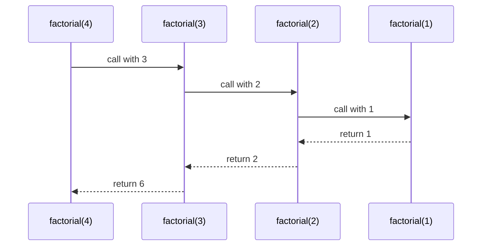

## Introduction

A comment thread on a discussion site is a comment with replies, and each reply is itself a comment that can have replies, to any depth. Suppose you need to count every comment in a thread. A loop over the top-level replies is not enough, because each reply may hide its own replies, which may hide more. You do not know how many levels of nested loops to write.

But you can describe the answer in one sentence: *the number of comments in a thread is one (the comment itself) plus the number of comments in each reply's thread.* That sentence refers to itself — it defines "number of comments in a thread" using "number of comments in a thread" — but on smaller threads each time, until a comment has no replies and the answer is simply one.

A function that implements a definition like that is **recursive**: it solves a problem by calling itself on a smaller instance of the same problem. **Recursion** is the technique. It is the natural tool whenever the data is **self-similar** — made of smaller pieces with the same shape as the whole. That covers a surprising amount of front-end and back-end work: the DOM (an element contains elements), JSON (an object contains objects and arrays), file systems (a folder contains folders), menus with submenus, nested routes, org charts, abstract syntax trees in compilers and linters, and React's component tree.

JavaScript adds practical constraints that are worth knowing precisely. Each call takes space on the **call stack**, the stack has a fixed size, and when you exceed it the engine throws `RangeError: Maximum call stack size exceeded`. The language specification describes an optimisation that would remove that limit for one style of recursion, but most engines do not implement it. So a JavaScript developer needs both skills: writing recursion clearly, and knowing when and how to replace it with a loop.

## Before you start

- **Functions and return values** — declaring a function and using what it returns. See [[b1-function-declaration]].
- **The call stack** — the engine's record of which function calls are in progress. See [[b1-call-stack]] and [[b1-stack-frames]]; this lesson explains what recursion does to it.
- **Arrays and objects** — iterating with `for...of` and reading nested properties. See [[b1-for-of-in]] and [[b1-objects-as-values]].
- Recursion as an algorithmic technique (recurrence relations, complexity, divide and conquer) is taught for Java in [[a1-recursion]]. This lesson focuses on how recursion behaves in JavaScript.

## The intuition

You are standing in a long queue and want to know your position, but you cannot see the front. You ask the person ahead of you, "What is your position?" They do not know either, so they ask the person ahead of them, and so on. Eventually the question reaches the person at the front, who knows the answer without asking anyone: "I am number one." That answer travels back: "I'm two", "I'm three", until it reaches you, and you add one to whatever you were told.

Three features of that scene are the three features of every recursive function. There is a **base case**: someone (the front of the queue) can answer without asking. There is a **recursive case**: everyone else answers by asking a slightly smaller version of the question and doing a little work with the reply. And there is **progress**: each question goes to someone strictly closer to the front, so the chain of questions must reach the base case.

Notice also the two directions. Questions travel *forward* — that is the sequence of calls. Answers travel *backward* — that is the sequence of returns. Each person must wait, remembering that they still have to add one, until the answer comes back. In a program, "waiting and remembering" is exactly what a call-stack frame does.

## Anatomy of a recursive function

Factorial is the traditional first example because its definition is already recursive: `5! = 5 × 4!`, `4! = 4 × 3!`, and so on, with `1! = 1`.

```javascript title="factorial.js"
function factorial(n) {
  if (n <= 1) return 1;              // base case: the answer is known
  return n * factorial(n - 1);       // recursive case: a smaller version
}

console.log(factorial(5));
console.log(factorial(1));
```

```output
120
1
```

Every correct recursive function answers three questions.

**What is the base case?** The input for which you know the answer directly, with no further calls. Here it is `n <= 1`. Using `<=` rather than `=== 1` also handles `factorial(0)`, which mathematically is 1, and stops negative input from recursing forever.

**How does the recursive case reduce the problem?** It calls the function on an input that is closer to the base case — here `n - 1` — and combines the result with a little work of its own, multiplying by `n`.

**Why does it always reach the base case?** Because every call decreases `n` by one, any positive integer eventually reaches 1. This is the part beginners skip, and skipping it is how infinite recursion happens. For data structures the argument is usually "every call receives a strictly smaller piece": a shorter array, a child node, a sub-folder.

A useful way to write recursive code is to **trust the recursive call**. When writing `return n * factorial(n - 1)`, do not mentally trace all the calls. Assume `factorial(n - 1)` correctly returns `(n-1)!` — that is what you are in the middle of writing — and ask only: "given that, is `n * (n-1)!` the right answer for `n`?" If the base case is correct and each step is correct assuming smaller steps are correct, the whole function is correct. This is the same reasoning as proof by induction.

## What the call stack does

The **call stack** is the engine's list of function calls that have started but not yet returned. Each entry is a **stack frame** (an *execution context* in the specification) holding that call's parameters, local variables and the place to resume when it returns. Calling a function pushes a frame; returning pops it.

Recursion does not need any special support for this, and that is the key insight: **each recursive call gets its own frame with its own `n`**. The variable `n` in `factorial(4)` and the variable `n` in `factorial(3)` are different variables that happen to have the same name, just as two people in the queue each have their own position.

Adding logging makes the frames visible:

```javascript title="trace.js"
function factorial(n, depth = 0) {
  const pad = '  '.repeat(depth);
  console.log(`${pad}call factorial(${n})`);
  if (n <= 1) {
    console.log(`${pad}return 1`);
    return 1;
  }
  const result = n * factorial(n - 1, depth + 1);
  console.log(`${pad}return ${result}`);
  return result;
}

factorial(4);
```

```output
call factorial(4)
  call factorial(3)
    call factorial(2)
      call factorial(1)
      return 1
    return 2
  return 6
return 24
```

The indentation is the stack depth. The calls go down four levels before anything is computed; no multiplication happens on the way down, because each frame is paused at `n * factorial(n - 1, ...)`, waiting for the inner call's result. Then the returns come back up in reverse order, each frame finishing its multiplication with the value it receives.

| Moment | Stack (top is right) | What happens |
|---|---|---|
| 1 | `f(4)` | `4 <= 1` is false; calls `f(3)` and waits |
| 2 | `f(4) f(3)` | calls `f(2)` and waits |
| 3 | `f(4) f(3) f(2)` | calls `f(1)` and waits |
| 4 | `f(4) f(3) f(2) f(1)` | base case: returns `1`; frame popped |
| 5 | `f(4) f(3) f(2)` | computes `2 * 1`, returns `2` |
| 6 | `f(4) f(3)` | computes `3 * 2`, returns `6` |
| 7 | `f(4)` | computes `4 * 6`, returns `24`; stack empty |



The maximum number of frames alive at once is the **recursion depth** — here 4. Depth, not the total number of calls, decides whether the stack overflows. You will see why that distinction matters when a function calls itself more than once.

## Recursion on nested data

Factorial is a teaching example; nobody needs recursion to multiply numbers. The real strength of recursion is data whose depth you do not know in advance. Here is the comment-thread problem from the introduction, with a second function that renders the thread with indentation:

```javascript title="thread.js"
const thread = {
  author: 'ana', text: 'Ship it?', replies: [
    { author: 'ben', text: 'Tests first', replies: [
      { author: 'ana', text: 'Fair', replies: [] },
    ] },
    { author: 'cy', text: 'LGTM', replies: [] },
  ],
};

function countComments(comment) {
  let total = 1;                                   // this comment
  for (const reply of comment.replies) {
    total += countComments(reply);                 // each reply's whole subtree
  }
  return total;
}

function render(comment, depth = 0) {
  const lines = [`${'  '.repeat(depth)}${comment.author}: ${comment.text}`];
  for (const reply of comment.replies) {
    lines.push(...render(reply, depth + 1));
  }
  return lines;
}

console.log(countComments(thread));
console.log(render(thread).join('\n'));
```

```output
4
ana: Ship it?
  ben: Tests first
    ana: Fair
  cy: LGTM
```

`countComments` is the English sentence from the introduction written as code. Where is the base case? There is no `if` — a comment with an empty `replies` array simply skips the loop and returns `1`. The base case is implicit in the data: a leaf node has no children to recurse into. Progress is guaranteed because each call receives a reply, which is a strictly smaller subtree, and the tree is finite.

`render` shows a common technique: passing extra information *down* the recursion as a parameter. `depth` is not part of the problem's input; it is context that each call hands to its children, one level deeper. The results come back *up* as arrays of lines, which each level combines with its own line. Down with parameters, up with return values — that is the shape of most tree recursion.

The same shape flattens an array nested to any depth. The base case is "not an array":

```javascript title="flatten.js"
function flatten(value) {
  if (!Array.isArray(value)) return [value];       // base case: a single item
  const out = [];
  for (const item of value) out.push(...flatten(item));
  return out;
}

console.log(flatten([1, [2, [3, [4]], 5], [], [[6]]]));
console.log([1, [2, [3, [4]], 5], [], [[6]]].flat(Infinity));
```

```output
[ 1, 2, 3, 4, 5, 6 ]
[ 1, 2, 3, 4, 5, 6 ]
```

In production you would use the built-in `Array.prototype.flat(Infinity)` (ES2019), shown on the last line; writing `flatten` yourself is a standard interview exercise because it tests exactly this pattern. See [[b1-flat-flatmap]].

### Mutual recursion

Recursion does not have to be a function calling itself directly. In **mutual recursion**, two or more functions call each other in a cycle. It appears naturally when the data has several kinds of node. Here is a simplified JSON serialiser: a value may be an array or an object, and each of those contains values.

```javascript title="serialize.js"
function serialize(value, seen = new Set()) {
  if (value === null || typeof value !== 'object') return JSON.stringify(value);
  if (seen.has(value)) throw new TypeError('circular structure');
  seen.add(value);
  const text = Array.isArray(value)
    ? serializeArray(value, seen)
    : serializeObject(value, seen);
  seen.delete(value);                  // the same object may appear in sibling branches
  return text;
}

function serializeArray(arr, seen) {
  return `[${arr.map((item) => serialize(item, seen)).join(',')}]`;
}

function serializeObject(obj, seen) {
  const parts = Object.entries(obj)
    .map(([key, v]) => `${JSON.stringify(key)}:${serialize(v, seen)}`);
  return `{${parts.join(',')}}`;
}

const shared = { id: 1 };
console.log(serialize({ a: [1, 'two', shared], b: shared, c: null }));

const loop = { name: 'loop' };
loop.self = loop;
try { serialize(loop); } catch (e) { console.log(e.message); }
```

```output
{"a":[1,"two",{"id":1}],"b":{"id":1},"c":null}
circular structure
```

The base case is a primitive value (or `null`), serialised directly. `serialize` delegates to the two container functions, and they call `serialize` for each element. Function declarations make this layout possible, because each function can call the others regardless of the order they are written in; see [[b1-function-hoisting]].

The `seen` set handles a danger specific to object graphs: **cycles**. `loop.self` points back to `loop`, so naive recursion would descend forever. Tracking the objects on the current path detects the cycle and stops with an error — which is exactly what the real `JSON.stringify` does, throwing `TypeError: Converting circular structure to JSON`. Removing the object from `seen` after finishing it means an object that appears twice in *different* branches (like `shared`) is not mistaken for a cycle. Any recursion over arbitrary object graphs, such as deep cloning ([[b1-impl-deep-clone]]) or deep equality, needs this guard.

## When one call makes several

`countComments` calls itself once per reply, so it may make many recursive calls from a single frame. That is fine there, because each comment is visited exactly once. Trouble starts when the same sub-problem is solved repeatedly. The Fibonacci numbers are defined as `fib(0) = 0`, `fib(1) = 1`, and `fib(n) = fib(n-1) + fib(n-2)`:

```javascript title="fib.js"
let calls = 0;
function fib(n) {
  calls++;
  if (n < 2) return n;
  return fib(n - 1) + fib(n - 2);
}

for (const n of [10, 20, 30]) {
  calls = 0;
  const v = fib(n);
  console.log(`fib(${n}) = ${v} after ${calls} calls`);
}
```

```output
fib(10) = 55 after 177 calls
fib(20) = 6765 after 21891 calls
fib(30) = 832040 after 2692537 calls
```

Each increase of 10 in `n` multiplies the work by more than a hundred. The reason is visible if you sketch the calls: `fib(30)` calls `fib(29)` and `fib(28)`, but `fib(29)` *also* calls `fib(28)`, and each of those calls `fib(27)`, and so on. The same values are recomputed an exponential number of times — roughly 1.6ⁿ calls.

Notice what does *not* go wrong: the stack. The depth is only about 30, because the second call `fib(n - 2)` starts only after the first one has fully returned. Total calls and maximum depth are different measures. This function is slow, not deep.

The fix is to remember answers that have already been computed, so each `fib(k)` is computed once. That technique is [[b1-memoization]], and it turns this function from exponential to linear time. In algorithm design, recursion plus memoization is top-down dynamic programming; see [[a11-memoization]].

## Building results with backtracking

Some recursive functions explore choices: at each level, try each option, recurse, then undo the option and try the next. This is **backtracking**, used to generate permutations and combinations or to solve puzzles. It also shows a classic bug about shared state.

```javascript title="permutations.js"
function permutations(items) {
  const results = [];
  const current = [];
  const used = new Array(items.length).fill(false);

  function build() {
    if (current.length === items.length) {
      results.push([...current]);          // copy: current keeps changing
      return;
    }
    for (let i = 0; i < items.length; i++) {
      if (used[i]) continue;
      used[i] = true;
      current.push(items[i]);
      build();
      current.pop();                       // undo the choice before trying the next
      used[i] = false;
    }
  }

  build();
  return results;
}

console.log(permutations(['a', 'b', 'c']).map((p) => p.join('')).join(' '));
```

```output
abc acb bac bca cab cba
```

The inner function `build` is a closure over `results`, `current` and `used`, so every level of the recursion shares the same three arrays instead of passing them as arguments. Each level picks an unused item, recurses to fill the remaining positions, then **undoes** its choice with `pop()` and `used[i] = false` so the next iteration starts from the same state. The copy `[...current]` is essential: pushing `current` itself would store a reference to one array that the algorithm keeps modifying, and at the end every entry in `results` would be the same empty array. The technique is developed fully in [[a9-constraint-backtracking]].

## Stack limits and RangeError

Every frame uses memory, and the call stack has a fixed maximum size set by the engine. When a call would exceed it, the engine throws a `RangeError` instead of crashing the process:

```javascript title="overflow.js"
function sumTo(n) {
  if (n === 0) return 0;
  return n + sumTo(n - 1);
}

console.log(sumTo(1000));
try {
  sumTo(100000);
} catch (e) {
  console.log(e instanceof RangeError, e.message);
}
```

```output
500500
true Maximum call stack size exceeded
```

How deep can you go? It depends on the engine, its configuration and the size of each frame — a function with more parameters and local variables uses bigger frames and overflows sooner. As a rough guide, Node.js 22 manages around ten thousand frames for a tiny function like `sumTo`; browsers vary, and the number can change between versions. Treat any recursion whose depth grows with the size of user-supplied data as a potential crash: a 100,000-element linked list, a pathologically deep JSON document, or a degenerate tree that is really a long chain. Firefox reports the same failure as `InternalError: too much recursion`. More on the mechanics in [[b1-stack-overflow]].

> [!WARNING] A missing base case fails fast
> Infinite recursion does not hang like an infinite loop. Each call adds a frame, so it hits the stack limit within milliseconds and throws a RangeError. If you see "Maximum call stack size exceeded", look first for a base case that is missing, unreachable, or not handled for some input (negative numbers, empty arrays, cyclic objects).

### Tail calls: in the specification, not in most engines

A **tail call** is a call that is the very last thing a function does: its result is returned unchanged, with no work left afterwards. `return n + sumTo(n - 1)` is *not* a tail call, because the addition still has to happen after the inner call returns. It can be rewritten into tail form by carrying the running total in an **accumulator** parameter:

```javascript title="tail.js"
'use strict';
function sumTail(n, acc = 0) {
  if (n === 0) return acc;
  return sumTail(n - 1, acc + n);      // a tail call: nothing left to do after it
}

try { console.log(sumTail(100000)); } catch (e) { console.log(e.name); }
```

```output
RangeError
```

When nothing is left to do after a tail call, the current frame is no longer needed, so an engine could *reuse* it instead of pushing a new one; recursion in tail form would then run in constant stack space. ES2015 requires exactly this — **proper tail calls** in strict-mode code. In practice, only JavaScriptCore (Safari) implements it. V8 (Chrome, Node.js, Deno) and SpiderMonkey (Firefox) do not, mainly because removing frames makes stack traces lose information developers rely on. The output above is from Node.js 22: the tail-form version overflows just like the original. Do not rely on tail calls for correctness in JavaScript code that must run everywhere.

## Converting recursion to iteration

When depth can grow large, convert the recursion. There are three standard techniques, from simplest to most general.

**A plain loop** works when the recursion is linear — one recursive call per level — and especially when it is already in tail form. The accumulator becomes a loop variable:

```javascript
function sumIter(n) {
  let total = 0;
  for (let i = 1; i <= n; i++) total += i;
  return total;
}
console.log(sumIter(100000));
```

```output
5000050000
```

**An explicit stack** works for tree recursion. The call stack was only ever storing "work still to do"; you can store that work in an ordinary array instead, which lives on the heap and is limited only by memory.

```javascript title="walk.js"
const tree = {
  name: 'src', children: [
    { name: 'app', children: [{ name: 'main.ts', children: [] }] },
    { name: 'lib', children: [
      { name: 'util.ts', children: [] },
      { name: 'api.ts', children: [] },
    ] },
  ],
};

function namesRecursive(node, out = []) {
  out.push(node.name);
  for (const child of node.children) namesRecursive(child, out);
  return out;
}

function namesIterative(root) {
  const out = [];
  const stack = [root];                  // our own stack replaces the call stack
  while (stack.length > 0) {
    const node = stack.pop();
    out.push(node.name);
    // push children in reverse so the first child is popped (visited) first
    for (let i = node.children.length - 1; i >= 0; i--) stack.push(node.children[i]);
  }
  return out;
}

console.log(namesRecursive(tree).join(' '));
console.log(namesIterative(tree).join(' '));
```

```output
src app main.ts lib util.ts api.ts
src app main.ts lib util.ts api.ts
```

Both produce the same depth-first order. On a "tree" that is really a chain 100,000 levels deep, `namesRecursive` throws a RangeError and `namesIterative` returns all 100,000 names. The cost is clarity: the recursive version states the idea in two lines, while the iterative version makes you manage the order by hand (note the reversed push). Replacing `pop()` with `shift()` — taking from the front — turns the same loop into breadth-first, level-by-level traversal. See [[a5-stack]].

**A trampoline** keeps the recursive structure but stops the stack from growing. Instead of calling itself, the function *returns a function* describing the next step, and a small driver loop keeps calling those until it gets a non-function value:

```javascript title="trampoline.js"
function trampoline(fn) {
  return (...args) => {
    let result = fn(...args);
    while (typeof result === 'function') result = result();   // keep bouncing
    return result;
  };
}

const sumT = trampoline(function step(n, acc = 0) {
  if (n === 0) return acc;
  return () => step(n - 1, acc + n);         // return the next step instead of calling it
});

console.log(sumT(100000));
```

```output
5000050000
```

Each step returns to the driver before the next begins, so the stack depth never exceeds two or three frames. The trampoline only works for tail-form recursion, cannot be used when the final result itself is a function, and allocates a closure per step, so it is slower than a loop. It is useful mainly when translating code from languages with tail-call elimination.

## How it works internally

Nothing about recursion is special to the engine. A recursive call is an ordinary call: the engine creates a new execution context, binds the parameters in a fresh environment record, pushes the context, and runs the body. A function can find its own name because the name is a binding in the scope where the function was declared (or, for a named function expression, in a scope created specially for the function). See [[b1-execution-contexts]].

The stack limit comes from the host. Engines run JavaScript frames on a fixed-size native stack (V8 sets a default limit of roughly 1 MB on 64-bit systems, adjustable with the `--stack-size` flag, which can crash the process if set beyond what the operating system provides). Before pushing a frame, the engine checks the remaining space and throws a RangeError if it would run out. Because the error is an ordinary exception, it can be caught — but catching it deep inside a recursive algorithm usually leaves data half-processed, so treat it as a bug to fix rather than a condition to handle.

Optimising compilers can sometimes **inline** a call — copy the called function's body into the caller — which removes a frame. Recursive calls are usually not inlined (or only to a small depth), so you should assume each call costs one frame.

## In real systems

**Walking the DOM.** Finding all text nodes, collecting headings for a table of contents, or checking accessibility attributes means visiting an element and then each of its children. Browsers provide `TreeWalker` and `querySelectorAll` for many cases, but custom traversals are written recursively. Real DOMs are rarely more than a few dozen levels deep, so recursion is safe there.

**Data utilities.** Deep clone, deep equality, deep merge of configuration objects, and converting keys between `snake_case` and `camelCase` in an API response all recurse over objects and arrays. They must handle cycles, and libraries such as Lodash implement them with a stack of visited objects for that reason. The built-in `structuredClone` performs a deep, cycle-safe copy natively. See [[b1-structured-clone]].

**File systems and builds.** Build tools walk source directories recursively. Node.js (since v20.1 and v18.17) offers `fs.readdirSync(dir, { recursive: true })`, but custom walks — skipping `node_modules`, following or not following symbolic links — are written by hand. Symbolic links can create cycles, the same problem as cyclic objects.

**Parsers and compilers.** Babel, TypeScript, ESLint and Prettier represent code as an abstract syntax tree and process it with recursive visitors. Hand-written parsers commonly use **recursive descent**, one function per grammar rule, calling each other mutually.

**Asynchronous recursion is different.** A recursive `async` function that `await`s before recursing does not grow the call stack across the await:

```javascript title="pages.js"
const fetchPage = (page) =>
  Promise.resolve({ items: [page], next: page < 100000 ? page + 1 : null });

async function collect(page, count = 0) {
  const { items, next } = await fetchPage(page);
  if (next === null) return count + items.length;
  return collect(next, count + items.length);
}

collect(1).then((n) => console.log('pages collected:', n));
```

```output
pages collected: 100000
```

This simulated paginated API is followed 100,000 times without a RangeError. When an `async` function reaches `await`, its frame is popped and its state saved; the rest runs later from the microtask queue on a nearly empty stack. Each level still holds a pending promise until the chain resolves, so memory grows with depth, but the stack does not. The same applies to recursion through `setTimeout`, which is the usual way to write a polling loop. See [[b1-async-await]] and [[b1-event-loop]].

## Trade-offs and alternatives

| | Recursion | Iteration (loop or explicit stack) |
|---|---|---|
| Fits self-similar data (trees, nested JSON) | Naturally | Needs manual bookkeeping |
| Fits linear sequences | Works but adds frames | Naturally |
| Maximum depth | Limited by the call stack | Limited only by memory |
| Speed | Function-call overhead per step | Usually faster |
| Code clarity for trees | High | Lower |

Use recursion when the data is a tree or nested structure of bounded, reasonable depth (UI trees, ASTs, configuration objects) and clarity matters. Use iteration when depth grows with input size (long lists, chains, user-controlled nesting), when performance is critical in a hot path, or when the recursion is linear anyway — summing an array recursively is a teaching exercise, not production code. When you need both clarity and safety, write the recursive version first to get the logic right, then convert it with an explicit stack and keep the recursive version as a test oracle.

## Common mistakes

> [!MISTAKE] Forgetting to return the recursive result
> `if (arr.length === 0) return 0; arr[0] + sumList(arr.slice(1));` computes the sum and throws it away. The function returns `undefined` for any non-empty array. Every path through a recursive function that produces a value must `return` it: `return arr[0] + sumList(arr.slice(1));`.

**A base case that some inputs never reach.** `function countdown(n) { if (n === 0) return; countdown(n - 2); }` works for even numbers and overflows for odd ones, because it jumps from 1 to -1. Prefer base cases that cover a range (`n <= 0`) and validate input.

**No progress.** Calling `walk(node)` instead of `walk(child)`, or `arr.slice(0)` instead of `arr.slice(1)`, recurses on the same problem forever. Check that every recursive call receives strictly smaller input.

**Recursing into cycles.** Object graphs, DOM-like structures with parent pointers and file systems with links can contain cycles. Keep a `Set` (or `WeakSet`) of visited objects.

**Sharing a mutable array without copying.** In backtracking, pushing the working array into the results stores a reference that later changes. Push a copy.

**Hidden quadratic cost.** `arr.slice(1)` copies the array on every call, so a recursive sum over `n` elements does O(n²) work in total. Pass an index instead: `sum(arr, i + 1)`.

**Recomputing overlapping sub-problems.** If the same arguments are reached through different paths, the running time can become exponential. Memoize, or restructure bottom-up.

## Interview perspective

Interviewers use recursion to test whether you can decompose a problem and reason about the stack, and front-end interviews favour recursion over nested data.

> [!INTERVIEW] Narrate the three parts
> State the base case, the recursive case, and why every call moves towards the base case before you write code: "If the value isn't an array, the result is just that value in an array. Otherwise I flatten each element and concatenate. Each call receives an element, which is strictly smaller, so it terminates." Then name the depth limit and how you would handle deep input.

Common questions:

- **Flatten a nested array, without `flat`.** The `flatten` function above; follow-ups ask for a depth limit (pass `depth` down and stop at zero) or an iterative version with a stack.
- **Deep clone an object.** Recurse over own properties, handle arrays, dates and cycles with a `Map` from original to clone. See [[b1-impl-deep-clone]].
- **Maximum depth of a tree / nested object.** `1 + max(depth(child))`, with 0 or 1 for leaves.
- **Generate all subsets or permutations.** Backtracking with an undo step.
- **What happens with very deep recursion in JavaScript?** RangeError when the stack limit is exceeded; the limit is engine-dependent; tail calls are specified but implemented only in Safari; convert to iteration.
- **Is `return n * f(n - 1)` a tail call?** No: the multiplication happens after the call returns. Rewrite with an accumulator to put it in tail form.

```quiz
Q: In `function f(n) { if (n <= 1) return 1; return n * f(n - 1); }`, how many stack frames for `f` exist at the deepest point of `f(5)`?
- [ ] 1, because each call finishes before the next starts
- [x] 5, one for each of f(5), f(4), f(3), f(2) and f(1)
- [ ] 10, because each call pushes two frames
- [ ] It depends on whether tail calls are optimised
> Each call waits for the inner call's result before it can multiply, so all five frames are alive when f(1) runs. Tail-call optimisation would not apply anyway, because the multiplication happens after the recursive call returns.

Q: A recursive `fib(n)` that calls `fib(n - 1) + fib(n - 2)` takes millions of calls for n = 30, yet does not throw a RangeError. Why?
- [ ] The engine detects the repetition and caches results
- [x] The maximum stack depth is only about n; the problem is the total number of calls, not the depth
- [ ] V8 converts the recursion into a loop automatically
- [ ] RangeError is only thrown for infinite recursion
> The second call starts only after the first has returned, so at most about 30 frames exist at once. The slowness comes from recomputing the same sub-problems an exponential number of times, which memoization fixes. No mainstream engine caches results automatically.

Q: In Node.js, a recursive function is rewritten so the recursive call is in tail position (`return f(n - 1, acc + n)`) in strict mode. What happens for n = 100,000?
- [ ] It runs in constant stack space, as ES2015 requires
- [x] It still throws RangeError, because V8 does not implement proper tail calls
- [ ] It throws a SyntaxError
- [ ] It returns undefined
> ES2015 specifies proper tail calls in strict mode, but V8 (Node.js and Chrome) and SpiderMonkey do not implement them; only Safari's JavaScriptCore does. Each call still pushes a frame, so deep tail recursion overflows. Use a loop or a trampoline.
```

## Practice

1. **Sum nested numbers.** Write `deepSum(value)` that adds every number in an arbitrarily nested structure of arrays and plain objects, ignoring other types. State the base case before writing code.
2. **Depth-limited flatten.** Extend `flatten(arr, depth = 1)` to match `arr.flat(depth)`, including `depth = 0` and `Infinity`.
3. **Path finder.** Given a nested object, write `findPaths(obj, predicate)` that returns paths such as `'user.address.city'` for every leaf value where `predicate(value)` is true. Pass the current path down as a parameter.
4. **Make it iterative.** Convert `countComments` to use an explicit stack, then build a 200,000-level chain of replies and show that the recursive version throws and the iterative one does not.
5. **Cycle-safe equality.** Write `deepEqual(a, b)` for plain objects and arrays that returns `false` instead of overflowing when given cyclic structures. Explain what you track and why.

## Quick revision {#quick-revision}

- Recursion: a function solves a problem by calling itself on a smaller instance of it.
- Every recursive function needs a base case, a recursive case, and progress towards the base case on every call.
- "Trust the recursive call": assume it works for smaller input and check one step (induction).
- Each call gets its own stack frame with its own parameters and locals; calls go down, results come back up in reverse order.
- Depth (frames alive at once) causes stack overflow; total calls cause slowness. Naive `fib` is exponential in calls but only `n` deep.
- Tree recursion: pass context down as parameters, return results up.
- Mutual recursion: functions calling each other; function declarations make the order irrelevant.
- Object graphs can have cycles: track visited objects with a `Set`/`WeakSet`.
- Exceeding the stack throws `RangeError: Maximum call stack size exceeded` (Firefox: `InternalError: too much recursion`); the limit is engine- and frame-size-dependent.
- Proper tail calls are in ES2015 (strict mode) but only Safari implements them; V8 and SpiderMonkey do not.
- Convert deep recursion with a loop (linear), an explicit stack (trees; `pop` for DFS, `shift` for BFS) or a trampoline (tail form).
- Recursive `async` functions that `await` before recursing do not grow the call stack.

## Key takeaways {#key-takeaways}

- Recursion fits self-similar data: a tree, a nested object or a thread can be processed by handling one node and recursing into its children.
- A recursive function is correct when its base case is correct, each step is correct assuming smaller steps are, and every call makes progress.
- Every pending call occupies a stack frame, so recursion depth is limited, and exceeding it throws a RangeError.
- Do not count on tail-call optimisation in JavaScript; for depth that grows with input, use a loop or an explicit stack.
- Repeated sub-problems make naive recursion exponential; memoization or a bottom-up rewrite fixes that.
