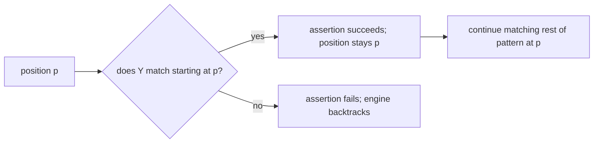

## Introduction

A regex that only says "yes, this matched" is often not enough. When you match a date like `2024-05-09`, you usually want the year, month and day as separate values. When you match a log line, you want the timestamp and the error code. When you reformat a name from `John Smith` to `Smith, John`, you need to move the pieces around.

**Groups** are how a regex hands back pieces. Wrapping part of a pattern in parentheses does two jobs at once: it treats that part as a single unit (so a quantifier or alternation can apply to the whole thing), and it *captures* the text that part matched, so you can read it afterwards.

**Lookaround** solves a different problem. Sometimes you want to match something only if it is followed or preceded by something else — a number only when it comes after a `$`, a filename only when it ends in `.ts` — but you do not want that context to be part of the match. Lookaround assertions check the surroundings and then step back, consuming nothing.

Together these features account for most of the "advanced" regex you will see in real JavaScript code. This lesson teaches them on top of the methods from [[b1-regex-methods]].

## Before you start

- **Pattern building blocks** — classes, quantifiers, anchors and flags. See [[b1-regex-classes-quantifiers]].
- **Regex methods** — `exec`, `matchAll`, `replace` and the match array they produce. See [[b1-regex-methods]].
- **Destructuring and optional chaining** — used to read groups concisely. See [[b1-spread-rest]].

## The intuition

Imagine marking up a printed string with a highlighter as the regex engine reads it. Each pair of capturing parentheses is a numbered highlighter colour: whatever text that part of the pattern consumed gets highlighted in that colour, and at the end you can ask "what was in colour 2?". A **non-capturing group** is a pair of brackets drawn in pencil — it groups things for the engine's benefit but leaves no highlight. A **lookaround** is the engine glancing ahead or behind without moving its reading position: it checks that the next characters say `.ts`, then carries on from where it was, as if it had not looked.

## Capturing groups {#capturing-groups}

Any parenthesised part of a pattern is a **capturing group**. Groups are numbered from 1 by the position of their **opening parenthesis**, reading left to right. In a match array, index 0 is the whole match and index `n` is group `n`.

```javascript title="capturing.js"
const m = /(\d{4})-(\d{2})-(\d{2})/.exec('Due: 2024-05-09.');
console.log(m[0], m[1], m[2], m[3]);
const nested = /((\w+)@(\w+))\.com/.exec('mail ana@site.com');
console.log(nested.slice(1));
```

```output
2024-05-09 2024 05 09
[ 'ana@site', 'ana', 'site' ]
```

In the nested pattern there are three opening parentheses. The outer one comes first, so group 1 is `ana@site`; the two inner ones follow, giving groups 2 and 3. When patterns get complicated, counting opening parentheses from the left is the reliable way to number them.

### When a group is `undefined`

A group that did not take part in the match is `undefined` in the array — not an empty string. This happens with alternation and with optional groups:

```javascript title="undefined-groups.js"
console.log(/(a)|(b)/.exec('b'));
const opt = /(\d+)(?:\.(\d+))?/.exec('42');
console.log(opt[1], opt[2], opt[2] ?? '0');
```

```output
[ 'b', undefined, 'b', index: 0, input: 'b', groups: undefined ]
42 undefined 0
```

In `(a)|(b)`, only the second alternative matched, so group 1 is `undefined`. In the number pattern, the fractional part is optional; for `42` it did not participate, so group 2 is `undefined`. Code such as `opt[2].length` would throw. Always guard optional groups, typically with `??` to provide a default.

### Repeated groups keep only the last iteration

When a quantifier applies to a capturing group, the group is re-captured on each repetition, and only the **last** one survives:

```javascript title="repeated-group.js"
console.log(/(\w)+/.exec('abc')[1]);
console.log(/(\w+)/.exec('abc')[1]);
```

```output
c
abc
```

`(\w)+` matched `a`, then `b`, then `c`, each time overwriting group 1. If you want the whole repeated run, put the quantifier *inside* the group, as in `(\w+)`. If you need every repetition separately, a single regex cannot give you that; use `matchAll` over a simpler pattern instead.

## Named groups {#named-groups}

Numbered groups become hard to read once there are more than two or three, and they break silently when someone adds a new group earlier in the pattern. **Named groups** (ES2018) solve both problems. Write `(?<name>…)` and read the result from `match.groups.name`:

```javascript title="named-groups.js"
const n = /(?<year>\d{4})-(?<month>\d{2})-(?<day>\d{2})/.exec('2024-05-09');
console.log(n.groups, n[1]);
const { year, month } = n.groups;
console.log(year, month);
```

```output
[Object: null prototype] { year: '2024', month: '05', day: '09' } 2024
2024 05
```

Named groups are still numbered too — `n[1]` is the year — so code that uses either style keeps working. The `groups` object has a `null` prototype, which is why Node prints `[Object: null prototype]`; it means a group called `toString` or `constructor` cannot collide with inherited properties. Destructuring the `groups` object is the idiomatic way to pull values out.

Named groups work everywhere groups are exposed: in `matchAll` results, in replacement strings as `$<name>`, and as the last argument to a replacement callback:

```javascript title="named-everywhere.js"
const out = 'w=10 h=20'.replace(/(?<k>\w)=(?<v>\d+)/g, (...args) => {
  const groups = args.at(-1);
  return `${groups.k}:${groups.v * 2}`;
});
console.log(out);
for (const { groups: { k, v } } of 'a=1 b=2'.matchAll(/(?<k>\w)=(?<v>\d)/g)) console.log(k, v);
```

```output
w:20 h:40
a 1
b 2
```

Reading the groups object with `args.at(-1)` avoids counting positional arguments, which change whenever the pattern gains a group.

Each name may appear only once in a pattern in Node 22 and older engines; `/(?<x>a)|(?<x>b)/` is a `SyntaxError` there. ES2025 relaxes this so the same name can be reused in *different alternatives*, which is handy for patterns like "a date in either of two formats". That feature is in Node 23+ and current browsers but was not run here; check your targets before using it.

## Non-capturing groups {#non-capturing-groups}

Sometimes you need parentheses only for grouping. **Non-capturing groups**, written `(?:…)`, group without saving. The commonest reason is to scope alternation, because `|` has the lowest precedence of any regex operator:

```javascript title="non-capturing.js"
console.log(/^cat|dog$/.test('catalog'), /^(?:cat|dog)$/.test('catalog'));
console.log(/^(?:cat|dog)s?$/.test('dogs'));
console.log(/(?:ab)+/.exec('ababab')[0], /(?:ab)+/.exec('ababab').length);
```

```output
true false
true
ababab 1
```

`/^cat|dog$/` does not mean "exactly cat or dog". It means "`^cat`" **or** "`dog$`" — so `catalog` passes because it starts with `cat`. The grouped `^(?:cat|dog)$` applies both anchors to both alternatives. The last line shows a quantifier applied to a two-character unit; the match array has length 1, so no group was saved.

Prefer `(?:…)` whenever you do not need the captured text. It keeps group numbers stable and meaningful, avoids surprises in `split` (where captured separators appear in the output), and does slightly less work.

## Backreferences {#backreferences}

A **backreference** matches *the same text* that an earlier group captured. Write `\1`, `\2`, … for numbered groups or `\k<name>` for named ones.

```javascript title="backreferences.js"
console.log('this is is a test test'.match(/\b(\w+) \1\b/g));
console.log('it is the the end'.replace(/\b(?<w>\w+) \k<w>\b/g, '$<w>'));
console.log(/(['"]).*?\1/.exec(`say "it's fine" now`)[0]);
```

```output
[ 'is is', 'test test' ]
it is the end
"it's fine"
```

The first pattern finds doubled words: group 1 captures a word, and `\1` requires the next word to be the identical text. The second removes the duplicate. The third matches a quoted string that may use either quote character: `(['"])` captures whichever quote opened it, and `\1` requires the *same* quote to close it, so the apostrophe in `it's` does not end the match.

Backreferences are what make JavaScript regexes more powerful than the "regular languages" of theory — and they are one reason the engine must backtrack. Note the difference between `\1` inside a pattern and `$1` in a replacement string: the first matches captured text during matching; the second inserts it afterwards.

## Lookahead and lookbehind {#lookaround}

A **lookaround** is a zero-width assertion: like `^` or `\b`, it tests a condition at the current position and consumes no characters. There are four:

| Syntax | Name | Succeeds when the current position is… |
|---|---|---|
| `X(?=Y)` | Positive lookahead | followed by `Y` |
| `X(?!Y)` | Negative lookahead | not followed by `Y` |
| `(?<=Y)X` | Positive lookbehind | preceded by `Y` |
| `(?<!Y)X` | Negative lookbehind | not preceded by `Y` |

```javascript title="lookaround.js"
console.log('price: $42, qty 7'.match(/(?<=\$)\d+/)[0]);
console.log('price: $42, qty 7'.match(/(?<!\$)\b\d+/)[0]);
console.log('file.js file.ts file.json'.match(/\w+(?=\.ts\b)/g));
console.log('file.js file.ts file.json'.match(/\bfile\.(?!js\b)\w+/g));
const m = /js(?=!)/.exec('js!');
console.log(m[0], m[0].length);
```

```output
42
7
[ 'file' ]
[ 'file.ts', 'file.json' ]
js 2
```

Walk through each:

- `(?<=\$)\d+` matches digits only when a `$` stands just before them. The `$` is checked but not included, so the result is `42`, not `$42`.
- `(?<!\$)\b\d+` matches a number not preceded by `$`, which skips `42` and finds `7`. The `\b` stops it from matching the `2` inside `42`.
- `\w+(?=\.ts\b)` matches a name followed by `.ts`; the extension is not part of the match.
- `\bfile\.(?!js\b)\w+` matches any `file.` extension except exactly `js` — the `\b` inside the lookahead keeps `json` from being excluded.
- The last line confirms the zero width: `js(?=!)` matches two characters, not three.

Lookbehind arrived in ES2018. It has been in Chrome and Node since 2018 but only reached Safari in version 16.4 (March 2023), so code that must run on older iPhones should avoid it or be transpiled. JavaScript's lookbehind accepts any pattern, including variable-length ones like `(?<=\$\s*)`, which several other regex dialects do not allow.

### Lookaround for positions: thousands separators

Because lookarounds match positions, they can find the *places* to insert text:

```javascript title="thousands.js"
console.log(String(1234567).replace(/\B(?=(\d{3})+(?!\d))/g, ','));
```

```output
1,234,567
```

Read it as: "a position that is not a word boundary (so not at the start), followed by one or more groups of exactly three digits, followed by something that is not a digit (the end)". Those positions are before `234` and before `567`, and `replace` inserts a comma at each. In real code, `(1234567).toLocaleString('en-US')` or `Intl.NumberFormat` is the better tool, but the pattern is a classic illustration of lookahead.

### Lookaround for multiple conditions

Several lookaheads at the same position act as an AND of independent conditions, each scanning ahead from the start without moving it:

```javascript title="password-rules.js"
const strong = /^(?=.*[a-z])(?=.*[A-Z])(?=.*\d).{8,}$/;
console.log(['abcdefgh', 'abcDefg1', 'Abc1'].map((p) => strong.test(p)));
```

```output
[ false, true, false ]
```

Each `(?=.*X)` checks "somewhere ahead there is an X", then returns to the start, so the final `.{8,}$` still sees the whole string. It works, but for user-facing validation separate checks are usually better: they can tell the user *which* rule failed.



## How it works internally

When the engine enters a capturing group, it records the start position; when it leaves, it records the end. These pairs live in an internal capture array that is reset if the engine backtracks out of the group, which is why a group in a failed alternative ends up `undefined`. When the match succeeds, `exec` builds the result array from those pairs, adds `index` and `input`, and, if the pattern has named groups, a null-prototype `groups` object mapping names to the same strings. With the `d` flag, it also copies the raw pairs into `indices`, including `indices.groups`:

```javascript title="indices.js"
const m = /(?<key>\w+)=(?<val>\w+)/d.exec('  mode=dark');
console.log(m.indices[0], m.indices.groups);
```

```output
[ 2, 11 ] [Object: null prototype] { key: [ 2, 6 ], val: [ 7, 11 ] }
```

A lookaround runs a sub-match at the current position and then *discards the position change*, keeping only success or failure (and, for positive lookarounds, any groups captured inside them). Lookbehind in JavaScript is implemented by matching the inner pattern backwards from the current position, which is how it supports variable length.

Lookarounds are not free. Each one is a separate search, and a lookahead containing `.*` scans to the end of the input at every position the engine tries. Combined with nested quantifiers, lookarounds can contribute to the catastrophic backtracking described in [[b1-regex-basics]]. Anchoring the pattern with `^` so the lookaheads run once, as in the password example, keeps them cheap.

## Worked example: parsing a log line

Server logs look like `[2024-05-09 14:03:22] WARN (db) Slow query 812ms`. We want a structured object, tolerant of a missing component, and a summary of warnings.

```javascript title="parse-log.js"
const LINE = /^\[(?<date>\d{4}-\d{2}-\d{2}) (?<time>[\d:]{8})\] (?<level>[A-Z]+)(?: \((?<component>\w+)\))? (?<message>.*)$/;

function parseLine(line) {
  const m = LINE.exec(line);
  if (!m) return null;
  const { date, time, level, component = 'app', message } = m.groups;
  const ms = message.match(/(?<=\s)\d+(?=ms\b)/)?.[0];
  return { date, time, level, component, message, ms: ms ? Number(ms) : null };
}

console.log(parseLine('[2024-05-09 14:03:22] WARN (db) Slow query 812ms'));
console.log(parseLine('[2024-05-09 14:03:25] INFO Server started'));
console.log(parseLine('garbage'));
```

```output
{
  date: '2024-05-09',
  time: '14:03:22',
  level: 'WARN',
  component: 'db',
  message: 'Slow query 812ms',
  ms: 812
}
{
  date: '2024-05-09',
  time: '14:03:25',
  level: 'INFO',
  component: 'app',
  message: 'Server started',
  ms: null
}
null
```

Step by step: the whole pattern is anchored, so a line that does not fit the format returns `null` instead of a partial match. Named groups make the destructuring self-documenting. The component part `(?: \((?<component>\w+)\))?` is a non-capturing group made optional with `?`; inside it, `\(` and `\)` match literal parentheses while `(?<component>…)` captures. When the component is absent, `m.groups.component` is `undefined`, and the destructuring default `= 'app'` handles it — destructuring defaults apply exactly when the value is `undefined`. Finally, the duration is pulled out with a lookbehind and lookahead so that the match is only the number, not the surrounding space or the `ms` suffix.

## In real systems

**Routing.** Path patterns like `/users/:id/posts/:postId` are compiled into regexes with named or numbered groups, and the captured values become route parameters. The browser `URLPattern` API exposes the same idea with named groups.

**Reformatting.** Editors' find-and-replace (VS Code supports `$1` and named groups), codemods, and migration scripts move captured pieces around: `replace(/(\w+)\.then\(/, ...)`.

**Validation with context.** Lookahead and lookbehind express rules like "a number not inside a currency amount" or "a word not followed by a colon" that would otherwise need extra code.

**Syntax highlighting and linting** rely on `d`-flag indices and group positions to know where to draw colours or underline errors.

## Trade-offs and alternatives

Groups are cheap and make extraction concise, but long patterns full of groups become unreadable. Named groups help; so does building a pattern from smaller named pieces with `new RegExp(...)` and keeping each piece commented. When a pattern needs more than five or six groups, or optional parts nested inside optional parts, a small hand-written parser or splitting the work into two simpler regexes is often clearer and easier to test.

Lookarounds express "in this context" concisely, but they can often be replaced by capturing the context and ignoring it (`/\$(\d+)/` and reading group 1 instead of `(?<=\$)\d+`). That alternative works in every engine and is easier for colleagues to read; reach for lookaround when you need the *match itself* to exclude the context, as in `replace` or `split`, or when you are matching positions.

## Common mistakes

> [!MISTAKE] Off-by-one on the match array
> `m[0]` is the whole match; `m[1]` is the first group. Code that reads `m[0]` expecting the first group gets the entire match instead.

**Not guarding optional groups.** An unmatched group is `undefined`, so `m[2].trim()` throws. Use `?.`, `??` or destructuring defaults.

**Forgetting that `|` binds loosely.** `/^a|b$/` is `^a` or `b$`. Wrap alternatives in `(?:…)`.

**Expecting a repeated group to capture every repetition.** `(\d)+` keeps only the last digit. Put the quantifier inside the group or use `matchAll`.

**Over-nesting numbered groups.** Adding a group early in a long pattern renumbers every later one and silently breaks `$3` in a replacement elsewhere. Use named groups and `(?:…)`.

**Assuming lookbehind is everywhere.** Safari before 16.4 throws a `SyntaxError` on any pattern containing `(?<=` or `(?<!` — and because a literal is parsed with the script, the whole file fails to load, not just the one function.

## Interview perspective

> [!INTERVIEW] What interviewers listen for
> "Groups are numbered by their opening parenthesis; `[0]` is the whole match. Groups that don't participate are `undefined`. I use named groups for anything non-trivial and `(?:…)` when I only need grouping. Lookarounds are zero-width: they assert context without consuming it, which is why `(?<=\$)\d+` returns the number without the dollar."

Common questions:

- **Capturing versus non-capturing group?** Both group; only capturing saves text and gets a number.
- **How are nested groups numbered?** By the order of their opening parentheses.
- **What is a backreference?** `\1` or `\k<name>` matches the same text a group already captured, such as a closing quote that matches the opening one.
- **Lookahead versus a normal match?** Lookahead checks without consuming, so the next part of the pattern starts at the same position, and the context is excluded from the match.
- **Format a number with thousands separators** — expect the lookahead pattern above, then mention `Intl.NumberFormat` as the production answer.

## Practice

1. Extract `{ user, domain, tld }` from addresses like `ana@example.org` using named groups, returning `null` for invalid input.
2. Write a regex that matches `"double"` or `'single'` quoted strings with the same quote at both ends, and test it on a string containing an apostrophe.
3. Use `replace` with named groups to convert `09/05/2024` (day/month/year) into `2024-05-09`.
4. Match every word that is *not* followed by a colon in `'name: Ana role: admin active'`.
5. Explain why `/(\w+)*$/` is risky on long inputs that do not match, and rewrite it.

## Quick revision {#quick-revision}

- `( … )` captures; groups numbered 1, 2, … by opening parenthesis; `m[0]` is the whole match.
- Unmatched groups are `undefined`, not `''`; guard with `?.` / `??` / destructuring defaults.
- A quantified group keeps only its last repetition: `(\w)+` on `abc` → `c`.
- Named groups `(?<name>…)` → `m.groups.name` (null-prototype object), `$<name>` in replacements, last callback argument.
- `(?:…)` groups without capturing; use it to scope `|` and quantifiers.
- Backreferences `\1`, `\k<name>` match the same captured text again.
- Lookarounds are zero-width: `(?=…)`, `(?!…)`, `(?<=…)`, `(?<!…)`. Lookbehind is ES2018; Safari 16.4+.
- `d` flag adds `indices` and `indices.groups` with `[start, end]` pairs.
- Duplicate group names in different alternatives are ES2025 (Node 23+), an error in older engines.

```quiz
Q: What is `m[2]` after `const m = /((a)b)c/.exec('abc')`?
- [ ] `'ab'`
- [x] `'a'`
- [ ] `'abc'`
- [ ] `undefined`
> Groups are numbered by their opening parenthesis from the left. The outer `((a)b)` opens first, so group 1 is `ab`; the inner `(a)` opens second, so group 2 is `a`. `m[0]` is the whole match, `abc`.

Q: What does `'$100 and 200'.match(/(?<=\$)\d+/)[0]` return?
- [ ] `'$100'`
- [x] `'100'`
- [ ] `'200'`
- [ ] `null`
> The lookbehind requires a `$` immediately before the digits but does not consume it, so the match is only `100`. `200` is not preceded by `$`, so it is never matched; and `$100` is wrong because lookbehind text is never part of the match.

Q: Why does `/^cat|dog$/.test('catapult')` return true?
- [ ] Because `|` matches either character set anywhere
- [x] Because alternation has the lowest precedence, so the pattern means `^cat` or `dog$`
- [ ] Because `$` is ignored without the `m` flag
- [ ] Because `test` only checks the first three characters
> `|` splits the whole pattern into two alternatives, so the anchors apply to only one side each. `catapult` starts with `cat`, satisfying the first alternative. Writing `/^(?:cat|dog)$/` applies both anchors to both words.
```

## Key takeaways {#key-takeaways}

- Parentheses both group and capture; groups are numbered by opening parenthesis, and index 0 is always the whole match.
- A group that did not participate is `undefined`, so optional captures need a guard or default.
- Named groups make extraction readable and robust to pattern changes; non-capturing groups keep numbering clean.
- Backreferences let a pattern require the same text twice, such as matching opening and closing quotes.
- Lookahead and lookbehind assert context without consuming it, so the context is checked but excluded from the match.
- When a pattern needs many groups or nested optional parts, split it up or write a parser instead.
