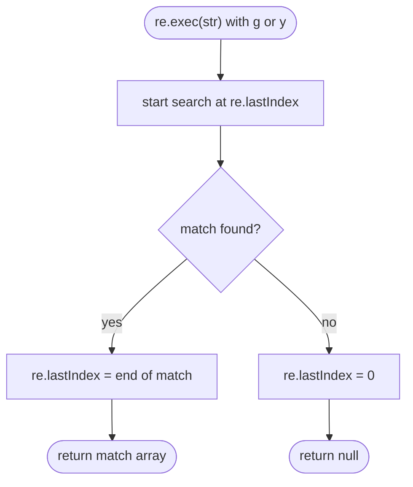

## Introduction

Writing a pattern is only half the job. You then have to *ask a question* with it: does this string match at all? Where is the first match, and what did each group capture? What are all the matches? What does the string look like with every match replaced?

JavaScript answers these questions with eight methods spread across two objects. Two live on `RegExp.prototype` — `test` and `exec` — and six live on `String.prototype` — `match`, `matchAll`, `replace`, `replaceAll`, `split` and `search`. They overlap, their return values differ in subtle ways, and several of them behave differently depending on whether the regex has the `g` flag. The design grew over twenty years rather than being planned at once, and that history is why there is a method that returns groups for the first match but not for later ones.

This lesson goes through each method with real output, then explains the one mechanism that ties them together and causes most of their bugs: the `lastIndex` cursor on a global regex. By the end you should be able to pick the right method without thinking and recognise a `lastIndex` bug from its symptoms.

## Before you start

- **Creating regexes and flags** — literals, the constructor, and what `g`, `y`, `i` and `m` do. See [[b1-regex-basics]] and [[b1-regex-classes-quantifiers]].
- **Iterators and spread** — `matchAll` returns an iterator, which you consume with `for...of` or `[...iter]`. See [[b1-iterators]] and [[b1-spread-rest]].
- **String methods without regex** — `includes`, `indexOf`, `replace` with a string. See [[b1-string-methods]] and [[b1-string-replace]].

Capture groups appear in many examples here. You only need to know that parentheses in a pattern save the text they matched, numbered from 1; [[b1-regex-groups]] covers them in depth.

## The intuition

Sort the methods by the question they answer:

| Question | Method | Returns |
|---|---|---|
| Does it match anywhere? | `re.test(str)` | `true` / `false` |
| Where is the first match, and what did the groups capture? | `re.exec(str)` or `str.match(re)` without `g` | A match array, or `null` |
| What are all the matched strings? | `str.match(re)` with `g` | Array of strings, or `null` |
| What are all the matches, with groups and positions? | `str.matchAll(re)` (requires `g`) | Iterator of match arrays |
| At what index is the first match? | `str.search(re)` | Index, or `-1` |
| What is the string with matches replaced? | `str.replace(re, x)` / `str.replaceAll(re, x)` | New string |
| What are the pieces between matches? | `str.split(re)` | Array of strings |

A useful mental model: `test` is a yes/no question; `exec` and `matchAll` hand you **details**; `match` with `g` hands you a **list of strings**; `replace` **paints over** matches; and a global regex is a **cursor** that moves each time you use it with `test` or `exec`.

## `test`: yes or no

`re.test(str)` returns `true` if the pattern matches anywhere in the string. It is the right choice for validation and branching, where you do not need the matched text.

```javascript title="test.js"
const re = /(\d+)-(\d+)/;
console.log(re.test('call 555-1234'), re.test('no digits'));
```

```output
true false
```

Remember that `test` answers "is there a match *somewhere*?". For validation you almost always want "does the *whole* string match?", which means anchoring the pattern with `^…$`, as explained in [[b1-regex-basics]].

## `exec`: the full match record

`re.exec(str)` returns `null` when there is no match. When there is one, it returns a **match array** — a real array with extra properties attached.

```javascript title="exec.js"
const re = /(\d+)-(\d+)/;
const m = re.exec('call 555-1234 now');
console.log(m);
console.log(m[0], m[1], m[2], m.index, m.length);
console.log(re.exec('nothing here'));
```

```output
[
  '555-1234',
  '555',
  '1234',
  index: 5,
  input: 'call 555-1234 now',
  groups: undefined
]
555-1234 555 1234 5 3
null
```

The elements are: `m[0]`, the whole matched text; then one element per capturing group in order, `m[1]` and `m[2]`. The array's `length` is the number of groups plus one. The extra properties are `index`, the position where the match starts in the input; `input`, the original string; and `groups`, an object of named groups (or `undefined` when the pattern has none). With the `d` flag there is also an `indices` property holding `[start, end]` pairs.

Two habits follow. First, always check for `null` before indexing — `re.exec(str)[1]` throws a `TypeError` when nothing matches; write `re.exec(str)?.[1]` or test the result first. Second, remember the off-by-one: **`m[0]` is the whole match and `m[1]` is the first group**, not the other way round.

## The `lastIndex` cursor

Here is the behaviour that makes the RegExp methods confusing. For a regex **without** `g` or `y`, `test` and `exec` always search from the start of the string and ignore `lastIndex`. For a regex **with** `g` or `y`, they:

1. Start searching at `re.lastIndex` (initially `0`).
2. On a match, set `re.lastIndex` to the index just past the match.
3. On failure, reset `re.lastIndex` to `0` and return `null` (or `false`).

The specification defines `test` as "run `exec` and check whether the result is not `null`", so `test` moves the cursor exactly like `exec` does. That is the source of a famous bug:

```javascript title="shared-global-regex.js"
const HAS_DIGIT = /\d/g;
function hasDigit(s) { return HAS_DIGIT.test(s); }
console.log(hasDigit('a1'), hasDigit('b2'), hasDigit('c3'), hasDigit('d4'));
const OK = /\d/;
console.log(['a1', 'b2', 'c3', 'd4'].map((s) => OK.test(s)));
```

```output
true false true false
[ true, true, true, true ]
```

Trace it. The first call finds `1` at index 1 and sets `lastIndex` to 2. The second call searches `'b2'` starting at index 2 — past the end — so it fails and resets `lastIndex` to 0. The third call starts fresh and succeeds, and so on. Every string contains a digit, yet the function alternates. Because the cursor lives on a regex object shared between calls, the bug shows up as "validation fails randomly", and it is especially confusing when the inputs differ in length.

The fixes, in order of preference:

- **Drop the `g` flag** when you only need a yes/no answer or the first match. `g` means "find all", which `test` never needs.
- **Create the regex inside the function**, so each call gets a fresh object with `lastIndex` 0.
- **Reset explicitly** with `re.lastIndex = 0` before use, if you must share a global regex.

> [!WARNING] A global regex in a helper
> A `g` or `y` regex stored in a constant and used with `test` or `exec` from several places is a cursor that every caller moves. The second call starts where the first stopped and appears to fail at random.

### Looping with `exec`

The cursor is not only a trap; it is how `exec` was designed to iterate over all matches before `matchAll` existed:

```javascript title="exec-loop.js"
const log = '2024-05-09 ERROR db\n2024-05-09 INFO ok\n2024-05-10 ERROR cache';
const re = /^(\S+) ERROR (\w+)$/gm;
let m;
while ((m = re.exec(log)) !== null) {
  console.log(m.index, m[1], m[2], 'next search at', re.lastIndex);
}
```

```output
0 2024-05-09 db next search at 19
39 2024-05-10 cache next search at 61
```

Each call continues from where the previous match ended, and the loop stops when `exec` returns `null` (which also resets `lastIndex` to 0, ready for reuse). This pattern still appears widely in older code, but it has a nasty edge case. If the pattern can match the **empty string**, a zero-length match leaves `lastIndex` where it was, and the loop never advances:

```javascript title="empty-match.js"
const re = /\d*/g;
let m, steps = 0;
while ((m = re.exec('a1')) !== null && steps < 5) {
  console.log(JSON.stringify(m[0]), m.index, re.lastIndex);
  steps++;
}
```

```output
"" 0 0
"" 0 0
"" 0 0
"" 0 0
"" 0 0
```

Without the `steps` guard this is an infinite loop. A hand-written loop must detect empty matches and increment `lastIndex` itself. `matchAll` does this for you, which is the main reason to prefer it.

## `match`: two methods in one

`str.match(re)` behaves completely differently depending on the `g` flag:

```javascript title="match.js"
const s = 'a12 b34 c5';
console.log(s.match(/(\d)(\d)?/));
console.log(s.match(/(\d)(\d)?/g));
console.log(s.match(/z/g), s.match(/z/));
```

```output
[ '12', '1', '2', index: 1, input: 'a12 b34 c5', groups: undefined ]
[ '12', '34', '5' ]
null null
```

**Without `g`**, `match` is the same as `re.exec(str)`: the first match with its groups and properties. **With `g`**, it returns a plain array of every matched string — and the capture groups are thrown away. There is no way to get groups for all matches from `match`. Note also that when nothing matches, `match` returns `null`, not an empty array, so `s.match(re).length` throws on a non-matching string; write `(s.match(re) ?? []).length`.

With `g`, `match` resets `lastIndex` to 0 before it starts and leaves it at 0 afterwards, so it does not suffer from the shared-cursor bug the way `test` and `exec` do.

## `matchAll`: every match, with details

`str.matchAll(re)` (ES2020) returns an **iterator** that yields one full match array — groups, `index`, `input` — for every match. It is the modern answer to "give me all the matches with their groups".

```javascript title="matchall.js"
const s = 'a12 b34 c5';
for (const m of s.matchAll(/([a-z])(\d+)/g)) {
  console.log(m[0], m[1], m[2], m.index);
}
try { s.matchAll(/\d/); } catch (e) { console.log(e.name + ': ' + e.message); }
```

```output
a12 a 12 0
b34 b 34 4
c5 c 5 8
TypeError: String.prototype.matchAll called with a non-global RegExp argument
```

`matchAll` requires the `g` flag and throws a `TypeError` without it. That rule exists because a non-global regex would match at the same place forever; making it an error stops the mistake early.

Internally, `matchAll` **copies** the regex (including its current `lastIndex`) and iterates the copy, so the original regex's `lastIndex` is not changed and a shared constant is safe to pass. It also handles empty matches correctly by stepping forward one position after a zero-length match. Because it returns an iterator, matches are produced lazily: if you `break` after the first three, the rest of the string is never searched. Use `[...str.matchAll(re)]` or `Array.from(str.matchAll(re), fn)` when you need an array.

## `replace` and `replaceAll`

`str.replace(pattern, replacement)` returns a new string; strings are immutable, so the original is unchanged. With a **string** pattern, or a regex **without** `g`, only the first occurrence is replaced. With a regex **with** `g`, every occurrence is.

`replaceAll` (ES2021) replaces every occurrence. With a string pattern it does exactly what its name says. With a regex it insists on `g` and throws without it — the same safety rule as `matchAll`.

```javascript title="replace.js"
const s = 'cat bat cat';
console.log(s.replace('cat', 'dog'));
console.log(s.replace(/cat/g, 'dog'));
console.log(s.replaceAll('cat', 'dog'));
try { s.replaceAll(/cat/, 'dog'); } catch (e) { console.log(e.name + ': ' + e.message); }
console.log('a.b.c'.replace('.', '-'), 'a.b.c'.replaceAll('.', '-'));
```

```output
dog bat cat
dog bat dog
dog bat dog
TypeError: String.prototype.replaceAll called with a non-global RegExp argument
a-b.c a-b-c
```

The last line is a reminder that a *string* pattern is matched literally: `'.'` means a dot, not "any character". For literal replacement of every occurrence, `replaceAll` with a string needs no regex and no escaping at all.

### Replacement patterns

When the replacement is a string, certain `$` sequences are substituted:

| Sequence | Inserts |
|---|---|
| `$&` | The whole match |
| `$1`, `$2`, … | The text of capture group 1, 2, … |
| `$<name>` | The text of named group `name` |
| `$` then a backtick | The text before the match |
| `$'` | The text after the match |
| `$$` | A literal `$` |

```javascript title="replacement-patterns.js"
console.log('John Smith'.replace(/(\w+) (\w+)/, '$2, $1'));
console.log('2024-05-09'.replace(/(?<y>\d+)-(?<m>\d+)-(?<d>\d+)/, '$<d>/$<m>/$<y>'));
console.log('cost 5'.replace(/\d+/, '[$&]'), 'cost 5'.replace(/\d+/, '$$$&'));
```

```output
Smith, John
09/05/2024
cost [5] cost $5
```

The `$$$&` example reads as `$$` (a literal dollar) followed by `$&` (the match). This matters whenever the replacement text comes from data: a user-supplied replacement containing `$&` or `$1` would be interpreted, not inserted literally. If you need to insert arbitrary text, either escape its dollars as `$$` or use a function, as below.

### Replacement functions

When the replacement is a **function**, it is called once per match, and its return value is inserted. Its arguments are the match, then each capture group, then the match offset, then the whole input string (and, if the pattern has named groups, a final `groups` object):

```javascript title="replace-callback.js"
const out = 'width=10 height=25'.replace(/(\w+)=(\d+)/g, (match, key, value, offset, input) => {
  console.log({ match, key, value, offset });
  return `${key}=${Number(value) * 2}`;
});
console.log(out);
const prices = 'Tea $3, Cake $4.50';
console.log(prices.replace(/\$(\d+(?:\.\d+)?)/g, (_, n) => '€' + (n * 0.9).toFixed(2)));
console.log('x'.replace(/x/, () => '$1 stays literal'));
```

```output
{ match: 'width=10', key: 'width', value: '10', offset: 0 }
{ match: 'height=25', key: 'height', value: '25', offset: 9 }
width=20 height=50
Tea €2.70, Cake €4.05
$1 stays literal
```

Callbacks let you compute the replacement — convert units, look a value up in a map, change case, escape HTML. The string a callback returns is inserted **as is**; `$` sequences in it are not interpreted, as the last line shows. That makes a callback the safe way to insert data. The groups are positional arguments, so a pattern with two groups gives the callback `(match, g1, g2, offset, input)`; naming unused leading parameters `_` is a common convention.

## `split` and `search`

`str.split(re)` divides the string at every match of the separator pattern. It always considers all matches, whether or not the regex has `g`.

```javascript title="split-search.js"
console.log('a, b;c  d'.split(/[,;\s]+/));
console.log('1+2-3'.split(/([+-])/));
console.log('a1b2c3'.split(/\d/, 2));
console.log('hello world'.search(/o/), 'hello'.search(/z/));
const g = /o/g; g.lastIndex = 5;
console.log('hello world'.search(g), g.lastIndex);
```

```output
[ 'a', 'b', 'c', 'd' ]
[ '1', '+', '2', '-', '3' ]
[ 'a', 'b' ]
4 -1
4 5
```

A regex separator handles several delimiters and runs of whitespace in one go. If the separator contains **capture groups, the captured text is included** in the result — useful for tokenising an expression while keeping the operators, surprising if you added parentheses only for grouping (use `(?:…)` to avoid it). The optional second argument limits how many pieces are returned.

`str.search(re)` returns the index of the first match, or `-1`. It is `indexOf` for patterns. It ignores the `g` flag and `lastIndex` entirely, and it restores `lastIndex` afterwards — the last line shows `lastIndex` is still 5.

## How it works internally

The string methods do not contain matching logic. `str.match(x)` checks whether `x` has a `Symbol.match` method; RegExp objects do, so the call is forwarded to `RegExp.prototype[Symbol.match]`, which in turn calls `exec`. `replace`, `replaceAll`, `matchAll`, `split` and `search` forward to `Symbol.replace`, `Symbol.matchAll`, `Symbol.split` and `Symbol.search` in the same way. Everything ultimately funnels through `exec`, which is why the `lastIndex` rules are the same everywhere.

If the argument is not a regex, the methods differ. `replace`, `replaceAll` and `split` treat a string argument as **literal text**. `match`, `matchAll` and `search` instead **convert it into a regex** with `new RegExp(x)`, so special characters suddenly matter:

```javascript title="string-argument.js"
console.log('x.y.z'.match('.')[0], 'x.y.z'.includes('.'));
console.log(String.prototype.match.call(2024, /\d{2}/g));
```

```output
x true
[ '20', '24' ]
```

`'x.y.z'.match('.')` returned `x`, because `'.'` became the pattern "any character". The second line shows that string methods convert their receiver to a string first (the specification's `ToString`), so they work on numbers when called through `call` — and that `null` or `undefined` receivers throw.



## Worked example: parsing query-like text

A log contains entries like `user=alice action=login ms=120`. We want a function that returns an object of the fields, a count of slow requests across many lines, and a redacted copy with user names masked.

```javascript title="parse-fields.js"
const FIELD = /(\w+)=(\S+)/g;

function parseFields(line) {
  const out = {};
  for (const [, key, value] of line.matchAll(FIELD)) out[key] = value;
  return out;
}

const lines = [
  'user=alice action=login ms=120',
  'user=bob action=search ms=950',
  'user=carol action=logout ms=40',
];

console.log(parseFields(lines[0]));
const slow = lines.filter((l) => Number(parseFields(l).ms) > 500);
console.log('slow:', slow.length);
const redacted = lines.map((l) => l.replace(/user=(\w)\w*/, (_, first) => `user=${first}***`));
console.log(redacted);
console.log(/action=login\b/.test(lines[0]), lines[1].search(/ms=/));
```

```output
{ user: 'alice', action: 'login', ms: '120' }
slow: 1
[
  'user=a*** action=login ms=120',
  'user=b*** action=search ms=950',
  'user=c*** action=logout ms=40'
]
true 23
```

Each method is doing the job it is best at. `matchAll` with destructuring (`[, key, value]` skips index 0, the whole match) collects every field with its groups. `FIELD` is a shared global regex, which would be dangerous with `exec` or `test`, but `matchAll` iterates a copy, so calling `parseFields` repeatedly is safe. `replace` with a callback rebuilds each user name; there is no `g` because each line has one user field. `test` answers a yes/no question with a non-global regex, and `search` gives a position.

## In real systems

**Validation** in forms and API handlers uses `test` with an anchored, non-global pattern. Linters such as ESLint's `regexp` plugin flag `test` used with a `g` regex because of the cursor bug.

**Templating and formatting.** Simple template engines replace `{{name}}` placeholders using `replace` with a callback that looks names up in a data object. Syntax highlighters and Markdown renderers use `matchAll` or sticky `exec` loops to walk through text.

**Tokenisers.** A lexer that splits source code into tokens commonly uses a single regex with the `y` flag and an `exec` loop, setting `lastIndex` to the current position so each token must start exactly where the previous one ended.

**Data cleaning.** Scripts normalise whitespace with `replace(/\s+/g, ' ')`, strip non-digits from phone numbers with `replace(/\D/g, '')`, and split CSV-ish data with `split`. (For real CSV with quoted commas, use a CSV parser.)

## Trade-offs and alternatives

| Method | Use when | Avoid when |
|---|---|---|
| `test` | Yes/no with a non-global regex | The regex is global and shared |
| `exec` | First match with groups; sticky tokenisers | Iterating all matches (use `matchAll`) |
| `match` (no `g`) | First match with groups, read from the string side | — |
| `match` (`g`) | List of matched strings only | You need groups or positions |
| `matchAll` | All matches with groups and positions | Old runtimes without ES2020 |
| `replace` / `replaceAll` | Producing a new string | You only need to know whether text exists |
| `split` | Breaking on variable separators | The format has quoting or nesting |
| `search` | Index of first match | You also need the matched text |

When the pattern is literal text, string methods with string arguments (`includes`, `indexOf`, `replaceAll('x', 'y')`) are clearer and avoid escaping.

## Common mistakes

> [!MISTAKE] `test` with a shared global regex
> `const RE = /x/g; items.filter((s) => RE.test(s))` skips matches unpredictably because each call starts at the previous `lastIndex`. Remove the `g`.

**Expecting groups from `match` with `g`.** It returns only whole-match strings. Use `matchAll` for groups across all matches.

**Calling `.length` or indexing on a `null` result.** `match` and `exec` return `null` on no match, not an empty array. Use `?? []` or optional chaining.

**`replace` with a string pattern expecting all occurrences.** `'a-b-c'.replace('-', '+')` gives `'a+b-c'`. Use `replaceAll` or a `g` regex.

**Unintended `$` in replacement strings.** User-provided replacement text containing `$&` or `$1` is interpreted. Use a callback to insert data literally.

**Capturing parentheses in a `split` separator.** The captured text appears in the result array. Use `(?:…)` if you only needed grouping.

**Hand-written `exec` loops with patterns that can match empty strings.** They loop forever. Use `matchAll`.

## Interview perspective

> [!INTERVIEW] Explaining the cursor bug
> "With the `g` or `y` flag, `exec` and `test` read and write `lastIndex`. `test` is literally `exec !== null`, so it moves the cursor too. If a global regex is shared, the second call starts where the first finished and can fail. I'd drop `g` for `test`, or use `matchAll`, which works on a copy and handles empty matches."

Questions to be ready for:

- **Difference between `str.match(re)` with and without `g`?** Without: first match with groups (like `exec`). With: array of all matched strings, no groups.
- **Why does `matchAll` throw without `g`?** A non-global regex always matches at the same place; the error prevents accidental single-match or infinite iteration.
- **What does a replacement callback receive?** Match, each group, offset, input, then the groups object if named groups exist.
- **Which methods treat a string argument as a pattern?** `match`, `matchAll` and `search` convert it to a regex; `replace`, `replaceAll` and `split` treat it literally.
- **Implement `count(str, sub)`** — `str.split(sub).length - 1` or `[...str.matchAll(new RegExp(escape(sub), 'g'))].length`; discuss escaping.

## Practice

1. Write `extractHashtags(text)` that returns every `#tag` (letters, digits, underscores) without the `#`, using `matchAll`.
2. Write `camelToKebab(name)` so that `'backgroundColor'` becomes `'background-color'`, using `replace` with a callback or `$` pattern.
3. Find and fix the bug: `const EMAIL = /@/g; const valid = emails.filter((e) => EMAIL.test(e));`.
4. Write a mini template function: `render('Hi {{name}}, you have {{n}} items', { name: 'Ana', n: 3 })`, leaving unknown placeholders unchanged.
5. Split `'3 + 4*2 - 1'` into numbers and operators, keeping the operators and dropping spaces.

## Quick revision {#quick-revision}

- `re.test(s)` → boolean. `re.exec(s)` → match array or `null`.
- Match array: `[0]` whole match, `[1…]` groups, plus `index`, `input`, `groups` (and `indices` with `d`).
- With `g`/`y`, `test` and `exec` start at `lastIndex` and update it; on failure they reset it to 0. Shared global regex + `test` = alternating results.
- `s.match(re)`: no `g` → like `exec`; `g` → all matched strings, no groups; no match → `null`.
- `s.matchAll(re)`: requires `g`, yields full match arrays, iterates a copy, handles empty matches.
- `replace`: first match unless regex has `g`; `replaceAll` requires `g` with a regex.
- Replacement string tokens: `$&`, `$1`, `$<name>`, `` $` ``, `$'`, `$$`. Callbacks receive `(match, ...groups, offset, input, groups?)` and their return is literal.
- `split(re)` includes captured groups in output; `search(re)` returns an index and ignores `g`/`lastIndex`.
- `match`/`matchAll`/`search` turn a string argument into a regex; `replace`/`replaceAll`/`split` treat it literally.

```quiz
Q: `const re = /a/g;` What does `[re.test('a'), re.test('a')]` evaluate to?
- [ ] `[true, true]`
- [x] `[true, false]`
- [ ] `[false, true]`
- [ ] It throws because `test` cannot be used with `g`
> The first call matches at index 0 and sets `lastIndex` to 1. The second call starts searching at index 1, which is the end of the one-character string, so it fails and resets `lastIndex` to 0. Without the `g` flag both calls would return true.

Q: You need every match of `/(\w+)@(\w+)/g` in a string, including both captured parts. Which call gives you that?
- [ ] `str.match(re)`
- [x] `[...str.matchAll(re)]`
- [ ] `str.search(re)`
- [ ] `re.test(str)`
> `matchAll` yields a full match array (with groups and index) for every match. `match` with a global regex returns only the whole-match strings and discards groups, which is the tempting wrong answer.

Q: What does `'$5'.replace(/\d/, '$$&')` produce?
- [ ] `$$5`
- [x] `$$&`
- [ ] `$5`
- [ ] `$&5`
> In a replacement string `$$` is a literal dollar sign, and the following `&` is then ordinary text, so the digit `5` is replaced by `$&` literally, giving `$$&`. To insert a dollar followed by the match you need `$$$&`.
```

## Key takeaways {#key-takeaways}

- Pick the method by the question: `test` for yes/no, `matchAll` for every match with details, `replace` for transformation, `split` for pieces.
- A match array holds the whole match at index 0, groups after it, and `index`, `input` and `groups` as properties.
- With `g` or `y`, `test` and `exec` are stateful through `lastIndex`; never share such a regex between unrelated calls.
- `match` with `g` drops groups; `matchAll` keeps them, works on a copy of the regex, and is safe with empty matches.
- Replacement strings interpret `$` sequences; replacement callbacks insert their return value literally.
- `match`, `matchAll` and `search` turn a string argument into a pattern, while `replace`, `replaceAll` and `split` match it literally.
