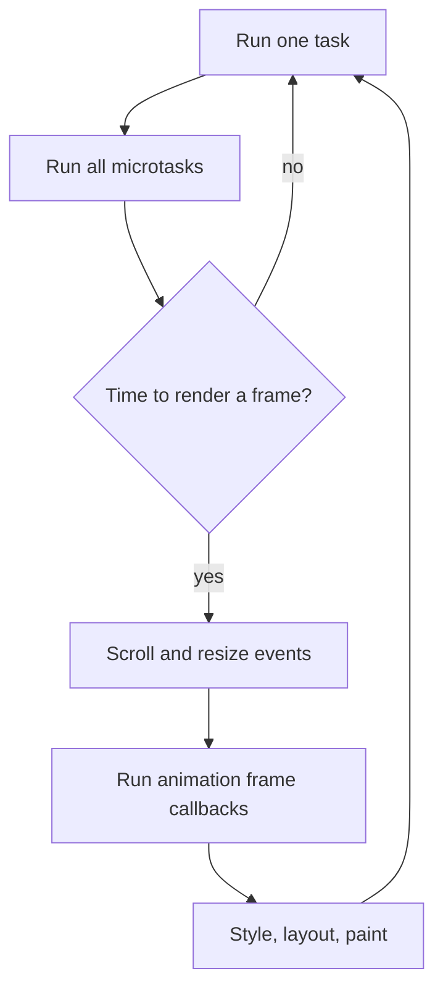

## Introduction

A screen redraws itself at a fixed rate — 60 times a second on many displays, 120 or more on newer phones and laptops. Each redraw is a **frame**. If you want something to move smoothly on a web page, you want to update its position exactly once per frame, right before the browser draws that frame. Update less often and the motion jumps; update more often and the extra work is wasted, because nobody sees the positions between frames.

Timers cannot give you that. `setTimeout(fn, 16)` runs roughly every 16 milliseconds, but nothing lines those runs up with the moments the browser actually paints, so some frames get two updates and some get none. That uneven rhythm is visible as stutter, often called **jank**.

`requestAnimationFrame(callback)` solves it by asking a different question. Instead of "call me in 16 ms", it says "call me when you are about to paint the next frame". The browser runs all such callbacks at one point in its rendering steps, passes each a timestamp for the frame, and then computes styles, layout and paint once, with all the changes included.

This lesson looks at `requestAnimationFrame` (often shortened to **rAF**) from the JavaScript side: what kind of scheduling it is, how it fits into the event loop next to tasks and microtasks, and how to write correct loops with it. The browser's rendering pipeline itself — style, layout, paint and the patterns built on them — is covered in [[b3-raf]] and the lessons it links.

## Before you start

- **The event loop** — tasks, the microtask queue, and the idea that the browser renders between tasks. See [[b1-event-loop]] and [[b1-microtasks]].
- **`setTimeout`** — how timers are queued, and why their delay is only a minimum. See [[b1-settimeout]].
- **Closures and callbacks** — a function passed to another function and called later still sees its surrounding variables. See [[b1-closures]] and [[b1-callback-concept]].

## The intuition

Think of a film crew shooting stop-motion animation. The camera takes a photo at fixed moments. Before each photo, the animator moves the clay figure once. If the animator moved the figure on their own schedule — every few seconds by their watch — some photos would show the figure in the same place twice and some moves would happen between photos and never be captured.

`requestAnimationFrame` is the animator asking the camera operator: "tell me just before you take the next photo." The browser is the camera operator. It knows when it is about to paint, so it calls you then, once. The analogy has one limit: the browser does not wait for you forever. If your callback takes too long, the photo is simply taken late, and the animation drops a frame.

## The API

```javascript
const id = requestAnimationFrame(callback);
cancelAnimationFrame(id);
```

`requestAnimationFrame` registers `callback` to run once, before the next repaint, and returns a non-zero integer id. `cancelAnimationFrame(id)` removes the callback if it has not run yet; called with an id that has already run or been cancelled, it does nothing. Like timers, both are **host functions**: the HTML Standard defines them on `window` in browsers (and also exposes them in dedicated workers, for drawing to an `OffscreenCanvas`). They are not part of ECMAScript, and Node.js does not provide them.

The callback receives one argument: a **timestamp** in milliseconds, a `DOMHighResTimeStamp` measured from the page's time origin — the same clock as `performance.now()`. It marks the start of the current frame's callbacks, so every callback in the same frame receives the same value, even if earlier callbacks took time to run.

The most important fact about the API is that **each request is for one frame only**. To animate continuously, the callback must request the next frame itself:

```javascript title="fade-in.js (browser)"
const box = document.querySelector('.box');
const duration = 500;          // ms
let startTime = null;
let frameId = 0;

function frame(now) {
  if (startTime === null) startTime = now;          // first frame defines t = 0
  const progress = Math.min((now - startTime) / duration, 1);
  box.style.opacity = String(progress);
  if (progress < 1) {
    frameId = requestAnimationFrame(frame);         // ask for the next frame
  }
}

frameId = requestAnimationFrame(frame);

// Somewhere else, for example when the box is removed:
// cancelAnimationFrame(frameId);
```

This example uses the DOM, so it was not run for this lesson. Here is what the browser does with it. The first call queues `frame` for the next frame. Just before painting, the browser calls `frame` with that frame's timestamp; the code records it as the start time, sets the opacity to `0` and requests another frame. On each following frame, `now - startTime` is the real time elapsed since the animation began, so the box reaches full opacity after 500 ms whether the display runs at 60 Hz (about 30 frames) or 120 Hz (about 60 frames). When `progress` reaches `1`, the function stops requesting, and the loop ends by itself.

The loop always stores the newest id in `frameId`. Each frame gets a new id, and only the pending one can be cancelled, so a stop function must use the latest value.

## Where rAF callbacks run in the event loop

The event loop in a browser repeats roughly these steps: run one task (a timer callback, an event handler, a script), then run every pending microtask, then — if it is time for a new frame — **update the rendering**. Updating the rendering is a sequence of steps defined by the HTML Standard; one of them is "run the animation frame callbacks", and it comes after things like dispatching `resize` and `scroll` events and before the browser recalculates styles, does layout and paints.



Several consequences follow from this placement.

**rAF callbacks are neither tasks nor microtasks.** They form their own list, run as a batch during the rendering steps. A task does not cause them to run; a frame does. If the browser decides not to render — because nothing on the page could have changed, or the tab is hidden — the callbacks wait.

**Microtasks run after each callback.** Each rAF callback is invoked like any other callback, and when it returns with an empty stack, the microtask queue is drained before the next rAF callback starts. A promise resolved inside one callback therefore settles before the next callback in the same frame.

**Callbacks requested during a frame run in the next frame.** Before running the list, the browser takes a snapshot of the callbacks currently registered. A callback that calls `requestAnimationFrame` adds to a fresh list for the following frame. That is why the recursive loop above runs once per frame instead of spinning forever inside one frame.

**Callbacks requested from the same frame run in request order** and all see the same timestamp.

**The rate follows the display.** On a 60 Hz screen the browser renders about every 16.7 ms; on a 120 Hz screen, about every 8.3 ms. rAF callbacks run at that rate, which is why animation code must use the timestamp instead of assuming a fixed step.

**Hidden pages get no frames.** Browsers stop running rAF callbacks in background tabs and typically in hidden iframes, because nothing is being painted. A loop simply pauses and resumes when the page is visible again. Timers, in contrast, keep running at a throttled rate.

### A model of the callback list

You cannot run the browser algorithm in Node.js, but you can model the parts that matter for ordering. The following is a deliberately small simulation of the HTML Standard's "run the animation frame callbacks" step — not a real browser, but it behaves the same way for the three rules above.

```javascript title="raf-model.js"
// A toy model of the browser's animation-frame callback list.
let pending = new Map();
let nextId = 1;

function requestFrame(cb) {
  const id = nextId++;
  pending.set(id, cb);
  return id;
}
function cancelFrame(id) { pending.delete(id); }

function renderFrame(timestamp) {
  const current = pending;          // snapshot: requests made now go to the next frame
  pending = new Map();
  for (const cb of current.values()) {
    cb(timestamp);
    // a real browser performs a microtask checkpoint here, after each callback
  }
  console.log(`-- painted frame at ${timestamp} ms`);
}

let count = 0;
function loop(ts) {
  count += 1;
  console.log(`loop run ${count} at ${ts}`);
  if (count < 3) requestFrame(loop);
}

requestFrame(loop);
requestFrame((ts) => console.log(`one-off callback at ${ts}`));
const doomed = requestFrame(() => console.log('never printed'));
cancelFrame(doomed);

renderFrame(16.7);
renderFrame(33.3);
renderFrame(50);
```

```output
loop run 1 at 16.7
one-off callback at 16.7
-- painted frame at 16.7 ms
loop run 2 at 33.3
-- painted frame at 33.3 ms
loop run 3 at 50
-- painted frame at 50 ms
```

In the first frame both callbacks run in request order with the same timestamp, and the cancelled one never runs. `loop` requests itself while the first frame is running, but because the list was snapshotted, that request lands in the second frame, so the loop runs exactly once per frame.

## Frame-rate independent motion

Because frames arrive at different rates on different devices, and sometimes late when the main thread is busy, animation must be driven by **elapsed time**, not by frame count. Moving a sprite "3 pixels per frame" makes it twice as fast on a 120 Hz screen and slow on a struggling laptop. Moving it "180 pixels per second" multiplied by the time since the last frame gives the same speed everywhere.

The step function is plain JavaScript, so it can be tested without a browser by feeding it the timestamps two different displays would produce:

```javascript title="motion.js"
const SPEED = 180;            // pixels per second
const MAX_STEP = 100;         // ms; ignore longer gaps (see below)

function makeMover() {
  let x = 0;
  let last = null;
  return function step(now) {
    if (last !== null) {
      const dt = Math.min(now - last, MAX_STEP);
      x += SPEED * (dt / 1000);
    }
    last = now;
    return x;
  };
}

function simulate(fps, seconds) {
  const step = makeMover();
  const frameMs = 1000 / fps;
  let x = 0;
  for (let i = 0; i <= fps * seconds; i++) x = step(i * frameMs);
  return x.toFixed(1);
}

console.log(`60 Hz after 1 s:  x = ${simulate(60, 1)}`);
console.log(`120 Hz after 1 s: x = ${simulate(120, 1)}`);
```

```output
60 Hz after 1 s:  x = 180.0
120 Hz after 1 s: x = 180.0
```

After one second the sprite has moved 180 pixels on both displays, even though the 120 Hz run called `step` twice as often. In a browser, `step` would be called from a rAF loop with the callback's timestamp.

`MAX_STEP` handles an important edge case. When a tab is hidden, rAF stops; when the user returns a minute later, the next timestamp is 60,000 ms after the last one. Without a cap, the sprite would jump 10,800 pixels in one frame. Capping the step (or resetting `last` when the page becomes visible) makes the animation resume smoothly instead. Games often go further and advance the simulation in fixed-size steps; see [[b3-raf-game-loop]].

## rAF compared with timers and microtasks

It is easy to blur the three ways of saying "later". They answer different questions:

| | `queueMicrotask` / promise | `setTimeout(fn, 0)` | `requestAnimationFrame(fn)` |
|---|---|---|---|
| Runs | As soon as the current stack empties | In a later task | Before the next paint |
| Before the next paint? | Always | Not guaranteed | Always (that is its purpose) |
| Rate when repeated | No limit; can starve rendering | Clamped (4 ms nested), not aligned to frames | Once per frame, at display rate |
| In hidden tabs | Runs | Throttled | Paused |
| Gets a timestamp | No | No | Yes, the frame time |
| Available in Node.js | Yes | Yes | No |

Two rows deserve explanation.

`setTimeout(fn, 16)` as a fake rAF fails in three ways. It is not aligned with paints, so on a 60 Hz display some frames get two updates and some none. Its delay is a minimum, so it drifts and falls behind (see [[b1-setinterval]]). And it keeps running in hidden tabs, using battery to update a page nobody sees. On a 120 Hz screen it also caps your animation at half the display rate.

Microtasks are the opposite extreme. A chain of microtasks runs before the browser gets any chance to render, so a loop built from promises or `queueMicrotask` freezes the page until it ends ([[b1-microtask-starvation]]). They are for "finish this bit of logic before anything else", not for anything visual.

> [!TIP] Batch visual updates per frame
> Events such as `scroll`, `pointermove` and `resize` can fire many times per frame. Instead of updating the page in each handler, store the latest value and request one frame if none is pending. The page then updates once per frame with the newest data, which is a frame-aligned throttle.

```javascript title="pointer-follow.js (browser)"
let latestX = 0;
let scheduled = false;

window.addEventListener('pointermove', (event) => {
  latestX = event.clientX;
  if (scheduled) return;          // a frame is already coming; it will use latestX
  scheduled = true;
  requestAnimationFrame(() => {
    scheduled = false;
    dot.style.transform = `translateX(${latestX}px)`;
  });
});
```

However many `pointermove` events arrive between two frames, the dot's position is written once, just before the paint. This pattern is not runnable outside a browser and was not run here.

## Using rAF in code that also runs outside the browser

Libraries, server-rendered React code and tests often execute in Node.js, where `requestAnimationFrame` is undefined. Calling it there throws `ReferenceError`. Feature-detect it and fall back to something reasonable:

```javascript title="feature-detect.js"
const raf =
  typeof requestAnimationFrame === 'function'
    ? requestAnimationFrame
    : (cb) => setTimeout(() => cb(performance.now()), 16);   // approximate fallback

if (typeof requestAnimationFrame !== 'function') {
  console.log('no requestAnimationFrame in this host; using a timer fallback');
}

raf((ts) => console.log(`callback received a timestamp: ${typeof ts}`));
```

```output
no requestAnimationFrame in this host; using a timer fallback
callback received a timestamp: number
```

`typeof` is safe on an undeclared name, so the check itself never throws. The fallback is only an approximation — it has none of the paint alignment — which is acceptable when there is no screen anyway. In tests, fake-timer libraries such as the ones built into Vitest and Jest can replace `requestAnimationFrame` so tests can advance frames without waiting. In React, code that touches rAF belongs in effects, which do not run during server rendering.

## Worked example: a cancellable progress animation

This puts the pieces together: a function that animates a number from one value to another over a given duration, uses the frame timestamp, can be cancelled, and reports when it finishes. It accepts the scheduling functions as parameters, so the same code runs in a browser with the real rAF and in Node.js with the model from earlier.

```javascript title="animate-value.js"
function animateValue({ from, to, duration, onUpdate, onDone, raf, caf }) {
  let start = null;
  let id = raf(function frame(now) {
    if (start === null) start = now;
    const t = Math.min((now - start) / duration, 1);
    const eased = 1 - (1 - t) ** 3;               // ease-out: fast start, gentle stop
    onUpdate(from + (to - from) * eased);
    if (t < 1) id = raf(frame);
    else onDone?.();
  });
  return () => caf(id);                            // cancels whichever frame is pending
}

// Drive it with a simple model of frames, 100 ms apart, to see the values.
let queue = [];
const raf = (cb) => { queue.push(cb); return queue.length; };
const caf = () => { queue = []; };

animateValue({
  from: 0, to: 100, duration: 400,
  onUpdate: (v) => console.log(v.toFixed(1)),
  onDone: () => console.log('done'),
  raf, caf,
});

for (let ts = 0; queue.length > 0; ts += 100) {
  const callbacks = queue;
  queue = [];
  callbacks.forEach((cb) => cb(ts));
}
```

```output
0.0
57.8
87.5
98.4
100.0
done
```

The first frame sets the start time and outputs `0.0`. The next frames compute `t` as 0.25, 0.5, 0.75 and 1, and the ease-out curve turns those into 57.8, 87.5, 98.4 and 100 — most of the movement happens early, which feels natural for things coming to rest. At `t = 1` the function stops requesting frames and calls `onDone`. The returned canceller calls `caf` with the *current* id, because `id` is reassigned on every frame. In a browser you would call `animateValue({ …, raf: requestAnimationFrame, caf: cancelAnimationFrame })`; that version was not run here.

## In real systems

**Animation libraries** such as GSAP and the motion libraries used with React drive their tweens from a single shared rAF loop, so a hundred animations cost one callback per frame instead of a hundred timers.

**Canvas and WebGL rendering** — charts, maps, games — redraw in a rAF loop, often only when something has changed, to save power.

**Scroll-linked effects** read `scrollY` once per frame in a rAF callback rather than doing work in every `scroll` event ([[b3-raf-scroll-sync]]).

**Measuring after a change.** Code sometimes needs to wait until the browser has applied a style before starting a CSS transition. A common technique is to request a frame inside a frame ("double rAF") so the second callback runs after the first frame has painted; see [[b3-raf-double-buffer]].

**React and frameworks** use rAF-like scheduling internally to batch visual work, and `useLayoutEffect` exists partly so that DOM measurements happen before paint without manual rAF calls.

## Trade-offs and alternatives

rAF is the right tool for anything that changes what is on screen continuously. It is the wrong tool for work that is not visual: it does not run in hidden tabs, so using it to poll a server or keep a game's network connection alive stops when the user switches tabs. It also does not make heavy work cheaper. Everything in a frame — your callbacks, style, layout and paint — must fit in the **frame budget**, about 16.7 ms at 60 Hz and 8.3 ms at 120 Hz. A 40 ms callback drops two or more frames whatever API scheduled it ([[b3-frame-budget]]). Move heavy computation to a Web Worker and keep rAF callbacks to reading the latest state and writing styles.

For many animations you do not need JavaScript at all. CSS transitions and animations, and the Web Animations API, let the browser run the animation itself, often on the compositor thread, so they stay smooth even when the main thread is busy. Reach for rAF when the motion depends on data, physics or input that CSS cannot express.

## Common mistakes

> [!MISTAKE] Expecting the callback to repeat
> `requestAnimationFrame(update)` calls `update` once. A continuous animation must call `requestAnimationFrame` again inside the callback, and stop by not calling it, or by `cancelAnimationFrame` with the latest id.

**Moving a fixed amount per frame.** Speed then depends on the display's refresh rate and on dropped frames. Multiply by the time elapsed since the last frame.

**Not capping the time step.** After a tab was hidden, the first elapsed time can be minutes. Cap it or reset the last timestamp.

**Cancelling a stale id.** Each frame returns a new id. Storing only the first one means `cancelAnimationFrame` cancels a frame that already ran, and the loop continues.

**Starting a second loop.** Calling a `start()` function twice creates two loops that both update the same element, so the animation runs at double speed. Keep the pending id and do nothing if a loop is already running.

**Reading and writing layout in a mixed order.** Writing a style and then reading `offsetWidth` in the same callback forces the browser to do layout early, possibly many times per frame. Read first, then write; see [[b3-layout-thrashing]].

**Calling it in Node.js or during server rendering.** It does not exist there. Feature-detect, or only call it from code that runs in the browser.

## Interview perspective

> [!INTERVIEW] Why not `setTimeout(fn, 16)`?
> "Timers are not synchronised with the display. A 16 ms timer drifts, can fire twice in one frame or miss a frame, keeps running in hidden tabs, and is wrong on displays that are not 60 Hz. `requestAnimationFrame` runs exactly once per rendered frame, just before style, layout and paint, and gives me the frame's timestamp, so I can compute motion from elapsed time."

Questions to be ready for:

- **Is a rAF callback a macrotask or a microtask?** Neither. It runs in the rendering steps of the event loop, after tasks and their microtasks, before style and layout; microtasks are drained after each rAF callback.
- **What happens if you call `requestAnimationFrame` inside a rAF callback?** The new callback runs in the next frame, not the current one, because the list is snapshotted before callbacks run.
- **Order puzzle:** with `setTimeout(a, 0)`, `requestAnimationFrame(b)` and `Promise.resolve().then(c)` in one script, `c` always runs first. Whether `a` or `b` comes next depends on when the next frame is due, so it is not guaranteed — a good answer says so instead of guessing.
- **How do you make an animation run at the same speed on 60 Hz and 120 Hz screens?** Use the timestamp: compute position from elapsed time.
- **How would you throttle a scroll handler to once per frame?** Store the latest value and schedule one rAF if none is pending.

## Practice

1. **Bouncing ball.** Animate a ball across a `<div>` and back using rAF, at 300 pixels per second regardless of display rate. Add Start and Stop buttons that work no matter how often they are clicked.
2. **Prove the snapshot rule.** In a browser console, request a frame whose callback logs its timestamp and requests another; log both timestamps and check that they differ by about one frame.
3. **Ordering.** In a browser, schedule a timeout, a rAF and a promise from one script, and log their order over ten reloads. Explain why the timeout and the rAF can swap.
4. **Hidden-tab resume.** Add a `visibilitychange` listener to your ball animation so it resets its last timestamp when the page becomes visible, and confirm the ball does not jump.
5. **Server-safe hook.** Write a small `useAnimationFrame(callback)` React hook that starts a loop in an effect, always calls the latest `callback`, and cancels the loop on unmount.

```quiz
Q: A rAF callback calls `requestAnimationFrame(again)`. When does `again` run?
- [ ] Immediately after the current callback, in the same frame
- [x] In the next frame, because the browser snapshots the callback list before running it
- [ ] After about 16 ms, measured by a timer
- [ ] Only after all pending `setTimeout` callbacks have run
> The browser takes the list of registered callbacks before running any of them; new requests go
> into the list for the next frame. That rule is what makes a self-requesting loop run once per
> frame instead of forever. The next frame's time comes from the display, not a 16 ms timer.
```

```quiz
Q: An animation moves an element 4 pixels in every rAF callback. What happens on a 120 Hz display compared with a 60 Hz one?
- [ ] Nothing; rAF always runs at 60 frames per second
- [x] It moves twice as fast, because the callback runs twice as often
- [ ] It moves at half speed, because each frame is shorter
- [ ] The browser rescales the movement automatically
> rAF follows the display's refresh rate, so a fixed per-frame step ties speed to the hardware.
> Using the callback's timestamp to compute elapsed time gives the same speed on every display.
```

```quiz
Q: Which statement about `requestAnimationFrame` callbacks is correct?
- [ ] They are microtasks, so they run before any timer
- [ ] They keep running at full rate in background tabs
- [x] They run during the rendering steps, before style and layout, and pause when the page is hidden
- [ ] They run on a separate thread so they cannot block the page
> rAF callbacks belong to neither queue: the browser runs them as a batch when it updates the
> rendering. They run on the main thread, so a slow callback delays the frame, and browsers stop
> them in hidden tabs because nothing is painted there.
```

## Quick revision {#quick-revision}

- `requestAnimationFrame(cb)` runs `cb` once, before the next repaint; returns an id for `cancelAnimationFrame(id)`.
- Host API from the HTML Standard (window and dedicated workers); not in Node.js — feature-detect with `typeof`.
- The callback gets a `DOMHighResTimeStamp` (same clock as `performance.now()`), identical for all callbacks in one frame.
- Runs in the event loop's rendering steps: after a task and its microtasks, after scroll/resize events, before style, layout and paint. Neither a task nor a microtask.
- Microtasks are drained after each rAF callback. Requests made during a frame run in the next frame.
- Rate equals the display's refresh rate (60, 120 Hz…); paused in hidden tabs and typically hidden iframes.
- Loops must re-request each frame; store the newest id to cancel.
- Compute motion from elapsed time; cap the time step after the tab was hidden.
- `setTimeout(fn, 16)` is not paint-aligned, drifts and runs in hidden tabs. Microtask loops starve rendering.
- Keep callbacks short: everything in a frame must fit in about 16.7 ms (60 Hz) or 8.3 ms (120 Hz).

## Key takeaways {#key-takeaways}

- rAF schedules by frame, not by time: "call me before you paint" rather than "call me in n milliseconds".
- Its callbacks have their own place in the event loop, between microtasks and rendering, and they run at the display's rate.
- Each request is one-shot; a loop re-requests itself, and the snapshot rule makes that run once per frame.
- Use the timestamp to make motion frame-rate independent, and guard against huge gaps after hidden periods.
- Use rAF for visual updates only, keep the work in it small, and feature-detect it in code that can run outside a browser.
