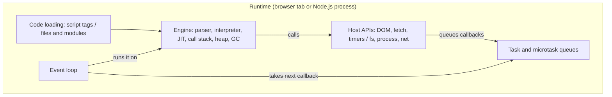

## Introduction

Write `console.log(document.title)` in a file and run it with Node.js, and you get `ReferenceError: document is not defined`. Paste the same line into the browser console and it prints the page title. Write `require('node:fs')` in browser code and it fails; in Node.js it gives you the file system. The language is the same in both places. What differs is the **runtime**.

A **JavaScript runtime** is the complete environment in which JavaScript code executes. It has four parts:

1. An **engine** that parses and executes the JavaScript language — V8, SpiderMonkey or JavaScriptCore.
2. **Host APIs** that let code do useful things outside pure computation: the DOM and `fetch` in a browser, `fs` and `process` in Node.js.
3. An **event loop** that schedules work: it runs your code, waits for timers and I/O, and runs callbacks when they are ready.
4. A **code-loading mechanism**: `<script>` tags in HTML, or files and modules on disk in Node.js.

Chrome, Firefox, Safari, Node.js, Deno, Bun and Cloudflare Workers are all runtimes. Chrome, Node.js, Deno and Cloudflare Workers even share the same engine, V8, yet expose different globals because they wrap it with different host APIs. Your answer to "what can this file do?" therefore depends on the runtime, not only on the language version.

This lesson first builds the general picture, then looks at each piece in its own section: the engine, the browser runtime, the line between Web APIs and the language, and Node.js.

## Before you start

- [[b1-what-is-javascript]] — the idea that JavaScript always runs inside a host.
- [[b1-ecmascript]] — ECMAScript defines the language; host APIs are specified elsewhere.
- No knowledge of the event loop is assumed; this lesson introduces it at a high level and links to [[b1-event-loop]] for the details.

## The intuition

Think of the engine as a **CPU** and the runtime as a **computer built around it**. The same Intel processor can sit inside a laptop running Windows or a server running Linux. The processor executes instructions identically, but what programs can do — open a window, read a disk, talk to a printer — depends on the operating system and hardware around it. A Windows program that calls a Windows-only API fails on Linux even though the CPU is the same.

V8 is the CPU. Chrome and Node.js are two different computers built around it. Code that calls `document.querySelector` assumes the "browser computer"; code that calls `fs.readFile` assumes the "Node.js computer".

The analogy is imperfect in one useful way: unlike two operating systems, browsers and Node.js increasingly share APIs. Node.js 18 added `fetch`, and both provide `URL`, `setTimeout`, `TextEncoder` and `structuredClone`. The overlap is growing, but it is never complete.

## The anatomy of a runtime



Follow one operation through it. Your code calls `setTimeout(callback, 100)`. That function is not part of the engine; it belongs to the host, which starts a timer outside JavaScript. Your code continues and eventually finishes. When 100 ms have passed *and* the JavaScript call stack is empty, the host puts `callback` in a queue, and the event loop hands it to the engine to run.

Two consequences follow immediately. First, the engine runs **one piece of your JavaScript at a time** — the single-threaded model. Second, a timer delay is a *minimum*, not a promise:

```javascript title="busy.js"
console.log('A: before');
setTimeout(() => console.log('C: timer callback'), 100);
const start = Date.now();
while (Date.now() - start < 300) {} // keep the thread busy for 300 ms
console.log('B: after busy loop, elapsed >= 300:', Date.now() - start >= 300);
```

```output
A: before
B: after busy loop, elapsed >= 300: true
C: timer callback
```

The timer expired after 100 ms, but its callback could not run until the busy loop finished and the stack emptied, roughly 300 ms after it was scheduled. Every runtime behaves this way, because the engine has one call stack and the event loop only hands it a new callback when the current one is done. [[b1-run-to-completion]] explains the guarantee and its costs.

### Identifying the runtime you are in

Each runtime has a **global object** that holds its host APIs: `window` in a browser page, `self` in a worker, `global` in Node.js. ES2020 added `globalThis`, which refers to the global object in every runtime. Robust code that must run in several runtimes checks for the APIs it needs rather than assuming:

```javascript title="which-runtime.js"
function describeRuntime() {
  if (typeof window !== 'undefined' && typeof document !== 'undefined') return 'browser page';
  if (typeof WorkerGlobalScope !== 'undefined') return 'web worker';
  if (typeof Deno !== 'undefined') return 'Deno';
  if (typeof Bun !== 'undefined') return 'Bun';
  if (typeof process !== 'undefined' && process.versions?.node) return 'Node.js';
  return 'unknown host';
}
console.log(describeRuntime());
console.log(typeof Map, typeof Promise, typeof JSON.parse); // language: everywhere
console.log(typeof fetch, typeof setTimeout, typeof URL);  // shared host APIs
console.log(typeof document, typeof require);               // host-specific
```

```output
Node.js
function function function
function function function
undefined function
```

That output is from Node.js 22 running a CommonJS file. In a browser tab the first line prints `browser page` and the last line prints `object undefined`. `typeof` is used because it is the one operator that does not throw for an undeclared name; writing `if (document)` in Node.js would throw a `ReferenceError`. Note the order of the checks: Deno and Bun also define a `process` object for Node.js compatibility, so they are tested first.

## JavaScript Engine {#b1-runtime-engine}

A **JavaScript engine** is the program that reads JavaScript source code and executes it. It implements the ECMAScript specification — syntax, types, operators, functions, objects and built-ins such as `Array`, `Map`, `Promise` and `JSON` — and nothing else. The major engines are:

| Engine | Written by | Used in |
|---|---|---|
| V8 | Google | Chrome, Edge, Opera, Node.js, Deno, Cloudflare Workers, Electron |
| SpiderMonkey | Mozilla | Firefox |
| JavaScriptCore (JSC) | Apple | Safari, all iOS browsers, Bun |

The engine's work can be pictured as a compiler plus a virtual machine. It **parses** source text into an abstract syntax tree, reporting a `SyntaxError` before any code runs if the text is invalid. It **compiles** that tree to bytecode and **interprets** the bytecode, which gives a fast start. While the program runs, it watches which functions are called often ("hot") and recompiles them with a **just-in-time (JIT) compiler** into optimised machine code, based on the types it has observed. If an assumption later breaks — a function that always received numbers suddenly receives a string — the engine **deoptimises** back to bytecode. In V8 the tiers are Ignition (interpreter), Sparkplug and Maglev (fast compilers), and TurboFan (optimising compiler); [[b1-parsing-jit]] walks through them.

The engine also owns the program's memory. Each function call pushes a frame on the **call stack** holding its local state; returning pops it. Objects, arrays, closures and strings are allocated on the **heap**, and the **garbage collector** frees heap objects that are no longer reachable from any live reference. [[b1-js-engine]] and [[b1-heap]] cover this in depth.

What the engine does *not* contain is just as defining. It has no `setTimeout`, no `fetch`, no `document`, no `fs`, and not even `console.log` — the language specification defines none of them. The program that embeds the engine (the **embedder**: a browser, Node.js, Deno) adds them by installing objects and functions on the global object. The engine also does not run an event loop by itself; it exposes a **job queue** for promise callbacks and lets the embedder decide when to drain it.

You can see the engine's own built-ins working with no host involvement:

```javascript title="engine-only.js"
function add(a, b) { return a + b; }
for (let i = 0; i < 100_000; i++) add(i, 1); // add becomes "hot" and may be JIT-compiled
console.log(add(2, 3));
console.log(({}).toString());
console.log([3, 1, 2].toSorted());
```

```output
5
[object Object]
[ 1, 2, 3 ]
```

Everything here — functions, the loop, `Object.prototype.toString`, `Array.prototype.toSorted` — is defined by ECMAScript and implemented by the engine. The only host API used is `console.log`, to show the results. Whether `add` was actually JIT-compiled is invisible to the program: optimisation must never change behaviour, only speed.

> [!WARNING] "It's a V8 bug"
> Surprising results such as `0.1 + 0.2 !== 0.3`, `typeof null === 'object'` or `this` being `undefined` in a detached method are specified behaviour that every conforming engine produces. Engine bugs exist but are rare; check the specification or MDN before blaming the engine.

Because engines implement the same specification, code that uses only language features behaves identically in all of them. Engines differ in performance characteristics, memory use, startup time and how quickly they ship new features — which is why, for example, Bun chose JavaScriptCore for its fast startup, and why benchmarks can vary between browsers. Write code against the specification, not against one engine's timing.

## Browser Runtime {#b1-runtime-browser}

The **browser runtime** is the environment a web page's JavaScript runs in: an engine, plus the Web APIs for the document, network, storage and devices, plus the HTML event loop — all sharing a thread with the browser's rendering work. JavaScript was invented for this runtime: to make documents respond to clicks, validate forms and update the page without a full reload.

### What the browser adds

In a page, the global object is `window`. Through it your code reaches the **Document Object Model (DOM)** — the live tree of elements built from the HTML (`document.querySelector`, `element.addEventListener`) — and many other APIs: `fetch` and `WebSocket` for networking, `localStorage` and IndexedDB for storage, `history` and `location` for navigation, `navigator` for device information, `requestAnimationFrame` for animation timing, plus timers, the clipboard, geolocation, media and more. None of these exist in the engine; the browser installs them.

```javascript title="page.js (run in a browser page)"
document.addEventListener('DOMContentLoaded', () => {
  document.body.dataset.ready = 'true';
  console.log('DOM ready:', document.querySelectorAll('p').length, 'paragraphs');
});
console.log(location.origin);
console.log(typeof window.fetch, window === globalThis);
```

On a page served from `https://example.com`, the second and third lines print `https://example.com` and `function true`, and the listener prints the paragraph count once the HTML has been parsed. Run the same file in Node.js and it throws `ReferenceError: document is not defined` on the first line, because none of these globals exist there.

### The main thread is shared with rendering

The most important fact about the browser runtime is that a page's JavaScript runs on the **main thread**, the same thread that computes styles, lays out elements, paints pixels and dispatches user input events. The browser's event loop alternates between running a task (a script, an event handler, a timer callback), draining microtasks (promise callbacks), and — when it is time for a new frame, typically 60 times a second — **rendering** the page.

So while your code runs, the page cannot repaint or respond to clicks. A function that takes 2 seconds freezes the tab for 2 seconds; no error appears, the page simply stops responding. This is why long loops are moved to **Web Workers** — separate threads with their own engine instance and global object (`self`), which can compute but cannot touch the DOM and communicate with the page through `postMessage`. It is also why the browser's event loop includes rendering steps that Node.js's loop does not have. See [[b3-main-thread]] and [[b3-web-workers]].

### Realms, tabs and frames

Each page, iframe and worker gets its own **realm**: its own global object and its own copies of the built-ins. An array created in an iframe has the iframe's `Array.prototype`, so `iframeArray instanceof Array` is `false` in the parent page — which is why `Array.isArray` exists. Modern browsers also isolate sites in separate operating-system processes for security and stability, so a crash or an infinite loop in one tab does not usually take down the others.

`window` is technically a **WindowProxy**: when an iframe navigates to a new page, the inner global object is replaced while references to the proxy remain valid. You rarely need this detail, but it explains why a saved reference to an iframe's `contentWindow` suddenly points at a different document after navigation.

### How code gets in

Browser code arrives through HTML: inline and external `<script>` tags, the `async` and `defer` attributes, and `type="module"`. The choice decides *when* code runs relative to HTML parsing — before the elements below it exist, or after the whole document is built. That is the subject of [[b1-script-loading]].

## Web APIs vs Language {#b1-runtime-web-apis}

**Web APIs** are the interfaces a browser exposes to JavaScript for interacting with the page, network, storage and device: the DOM, `fetch`, `URL`, `localStorage`, `crypto.getRandomValues`, `IntersectionObserver`, `setTimeout` and hundreds more. They are specified by web standards bodies (mostly WHATWG and W3C), not by ECMAScript. **Language features** — `Map`, `Promise`, `Proxy`, classes, destructuring, `async`/`await` — are specified by ECMA-262 and work in any engine new enough to implement them.

The split exists so that each side can evolve independently. TC39 can add `Object.groupBy` without coordinating with browser vendors' DOM teams, and the WHATWG can add a new DOM method without changing the language. It is also what lets the same engine power both a browser and a server.

### Telling them apart

A reliable rule: **if it touches pixels, the network, the clock, storage or the operating system, it is a host API.** Pure computation on values is language.

| API | Kind | Defined in |
|---|---|---|
| `Array.prototype.map`, `Map`, `Promise`, `JSON` | Language | ECMA-262 |
| `Intl.NumberFormat` | Language (internationalisation) | ECMA-402 |
| `document`, `Element`, events | Web API | DOM Standard |
| `fetch`, `Request`, `Response` | Web API | Fetch Standard |
| `setTimeout`, `localStorage`, `window` | Web API | HTML Standard |
| `URL`, `TextEncoder`, `structuredClone` | Web API, also in Node.js | URL, Encoding, HTML Standards |
| `fs`, `process`, `Buffer` | Node.js API | Node.js docs |

`setTimeout` deserves special mention because it feels like part of the language. It is a host function: calling it asks the host to start a timer and, when the timer expires, to queue your callback as a **task**. A `Promise` callback, by contrast, is queued by the engine as a **job** (microtask). This difference in who queues what is exactly why promise callbacks run before timer callbacks; see [[b1-microtasks]] and [[b1-macrotasks]].

### How Web APIs plug into the engine

Web APIs are mostly implemented in C++ (or Rust) inside the browser, then exposed to JavaScript through bindings. Their shapes are written in **Web IDL**, an interface description language that also defines how JavaScript values are converted when they cross the boundary — for example, that passing `'5'` where an `unsigned long` is expected converts it to the number 5. That is why `document.querySelector` looks like an ordinary JavaScript function, yet `typeof document` is `'object'` only where the host has installed it.

### Why the distinction matters in practice

**Diagnosing missing features.** If `Promise` or `Array.prototype.at` is missing, the *engine* is old: that is a language gap, fixed by a polyfill or transpiler. If `fetch` or `IntersectionObserver` is missing, the *host* lacks it: a platform gap, fixed by a platform polyfill or a different API. Confusing the two sends you to the wrong documentation and the wrong fix.

**Writing portable code.** Code that uses only language features plus widely shared Web APIs (`fetch`, `URL`, `TextEncoder`, `AbortController`) runs in browsers, Node.js 18+, Deno, Bun and edge runtimes. The WinterTC group (Ecma TC55) works on a common minimum set of Web APIs for server runtimes for this reason.

**Workers get a subset.** A Web Worker has `fetch`, timers and `IndexedDB` but no `document` or `window`, because it has no page. Checking availability with `typeof` is the safe pattern:

```javascript title="detect.js"
const languageOk = [Map, Promise, Proxy].every((C) => typeof C === 'function');
const hasDom = typeof document !== 'undefined';
console.log({ languageOk, hasDom, hasFetch: typeof fetch === 'function' });
```

```output
{ languageOk: true, hasDom: false, hasFetch: true }
```

Run in Node.js 22: every language constructor exists, `fetch` exists (Node.js has shipped it since version 18), and there is no DOM. In a page all three would be `true`; in a worker, `hasDom` would be `false`.

> [!MISTAKE] Polyfilling the wrong layer
> Adding a `Promise` polyfill will not make `fetch` appear, and a `fetch` polyfill will not help an engine that cannot parse `async` functions. Decide first whether the missing piece belongs to the language or the host.

## Node.js Conceptually {#b1-runtime-nodejs}

**Node.js** is a runtime for running JavaScript outside the browser — on servers, in command-line tools and in build scripts. It embeds the V8 engine and adds three things: **libuv**, a C library that provides an event loop and non-blocking access to files, networks and processes; a set of built-in modules such as `node:fs`, `node:http`, `node:path` and `node:crypto`; and globals such as `process` and `Buffer`. Ryan Dahl released it in 2009 to show that a single-threaded JavaScript program could handle many network connections efficiently if every I/O operation was asynchronous.

### A long-lived process with an event loop

A browser page's JavaScript runs in response to the page loading and to user events. A Node.js program is an operating-system **process** started from a file (`node server.js`). Node.js runs the file from top to bottom, then enters its event loop and keeps running **as long as there is pending work** — an open server socket, a running timer, an unfinished file read. When nothing is pending, the process exits.

```javascript title="node-loop.js"
const { readFile } = require('node:fs/promises');

console.log('1. script starts; pid is a', typeof process.pid);
readFile(__filename, 'utf8').then((text) => {
  console.log('file read finished; mentions readFile:', text.includes('readFile'));
});
setTimeout(() => console.log('timer fired'), 0);
console.log('2. script ends; pending work keeps the process alive');
```

```output
1. script starts; pid is a number
2. script ends; pending work keeps the process alive
file read finished; mentions readFile: true
timer fired
```

Lines 1 and 2 always come first: the whole script runs to completion before any callback. The order of the last two lines depends on timing — whether the file read completes before the loop reaches its timer phase — and can differ between runs or machines. Once both callbacks have run, nothing is pending, so the process exits without any explicit "quit". A server stays alive for the opposite reason: its listening socket is always pending.

### How I/O works

When you call `readFile`, Node.js does not block the JavaScript thread. libuv performs the work: network I/O uses the operating system's non-blocking mechanisms (epoll on Linux, kqueue on macOS, IOCP on Windows), and operations without good non-blocking OS support — file system calls, DNS lookups, some `crypto` functions — run on a small **thread pool** (four threads by default). When the work completes, libuv queues your callback, and the event loop runs it on the JavaScript thread. So Node.js is single-threaded *for your JavaScript*, but not internally.

libuv's loop runs in **phases**: timers (`setTimeout`/`setInterval`), pending callbacks, poll (waiting for and running I/O callbacks), check (`setImmediate`), and close callbacks. Between callbacks, Node.js drains two queues: the `process.nextTick` queue and the promise microtask queue. The ordering between them is a well-known subtlety:

```javascript title="ticks.js"
Promise.resolve().then(() => console.log('promise microtask'));
process.nextTick(() => console.log('nextTick'));
setImmediate(() => console.log('setImmediate'));
console.log('sync');
```

Run as a CommonJS file (`node ticks.js`) this prints `sync`, `nextTick`, `promise microtask`, `setImmediate`. Renamed to `ticks.mjs` and run as an ES module, Node.js 22 prints `sync`, `promise microtask`, `nextTick`, `setImmediate`, because an ES module's body is itself evaluated inside a promise job, so the promise queue is already being drained when the script finishes. The safe takeaway is not to rely on the relative order of `nextTick` and promise callbacks. [[b1-event-loop]] covers the Node.js loop in more depth.

### Globals and modules

Node.js has no `document`, no `window` and no layout or rendering. Its global object is `global` (and `globalThis`). It provides `process` (arguments, environment variables, exit codes), `Buffer` (binary data) and, in CommonJS files, `require`, `module`, `__filename` and `__dirname`.

Code is loaded from files, not `<script>` tags, in two module systems: **CommonJS** (`require`/`module.exports`, the original format) and **ES modules** (`import`/`export`, used for `.mjs` files or when `package.json` has `"type": "module"`). ES modules in Node.js have no `__dirname`; they use `import.meta.url` (and, since Node.js 20.11, `import.meta.dirname`). See [[b1-esm-vs-cjs]].

Modern Node.js also implements many Web APIs — `fetch` (since 18, stable since 21), `URL`, `AbortController`, `TextEncoder`, `structuredClone`, `Blob`, Web Streams — so code that uses only those can run in both browsers and Node.js. That convergence makes server-side rendering and shared libraries easier, but the process model, module loading and missing DOM still make Node.js a different runtime.

> [!WARNING] Runtime mismatches in bundles
> Importing `node:fs` in code that ends up in a browser bundle fails at build time or in the browser; importing a package that touches `window` at load time crashes server-side rendering in Node.js. Keep platform-specific code behind clear boundaries.

### When Node.js fits

Node.js excels at I/O-bound work — APIs, proxies, real-time messaging, build tooling — where most time is spent waiting on networks and disks. It is a poor fit for CPU-heavy work on the main thread, because a long computation blocks every connection; such work goes to `worker_threads` (each with its own V8 isolate and event loop), child processes or other services.

## How the runtimes compare

| | Browser page | Web Worker | Node.js |
|---|---|---|---|
| Global object | `window` | `self` | `global` |
| DOM | Yes | No | No |
| `fetch`, timers, `URL` | Yes | Yes | Yes (`fetch` since 18) |
| File system, processes | No | No | `node:fs`, `process` |
| Event loop | HTML event loop with rendering steps | HTML event loop, no rendering | libuv phases |
| Code loading | `<script>`, modules by URL | `importScripts`, module workers | CommonJS and ES modules from files |
| Security model | Sandboxed, same-origin policy | Sandboxed | Full OS access of the user running it |

Deno and Bun follow the Node.js column broadly, with differences: Deno is secure by default (file and network access need permission flags), and both prefer Web APIs. Edge runtimes such as Cloudflare Workers look like a Web Worker without a file system.

## In real systems

**Full-stack frameworks.** Next.js, Remix and SvelteKit run the same component code in Node.js (or an edge runtime) to render HTML on the server, then in the browser to make it interactive. Bugs appear when code that touches `window` runs during server rendering; frameworks provide hooks such as React's `useEffect`, which only run in the browser.

**Shared libraries.** Libraries published to npm declare where they run through `package.json` fields (`"exports"` conditions such as `"browser"` and `"node"`), so bundlers pick the right build.

**Choosing a runtime for a job.** A CPU-heavy image transformation in the browser goes to a Web Worker; on the server, to `worker_threads` or a separate service. An HTTP API with many concurrent connections is a natural Node.js job; a function that must run close to users with millisecond startup suits an edge runtime.

## Trade-offs and alternatives

Sharing one engine across runtimes gives a consistent language everywhere; the cost is that the APIs around it differ, so "JavaScript code" is never fully portable without care. Using only language features and the shared Web API subset maximises portability at the price of giving up platform power (the DOM, the file system). Bundlers and frameworks hide some differences but add configuration and build complexity.

Within the server space, Node.js offers the largest ecosystem and the most mature tooling; Deno offers built-in TypeScript, a permission model and Web-standard APIs; Bun offers fast startup and an integrated toolkit. All three run most npm packages today, but native add-ons and edge cases still differ.

## Common mistakes

> [!MISTAKE] Assuming globals exist everywhere
> `window`, `document` and `localStorage` exist only in browser pages; `process`, `require` and `__dirname` only in Node.js (and the last two only in CommonJS). Check with `typeof name !== 'undefined'`, or keep runtime-specific code in separate modules.

**Blocking the main thread.** In a browser, a long synchronous loop freezes rendering and input; in Node.js, it stalls every request. Split work into chunks, move it to a worker, or make it asynchronous.

**Thinking `setTimeout(fn, 0)` runs immediately.** It runs after the current code and all pending microtasks finish, and no earlier than the delay.

**Expecting browser APIs to behave identically in Node.js.** Node.js's `fetch` does not use the browser's cookie jar or HTTP cache, and its timers return objects, not numbers.

**Assuming Node.js is fully single-threaded.** Your JavaScript is; libuv's thread pool and the operating system do I/O in parallel.

## Interview perspective

> [!INTERVIEW] Explaining a runtime in one breath
> "A runtime is an engine plus host APIs, an event loop and a code loader. Chrome and Node.js share V8 but differ in everything around it: Chrome adds the DOM and an event loop that also renders; Node.js adds libuv for non-blocking I/O, `fs`, `process` and a phase-based loop."

Questions to prepare:

- **Why does `document is not defined` happen in Node.js?** The DOM is a browser host API; Node.js has no page.
- **Where does `setTimeout` come from?** The host. It starts a timer outside the engine and queues the callback as a task.
- **What happens when Node.js reads a file?** libuv performs it on its thread pool; the callback is queued and run by the event loop on the JavaScript thread.
- **Why do long loops freeze a page?** JavaScript and rendering share the main thread; the loop never yields, so the event loop cannot reach its rendering step.
- **When does a Node.js process exit?** When the event loop has no pending timers, sockets or requests (or `process.exit` is called).
- **What is the difference between an engine and a runtime?** The engine executes the language; the runtime wraps it with APIs, scheduling and loading.

## Practice

1. Run `which-runtime.js` from this lesson in the browser console, in Node.js and, if you can, in a Web Worker. Record the output and explain each difference.
2. Write a module `storage.js` exporting `save(key, value)` that uses `localStorage` in a browser and writes to a JSON file in Node.js. Where should the runtime check live, and why?
3. In a browser, start a 3-second busy loop from a button click and try to select text or click another button during it. Then move the loop into a Web Worker and repeat. Describe what changed and why.
4. Predict the output of `ticks.js` as CommonJS and as an ES module before running it, then explain the difference in your own words.
5. List five APIs you used recently and classify each as language, Web API, Node.js API, or shared Web API.

```quiz
Q: Chrome and Node.js both use V8. Why does `document.querySelector` work in Chrome but throw in Node.js?
- [ ] Node.js ships an older version of V8
- [x] The DOM is a host API that the browser installs; Node.js does not provide it
- [ ] Node.js disables the DOM for security reasons
- [ ] `document` is only available in strict mode
> The engine implements only the ECMAScript language. The browser adds the DOM and other Web APIs around V8; Node.js adds file system and process APIs instead. The V8 version is irrelevant — no version of the engine contains `document`.

Q: A page runs a synchronous loop that takes 2 seconds after a button click. What does the user experience?
- [ ] The loop runs on a background thread, so nothing changes
- [ ] The browser shows a JavaScript error after 1 second
- [x] The page cannot repaint or respond to input until the loop finishes
- [ ] Only animations stop; clicks still work
> Page JavaScript shares the main thread with style, layout, paint and input handling. While the loop runs, the event loop cannot reach its rendering step or dispatch new events, so the page appears frozen. Moving the work to a Web Worker avoids this.

Q: Which statement about Node.js I/O is correct?
- [ ] Node.js runs every callback on a separate thread in parallel
- [x] Your JavaScript runs on one thread, while libuv uses OS facilities and a thread pool for I/O and queues callbacks
- [ ] Node.js blocks the JavaScript thread while reading files
- [ ] Node.js reads files through the browser's Fetch API
> libuv performs I/O outside the JavaScript thread — through non-blocking OS mechanisms for sockets and a small thread pool for file system work — then queues callbacks that the event loop runs one at a time on the single JavaScript thread.

Q: An old browser lacks `IntersectionObserver`. What kind of gap is this?
- [ ] A language gap, fixed by transpiling to an older ECMAScript target
- [x] A platform (Web API) gap, fixed by a Web API polyfill or a fallback
- [ ] An engine bug, fixed by upgrading V8
- [ ] A Node.js gap, fixed by installing the package from npm
> `IntersectionObserver` is a Web API specified by the W3C, not part of ECMAScript. Transpiling rewrites language syntax and cannot add host objects; the fix is a platform polyfill or code that works without the API.
```

## Quick revision {#quick-revision}

- Runtime = engine + host APIs + event loop + code loading.
- Engines: V8 (Chrome, Edge, Node.js, Deno, Workers), SpiderMonkey (Firefox), JavaScriptCore (Safari, Bun).
- The engine parses, interprets bytecode, JIT-compiles hot code, manages the call stack and garbage-collected heap. It has no timers, DOM, `fetch` or `console`.
- Browser runtime: global `window`; DOM, `fetch`, storage, timers; main thread shared with style, layout, paint and input; Web Workers for parallel computation without DOM access.
- Each page, iframe and worker is a separate realm with its own built-ins (`instanceof Array` fails across frames; use `Array.isArray`).
- Web APIs are specified by WHATWG/W3C; language features by ECMA-262. Pixels, network, clock, storage, OS → host API.
- `setTimeout` queues a host task; promise callbacks are engine jobs (microtasks) and run first.
- Node.js: V8 + libuv + built-in modules; global `global`; `process`, `Buffer`, `require` (CommonJS); no DOM.
- libuv: OS non-blocking I/O for sockets, thread pool (4 by default) for files/DNS/crypto; loop phases timers → pending → poll → check → close.
- Node.js exits when no work is pending. `nextTick` vs promise order differs between CommonJS and ES modules — do not rely on it.
- Shared APIs: `fetch` (Node.js 18+), `URL`, `TextEncoder`, `AbortController`, `structuredClone`.

## Key takeaways {#key-takeaways}

- The same language runs everywhere, but what code can do depends on the runtime wrapped around the engine.
- The engine executes ECMAScript and manages memory; every API that touches the world comes from the host.
- In browsers, JavaScript shares the main thread with rendering, so long synchronous work freezes the page.
- Classifying an API as language or host tells you where it is available and whether a fix needs a transpiler, a polyfill or a different API.
- Node.js pairs V8 with libuv to run single-threaded JavaScript over non-blocking I/O, and stays alive only while work is pending.
- Portable code checks for the APIs it needs with `typeof` instead of assuming a particular runtime.
