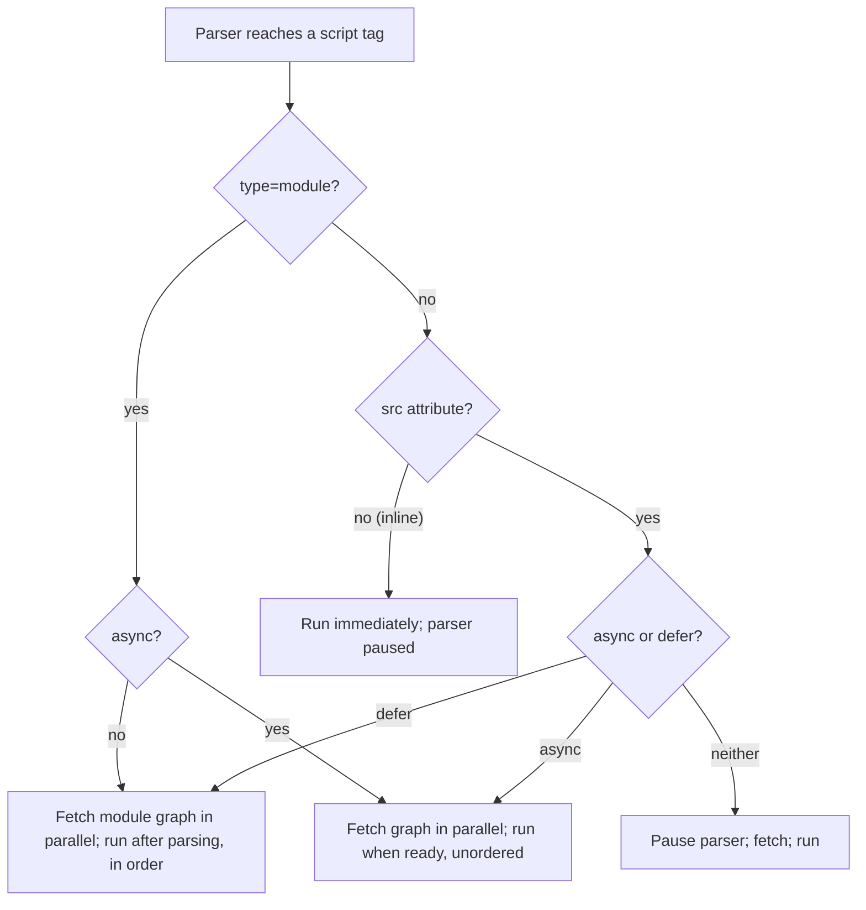

## Introduction

A web page is delivered as HTML. The browser reads that HTML from top to bottom and builds the **DOM** — the tree of elements your JavaScript manipulates. Somewhere in that HTML are `<script>` tags. When the browser's parser reaches one, it has to decide: stop and run this code now, or keep building the page and run it later?

That decision affects two things you care about. **Performance**: if the parser stops to download and run a large script, the user stares at a blank or half-built page. **Correctness**: if a script runs before the elements it needs have been parsed, `document.querySelector('#cart')` returns `null` and the next line throws `TypeError: Cannot read properties of null`.

HTML gives you control through how you write the tag:

- **Inline** code between `<script>` and `</script>`, or an **external** file via `src`.
- The **`async`** attribute: download in parallel, run as soon as downloaded.
- The **`defer`** attribute: download in parallel, run after the whole document is parsed, in order.
- **`type="module"`**: load an ES module, which is deferred by default and can `import` other modules.

This lesson explains what the parser does with each, then teaches each form in its own section. By the end you should be able to look at any page's `<head>` and say exactly when every script will run.

## Before you start

- [[b1-runtime-browser]] — page JavaScript runs on the main thread, shared with parsing and rendering.
- Basic HTML: elements, attributes, `<head>` and `<body>`.
- Helpful but not required: [[b3-dom]] for what the DOM is, and [[b1-modules]] for `import`/`export`.

## The intuition

Picture the HTML parser as a **builder reading blueprints** line by line and assembling the house as it goes. A plain `<script>` tag is a note in the blueprint saying "stop, call this contractor, and do whatever they say before continuing". The builder phones the contractor (downloads the file), waits for them to arrive, lets them work (executes the script), and only then resumes building. The contractor can only work on rooms that already exist; rooms further down the blueprint have not been built.

`defer` is a note saying "book this contractor now, but have them come in once the house is finished, in the order they were booked". `async` says "book this contractor; they'll do their work the moment they arrive, whatever the builder is doing". A module script is like `defer`, with the extra ability to bring its own sub-contractors (imports).

The analogy has a limit: browsers include a **preload scanner** that peeks ahead in the blueprint while the builder is stopped and starts booking later contractors early. So a blocking script stops the *building*, but not necessarily all *downloading*.

## How the parser treats scripts

To understand every variant, you need four facts about the browser's loading process.

**1. Parsing is incremental.** The browser builds the DOM as HTML bytes arrive. Elements above a given point exist; elements below it do not, yet.

**2. A classic script without `async` or `defer` blocks the parser.** The parser stops, the script is fetched (if external), executed, and only then does parsing continue. The historical reason is `document.write`: a script could write new HTML into the stream at the exact point where it sits, so the parser could not safely read ahead and build elements that the script might change.

**3. The document has a readiness state.** `document.readyState` is `'loading'` while the parser runs, `'interactive'` once parsing has finished, and `'complete'` once all subresources (images, stylesheets, async scripts) have loaded. Two events mark the transitions: **`DOMContentLoaded`** fires after parsing finishes *and* deferred scripts have run; **`load`** fires on `window` when everything has finished loading.

**4. Scripts can wait for stylesheets.** A classic script might read computed styles, so a blocking script does not execute until stylesheets that appear before it in the document have loaded. A slow CSS file can therefore delay JavaScript too. See [[b3-render-blocking-css]].



### The cost of blocking, visualised

Consider a `<head>` with one blocking 200 KB script on a slow connection. While it downloads, the parser cannot reach `<body>`, so nothing renders. This is why, for years, the advice was "put scripts at the end of `<body>`": by then the page has been parsed and can be shown. `defer` achieves the same result while letting the download start early from the `<head>`, which is strictly better.

| Strategy | Download starts | Parser blocked? | Runs | Order guaranteed? | Sees full DOM? |
|---|---|---|---|---|---|
| `<script src>` in `<head>` | When reached | Yes, during download and execution | Immediately | Yes, document order | No |
| `<script src>` at end of `<body>` | When reached (late) | Briefly | Immediately | Yes | Almost all |
| `<script src defer>` | Early, in parallel | No | After parsing, before `DOMContentLoaded` | Yes | Yes |
| `<script src async>` | Early, in parallel | Only while executing | As soon as downloaded | No | Unpredictable |
| `<script type="module">` | Early, with imports | No | After parsing (like `defer`) | Yes | Yes |
| Inline `<script>` | — | During execution | Immediately | Yes | Only above it |

## Worked example: predicting the order

Here is a page that uses every kind of script. Each file contains one `console.log`.

```html title="index.html"
<!doctype html>
<html>
<head>
  <script>
    console.log('A inline head | body exists:', document.body !== null, '|', document.readyState);
  </script>
  <script src="deferred.js" defer></script>
  <script type="module" src="module.js"></script>
  <script src="analytics.js" async></script>
</head>
<body>
  <h1>Shop</h1>
  <script>
    console.log('B inline body | h1 found:', document.querySelector('h1') !== null);
    document.addEventListener('DOMContentLoaded', () => console.log('E DOMContentLoaded'));
    window.addEventListener('load', () => console.log('F load'));
  </script>
</body>
</html>
```

```javascript title="deferred.js"
console.log('C deferred | h1 found:', document.querySelector('h1') !== null, '|', document.readyState);
```

```javascript title="module.js"
console.log('D module | top-level this:', this);
```

```javascript title="analytics.js"
console.log('X async analytics');
```

In a current browser the console shows:

```output
A inline head | body exists: false | loading
B inline body | h1 found: true
C deferred | h1 found: true | interactive
D module | top-level this: undefined
E DOMContentLoaded
F load
```

with `X async analytics` appearing somewhere between `A` and `F`. Walk through why:

1. The parser meets the first inline script and runs it immediately. It is inside `<head>`, so `document.body` is still `null`, and `readyState` is `'loading'`.
2. The parser meets `deferred.js`, `module.js` and `analytics.js`. All three start downloading in parallel, and none blocks the parser.
3. The parser builds `<h1>`, then runs the second inline script, which finds it.
4. Parsing finishes. `readyState` becomes `'interactive'`, and the browser runs the deferred list **in document order**: `deferred.js`, then `module.js`. Classic deferred scripts and non-async module scripts share this one ordered list. In the module, top-level `this` is `undefined`.
5. `DOMContentLoaded` fires.
6. `analytics.js` runs whenever its download completes — if it is cached it can even run before `B`. It does not delay `DOMContentLoaded`, but the `load` event waits for it, so `X` always appears before `F`.

If you remember only one thing: **inline and plain scripts run where they are; `defer` and modules run after parsing, in order; `async` runs whenever it arrives.**

## Inline Scripts {#b1-script-inline}

An **inline script** is JavaScript written directly inside a `<script>` element in the HTML, with no `src` attribute. When the parser reaches it, the code runs immediately and parsing waits until it finishes (unless it is an inline *module* script, covered below). For a moment, the HTML document itself is the JavaScript file.

```html title="inline.html"
<h1>Orders</h1>
<script>
  console.log(document.querySelector('h1')?.textContent ?? 'h1 not parsed yet');
  console.log(document.querySelector('footer'));
</script>
<footer>Contact us</footer>
```

```output
Orders
null
```

The script sees the `<h1>` because it was parsed earlier, but `footer` is `null`: the parser has not reached it. This is the defining rule of inline (and all parser-blocking) scripts: **they see the DOM above them, never below**. Code that needs the whole page must either sit at the end of `<body>` or wait for `DOMContentLoaded`.

### Why use inline scripts

Inline scripts cost no extra HTTP request, so they suit tiny, critical snippets that must run before anything else: setting a theme class on `<html>` before the first paint to avoid a light-to-dark flash, defining a configuration object for later scripts, or embedding per-request values that the server renders into the page.

```html title="theme-boot.html"
<script>
  // Runs before <body> renders, so the page never flashes the wrong theme
  try {
    if (localStorage.getItem('theme') === 'dark') document.documentElement.classList.add('dark');
  } catch {
    // storage can be unavailable (privacy modes); fall back to the default theme
  }
</script>
```

Servers also embed data this way. A common safe pattern uses a non-executing data block, because browsers do not run `<script>` elements whose `type` they do not recognise as JavaScript:

```html title="initial-data.html"
<script id="initial-state" type="application/json">{"user":"ada","cart":3}</script>
<script>
  const state = JSON.parse(document.getElementById('initial-state').textContent);
  console.log(state.cart);
</script>
```

```output
3
```

### Costs and constraints

**No caching.** An inline script is re-downloaded with every HTML response. A few hundred bytes is fine; tens of kilobytes repeated on every page view is waste that an external file would have cached.

**It blocks.** `async` and `defer` are ignored on inline classic scripts — there is nothing to download, so they have no meaning. A slow inline script delays everything below it.

**Content Security Policy.** Many sites send a **Content-Security-Policy (CSP)** header that forbids inline scripts, because injected inline scripts are the main vehicle for cross-site scripting (XSS). To allow a specific inline script under CSP, the tag must carry a `nonce` attribute matching the header, or the header must list a hash of the script's exact contents. Changing one character of a hashed script breaks it. See [[b3-csp-inline-scripts]].

**The `</script>` trap.** The HTML parser ends the script at the first `</script>` it sees, even inside a JavaScript string. `const html = '</script>';` in an inline script ends the element early and dumps the rest as text on the page. Write `'<\/script>'` instead; the backslash is harmless in JavaScript and hides the closing tag from the HTML parser. The same applies when a server embeds user data: escape `<` in JSON written into a page, or an attacker's `</script>` can break out.

Inline **module** scripts (`<script type="module">` with no `src`) behave differently: they are deferred until parsing finishes, run in strict mode with module scope, and honour `async`. They are covered in the module section below.

## External Scripts {#b1-script-external}

An **external script** is a JavaScript file loaded from a URL through the `src` attribute: `<script src="/app.js"></script>`. The browser fetches the file, then executes it as a classic script (or as a module with `type="module"`). Any code between the tags is ignored when `src` is present. Almost all application code is delivered this way, because real applications are far too large to paste into HTML and benefit from caching.

### What external loading gives you

**Caching.** The browser can store the file and reuse it across pages and visits, governed by HTTP caching headers. Build tools put a content hash in the file name (`app.3f9a1c.js`) so the file can be cached for a year and a new deployment simply references a new name. See [[b3-cache-busting]].

**Parallel downloads.** The preload scanner discovers external scripts early and downloads several at once, even while the parser is blocked.

**Separation and splitting.** Different teams or features can own different files, and bundlers can split code so each page downloads only what it needs.

### When an external script runs

Without attributes, an external classic script is **parser-blocking**: the parser stops, the file downloads, any earlier stylesheets finish loading, the code runs, and only then does parsing resume. A slow third-party server in your `<head>` therefore delays your entire page — and if that server is down, the parser waits until the request times out. That is why external scripts almost always carry `defer`, `async` or `type="module"`, which are described in their own sections.

Multiple external classic scripts without attributes execute in **document order**, even if a later file finishes downloading first: the browser holds it until the earlier ones have run. This ordering guarantee is what lets an old-style page load `jquery.js` and then `plugin.js` that depends on it.

### Attributes that matter for external scripts

```html title="external.html"
<script
  src="https://cdn.example.com/lib@4.2.0/lib.min.js"
  integrity="sha384-REPLACE_WITH_REAL_HASH"
  crossorigin="anonymous"
  defer
></script>
```

- **`integrity`** enables **Subresource Integrity (SRI)**: the browser hashes the downloaded file and refuses to run it if the hash differs. This protects you if a CDN is compromised. It only works for a fixed version of the file.
- **`crossorigin="anonymous"`** requests the file with CORS. It is required for SRI on cross-origin files, and without it, errors thrown by a cross-origin classic script reach `window.onerror` only as the opaque message `"Script error."` with no line number — a common frustration with error monitoring.
- **`nomodule`** marks a fallback script for browsers that do not support modules; modern browsers skip it.
- **`fetchpriority="high"`** or `"low"` hints how urgently to download it.

### Scripts added from JavaScript

You can also load an external script at run time by creating the element:

```javascript title="load-script.js"
function loadScript(src) {
  return new Promise((resolve, reject) => {
    const s = document.createElement('script');
    s.src = src;
    s.onload = () => resolve(src);
    s.onerror = () => reject(new Error(`Failed to load ${src}`));
    document.head.append(s);
  });
}

loadScript('/widgets/chat.js')
  .then((src) => console.log('loaded', src))
  .catch((err) => console.error(err.message));
```

Script elements created this way are **async by default**: they never block the parser and run as soon as they download, in no guaranteed order. Setting `defer` on them has no effect, because there is no parsing in progress to wait for. If you insert several dynamically and need them to run in insertion order, set `s.async = false` on each. For loading your own code on demand, dynamic `import()` is usually the better tool ([[b1-dynamic-import]]).

> [!WARNING] Third-party scripts run with full power
> An external script from another domain runs with the same privileges as your own code: it can read the DOM, cookies not marked `HttpOnly`, and form fields. Load third-party code deliberately, pin versions, use SRI where you can, and restrict sources with CSP.

## script async {#b1-script-async}

The **`async`** attribute tells the browser to download an external classic script in parallel with HTML parsing and to execute it **as soon as the download finishes**, pausing the parser only for the execution itself. Async scripts run in whatever order their downloads complete, not in document order.

```html title="third-party.html"
<script async src="https://analytics.example.com/tag.js"></script>
<script async src="https://ads.example.com/ads.js"></script>
```

If `ads.js` is smaller or served faster, it runs first, even though `tag.js` is listed first. Think of taxis dispatched in a fixed order but arriving according to traffic.

### When async is the right tool

`async` trades ordering for speed. It suits scripts that are **independent**: they do not depend on other scripts, other scripts do not depend on them, and they do not need a particular part of the DOM to exist. Analytics, error-monitoring loaders, advertising tags and A/B-testing snippets fit this description; vendors usually ship their snippets with `async` for exactly that reason.

It is the wrong tool for application code. Suppose `app.js` uses a function defined in `utils.js`:

```html title="broken.html"
<script async src="utils.js"></script>
<script async src="app.js"></script>
```

Whenever `app.js` downloads first, it runs first and throws `ReferenceError: formatPrice is not defined`. The bug appears intermittently — perhaps only on fast connections, or only when `utils.js` is not cached — which makes it hard to reproduce. Use `defer` or modules for code with dependencies.

### What an async script can see

Because an async script runs at an unpredictable moment, the DOM may be fully parsed, partially parsed, or barely started. It must not assume any element exists. If it needs the page, it should check `document.readyState` and wait for `DOMContentLoaded` when parsing is not finished:

```javascript title="widget.js"
function init() {
  const mount = document.getElementById('chat-root');
  console.log('chat widget mounted:', mount !== null);
}

if (document.readyState === 'loading') {
  document.addEventListener('DOMContentLoaded', init);
} else {
  init(); // parsing already finished; DOMContentLoaded may have fired already
}
```

The `else` branch is important: if the script arrives after `DOMContentLoaded` has fired, a listener added then would never be called.

### Timing details

`DOMContentLoaded` does **not** wait for async scripts, but the window `load` event does. An async script still occupies the main thread while it runs, so a large one can delay rendering at whatever moment it arrives. `async` is ignored on inline classic scripts. Browsers also ignore `document.write` calls made from async (and deferred) external scripts, because there is no defined place in the stream for the output.

On a module script, `async` has a similar meaning: the module and its imports are fetched in parallel and evaluated as soon as the whole graph is ready, without waiting for parsing and without ordering relative to other scripts.

## script defer {#b1-script-defer}

The **`defer`** attribute tells the browser to download an external classic script in parallel with parsing and to execute it **after the document has been completely parsed**, just before `DOMContentLoaded` fires. Multiple deferred scripts run **in the order they appear** in the document. It is the standard choice for classic application scripts.

```html title="app.html"
<head>
  <script defer src="/vendor.js"></script>
  <script defer src="/app.js"></script>
</head>
```

Both files start downloading as soon as the parser (or preload scanner) sees them, so placing them in `<head>` gets the network working early. Neither blocks parsing. Once the whole document is parsed, `vendor.js` runs, then `app.js` — even if `app.js` finished downloading first. Then `DOMContentLoaded` fires.

Think of boarding a ship: passengers (scripts) arrive at the terminal whenever they can, but nobody boards until the ship (the DOM) is fully built, and then they board in ticket order.

### Why defer is usually better than "scripts at the end of body"

Before `defer` was reliable, the standard advice was to put scripts just before `</body>` so the page would be parsed first. That works, but the download only starts when the parser reaches the bottom of the page. With `defer` in `<head>`, downloading overlaps with parsing and the script is often ready the moment parsing ends. Execution timing is the same: the full DOM exists in both cases.

### What a deferred script can rely on

A deferred script can assume that **every element in the HTML exists** and that earlier deferred scripts (and earlier non-async modules) have already run. It does not need a `DOMContentLoaded` listener for DOM access, though listening is harmless: the event fires after all deferred scripts complete.

```javascript title="app.js (loaded with defer)"
console.log('readyState:', document.readyState);
console.log('sections:', document.querySelectorAll('section').length);
document.addEventListener('DOMContentLoaded', () => {
  console.log('DOMContentLoaded fires after every deferred script has run');
});
```

On a page with three `<section>` elements this prints `readyState: interactive`, `sections: 3`, and then the `DOMContentLoaded` message. `readyState` is `'interactive'` because parsing is complete but images and other subresources may still be loading.

### Limits and edge cases

- **`defer` is ignored on inline classic scripts**; there is nothing to fetch, so they run immediately.
- **`defer` on a script inserted with JavaScript does nothing**; such scripts are async by default.
- **If both `async` and `defer` are present**, `async` wins in modern browsers; `defer` was a fallback for very old browsers that did not support `async`.
- **Mixing strategies** creates surprises: a blocking script in the middle of the page runs before every deferred script, even ones listed above it, because deferred scripts wait for parsing to finish.
- **Module scripts are deferred automatically**; adding `defer` to `type="module"` has no effect.

## type="module" {#b1-script-module}

A script with **`type="module"`** is loaded as an **ES module**: a file with its own scope that can `import` from and `export` to other modules. The browser fetches the module and everything it imports, links them into a graph, and evaluates them in dependency order. Module scripts are deferred by default, always run in strict mode, and do not put their top-level variables on `window`.

```html title="index.html"
<script type="module" src="/js/app.js"></script>
```

```javascript title="js/math.js"
export function add(a, b) {
  return a + b;
}
```

```javascript title="js/app.js"
import { add } from './math.js';

const total = add(2, 3);
console.log(total);
console.log(typeof this, typeof window.total);
console.log(new URL(import.meta.url).pathname);
```

```output
5
undefined undefined
/js/app.js
```

Each line shows a module property. `import` pulls `add` from `math.js`, resolved relative to the importing file's URL. Top-level `this` is `undefined`, not `window` as in a classic script. `total` is declared at the top level, yet `window.total` is `undefined`, because module scope is private to the file. `import.meta.url` gives the module's own URL, useful for locating assets next to it.

### What changes compared with a classic script

| | Classic script | Module script |
|---|---|---|
| Timing | Blocks unless `async`/`defer` | Deferred by default; `async` allowed, inline too |
| Scope | Top-level `var`/functions become globals | Module scope; nothing leaks to `window` |
| Strict mode | Opt in with `'use strict'` | Always strict |
| Top-level `this` | `window` | `undefined` |
| `import`/`export` | Not allowed (syntax error) | Allowed; dynamic `import()` works in both |
| Top-level `await` | Not allowed | Allowed (ES2022) |
| Same file included twice | Runs twice | Evaluated once (module map) |
| Cross-origin files | Allowed without CORS | Require CORS headers |
| MIME type | Loosely checked | Must be a JavaScript MIME type |

Two of these are frequent sources of confusion. **Modules are evaluated once**: the browser keeps a **module map** keyed by URL, so if ten modules import `./math.js`, it is fetched and evaluated a single time and all importers share the same instance. **Modules need correct serving**: the server must send a JavaScript `Content-Type` (such as `text/javascript`), cross-origin modules need `Access-Control-Allow-Origin`, and opening the page with `file://` usually fails, because browsers treat file URLs as having an opaque origin. Use a local development server.

### How the module graph loads

When the browser meets a module script, it fetches the file, parses it to find its `import` statements, fetches those, and so on until the whole graph is known. Only then does it evaluate, starting from the modules with no dependencies. A deep chain of imports means several round trips before any code runs, which is one reason production sites still bundle modules into fewer files, and why `<link rel="modulepreload">` exists to tell the browser about deeper modules early ([[b3-modulepreload]]).

Bare specifiers such as `import { format } from 'date-fns'` do not work in browsers by themselves, because the browser only understands URLs. Bundlers rewrite them, or an **import map** (`<script type="importmap">`) declares which URL each bare name maps to.

### Feature detection and fallbacks

Old browsers ignore `type="module"` because they do not recognise the type, and modern browsers ignore scripts marked `nomodule`. Together they once let sites send modern code to modern browsers and a transpiled bundle to old ones:

```html title="fallback.html"
<script type="module" src="/modern.js"></script>
<script nomodule defer src="/legacy.js"></script>
```

Today every browser in common use supports modules, so many sites ship modules only.

> [!MISTAKE] Loading a module file as a classic script
> If a file containing `import` is referenced with a plain `<script src>`, the browser parses it as a classic script and throws `SyntaxError: Cannot use import statement outside a module`. Add `type="module"`, or bundle the code.

## In real systems

**Framework builds.** Vite emits `<script type="module" src="/assets/index-a1b2c3.js">` plus `modulepreload` links for imported chunks. Older webpack setups emit classic scripts with `defer`. Either way, the generated HTML follows the rules in this lesson, so inspecting `dist/index.html` tells you exactly when your app starts.

**Third-party tags.** Analytics and advertising vendors ship `async` snippets. Tag managers inject further scripts dynamically, which are async by default. Performance teams audit these because each one competes for the main thread.

**Server-rendered pages.** Frameworks such as Next.js render HTML on the server, embed the initial data in a JSON script block, and load the client bundle as deferred modules that "hydrate" the existing markup.

**Interviews.** "What is the difference between `async` and `defer`?" is one of the most common frontend interview questions. See also [[b3-interview-script-loading]].

## Trade-offs and alternatives

| Need | Best choice | Why |
|---|---|---|
| Application code with dependencies | `type="module"` or `defer` | Ordered, non-blocking, full DOM available |
| Independent third-party script | `async` | Runs early without waiting for or blocking others |
| Tiny critical snippet (theme, config) | Inline in `<head>` | No request; runs before first paint |
| Code needed only after an interaction | Dynamic `import()` | Not downloaded until needed |
| Legacy library that uses `document.write` | Plain blocking script (avoid if possible) | `document.write` only works from parser-blocking scripts |

Blocking scripts are rarely the right answer in new code. The only legitimate reason left is a script that must run before anything below it is parsed, and that is almost always a tiny inline snippet rather than an external file.

## Common mistakes

> [!MISTAKE] "Cannot read properties of null" on page load
> A script in `<head>` without `defer` runs before `<body>` exists, so `document.getElementById('app')` returns `null`. Add `defer` (or use a module), instead of wrapping everything in `window.onload`, which also waits for every image.

**Expecting `async` scripts to run in order.** Network timing decides; dependent scripts break intermittently.

**Adding `defer` to inline scripts or injected scripts.** It has no effect in either case.

**Opening a module-based page from the file system.** `file://` pages fail to load modules because of CORS; use a dev server.

**Waiting for `load` when `DOMContentLoaded` is enough.** `load` waits for every image and iframe; most initialisation only needs the DOM.

**Using `document.write`.** It is ignored from async and deferred scripts, and calling it after the page has loaded replaces the entire document.

## Interview perspective

> [!INTERVIEW] async versus defer in one answer
> "Both download in parallel without blocking the parser. `defer` runs after parsing finishes, in document order, before `DOMContentLoaded` — right for app code. `async` runs as soon as the file arrives, in any order, possibly mid-parse — right for independent scripts like analytics. Module scripts behave like `defer` by default."

Other likely questions:

- **Why does a plain script block parsing?** It might call `document.write` or read the DOM and styles at that point, so the parser must wait.
- **When does `DOMContentLoaded` fire relative to scripts?** After parsing and after all deferred and non-async module scripts; not waiting for async scripts, images or iframes.
- **Why did people put scripts at the end of `<body>`?** So the page could be parsed and shown first; `defer` does this better by downloading early.
- **What does the preload scanner do?** Looks ahead in the HTML while the parser is blocked and starts fetching scripts, stylesheets and images.
- **What does `type="module"` change?** Deferred by default, strict mode, module scope, `import`/`export`, evaluated once per URL, CORS required.

## Practice

1. Build the worked-example page with a local dev server. Add an artificial delay to `deferred.js` (for example with your server or DevTools network throttling) and confirm that `module.js` still runs after it. Then make `analytics.js` slow and fast and watch where its log moves.
2. Take a page that has `<script src="app.js">` in `<head>` and fails with "Cannot read properties of null". Fix it in two different ways and explain which you prefer.
3. Write `loadScriptsInOrder(urls)` that injects several scripts dynamically and guarantees they execute in array order. Explain why `async = false` is needed.
4. Convert two classic scripts that share a global variable into modules with `import`/`export`. What happens if you forget `type="module"` on the entry script?
5. Open DevTools' Performance panel on a news site and find the scripts that run before `DOMContentLoaded`. Classify each as blocking, deferred, async or module.

```quiz
Q: Three external scripts are in `<head>` with `defer`: `a.js`, `b.js`, `c.js`. `c.js` finishes downloading first. In what order do they run?
- [ ] `c.js`, then `a.js`, then `b.js`
- [x] `a.js`, `b.js`, `c.js`, after the document is parsed
- [ ] In download order, while the document is still parsing
- [ ] Only `c.js` runs; the others are skipped
> Deferred scripts run after parsing completes, strictly in document order, regardless of which download finishes first. The browser holds `c.js` until `a.js` and `b.js` have run. Download order matters only for `async` scripts.

Q: An inline script placed in `<head>` calls `document.querySelector('#app')`, and `#app` is a `div` in `<body>`. What does it return?
- [ ] The `div`, because inline scripts run after parsing
- [x] `null`, because the parser has not created the `div` yet
- [ ] A `ReferenceError`
- [ ] It depends on whether the script is cached
> Inline classic scripts run the moment the parser reaches them and can only see elements parsed so far. `querySelector` returns `null` for no match; it does not throw. Caching is irrelevant because inline code is not downloaded separately.

Q: Which script is the best fit for `async`?
- [ ] The main application bundle that depends on a vendor bundle
- [ ] A script that must run before the page is first painted to set the theme
- [x] An analytics tag that does not depend on other scripts or on specific DOM elements
- [ ] A polyfill that the application code needs
> `async` gives up ordering in exchange for running as early as possible. That suits independent scripts only. Anything that other code depends on, or that depends on other code, needs `defer` or a module; a pre-paint snippet belongs inline in `<head>`.

Q: A module script declares `const total = 5` at the top level. What is `window.total`?
- [ ] `5`, like any top-level declaration
- [x] `undefined`, because module top-level bindings live in module scope
- [ ] It throws, because modules cannot access `window`
- [ ] `null`
> Modules have their own scope; top-level declarations are not attached to the global object. Modules can still read `window` explicitly. In a classic script, top-level `var` and function declarations do become properties of `window`, while `let` and `const` do not.
```

## Quick revision {#quick-revision}

- The parser builds the DOM top to bottom; a script sees only elements parsed before it runs.
- Plain classic script (inline or `src`): blocks parsing while fetching and running; waits for earlier stylesheets; runs in document order.
- `defer` (external classic only): parallel download; runs after parsing, in document order, before `DOMContentLoaded`.
- `async`: parallel download; runs as soon as downloaded; no order; may run mid-parse; delays `load` but not `DOMContentLoaded`.
- `type="module"`: deferred by default (shares the ordered deferred list), `async` allowed (even inline), strict, module scope, top-level `this` is `undefined`, top-level `await`, evaluated once per URL, needs CORS and a JavaScript MIME type.
- Inline: no request, no caching, ignores `async`/`defer` (classic), blocked by strict CSP without nonce/hash; escape `</script>` in strings.
- Dynamically inserted scripts are async by default; `defer` does nothing; set `async = false` for ordered execution.
- `readyState`: `loading` → `interactive` (parsed; deferred scripts run) → `complete`. `DOMContentLoaded` after deferred scripts; `load` after everything.
- `integrity` (SRI) + `crossorigin="anonymous"` for CDN scripts; `nomodule` for legacy fallbacks.

## Key takeaways {#key-takeaways}

- How a `<script>` tag is written decides both when code downloads and when it runs relative to the HTML parser.
- Plain scripts block parsing and see only the DOM above them, which causes slow first paint and `null` element bugs.
- Use modules or `defer` for application code: they download early, never block parsing, run in order and see the full DOM.
- Reserve `async` for independent scripts whose order does not matter, and inline scripts for tiny snippets that must run before first paint.
- Module scripts also change scope, strictness, `this`, deduplication and serving requirements, not only timing.
