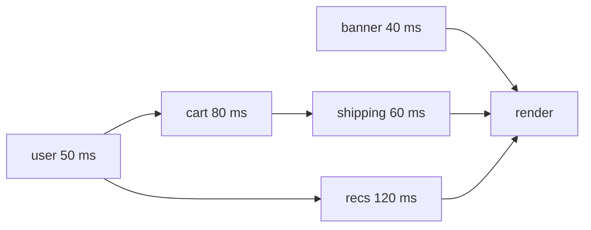

## Introduction

A product page needs three things from the server: the user, their orders and their preferences. Each request takes about 100 ms. Written the obvious way — `await` the user, then `await` the orders, then `await` the preferences — the page waits 300 ms. Written so that all three requests are sent at once, it waits about 100 ms. Same requests, same server, same code size; the only difference is *when each request starts*.

That is the subject of this lesson. **Sequential** async work starts each operation only after the previous one has finished, so total time is the **sum** of the durations. **Parallel** (more precisely, concurrent) async work starts several operations before waiting for any of them, so total time is roughly the **longest** single duration. Sequential is required when a step needs the previous step's result. When steps are independent, sequential code is wasted time — and because `await` makes sequential code look so natural, it is one of the most common performance bugs in JavaScript.

The opposite mistake exists too. Firing ten thousand requests at once can exhaust connections, trip rate limits and knock over a database. Good async code is **as concurrent as the dependencies allow, and no more concurrent than the system can handle**.

## Before you start

- **Promises** — a promise represents work that is already running. See [[b1-promises]].
- **`async`/`await`** — `await p` pauses the current function until `p` settles. See [[b1-async-await]] and [[b1-await-does-not-block]].
- **`Promise.all` and friends** — waiting for several promises at once. See [[b1-promise-combinators]], especially [[b1-promise-all]].
- **The event loop** — JavaScript runs your code on one thread while the runtime waits on timers and I/O. See [[b1-event-loop]].

All snippets run in Node.js 22 as ES modules (`.mjs`). Timers stand in for network requests. Printed times are rounded and can vary slightly between runs.

## The intuition

Think about cooking dinner. Boiling pasta needs the water to boil first; you cannot reorder those steps, because one depends on the other. But boiling water, preheating the oven and chopping vegetables do not depend on each other, so a sensible cook starts the water, turns on the oven, and chops while both heat up. The cook is still one person — they only *do* one thing at a time — but the slow parts, the waiting, overlap.

JavaScript is that cook. It has one thread that runs your code, but most async operations spend their time *waiting*: for a network response, a disk read, a timer. Starting a request takes microseconds; then the network does the work while JavaScript is free. If you start three requests before waiting, their waiting overlaps. If you start each only after the last one finishes, the waits line up end to end.

The analogy also shows the limit. Chopping vegetables is the cook's own work; doing it "in parallel" with more chopping is impossible for one person. Likewise, CPU-heavy JavaScript — parsing a huge file, resizing an image in code — cannot be sped up by wrapping it in promises, because the one thread has to do all of it. We will come back to this.

## The key fact: a promise starts when it is created

Everything in this lesson follows from one rule: **calling an async function starts its work immediately and returns a promise for the result.** `await` does not start anything. It only waits for something that is already running.

So these two lines mean different things:

```javascript
const a = await fetchUser();   // start, then wait until done
const pa = fetchUser();        // start, and keep going
```

Once you see `await` as "wait here", the difference between sequential and parallel code is just a question of where the waits are placed relative to the starts.

```javascript title="sequential-vs-parallel.mjs"
const delay = (ms, value) => new Promise((resolve) => setTimeout(() => resolve(value), ms));
const fetchUser = () => delay(100, 'user');
const fetchOrders = () => delay(100, 'orders');
const fetchPrefs = () => delay(100, 'prefs');
const elapsed = (t0) => `${Math.round((Date.now() - t0) / 50) * 50} ms`;

let t0 = Date.now();
const user = await fetchUser();
const orders = await fetchOrders();
const prefs = await fetchPrefs();
console.log('sequential', elapsed(t0), [user, orders, prefs]);

t0 = Date.now();
const all = await Promise.all([fetchUser(), fetchOrders(), fetchPrefs()]);
console.log('parallel  ', elapsed(t0), all);
```

```output
sequential 300 ms [ 'user', 'orders', 'prefs' ]
parallel   100 ms [ 'user', 'orders', 'prefs' ]
```

In the sequential version, `fetchOrders()` is not even called until `fetchUser()`'s promise has fulfilled, so the three 100 ms waits happen one after another. In the parallel version, all three functions are called while building the array — three timers start within the same millisecond — and `Promise.all` waits once for all of them. The results are identical and in the same order; only the elapsed time differs.

| Time | Sequential version | Parallel version |
|---|---|---|
| 0 ms | user starts | user, orders and prefs all start |
| 100 ms | user done; orders starts | all three done — `Promise.all` fulfils |
| 200 ms | orders done; prefs starts | — |
| 300 ms | prefs done | — |

> [!NOTE] "Parallel" or "concurrent"?
> Strictly, this is **concurrency**: several operations in progress at once, with their waiting overlapped, while JavaScript itself runs one callback at a time. True **parallelism** — several CPUs executing code simultaneously — happens inside the runtime and the network, not in your JavaScript. Everyday usage says "parallel requests", and so does this lesson, but the distinction matters for CPU-bound work.

## Accidental sequential code

Sequential code is correct when it is needed. The bug is sequential code where nothing required it. It hides in three common shapes.

### `await` inside a loop

```javascript title="loop-vs-map.mjs"
const t0 = Date.now();
const since = () => `${Math.round((Date.now() - t0) / 50) * 50} ms`;
const fetchItem = (id) =>
  new Promise((resolve) => {
    console.log(`  start ${id} at ${since()}`);
    setTimeout(() => resolve(`item ${id}`), 50);
  });

const ids = [1, 2, 3];
const one = [];
for (const id of ids) {
  one.push(await fetchItem(id));      // waits for each before starting the next
}
console.log('for...of + await done at', since());

const two = await Promise.all(ids.map((id) => fetchItem(id)));
console.log('map + Promise.all done at', since());
```

```output
  start 1 at 0 ms
  start 2 at 50 ms
  start 3 at 100 ms
for...of + await done at 150 ms
  start 1 at 150 ms
  start 2 at 150 ms
  start 3 at 150 ms
map + Promise.all done at 200 ms
```

The start times tell the story. In the loop, item 2 does not start until item 1 has finished; for 100 items of 50 ms each, that is 5 seconds. With `map`, every call happens synchronously while the array is built, so all three start at the same moment and the batch takes 50 ms. `ids.map((id) => fetchItem(id))` produces an array of promises, all in flight; `Promise.all` turns it into one promise for an array of results, in input order.

The loop is the right choice when each iteration genuinely depends on the previous one — paging through an API where each response contains the cursor for the next page — or when order of side effects matters, as discussed below.

### `async` callbacks passed to `forEach`

```javascript title="foreach-async.mjs"
const t0 = Date.now();
const since = () => `${Math.round((Date.now() - t0) / 50) * 50} ms`;
const fetchItem = (id) => new Promise((resolve) => setTimeout(() => resolve(`item ${id}`), 50));

const results = [];
[1, 2, 3].forEach(async (id) => {
  results.push(await fetchItem(id));
});
console.log('after forEach:', results, 'at', since());
setTimeout(() => console.log('later:', results, 'at', since()), 100);
```

```output
after forEach: [] at 0 ms
later: [ 'item 1', 'item 2', 'item 3' ] at 100 ms
```

This one is not sequential — the requests do run concurrently — but it is broken in a different way. `forEach` ignores its callback's return value, so the three promises returned by the `async` callbacks are thrown away. Nothing waits for them: the line after the loop sees an empty array, and if any of them rejects, the rejection is unhandled. `forEach`, `filter` and `reduce` were not designed for promises. Use `map` plus `Promise.all` for concurrency, or `for...of` with `await` for order. (The results array here also fills in completion order, not input order — another reason to prefer `Promise.all`.)

### Awaiting too early

The third shape is subtler: the operations are independent, but each `await` appears right where its value is created, as in the first example. The fix is to **start early, await late**: call every independent operation first, then wait for them together. Prefer joining them with `Promise.all` rather than separate `await`s on saved promises. If you write `const a = startA(); const b = startB(); await a; await b;` and `a` rejects, the function exits before anyone listens to `b`, so `b`'s rejection becomes unhandled — [[b1-error-propagation]] shows that crash. `Promise.all` attaches handlers to every input at once.

## Partly dependent work

Real flows are rarely all-independent or all-dependent. Usually some steps need earlier results and others do not. The fastest correct schedule starts **every operation as soon as everything it needs is available** — no earlier (it would lack its inputs) and no later (it would waste time).

A useful way to plan this is to draw the dependencies. Consider a checkout page:

- `getBanner()` needs nothing.
- `getUser()` needs nothing.
- `getCart(user)` and `getRecs(user)` each need the user.
- `getShipping(cart, user)` needs the cart and the user.



The total time cannot be less than the longest path through the graph — user → cart → shipping is 50 + 80 + 60 = 190 ms — which is called the **critical path**. Fully sequential code would take 40 + 50 + 80 + 120 + 60 = 350 ms. The code below achieves the critical path:

```javascript title="checkout.mjs"
const t0 = Date.now();
const since = () => `${Math.round((Date.now() - t0) / 10) * 10} ms`;
const call = (name, ms, value) =>
  new Promise((resolve) =>
    setTimeout(() => {
      console.log(`  ${name} done at ${since()}`);
      resolve(value);
    }, ms));

const getUser = () => call('user', 50, { id: 7, region: 'EU' });
const getCart = (user) => call('cart', 80, { userId: user.id, items: 3 });
const getRecs = (user) => call('recs', 120, ['socks', 'hat']);
const getShipping = (cart, user) => call('shipping', 60, `${user.region}: ${cart.items} items`);
const getBanner = () => call('banner', 40, 'Free returns');

async function loadCheckout() {
  const bannerP = getBanner();                       // needs nothing: start now
  const user = await getUser();                      // everything else needs the user
  const [shipping, recs, banner] = await Promise.all([
    getCart(user).then((cart) => getShipping(cart, user)),  // cart -> shipping chain
    getRecs(user),                                   // independent of the cart
    bannerP,
  ]);
  return { shipping, recs, banner };
}

console.log(await loadCheckout(), 'at', since());
```

```output
  banner done at 40 ms
  user done at 50 ms
  cart done at 130 ms
  recs done at 170 ms
  shipping done at 190 ms
{
  shipping: 'EU: 3 items',
  recs: [ 'socks', 'hat' ],
  banner: 'Free returns'
} at 190 ms
```

Read the timeline. The banner starts at 0 ms because it depends on nothing, and it is not awaited until the end, so it never delays anything. The user is awaited immediately because three later steps need it. At 50 ms, cart and recommendations start together. The cart-then-shipping chain is expressed as one promise with `.then`, so shipping starts the moment the cart arrives (130 ms) without waiting for the slower recommendations. Everything joins in one `Promise.all`, which also means a failure in any branch rejects `loadCheckout` and no rejection is left unhandled.

The general technique: **turn each independent branch of the graph into one promise** (a `.then` chain or a small `async` function), then join the branches with a combinator. A common mistake here is to write `const cart = await getCart(user); const recs = await getRecs(user);` — correct, but it adds the full 120 ms of recommendations after the cart instead of overlapping them.

## How it works internally

When you call `fetch` or `setTimeout`, JavaScript asks the host — the browser or Node.js — to start the operation, and gets control back almost at once. The host performs the waiting outside the JavaScript thread: the operating system handles sockets, Node's libuv thread pool handles some file operations, and the browser's network stack handles HTTP. When an operation completes, the host queues a task; when that task runs, it resolves the corresponding promise, and its reactions run as microtasks.

So with three requests started together, the JavaScript thread spends a fraction of a millisecond starting them, is idle (or doing other work) while the network does its job, and then runs three short callbacks as the responses arrive. `Promise.all` simply attaches a reaction to each promise and counts completions. That is why concurrency costs so little in JavaScript: nothing is blocked while waiting, and no extra threads are created by your code.

It is also why **CPU-bound work does not benefit**:

```javascript title="cpu-bound.mjs"
// CPU-bound work: wrapping it in promises does not make it parallel.
function busy(ms) {
  const end = Date.now() + ms;
  while (Date.now() < end) {}        // blocks the only JavaScript thread
  return ms;
}
const t0 = Date.now();
await Promise.all([1, 2, 3].map(async () => busy(100)));
console.log('three 100 ms CPU jobs with Promise.all took', Math.round((Date.now() - t0) / 50) * 50, 'ms');
```

```output
three 100 ms CPU jobs with Promise.all took 300 ms
```

Each `async` callback runs `busy` synchronously to completion before the next one starts, so there is no waiting to overlap. Real parallel computation needs more threads: Web Workers in the browser, `worker_threads` in Node.js. Those are separate runtimes that communicate by messages, and promises are then a convenient way to wait for their answers.

## Bounding concurrency

Unbounded concurrency is the opposite failure. `Promise.all(userIds.map(sendEmail))` with 50,000 users opens 50,000 requests at once. Browsers cap connections per host (HTTP/1.1 commonly six), so most requests queue anyway; servers and APIs apply rate limits and return 429 errors; databases have a fixed connection pool; and memory grows with every in-flight request. The usual answer is a **concurrency limit**: run at most *k* operations at a time, starting a new one whenever one finishes.

```javascript title="map-with-limit.mjs"
// Run worker(item) for every item, with at most `limit` running at once.
async function mapWithLimit(items, limit, worker) {
  const results = new Array(items.length);
  let next = 0;
  async function lane() {
    while (next < items.length) {
      const index = next++;               // claim an item; safe: no await in between
      results[index] = await worker(items[index], index);
    }
  }
  const lanes = Array.from({ length: Math.min(limit, items.length) }, lane);
  await Promise.all(lanes);
  return results;
}

let active = 0;
let peak = 0;
const upload = (name) =>
  new Promise((resolve) => {
    active += 1;
    peak = Math.max(peak, active);
    setTimeout(() => {
      active -= 1;
      resolve(`${name} ok`);
    }, 20 + name.length * 5);
  });

const files = ['a.png', 'bb.png', 'ccc.png', 'd.png', 'eeeee.png', 'f.png', 'gg.png'];
const out = await mapWithLimit(files, 3, upload);
console.log(out.join(", "));
console.log('peak concurrency:', peak);
```

```output
a.png ok, bb.png ok, ccc.png ok, d.png ok, eeeee.png ok, f.png ok, gg.png ok
peak concurrency: 3
```

The design is a set of **lanes** (sometimes called workers). Each lane is an `async` loop that claims the next unprocessed index, waits for that item, and repeats. With three lanes, at most three items are in flight; as soon as one finishes, its lane claims the next. `next++` is safe without locks because JavaScript runs one piece of code at a time and there is no `await` between reading and incrementing `next`. Results are stored by index, so the output keeps input order even though items finish at different times.

One behaviour to know: if a worker rejects, its lane stops and `Promise.all(lanes)` rejects, but the other lanes keep processing items in the background. For batch jobs it is often better to catch inside the worker and record the failure, `allSettled`-style. Libraries such as `p-limit` and `p-map` provide well-tested versions of this; [[b1-concurrency-limiting]] covers the topic further.

Choosing *k* is a judgement call: high enough to hide latency, low enough to respect the other side's limits. Values from 4 to 16 are common for HTTP APIs; the right number for a database is usually its pool size or smaller.

## When order matters

Concurrent operations finish in whatever order the outside world returns them. Reading results is still deterministic when you use `Promise.all`, because results are matched by position. But **side effects** — writes to a database, appends to a file, API calls that change state — happen in completion order, which can vary from run to run. If you apply database migrations concurrently, or send "create" and "update" for the same record at once, the update may arrive first.

Use sequential execution whenever:

- a step needs the previous step's **result** (a cursor, an ID, a token);
- side effects must happen in a **specific order** (migrations, an audit log, ordered messages);
- the target can only handle **one request at a time** (a device, a strict rate limit, an operation guarded by a lock).

`for...of` with `await` is the clearest way to write that. It is not a code smell when the order is the point; add a short comment saying why, so a reviewer does not "optimise" it into a bug.

## In real systems

**Server request handlers** typically load several independent pieces of data per request — the user, feature flags, the resource itself. Joining them with `Promise.all` is one of the cheapest latency wins available. Distributed tracing tools draw these calls as a waterfall; a staircase of sequential spans with no data dependencies is the classic sign of accidental sequential code.

**Frontend data loading** has the same problem at a larger scale, known as a **request waterfall**: a parent component fetches, renders a child, and only then does the child start its own fetch. Frameworks address it by starting fetches before rendering — route loaders, server components and data-fetching libraries all exist partly to start independent requests together.

**Batch jobs and scripts** — migrating records, sending notifications, processing uploads — use bounded concurrency with retries and per-item error reporting, because both extremes fail: fully sequential is too slow, fully concurrent hits rate limits.

## Trade-offs and alternatives

| Approach | Time | Use when | Watch for |
|---|---|---|---|
| Sequential `await` / `for...of` | sum of durations | steps depend on each other; order of effects matters | accidental use on independent work |
| `Promise.all` over everything | about the longest duration | a small, known number of independent operations | unbounded input size; fail-fast discards other results |
| `Promise.allSettled` | about the longest duration | independent operations where partial success is fine | inspect failures |
| Bounded pool (`mapWithLimit`, `p-limit`) | between the two | many independent operations against a limited resource | choosing the limit; error policy |
| Workers (`worker_threads`, Web Workers) | divides CPU time across cores | CPU-bound computation | message-passing overhead and complexity |

Concurrency also changes error behaviour. Sequentially, the first failure stops everything after it. Concurrently, later operations are already running when an earlier one fails, so you must decide whether to let them finish, ignore them, or abort them with an `AbortSignal`.

## Common mistakes

**Awaiting independent calls one after another.** Start them together and join with `Promise.all`.

**`await` inside a loop over independent items.** Use `map` + `Promise.all`, or a limited pool for large lists.

**`async` callbacks in `forEach`.** Nothing waits and rejections go unhandled. Use `for...of` or `map` + `Promise.all`.

**Saving promises and awaiting them one by one.** A failure in the first leaves the others unhandled. Join them with a combinator.

**Unbounded `Promise.all` on large inputs.** Add a concurrency limit.

**Parallelising ordered side effects.** If order matters, keep it sequential and comment why.

**Expecting promises to speed up computation.** They overlap waiting, not CPU work. Use workers for heavy computation.

## Interview perspective

This topic usually appears as a code-review question: "This endpoint takes 900 ms; here is the handler. What would you change?" A strong answer identifies which awaited calls are independent, rewrites them with `Promise.all`, states the new expected latency (the slowest call instead of the sum), and then raises the follow-ups without being asked: error policy (`all` versus `allSettled`), whether any call has side effects that require order, and whether the number of calls is bounded.

Other common prompts:

- **"What does `await` do to the operation?"** Nothing — the operation started when the function was called. `await` only pauses the current function.
- **"Why doesn't `forEach` work with `async`?"** It discards the returned promises, so nothing waits for them.
- **"Implement a function that runs tasks with a concurrency limit."** The lane-based pool above; explain why `next++` is race-free in JavaScript and how results stay ordered.
- **"Will `Promise.all` make my image processing faster?"** Not if the work is CPU-bound on the main thread; explain the single thread and suggest workers.

## Practice

1. Rewrite a handler that does `const a = await getA(); const b = await getB(a.id); const c = await getC();` so that it runs in the minimum time. What is the critical path?
2. Modify `mapWithLimit` so a failing item does not stop its lane, and the function returns `allSettled`-style results.
3. Write `sequence(tasks)` that runs an array of async functions strictly one after another and returns their results — once with `for...of` and once with `reduce` over a promise.
4. A script uploads 2,000 files with `await` inside a `for` loop and takes 20 minutes. The API allows 10 concurrent requests. Estimate the new time with a limit of 10, and list what could go wrong.
5. Draw the dependency graph for a page that loads a post, its author, the author's other posts and the post's comments, then write the fastest `loadPage`.

```quiz
Q: `const a = await getA(); const b = await getB();` — each takes 200 ms and they are independent. How long does this take, and how do you fix it?
- [ ] 200 ms; it is already concurrent because `await` does not block
- [x] About 400 ms; start both, then `await Promise.all([getA(), getB()])`
- [ ] About 400 ms; wrap each call in `new Promise` to run them on separate threads
- [ ] 200 ms; JavaScript runs async functions on separate threads automatically
> `getB()` is not called until `getA()`'s promise has fulfilled, so the waits add up. Calling both before waiting overlaps them, giving about 200 ms. `await` does not block the thread, but it does pause this function, and promises never create threads.
```

```quiz
Q: What is wrong with `items.forEach(async (item) => { await save(item); }); console.log('saved');`?
- [ ] The saves run one after another, so it is slow
- [x] Nothing waits for the saves, so `'saved'` prints first and rejections go unhandled
- [ ] `forEach` throws when given an `async` function
- [ ] `await` is not allowed inside callbacks
> `forEach` ignores the promises its callback returns. The saves do start (concurrently), but the next line runs immediately and nobody handles a failure. Use `await Promise.all(items.map(save))` or a `for...of` loop.
```

```quiz
Q: Why does `Promise.all` over three 100 ms CPU-bound loops take about 300 ms?
- [ ] `Promise.all` runs its inputs one at a time
- [ ] The microtask queue adds 100 ms of overhead per promise
- [x] JavaScript runs on one thread, so CPU work cannot overlap; only waiting can
- [ ] Node.js limits `Promise.all` to one input per core
> Each callback runs synchronously to completion on the single JavaScript thread before the next can start. `Promise.all` overlaps waiting on external operations, not computation; CPU parallelism needs workers.
```

```quiz
Q: Which situation calls for sequential execution even though it is slower?
- [ ] Loading a user's profile, orders and settings for one page
- [ ] Fetching thumbnails for 20 images
- [x] Applying database migrations that must run in order
- [ ] Checking three mirrors for the same file
> Migrations are side effects whose order matters, so each must finish before the next starts. The other three are independent reads that should overlap (with `all`, a bounded pool, and `any` respectively).
```

## Quick revision {#quick-revision}

- Calling an async function **starts** the work; `await` only **waits**. Placement of waits decides the schedule.
- Sequential: total ≈ **sum** of durations. Concurrent: total ≈ **longest** duration.
- Independent operations: start all, then `await Promise.all([...])` (or `allSettled`).
- Loops: `for...of` + `await` is sequential; `map` + `Promise.all` is concurrent; `forEach(async …)` waits for nothing.
- Avoid `const a = startA(); const b = startB(); await a; await b;` — if `a` rejects, `b` is unhandled. Join instead.
- Partly dependent work: start each operation as soon as its inputs exist; make each branch one promise; join branches. Minimum time = **critical path**.
- Bound concurrency for large inputs: lanes that claim the next index; results stored by index; libraries `p-limit` / `p-map`.
- Keep work sequential when it needs previous results, when side-effect order matters, or when the target handles one request at a time.
- Promises overlap **waiting**, not computation; CPU-bound work needs Web Workers or `worker_threads`.

## Key takeaways {#key-takeaways}

- The difference between 300 ms and 100 ms is often just where `await` is placed.
- Ask of every `await`: does the next line really need this result? If not, start the work earlier and join it later.
- `map` + `Promise.all` is the default for independent items; a bounded pool is the default for many items.
- Sequential code is right when dependencies or ordered side effects demand it — say so in a comment.
- Concurrency in JavaScript overlaps I/O waits on one thread; it does not make computation parallel.
