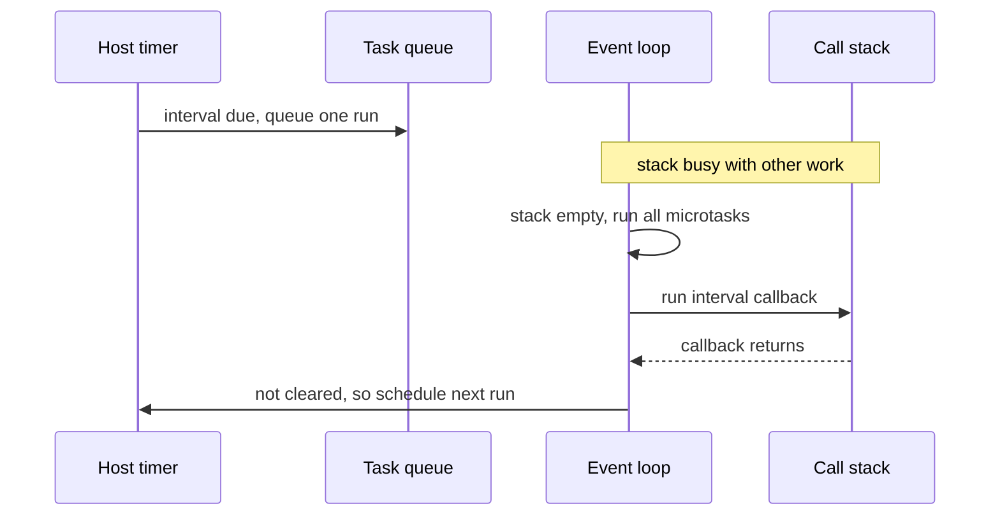

## Introduction

Many programs need to do something repeatedly: refresh a clock on screen every second, ask a server every ten seconds whether a report is ready, send a heartbeat so a connection stays open, advance a carousel. You could write `setTimeout` again and again, but JavaScript hosts offer a one-line version: `setInterval(fn, ms)` runs `fn` about every `ms` milliseconds until you call `clearInterval` with the id it returned.

That "about" is the subject of most of this lesson. `setInterval` looks like a metronome, but it is built on the same machinery as `setTimeout`: the host waits, then puts a task in a queue, and the task runs only when the single JavaScript thread is free. So intervals arrive late, the lateness can add up over time, and an interval whose callback starts asynchronous work can end up with several runs in flight at once. None of this is a bug in the host; it follows directly from how the event loop works, and once you see why, you can pick the right tool for each repeating job.

Engineers meet `setInterval` in polling code, countdown timers, auto-save, dashboards and many interview questions — especially the React question about why a counter inside `setInterval` stops at 1.

## Before you start

- **`setTimeout` and `clearTimeout`** — how a single timer is scheduled, why its delay is a minimum, and what clamping is. See [[b1-settimeout]]; this lesson builds directly on it.
- **The event loop** — tasks, microtasks and the call stack. See [[b1-event-loop]].
- **Closures** — a callback that runs later still sees the variables around it. See [[b1-closures]].
- **Promises and `async`/`await`** — needed for the section on async callbacks. See [[b1-promises]] and [[b1-async-await]].

## The intuition

Picture a repeating alarm on your phone set for every 10 minutes. When it rings, you are supposed to water a plant. If you are in the shower when it rings, you water the plant when you get out — late. The alarm does not ring twice to make up for the missed time, and it does not interrupt your shower. That is close to how `setInterval` behaves: the host keeps the alarm, the ring becomes a task in a queue, and JavaScript gets to the task only when it has finished whatever it was doing.

The analogy breaks down in one important place. If watering the plant means *starting* something that takes a long time — phoning a nursery and waiting on hold — the alarm keeps ringing while you wait, and you may start a second phone call before the first is over. That is what happens when an interval callback is `async`, and it is covered below.

## What setInterval does

The signature mirrors `setTimeout`:

```javascript
const id = setInterval(callback, delayMs, ...extraArgs);
```

`callback` is the function to run each time, `delayMs` is the interval in milliseconds (non-numbers are converted; missing, negative or `NaN` means 0), and any extra arguments are passed to every call. The function returns an id at once and does not wait. Like `setTimeout`, it is a **host API**: the HTML Standard defines it for browsers and Node.js provides its own version, so it is not part of the ECMAScript language itself. Browsers return a positive integer; Node.js returns a `Timeout` object.

The first run happens after one interval, not immediately. If you want a run now and then every second, call the function yourself once before starting the interval.

```javascript title="ticks.js"
let n = 0;

const id = setInterval((label) => {
  n += 1;
  console.log(`${label} ${n}`);
  if (n === 3) clearInterval(id);   // stop from inside the callback
}, 100, 'tick');

console.log('interval started');
```

```output
interval started
tick 1
tick 2
tick 3
```

`interval started` prints first because `setInterval` only registers the callback and returns. About 100 ms later the host queues the first run, which prints `tick 1`, and so on. On the third run the callback calls `clearInterval(id)`. The `id` constant is in scope inside the callback because the callback is a closure over the module's variables, and by the time it first runs, the assignment `const id = …` has long finished.

### clearInterval

`clearInterval(id)` removes the interval so that no further runs are queued. It can be called from inside the callback, as above, or from anywhere else that holds the id — a "Stop" button handler, a component's cleanup function, the code that handles a finished download. Calling it with an id that was already cleared, or with `undefined`, does nothing and does not throw, which makes it safe to call in every cleanup path.

Two details are worth knowing. First, in browsers `setTimeout` and `setInterval` share one list of active timers, and the HTML Standard defines `clearTimeout` and `clearInterval` to remove entries from that same list, so either function cancels either kind of timer. Node.js behaves the same way:

```javascript title="cross-clear.js"
const id = setInterval(() => console.log('x'), 10);

setTimeout(() => {
  clearTimeout(id);          // works on an interval too
  console.log('cleared with clearTimeout');
}, 35);
```

```output
x
x
x
cleared with clearTimeout
```

The exact number of `x` lines depends on timing; on most runs it is three. Mixing the two names works, but it confuses readers, so use the matching function.

Second, clearing an interval never stops a run that is already executing. If the callback is in the middle of running, it finishes; `clearInterval` only prevents the next one.

## How it works internally

Internally an interval is a timer that re-arms itself. When the delay has passed, the host queues a task that runs the callback. After that task runs, if the interval has not been cleared, the host schedules the next run. That design has three consequences.

**Each run waits for the thread.** Exactly as with `setTimeout`, a due run is only a task in a queue. Synchronous code, all pending microtasks and any tasks ahead of it run first. An interval callback can never interrupt other JavaScript, including a previous run of itself.

**Missed runs are not stacked up.** At most one run of a given interval is pending at a time. If the thread is busy for longer than several intervals, you do not get a burst of catch-up calls afterwards; you get one late run and the schedule continues from there. Here is what Node.js 22 does when every run takes 80 ms on a 50 ms interval:

```javascript title="overrun.js"
const start = performance.now();
let n = 0;

const id = setInterval(() => {
  n += 1;
  const t = Math.round(performance.now() - start);
  const busyUntil = performance.now() + 80;
  while (performance.now() < busyUntil) {
    // 80 ms of synchronous work inside a 50 ms interval
  }
  console.log(`run ${n} started at ${t} ms`);
  if (n === 4) clearInterval(id);
}, 50);
```

```output
run 1 started at 51 ms
run 2 started at 133 ms
run 3 started at 213 ms
run 4 started at 293 ms
```

The exact millisecond values vary slightly between runs. The runs never overlap, because JavaScript runs one task at a time. Each run was already overdue when the previous one finished, so the next run starts as soon as the thread is free, and the effective period becomes 80 ms instead of 50. Nothing tried to "make up" the lost calls. Browsers are not specified to produce exactly these numbers, and this lesson's examples were not run in a browser, but the principle is the same everywhere: an interval can deliver fewer runs than you asked for, never more.

**Small intervals are clamped.** The same floors that apply to `setTimeout` apply to intervals. Node.js treats anything below 1 ms as 1 ms. In browsers, the HTML Standard raises delays below 4 ms to 4 ms once timers are nested more than five levels deep, and the repeats of an interval count as nesting, so `setInterval(fn, 0)` in a browser settles to roughly 4 ms between runs after the first few. Browsers also throttle intervals in hidden tabs, typically to at most one run per second, and further for pages hidden for a long time.



## Drift

Because every run happens a little after it was due, and the next run is scheduled relative to when the host re-armed the timer, the small delays accumulate. Over many runs the interval falls further and further behind wall-clock time. This is called **drift**.

```javascript title="drift.js"
const start = performance.now();
let n = 0;

const id = setInterval(() => {
  n += 1;
  const drift = performance.now() - start - n * 100;   // actual minus ideal
  if (n % 5 === 0) console.log(`tick ${n}: ${drift.toFixed(1)} ms behind schedule`);
  if (n === 20) clearInterval(id);
}, 100);
```

```output
tick 5: 4.5 ms behind schedule
tick 10: 9.5 ms behind schedule
tick 15: 14.9 ms behind schedule
tick 20: 20.7 ms behind schedule
```

That is one run on Node.js 22 with an idle thread; the numbers change between runs but the trend does not. Each tick is about a millisecond late and the lateness adds up, so after an hour of one-second ticks a clock that adds `1` per tick could be several seconds wrong. On a busy page, or in a background tab where the browser throttles timers, it can be wrong by minutes.

The lesson is that **an interval is a reminder to check, not a measure of time**. Whenever the result depends on how much real time has passed, read the clock inside the callback and compute from it:

```javascript title="countdown.js"
function startCountdown(seconds, onTick, onDone) {
  const endsAt = Date.now() + seconds * 1000;

  const id = setInterval(() => {
    const remainingMs = endsAt - Date.now();
    if (remainingMs <= 0) {
      clearInterval(id);
      onDone();
      return;
    }
    onTick(Math.ceil(remainingMs / 1000));
  }, 250);   // check often; the display is computed from the clock, not from tick count

  return () => clearInterval(id);
}

startCountdown(2, (s) => console.log(`${s} s left`), () => console.log('done'));
```

```output
2 s left
2 s left
2 s left
1 s left
1 s left
1 s left
1 s left
done
```

The countdown stores the moment it should end and, on every tick, computes how much time is really left. If a tick is late, or the tab was throttled for a minute, the next tick still shows the correct value. Checking four times a second means the display changes within a quarter-second of the true boundary. The exact number of lines printed depends on timing — a run can print three or four lines for a given second — which is why a real UI would only re-render when the displayed number changes. Use `Date.now()` when you care about the wall clock (a deadline at 17:00), and `performance.now()` when you care about elapsed time and want a clock that is not affected by the user changing the system time.

## Async callbacks can overlap

A synchronous interval callback cannot overlap itself. An `async` one can, and this is the most common real-world `setInterval` bug. An `async` function returns as soon as it reaches its first `await`; as far as the event loop is concerned, that run has finished. The interval does not know or care that a promise is still pending, so it starts the next run on schedule.

```javascript title="async-overlap.js"
const sleep = (ms) => new Promise((resolve) => setTimeout(resolve, ms));
let inFlight = 0;
let runs = 0;

const id = setInterval(async () => {
  const n = ++runs;
  inFlight += 1;
  console.log(`run ${n} started, ${inFlight} in flight`);
  await sleep(250);                 // stands in for a slow network request
  inFlight -= 1;
  console.log(`run ${n} finished`);
}, 100);

setTimeout(() => clearInterval(id), 450);
```

```output
run 1 started, 1 in flight
run 2 started, 2 in flight
run 3 started, 3 in flight
run 1 finished
run 4 started, 3 in flight
run 2 finished
run 3 finished
run 4 finished
```

With a 100 ms interval and a 250 ms "request", three requests are in flight at once. In a real polling loop that means extra load on the server, and worse, the responses can arrive out of order, so an older response may overwrite newer data. If the server slows down, every run takes longer and even more requests pile up — exactly when the server can least afford it.

There are two fixes. A guard flag skips a run while the previous one is still going:

```javascript
let busy = false;
setInterval(async () => {
  if (busy) return;          // previous run still in flight: skip this one
  busy = true;
  try {
    await refresh();
  } finally {
    busy = false;            // release even if refresh() throws
  }
}, 5000);
```

The better fix is usually not to use `setInterval` at all, which leads to the next section.

## Chained setTimeout: the usual alternative

A **chained timeout** (sometimes called a recursive `setTimeout`) schedules the next run at the *end* of the current one:

```javascript title="poll.js"
const sleep = (ms) => new Promise((resolve) => setTimeout(resolve, ms));
let attempt = 0;

async function checkStatus() {
  attempt += 1;
  await sleep(150);                       // stands in for fetch('/api/report/42')
  return attempt >= 3 ? 'ready' : 'pending';
}

function poll(delayMs) {
  let timerId;
  let stopped = false;

  async function run() {
    const status = await checkStatus();
    console.log(`attempt ${attempt}: ${status}`);
    if (status === 'ready' || stopped) return;
    timerId = setTimeout(run, delayMs);   // schedule only after this run finished
  }

  run();
  return () => {
    stopped = true;
    clearTimeout(timerId);
  };
}

poll(100);
```

```output
attempt 1: pending
attempt 2: pending
attempt 3: ready
```

Because the next timer is created only after `checkStatus` has finished, two checks can never be in flight together, no matter how slow the server is. The gap is measured from the end of one run to the start of the next, so a slow response automatically slows the polling down instead of piling up requests. The chain also makes it natural to change the delay per run — backing off to longer waits after errors, for example — which `setInterval` cannot do without being cleared and recreated.

The `stopped` flag is needed because `clearTimeout(timerId)` only cancels a timer that exists. If `stop` is called while `checkStatus` is still awaiting, there is no pending timer yet; without the flag, `run` would schedule a new one after the stop. This "cancel while in flight" case is easy to miss.

| | `setInterval` | Chained `setTimeout` |
|---|---|---|
| Next run measured from | When the timer was re-armed | The end of the previous run |
| Async runs can overlap | Yes | No |
| Change the delay per run | Clear and recreate | Pass a new delay each time |
| Accumulated drift | Yes | Yes, plus the run time itself |
| Stop | `clearInterval(id)` | Clear the current timer and set a stop flag |

Neither form keeps accurate time; both need the clock-reading technique from the drift section when accuracy matters. Use `setInterval` for short, synchronous, fire-and-forget work such as updating a clock display. Use a chained timeout for anything that awaits, anything that should slow down under load, and anything whose delay should change.

## Worked example: an auto-save that cleans up after itself

A text editor saves the draft every few seconds, but only if it changed, and stops saving when the editor closes. This puts the pieces together.

```javascript title="autosave.js"
function createAutosave(save, everyMs) {
  let draft = '';
  let lastSaved = '';

  const id = setInterval(() => {
    if (draft === lastSaved) return;        // nothing new: skip the save
    lastSaved = draft;
    save(draft);
  }, everyMs);

  return {
    update(text) { draft = text; },
    close() {
      clearInterval(id);
      if (draft !== lastSaved) save(draft); // flush the last edit before closing
    },
  };
}

const editor = createAutosave((text) => console.log(`saved: "${text}"`), 100);
editor.update('Hel');
setTimeout(() => editor.update('Hello'), 150);
setTimeout(() => editor.update('Hello, world'), 260);
setTimeout(() => editor.close(), 280);
```

```output
saved: "Hel"
saved: "Hello"
saved: "Hello, world"
```

Walk through the timeline. At about 100 ms the interval sees `"Hel"`, which differs from the empty `lastSaved`, and saves it. At 150 ms the draft becomes `"Hello"`; the run at about 200 ms saves it. At 260 ms the draft becomes `"Hello, world"`, but the editor closes at 280 ms, before the next run at about 300 ms. `close` clears the interval and flushes the unsaved text, so the last edit is not lost. Without `clearInterval` in `close`, the interval would keep running forever — in Node.js it would also keep the process alive — and it would keep a reference to `save` and the draft, which could hold memory long after the editor is gone ([[b1-closure-memory]]).

## In real systems

**Polling.** Checking a job's status, a build's progress or a list of notifications is the classic use. Production pollers use chained timeouts, back off on errors, add a little random **jitter** to the delay so thousands of clients do not hit the server in sync, and stop when the page is hidden (the Page Visibility API, see [[b3-page-visibility]]). When updates must be immediate, push-based alternatives such as Server-Sent Events replace polling entirely; see [[b3-sse-vs-polling]].

**Clocks and countdowns.** Use an interval only as the trigger to re-read the clock and re-render, as in the countdown above.

**Heartbeats.** WebSocket clients and Node.js services often send a small "still alive" message every 20–30 seconds. Here `setInterval` is fine: the work is tiny and synchronous. In Node.js, call `.unref()` on the returned `Timeout` if the heartbeat should not by itself keep the process running.

**React components.** An interval started in `useEffect` must be cleared in the effect's cleanup, or it keeps running after the component unmounts; in development, Strict Mode runs every effect twice, so a missing cleanup shows up at once as two intervals ([[b4-effect-cleanup]]). React also produces the most famous interval bug:

```javascript
useEffect(() => {
  const id = setInterval(() => setCount(count + 1), 1000);   // count is always 0 here
  return () => clearInterval(id);
}, []);
```

The effect runs once, so its callback closes over the `count` from the first render, which is `0`. Every tick sets the count to `0 + 1`, and the display sticks at 1. The fix is the updater form `setCount((c) => c + 1)`, which asks React for the current value instead of using the captured one. This is a [[b4-stale-closures|stale closure]], not a timer problem, but timers are where most people first meet it.

**Animation.** Moving something on screen with `setInterval(step, 16)` stutters, because the interval is not aligned with the display's refresh and keeps running in hidden tabs. Use [[b1-requestanimationframe-js]] instead.

## Trade-offs and alternatives

`setInterval` is the shortest way to say "keep doing this", and for small synchronous work it is perfectly good. Its costs are the ones covered above: it drifts, it overlaps async work, it does not adapt to load, and it runs forever unless something clears it. The alternatives each fix one of those:

| Job | Tool |
|---|---|
| Short synchronous repeat (clock display, heartbeat) | `setInterval` |
| Repeating async work (polling, sync) | Chained `setTimeout` |
| Visual updates and animations | `requestAnimationFrame` — [[b1-requestanimationframe-js]] |
| Rate-limiting a frequent event (scroll, resize) | Throttle — [[b1-throttle]] |
| Real-time server updates | Server-Sent Events or WebSockets — [[b3-sse-vs-polling]] |
| Accurate elapsed time | Any trigger, plus reading `performance.now()` |

## Common mistakes

> [!MISTAKE] Counting ticks to measure time
> `seconds += 1` on every one-second tick drifts and falls far behind in background tabs. Store a start or end timestamp and compute elapsed time from the clock on each tick.

**Never clearing the interval.** Intervals run until cleared, even after the element, component or request they served is gone. Every interval needs an owner and a cleanup path. In Node.js, a forgotten interval keeps the process from exiting.

**Losing the id.** Starting an interval inside a function and not storing the id makes it impossible to stop. Starting a second interval while the first is still running — for example, a "Start" button clicked twice — creates two intervals, and the variable now holds only the second id. Clear any existing interval before starting a new one.

**Using `setInterval` with an `async` callback.** Runs overlap when the work is slower than the interval. Use a chained timeout or a busy flag.

**Expecting an immediate first run.** The first call happens after one full interval. Call the function once yourself if you need it now.

**Passing a call instead of a function.** `setInterval(update(), 1000)` runs `update` once immediately and schedules its return value. Pass `update` or `() => update(arg)`.

**Passing a method without binding it.** `setInterval(this.tick, 1000)` loses `this`, just as with `setTimeout`. Use `() => this.tick()` or `this.tick.bind(this)`; see [[b1-this-lost]].

## Interview perspective

Interviewers use intervals to check whether you understand that timers are tasks on a single thread.

> [!INTERVIEW] What happens if the callback takes longer than the interval?
> "A synchronous callback cannot overlap itself, because JavaScript runs one task at a time. The host keeps at most one run pending, so missed runs are dropped rather than replayed and the effective period stretches. An `async` callback is different: the run ends at its first `await`, so the next run can start while the previous promise is pending. For async work I chain `setTimeout` so the next run is scheduled after the previous one finishes."

Other questions to be ready for:

- **`setInterval` versus recursive `setTimeout`?** Interval re-arms on a fixed schedule; the chain waits for completion, cannot overlap, and can change its delay each time.
- **Why does a `setInterval` clock drift, and how do you fix it?** Each run is a little late and the lateness accumulates; compute from `Date.now()` or `performance.now()` instead of counting ticks.
- **Why is my React counter stuck at 1?** Stale closure over the first render's state; use the updater function or include the state in dependencies.
- **Implement `setInterval` using `setTimeout`.** A function that schedules a timeout which calls the callback and schedules itself again, returning a canceller that clears whichever timeout is current. Be ready to discuss whether the next delay is measured from the start or end of the run.
- **Can `clearTimeout` clear an interval?** Yes, in browsers and Node.js; they share one pool of ids. Use `clearInterval` for clarity.

## Practice

1. **Predict, then run.** Start a 100 ms interval whose callback blocks for 250 ms, and log the start time of each run for five runs. Explain the gaps you see.
2. **Stopwatch.** Build `createStopwatch()` with `start`, `stop` and `reset` methods and a display updated every 100 ms. The displayed time must stay correct even if you block the thread for two seconds while it runs.
3. **Implement it.** Write `myInterval(fn, ms)` using only `setTimeout`. Return a function that stops it, and make sure calling the stopper from inside `fn` works.
4. **Safe poller.** Turn the polling example into `poll(fn, { delayMs, maxDelayMs })` that doubles the delay after each error, up to `maxDelayMs`, and resets it after a success.
5. **Double start.** Write a "Start" handler that can be called any number of times but never leaves more than one interval running.

```quiz
Q: A 100 ms interval's synchronous callback takes 300 ms each time. What happens?
- [ ] Three extra runs are queued during each callback and then run back to back
- [ ] The next run interrupts the current one after 100 ms
- [x] Runs happen one after another, roughly every 300 ms, with missed runs dropped
- [ ] The host throws an error because the callback is too slow
> JavaScript runs one task at a time, so nothing can interrupt a running callback. Hosts keep at
> most one run of an interval pending, so the missed runs are not replayed in a burst; the next
> run starts as soon as the thread is free, stretching the period to about 300 ms.
```

```quiz
Q: Why can an `async` interval callback have several runs in progress at the same time?
- [ ] `setInterval` starts a new thread for each `async` callback
- [x] Each run returns at its first `await`, so the interval considers it finished and schedules the next
- [ ] Promises inside intervals are resolved in parallel by the engine
- [ ] Only because the interval was shorter than 4 ms
> An `async` function returns a promise when it hits `await`; the task is over from the event
> loop's point of view. The interval re-arms and fires again while that promise is still pending.
> There is still only one JavaScript thread — the runs interleave, they do not run in parallel.
```

```quiz
Q: A countdown adds `-1` to a counter on every tick of `setInterval(fn, 1000)`. After 10 minutes in a background tab it is far behind. What is the right fix?
- [ ] Use a smaller interval such as 10 ms
- [ ] Replace it with `setTimeout(fn, 1000)` chained
- [x] Store the end time and compute the remaining time from the clock on each tick
- [ ] Call `clearInterval` and restart it every minute
> Every timer-based schedule drifts and is throttled in hidden tabs, so counting ticks can never be
> accurate. A chained timeout drifts too, and a 10 ms interval is throttled the same way. Reading
> the clock makes each tick correct no matter how late it ran.
```

## Quick revision {#quick-revision}

- `setInterval(fn, ms, ...args)` runs `fn` about every `ms` ms until `clearInterval(id)`. It is a host API; browsers return a number, Node.js a `Timeout` object.
- The first run is after one interval, not immediately.
- Each run is a task: it waits for the stack to empty and for all microtasks. Runs are never early, often late.
- Hosts keep at most one run pending; missed runs are dropped, not replayed.
- Clamping applies: 1 ms floor in Node.js; 4 ms in browsers after nesting deeper than five levels; about one run per second in hidden tabs.
- Drift: small lateness accumulates. Never count ticks to measure time; read `Date.now()` or `performance.now()`.
- `async` callbacks can overlap because each run ends at its first `await`. Use a chained `setTimeout` or a busy flag.
- Chained `setTimeout`: next run scheduled after the current one finishes; can vary the delay; stop with `clearTimeout` plus a stop flag.
- `clearTimeout` and `clearInterval` share one id pool, but use the matching one. Clearing never stops a run already executing.
- Always clear intervals in cleanup (React effect cleanup, closing a dialog). Use `setCount(c => c + 1)` inside intervals in React.

## Key takeaways {#key-takeaways}

- `setInterval` is a self-re-arming timer: the host queues one run at a time, and each run waits its turn on the single JavaScript thread.
- Intervals are not clocks. They drift, they are clamped and throttled, so anything time-based must read the clock.
- Synchronous runs never overlap; `async` runs can, which causes request pile-ups and out-of-order responses.
- A chained `setTimeout` waits for each run to finish and is the better default for polling and other async work.
- Every interval needs an owner that calls `clearInterval` when it is no longer needed.
