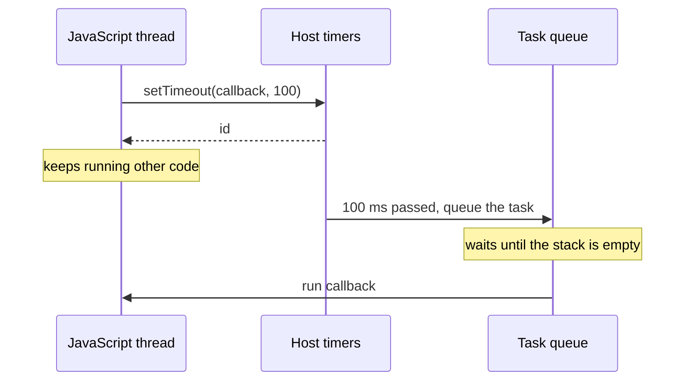

## Introduction

Most code you write runs immediately, one statement after another. Sometimes that is not what you want. A "Saved" message should disappear after three seconds. A search box should wait until the user stops typing before it calls the server. A request that has had no answer for ten seconds should be abandoned. A failed upload should be tried again after a short pause. Each of these needs a way to say: **run this function later**.

`setTimeout` is that way. You give it a function and a delay in milliseconds, and it arranges for the function to be called once, some time after the delay has passed. It returns an identifier, and passing that identifier to `clearTimeout` cancels the call if it has not happened yet.

```javascript
const id = setTimeout(() => console.log('three seconds later'), 3000);
clearTimeout(id);   // changed our mind: the callback will never run
```

Two facts about `setTimeout` surprise almost everyone at first, and this lesson is built around them. First, `setTimeout` **does not pause your program**. The line after it runs straight away; only the callback is postponed. Second, the delay is a **minimum, not an appointment**. The callback runs when the delay has passed *and* the JavaScript thread is free, which can be noticeably later.

Timers are also the standard way interviewers test whether you understand the [[b1-event-loop|event loop]], so being able to explain exactly when a timer callback runs is worth the effort.

## Before you start

- **Functions as values** — passing a function to another function without calling it. See [[b1-first-class-functions]].
- **The event loop, in outline** — the call stack, the task queue, and the rule that a queued callback runs only when the stack is empty. See [[b1-event-loop]]. This lesson repeats the parts it needs.
- **Arrow functions and closures** — callbacks usually read variables from the surrounding code. See [[b1-arrow-functions]] and [[b1-closures]].

Promises appear in a few examples. If you have not met them yet, read those examples for the timer behaviour and come back after [[b1-promises]].

## The intuition

Think of a kitchen with one cook and a row of egg timers. The cook is the JavaScript thread: one person, doing one thing at a time. Calling `setTimeout` is winding an egg timer and writing an instruction on a note next to it — "take the bread out". The cook does not stand and watch the timer. They go straight back to chopping.

When the timer rings, nothing is taken out of the oven yet. The note is put on the cook's **to-do rail**. The cook picks it up only after finishing the dish they are working on, and after any notes that were already on the rail. If the cook is in the middle of twenty minutes of uninterrupted work, the bread waits twenty minutes, whatever the timer said.

That is the whole model: the timer measures time somewhere else, the ring only *queues* the work, and the single cook gets to it when free. The analogy stops working in one place: a real cook can be interrupted. JavaScript cannot — the function that is currently running always finishes first.

## What setTimeout does

The full signature is:

```text
id = setTimeout(callback, delay, arg1, arg2, ...)
```

`callback` is the function to run later. `delay` is the minimum wait in milliseconds; if you leave it out, it is `0`. Any further arguments are passed to the callback when it is called. The return value identifies the timer.

```javascript title="basics.js"
console.log('1: before');

const id = setTimeout(() => {
  console.log('3: timer callback');
}, 100);

console.log('2: after, typeof id =', typeof id);
```

```output
1: before
2: after, typeof id = object
3: timer callback
```

The call to `setTimeout` returned immediately, so line `2` printed before the callback. The callback ran about 100 ms later, after the script had finished.

The output above is from Node.js 22, where the id is a `Timeout` object. In a browser the same line prints `typeof id = number`, because browsers return a positive integer. This difference rarely matters: in both hosts you store whatever you were given and hand it back to `clearTimeout`. It does matter in TypeScript, where the portable type is `ReturnType<typeof setTimeout>`.

`setTimeout` is not part of the JavaScript language. The ECMAScript specification, which defines the language, has no timers at all. Timers are provided by the **host** — the browser (where they are defined by the HTML Standard) or Node.js (where they are implemented on top of the libuv library). [[b1-runtimes]] explains that split. It is the reason some details differ between hosts, and this lesson names the host whenever they do.

### Passing arguments to the callback

Arguments after the delay are forwarded to the callback. The alternative is to wrap the call in an arrow function that closes over the values.

```javascript title="arguments.js"
function greet(greeting, name) {
  console.log(`${greeting}, ${name}`);
}

setTimeout(greet, 50, 'Hello', 'Ada');          // extra arguments are forwarded
setTimeout(() => greet('Hi', 'Grace'), 60);     // or close over them in an arrow
```

```output
Hello, Ada
Hi, Grace
```

Both are fine. The forwarded form evaluates the arguments at the moment you call `setTimeout`; the arrow form evaluates them when the callback runs. That difference shows up when a variable changes in between, which is the subject of [[b1-closures-in-loops]] and [[b1-stale-closures]].

### Pass the function, do not call it

The first argument must be a function *value*. Writing parentheses after the name calls the function immediately and passes its return value instead.

```javascript
setTimeout(showMessage(), 1000);   // wrong: runs showMessage now, schedules its result
setTimeout(showMessage, 1000);     // right: schedules showMessage itself
```

In the wrong version, `showMessage` runs at once. If it returns `undefined`, Node.js throws a `TypeError` because the callback is not a function, and a browser quietly schedules nothing useful. Either way the message does not appear a second later.

A related leftover from the early web: browsers also accept a *string* of code as the first argument and evaluate it like `eval` when the timer fires. Never use this. It is slow, it cannot see local variables, and a Content Security Policy that forbids `eval` blocks it. Node.js rejects a string with a `TypeError`.

## How it works internally

Follow one call, `setTimeout(callback, 100)`, from start to finish.

1. **Registration.** Your code calls into the host. The host records the callback, its arguments and the time at which the timer becomes due, in a list of active timers. It hands back an id. This takes microseconds, and your code continues.
2. **Waiting.** The time is tracked by the host, outside the JavaScript thread. No JavaScript runs for this timer while it waits, and the thread is free to do anything else — or nothing.
3. **Becoming due.** When the delay has passed, the host places a **task** on a task queue: "call this callback". A task (informally a *macrotask*, see [[b1-macrotasks]]) is a unit of work the event loop runs from an empty call stack.
4. **Running.** The event loop takes tasks one at a time. When it reaches this one — after the current code has finished, after all pending microtasks, and after any tasks ahead of it — it calls the callback.
5. **After.** A one-shot timer is removed from the host's list once it has fired.



Step 4 is where the "at least" comes from. The host promises that the task will not be queued *before* the delay has passed. It promises nothing about how long the task then waits in the queue. JavaScript finishes whatever function is running before it starts another — the rule called [[b1-run-to-completion|run-to-completion]] — so a timer can never interrupt code that is already executing.

You can watch this happen by keeping the thread busy:

```javascript title="late-timer.js"
const start = Date.now();

setTimeout(() => {
  console.log(`asked for 10 ms, ran after ${Date.now() - start} ms`);
}, 10);

while (Date.now() - start < 200) {
  // 200 ms of synchronous work: nothing else can run
}
console.log('synchronous work finished');
```

```output
synchronous work finished
asked for 10 ms, ran after 201 ms
```

The timer was due after 10 ms, and its task was queued then. But the `while` loop held the thread for 200 ms, so the callback ran at the first moment the stack was empty. The exact number varies by a millisecond or two between runs; it is never less than 200.

This also shows why `setTimeout` cannot be used to pause code. There is no "sleep" statement in JavaScript that blocks a function for a while and then continues on the next line. A busy loop like the one above does block, but it freezes everything — in a browser the page cannot scroll, repaint or respond to clicks while it spins. The correct way to wait is shown in the `sleep` example later.

### Order among timers

Timers with different delays fire in order of their due time. Timers with the *same* due time fire in the order they were created. So this prints `a`, then `b`, then `c`:

```javascript
setTimeout(() => console.log('b'), 5);
setTimeout(() => console.log('a'), 1);
setTimeout(() => console.log('c'), 5);
```

Each callback is its own task. After each one, the event loop runs every pending microtask before it takes the next timer, and in a browser it may also repaint the page in between.

## Minimum-Delay Misconception {#b1-minimum-delay}

The **minimum-delay misconception** is the belief that `setTimeout(fn, n)` runs `fn` exactly `n` milliseconds later — and in particular that `setTimeout(fn, 0)` runs `fn` immediately. Neither is true. The delay is a lower bound on when the callback *may* run, and several separate things push the real time later.

### Zero does not mean now

A delay of `0` still sends the callback through the task queue. It must wait for the current synchronous code to finish and for every pending microtask to run. Promise callbacks and `queueMicrotask` callbacks are microtasks, so they always run before a zero-delay timer that was scheduled earlier.

```javascript title="zero-delay.js"
setTimeout(() => console.log('timeout 0'), 0);
Promise.resolve().then(() => console.log('promise then'));
queueMicrotask(() => console.log('queueMicrotask'));
console.log('synchronous');
```

```output
synchronous
promise then
queueMicrotask
timeout 0
```

The timer was scheduled first and printed last. `setTimeout(fn, 0)` really means "run `fn` in a later task, as soon as the event loop gets to it". That is still useful — it lets the current code finish and, in a browser, gives the page a chance to repaint before `fn` runs — but it is not "immediately". [[b1-microtasks]] explains the two queues in full.

### Where the extra time comes from

**A busy thread.** As the `late-timer.js` example showed, a timer callback waits for whatever is running. One long function delays every timer that becomes due during it.

**Clamping of small delays.** Hosts raise very small delays to a floor. Node.js stores any delay below 1 ms (including `0`, negative numbers and `NaN`) as 1 ms. Browsers follow a rule in the HTML Standard about **nested** timers: once timers have been scheduled from inside timer callbacks more than five levels deep, any delay below 4 ms is raised to 4 ms. The rule exists because pages used to spin `setTimeout(fn, 0)` loops that burned the processor and drained batteries. It means a zero-delay timer chain in a browser settles at about 250 callbacks per second at most.

Node.js has no nesting rule, which this measurement shows. Each number is the gap between one callback and the next in a chain of zero-delay timers:

```javascript title="nested-zero.js"
const gaps = [];
let last = performance.now();
let hops = 0;

function hop() {
  const now = performance.now();
  gaps.push((now - last).toFixed(1));
  last = now;
  if (++hops < 10) setTimeout(hop, 0);    // each timer schedules the next
  else console.log(gaps.join('  '));
}

setTimeout(hop, 0);
```

```output
1.3  1.2  1.2  1.2  1.2  1.2  1.2  1.2  1.4  1.3
```

That is one run on Node.js 22; the figures change slightly every time, but they stay a little above 1 ms because of Node's 1 ms floor. This lesson's examples were not run in a browser. By the HTML Standard's rule, the same code there would show the first few gaps near zero and the later ones at 4 ms or more.

**Hidden tabs.** Browsers throttle timers in tabs the user cannot see, to save power. Timers in a background tab typically fire at most about once per second, and Chrome throttles further — to about once per minute — for pages that have been hidden for several minutes and keep chaining timers. A countdown driven by counting timer callbacks will fall far behind in a background tab.

**Very large delays.** Browsers store the delay as a 32-bit signed integer, so the largest usable delay is 2,147,483,647 ms, about 24.8 days. A larger value overflows and the timer fires almost at once. Node.js 22 handles the same case by printing a `TimeoutOverflowWarning` and setting the delay to 1 ms. To schedule something a month away, store the target date and re-check it with shorter timers.

**Clock resolution.** `Date.now()` returns whole milliseconds, so measuring a short timer with it can report `0` or `1` for the same real delay. Use `performance.now()` for measurements.

### What to do about it

Treat the delay as "not before". If something must be based on real elapsed time — a clock, a countdown, an animation — read the clock inside the callback (`Date.now()` or `performance.now()`) and compute from that, instead of assuming the callback ran on time.

Choose the scheduling tool by what you mean:

| You mean | Use |
|---|---|
| "After the current code, before anything else" | `queueMicrotask(fn)` — see [[b1-queue-microtask]] |
| "In a later task, letting the browser breathe" | `setTimeout(fn, 0)` |
| "Just before the next repaint" | `requestAnimationFrame(fn)` — see [[b1-requestanimationframe-js]] |
| "After pending I/O callbacks" (Node.js only) | `setImmediate(fn)` |
| "After at least n ms" | `setTimeout(fn, n)` |

And never write a test or a piece of logic that depends on a zero-delay timer beating a promise callback. It cannot.

## clearTimeout: cancelling a timer

`clearTimeout(id)` removes a timer from the host's list. If its callback has not run yet, it never will. Cancelling is how you express "this work is no longer wanted": the user typed another character, the component was removed from the page, the response arrived before the timeout.

```javascript title="clear.js"
const saveTimer = setTimeout(() => console.log('saved draft'), 50);
const hintTimer = setTimeout(() => console.log('showing hint'), 50);

clearTimeout(saveTimer);          // cancelled before it fired
clearTimeout(saveTimer);          // cancelling twice is harmless
clearTimeout(undefined);          // so is an id that never existed

setTimeout(() => {
  clearTimeout(hintTimer);        // too late: the callback already ran
  console.log('cleared hintTimer after it fired');
}, 100);
```

```output
showing hint
cleared hintTimer after it fired
```

`saved draft` never prints, because its timer was cancelled in time. `clearTimeout` is deliberately forgiving: an id that is unknown, already cancelled, already fired or `undefined` is ignored without an error, so cleanup code does not need to check first.

The last part of the example is the trap. `clearTimeout` **does not undo** anything. If the callback has already run, the work has happened and cancelling is a no-op. Code that needs to know whether the callback ran must record that itself, for example by setting a flag inside the callback.

Two smaller facts. First, timeouts and intervals share one pool of ids, so `clearTimeout` can cancel a timer created with `setInterval` and `clearInterval` can cancel a timeout. That is true in browsers (the HTML Standard says so) and in Node.js, but using the matching function makes the code easier to read. Second, to cancel a timer you must have kept its id. A timer started inside a function whose id is discarded cannot be cancelled later, which is why you see ids stored in variables, object fields or React refs.

> [!IMPORTANT] Whoever starts a timer owns its cleanup
> If the thing that scheduled a timer can go away before the timer fires — a closed dialog, an unmounted component, a finished request — cancel the timer at that moment. Otherwise the callback runs later against state that no longer exists.

## Worked examples

### A sleep function

There is no built-in way to pause in the middle of a function, but a promise that resolves from a timer gives you one that reads like a pause and does not block the thread. The same helper drives a retry loop that waits longer after each failure.

```javascript title="retry.mjs"
const sleep = (ms) => new Promise((resolve) => setTimeout(resolve, ms));

async function retry(task, attempts, delayMs) {
  for (let i = 1; i <= attempts; i++) {
    try {
      return await task(i);
    } catch (err) {
      console.log(`attempt ${i} failed: ${err.message}`);
      if (i === attempts) throw err;
      await sleep(delayMs * i);             // wait longer after each failure
    }
  }
}

const flaky = async (attempt) => {
  if (attempt < 3) throw new Error('network down');
  return 'payload';
};

console.log('result:', await retry(flaky, 5, 20));
```

```output
attempt 1 failed: network down
attempt 2 failed: network down
result: payload
```

`sleep(ms)` creates a promise and passes its `resolve` function to `setTimeout` as the callback. When the timer fires, the promise resolves, and the `async` function that was waiting on it continues. While it waits, the thread is free: other timers, events and rendering carry on. That is the difference from a busy loop. [[b1-await-does-not-block]] covers why `await` behaves this way, and [[b1-impl-retry-sleep]] develops the retry helper further. Node.js ships this helper as `setTimeout` from the `node:timers/promises` module.

### A timeout for a slow operation

A timer can also put an upper limit on how long you are willing to wait for something else.

```javascript title="with-timeout.js"
function withTimeout(promise, ms) {
  let timer;
  const timeout = new Promise((_, reject) => {
    timer = setTimeout(() => reject(new Error(`timed out after ${ms} ms`)), ms);
  });
  return Promise.race([promise, timeout]).finally(() => clearTimeout(timer));
}

const sleep = (ms, value) => new Promise((r) => setTimeout(r, ms, value));

withTimeout(sleep(20, 'fast'), 100).then(console.log);
withTimeout(sleep(300, 'slow'), 100).catch((e) => console.log(e.message));
```

```output
fast
timed out after 100 ms
```

`Promise.race` settles with whichever promise settles first: the real work or the timer's rejection. The `finally` step matters. Without `clearTimeout`, the losing timer would stay active after the fast case finished — harmless to the result, but in Node.js an active timer keeps the process from exiting until it fires. Note what this helper does *not* do: it stops waiting, but the slow operation itself keeps running. Stopping the work as well needs cancellation support such as [[b1-abort-controller-js|AbortController]]; for `fetch`, `AbortSignal.timeout(ms)` does both in one step ([[b3-abort-timeout]]).

## this and errors inside the callback

Two things change because the *host* calls your callback later, not your own code.

### The callback loses its object

When you pass a method as the callback, you pass the function alone. The host calls it as a plain function, so `this` is no longer the object.

```javascript title="lost-this.js"
const cart = {
  items: 3,
  report() {
    console.log('items:', this?.items);
  },
};

setTimeout(cart.report, 10);              // method detached from its object
setTimeout(() => cart.report(), 20);      // called as a method: this is cart
setTimeout(cart.report.bind(cart), 30);   // bound copy: this is cart
```

```output
items: undefined
items: 3
items: 3
```

In the first call, `this` inside `report` is whatever the host supplies: the `window` object in a browser, the `Timeout` object in Node.js. Neither has an `items` property. The fixes are to wrap the call in an arrow function, so it is made as `cart.report()`, or to pass a bound copy. [[b1-this-lost]] and [[b1-bind]] explain both.

### try/catch around setTimeout catches nothing

A `try` block protects code that runs *while the block is on the call stack*. By the time the timer callback runs, the function that called `setTimeout` returned long ago.

```javascript title="errors.js"
process.on('uncaughtException', (e) => console.log('[uncaught]', e.message));

try {
  setTimeout(() => {
    throw new Error('failed inside the timer');
  }, 10);
  console.log('setTimeout returned normally');
} catch (err) {
  console.log('caught:', err.message);    // never runs
}

setTimeout(() => {
  try {
    throw new Error('failed inside the timer');
  } catch (err) {
    console.log('caught inside the callback:', err.message);
  }
}, 20);
```

```output
setTimeout returned normally
[uncaught] failed inside the timer
caught inside the callback: failed inside the timer
```

The first error escaped the `catch` and became an **uncaught exception**. The example installs a Node.js `uncaughtException` handler only so that the program can continue and show the second case; without it, Node.js prints the stack trace and exits. In a browser, an uncaught error in a timer is reported to the console and to `window.onerror`, and the page keeps running. The rule in both hosts: handle errors **inside** the callback, or wrap the timer in a promise so the error travels through `await` and `catch` ([[b1-error-propagation]]).

```quiz
Q: What does this print? `setTimeout(() => console.log('A'), 0); Promise.resolve().then(() => console.log('B')); console.log('C');`
- [ ] A, B, C
- [ ] C, A, B
- [x] C, B, A
- [ ] The order of A and B is not defined
> `C` is synchronous and runs first. The promise callback is a microtask, and all microtasks run before the event loop takes the next task. The timer callback is a task, so it runs last even though it was scheduled first and has a delay of 0.

Q: A function calls `setTimeout(work, 50)` and then runs a synchronous loop that takes 400 ms. When does `work` run?
- [ ] After 50 ms, interrupting the loop
- [ ] After 50 ms, on another thread
- [x] After about 400 ms, once the loop has finished
- [ ] Never, because the timer expired while the thread was busy
> The timer becomes due at 50 ms and its task is queued, but JavaScript never interrupts running code. The callback runs when the call stack is next empty. An expired timer is not lost; it waits in the queue.

Q: `const id = setTimeout(save, 1000);` — two seconds later the code calls `clearTimeout(id)`. What happens?
- [ ] `save` is undone
- [ ] A `TypeError` is thrown because the timer no longer exists
- [x] Nothing: `save` already ran, and clearing a finished timer is a no-op
- [ ] `save` runs a second time
> `clearTimeout` only prevents a callback that has not run yet. It ignores ids that have already fired, were already cleared or never existed, and it cannot reverse work that has been done.

Q: Why does `setTimeout(user.logout, 1000)` fail with "cannot read properties of undefined" inside `logout`?
- [ ] Timers cannot call methods
- [x] Only the function is passed, so it is called without `user` as `this`
- [ ] The delay is too short for `user` to exist
- [ ] `logout` must be an arrow function
> `user.logout` evaluates to the function value; the link to `user` is not part of it. The host calls it as a plain function. Use `() => user.logout()` or `user.logout.bind(user)`. An arrow method would not help, because an arrow takes `this` from where it is defined, not from `user`.
```

## In real systems

**Debouncing.** A search box that queries the server on every keystroke wastes requests. The standard fix keeps one timer: every keystroke clears the previous timer and starts a new one, so the request is sent only when the user has paused. That `clearTimeout`-then-`setTimeout` pair is the whole of [[b1-debounce]].

**React components.** A timer started in an effect must be cancelled in the effect's cleanup function, or its callback will run after the component has gone and try to update state that no longer matters. The pattern is `useEffect(() => { const id = setTimeout(...); return () => clearTimeout(id); }, [...])`; see [[b4-effect-cleanup]]. Timer callbacks in components are also a common source of [[b1-stale-closures|stale closures]], because the callback keeps the variables from the render that created it.

**Timeouts and retries.** Network clients use timers to give up on slow calls and to space out retries, usually with a growing delay and some randomness so that many clients do not retry at the same instant. [[b1-timeouts-retries]] covers the design.

**Breaking up long work.** Processing 100,000 rows in one go freezes a page. Processing a chunk, then scheduling the next chunk with `setTimeout(next, 0)`, lets the browser handle input and repaint between chunks. See [[b1-long-tasks]].

**Node.js servers and scripts.** An active timer keeps the Node.js process alive. A forgotten 30-second timer makes a command-line script hang for 30 seconds after its work is done. Node's `Timeout` object has `unref()` for timers that should not hold the process open, and `refresh()` to restart the countdown without creating a new timer.

**Tests.** Tests should not wait for real time. Test runners such as Vitest and Jest provide fake timers that replace `setTimeout` and let the test advance the clock instantly.

## Trade-offs and alternatives

`setTimeout` is the right tool for "do this once, later" and for cancellable delays. It is the wrong tool in a few common cases.

| Need | Better choice | Why |
|---|---|---|
| Run something repeatedly | `setInterval`, or a chain of timeouts | See [[b1-setinterval]] for which and why |
| Visual animation | `requestAnimationFrame` | Timers are not aligned with screen repaints, so motion stutters |
| Run right after the current code | `queueMicrotask` or a promise | No trip through the task queue |
| Precise timing | Read the clock and correct | The delay is only a minimum |
| Cancel the underlying work | `AbortController` | `clearTimeout` cancels the timer, not a request in flight |
| Low-priority background work in browsers | `requestIdleCallback` or `scheduler.postTask` | The browser picks a quiet moment; see [[b3-idle-callback]] and [[b3-scheduler-posttask]] |

A timer also has a cost that is easy to forget: until it fires or is cleared, the host holds a reference to the callback, and the callback holds every variable it closes over. A long timer that captures a large object keeps that object in memory for the whole delay ([[b1-closure-memory]]).

## Common mistakes

> [!MISTAKE] Expecting the code after setTimeout to wait
> `setTimeout(load, 1000); render();` runs `render` immediately, before `load`. Anything that must happen after the delay belongs inside the callback, or after an `await sleep(1000)`.

**Calling the function instead of passing it.** `setTimeout(tick(), 1000)` runs `tick` now. Pass `tick`, or `() => tick(arg)`.

**Using a timer to "wait for" something.** Code such as `setTimeout(readResult, 500)` hopes a request will be finished in half a second. On a slow network it is not, and on a fast one the user waits for nothing. React to the actual completion — a promise, a callback or an event — and use timers only for limits and pauses.

**Assuming zero means immediate.** `setTimeout(fn, 0)` runs after all synchronous code and all microtasks, and is clamped by the host.

**Forgetting to clear.** Timers that outlive what created them cause state updates on removed components, duplicate requests, and Node.js processes that will not exit. Store the id and clear it in the cleanup path.

**Counting callbacks to measure time.** Ten callbacks of a 100 ms timer do not mean one second has passed. Compare timestamps.

**Passing a method without binding.** `setTimeout(obj.method, 0)` loses `this`.

## Interview perspective

Timer questions are event-loop questions. The interviewer wants to hear the path the callback takes — host timer, task queue, empty stack — not a memorised output.

> [!INTERVIEW] What a strong answer sounds like
> "`setTimeout` registers the callback with the host and returns. When the delay has passed, the host queues a task. The event loop runs that task only when the call stack is empty and the microtask queue has been drained, so the delay is a minimum. That is why a zero-delay timer still prints after synchronous code and after promise callbacks."

Questions to be ready for:

- **Does `setTimeout(fn, 0)` run immediately?** No. It queues a task for a later turn of the loop; synchronous code and microtasks run first, and hosts clamp the delay (1 ms in Node.js, 4 ms for deeply nested timers in browsers).
- **Is `setTimeout` part of JavaScript?** No, it is a host API: the HTML Standard defines it for browsers, and Node.js provides its own implementation. That is why return types and clamping differ.
- **Why can a timer fire late?** A busy main thread, tasks ahead of it in the queue, clamping, and throttling in hidden tabs.
- **What does the loop with `var` and `setTimeout` print, and why?** All callbacks share one `var` binding and run after the loop ends, so they print the final value; `let` gives each iteration its own binding. See [[b1-closures-in-loops]].
- **Implement `sleep`, `debounce` or a promise timeout.** All three are a few lines over `setTimeout` and `clearTimeout`; be ready to explain the cleanup.
- **How do you cancel a pending timer in a React component?** Return a cleanup function from the effect that calls `clearTimeout`.
- **Can you catch an error thrown in a timer callback with `try`/`catch` around `setTimeout`?** No; the `try` block has finished by the time the callback runs.

More ordering questions are worked through in [[b1-event-loop-puzzles]].

## Practice

1. **Predict, then run.** Write a script with two `console.log` calls, one `setTimeout(…, 0)`, one `setTimeout(…, 10)` and one `Promise.resolve().then(…)`. Write down the order before running it.
2. **Cancellable delay.** Write `delay(ms)` that returns an object `{ promise, cancel }`. Calling `cancel()` before the time is up must clear the timer and reject the promise.
3. **Debounce.** Write `debounce(fn, ms)` that returns a function which calls `fn` only after `ms` milliseconds without another call. Check that `this` and the arguments reach `fn`.
4. **Measure lateness.** Schedule a 50 ms timer, then block the thread for 20 ms, 100 ms and 300 ms in three experiments. Record when the callback runs each time and explain the three results.
5. **Long delay.** Write `setLongTimeout(fn, ms)` that works for delays longer than 24.8 days by chaining shorter timers, and returns a function that cancels it.

## Quick revision {#quick-revision}

- `setTimeout(callback, delay, ...args)` schedules `callback` to run once, after at least `delay` ms; it returns at once with a timer id.
- It is a host API, not part of ECMAScript. Browsers return a number; Node.js returns a `Timeout` object. Pass either back to `clearTimeout`.
- The callback runs as a task: after the current synchronous code, after all microtasks, when the call stack is empty.
- The delay is a minimum. A busy thread, clamping (1 ms floor in Node.js; 4 ms for timers nested more than five deep in browsers), hidden-tab throttling and queueing all add time.
- `setTimeout(fn, 0)` is not immediate; promise callbacks and `queueMicrotask` run first.
- Delays above 2,147,483,647 ms (about 24.8 days) overflow and fire almost immediately.
- `clearTimeout(id)` prevents a pending callback. It is a no-op for fired, cleared or unknown ids and never undoes work.
- Pass a function, not a call: `setTimeout(fn, 100)`, not `setTimeout(fn(), 100)`.
- Methods lose `this` when passed directly; use an arrow wrapper or `bind`.
- `try`/`catch` around `setTimeout` does not catch errors thrown later inside the callback.
- `sleep = (ms) => new Promise((r) => setTimeout(r, ms))` is the non-blocking way to pause an `async` function.
- Clear timers when their owner goes away (effect cleanup, closed dialog, settled request).

## Key takeaways {#key-takeaways}

- `setTimeout` does not pause anything; it hands a function to the host and returns, and the rest of your code keeps running.
- When the delay passes, the callback is only queued. It runs when the single JavaScript thread is free, so the delay is a lower bound.
- Zero delay means "in a later task", which is after all synchronous code and all microtasks.
- `clearTimeout` cancels a callback that has not run yet and does nothing otherwise; keep the id and clean up when the timer's owner goes away.
- Because the host calls the callback later, it has no `this` from your object and no surrounding `try` block — bind what you need and handle errors inside.
- Almost every higher-level timing tool — sleep, debounce, timeouts, retries with backoff — is a small wrapper around these two functions.
