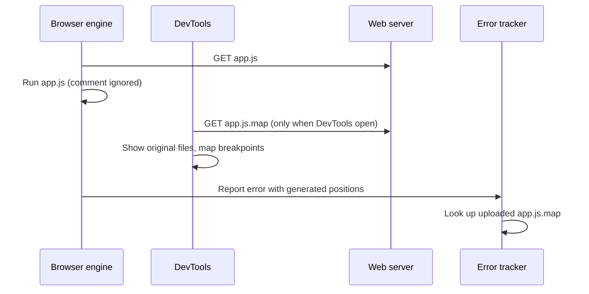

## Introduction

Modern frontend code goes through several transformations before a browser sees it. TypeScript is compiled to JavaScript, JSX is turned into function calls, hundreds of modules are bundled into a few files, and a minifier removes whitespace and renames `calculateTotalPrice` to `t`. The result is fast to download and parse, but it is nothing like what you wrote. If an error happens on "line 1, column 48,213 of `index-3f9a1c.js`", that position is useless to a human.

A **source map** solves this. It is a JSON file, produced by the same tool that transformed the code, that records for each position in the **generated** file which position in which **original** file it came from — and optionally the original identifier name. Debuggers read the map to show you your original TypeScript or JSX, let you set breakpoints in it and step through it. Error-tracking services read it to turn a minified production stack trace into one that points at `src/cart/total.ts:42`.

Three facts frame everything in this lesson. A source map is **for tools, not for the engine**: the JavaScript engine never reads it, so adding or removing one cannot change how your program behaves. A source map is **a lookup table, not a decompiler**: it can only point back to positions the build tool recorded. And a source map can **contain your original source code**, which makes publishing one a deliberate decision rather than a default.

## Before you start

- **Browser DevTools** — the Sources panel, breakpoints and the call stack. See [[b1-devtools]] and [[b1-breakpoints]].
- **Stack traces** — reading `at fn (file:line:column)` lines. See [[b1-stack-traces]].
- **What a build step does** — at least the idea that TypeScript is compiled and bundles are minified. TypeScript's own options are covered in [[b2-source-maps-ts]], and bundler setup in [[b2-vite-typescript]].

## The intuition

Think of a translated book with a concordance at the back: "page 212, line 7 of this edition corresponds to chapter 9, paragraph 3 of the original". The concordance does not change the translation and is not needed to read it. It exists so that a scholar can go from any passage back to the original text. If the publisher includes the original text itself in the appendix, the scholar does not even need a copy of the original book.

A source map is that concordance. The generated file is the translation the engine actually reads. The `mappings` field is the table of correspondences. The optional `sourcesContent` field is the appendix with the original text. And just as a concordance compiled for the first edition is wrong for the second, a source map built from different code than the file it describes gives wrong answers — a common real-world bug.

The analogy stops at one point: a concordance usually maps whole lines, but a source map maps individual columns, because a minified file may put your entire application on one line.

## A source map from start to finish

The clearest way to understand a source map is to make one. Here is a small TypeScript module with a deliberate error path:

```ts title="src/price.ts"
interface Item {
  name: string;
  cents: number;
}

export function total(items: Item[]): number {
  let sum = 0;
  for (const item of items) {
    if (item.cents < 0) {
      throw new Error(`negative price for ${item.name}`);
    }
    sum += item.cents;
  }
  return sum;
}

console.log(total([{ name: 'tea', cents: 350 }]));
console.log(total([{ name: 'refund', cents: -100 }]));
```

Compiling it with the TypeScript compiler (version 6.0) and `--sourceMap` produces two files:

```bash
tsc src/price.ts --outDir dist --sourceMap --target es2022 --module nodenext \
  --moduleResolution nodenext --rootDir src
```

```js title="dist/price.js"
"use strict";
Object.defineProperty(exports, "__esModule", { value: true });
exports.total = total;
function total(items) {
    let sum = 0;
    for (const item of items) {
        if (item.cents < 0) {
            throw new Error(`negative price for ${item.name}`);
        }
        sum += item.cents;
    }
    return sum;
}
console.log(total([{ name: 'tea', cents: 350 }]));
console.log(total([{ name: 'refund', cents: -100 }]));
//# sourceMappingURL=price.js.map
```

```json title="dist/price.js.map"
{"version":3,"file":"price.js","sourceRoot":"","sources":["../src/price.ts"],"names":[],"mappings":";;AAKA,sBASC;AATD,SAAgB,KAAK,CAAC,KAAa;IACjC,IAAI,GAAG,GAAG,CAAC,CAAC;IACZ,KAAK,MAAM,IAAI,IAAI,KAAK,EAAE,CAAC;QACzB,IAAI,IAAI,CAAC,KAAK,GAAG,CAAC,EAAE,CAAC;YACnB,MAAM,IAAI,KAAK,CAAC,sBAAsB,IAAI,CAAC,IAAI,EAAE,CAAC,CAAC;QACrD,CAAC;QACD,GAAG,IAAI,IAAI,CAAC,KAAK,CAAC;IACpB,CAAC;IACD,OAAO,GAAG,CAAC;AACb,CAAC;AAED,OAAO,CAAC,GAAG,CAAC,KAAK,CAAC,CAAC,EAAE,IAAI,EAAE,KAAK,EAAE,KAAK,EAAE,GAAG,EAAE,CAAC,CAAC,CAAC,CAAC;AAClD,OAAO,CAAC,GAAG,CAAC,KAAK,CAAC,CAAC,EAAE,IAAI,EAAE,QAAQ,EAAE,KAAK,EAAE,CAAC,GAAG,EAAE,CAAC,CAAC,CAAC,CAAC"}
```

The generated file has two new lines at the top, the `interface` is gone (types do not exist at runtime), and every line has moved. The last line is a comment: `//# sourceMappingURL=price.js.map`. This **`sourceMappingURL` comment** is how tools find the map. The engine treats it as an ordinary comment.

### What the map does to a stack trace

Node.js can apply source maps to stack traces when started with `--enable-source-maps` (available since Node.js 12.12). Running the compiled file both ways shows the difference — this is the clearest demonstration that the map changes what *tools report*, not what the program *does*:

```bash
node dist/price.js
node --enable-source-maps dist/price.js
```

```output
350
Error: negative price for refund
    at total (/app/dist/price.js:8:19)
    at Object.<anonymous> (/app/dist/price.js:15:13)

350
Error: negative price for refund
    at total (/app/src/price.ts:10:13)
    at Object.<anonymous> (/app/src/price.ts:18:13)
```

The output is trimmed to the first frames, and your paths will differ. Both runs print `350` and throw the same error at the same moment. Without the map, the trace points at line 8 of the compiled JavaScript; with it, at line 10 of the TypeScript — the `throw` you actually wrote. In both cases the column points at `new Error(...)`, where the error object was created. It is column 19 in the compiled file, which indents that line by twelve spaces, and column 13 in the original, which indents it by six.

## The format, field by field

The format used everywhere today is **Source Map version 3**, originally a 2011 design by Google and Mozilla engineers, and standardised by Ecma International as **ECMA-426** in December 2024. A map is a JSON object with these fields:

| Field | Meaning |
|---|---|
| `version` | Always `3` |
| `file` | The generated file this map describes (optional) |
| `sources` | Original file paths or URLs, resolved relative to the map's own location (and `sourceRoot` if set) |
| `sourceRoot` | Optional prefix added to every entry in `sources` |
| `sourcesContent` | Optional array holding the full text of each original file, in the same order as `sources` |
| `names` | Original identifiers, referenced by index from `mappings` |
| `mappings` | The encoded position table |
| `ignoreList` | Indexes into `sources` that debuggers should treat as library code (older tools used `x_google_ignoreList`) |

`sourcesContent` deserves attention. If it is present, a debugger can show the original code without downloading the original files — convenient, but it means the map *is* a copy of your source. If it is absent, the debugger tries to fetch each URL in `sources`, which fails for paths that only exist on a build machine. TypeScript omits it unless you set `inlineSources`; most bundlers include it by default.

In our example `names` is empty because TypeScript did not rename anything. A minifier fills it — when `calculateTotal` becomes `t`, the segment for `t` points at the index of `"calculateTotal"` in `names`, so tools can display the original name.

### How `mappings` is encoded

The `mappings` string is where all the information is, and its encoding is designed to keep maps small.

1. **Lines are separated by `;`.** The *n*-th group describes line *n* of the generated file. Our string starts with `;;`, so generated lines 1 and 2 (`"use strict"` and `Object.defineProperty`) have no mappings — they did not come from any line of the TypeScript file.
2. **Segments within a line are separated by `,`.** Each segment marks a point in the generated line where a new mapping starts.
3. **Each segment has 1, 4 or 5 numbers**: the generated column; then the source index (into `sources`), the original line and the original column; then optionally the index into `names`. A 1-number segment marks generated code that maps to nothing.
4. **Numbers are relative to the previous segment.** The generated column resets to zero on every new line; the other fields keep accumulating across the whole file. Small differences are much shorter to encode than large absolute positions.
5. **Numbers are written in Base64 VLQ** (variable-length quantity). Each Base64 character carries 5 bits of data plus a *continuation bit* that says whether more characters follow; the lowest bit of the decoded number is the sign. Small numbers — the common case, thanks to step 4 — take a single character.

Take the first segment on generated line 3, `AAKA`. In Base64, `A` is 0 and `K` is 10. None of them has the continuation bit (value 32), so each character is a complete number. Dropping the sign bit (shifting right by one) gives `0, 0, 5, 0`: generated column 0, source 0 (`../src/price.ts`), original line 0 + 5 = 5 (zero-based, so line 6 — `export function total`), original column 0. That is correct: `exports.total = total;` was generated from the `export` on line 6.

### Decoding a whole map

A decoder is short enough to write yourself, and doing it removes any mystery from what a debugger does. This program decodes the map above, then performs the same lookup Node.js did for the stack trace — it finds the last mapping at or before generated line 8, column 19:

```js title="decode.mjs"
import { readFileSync } from 'node:fs';

const B64 = 'ABCDEFGHIJKLMNOPQRSTUVWXYZabcdefghijklmnopqrstuvwxyz0123456789+/';

// One segment like "AAKA" -> [0, 0, 5, 0]. Each base64 digit carries 5 data bits;
// bit 6 (value 32) means "more digits follow"; the lowest bit of the result is the sign.
function decodeSegment(segment) {
  const values = [];
  let value = 0;
  let shift = 0;
  for (const ch of segment) {
    const digit = B64.indexOf(ch);
    value += (digit & 31) << shift;
    if (digit & 32) {
      shift += 5;
    } else {
      values.push(value & 1 ? -(value >> 1) : value >> 1);
      value = 0;
      shift = 0;
    }
  }
  return values;
}

// Expand the whole "mappings" string into absolute positions (all 0-based).
function decodeMappings(map) {
  const result = [];
  let source = 0, origLine = 0, origCol = 0, name = 0;
  map.mappings.split(';').forEach((lineText, genLine) => {
    let genCol = 0; // generated column restarts on every generated line
    for (const seg of lineText.split(',').filter(Boolean)) {
      const v = decodeSegment(seg);
      genCol += v[0];
      if (v.length >= 4) {
        source += v[1]; origLine += v[2]; origCol += v[3];
        if (v.length === 5) name += v[4];
        result.push({ genLine, genCol, source: map.sources[source], origLine, origCol });
      }
    }
  });
  return result;
}

console.log('AAKA ->', decodeSegment('AAKA'));
console.log('sBASC ->', decodeSegment('sBASC'));

const map = JSON.parse(readFileSync('dist/price.js.map', 'utf8'));
const mappings = decodeMappings(map);
console.log('total segments:', mappings.length);

// The stack said dist/price.js:8:19 (1-based). Find the last segment at or before it.
const line = 8 - 1, col = 19 - 1;
const hit = mappings.filter((m) => m.genLine === line && m.genCol <= col).at(-1);
console.log(`price.js:8:19 -> ${hit.source}:${hit.origLine + 1}:${hit.origCol + 1}`);

const covered = new Set(mappings.map((m) => m.origLine + 1));
console.log('original lines with mappings:', [...covered].sort((a, b) => a - b).join(' '));
```

```output
AAKA -> [ 0, 0, 5, 0 ]
sBASC -> [ 22, 0, 9, 1 ]
total segments: 102
price.js:8:19 -> ../src/price.ts:10:13
original lines with mappings: 6 7 8 9 10 11 12 13 14 15 17 18
```

Walk through the important parts. `decodeSegment` reads characters until one lacks the continuation bit, then converts the accumulated value to a signed number. `sBASC` shows a multi-character number: `s` is 44, which has the continuation bit set, so it combines with the next character `B` to give 22. `decodeMappings` keeps running totals because every field is relative, and resets only `genCol` per line. The lookup reproduces Node's answer exactly: `price.ts:10:13`. Notice the last line: original lines 1–5 (the `interface`) and 16 (blank) have no mappings at all. Code that produced no output cannot be mapped to, which is why a debugger refuses to place a breakpoint on a TypeScript type declaration.

Production tools do the same thing, only faster: they decode once into a sorted array and binary-search it for each lookup.

## How tools find and use a map



There are two standard ways for a generated file to point at its map: the trailing `//# sourceMappingURL=<url>` comment (`/*# sourceMappingURL=<url> */` in CSS), or a **`SourceMap` HTTP response header** on the JavaScript file. The URL is resolved relative to the generated file and may also be a `data:` URL, which embeds the whole map inline — convenient in development but it makes the file much larger, so it should not ship to users.

The engine ignores both. A browser fetches the map only when DevTools are open (and source maps are enabled in their settings, as they are by default). That is why shipping a map has no effect on users' download size or performance unless the map is inlined: the `.map` file is a separate request that only debugging tools make.

Once DevTools have the map, they show the original files in the Sources panel's file tree, usually under the paths in `sources`. Setting a breakpoint on an original line makes DevTools look up the generated position(s) for that line and set the real breakpoint there. Stepping is translated the same way in reverse. One original line can map to several generated places (for example, a loop that a compiler duplicated) or to none.

Where stack traces are concerned, browser DevTools display mapped locations for errors they show, but **`error.stack` remains the generated positions** — the string your code sees is not rewritten. That is why error trackers rewrite stacks on their own servers. Node.js is the exception: with `--enable-source-maps` (or `process.setSourceMapsEnabled(true)`, available since Node.js 16.6), it rewrites `error.stack` itself. That rewriting costs time every time a stack is formatted, so services that create many errors should measure it.

## Producing maps: build tool settings

Every common tool can emit maps, with the same small set of choices: **external** (separate `.map` file with a comment), **inline** (embedded as a `data:` URL), or **hidden** (separate file, but no comment, so browsers never find it).

| Tool | Typical settings |
|---|---|
| TypeScript `tsc` | `sourceMap`, `inlineSourceMap`, `inlineSources` (adds `sourcesContent`), `declarationMap` for `.d.ts` files |
| Vite | Dev server always serves maps; for builds `build.sourcemap`: `false` (default), `true`, `'inline'` or `'hidden'` |
| webpack | `devtool`: for example `'eval-cheap-module-source-map'` in development, `'source-map'`, `'hidden-source-map'` or `'nosources-source-map'` in production |
| esbuild | `--sourcemap` (linked), `--sourcemap=inline`, `--sourcemap=external` (no comment) |

In a multi-stage build — TypeScript, then a bundler, then a minifier — each stage must read the previous stage's map and produce a combined one. Modern bundlers do this automatically; when you hand-assemble a pipeline and one step drops the map, positions end up pointing at an intermediate file.

Development builds favour speed and accuracy; production builds have a different question to answer.

## Source maps in production

Production maps are what make a minified error report readable, so you want them *somewhere*. The question is who may download them. If you deploy `app.js.map` publicly with `sourcesContent`, anyone can open DevTools and read your original source, including comments, internal file names, feature-flag names for unreleased features and dead code.

There are three common policies:

1. **Public maps.** Simple, and helpful for open-source projects. The cost is that the source is readable by anyone.
2. **Hidden maps uploaded to an error tracker.** Build with hidden maps, upload the `.map` files to Sentry, Datadog or similar as part of the release, and do not deploy them to the public web server. Users' browsers never fetch them; your tracker rewrites stacks. This is the most common choice for commercial applications.
3. **Maps behind access control.** Serve maps only on an internal network or behind authentication, so engineers' DevTools can still load them.

It is worth being precise about the security trade-off. Minification is not protection: everything sent to the browser is already public, and any secret in client code is exposed with or without a map. Withholding maps hides *readability*, comments and project structure, not secrets. Never rely on it to protect API keys or business rules that must be enforced on the server.

> [!WARNING] Matching maps to builds
> A map only describes the exact file it was produced with. Upload maps for every release, tied to that release's version or build id. If a tracker uses a map from a different build, it will confidently show the wrong line — often worse than no map at all.

## In real systems

A typical production setup looks like this. The continuous-integration job builds with hidden source maps, uploads them to the error tracker tagged with the release version (newer setups embed a unique **debug id** in both the bundle and the map so they can be matched without relying on file names), and then deletes the `.map` files before deploying the static assets. When a user's browser throws, the tracker receives a stack with positions like `index-3f9a1c.js:1:48213`, finds the matching map, and shows the engineer `src/cart/total.ts:42` with surrounding source.

Frameworks also use the `ignoreList` field. When React, Angular or Vite produce maps for their own code and dependencies, they mark those sources as ignorable, and DevTools then collapse them in call stacks and skip them while stepping — the automatic version of the ignore-listing described in [[b1-breakpoints]].

On the server, Node.js services written in TypeScript often run with `--enable-source-maps` (or set it in `NODE_OPTIONS`) so that logs contain TypeScript line numbers. Tools that run TypeScript directly, such as `tsx`, handle mapping for you.

## Trade-offs and alternatives

| Option | Debugging quality | Cost |
|---|---|---|
| No maps | Generated code only; pretty-print restores layout but not names or files | None |
| Inline maps | Full; no extra request | File size roughly doubles or worse; never ship to users |
| External public maps | Full, for anyone | Source is readable by anyone |
| Hidden maps + tracker upload | Full in error reports; none in users' DevTools | Build/upload step to maintain |
| `nosources` maps | Original file names and lines, but no code text | Debuggers cannot show source without the files |

Faster development map types (such as webpack's `eval-cheap-*` variants) sacrifice column precision for rebuild speed; that is usually fine while developing, but production maps should be full quality because they are what you debug real users' errors with.

## Common mistakes

**Stale maps.** The map was built from different code than the file being served — a cached old map, a manual edit to a built file, or a deploy that uploaded maps from another build. Symptoms are breakpoints that land on blank lines or errors that point at unrelated code. Rebuild, clear the cache, and check that the map and file come from the same build.

**Expecting the engine to use the map.** Without DevTools, a tracker or `--enable-source-maps`, nothing reads it. `error.stack` in a browser still shows generated positions.

**Deploying inline maps to production.** A `data:` URL map is part of the JavaScript file, so every user downloads it.

**Assuming hidden maps protect secrets.** They protect readability. Secrets in client code are already exposed.

**Breaking the chain in a multi-step build.** If a custom transform does not consume and re-emit the incoming map, the final map points at intermediate output.

**Trying to break on type-only lines.** Interfaces and type aliases produce no JavaScript, so there is no generated position to stop at.

## Interview perspective

- *"What is a source map and who uses it?"* A JSON lookup table from generated positions to original file, line, column and name, used by debuggers, error trackers and Node's `--enable-source-maps`. The engine itself ignores it.
- *"Does a source map affect performance?"* Not for users, unless inlined: browsers only fetch external maps when DevTools are open. Node's stack rewriting has a cost when formatting stacks.
- *"Would you publish source maps in production?"* A good answer weighs debuggability against exposing source, describes hidden maps uploaded to an error tracker, and states that client code is never secret anyway.
- *"How are mappings encoded?"* Lines by `;`, segments by `,`, 1/4/5 relative fields in Base64 VLQ.
- Follow-up: *"Your production stack trace points at a blank line in the original file. What happened?"* A mismatched or stale map.

```quiz
Q: A team adds `//# sourceMappingURL=app.js.map` to its bundle and deploys the map. What changes for a user who never opens DevTools?
- [ ] The engine parses the map and runs code slightly slower
- [ ] Error messages in `error.stack` now show original TypeScript lines
- [x] Nothing in how the code runs; the browser does not download the map unless DevTools need it
- [ ] The map replaces the bundle when it is newer
> The comment is ignored by the engine, and browsers fetch external maps only for debugging tools. `error.stack` still contains generated positions in browsers. The only real effect is that anyone who does open DevTools can read the original source if the map includes it.
```

```quiz
Q: In a mappings segment `AAKA`, which statement is true?
- [ ] It means generated line 10 maps to original line 0
- [x] It decodes to the relative values 0, 0, 5, 0: generated column, source index, original line and original column
- [ ] `K` is the name index
- [ ] The values are absolute positions from the start of the file
> Segments carry 1, 4 or 5 Base64 VLQ numbers. Four values mean generated column, source, original line, original column; a fifth would be the name index. They are relative to the previous segment (the generated column only within the current line), so `5` means "five lines after the previous original line".
```

```quiz
Q: Production error reports point at lines that do not match the code that threw. What is the most likely cause?
- [ ] The minifier renamed variables
- [ ] Source maps cannot represent columns
- [x] The map used by the error tracker was built from a different version of the code
- [ ] `sourcesContent` was omitted
> Renaming is exactly what maps record, and maps are column-precise. Omitting `sourcesContent` hides the code text but keeps positions correct. Wrong lines almost always mean the map and the generated file came from different builds, so maps must be uploaded per release.
```

## Practice

1. Compile a small TypeScript file with and without `--inlineSources` and compare the maps. Which field appears?
2. Run `decode.mjs` against a map produced by a minifier (for example, Vite's production build of a small app) and find a segment with five fields. What does its name index point to?
3. Change `src/price.ts` and run the old `dist/price.js` with the old map but the new source. Predict and then observe what goes wrong.
4. Configure a Vite project with `build.sourcemap: 'hidden'`. Confirm that `.map` files are emitted and that the bundles contain no `sourceMappingURL` comment.
5. Explain in three sentences to a teammate why withholding source maps does not protect an API key in the frontend.

## Quick revision {#quick-revision}

- Source map = JSON mapping generated positions to original file, line, column (and name). Format version 3, standardised as ECMA-426 (2024).
- Fields: `version`, `file`, `sources`, `sourceRoot`, `sourcesContent`, `names`, `mappings`, `ignoreList`.
- `mappings`: `;` per generated line, `,` per segment; segments of 1, 4 or 5 Base64 VLQ numbers, relative to the previous segment; generated column resets per line.
- Linked by `//# sourceMappingURL=` comment or `SourceMap` header; may be a `data:` URL (inline).
- The engine ignores maps. Browsers fetch them only for DevTools. Browser `error.stack` stays generated.
- Node: `--enable-source-maps` (12.12+) or `process.setSourceMapsEnabled(true)` rewrites stacks.
- Lines with no generated code (types, blank lines) cannot be mapped to or broken on.
- Production: hidden maps uploaded to the error tracker per release are the usual choice; public maps expose source; neither protects secrets.
- Stale or mismatched maps give confidently wrong lines.

## Key takeaways {#key-takeaways}

- A source map is a lookup table for tools; it never changes what the program does.
- Debuggers use it to show original files and translate breakpoints; error trackers use it to rewrite minified stacks.
- The `mappings` string is compact because every number is relative and Base64 VLQ-encoded.
- `sourcesContent` makes a map self-contained, which is also why a public map publishes your source.
- In production, upload hidden maps to your error tracker and make sure each map matches its build exactly.
