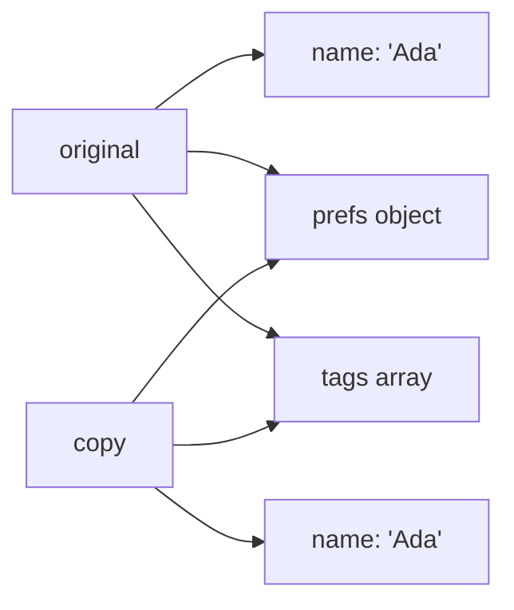

## Introduction

Before 2015, a JavaScript programmer who wanted to find the largest number in an array, copy an array with one extra element, merge two settings objects, and write a function that accepted any number of arguments wrote four different idioms:

```javascript
const prices = [12, 7, 31, 4];
const highest = Math.max.apply(null, prices);
const withExtra = prices.slice().concat([5]);
const defaults = { theme: 'light', pageSize: 20 };
const settings = Object.assign({}, defaults, { pageSize: 50 });
function logAll() {
  const args = Array.prototype.slice.call(arguments);
  console.log(args.join(' | '));
}
console.log(highest, withExtra, settings);
logAll('a', 'b', 'c');
```

```output
31 [ 12, 7, 31, 4, 5 ] { theme: 'light', pageSize: 50 }
a | b | c
```

Each works, but each needs a different API, and two of them (`apply` with a meaningless `null`, borrowing `slice` to convert `arguments`) only make sense once you know why they are there. The same program with three dots:

```javascript
const prices = [12, 7, 31, 4];
const highest = Math.max(...prices);
const withExtra = [...prices, 5];
const defaults = { theme: 'light', pageSize: 20 };
const settings = { ...defaults, pageSize: 50 };
function logAll(...args) {
  console.log(args.join(' | '));
}
console.log(highest, withExtra, settings);
logAll('a', 'b', 'c');
```

```output
31 [ 12, 7, 31, 4, 5 ] { theme: 'light', pageSize: 50 }
a | b | c
```

The `...` token has two jobs. **Spread** takes one collection and expands it into separate values: `...prices` turns an array into four arguments, or four elements of a new array. **Rest** does the opposite: it takes several separate values and collects them into one new array or object: `...args` gathers every argument passed to `logAll`. Spread for arrays and calls, and rest for parameters and array destructuring, arrived in ES2015; spread and rest for object properties arrived in ES2018.

You will meet both on almost every page of modern JavaScript: React state updates, Redux reducers, configuration merging, wrapper functions that forward their arguments, and API code that strips fields before sending a payload. This lesson covers each form, the exact rules that decide what gets copied, and the one property that causes most bugs — every copy is **shallow**.

## Before you start

- **Arrays and objects** — creating them with literals and reading elements and properties. See [[b1-array-basics]] and [[b1-object-literals]].
- **Function parameters** — how arguments are matched to parameters and what default parameters do. See [[b1-parameters]].
- **Destructuring** — unpacking values with patterns; rest is one of its features. See [[b1-destructuring]].
- **References** — that a variable holding an object holds a reference to it, so two variables can point at the same object. See [[b1-copying-objects]].
- **Iterables** (helpful, not required) — the protocol that lets `for...of` walk arrays, strings, Sets and Maps. See [[b1-iterable-protocol]].

## The intuition

Think of a box of loose items. **Spread** tips the box out onto a table: the items are now individual things you can arrange alongside others, and they can be poured into a new box. **Rest** sweeps whatever is left on the table into a fresh box. Both forms always produce *new* containers; neither modifies the box it came from.

Because they share a token, you tell them apart by position:

| Where the `...` appears | Form | What it does |
|---|---|---|
| Inside an array literal `[...x]` | Spread | Puts each element of iterable `x` into the new array |
| Inside a call's arguments `f(...x)` or `new C(...x)` | Spread | Passes each element of iterable `x` as a separate argument |
| Inside an object literal `{ ...x }` | Spread | Copies `x`'s own enumerable properties into the new object |
| In a parameter list `function f(...x)` | Rest | Collects remaining arguments into array `x` |
| In a destructuring pattern `[a, ...x]` or `{ a, ...x }` | Rest | Collects remaining elements or properties into new `x` |

A short way to remember it: where a value is being *built* (an array literal, an argument list, an object literal), `...` spreads. Where values are being *received* into names (a parameter list, a destructuring pattern on the left of `=`), `...` collects.

The analogy stops working in one place: tipping out a box moves the items, while spread copies the *references* to them. If one of the items is itself a box (a nested object), the new container holds the same inner box, not a copy of it. That is the shallow-copy rule, covered below.

## Spread in array literals

Inside square brackets, `...value` asks `value` for its elements one at a time and places each one at that position in the new array. That gives a short syntax for copying, concatenating and inserting:

```javascript
const weekdays = ['Mon', 'Tue', 'Wed', 'Thu', 'Fri'];
const weekend = ['Sat', 'Sun'];

const copy = [...weekdays];
const week = [...weekdays, ...weekend];
const withHoliday = ['Holiday', ...weekdays.slice(1)];

copy.push('Extra');
console.log(weekdays.length, copy.length);
console.log(week.join(' '));
console.log(withHoliday);
console.log(copy === weekdays);
```

```output
5 6
Mon Tue Wed Thu Fri Sat Sun
[ 'Holiday', 'Tue', 'Wed', 'Thu', 'Fri' ]
false
```

`copy` is a different array: pushing onto it leaves `weekdays` at five elements, and `copy === weekdays` is `false`. `week` places all of one array and then all of the other, and spreads can be mixed freely with ordinary elements at any position. Compared with `concat`, the spread version reads in the same order as the result and works the same way for one source or five. For more ways to copy arrays and how they compare, see [[b1-copying-arrays]].

### Spread works on any iterable

Array spread does not require an array. It uses the **iterable protocol**: it calls the value's `Symbol.iterator` method and pulls values until the iterator reports it is done ([[b1-iterable-protocol]]). Strings, Sets, Maps, generators and many DOM collections such as `NodeList` are iterable, so spreading is the standard way to turn them into arrays:

```javascript
console.log([...'héllo']);
console.log([...new Set([3, 1, 3, 2, 1])]);
console.log([...new Map([['a', 1], ['b', 2]])]);
function* countdown(n) { while (n > 0) yield n--; }
console.log([...countdown(3)]);
console.log([...[1, , 3]]);
```

```output
[ 'h', 'é', 'l', 'l', 'o' ]
[ 3, 1, 2 ]
[ [ 'a', 1 ], [ 'b', 2 ] ]
[ 3, 2, 1 ]
[ 1, undefined, 3 ]
```

Each source contributes whatever its iterator yields: a string yields characters, a Set yields its unique values in insertion order (so `[...new Set(list)]` is the usual one-line de-duplication; see [[b1-set]]), and a Map yields `[key, value]` pairs ([[b1-map]]). The last line shows that a **hole** in a sparse array becomes a real `undefined` element, because the array iterator reads every index from `0` to `length - 1`.

A string iterator yields whole **code points**, not the 16-bit code units that `length` and indexing count. A character outside the Basic Multilingual Plane is stored as two code units, so the two counts differ:

```javascript
const text = 'a𝒳b';
console.log(text.length, [...text].length, [...text]);

const config = { a: 1 };
try {
  const items = [...config];
} catch (e) {
  console.log(e.constructor.name + ': ' + e.message);
}
```

```output
4 3 [ 'a', '𝒳', 'b' ]
TypeError: config is not iterable
```

The second half shows the limit of array spread. A plain object has no `Symbol.iterator` method, so `[...config]` throws a `TypeError`. The same happens for `null` and `undefined`. When you want an object's contents as an array, choose what you mean explicitly: `Object.keys(config)`, `Object.values(config)` or `Object.entries(config)`. An **array-like** object — one with a `length` and numeric keys but no iterator — is not iterable either; `Array.from(arrayLike)` handles both array-likes and iterables ([[b1-array-from-isarray]]).

## Spread in function calls

In an argument list, `...value` expands an iterable into separate positional arguments. The function receives ordinary parameters; it cannot tell whether the caller wrote the arguments out or spread them:

```javascript
function describe(name, role, team) {
  return `${name} (${role}) on ${team}`;
}
const row = ['Ada', 'admin', 'core'];
console.log(describe(...row));
console.log(describe('Lin', ...['editor', 'web']));
console.log(describe(...['Kai']));

const parts = [2026, 10, 12];
const date = new Date(...parts);
console.log(date.getFullYear(), date.getMonth(), date.getDate());

console.log(Math.max(...[]), Math.min(...[]));
```

```output
Ada (admin) on core
Lin (editor) on web
Kai (undefined) on undefined
2026 10 12
-Infinity Infinity
```

The first three calls show the matching rule: spread values fill parameters left to right, after any arguments written before them, and missing ones are `undefined` exactly as if the caller had passed fewer arguments. Spread can appear more than once and anywhere in the list.

Call spread replaces `fn.apply(thisArg, array)` ([[b1-apply]]). It reads better, it does not need a dummy `this` argument, and it works with `new`: before ES2015 there was no clean way to call a constructor with an array of arguments, while `new Date(...parts)` works directly. Note that `Date` months count from zero, so `10` is November.

The last line is a trap worth remembering. `Math.max()` with no arguments returns `-Infinity` (the identity value for "maximum"), so `Math.max(...list)` on an empty list returns `-Infinity` rather than throwing. Check for emptiness first when that matters.

### Spreading very large arrays into a call

Every spread argument becomes a real argument, and engines place arguments on the call stack, which has a fixed size. Spreading a large enough array therefore fails:

```javascript
const big = Array.from({ length: 1_000_000 }, (_, i) => i);
try {
  console.log(Math.max(...big));
} catch (e) {
  console.log(e.constructor.name + ': ' + e.message);
}
console.log(big.reduce((max, n) => (n > max ? n : max), -Infinity));
```

```output
RangeError: Maximum call stack size exceeded
999999
```

The exact threshold depends on the engine and its stack size; on Node.js 22 with default settings, 100,000 numbers worked and 150,000 failed. `apply` has the same limit. Array *literal* spread (`[...big]`) has no such limit, because it builds an array rather than an argument list. For data that can be large, use a loop or `reduce`, as the last line does.

## Spread in object literals

Inside curly braces, `...value` copies the **own enumerable properties** of `value` into the object being built. "Own" means properties stored on the object itself, not inherited from its prototype; "enumerable" means properties that show up in `Object.keys` and `for...in`, which includes every property you create by ordinary assignment ([[b1-enumerable-properties]]).

Properties are written in order from left to right, and when two sources have the same key, **the later one wins**. That one rule gives you copying, merging and overriding:

```javascript
const defaults = { theme: 'light', pageSize: 20, compact: false };
const saved = { pageSize: 50, compact: undefined };

const merged = { ...defaults, ...saved };
const forced = { ...saved, ...defaults };
const withId = { id: 7, ...defaults, theme: 'dark' };

console.log(merged);
console.log(forced);
console.log(withId);
```

```output
{ theme: 'light', pageSize: 50, compact: undefined }
{ pageSize: 20, compact: false, theme: 'light' }
{ id: 7, theme: 'dark', pageSize: 20, compact: false }
```

`merged` is the usual "defaults, then user choices" pattern: `saved` comes second, so its `pageSize` replaces the default. `forced` reverses the order and the defaults overwrite everything, a common bug when the order is written carelessly. `withId` shows explicit properties mixing with spreads: `theme: 'dark'` comes after `...defaults`, so it wins.

Look closely at `compact` in `merged`. The saved value was `undefined`, and spread copied it, replacing the default `false`. Unlike default parameters and destructuring defaults, object spread has no notion of "missing": a property that exists with the value `undefined` is copied like any other. If `undefined` should mean "use the default", remove those keys before merging or merge with `??` per field ([[b1-nullish-coalescing]]).

Key order in the result follows the usual property-order rules: integer-like keys first in ascending order, then string keys in the order they were *first* created. That is why `theme` stays first in `withId` even though its value came from the last property: overwriting a key keeps its original position.

### What object spread accepts

Object spread is forgiving about its input in a way array spread is not:

```javascript
const user = { name: 'Ada' };
const extra = null;
const isAdmin = false;

const a = { ...user, ...extra };
const b = { ...user, ...(isAdmin && { permissions: ['all'] }) };
const c = { ...user, ...(!isAdmin && { permissions: ['read'] }) };

console.log(a, b, c);
console.log({ ...'hi' }, { ...[10, 20] });
try {
  const list = [...extra];
} catch (e) {
  console.log(e.constructor.name + ': ' + e.message);
}
```

```output
{ name: 'Ada' } { name: 'Ada' } { name: 'Ada', permissions: [ 'read' ] }
{ '0': 'h', '1': 'i' } { '0': 10, '1': 20 }
TypeError: extra is not iterable
```

Spreading `null` or `undefined` into an object contributes nothing and does **not** throw. Spreading another primitive such as `false` or `42` also contributes nothing, because those values have no own enumerable properties. That makes the **conditional spread** idiom work: `...(condition && { key: value })` adds the property when the condition is true and spreads `false` (adding nothing) when it is not. Strings and arrays contribute their indexes as keys, which is rarely what you want.

The final lines show the asymmetry: the same `null` that object spread ignores makes array spread throw. You will sometimes see `{ ...(options ?? {}) }` written defensively; for object spread the `?? {}` is unnecessary, but `[...(list ?? [])]` is a real guard for arrays.

### What object spread copies, and what it loses

Object spread copies *values*, not the full definition of each property, and it never copies the prototype link:

```javascript
class Point {
  #secret = 'hidden';
  constructor(x, y) { this.x = x; this.y = y; }
  get length() { return Math.hypot(this.x, this.y); }
  scale(k) { return new Point(this.x * k, this.y * k); }
}
const id = Symbol('id');
const p = new Point(3, 4);
p[id] = 42;
Object.defineProperty(p, 'internal', { value: true, enumerable: false });

const copy = { ...p };
console.log(copy);
console.log(copy instanceof Point, typeof copy.scale, copy.length);
console.log(copy[id], 'internal' in copy);
```

```output
{ x: 3, y: 4, [Symbol(id)]: 42 }
false undefined undefined
42 false
```

The copy received `x` and `y` (own, enumerable) and the symbol-keyed property (symbol keys are copied too, unlike with `Object.keys` or JSON). It did not receive:

- `scale` and the `length` getter, because class methods and accessors live on `Point.prototype`, not on the instance ([[b1-prototype-chain]]);
- the private field `#secret`, which is not a property at all;
- `internal`, because it is not enumerable;
- the prototype itself: `copy` is a plain object, so `instanceof Point` is `false`.

So spreading a class instance gives you a plain data snapshot, not a working clone. If you need another instance, construct one (`new Point(p.x, p.y)`) or give the class a `clone` method.

Two more details matter less often. A **getter** on the source runs during the spread, and the copy stores the value it returned as an ordinary data property; later changes to the source are not reflected. And spread *defines* properties on the new object rather than *assigning* them, so setters are never triggered — unlike `Object.assign(target, source)`, which assigns to an existing target and does run its setters:

```javascript
const source = {
  get stamp() {
    console.log('getter runs');
    return 'v1';
  },
};
const copy = { ...source };
console.log(Object.getOwnPropertyDescriptor(copy, 'stamp'));

const target = {
  set name(v) { console.log('setter called with', v); },
};
Object.assign(target, { name: 'Ada' });
const spread = { ...target, ...{ name: 'Lin' } };
console.log(spread.name);
```

```output
getter runs
{ value: 'v1', writable: true, enumerable: true, configurable: true }
setter called with Ada
Lin
```

`Object.assign` printed the setter message; building `spread` did not. The practical difference between the two is simpler than this: `Object.assign(target, ...)` **mutates** its first argument, while object spread always produces a new object. `Object.assign({}, a, b)` and `{ ...a, ...b }` give the same result for ordinary data ([[b1-object-assign-create]]).

## Every copy is shallow

All forms of spread copy one level. The new array or object gets new slots, but each slot holds the same value the source held — and when that value is an object or array, it is a reference to the *same* object. This is a **shallow copy**:

```javascript
const original = { name: 'Ada', prefs: { theme: 'light' }, tags: ['admin'] };
const copy = { ...original };

copy.name = 'Lin';
copy.prefs.theme = 'dark';
copy.tags.push('editor');

console.log(original.name, original.prefs.theme, original.tags);
console.log(copy.prefs === original.prefs);

const deep = structuredClone(original);
deep.prefs.theme = 'high-contrast';
console.log(original.prefs.theme, deep.prefs === original.prefs);
```

```output
Ada dark [ 'admin', 'editor' ]
true
dark false
```

Reassigning `copy.name` replaced a slot in the copy, so `original.name` is unchanged. But `copy.prefs.theme = 'dark'` did not touch `copy` at all: it followed the shared reference into the one `prefs` object both share and changed that. The same applies to `tags`.



There are two correct responses, and they suit different jobs:

- When you need a fully independent duplicate, use a **deep copy**: `structuredClone(value)` copies nested objects, arrays, Maps, Sets, Dates and cycles, as the last lines show ([[b1-structured-clone]]). It cannot copy functions, DOM nodes or class prototypes.
- When you are *updating* data immutably — the normal case in UI state — you do not need a deep copy at all. Spread each level you change, and leave unchanged levels shared. The worked example below does this.

## Rest parameters

A **rest parameter** is a final parameter written with `...`. It collects every argument that was not matched by an earlier parameter into a new, real array:

```javascript
function sum(label, ...numbers) {
  const total = numbers.reduce((acc, n) => acc + n, 0);
  return `${label}: ${total} from ${numbers.length} values`;
}
console.log(sum('a', 1, 2, 3));
console.log(sum('b'));
console.log(Array.isArray((function (...r) { return r; })()));
console.log(sum.length);

function legacy() {
  console.log(arguments.length, Array.isArray(arguments), typeof arguments.map);
}
legacy(1, 2);

function outer() {
  const inner = () => arguments[0];
  return inner('inner-arg');
}
console.log(outer('outer-arg'));
```

```output
a: 6 from 3 values
b: 0 from 0 values
true
1
2 false undefined
outer-arg
```

`label` takes the first argument and `numbers` takes everything after it. With no extra arguments, `numbers` is an **empty array**, never `undefined`, so the function needs no special case. `sum.length` is `1`: a function's `length` counts the parameters before the first one with a default or the rest parameter.

Rest parameters replace the older **`arguments`** object, which every non-arrow function still receives ([[b1-parameters]]). `arguments` contains *all* arguments, not only the unmatched ones; it is an array-like object, not an array, so it lacks `map`, `filter` and the rest of the array API; and arrow functions do not have their own. The last example shows the consequence: inside an arrow function, `arguments` refers to the enclosing regular function's arguments, so `inner('inner-arg')` returned the *outer* function's first argument. With rest parameters none of these surprises exist, which is why modern code uses `...args` everywhere, including in arrow functions.

The syntax has a few hard rules, each enforced as a `SyntaxError` when the code is parsed:

| Code | Error |
|---|---|
| `function f(...a, b) {}` | Rest parameter must be last formal parameter |
| `function f(...a,) {}` | Rest parameter must be last formal parameter (no trailing comma after rest) |
| `function f(...a = []) {}` | Rest parameter may not have a default initializer |

A rest parameter may not have a default because it can never be `undefined`; it is at least an empty array. There can be only one, since a second could never receive anything.

## Rest in destructuring

Destructuring patterns accept a rest element too, and it follows the same idea: collect what the earlier targets did not take into a new array or object. [[b1-destructuring]] teaches patterns in full; the rest-specific behaviour is this:

```javascript
const [first, ...others] = new Set(['a', 'b', 'c']);
const { id, ...body } = { id: 9, title: 'Draft', done: false };
const [x, ...[y, z]] = [1, 2, 3, 4];
console.log(first, others, id, body, x, y, z);
```

```output
a [ 'b', 'c' ] 9 { title: 'Draft', done: false } 1 2 3
```

An array-pattern rest works on any iterable, like array spread, and always produces an array. An object-pattern rest produces a new plain object holding the source's remaining own enumerable properties — the same set of properties object spread copies — and it is shallow. `const { id, ...body } = entity` is the standard way to **omit** a field without mutating anything: send `body` to an API that does not accept `id`. The third line shows that an array rest element may itself be a pattern; here it destructures the remaining `[2, 3, 4]` into `y` and `z`.

As with parameters, the rest element must be the last thing in the pattern, so `const [...rest, last] = list` is a `SyntaxError`. To take the last element, use `list.at(-1)`.

## How it works internally

The three spread positions use two different mechanisms, which explains every difference between them.

**Array spread and call spread use the iterator protocol.** For each `...value`, the engine calls `value[Symbol.iterator]()` and then calls `next()` repeatedly, appending each `value` from the result until `done` is `true`. That is why any iterable works, why plain objects and `null` throw "is not iterable", and why holes become `undefined`. You can watch it happen with a hand-written iterable:

```javascript
const range = {
  from: 1,
  to: 3,
  [Symbol.iterator]() {
    let current = this.from;
    const last = this.to;
    console.log('iterator created');
    return {
      next() {
        console.log('next() ->', current <= last ? current : 'done');
        return current <= last
          ? { value: current++, done: false }
          : { value: undefined, done: true };
      },
    };
  },
};
console.log([...range]);
console.log(Math.max(...range));
console.log(Reflect.ownKeys({ ...range }));
```

```output
iterator created
next() -> 1
next() -> 2
next() -> 3
next() -> done
[ 1, 2, 3 ]
iterator created
next() -> 1
next() -> 2
next() -> 3
next() -> done
3
[ 'from', 'to', Symbol(Symbol.iterator) ]
```

Both array spread and call spread create a fresh iterator and drain it. Engines take a fast path for ordinary arrays whose iterator has not been modified, but the observable behaviour is always the one shown here. Because spread consumes the iterator, spreading a one-shot iterator such as a generator object a second time yields nothing.

**Object spread uses property copying, not iteration.** The last line shows that `{ ...range }` ignored the iterator completely. The specification calls this step CopyDataProperties: if the source is `null` or `undefined`, do nothing; otherwise convert it to an object, list its own property keys (strings and symbols), and for each enumerable one, read its value with an ordinary get (running getters) and *define* a new data property with that value on the target. Rest in an object pattern runs the same procedure, with the keys already used by the pattern excluded.

**Rest parameters** are created when the function is called: the engine allocates a new array and fills it with the arguments from the rest parameter's position onward.

All of this is **O(n)** work and allocation each time: `[...arr]` visits every element, and `{ ...obj }` visits every own key. That is cheap for a single update, which is why immutable state updates are practical. It becomes a problem when spread happens inside a loop over the same growing structure:

```javascript
const ids = Array.from({ length: 5_000 }, (_, i) => `u${i}`);

let copied = 0;
const slow = ids.reduce((acc, id) => {
  copied += Object.keys(acc).length; // every spread copies all existing keys
  return { ...acc, [id]: true };
}, {});

const fast = {};
for (const id of ids) fast[id] = true;

console.log(Object.keys(slow).length, Object.keys(fast).length);
console.log('properties copied by the spread version:', copied.toLocaleString('en-US'));
```

```output
5000 5000
properties copied by the spread version: 12,497,500
```

Both versions build the same object. The spread version copies the whole accumulator on every step — 0, then 1, then 2 properties, up to 4,999 — which adds up to about n²/2 copies, twelve and a half million for five thousand items. The loop does five thousand writes, and the gap grows with the square of the input: four times the items means sixteen times the copying. Mutating a local object that nobody else can see yet is not an "impure" shortcut; the function is still pure from the outside. Keep spread for producing a new value once per update.

## Worked example: immutable state updates

User interfaces built with React or Redux keep application state in plain objects and arrays and **never mutate them**. Each change produces a new state object, and the framework compares references (`oldState.todos === newState.todos`) to decide what changed and what to re-render ([[b4-state-immutability]]). Spread is how that new state is built. The rule is: copy every object on the path from the root to the thing that changes, and share everything else.

```javascript
const state = {
  filter: 'all',
  user: { name: 'Ada', prefs: { theme: 'light', fontSize: 14 } },
  todos: [
    { id: 1, text: 'Write tests', done: false },
    { id: 2, text: 'Ship release', done: false },
  ],
};

function toggleTodo(state, id) {
  return {
    ...state,
    todos: state.todos.map((todo) =>
      todo.id === id ? { ...todo, done: !todo.done } : todo,
    ),
  };
}

function setTheme(state, theme) {
  return {
    ...state,
    user: {
      ...state.user,
      prefs: { ...state.user.prefs, theme },
    },
  };
}

function addTodo(state, text) {
  const id = Math.max(0, ...state.todos.map((t) => t.id)) + 1;
  return { ...state, todos: [...state.todos, { id, text, done: false }] };
}

const s1 = toggleTodo(state, 2);
const s2 = setTheme(s1, 'dark');
const s3 = addTodo(s2, 'Write changelog');

console.log(state.todos[1].done, s1.todos[1].done);
console.log(state.user.prefs.theme, s2.user.prefs.theme, s2.user.prefs.fontSize);
console.log(s3.todos.map((t) => `${t.id}:${t.text}`).join(', '));

// What was shared and what was replaced
console.log('todo 1 shared:', s1.todos[0] === state.todos[0]);
console.log('todo 2 shared:', s1.todos[1] === state.todos[1]);
console.log('user shared by s1:', s1.user === state.user);
console.log('user shared by s2:', s2.user === s1.user);
console.log('todos array shared by s2:', s2.todos === s1.todos);
```

```output
false true
light dark 14
1:Write tests, 2:Ship release, 3:Write changelog
todo 1 shared: true
todo 2 shared: false
user shared by s1: true
user shared by s2: false
todos array shared by s2: true
```

Walk through each function.

`toggleTodo` changes one todo. The path to it is `state → todos → that todo`, so it copies exactly those three levels. `{ ...state, todos: ... }` copies the root and replaces `todos` (the explicit property comes after the spread, so it wins). `map` builds a new array, and inside it `{ ...todo, done: !todo.done }` copies only the todo being toggled; every other todo is returned as the same object. The first output line confirms the original state still says `false`.

`setTheme` changes a value three levels deep, so it spreads three times: the root, `user`, and `prefs`. Each spread keeps the siblings at that level — `filter`, `todos`, `name`, `fontSize` — and the final `{ ...state.user.prefs, theme }` uses property shorthand to override `theme`. Forgetting one level is the classic bug: `{ ...state, user: { ...state.user, prefs: { theme } } }` would silently drop `fontSize`.

`addTodo` appends with `[...state.todos, newTodo]` instead of `push`, and computes the next id with call spread. The `0` before the spread is deliberate: with an empty list, `Math.max(...[])` would be `-Infinity`, and the `0` makes the first id `1`. For very long lists, remember the call-stack limit from earlier and use `reduce`.

The last five lines show **structural sharing**: each new state reuses every object it did not change. That is why this style is affordable — an update copies a handful of small objects, not the whole tree — and why change detection is a fast `===` check: an unchanged subtree is the identical object. A deep clone of the state on every update would be slower and would make every reference look changed.

For deeply nested updates, the spread chains become long. Libraries such as Immer let you write what looks like mutation on a draft and produce the same structurally shared result; Redux Toolkit uses Immer internally ([[b4-redux-toolkit]]).

## In real systems

**React props and state.** `setForm({ ...form, email: value })` updates one field of a form object ([[b4-usestate]]). A wrapper component forwards the props it does not handle: `function Button({ variant, ...rest }) { return <button className={variant} {...rest} />; }`. The JSX `{...rest}` is JSX's own spread-attributes syntax, which compiles to object spread.

**Forwarding wrappers.** Logging, timing, retry and debounce helpers accept any arguments and pass them through unchanged:

```javascript
function withLogging(fn) {
  return (...args) => {
    console.log(`calling ${fn.name}(${args.join(', ')})`);
    return fn(...args);
  };
}
function area(width, height) { return width * height; }
const loggedArea = withLogging(area);
console.log(loggedArea(3, 4));

function createClient({ baseUrl, ...options } = {}) {
  const config = { timeout: 5000, retries: 2, ...options };
  return { baseUrl, ...config };
}
console.log(createClient({ baseUrl: '/api', retries: 0 }));
```

```output
calling area(3, 4)
12
{ baseUrl: '/api', timeout: 5000, retries: 0 }
```

The wrapper uses rest to collect and spread to pass on, so it works for functions of any arity. `createClient` combines the patterns from this lesson: rest in a parameter pattern separates the one required field from the options, and object spread layers the caller's options over defaults. Note that `retries: 0` survives the merge; a `||`-based default would have replaced it.

**API payloads.** `const { id, createdAt, ...patch } = record; await api.update(id, patch)` sends only the editable fields. Logging code uses the same pattern to drop secrets: `const { password, ...safe } = body`.

**Data conversion.** `[...new Set(ids)]` removes duplicates, `[...map.entries()]` turns a Map into pairs for sorting or JSON, and `[...document.querySelectorAll('li')]` turns a `NodeList` into an array (a browser behaviour described from the DOM specification; it was not run here).

**TypeScript.** The compiler checks spread arguments against parameter lists. Spreading a plain `number[]` into a function with exactly two `number` parameters is an error (TS2556, "A spread argument must either have a tuple type or be passed to a rest parameter"), because the compiler cannot know the array's length; a tuple type such as `[number, number]` or an `as const` array fixes it, as does a rest parameter in the callee. Tuple types can contain rest elements themselves, such as `[id: number, ...cells: string[]]` ([[b2-tuples]]).

## Trade-offs and alternatives

Spread and rest make copying and combining short, uniform and non-mutating, and rest parameters are strictly better than `arguments`. The costs are the ones covered above: copies are shallow, every spread is a full O(n) copy, call spread has a size limit, and the "later wins" rule makes argument order significant.

| Need | Good choice | Why |
|---|---|---|
| Copy or combine arrays | `[...a, ...b]` | Readable, any iterable |
| Pass array items as arguments | `f(...args)` | Replaces `apply`; works with `new` |
| Copy or merge plain objects | `{ ...a, ...b }` | New object, later wins |
| Merge *into* an existing object | `Object.assign(target, src)` | Mutates the target; runs its setters |
| Independent deep duplicate | `structuredClone(value)` | Copies nested levels and cycles |
| Deep immutable update | Nested spread, or Immer | Copies only the changed path |
| Max of a huge array | Loop or `reduce` | No call-stack limit |
| Build a large object or array step by step | Mutate a local value, then return it | Avoids O(n²) copying |
| Array-like (not iterable) to array | `Array.from(x)` | Spread requires an iterator |

## Common mistakes

**Expecting a deep copy.** `{ ...obj }` and `[...arr]` copy one level. Changing `copy.nested.field` changes the original's nested object too. Spread each level you modify, or use `structuredClone` when you really need an independent duplicate.

**Writing the override in the wrong place.** `{ ...user, role: 'viewer' }` sets the role; `{ role: 'viewer', ...user }` lets `user.role` overwrite it. Put the values that must win last.

**Assuming `undefined` falls back to a default.** `{ ...defaults, ...options }` copies `options.x` even when it is `undefined`. Filter out `undefined` keys or merge those fields with `??`.

**Spreading a non-iterable into an array or call.** `[...obj]`, `[...null]` and `f(...undefined)` throw `TypeError: ... is not iterable`. Use `Object.entries`/`Object.values`, `Array.from` for array-likes, or a `?? []` guard.

**Expecting object spread to clone a class instance.** The copy has no methods, no getters from the class, no private fields and the wrong prototype. Construct a new instance instead.

**Spreading inside a loop over an accumulator.** `reduce((acc, x) => ({ ...acc, [x.id]: x }), {})` is quadratic. Mutate the accumulator you created, or use `Object.fromEntries(items.map(...))` or a Map.

**`Math.max(...list)` on empty or huge lists.** An empty list gives `-Infinity`; a list of a few hundred thousand numbers throws `RangeError`. Check for emptiness and use `reduce` for large data.

**Using `arguments` in an arrow function.** It refers to the enclosing function's arguments, or throws a `ReferenceError` at the top level of a module. Use a rest parameter.

## Interview perspective

Interviewers use spread and rest to check whether you understand references. Expect "what does this print?" snippets that mutate a nested property of a copy, and requests to update a nested state object immutably.

> [!INTERVIEW] What a strong answer sounds like
> "It's the same token doing opposite jobs, decided by position: where a value is being built — an array literal, a call, an object literal — it spreads; where values are being received — parameters or a destructuring pattern — it collects. Array and call spread use the iterator protocol, so any iterable works and plain objects throw; object spread copies own enumerable properties, ignores null, and later keys win. Every form is shallow, so for state updates I spread each level on the path to the change and share the rest."

Questions to prepare:

- **Spread versus rest?** Spread expands one collection into many values; rest collects many values into one new array or object. Give one example of each from the table above.
- **Is `{ ...obj }` a deep clone?** No. Show a nested mutation leaking through, then fix it with nested spread or `structuredClone`, and say when each is right.
- **Object spread versus `Object.assign`?** Same result for `Object.assign({}, a, b)`. `Object.assign` mutates its first argument and runs setters on it; spread always creates a new object and defines properties.
- **Why are rest parameters better than `arguments`?** A real array, only the unmatched arguments, works in arrow functions, and the signature documents that the function is variadic.
- **Update `state.user.prefs.theme` without mutation.** Three spreads, one per level; mention structural sharing and why reference equality makes it cheap to detect changes.
- **Follow-up: what is wrong with `reduce((a, x) => ({ ...a, [x]: true }), {})`?** O(n²) copying; mutate a local accumulator instead.
- **Follow-up: when does `Math.max(...arr)` fail?** Empty arrays give `-Infinity`; very large arrays exceed the call-stack argument limit.

```quiz
Q: What does this print? `const a = { n: 1, inner: { n: 1 } }; const b = { ...a }; b.n = 2; b.inner.n = 2; console.log(a.n, a.inner.n);`
- [ ] `1 1`
- [x] `1 2`
- [ ] `2 2`
- [ ] It throws, because `b` is frozen
> Spread made a new outer object, so `b.n = 2` replaced a slot in `b` only and `a.n` stays `1`. But `b.inner` holds the same reference as `a.inner`, so `b.inner.n = 2` changed the one shared object. Answering `1 1` assumes a deep copy; spread only copies one level.
```

```quiz
Q: Which line throws a `TypeError`?
- [ ] `const x = { ...null };`
- [ ] `const x = { ...'ab' };`
- [x] `const x = [...{ a: 1 }];`
- [ ] `const x = [...'ab'];`
> Array spread needs an iterable, and a plain object has no `Symbol.iterator` method, so it throws "is not iterable". Object spread copies own enumerable properties instead: it ignores `null` and turns a string into index keys. Strings are iterable, so `[...'ab']` gives `['a', 'b']`.
```

```quiz
Q: `const defaults = { size: 'md', color: 'blue' }; const props = { color: undefined };` What is `{ ...defaults, ...props }`?
- [ ] `{ size: 'md', color: 'blue' }`
- [x] `{ size: 'md', color: undefined }`
- [ ] `{ color: undefined }`
- [ ] `{ size: 'md' }`
> Object spread copies every own enumerable property, including one whose value is `undefined`, and later sources win, so `color` is overwritten. Defaults that apply only to `undefined` belong to destructuring and default parameters, not to spread. Key order stays `size, color` because `color` was first created by `defaults`.
```

## Practice

1. Without using `concat`, `push` or `splice`, write `insertAt(list, index, item)` that returns a new array with `item` inserted, and confirm the input is unchanged.
2. Write `merge(defaults, overrides)` that ignores keys in `overrides` whose value is `undefined`. Test it with `{ retries: 0 }` and `{ retries: undefined }`.
3. Given `state = { cart: { items: [{ id: 1, qty: 1 }, { id: 2, qty: 3 }], coupon: null } }`, write `incrementQty(state, id)` without mutation. Then check with `===` which objects in the new state are shared with the old one, and explain why each one is or is not.
4. Rewrite `function join() { return Array.prototype.slice.call(arguments, 1).join(arguments[0]); }` with a rest parameter, as an arrow function.
5. Predict the output, then run it: `function f(a, ...b) { return [a, b, f.length]; } console.log(f(), f(1), f(1, 2, 3));`
6. Explain why `const byId = items.reduce((acc, it) => ({ ...acc, [it.id]: it }), {})` slows down as `items` grows, and write two faster versions.

## Quick revision {#quick-revision}

- `...` spreads where a value is built (array literal, call, object literal) and collects where values are received (parameters, destructuring patterns).
- Array spread `[...x]` and call spread `f(...x)` use the iterator protocol: any iterable works (arrays, strings by code point, Sets, Maps as pairs, generators); plain objects, `null` and `undefined` throw "is not iterable"; holes become `undefined`.
- Call spread replaces `apply`, works with `new`, fills parameters left to right; huge arrays (about 10⁵+ items, engine-dependent) throw `RangeError`; `Math.max(...[])` is `-Infinity`.
- Object spread `{ ...x }` (ES2018) copies own enumerable string and symbol keys; later sources win; `undefined` values are copied; `null`/`undefined`/`false` sources add nothing; getters run and become data properties; no prototype, methods or private fields.
- `{ ...a, ...b }` equals `Object.assign({}, a, b)` for data; `Object.assign(target, ...)` mutates and runs setters.
- All copies are shallow: nested objects are shared. Deep duplicate: `structuredClone`. Immutable update: spread every level on the path to the change and share the rest.
- Rest parameter `(...args)`: real array, empty if no extras, must be last, one only, no default, no trailing comma, not counted in `fn.length`; replaces `arguments`, which arrow functions do not have.
- Rest in patterns: `[a, ...tail]` (any iterable, new array), `{ id, ...others }` (new object of remaining own enumerable properties); must be last; used to omit fields.
- Each spread is an O(n) copy; spreading an accumulator inside a loop is O(n²).

## Key takeaways {#key-takeaways}

- Spread and rest are one token with opposite jobs: spread expands one collection into many values, rest gathers many values into one new collection, and the position of `...` decides which.
- Array and call spread iterate; object spread copies own enumerable properties. That difference explains why `[...obj]` throws while `{ ...null }` is fine.
- Every spread and rest copy is shallow and creates a new outer container, so nested objects stay shared.
- In object spread the last source wins, including when its value is `undefined`; put the values that must win last.
- Immutable updates spread each level on the path to the change and reuse everything else, which keeps updates cheap and change detection a reference check.
- Use rest parameters instead of `arguments`, avoid spreading inside loops over a growing accumulator, and avoid call spread on very large arrays.
