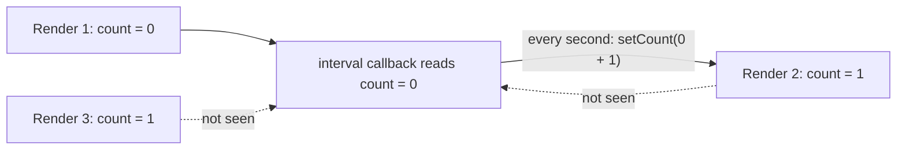

## Introduction

You build a chat widget. When it mounts, it subscribes to a WebSocket and, for every incoming message, shows a notification that includes the current user's display name. The user changes their display name in settings. The widget's header updates instantly — but the notifications keep showing the *old* name. Nothing throws, nothing logs an error, and reloading the page "fixes" it.

That is a **stale closure**: a function that is still in use, still being called, but is reading variables that belong to an *earlier* state of the program. The WebSocket callback was created once, when the widget mounted, and it closed over the display name from that moment. The program has since produced a newer display name in a newer variable, but the old callback has no way to see it.

The name is a little misleading. In the language's terms, nothing is stale: the closure reads its captured variable correctly every time ([[b1-closures]]). The problem is a mismatch between **which variable the long-lived function captured** and **which variable now holds the value you care about**. Stale closures appear whenever code creates new variables on every call — which is exactly how React function components work, since every render is a new function call with new `const` state. That is why this bug is the single most common source of confusing behaviour in React effects, intervals and memoized callbacks.

This lesson shows the bug in plain JavaScript first, so you can see it is a language behaviour rather than a framework quirk, and then applies the same model to React.

## Before you start

- **Closures** — functions reference the bindings of the scope they were created in. See [[b1-closures]].
- **Bindings per call** — every call of a function creates new local variables; see the factory examples in [[b1-closures]] and the per-iteration bindings in [[b1-closures-in-loops]].
- **For the React section:** components, `useState` and `useEffect`. See [[b4-usestate]], [[b4-useeffect]] and [[b4-state-snapshots]].
- **Timers** — `setInterval` keeps calling the same callback function until cleared. See [[b1-setinterval]].

Plain JavaScript examples run in Node.js 22; React examples assume React 19.

## The intuition

You put up a billboard and a photographer takes a picture of it. Next week you repaint the billboard. If someone asks the photographer what the billboard says, they look at the photo in their bag and tell you last week's message.

Here the billboard is not one surface that gets repainted — that would be a single mutated variable, and a closure watching it would always be up to date. Instead, every update puts up a **new billboard** next to the old one. The photographer still has a photo of the first billboard, which never changed. Nothing is wrong with the photo; it is simply of the wrong billboard.

That distinction is the whole lesson:

| Situation | What the closure captured | Result |
|---|---|---|
| One `let` that the program keeps reassigning | The variable that receives every update | Always current (live) |
| A new variable created by each call or render | The variable from one specific call | Frozen at that call's value (stale if you wanted the latest) |

## A stale closure in plain JavaScript

Here is the bug with no framework at all. A function is called repeatedly — think of it as "render" — and on its first call only, it registers a listener:

```javascript title="stale-listener.mjs"
const listeners = new Set();
let subscribed = false;

function renderGreeting(props) {
  const name = props.name;               // a new binding on every call
  if (!subscribed) {                     // subscribe only once
    listeners.add(() => console.log(`notification for ${name}`));
    subscribed = true;
  }
  return `<p>Hello, ${name}</p>`;
}

console.log(renderGreeting({ name: 'Ada' }));
console.log(renderGreeting({ name: 'Grace' }));

for (const listener of listeners) listener();   // an event arrives later
```

```output
<p>Hello, Ada</p>
<p>Hello, Grace</p>
notification for Ada
```

The second call rendered `Grace` correctly, but the notification says `Ada`. Walk through the bindings:

1. Call 1 creates `name₁ = 'Ada'` and a listener whose closure refers to `name₁`.
2. Call 2 creates a *different* binding `name₂ = 'Grace'`. It does not touch `name₁`, and it does not register a new listener.
3. The event fires. The only listener reads `name₁`, which is still `'Ada'` — correctly, from the language's point of view.

Compare this with a closure over one long-lived variable that is updated in place:

```javascript title="live-binding.mjs"
function createGreeter() {
  let name = 'Ada';                       // one binding for the greeter's whole life
  const notify = () => `notification for ${name}`;
  const rename = (next) => { name = next; };
  return { notify, rename };
}

const greeter = createGreeter();
greeter.rename('Grace');
console.log(greeter.notify());
```

```output
notification for Grace
```

`notify` and `rename` share one `name`, so the update is visible. The difference between the two programs is not the closure; it is whether updates **reassign the captured variable** or **create a new one**.

## The four ways to fix it

Every fix for a stale closure makes the long-lived code read from the place where the latest value actually lives. There are four ways to do that.

### 1. Resubscribe when the value changes

Replace the old function with a new one created from the latest values. The old closure is discarded, so its old bindings no longer matter:

```javascript title="resubscribe.mjs"
const listeners = new Set();
let current = null;

function renderGreeting({ name }) {
  if (current) listeners.delete(current);          // remove the old closure
  current = () => console.log(`notification for ${name}`);
  listeners.add(current);                          // add one over the new name
  return `<p>Hello, ${name}</p>`;
}

renderGreeting({ name: 'Ada' });
renderGreeting({ name: 'Grace' });
for (const listener of listeners) listener();
```

```output
notification for Grace
```

This is what React's dependency array does: when a listed value changes, React runs the old effect's cleanup and runs the effect again, creating a fresh closure. The cost is the churn of tearing down and recreating the subscription.

### 2. Read from a mutable box

Keep one long-lived object, and have the long-lived function read a property of it at call time. Each update writes the latest value into the box:

```javascript title="ref-box.mjs"
const listeners = new Set();
const latest = { current: null };                  // one object for the whole lifetime
let subscribed = false;

function renderGreeting({ name }) {
  latest.current = name;                           // keep the box up to date
  if (!subscribed) {
    listeners.add(() => console.log(`notification for ${latest.current}`));
    subscribed = true;
  }
  return `<p>Hello, ${name}</p>`;
}

renderGreeting({ name: 'Ada' });
renderGreeting({ name: 'Grace' });
for (const listener of listeners) listener();
```

```output
notification for Grace
```

The listener still closes over an old binding — `latest` — but that binding points to the same object forever, and the object's property is updated. This is exactly how React's `useRef` works.

### 3. Pass the latest value in, instead of reading it from the closure

If whoever calls the function knows the latest value, let it pass that value as an argument. A function that receives its inputs has nothing to go stale. React's functional state update `setCount((c) => c + 1)` is this pattern: React passes the latest state to your updater.

### 4. Read from the source of truth at call time

If the value lives somewhere globally reachable — a store, a getter such as `store.getState()`, the DOM — call it inside the function instead of capturing a copy. The closure then captures the *getter*, which never changes.

### Stale data after `await`

Asynchronous functions produce a related problem. A value read before an `await` belongs to the moment it was read; by the time the function resumes, the world may have moved on:

```javascript title="await-stale.mjs"
let selectedUserId = 1;
const delay = (ms) => new Promise((resolve) => setTimeout(resolve, ms));

async function loadProfile() {
  const id = selectedUserId;                       // read before waiting
  await delay(10);                                 // the user clicks elsewhere meanwhile
  return `showing profile ${id} (selected is now ${selectedUserId})`;
}

const pending = loadProfile();
selectedUserId = 2;
console.log(await pending);
```

```output
showing profile 1 (selected is now 2)
```

Whether this is a bug depends on intent. If the function should finish the job the user asked for, using `id` is correct. If it should only show the profile that is *currently* selected, it must check again after the `await` and discard outdated results — the race-condition handling taught in [[b1-stale-requests]].

```quiz
Q: A function is called on every update and creates `const value = props.value`. On its first call only, it registers a callback that logs `value`. After three updates, what does the callback log?
- [ ] The latest value, because closures read live bindings
- [x] The first value, because the callback captured the binding from the first call and later calls created new bindings
- [ ] undefined, because the first call's scope was destroyed
- [ ] It throws, because the binding is const
> Closures do read live bindings — but the callback's binding is the first call's const, which never changes. Each later call created its own new const that the callback cannot see. The first call's scope is kept alive by the callback, so nothing is undefined.
```

## Closures in React {#b1-closures-react}

**Closures in React** means applying the rules above to function components. A React function component is a plain JavaScript function that React calls every time it needs to render. Each call creates new local constants — props, state values from `useState`, derived values — and new function objects for every handler and effect defined inside. Those functions close over **that render's** values. Most of the time this is exactly what you want. When one of those functions outlives its render — an interval, a subscription, a memoized callback — and keeps being called after newer renders have happened, it is a stale closure.

### Every render has its own values

```jsx title="Counter.jsx"
import { useState } from 'react';

export function Counter() {
  const [count, setCount] = useState(0);

  function handleClick() {
    setCount(count + 1);
    setCount(count + 1);
    setCount(count + 1);
  }

  return <button onClick={handleClick}>Clicked {count} times</button>;
}
```

Clicking the button once shows `Clicked 1 times`, not `3`. Inside one render, `count` is a `const` — for the first render it is `0`, and `handleClick` closes over that `0`. All three calls ask React to set the state to `0 + 1`. The next render is a new call of `Counter` with a new `count` equal to `1` and a new `handleClick` that closes over it. React's documentation calls this **state as a snapshot** ([[b4-state-snapshots]]). The fix when you need to build on the latest value is the functional update, `setCount((c) => c + 1)`, which receives the up-to-date state as an argument ([[b4-usestate-functional-updates]]).

Snapshot semantics are often *correct*. Consider a handler that waits and then reports:

```jsx title="SendButton.jsx"
function SendButton({ recipient }) {
  async function handleSend() {
    await sendMessage(recipient);
    showToast(`Sent to ${recipient}`);   // the recipient at the moment of the click
  }
  return <button onClick={handleSend}>Send</button>;
}
```

If the parent switches to a different recipient while the request is in flight, the toast still names the person the message was actually sent to. The closure preserved the values that belong to the user's action. Older class components read `this.props.recipient` after the `await` and would have shown the *new* recipient — a real bug that function components avoid because of closures.

### The stale interval

The problem appears when a function created in one render keeps running after later renders:

```jsx title="Ticker.jsx"
import { useEffect, useState } from 'react';

export function Ticker() {
  const [count, setCount] = useState(0);

  useEffect(() => {
    const id = setInterval(() => {
      setCount(count + 1);               // count is always 0 here
    }, 1000);
    return () => clearInterval(id);
  }, []);                                // effect runs once, after the first render

  return <p>{count}</p>;
}
```

The screen shows `1` after the first second and then stays at `1` forever. The empty dependency array tells React to run the effect only after the first render. The interval callback was created in that render, so it closes over the first render's `count`, which is `0`. Every second it calls `setCount(0 + 1)`. React does re-render after the first tick, and the new render has `count === 1`, but that render's values never reach the interval: the interval is still holding the first render's function.



The four fixes from the plain JavaScript section map directly onto React tools.

**Functional update (pass the value in).** The callback no longer needs `count` at all:

```jsx
useEffect(() => {
  const id = setInterval(() => setCount((c) => c + 1), 1000);
  return () => clearInterval(id);
}, []);
```

This is the best fix here: the interval is created once and the counter climbs `1, 2, 3...`. Use it whenever the new state depends only on the old state.

**Declare the dependency (resubscribe).** List `count` in the dependency array:

```jsx
useEffect(() => {
  const id = setInterval(() => setCount(count + 1), 1000);
  return () => clearInterval(id);
}, [count]);
```

This works: every time `count` changes, React clears the old interval and starts a new one over the new `count`. The cost is that the timer restarts on every change — if `count` were also changed by a button, each click would reset the one-second rhythm. Dependency arrays are covered in [[b4-effect-dependencies]] and cleanup in [[b4-effect-cleanup]].

**Read from a ref (mutable box).** When an effect must stay subscribed but needs the latest value of something it does not want to depend on, keep that value in a ref:

```jsx title="useInterval.js"
import { useEffect, useRef } from 'react';

export function useInterval(callback, delay) {
  const savedCallback = useRef(callback);

  useEffect(() => {
    savedCallback.current = callback;      // after each commit, point at the latest callback
  });

  useEffect(() => {
    const id = setInterval(() => savedCallback.current(), delay);
    return () => clearInterval(id);
  }, [delay]);
}
```

`useRef` returns the same object on every render, so the interval's closure over `savedCallback` never goes stale; it reads `.current` each tick, and the first effect keeps `.current` pointing at the most recent render's callback. The ref is updated inside an effect rather than during rendering because React expects rendering to be pure — writing refs during render can misbehave with concurrent rendering. See [[b4-useref]] and [[b4-mutable-ref-values]].

**`useEffectEvent` (React 19.2 and later).** React 19.2 made stable a hook designed for exactly this situation: logic called from inside an effect that should always see the latest props and state but should *not* cause the effect to re-run.

```jsx title="ChatRoom.jsx"
import { useEffect, useEffectEvent } from 'react';

function ChatRoom({ roomId, displayName }) {
  const onMessage = useEffectEvent((message) => {
    showNotification(`${displayName}: new message`, message);   // always the latest name
  });

  useEffect(() => {
    const connection = connect(roomId);
    connection.on('message', (msg) => onMessage(msg));
    return () => connection.disconnect();
  }, [roomId]);                            // reconnect only when the room changes
}
```

This is the chat widget from the introduction, fixed. Changing `displayName` does not reconnect, yet notifications use the new name. An Effect Event may only be called from inside effects (not during rendering, not passed to other components) and is deliberately left out of the dependency array. On React versions before 19.2, use the ref pattern instead. The general guidance on separating event-like logic from effects is in [[b4-events-vs-effects]].

### Stale `useCallback` and `useMemo`

Memoisation hooks keep a function or value from an earlier render on purpose, and that is the same mechanism as a stale closure:

```jsx
const handleSave = useCallback(() => {
  saveDraft(draftText);                    // draftText from the render that created this
}, []);                                    // missing dependency: saves the first draft forever
```

With an empty dependency array, `useCallback` returns the function from the first render on every later render, so it saves the initial `draftText`. The fix is to list `draftText` as a dependency, which makes React hand out a new function whenever the text changes. When a stable identity truly matters (for example, a memoised child that should not re-render on every keystroke), combine a ref or a functional update rather than lying about dependencies. See [[b4-usecallback]].

### Letting the linter find them

The `react-hooks/exhaustive-deps` rule from `eslint-plugin-react-hooks` reports every value an effect, `useCallback` or `useMemo` reads but does not list. Most stale closures in React are caught by keeping this rule on and treating its warnings as bugs. When the rule's suggestion would cause unwanted re-runs, that is the signal to use a functional update, a ref or `useEffectEvent` — not to silence the rule.

> [!NOTE] Strict Mode does not cause or cure stale closures
> In development, Strict Mode mounts, unmounts and remounts components to surface missing cleanups ([[b4-strict-mode-double-run]]). That can make interval bugs look different during development, but the stale closure itself comes from the dependency array, not from Strict Mode.

## In real systems

Stale closures cluster around anything that **subscribes once and is called many times**:

- **Intervals and polling** that read state to build the next request.
- **WebSocket, `EventSource` and message-bus handlers** registered in a mount effect.
- **Global listeners** — `window.addEventListener('keydown', ...)` or `resize` — added once in an effect and reading component state.
- **Third-party widgets** (maps, charts, editors) that take callbacks at construction time and never accept new ones.
- **Debounced or throttled functions** created once with `useMemo` or `useRef`; the debounced wrapper keeps calling the inner function from the render that created it ([[b1-debounce]]).
- **Promise chains and `async` handlers** that use values after an `await`.

Outside React the same bug appears in any code that rebuilds values on every call while keeping old callbacks: server middleware that captures configuration at startup and never sees a reloaded config, or a module that caches a function created with an old feature-flag value.

## Trade-offs and alternatives

| Fix | Keeps the subscription | Sees latest values | Cost |
|---|---|---|---|
| Functional update | Yes | Only the state passed in | Works only for state derived from previous state |
| Dependency array (resubscribe) | No — recreated on change | Yes | Teardown and setup on every change; timers reset |
| Ref holding the latest value | Yes | Yes | Manual bookkeeping; refs do not trigger renders |
| `useEffectEvent` (React 19.2+) | Yes | Yes | Only callable from effects |
| Read from an external store at call time | Yes | Yes | Needs the value to live outside the component |

Prefer the functional update when it fits, then the dependency array when re-subscribing is cheap and harmless, and reach for refs or `useEffectEvent` when the subscription is expensive (a socket, a third-party widget) or must not restart.

## Common mistakes

> [!MISTAKE] Silencing the dependency linter
> Adding `// eslint-disable-next-line react-hooks/exhaustive-deps` to make a warning go away usually turns a visible warning into an invisible stale closure. Restructure the code with a functional update, a ref or an Effect Event instead.

**Believing the closure "copied" the old value.** It did not; it is reading a binding from an old render or call. Understanding that tells you the fix: read from a binding that receives updates.

**Updating a ref during render.** `ref.current = value` in the component body works most of the time but breaks React's purity rules and can expose values from renders that were never committed. Update the ref in an effect.

**Adding dependencies to an effect that must not restart.** Listing a frequently changing value can turn "subscribe once" into "reconnect on every keystroke". Move the value out with `useEffectEvent` or a ref.

**Assuming every old value is a bug.** A handler that finishes a user's action with the values from the moment of that action is behaving correctly. Decide whether you want the value *at the time of the event* or *the latest value*, and write code for that choice.

## Interview perspective

> [!INTERVIEW] Explaining the stale interval
> "The effect runs once, so the interval callback is created in the first render and closes over that render's `count`, which is zero. Later renders create new `count` constants, but the interval keeps calling the original function, so it keeps setting the count to one. I'd use `setCount(c => c + 1)` so the callback doesn't need `count`. If I needed to read other changing values, I'd store them in a ref or use `useEffectEvent`."

Questions to prepare:

- **What is a stale closure?** A function that outlives the call or render that created it and keeps reading that call's variables after newer ones exist.
- **Why do function components have this problem when classes mostly did not?** Each render is a new call with new `const` state; class methods read `this.state`, a mutable property, at call time — which had the opposite problem of seeing values newer than the event.
- **How does `useRef` fix it?** The ref object is the same on every render, so a closure over it never goes stale; the latest value is written to `.current`.
- **When is a dependency array the wrong fix?** When re-running the effect is expensive or resets behaviour, such as reconnecting a socket or restarting a timer.
- **Write a `useInterval` hook.** Store the callback in a ref updated by an effect; create the interval in a second effect that depends only on the delay.

## Practice

1. Write a plain JavaScript `createStore()` with `getState`, `setState` and `subscribe`. Show a subscriber that goes stale by capturing a state value, then fix it by calling `getState()` inside the subscriber.
2. In React, build a component that logs the current text of an input every five seconds without restarting the interval on every keystroke. Solve it once with a ref and once with `useEffectEvent`.
3. Take the `Ticker` component and add a "Reset" button. Explain why the `[count]` dependency fix would make resets interact badly with the timer, and pick a better fix.
4. A `useCallback` handler passed to a memoised list saves stale data. Fix it two ways and compare how often the list re-renders.
5. Write an async search function that ignores results for queries that are no longer the latest. Explain which values it reads before and after the `await`.

## Quick revision {#quick-revision}

- Stale closure: a long-lived function reading variables from an old call/render after newer variables exist.
- Closures are live over *their* binding; staleness comes from updates creating *new* bindings.
- One reassigned `let` → closures stay current. New `const` per call/render → old closures see old values.
- Four fixes: resubscribe with new values; read a mutable box (ref); pass the value in (functional update); read the source of truth at call time.
- React: every render is a function call with its own props, state and handlers ("state as a snapshot").
- `useEffect(..., [])` + interval reading `count` → stuck at the first render's `count`.
- Fixes: `setCount(c => c + 1)`; `[count]` deps (restarts the timer); `useRef` updated in an effect; `useEffectEvent` (stable in React 19.2).
- `useCallback`/`useMemo` with missing deps return functions/values from old renders.
- Keep `react-hooks/exhaustive-deps` on; do not silence it.
- Values from the moment of an event are sometimes exactly right — decide which you want.

## Key takeaways {#key-takeaways}

- A stale closure is not a broken closure; it is a correct closure over the wrong binding.
- The bug appears whenever a function is created once but the values it needs are recreated on every call, as in React renders.
- Fix it by making the long-lived code read from where the latest value lives: a fresh subscription, a ref, an argument, or a store.
- In React, prefer functional updates, then honest dependency arrays, then refs or `useEffectEvent` for subscriptions that must not restart.
- Closures freezing a render's values is also a feature: it keeps asynchronous handlers consistent with the user's action.
